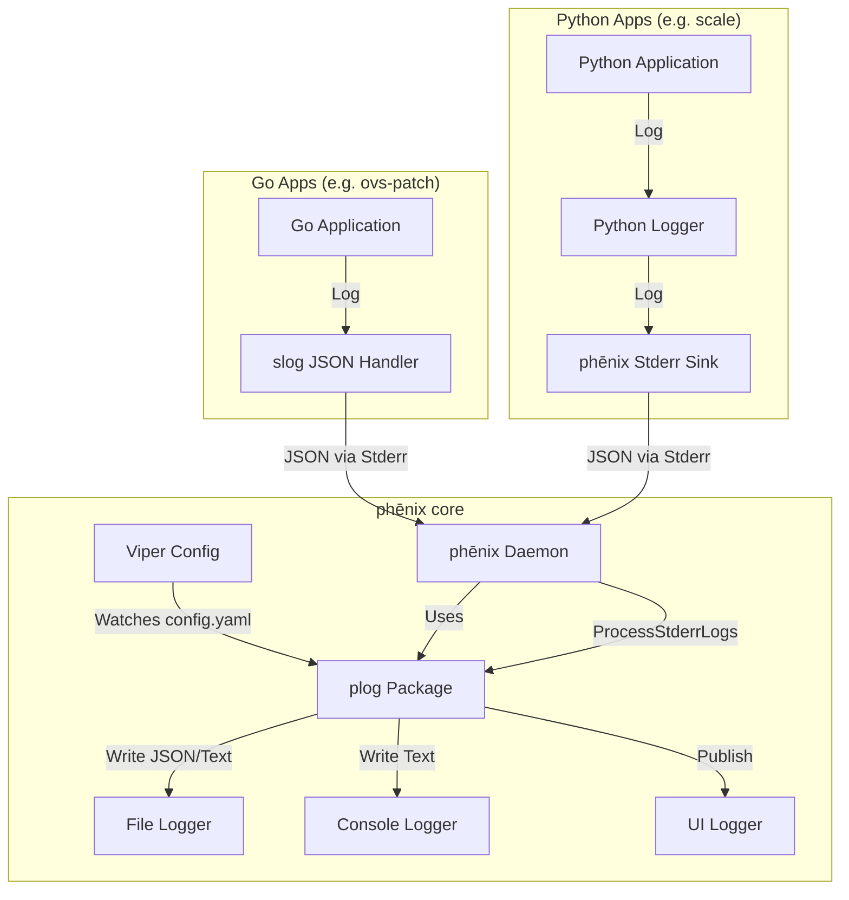

## phēnix

[](https://github.com/sandialabs/sceptre-phenix/actions/workflows/packages.yml)
[](LICENSE)

phēnix is an automated experimentation, emulation, and orchestration platform.

## 📖 Overview

phēnix provides a framework for defining, deploying, and managing complex cyber experiments. It orchestrates virtual machines, networks, and applications to create realistic emulation environments.

> [!NOTE]
> For full documentation, visit [phenix.sceptre.dev](https://phenix.sceptre.dev).
> The documentation source lives in [`docs/`](docs/); see
> [Contributing](.github/CONTRIBUTING.md#documentation) to build and preview it locally.

## 🚀 Getting Started

### Prerequisites

* Linux environment (Ubuntu 24.04+ recommended)
* Docker & Docker Compose

### Running with Docker (Preferred)

The easiest way to get phēnix running is using Docker.

> [!TIP]
> You can skip building locally by pulling the latest image from the container registry:
>
> ```bash
> docker pull ghcr.io/sandialabs/sceptre-phenix/phenix:main
> ```

> [!IMPORTANT]
> currently the main image available on GHCR defaults to having UI authentication disabled. If you want to enable authentication, you'll need to build the image yourself, setting the PHENIX_WEB_AUTH=enabled Docker build argument. See [issue #4](https://github.com/sandialabs/sceptre-phenix/issues/4) for additional details.

To build the phēnix container image from source (does not require installing local dependencies):

```bash
make docker
```

The compose file checks the `phenix` container's health with `phenix healthcheck`, which probes the server's `/healthz` endpoint; `docker exec phenix phenix healthcheck --ready` also checks minimega, the store and free disk space. See [Health Checks](https://phenix.sceptre.dev/latest/health/).

`docker exec phenix phenix doctor` checks the configuration without the server: it prints the phēnix and minimega versions and the environment, each setting with where its value came from (secrets redacted), then the checks of config file syntax and keys, the config files found and the one `phenix settings set` writes, environment variables, the settings every command reads, the store, log and base directories, the store file's format and owner, what `phenix ui` reads at startup (sign-in, users, TLS, listen endpoints and the unix socket), the version and modes of a running `phenix ui`, minimega with its files directory, base directory and mesh, the host tools phēnix runs, free disk space, and the optional features, and a summary with a hint per failure. `--skip` leaves out a check or group, `--strict` fails on warnings, `-x` leaves out the settings, and `--report` prints it all in a block to paste into a bug report. See [Checking the Configuration](https://phenix.sceptre.dev/latest/settings/#checking-the-configuration).

### Native Installation (.deb)

As an alternative to running phēnix using Docker, you can build a native Debian package (`.deb`) which installs the binaries and dependencies directly onto your system.

```bash
./scripts/build-deb.sh
```

Once the build is complete, you can install the generated package:

```bash
sudo apt install ./build/deb/phenix_<version>_amd64.deb
```

Each [GitHub release](https://github.com/sandialabs/sceptre-phenix/releases) also attaches the `.deb` and SPDX JSON software bills of materials (SBOMs) of it and of the phenix and JIT UI container images.

### Shell Completion

phēnix supports shell completion (tab-completion) for Bash, Zsh, Fish, and PowerShell.

> [!IMPORTANT]
> **Docker Users:** If you are running phēnix via Docker, standard shell aliases (e.g., `alias phenix='docker exec ...'`) will break completion due to TTY allocation issues. You **must** install the wrapper script:
>
> ```bash
> # This command installs the `scripts/phenix-wrapper.sh` script to /usr/local/bin/phenix.
> make install-wrapper
> ```

Once the wrapper is installed (and any existing aliases removed), enable completion by sourcing the script in your shell profile (e.g., `~/.bashrc` or `~/.zshrc`):

```bash
# Bash (requires the bash-completion package)
source <(phenix completion bash)

# Zsh (load compinit first, e.g. `autoload -U compinit && compinit`)
source <(phenix completion zsh)
```

### Deploy a Topology Directory

`phenix workflow apply` deploys a topology directory through the running `phenix ui` server's unix socket. The directory can hold `phenix-configs/` (topology, scenario and other configs), `phenix-injects/` (files to inject into VMs, copied to `/phenix/injects/<name>`) and `phenix.yml` (the workflow config, which creates, updates or restarts the experiment). `<name>` is the directory's name unless `-b` sets it, and `${BRANCH_NAME}` in the configs expands to it. The server dry-runs every config and the workflow config before anything changes:

```bash
# Validate everything and log the plan; change nothing
phenix workflow apply /phenix/topologies/helloworld -n

# Deploy it; a bare name is looked up under base-dir.topologies
phenix workflow apply helloworld

# Allow restarting the experiment if it's already running
phenix workflow apply helloworld -f

# Docker Compose: the socket is inside the phenix container
docker exec phenix phenix workflow apply /phenix/topologies/helloworld -f
```

See [Workflow](https://phenix.sceptre.dev/latest/workflow/) for the directory layout, the `phenix.yml` reference, more examples and the REST API.

## 🛠️ Local Development

If you wish to build and run the services locally without Docker, follow these steps.

### Prerequisites

* Go 1.24+ (for core development)
* Python 3.12+ (for app development)
* Node.js 24+ & npm (for UI development)
* Protoc 3.12+ (for Protocol Buffers generation)

To install the required system packages on Ubuntu:

```bash
sudo apt update
sudo apt install -y protobuf-compiler python3 python3-pip python3-venv
```

For Go 1.24+, follow the [official installation instructions](https://go.dev/doc/install).

For Node.js, the simplest way to get (and stay on) the right version is
[nvm](https://github.com/nvm-sh/nvm):

```bash
curl -o- https://raw.githubusercontent.com/nvm-sh/nvm/v0.40.3/install.sh | bash
nvm install 24
```

The UI source tree has a `.nvmrc`, so `nvm use` (or `nvm install`) run from
`src/js` selects the correct Node version automatically. UI dependencies are
installed with `npm ci` from `src/js` (one-off tools like `prettier` can be
run with `npx` without a global install).

On older Ubuntu releases (<24.04), Python 3.12+ will need to be manually installed and pointed to with `SYSTEM_PYTHON`:

```shell
sudo apt install -y software-properties-common
sudo add-apt-repository -y ppa:deadsnakes/ppa
sudo apt install python3.12 python3.12-venv

SYSTEM_PYTHON=/usr/bin/python3.12 make install-dev
```

### Makefile

We use a `Makefile` to standardize development tasks. Run `make help` to see all available targets.

```bash
# Development
make all         # Run all tools (lint, test, build examples)
make check       # Run linters without fixing (for CI)
make check-generated # Check that `make generate` is reproducible and writes only ignored files
make generate    # Generate Go code (protobuf, mocks, RBAC policy) and the API reference
make api-docs    # Render the API reference served at /docs/ (src/go/web/public/docs/index.html)
make lint        # Run linters and formatters, fixing issues in place
make test        # Run unit tests

# Build
make build       # Build the UI, the API reference and the main phenix binary
make deb         # Build the phenix .deb package
make docker      # Build the phenix docker image
make tunneler    # Build phenix-tunneler binaries

# Installation
make install-dev # Install development and build dependencies

# Cleanup
make clean       # Clean build artifacts
```

The `phenix-tunneler serve` command can provide a local web interface for
listing and managing listeners. It is disabled by default; enable it with
`--web-listen 127.0.0.1:8080`. The address can be changed with that option.

### Build

To build the phēnix core services locally:

```bash
git clone https://github.com/sandialabs/sceptre-phenix.git
cd sceptre-phenix
make build
```

`make build` also renders the API reference that `bin/phenix` serves at
`/docs/`, with the Redocly CLI version pinned in `scripts/api-docs.sh`. That
step runs `npx` and needs network access the first time; pass
`SKIP_API_DOCS=1` to build offline without it, and `SKIP_UI=1` to reuse an
existing UI build in `src/js/dist`.

## Logging & Configuration

phēnix features a centralized, structured, and dynamic logging system. This system aggregates logs from the core daemon, internal Go services, and external Python/Go user applications into a unified stream that can be routed to files, the console, and the web UI.

### 🏗️ Architecture

The logging architecture is designed to be **centralized**. The phēnix core acts as the aggregator.



### ⚙️ Configuration

Logging settings are managed via the `phenix settings` command, which modifies the `config.yaml` file. Changes are applied **dynamically** (hot-swapped) without restarting the service.

#### Settings Reference

| Setting Key | Environment Variable | Default | Description |
| :--- | :--- | :--- | :--- |
| `experiment.disk-check` | `PHENIX_EXPERIMENT_DISK_CHECK` | `error` | What a start does when a VM disk image or CD-ROM image is missing, or its backing chain is broken: `error` refuses the start, `warn` starts with a warning, and `off` does not check. |
| `log.level` | `PHENIX_LOG_LEVEL` | `info` | Global log verbosity (`debug`, `info`, `warn`, `error`). |
| `color` | `PHENIX_COLOR` | `auto` | When phēnix colors its output: statuses in tables, `phenix doctor` rows, warnings and errors. `auto` colors only a terminal, and not when `NO_COLOR` is set or `TERM` is `dumb`. `on` and `off` ignore both variables. JSON and YAML output never have color. phēnix refuses another value. |
| `log.console` | `PHENIX_LOG_CONSOLE` | `stderr` | Destination for console logs (`stderr`, `stdout`, or a file path). Uses **Text/Human-Readable** format. Note: Setting this to a file path will prevent console logs from appearing in `docker logs`. |
| `log.system.path` | `PHENIX_LOG_SYSTEM_PATH` | `/var/log/phenix/phenix.log` | Path to the persistent system log file (used by UI). Uses **JSON** format. This is independent of `log.console` and is always active. |
| `log.system.max-size` | `PHENIX_LOG_SYSTEM_MAX_SIZE` | `100` | Max size in MB before rotation. |
| `log.system.max-backups` | `PHENIX_LOG_SYSTEM_MAX_BACKUPS` | `3` | Number of old log files to retain. |
| `log.system.max-age` | `PHENIX_LOG_SYSTEM_MAX_AGE` | `90` | Max age in days to retain old logs. |
| `ui.logs.level` | `PHENIX_UI_LOGS_LEVEL` | `""` | Log level for the web UI stream (defaults to `log.level`). |
| `ui.logs.minimega-path` | `PHENIX_UI_LOGS_MINIMEGA_PATH` | `""` | Path to the minimega log file to display in the UI and offer for download on the Logs page. **(Restart Required)** |
| `ui.netflow.max-size` | `PHENIX_UI_NETFLOW_MAX_SIZE` | `100` | Maximum size in megabytes of each recorded netflow capture; `0` does not record captures. **(Restart Required)** |
| `base-dir.injects` | `PHENIX_BASE_DIR_INJECTS` | `<base-dir.phenix>/injects` | Directory that `phenix workflow apply` stages a topology directory's `phenix-injects/` into, as `<base-dir.injects>/<name>`. The `phenix ui` server's value is used unless `--base-dir.injects` is given. Use an absolute path. **(Restart Required)** |
| `base-dir.topologies` | `PHENIX_BASE_DIR_TOPOLOGIES` | `<base-dir.phenix>/topologies` | Directory where `phenix workflow apply NAME` looks for `NAME` when it isn't an existing path. Use an absolute path. |

#### Configuration Precedence

phēnix resolves each setting in the following order (highest to lowest):

1. **Command Line Flags**: Arguments passed directly to the binary (e.g., `phenix ui --log.level=debug`).
2. **Environment Variables**: Variables like `PHENIX_LOG_LEVEL`.
3. **Config File**: Settings defined in `config.yaml` (managed via `phenix settings set`).
4. **Defaults**: Internal application defaults.

> [!NOTE]
> An environment variable, such as one set in Docker Compose, overrides a value that `phenix settings set` writes to the config file. Unset the variable to use the file's value; `phenix doctor` warns about each such override.

#### Managing Settings

> [!TIP]
> Use `phenix settings set` to change configuration on the fly.

```bash
# View all current runtime settings
phenix settings list

# Change log level to debug
phenix settings set log.level debug

# Revert a setting to default
phenix settings unset log.level

# Reset all settings
phenix settings unset --all
```

### 👨‍💻 Developer Guide

> [!TIP]
> Check out the [Example Applications](examples/README.md) for complete, runnable reference implementations in Go and Python.

#### The Logging Contract

All applications (Go or Python) running under phēnix must adhere to the following contract to ensure their logs are correctly parsed and displayed in the UI:

1. **Output**: Logs must be written to `stderr`.
2. **Format**: Logs must be single-line **JSON** objects.
3. **Required Fields**:
    * `level`: `DEBUG`, `INFO`, `WARN`, `ERROR`
    * `msg`: The log message string.
    * `time`: Timestamp (RFC3339 or similar).
4. **Optional Fields**:
    * `traceback`: For exceptions/panics (string).

#### Python Apps

Use the `phenix_apps.common.logger`. It is pre-configured to output JSON to stderr.

> [!IMPORTANT]
> For fatal errors, **raise an exception** (e.g., `ValueError`, `RuntimeError`) instead of calling `sys.exit(1)`. The `AppBase` class wraps execution in a try/except block and will automatically catch the exception, log the traceback as structured JSON, and exit cleanly.

```python
from phenix_apps.common.logger import logger

def my_func():
    try:
        logger.bind(custom_field="value").info("Starting operation")
        # ... code ...
    except Exception:
        # Automatically captures traceback and formats as JSON
        logger.exception("Operation failed")
```

#### Go Apps

Use `log/slog` with a JSON handler.

```go
import (
    "log/slog"
    "os"
)

func main() {
    logger := slog.New(slog.NewJSONHandler(os.Stderr, nil))
    slog.SetDefault(logger)

    slog.Info("Application started", "app", "my-app")
}
```

#### phēnix Core

Use the `phenix/util/plog` package.

```go
import "phenix/util/plog"

func MyFunc() {
    // Always provide a LogType enum
    plog.Info(plog.TypeSystem, "System initialized", "version", "1.0")
}
```

Web handlers log security-relevant actions (capture access, consoles, disk
changes, file deletion, ...) as `AUDIT` records with ECS fields through
`phenix/web/audit`. These always reach the system log file, whatever
`log.level` is; see [Audit Events](docs/content/logging.md#audit-events).

### 🧠 Decision Log

| Decision | Reasoning |
| :--- | :--- |
| **Wrapper (`plog`)** | We needed to enforce the `LogType` field for UI filtering and handle multiplexing to files/sockets, which raw `slog` doesn't do out-of-the-box. |
| **JSON on Stderr** | `stderr` is the standard channel for container/process logs. JSON allows the core to parse, filter, and reformat logs from child processes without complex regex. |
| **Viper + fsnotify** | Allows for "hot-swapping" configuration (like log levels) without restarting the daemon, critical for debugging live experiments. |
| **`settings` vs `settings db`** | Separated the legacy BoltDB settings (business logic) from the new runtime configuration (system behavior) to avoid confusion. |

### ⚠️ Gotchas & Troubleshooting

* **Do NOT delete `config.yaml`**: If you delete the config file while phēnix is running, the file watcher breaks. Use `phenix settings unset --all` instead.
* **Tracebacks**: In Python, standard `print(e)` or `traceback.print_exc()` writes raw text to stderr, which breaks the JSON parser. Always use `logger.exception()`.
* **Timestamps**: Ensure timestamps are consistent. The core now enforces `2006-01-02 15:04:05.000` format for file logs for easier reading.

### 🌐 HTTP Request Logging

To view detailed HTTP request logs (method, path, status, duration), start the UI with the `--log-requests` flag

## 🤝 Contributing

Please refer to [CONTRIBUTING.md](.github/CONTRIBUTING.md) for details on our code of conduct, and the process for submitting pull requests.

## 📄 License

This project is licensed under the terms of the [LICENSE](LICENSE) file.
