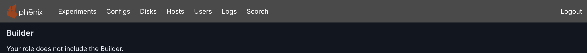

# Administration

This page is for phēnix administrators. Every phēnix server has Builder,
and roles control who can use it.

## Permissions

The permission `builder` `use` gives a user Builder. With it, a user
reads and changes every draft and the three libraries. Drafts have no
owner. A draft records who created and last changed it, for information
only.

To give a role Builder, add this policy to it:

```yaml
- resources:
  - builder
  verbs:
  - use
```

The policy takes no resource names. `builder` `use` gives no access to
configs. With authentication disabled, all users work as `global-admin`.
Of the built-in roles, only **Global Admin** and **Builder** have
`builder` `use`.

### The Builder role

The built-in role **Builder** is for users who draw diagrams and publish
them as topologies. It holds:

- `builder` `use`.
- `configs` `list`, `get`, `create`, `update` and `delete`, on
  `Topology/*`, `Scenario/*` and `Experiment/*` only.
- `schemas` `get`, `topologies` and `scenarios` `list` and `get`,
  `experiments` `list`, `get`, `create` and `update`, and `disks` `list`.

Each time `phenix ui` starts, it makes sure that the role exists and has
`builder` `use`. It changes no other role. Add the `builder` policy to
each other role that must use Builder. Then assign roles on the
**Users** page (see [Users](../user-administration.md)).

### What each task needs

`builder` `use` alone allows all work on drafts, the libraries, the
Inspector fields, and **Upload** of a Builder document. Other tasks also
need `configs` permissions:

- An import of a stored config needs `get` on the config, and
  `topologies` or `experiments` `list` on its name.
- An import of a config file needs `get` and `create`.
- A publish needs `create` or `update` on each config that it writes.
- **Preflight** needs the permissions of each check.

[What each task needs](details/administration.md#what-each-task-needs)
lists every task.

### Example role

The example role **Topology Designer** cannot publish, import a config
file or delete a topology. It also cannot store a scenario file or create
the configs of a package. It can do all other work on drafts and the
libraries. A user with the Builder role can then publish its drafts. To
add the role:

1. Download
   [topology-designer.role.yaml](examples/roles/topology-designer.role.yaml).
2. Store it with `phenix config create`.
3. Assign it on the **Users** page.

!!! warning
    Do not use `"*/*"` in the `configs` policy of a role. It also matches
    User and Role configs, so a user could read password hashes.

phēnix copies the policies of a role into a user when you assign the role.
After you change a Role config, assign the role to its users again.

### What users without a permission see

Builder hides or disables each control that the role does not allow, and
the server checks each request. Without `builder` `use`, the navigation
bar has no **Builder** link, and `/builder` says "Your role does not
include the Builder." Without `configs` `update`, the command palette says
"Your role cannot publish diagrams." Without `disks` `list`, the checks
say that Builder does not check drive images.



## The libraries

The server keeps one template library, one layer set library and one icon
library, which all Builder users share and change. No role can change the
built-in templates, the server collections, the built-in layer set
**Purdue Model**, or the icons that phēnix added from template files.
**Duplicate** makes a copy of a read-only template or layer set that users
can change. phēnix logs each library change with the user name (see
[The libraries](details/administration.md#the-libraries)).

## Storage

Drafts, published documents and the libraries are records in the phēnix
store, not configs. `phenix config list` and the **Configs** page do not
list them. The limits are in [Limits](reference.md#limits).

When phēnix starts, and each hour, it deletes the published documents that
no topology references. It also deletes the stored documents that no draft
and no published document names. **Clean up…** in the Builder settings
does the same at once, and also deletes each draft with no change since
its last publish. It shows what it would delete and asks before it
deletes (see
[Cleaning up storage](details/administration.md#cleaning-up-storage)).

## Template files on the server

To give all users the same node templates, put template files in the
template directory of the server. When `phenix ui` starts, it reads each
file as one read-only collection. A file has the format that the
**Node Templates** tab downloads (see the example
[node-templates.yaml](examples/node-templates.yaml)).

The directory is `<base-dir.phenix>/builder/templates`, by default
`/phenix/builder/templates`. To change it, set `base-dir.builder-templates`
with the flag `--base-dir.builder-templates`, the environment variable
`PHENIX_BASE_DIR_BUILDER_TEMPLATES`, or the config file (see
[Settings](../settings.md)):

```yaml
base-dir:
  builder-templates: /etc/phenix/builder-templates
```

phēnix reads the files directly in the directory that end in `.yaml`,
`.yml` or `.json` (see [Limits](reference.md#limits)). It skips a file that
is not valid and logs a warning. It reads the directory only when it
starts, so restart `phenix ui` after you add, change or delete a file.
phēnix adds the custom icons of a file to the icon library as server
icons, when the library does not have them. No user can rename or delete a
server icon (see
[Template files on the server](details/administration.md#template-files-on-the-server)).

## The builder-doc annotation

A topology names its diagram in the `builder-doc` annotation of its
Topology config. The annotation is a map with up to three keys:
`digest`, `id` and `path`. **Publish** writes `digest` and `id`. You write
`path` yourself, for a Builder file. A topology shows the published
document that the annotation names, or else the file at `path`, or else
none (see
[Which diagram a topology shows](details/administration.md#which-diagram-a-topology-shows)).

phēnix checks the annotation each time anyone creates or updates a
Topology config, and refuses a config whose annotation is not valid (see
[The builder-doc annotation](details/administration.md#the-builder-doc-annotation)).
After a rename, or a copy of the config, phēnix deletes the `id`. Without
a `path`, it deletes the whole annotation (see
[Renaming and copying a topology](details/administration.md#renaming-and-copying-a-topology)).

## A Builder file beside a topology

A topology in a repository can keep its diagram there, as a Builder JSON
or YAML file. Name the file in the annotation:

```yaml
apiVersion: phenix.sandia.gov/v1
kind: Topology
metadata:
  name: pump-station
  annotations:
    builder-doc:
      path: /phenix/topologies/pump-station/pump-station.builder.json
```

To make such a config:

1. Open the draft in Builder, or upload the Builder file.
2. Click **Download** > **Topology YAML**.
3. Set `metadata.name`.
4. Add the annotation. Do not change the `spec`.
5. Store the config with `phenix config create`.

The **Published Diagrams** tab then lists the topology with the tag
**File**. phēnix reads the file each time someone opens the diagram, so a
`git pull` that changes the file changes the diagram. phēnix reads a file
only when all of these are true:

- The file is below the base directory, `/phenix` or the
  `base-dir.phenix` setting.
- It is outside the VM mount directory.
- It is a regular file within the size limit in [Limits](reference.md#limits).
- It holds one valid Builder document.

Otherwise, opening the diagram fails with "Could not open the diagram of
topology pump-station." and a sentence that names the path (see
[When the file cannot be used](details/administration.md#when-the-file-cannot-be-used)).

!!! warning
    The name of a topology does not protect its Builder file. A user who
    has `configs` `get`, and `create` or `update`, on any one topology name
    can store a topology there with any `path` below the base directory.
    The user can then open that file. Keep a Builder file below the base
    directory only when each such user may read it. See
    [Who can read a Builder file](details/administration.md#who-can-read-a-builder-file).

To accept one document only, add `digest` beside `path`. The digest is
the SHA-256 of the document as phēnix writes it, which the REST API gives
(see [Pinning the file with a digest](details/administration.md#pinning-the-file-with-a-digest)).

**Publish** never writes the file. It stores a published document and
writes `digest` and `id` beside the `path`. The file is out of date until
you replace it with **Download** > **Builder JSON** (see
[Editing and publishing](details/administration.md#editing-and-publishing)).

## REST API

Scripts use the same REST API as the Web-UI, under `/api/v1`. The
interactive API docs of a running server, at `/docs/`, describe each route
under the **Builder** tag (see [API](../api.md)).

Each route needs `builder` `use`, and a route that reads or writes configs
also needs the `configs` permissions of the Web-UI task. With
authentication enabled, send a token in the `X-Phenix-Auth-Token` header
as `Bearer <token>`. A refused request answers with a JSON body whose
`code` names the failure (see
[Errors of the REST API](reference.md#errors-of-the-rest-api)). The route
table and examples are in [REST API](details/administration.md#rest-api).

## More detail

- [Administration: details](details/administration.md): every permission,
  limit, store record, file rule and REST route.
- [Troubleshooting](troubleshooting.md) and
  [Troubleshooting: details](details/administration.md#troubleshooting):
  what a message means, and what to do.
- [Availability](details/administration.md#availability),
  [Response headers](details/administration.md#response-headers) and
  [Compressed files](details/administration.md#compressed-files): the
  `Content-Security-Policy` that a proxy must allow, the response headers,
  and `PHENIX_BROTLI_QUALITY`.
- [Users](../user-administration.md) and [Settings](../settings.md): roles,
  tokens and the `base-dir` settings.
