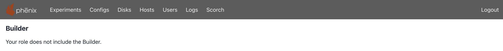

# Administration

This page is for phenix administrators.

## Availability

Each phenix server has the Builder, and no setting turns it on or off. Roles
control who can use it (see [Permissions](#permissions)). The editor is at
`/builder`, and its API is under `/api/v1/builder` (see
[REST API](#rest-api)).

Builder works over plain HTTP. For HTTPS, see `--tls-key` and `--tls-cert`
in `phenix ui --help`.

phenix sets no Content-Security-Policy on the application page. If a proxy
in front of phenix adds one, the policy must allow workers from the phenix
origin and `data:` images. The layout engine and **Auto-group** by name
pattern run in workers. Custom icons are `data:` images.

## Permissions

The permission `builder` `use` gives a user the Builder. With it, a user
reads and changes all the Builder data of the server: every draft (damaged
drafts included, see [Damaged drafts](drafts.md#damaged-drafts)), the three
libraries, and the Builder schemas that give the fields of the Inspector.

Drafts have no owner. Any Builder user can open, change and delete any
draft. A draft records who created it and who changed it last, for
information only.

To give a role the Builder, add this policy to it:

```yaml
- resources:
  - builder
  verbs:
  - use
```

The policy takes no resource names. The verb `"*"` also gives `use`.

`builder` `use` gives no access to phenix configs (see
[What each task needs](#what-each-task-needs) and
[Resource: `configs`](../user-administration.md#resource-configs)). A role
that limits topology names does not limit which Builder files its users
can read (see
[Who can read a Builder file](#who-can-read-a-builder-file)).

With authentication disabled, all users work as `global-admin`, with the
Global Admin role (see [User Authn/Authz in phenix](../user-administration.md)).
Drafts then show `global-admin` as the user who created and changed them.

Of the built-in roles, only **Global Admin** and **Builder** have `builder`
`use`. **Global Viewer** does not. Give Builder users the Builder role, or a
role such as the [example role](#example-role).

### The Builder role

The built-in role **Builder** (`builder`) is for users who draw and publish
topologies. It holds:

- `builder` `use`.
- `configs` `list`, `get`, `create`, `update` and `delete`, on `Topology/*`,
  `Scenario/*` and `Experiment/*` only. It gives no access to User, Role or
  Image configs.
- `schemas` `get`, `topologies` and `scenarios` `list` and `get`,
  `experiments` `list`, `get`, `create` and `update`, and `disks` `list`.

[Builder (`builder`)](../user-administration.md#builder-builder) shows the
role as YAML.

Each time `phenix ui` starts, it makes sure that the role exists:

- When the store has no role named `builder` and no role with the role name
  `Builder`, phenix creates the role. Thus a deleted role comes back.
- When the role exists, phenix keeps its policies. If the role has no
  `builder` `use`, phenix adds the `builder` policy to the role and to its
  users. Nothing else changes.
- phenix keeps the `builder-drafts`, `builder-icons` and
  `builder-templates` policies of an earlier version. No route checks them.

phenix does not change other roles. Add the `builder` policy to each other
role that must use the Builder. Assign a role on the **Users** page (see
[Updating Users](../user-administration.md#updating-users)).

### What each task needs

`builder` `use` alone allows these tasks: all work on drafts and snapshots,
undo and redo, the libraries, the default layer set, the Inspector fields,
and **Upload** of a Builder document from a file or pasted text. The other
tasks also need the permissions in this table.

| Task | Other permissions |
|---|---|
| See the **Published Diagrams** tab | `configs` `list` on the topologies that it lists |
| Open a published diagram, with **Open**, **Edit as a draft** or **Upload** | `configs` `get` on that topology, such as `Topology/riverside-water`. This does not protect a Builder file (see [Who can read a Builder file](#who-can-read-a-builder-file)) |
| Import a stored config | `configs` `get` on the config, and `topologies` `list` (or `experiments` `list`) on its name |
| Import a config file, or convert a legacy Builder diagram with **Upload** | `configs` `get` and `create` |
| Upload a Builder package | `configs` `get`. To create the configs that you tick, also `create` |
| Open a topology in Builder from the **Configs** page | `configs` `list`, and `get` on the topology. To import it, also `create` |
| See **Exp**, which opens the experiment of a publication | `experiments` `get` on that experiment |
| Add a stored scenario to a diagram | `configs` `list` and `scenarios` `list` |
| Store a scenario file from the **Scenarios** dialog | `configs` `create` on `Scenario/<name>`. To replace a scenario, `configs` `get` and `update` on it |
| See the apps of the diagram's scenario in the Inspector | `configs` `get` on `Scenario/<name>` |
| Download **Topology YAML** or a package | `configs` `get` |
| Use **Publish**, in the editor or on a draft card | `configs` `update` |
| Publish a topology | `configs` `create` on `Topology/<name>` for a new topology, `update` for an existing one. For a draft imported from a stored config, also `configs` `get` and `topologies` `get` (or `experiments` `get`) on that config |
| Publish an experiment | `experiments` `create` and `configs` `create` on `Experiment/<name>`. To update one, `update` of both |
| Publish a diagram that lists scenarios | `configs` `get` and `scenarios` `list` on each listed `Scenario/<name>`. It also needs `configs` `update` on each scenario whose `topology` annotation does not name the topology yet |
| Delete a published topology | `configs` `delete` on `Topology/<name>` |
| Get drive image suggestions and missing-image checks | `disks` `list` |
| Run **Preflight** checks | `configs` `get`, and for each check: **Host capacity**, `hosts` `list`. **Networks**, `hosts` `list` for the bridges, `experiments` `list` for the VLANs of running experiments (only those it can list by name), and `configs` `get` and `experiments` `get` on the named experiment. **Disk images**, `disks` `list`. **Scenario apps**, `applications` `list`, and `configs` `get` and `scenarios` `list` on each listed `Scenario/<name>`. Without its permission, a check or a part of it shows as unavailable |

Import and Publish read included topologies, such as `corp-services`, with
the `configs` `get` and `topologies` `list` permissions of the user. They
warn about an include that the user cannot read.

An import of a config file keeps each `${NAME}` and `${NAME:default}` as
written. Thus the Builder never shows the environment variables of the
server (see [Importing a config file](import-upload-download.md#importing-a-config-file)).

### The libraries

The server keeps one template library, one layer set library and one icon
library. All Builder users share them (see
[The template library](templates.md#the-template-library),
[Layer sets](diagrams.md#layer-sets) and
[Custom icons](diagrams.md#custom-icons)). `builder` `use` allows each change.

No role can change these items, Global Admin included:

- The five built-in templates, and the templates and collections of the
  [template files on the server](#template-files-on-the-server). A change
  answers 409 with the code `template.item.read-only`.
- The built-in layer set **Purdue Model** (ID `builtin:purdue`). A change or
  a delete answers 403 with the code `layerset.read-only`.
- The icons that phenix adds from template files. A rename or a delete
  answers 403.

**Duplicate** makes a copy of a read-only template or layer set that users
can change. Any Builder user can rename or delete an uploaded icon.

The server has one default layer set (see
[Layers for new diagrams](diagrams.md#layers-for-new-diagrams)). When a user
deletes it, the server has no default. A diagram
keeps its own copies of templates and layers, so a library change does not
change the diagram (see [Linked templates](templates.md#linked-templates)).

phenix logs each library change with the user name: each add, change or
delete of a template, collection or layer set, each choice of a default
layer set, and each upload, rename or delete of an icon.

### Example role

The example role **Topology Designer** cannot publish, import a config file
or delete a topology. It can do all other work on drafts and the libraries,
import stored configs, open published diagrams and download Topology YAML.
A user with the Builder role can then publish its drafts. Download it from
[topology-designer.role.yaml](examples/roles/topology-designer.role.yaml):

```yaml
apiVersion: phenix.sandia.gov/v1
kind: Role
metadata:
  name: topology-designer
spec:
  roleName: Topology Designer
  policies:
  - resources:
    - builder
    verbs:
    - use
  - resources:
    - configs
    resourceNames:
    - "Topology/*"
    - "Scenario/*"
    - "Experiment/*"
    verbs:
    - list
    - get
  - resources:
    - topologies
    - scenarios
    - experiments
    resourceNames:
    - "*"
    verbs:
    - list
    - get
  - resources:
    - disks
    resourceNames:
    - "*"
    verbs:
    - list
```

Do not use `"*/*"` in the `configs` policy. It also matches User and Role
configs, so a user could read password hashes. To let the role publish, add
`create`, `update` and `delete` to its `configs` policy.

To add the role, store it as a config, then assign it on the **Users** page:

```bash
phenix config create topology-designer.role.yaml
```

!!! note
    phenix copies the policies of a role into a user when you assign the
    role. After you change a Role config, assign the role to its users again.

### What users without a permission see

Builder hides, or makes unavailable, each control for a task in
[What each task needs](#what-each-task-needs) that the role does not allow.
The server still checks each request.

- Without `builder` `use`, there is no **Builder** link, and the **Configs**
  page has no Builder links or buttons. `/builder` shows only "Your role
  does not include the Builder." Each Builder API request answers 403.
- Without `configs` `update`, the command palette gives the reason "Your
  role cannot publish diagrams."
- Without `disks` `list`, the **Diagram checks** dialog says "The Builder
  does not check drive images, because the server did not list its disk
  images." It says the
  same when the server lists no images, for example while minimega is not
  running.



A refused request answers 403, with a message such as "deleting a Builder
draft: user bob does not have permission". A draft that does not exist answers 404.

## Storage

Drafts, published documents and the three libraries are records in the
phenix store (the `store.endpoint` setting), not configs.
`phenix config list` and the **Configs** page do not list them.

Limits:

- The server holds at most 2,000 drafts, damaged drafts included. Past it,
  `POST /builder/drafts` answers 413 with the code `draft.limit`, and a
  message that says to delete drafts or to run **Clean up**.
  `GET /builder/drafts` reports the limit as `limits.drafts`.
- A draft keeps at most 50 snapshots and 50 MiB of them. Past either limit,
  phenix deletes the oldest snapshots.
- A diagram (a Builder document) can be at most 5 MiB. It can hold at most
  50 custom icons, 50 device templates and 100 notes of its own.
- The server holds at most 2,000 icons. The built-in icons are not part of
  this limit, but the **Icons** tab counts them. An icon is a PNG of at
  most 96 × 96 pixels and 40,960 bytes.
- The template library can be at most 512 KiB, with at most 200 templates
  and 50 collections (see [Limits](templates.md#limits)).
- The layer set library holds at most 200 layer sets, and the built-in
  **Purdue Model**. A layer set has 1 to 32 layers, and a layer has at most
  16 node matchers. A request that adds or replaces a layer set can be at
  most 1 MiB, and a layer set file at most 4 MiB. A full library answers 413
  with the code `layerset.library.full`.

The libraries belong to the server. When someone deletes a user account,
its icons, templates and layer sets stay, and `createdBy` and `updatedBy`
keep the user name. The built-in templates and layer set are part of
phenix, not store records. A template library that never changed has no
record. phenix keeps the collections of its template files in memory only.

Drafts and published documents use these store namespaces:

- `builder.drafts`: one record for each draft, with its ID as the key. It
  holds the metadata of the draft and its snapshots, not the documents.
- `builder.content`: one gzip record for each document. The key is
  `drafts/` and the draft and snapshot IDs, or `published/` and the
  document ID. phenix checks the size and the sha256 digest at each read.
- `builder.published`: one record for each published document, with its ID
  as the key.

Each save, undo or redo, snapshot delete and draft delete writes all its
records in one store transaction. Thus the store never holds a draft without
its documents, or a part of a failed save. Each stored value has a small
header with its revision and times.

The libraries use these store namespaces:

- `builder.icons`: one record for each icon name, with the key `name/` and
  the name in lower case. An icon with old names has a record for each.
- `builder.templates`: one record, `library`, with all the templates and
  collections.
- `builder.layersets`: one record for each layer set, with the key `set/`
  and its ID, and the record `default` when a user chose a default set.

A publish stores a copy of the diagram that never changes, the published
document. The `builder-doc` annotation of the topology names it (see
[The builder-doc annotation](#the-builder-doc-annotation)). After a publish,
phenix deletes the older published documents of the topology that are more
than one hour old.

When anyone deletes or renames a topology, by any means, phenix deletes its
published documents. A document less than one hour old can stay for a time,
because a publish may be in progress. Deleting or renaming a topology never
reads, changes or deletes a Builder file (see
[Renaming and copying a topology](#renaming-and-copying-a-topology)).

The browser also keeps some Builder data:

- The IndexedDB database `phenix-builder` keeps changes until the server
  stores them.
- localStorage keeps preferences: `phenix.builder.theme`,
  `phenix.builder.panes`, `phenix.builder.minimap`,
  `phenix.builder.shortcuts` and `phenix.builder.settings`. The last one
  holds the Settings dialog choices, such as **Snap to grid**, and whether
  **Show connections** is on. They apply to that browser, not to the
  diagram.
- The Builder does not read `phenix.builder.layers`, the default layers of
  earlier versions. Logging out deletes the key.
- Logging out, or signing in as another user in the same browser, deletes
  the rest: unsaved changes, recent commands, the last **Auto-group** name
  pattern, the last **Preflight** checks (`phenix.builder.preflight`) and
  the collapsed sections of **Templates** (`phenix.builder.palette`). See
  [Logging out](drafts.md#logging-out).

### Cleaning up storage

When phenix starts, and each hour while it runs, it deletes the published
documents that no topology references. It also deletes the documents in
`builder.content` that no draft and no published document names. It keeps:

- what phenix stored in the last hour, because a publish or a save may still
  reference it
- every published document, when a topology cannot be read or its
  `builder-doc` annotation does not decode
- a published document that it cannot read, and its content
- every Builder file

phenix leaves a published document that it cannot read out of every list,
and logs "skipping unreadable builder published document" with the ID. A
newer phenix may have saved it. To delete it, send
`DELETE /builder/documents/{document}` with that ID. This deletes only the
record and its content, and changes no config. When the record still names
its topology, the role needs `configs` `get` and `delete` on it. Otherwise
the role needs them on `*/*`, as Global Admin has. `If-Match` must name the
tag of the stored record. Send any tag, and the 412 answer gives the tag in
its `ETag` header.

**Clean up…** in the Builder settings does the same at once. It also deletes
each draft that has no change since its last publish. For such a draft, the
current snapshot is the last one it published, no newer snapshot follows it, and
its topology still references what it published. The topology and its
published document stay. These drafts also stay:

- A draft whose topology someone deleted, or published again from another
  draft. It is then the only copy of its diagram.
- A draft that changes while the cleanup runs.

A cleanup waits for a publish that is in progress.

With `?dryRun=true`, `POST /builder/cleanup` deletes nothing and tells what it
would delete:

```json
{"dryRun": true, "drafts": ["4b0c…"], "documents": 1, "content": 2}
```

`drafts` lists draft IDs. `documents` and `content` count published
documents and documents in `builder.content`. When the cleanup cannot read
or delete an item, the answer has a `Warning` header, and the server log
gives the reason. The answer still lists the deleted drafts.

## Template files on the server

To give all users the same node templates, put template files in the
template directory of the server. When `phenix ui` starts, it reads each
file as one read-only collection (see
[Server collections](templates.md#server-collections)). A file has the format
that the **Node Templates** tab downloads (see
[Downloading and importing templates](templates.md#downloading-and-importing-templates)
and the example [node-templates.yaml](examples/node-templates.yaml)).

The directory is `<base-dir.phenix>/builder/templates`, by default
`/phenix/builder/templates`. To change it, set `base-dir.builder-templates`
with the root flag `--base-dir.builder-templates`, the environment variable
`PHENIX_BASE_DIR_BUILDER_TEMPLATES`, or the phenix config file (see
[Settings](../settings.md)):

```yaml
base-dir:
  builder-templates: /etc/phenix/builder-templates
```

phenix reads at most 50 files directly in the directory, in name order. It
reads only names that end in `.yaml`, `.yml` or `.json`, in any case, and
not names that start with `.`. It does not read subdirectories. A file must
be a regular file of at most 8 MiB, as JSON or YAML. phenix follows a
symbolic link only when the link stays in the directory. phenix skips a file
that is not valid, and reads the others.

phenix logs:

- `skipping builder template file`, a warning with the `directory`, the
  `file` and the `reason`. An example reason is `is not a valid template
  file: templates[1].name: template name "plc" is also the name of
  templates[0], ignoring case`.
- A directory that does not exist, at debug level only.
- `builder template directory cannot be read`, a warning, when the path is
  not a directory.
- `read builder template files`, with the number of collections read and of
  files skipped.

When the directory does not exist or cannot be read, phenix has no server
collections, and the Builder starts.

phenix adds the custom icons of a file to the icon library, under their
names, when the library does not have them. These icons have no uploader.
The icon dialog shows them as from "Server", and no user can rename or
delete them. They fill at most 1,000 of the 2,000 icons. phenix skips icons
past that limit, and logs one warning, `builder icon library has no room for
more template file icons`, with the number skipped. When the library has an
icon of the same name with a different picture, the library keeps its
picture. phenix then logs `builder template file icon differs from the icon
library's, which is kept` with the `file`, the `icon` and the `owner` of the
library icon (`the server` for an icon from a template file).

phenix reads the directory only when it starts. Restart `phenix ui` after
you add, change or delete a file. phenix writes only the new icons to the
store, not the collections.

phenix makes the ID of each collection and template from the file name and
the template name. The IDs stay the same across restarts. A renamed file
gives its collection a new ID. A diagram links its copy of a template by
that ID (see [Linked templates](templates.md#linked-templates)).

## The builder-doc annotation

A topology names its diagram in the `builder-doc` annotation of its Topology
config. The annotation is a map with up to three keys:

```yaml
apiVersion: phenix.sandia.gov/v1
kind: Topology
metadata:
  name: pump-station
  annotations:
    builder-doc:
      digest: sha256:1c92d3b0c95588fbb20926c1e58bb0452903c4e2cb0ffbf12fcdc19f72717732
      id: fd063e784604f43e5c39cc9959501cf117b4dc2be895e92f9bb98e23f8465c4b
      path: /phenix/topologies/pump-station/pump-station.builder.json
```

| Key | What it holds |
|---|---|
| `digest` | `sha256:` and 64 lowercase hex digits. It names the stored published document with that content for this topology. With `path`, it sets which document the file must hold. |
| `id` | The ID of a published document in the store. It applies only to the topology that received the document. |
| `path` | The absolute path of a Builder file on the phenix server (see [Builder documents in files](#builder-documents-in-files)). |

The map must have at least one of these keys, and no other keys. **Publish**
writes `digest` and `id`, and keeps a `path`. You write `path` yourself.

`builder-doc` is the only annotation that is a map, or in JSON, an object.
All other annotations are text.

### Which diagram a topology shows

1. The published document that the annotation names: by `id`, or by
   `digest` when there is no `id`. It must belong to this
   topology, and must match the `digest`, if any.
2. Otherwise, the Builder file at `path`. It must hold the document with the
   `digest`, if any.
3. Otherwise, none. **Published Diagrams** does not list the topology. On the
   **Configs** page, its `builder` tag and its edit button open the
   **Import** dialog, with "Topology pump-station has no Builder diagram to
   open. Import it to make one."

The stored document comes first because Publish wrote the stored topology
from it. The file may have changed since then.

### What phenix checks

phenix checks the annotation each time anyone creates or updates a Topology
config, by any means. It refuses a config whose `builder-doc` is not valid.
With `phenix config create`, the log line before the error gives the reason:

```console
$ phenix config create pump-station.topology.yaml
2026-10-01 21:52:35.595 ERR calling config hook: config validation failed: topology pump-station: builder: invalid request: builder-doc.path: must be an absolute path type=SYSTEM uuid=197b8a05-ccb3-4162-994a-c39d8ebc1dc5
Error: Unable to create configuration from pump-station.topology.yaml (search error logs for 197b8a05-ccb3-4162-994a-c39d8ebc1dc5)
```

| Reason | What is wrong |
|---|---|
| `value must be an object` | `builder-doc` is text, not a map |
| `property "file" is unsupported` | A key other than `digest`, `id` and `path` |
| `there must be at least 1 properties` | The map is empty |
| `builder-doc: digest is not a sha256 digest` | `digest` is not `sha256:` and 64 lowercase hex digits |
| `builder-doc.path: must be an absolute path` | `path` does not start with `/` |
| `builder-doc.path: must be a clean path, with no ".", "..", "//" or trailing "/"` | `path` has one of these |
| `builder-doc.path: must end in .json, .yaml or .yml` | `path` has a different ending, or an ending in capitals, such as `.JSON` |

A `path` can be at most 1024 bytes. phenix does not look for the file when
it stores the config.

`phenix config edit` cannot delete an annotation. To delete `builder-doc`,
send the config without it with `PUT /api/v1/configs/topology/<name>`. Or
delete the topology and create it again.

### Renaming and copying a topology

A published document belongs to one topology name. After a rename, or a
copy of the config under a new name, the `id` and `digest` no longer name a
document of that topology. phenix then changes the annotation:

- Without a `path`, phenix deletes the annotation. The topology is a plain
  Topology config until someone publishes it again.
- With a `path`, phenix deletes the `id`. The `path` and the `digest` stay,
  so phenix reads the topology from the file. The file must still hold the
  document with that digest.

## Builder documents in files

A topology can name a Builder document in a file on the phenix server,
instead of a published document. Use this for topologies in a repository
that you check out on the server. The diagram then opens in Builder without
a publish.

### Example

The directory `/phenix/topologies/pump-station/` holds two files:

- `pump-station.builder.json`, the Builder document (the example file
  [pump-station.builder.json](examples/pump-station.builder.json)).
- `pump-station.topology.yaml`, the Topology config, with a `builder-doc`
  annotation that names the document:

    ```yaml
    apiVersion: phenix.sandia.gov/v1
    kind: Topology
    metadata:
        name: pump-station
        annotations:
            builder-doc:
                path: /phenix/topologies/pump-station/pump-station.builder.json
    spec:
        nodes:
            - general:
                description: Field engineering laptop
                hostname: eng-ws-01
            # ... the rest of the nodes
    ```

To make the Topology config:

1. Open the document in Builder.
2. Select **Download** > **Topology YAML** (see
   [Topology YAML](import-upload-download.md#topology-yaml)).
3. Set `metadata.name`.
4. Add the annotation. Do not change the `spec`.

If the topology differs from what the document publishes, a draft made from
the file cannot update it (see
[Publishing to a topology that names a Builder file](publishing.md#publishing-to-a-topology-that-names-a-builder-file)).
For this reason, do not use the example file
[pump-station.topology.yaml](examples/pump-station.topology.yaml) here. Its
node order is different.

Store the config:

```console
$ phenix config create /phenix/topologies/pump-station/pump-station.topology.yaml
2026-10-01 21:52:35.788 INF configuration created type=SYSTEM kind=Topology name=pump-station
```

**Published Diagrams** then lists `pump-station` with the tag **File**. Its
diagram opens read only (see
[Diagrams read from a file](drafts.md#diagrams-read-from-a-file)).

phenix reads the file each time and keeps no copy. Thus after a `git pull`
changes the file, the next **Open** shows the new diagram. The stored
Topology config does not change. To make it match the file again, create the
config again, or publish a draft made from the file.

### Which files phenix reads

phenix reads a Builder file only when all of these conditions are true:

- The file is below the phenix base directory: `/phenix`, or the
  `base-dir.phenix` setting (see [Settings](../settings.md)).
- It is not below the VM mount directory: `/phenix/mounts`, or the
  `mount-dir` setting.
- It is a regular file, not a directory, a device or a pipe. phenix follows
  a symbolic link only when its target is a relative path that stays below
  the base directory and outside the mount directory. phenix refuses an
  absolute target, such as from `ln -s /phenix/topologies/a.json b.json`.
- It is at most 5 MiB.
- It holds one valid Builder document, as JSON or YAML. The content sets the
  format, not the file name. A YAML file must not use anchors, aliases,
  merge keys or more than one document.

When the CLI creates the config from a file, phenix fills in `${NAME}` in
the `path` from the environment. A config sent to the REST API fills in only
`${BRANCH_NAME}`. phenix does not fill in `${NAME}` in the Builder file.

phenix resolves the path on the server that runs `phenix ui`. When several
phenix servers share one store, each server reads its own file system.

phenix reads the file only when someone opens the diagram, makes a draft
from it, or publishes that draft to the topology. **Published Diagrams**
reads no file, so it shows a card even when the file is missing or not
valid. No config change and no `phenix` command reads the file.

### Who can read a Builder file

Anyone whose role has `configs` `get` on the topology can open its diagram.
Anyone who can list the config can see the `path`.

!!! warning
    The name of a topology does not protect its Builder file. A user who
    has `configs` `get`, and `create` or `update`, on any one topology name
    can store a topology there with any `path` below the base directory.
    The user can then open the diagram of that file.

    For example, a role limited to `Topology/teama-*` cannot read the
    topologies of team B. But its users can store `teama-x` with the `path`
    of a Builder file of team B, and open it. A fixed layout such as
    `/phenix/topologies/<name>/` makes the path easy to guess.

    Keep a Builder file below the base directory only when each user who
    can create or update a topology may read it. A published document does
    not have this problem, because it belongs to its topology.

### Pinning the file with a digest

Add `digest` beside `path` to accept one document only:

```yaml
    builder-doc:
      digest: sha256:1c92d3b0c95588fbb20926c1e58bb0452903c4e2cb0ffbf12fcdc19f72717732
      path: /phenix/topologies/pump-station/pump-station.builder.json
```

When the file holds a different document, the diagram does not open.

The digest is the SHA-256 of the document as phenix writes it, not of the
file. `sha256sum` of a YAML file, or of a JSON file with different spacing,
key order or final line break, gives a different value. To get the digest,
use the REST API (see [Examples](#examples)).

### When the file cannot be used

Opening the diagram then fails with "Could not open the diagram of topology
pump-station." and one of these sentences. Each sentence names the path, but
not the file content. The REST API gives the same sentence as `message`. The
phenix log gives `builder document file not usable`, with the topology, the
path and the reason.

| Message | Status | Why |
|---|---|---|
| "Builder file … is outside /phenix, the directory phenix reads Builder files from." | 422 | The path is not below the base directory, or it is below the mount directory |
| "Builder file … does not exist on this phenix server." | 404 | No file is at the path, or a part of the path is a file |
| "phenix cannot read Builder file …." | 422 | phenix has no read permission, a symbolic link is not allowed, or the read failed |
| "Builder file … is not a regular file." | 422 | The path is a directory, a device or a pipe |
| "Builder file … is larger than 5 MiB." | 413 | The file is too large |
| "Builder file … is not a valid Builder document. Upload it in the Builder to see why." | 422 | The file is not a valid Builder document. **Upload** shows the problem (see [Uploading a Builder document](import-upload-download.md#uploading-a-builder-document)) |
| "Builder file … does not match the digest topology pump-station records for it." | 422 | The file holds a document with a different `digest` |

### Editing and publishing

**Edit as a draft** makes a draft from the file (see
[Diagrams read from a file](drafts.md#diagrams-read-from-a-file)). For when
that draft can update the topology, see
[Publishing to a topology that names a Builder file](publishing.md#publishing-to-a-topology-that-names-a-builder-file).

**Publish never writes the file.** It stores a published document and writes
`digest` and `id` beside the `path`:

```yaml
    builder-doc:
      digest: sha256:4ba9ae46494bb7d2498f5119b55996f332c52c1b95d79502361afbf50707cbc3
      id: 89f0a9779c2e5892da9f7a9ae2ed5c58c564fe57ea86f50f4452f174cb68ad93
      path: /phenix/topologies/pump-station/pump-station.builder.json
```

The topology then shows the published document, without the **File** tag.
The file is out of date until you replace it. The `path` stays for a
different phenix server that gets this config without the published
document. That server reads its own file, if the file matches the `digest`.

## REST API

Scripts use the same REST API as the web UI, under `/api/v1`. The
interactive API docs of a running server, at `/docs/`, describe each route
under the **Builder** tag (see
[Interactive API Docs](../api.md#interactive-api-docs-swaggeropenapi)).

No single request publishes a Builder file. Create a draft from the
document, then publish the draft.

Each route needs `builder` `use`. These routes also need `configs`
permissions:

| Route | What it does | `configs` permission |
|---|---|---|
| `POST /builder/drafts/{draft}/publish` | Create or update the Topology and Experiment configs, and add the topology to the `topology` annotation of each listed scenario. With `"dryRun": true`, tell what publishing would change, and write nothing. A dry run needs no `If-Match` | The permissions of each config |
| `POST /builder/drafts/{draft}/preflight` | Run the [preflight checks](editor.md#preflight) named in `checks` (`capacity`, `network`, `disks`, `apps`) on the current document, against the named `experiment`, if any | `get`, and the permissions of each check (see [What each task needs](#what-each-task-needs)) |
| `GET /builder/sources` | The configs that a document can come from or publish with | `list` |
| `POST /builder/generate` | Make a document from a stored Topology or Experiment config, or a config file, with the [import options](import-upload-download.md#import-options) (`includes`, `copy`, `name`) | `get`. `create` for a config file |
| `POST /builder/legacy` | Convert a [legacy Builder](legacy.md) diagram, or a Topology config file that holds one, into a document | `get` and `create` |
| `POST /builder/export/topology` | The Topology YAML that a document would publish | `get` |
| `POST /builder/package` | The [Builder package](import-upload-download.md#moving-a-diagram-with-a-builder-package) of a document, with the sections in `include` | `get`. For each config in the package, `get` with `scenarios` or `topologies` `list` |
| `POST /builder/package/resolve` | For each item that the package diagram needs: `present`, `missing`, `different` or `unknown` on this server | `get`. `list` for icons, `disks` `list` for disk images, `applications` `list` for apps |
| `GET /builder/documents` | List the published documents (`source` `store`), and the topologies that name a Builder file (`source` `file`, with `path` and no `id`) | `list` |
| `GET /builder/documents/{document}` | Read a published document | `get` on its topology |
| `DELETE /builder/documents/{document}` | Delete a published topology and its published documents, or an unreadable published document (see [Cleaning up storage](#cleaning-up-storage)) | `delete` on the topology |
| `GET /builder/topologies/{topology}/document` | Read the diagram that `builder-doc` names, from the store or the Builder file | `get` on the topology |

The `preflight`, `generate`, `legacy`, `export/topology`, `package` and
`package/resolve` routes write nothing. The other routes need only `builder`
`use`:

| Route | Notes |
|---|---|
| `GET /schemas/builder/v1`, `/schemas/builder/templates/v1`, `/schemas/builder/package/v1`, `/schemas/builder/layersets/v1` | The JSON Schemas of the Builder document, a template file, a Builder package and a layer set file |
| `GET`, `POST` `/builder/drafts` | The list has `drafts`, latest change first, `damaged` (drafts that this server cannot read) and `limits.drafts` |
| `GET`, `DELETE` `/builder/drafts/{draft}` | `GET` gives the current document. `DELETE` also deletes a damaged draft |
| `GET`, `POST` `/builder/drafts/{draft}/snapshots` | `POST` saves a new version of the document |
| `GET`, `DELETE` `/builder/drafts/{draft}/snapshots/{snapshot}` | `current` names the current snapshot, which `DELETE` cannot delete |
| `PATCH /builder/drafts/{draft}/cursor` | Undo and redo: choose the current snapshot |
| `POST /builder/cleanup` | See [Cleaning up storage](#cleaning-up-storage) |
| `GET`, `POST` `/builder/icons` | The list has no images. It gives `maxIcons` and an `etag`. With `If-None-Match` of that tag, it answers 304 while the list does not change. `POST` uploads a PNG under a name |
| `GET`, `PUT`, `DELETE` `/builder/icons/{icon}` | `GET` reads an icon and its image, by its name or an old name. `PUT` renames an uploaded icon, and keeps at most 16 old names. `DELETE` deletes an uploaded icon and all its names |
| `GET /builder/templates` | The library (`templates`, `collections`), the built-in templates (`builtins`) and the server collections (`preloaded`) |
| `POST /builder/templates/items`, `PUT /builder/templates/items/{template}` | Add templates, and with `collection`, a new collection that holds them. Replace a template |
| `POST /builder/templates/collections`, `PUT /builder/templates/collections/{collection}` | Add or replace a collection |
| `POST /builder/templates/delete` | Delete templates and collections |
| `GET`, `POST` `/builder/layersets` | The list has the built-in sets first, then the others by name. It gives `defaultId`, `defaultEtag`, `damaged` (records that this server cannot read) and the limits |
| `GET`, `PUT` `/builder/layersets/default` | Read or choose the default layer set. `"id": null` clears the choice |
| `GET`, `PUT`, `DELETE` `/builder/layersets/{layerset}` | `PUT` and `DELETE` do not accept a built-in set |

A change to a read-only library item answers as
[The libraries](#the-libraries) tells.

These requests need an `If-Match` header with the `etag` of the item from
the last response: each change to an existing draft, `PUT` and `DELETE` of
a layer set, `PUT` of a template or a collection,
`PUT /builder/layersets/default`, and `DELETE` of an icon or a published
topology. A request without it answers 400. An older tag answers 412
(`template.item.stale`, `layerset.stale` or `request.stale`) with the
current ETag. Then read the item again, check it, and send the request
again. `POST /builder/templates/delete` names each item with its `etag` in
the body (`{"templates": [{"id": "…", "etag": "\"3\""}]}`). When one of them
changed, it answers 412 and deletes nothing.

Draft responses also have the ETag in their body, as `etag`. Use that value,
because a proxy that compresses responses can change the `ETag` header. The
`etag` of an icon changes at a rename. The `etag` of a published topology
changes at each change of the topology.

Each template, collection, layer set and icon in a response has `createdBy`
(who added the item) and `updatedBy` (who changed it last). An item that no
user added, such as a built-in template, has no `createdBy`.

With authentication enabled, send a token in the `X-Phenix-Auth-Token`
header, as `Bearer <token>` (see
[Generating User Authentication Tokens](../user-administration.md#generating-user-authentication-tokens)).

A refused request answers with a JSON body whose `code` names the failure,
such as `publish.topology.exists`. When a document is not valid, or
only publishing refuses a draft, `issues` lists each problem with its own
code. The warnings and failures of a publication are issues too.
[Error Codes](error-codes.md) lists every code.

### Response headers

Each Builder response, the schema routes included, has
`X-Content-Type-Options: nosniff`, because each response is JSON. Each also
has `Cache-Control: no-store`, so no browser or proxy keeps a copy, also of
an error or a 304 answer.

The icon responses hold the images as base64 in the JSON. They also have
`Content-Security-Policy: default-src 'none'; frame-ancestors 'none'`. If a
browser shows one of them as a page, it loads, runs and frames nothing.

### Examples

These examples use the example lab (see
[The example lab](index.md#the-example-lab)) and `jq`. Set the server and
your token first:

```bash
PHENIX=http://localhost:3000
TOKEN='your-token'   # a token from the Users page
```

List the drafts:

```bash
curl -s -H "X-Phenix-Auth-Token: Bearer $TOKEN" "$PHENIX/api/v1/builder/drafts" \
  | jq '.drafts[] | {title, createdBy, id, etag}'
```

```json
{
  "title": "Riverside Water",
  "createdBy": "e2e-admin",
  "id": "6290aef3-24a3-4126-b90a-308cbf561f17",
  "etag": "\"10\""
}
```

Make a document from the stored topology `riverside-water`, as **Import**
does. `POST /builder/generate` writes nothing:

```bash
curl -s -X POST -H "X-Phenix-Auth-Token: Bearer $TOKEN" -H 'Content-Type: application/json' \
  -d '{"source":"Topology/riverside-water"}' "$PHENIX/api/v1/builder/generate" > generated.json
jq '{name: .document.metadata.name, source: .source.fullName, warnings}' generated.json
```

```json
{
  "name": "riverside-water",
  "source": "Topology/riverside-water",
  "warnings": [
    "The Builder added 2 nodes from included topology corp-services (2 nodes). The diagram shows them read only. Edit them in their own topology. Publishing keeps includeTopologies and does not copy them."
  ]
}
```

Store the document as a draft. The `sourceToken` connects the draft to its
topology, so the draft can publish back to `riverside-water`:

```bash
jq '{title: .document.metadata.name, sourceToken: .source.fullName, document}' generated.json \
  | curl -s -X POST -H "X-Phenix-Auth-Token: Bearer $TOKEN" -H 'Content-Type: application/json' \
      -d @- "$PHENIX/api/v1/builder/drafts" > created.json
jq '{id, createdBy, title, etag}' created.json
```

```json
{
  "id": "6b471c7d-dd32-44e7-ae85-a889f377747f",
  "createdBy": "e2e-admin",
  "title": "riverside-water",
  "etag": "\"14\""
}
```

To keep the name of an uploaded file, which the Inspector shows as
**Source file**, send `sourceFile` beside `document`. It must be a plain
file name of at most 255 bytes, with no `/` or `\`.

The server writes who made and last saved the diagram into its `metadata`
(see
[Who made and last saved a diagram](import-upload-download.md#who-made-and-last-saved-a-diagram)).
The answers to creating and saving a draft have no document. They give
`createdBy`, `createdAt`, `updatedBy` and `updatedAt` as `stamp`.

Convert a [legacy Builder](legacy.md) diagram, as **Upload** does. `content`
is the XML of the diagram, or a Topology config that holds it in
`builder-xml`. `name` names a diagram that has no topology. The answer has
the same form as for `POST /builder/generate`:

```bash
jq -Rs '{content: ., name: "plant"}' plant.xml \
  | curl -s -X POST -H "X-Phenix-Auth-Token: Bearer $TOKEN" -H 'Content-Type: application/json' \
      -d @- "$PHENIX/api/v1/builder/legacy" > converted.json
jq '{name: .document.metadata.name, warnings}' converted.json
```

Delete the draft with its current ETag. The delete answers 204, or 400
without `If-Match`:

```bash
ID=$(jq -r .id created.json)
ETAG=$(curl -s -H "X-Phenix-Auth-Token: Bearer $TOKEN" "$PHENIX/api/v1/builder/drafts/$ID" | jq -r .etag)
curl -s -X DELETE -H "X-Phenix-Auth-Token: Bearer $TOKEN" -H "If-Match: $ETAG" \
  "$PHENIX/api/v1/builder/drafts/$ID"
```

Read the diagram of the topology `pump-station` (see
[Builder documents in files](#builder-documents-in-files)), without the
document:

```bash
curl -s -H "X-Phenix-Auth-Token: Bearer $TOKEN" \
  "$PHENIX/api/v1/builder/topologies/pump-station/document" | jq 'del(.document)'
```

```json
{
  "source": "file",
  "digest": "sha256:1c92d3b0c95588fbb20926c1e58bb0452903c4e2cb0ffbf12fcdc19f72717732",
  "size": 6517,
  "target": "pump-station",
  "kind": "Topology",
  "config": "Topology/pump-station",
  "path": "/phenix/topologies/pump-station/pump-station.builder.json"
}
```

`digest` is the digest to write beside `path` (see
[Pinning the file with a digest](#pinning-the-file-with-a-digest)). For a
file, the answer has `"topologyDiffers": true` when the stored topology
is not what the document publishes. For a published document, `source` is
`store`, and the answer has `id`, `createdBy` and `createdAt`, not `path`.

## Compressed files

The Builder page loads large script files that other pages do not load. The
UI build writes a Brotli copy and a gzip copy of each, when the copy is
smaller. phenix sends the copy that the browser accepts, and tells the
browser to keep the file for one year. A changed file gets a new name, so
browsers get it after an upgrade.

The environment variable `PHENIX_BROTLI_QUALITY` sets the Brotli quality of
the UI build: a whole number from 0 to 11, by default 9. A higher quality
makes smaller copies and a slower build. Another value stops the build with
an error.

The Docker image (`docker/Dockerfile`) and the Podman image
(`podman/Containerfile`) set quality 11. `make docker` uses
`docker/Dockerfile`. `make deb` builds `docker/Dockerfile`, then makes the
package from that image. When `PHENIX_BUILD_IMAGE` names an image that you built
before, `make deb` uses that image and its quality. All other builds, such
as `make build` and `npm run build`, use quality 9.

To build the UI with quality 11:

```bash
cd src/js
PHENIX_BROTLI_QUALITY=11 npm run build
```

To build the Docker image with a different quality:

```bash
docker build --build-arg PHENIX_BROTLI_QUALITY=9 -t phenix -f docker/Dockerfile .
```

## Troubleshooting

| What you see | Why | What to do |
|---|---|---|
| No **Builder** link, or "Your role does not include the Builder." | The role has no `builder` `use` | See [Permissions](#permissions) |
| A button is missing or unavailable, or "The Builder does not check drive images, because …" | The role does not allow that task. A published diagram opens read only, without **Publish** | See [What each task needs](#what-each-task-needs) |
| "Could not publish the diagram. Adding topology riverside-water-b to scenario riverside-water: user … does not have permission" | The role cannot update a scenario that the diagram lists | Give the role `configs` `update` on `Scenario/riverside-water`, or remove the scenario from the diagram |
| "Could not publish the diagram. Scenario riverside-water does not exist." | The listed scenario does not exist, or the role cannot read it | Store the scenario, give the role `configs` `get` and `scenarios` `list` on it, or remove it from the diagram |
| The Publish dialog says that the topology "already exists. This diagram cannot update it" | The draft did not come from that topology and did not publish to it. For a topology from the legacy Builder, only the draft imported from it can update it | Publish under a different name, or import the topology and change that draft (see [Publishing](publishing.md) and [Legacy Builder](legacy.md#converting-a-stored-topology)) |
| The Publish dialog says that the topology "changed after this diagram published it" | Someone changed the topology after this draft published it | Import the topology again, or publish under a different name (see [Publishing again](publishing.md#publishing-again)) |
| "Could not convert the legacy diagram. …" | The file is not a legacy Builder diagram, or it is a Topology config without `builder-xml` | See [Converting a file](legacy.md#converting-a-file) |
| "Could not open the diagram of topology pump-station. Builder file … " | phenix cannot use the Builder file of the topology | See [When the file cannot be used](#when-the-file-cannot-be-used) |
| "Topology … does not exist, or you do not have permission to read it." | Someone deleted the topology, or the role cannot list it | Give the role `configs` `list` and `topologies` `list` on the topology |
| `phenix config create` skips a file with "skipped Builder document. Upload it in the Builder to publish it", or refuses it as "a Builder document, not a configuration" | The file is a Builder document, not a config | See [Builder documents and phenix config create](import-upload-download.md#builder-documents-and-phenix-config-create) |
| The save state says "Offline: …" | The browser cannot reach the server, or the server did not answer in time | Keep the tab open. Saving tries again when the server answers (see [Working offline](drafts.md#working-offline)) |
| "This draft changed on the server" | Someone saved a newer version of the draft first | See [When the draft changed on the server](drafts.md#when-the-draft-changed-on-the-server) |
| The sign-in page opens while you work in the Builder | The session ended (`--jwt-lifetime`, by default 24 hours) | Log in. Changes that the server did not have are lost (see [Logging out](drafts.md#logging-out)) |
| A draft card says "You cannot open this draft, because the Builder cannot read it. A newer version of phenix may have saved it." | A newer phenix saved the draft | See [Damaged drafts](drafts.md#damaged-drafts) |
| "Auto layout failed. The layout engine could not start." or "Auto layout failed. The Builder could not load the layout engine. Reload the page to try again.", or "The Builder could not check the pattern. Reload the page to try again." in **Auto-group by name pattern** | A proxy or a content security policy may block the worker scripts of phenix | Reload the page. Let the proxy serve the phenix scripts, and let the policy allow workers from the same origin (see [Availability](#availability)) |
| "The Builder could not convert this image. Save it as a PNG, and then upload it again." | The browser could not make a PNG icon from the file, for example an SVG that draws nothing on its own | Save the picture as a PNG and upload that |
| "The Builder cannot read the template library. A newer version of phenix may have saved it." on the **Node Templates** tab | A newer phenix saved the template library. The server refuses each library change with 409 | Use that phenix version. The built-in templates and the server collections are still listed |
| "The server cannot read 1 layer set. A newer version of phenix may have saved it." on the **Layers** tab | A newer phenix saved that layer set. The list leaves it out | Use that phenix version. The other layer sets are still listed |
