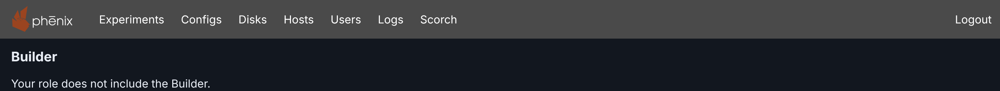

# Administration

This page is for phēnix administrators. Every phēnix server has Builder, and
roles control who can use it.

## Permissions

The `builder` `use` permission gives a user Builder: every draft and all
three libraries. Drafts have no owner. A draft records who created and last
changed it, but only for information.

To give a role Builder, add this policy to it (it takes no resource names):

```yaml
- resources:
  - builder
  verbs:
  - use
```

`builder` `use` gives no access to configs. Of the built-in roles, only
`Global Admin` and `Builder` have it. With authentication disabled, all
users work as `global-admin`.

Builder hides or disables each control that a role doesn't allow, and the
server checks each request anyway. Without `builder` `use`, there's no
`Builder` link in the navigation bar, and `/builder` says "Your role does
not include the Builder."



### The Builder Role

The built-in `Builder` role is for users who draw diagrams and publish them
as topologies. Besides `builder` `use`, it has every `configs` verb on
`Topology/*`, `Scenario/*` and `Experiment/*` only, and the `schemas`,
`topologies`, `scenarios`, `experiments` and `disks` permissions that
Builder uses (see
[Builder (`builder`)](../user-administration.md#builder-builder)).

Each time `phenix ui` starts, it makes sure that the role exists and has
`builder` `use`. It doesn't touch other roles, so add the `builder` policy
to each other role that needs Builder, then assign roles on the `Users` page
(see [Updating Users](../user-administration.md#updating-users)).

### What Each Task Needs

`builder` `use` alone covers all work on drafts, the libraries, the
Inspector fields, and `Upload` of a Builder document. Other tasks also need
`configs` permissions:

| Task | Also needs |
|---|---|
| Import a stored config | `configs` `get` on the config, and `topologies` or `experiments` `list` on its name |
| Import a config file | `configs` `get` and `create` |
| Publish | `configs` `update` to use `Publish`, and `create` (new) or `update` (existing) on each config that it writes |
| Preflight | the permissions of each check |

The [full table](details/administration.md#what-each-task-needs) lists every
task.

### Example Role

The example role `Topology Designer` can work on drafts and the libraries,
but can't publish, import a config file, delete a topology, store a
scenario file, or create the configs of a package. Someone with the
`Builder` role then publishes its drafts. To add the role:

1. Download
   [topology-designer.role.yaml](examples/roles/topology-designer.role.yaml).
2. Store it with `phenix config create`.
3. Assign it on the `Users` page.

!!! warning
    Don't use `"*/*"` in the `configs` policy of a role. It also matches
    User and Role configs, so a user could read password hashes.

phēnix copies a role's policies into a user when you assign the role, so
after you change a Role config, assign the role to its users again.

## The Libraries

The server keeps one template library, one layer set library and one icon
library, which all Builder users share and change. No role can change the
built-in templates, the server collections, the built-in layer set
`Purdue Model`, or the icons that phēnix added from template files.
`Duplicate` makes a copy of a read-only template or layer set that users can
change. phēnix logs each library change with the user name.

## Storage

Drafts, published documents and the libraries are records in the phēnix
store, not configs, so `phenix config list` and the `Configs` page don't
list them. Their limits are in [Limits](reference.md#limits).

At start and every hour, phēnix deletes the published and stored documents
that nothing references anymore.
`Clean up…` in the Builder settings does the same right away, and also
deletes each draft with no change since its last publish. It shows what it
would delete and asks first (see
[Cleaning up storage](details/administration.md#cleaning-up-storage)).

## Template Files on the Server

To give all users the same node templates, put template files in the
template directory of the server. When `phenix ui` starts, it reads each
file as one read-only collection. A file has the format that the
`Node Templates` tab downloads (see the example
[node-templates.yaml](examples/node-templates.yaml)).

The directory is `<base-dir.phenix>/builder/templates`, by default
`/phenix/builder/templates`. To change it, set `base-dir.builder-templates`
with the flag `--base-dir.builder-templates`, the environment variable
`PHENIX_BASE_DIR_BUILDER_TEMPLATES`, or the config file (see
[Settings](../settings.md#settings-reference)):

```yaml
base-dir:
  builder-templates: /etc/phenix/builder-templates
```

phēnix reads the `.yaml`, `.yml` and `.json` files in the directory, and
skips (and logs) a file that isn't valid. It only reads them at start, so
restart `phenix ui` after you change them. Custom icons in a file become
server icons, which no user can rename or delete (see
[Template files on the server](details/administration.md#template-files-on-the-server)).

## The builder-doc Annotation

A Topology config names its diagram in the `builder-doc` annotation, a map
with up to three keys: `digest` and `id`, which `Publish` writes, and
`path`, which you write yourself for a Builder file. A topology shows the
published document that the annotation names, or else the file at `path`.
phēnix refuses a Topology config whose annotation isn't valid (see
[The builder-doc annotation](details/administration.md#the-builder-doc-annotation)).

## A Builder File Beside a Topology

A topology in a repository can keep its diagram there too, as a Builder JSON
or YAML file. Name the file in the annotation:

```yaml
apiVersion: phenix.sandia.gov/v1
kind: Topology
metadata:
  name: pump-station
  annotations:
    builder-doc:
      path: /phenix/topologies/pump-station/pump-station.builder.json
spec:
  ...
```

To make such a config:

1. Open the draft in Builder, or upload the Builder file.
2. Click `Download` > `Topology YAML`.
3. Set `metadata.name`.
4. Add the annotation. Don't change the `spec`.
5. Store the config with `phenix config create`.

The `Published Diagrams` tab then lists the topology with the `File` tag.
phēnix reads the file each time someone opens the diagram, so a `git pull`
that changes the file changes the diagram. The file must be below the base
directory (`/phenix`, or the `base-dir.phenix` setting) and outside the VM
mount directory (see
[Which files phenix reads](details/administration.md#which-files-phenix-reads)).

!!! warning
    The name of a topology doesn't protect its Builder file. A user who has
    `configs` `get`, and `create` or `update`, on any one topology name can
    store a topology there with any `path` below the base directory, and
    then open that file. Only keep a Builder file below the base directory
    if each such user may read it (see
    [Who can read a Builder file](details/administration.md#who-can-read-a-builder-file)).

`Publish` never writes the file. It stores a published document and writes
`digest` and `id` beside the `path`, so the file is out of date until you
replace it with `Download` > `Builder JSON`.

## API

Scripts use the same REST API as the web UI, under `/api/v1`, and the
interactive API docs at `/docs/` describe each route under the `Builder`
tag. Each route needs `builder` `use`, and a route that reads or writes
configs also needs the `configs` permissions of the matching web UI task
(see [REST API](details/administration.md#api)).

## See Also

- [Administration: Details](details/administration.md): every permission,
  store record, file rule and REST route.
- [User Authn/Authz in phēnix](../user-administration.md#roles): roles,
  users and tokens.
- [API](../api.md#authentication): how to send a token with a request.
- [Troubleshooting](troubleshooting.md#permissions): what users see when a
  permission is missing.
