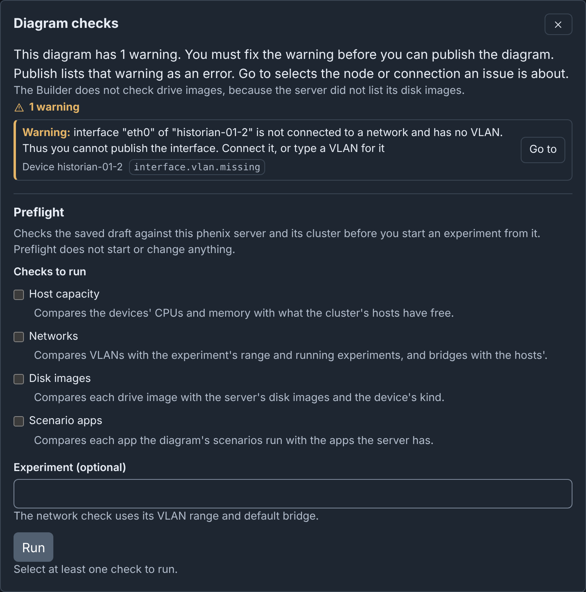
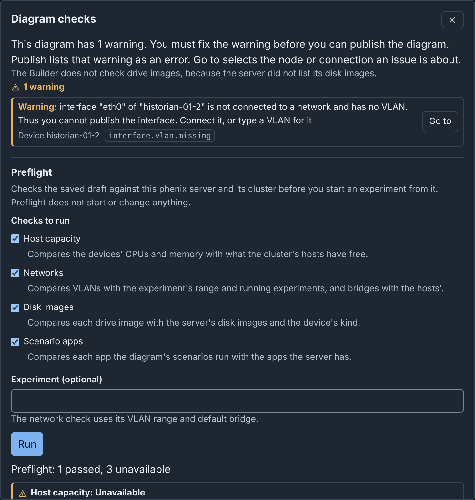

# Checks and Preflight: details

!!! info
    This page holds every rule, limit and message of this feature. For the
    short guide, see [The Editor](../editor.md#checks-and-warnings).

## Checks and warnings

Builder checks the diagram while you edit it. The checks button in the header
shows the result: **No issues**, or a count such as **3 warnings**.

To fix an issue:

1. Click the checks button. The **Diagram checks** dialog lists the errors,
   then the warnings.
2. Click **Go to** beside the issue. The canvas selects its node, and the
   Inspector shows it.
3. Fix the field. In the Inspector, **Go to** beside an issue moves focus
   to its field.

Some issues also have **Fix** (see [Fixing an issue in one step](#fixing-an-issue-in-one-step)).

**Go to** shows a hidden Inspector and moves the view to the node. An issue
about a network goes to its switch. An issue that names no field moves focus
to its node or connection. An issue about the full diagram, or about a
network with no switch, has no **Go to**.

There are two levels:

- **Errors**, such as an empty required field. You cannot publish until you
  fix them.
- **Warnings**. Some warnings block **Publish**, which lists them as errors
  (see [What blocks publishing](publishing.md#what-blocks-publishing)). The
  dialog says so. Other warnings, such as a device with no interfaces, do not
  block publishing.

For the full list of codes, see [Codes](../reference.md#codes).

The canvas marks each node and connection with an issue: a cross for an
error, or a triangle for only warnings. Screen readers read the issues as the
description of the item.

Devices from included topologies get no warnings, because they belong to their
own topology. But a hostname that an included device also uses is an error,
and an address that it also uses is a warning.

When the server lists no disk images, the dialog says "The Builder does not
check drive images, because the server did not list its disk images." Otherwise, a drive image
that the server does not have is a warning.

### Rulesets and addresses

phenix accepts these settings, but they do not work as the diagram shows them.
None of these warnings blocks publishing. Publish and the Topology YAML
download also list them.

| Warning | Code | Go to opens |
| --- | --- | --- |
| A device that is not a Router or a Firewall has firewall rulesets, or an interface that names one. The `vrouter` app ignores them. | `device.rulesets.ignored` | The **Type** of the device |
| An **Inbound ruleset** or **Outbound ruleset** of an interface names no ruleset of its device. The `vrouter` app then applies no firewall to that interface. | `interface.ruleset.unknown` | The ruleset field |
| The address of an interface is not a host address of the subnet of its network. | `interface.ip.outside-subnet` | The **Address** |
| No interface on a network has the gateway address of the network. Interfaces of external devices and of included topologies count. | `network.gateway.unowned` | The **Gateway** of the network |
| The subnets of two networks overlap. | `network.subnet.overlap` | The **Subnet** of the network |

Overlapping subnets are a problem only when the networks connect, for example
through a router. Isolated enclaves that reuse a subnet on purpose can ignore
this warning.

### Device settings

phenix apps do not apply these device settings as the diagram shows them.
The Inspector shows the same warnings at
the field. Publish and the Topology YAML download also list them. Three of
them block publishing (see
[What blocks publishing](publishing.md#what-blocks-publishing)).

These devices get fewer warnings:

- Devices from included topologies and external devices get none of these
  warnings. phenix still reads the `ntp-server` label of an external device.
- phenix apps do not configure a device whose `phenix/default-apps`
  annotation is `false`. It gets no warning about its OS type, interfaces,
  OSPF or `vrouter/enable-ssh`.
- That device still gets the warnings about no drive, file injections,
  `phenix/startup-autotunnel` and the `ntp-server` label.

| Warning | Code | Go to opens |
| --- | --- | --- |
| A device has no drive under **Drives**. phenix needs a drive to start it. This blocks publishing. | `device.drives.none` | **Add drive** under **Drives** |
| A Router or Firewall has an OS type other than `vyatta`, `vyos` or `minirouter`. phenix does not configure its routing or firewall. phenix still configures `linux` as Vyatta, but this is deprecated. | `device.router-os.unsupported` | **OS type** |
| A device that is not a Router or Firewall has static interfaces. Its OS type is not `linux`, `rhel`, `centos` or `windows`, for example `other`. phenix writes no interface configuration for it. | `device.interfaces.unconfigured` | **OS type** |
| A device has serial interfaces, but its OS type is not exactly `linux`. phenix sets serial interfaces only on `linux`. | `device.serial.unconfigured` | **OS type** |
| A device has file injections or deletions, but **Snapshot** is off, or the **Inject partition** of its first drive is 0. phenix does not inject or delete its files. | `device.injections.unapplied` | **Snapshot**, or the **Inject partition** of the drive |
| A Vyatta or VyOS router (OS type `vyatta`, `vyos` or `linux`) has an interface with protocol `ospf`, but no `network.ospf`. The experiment does not start. This blocks publishing. | `device.ospf.missing` | The **Protocol** of the interface |
| An `ospf` interface of a minirouter has an address in no area network of its `network.ospf`, or the device has no `network.ospf`. The interface is in no OSPF area. | `interface.ospf.outside-area` | The **Address** of the interface |
| An area network of a minirouter holds the address of none of its `ospf` interfaces. minirouter does not advertise it. | `device.ospf-network.unused` | The area network |
| A minirouter has `network.ospf`, but no interface with protocol `ospf`. | `device.ospf.unused` | `network.ospf` |
| The `ntp-server` label names no interface of its device, or an interface with no IP address. The experiment does not start. This blocks publishing. | `device.ntp-server.invalid` | The value of the label |
| More than one device has the `ntp-server` label. phenix uses only the first device with it, in the order of the diagram. | `device.ntp-server.ignored` | The value of the label |
| The diagram has Vyatta or VyOS routers, and the `ntp-server` device has no interface on VLAN `mgmt`, in any case. The routers get no NTP server, unless an `ntp` app of the scenario names one. | `device.ntp-server.no-mgmt` | The value of the label |
| The `vrouter/enable-ssh` annotation of a Vyatta or VyOS router is not an IP address or the name of an interface with an IP address. phenix does not enable SSH. phenix reads this annotation on no other device. | `device.enable-ssh.invalid` | The value of the annotation |
| An entry of the `phenix/startup-autotunnel` annotation is not `"port"`, `"port:dport"` or `"port:host:dport"`, with ports from 1 to 65535. A `dport` of `VNC`, in any case, permits an empty host. phenix skips each bad entry. phenix opens no tunnel when the value is not a list of texts. | `device.autotunnel.invalid` | The value of the annotation |
| The `phenix/default-apps` annotation is not `true` or `false`, for example the text `"false"`. phenix runs its default apps. | `device.default-apps.invalid` | The value of the annotation |

phenix finds an interface by name in any case: `ETH0` names `eth0`. In the
Inspector, the values of the `ntp-server` label and the `vrouter/enable-ssh`
annotation suggest the interface names of the device.

### Fixing an issue in one step

Some issues have a **Fix** button, which says what it does, for example "Fix:
Rename web-01 to web-01-2". The dialog stays open, and focus moves to the
next issue. **Undo** reverts each fix as one step.

| Issue | Code | What Fix does |
| --- | --- | --- |
| Two devices have the same hostname | `node.hostname.duplicate` | Renames the device to the next free hostname, such as `web-01-2`. When the other device is from an included topology, Fix renames the device of this diagram. |
| Interfaces on one network use the same IP address | `interface.ip.shared` | Gives the interface the first free address of the subnet, as [Assign addresses](editor.md#addresses-of-a-network) does, with the same gateway rules. |
| Interfaces on one network use the same MAC address | `interface.mac.shared` | Clears the MAC address of the interface. phenix then makes one when the experiment starts. |

There is no **Fix** in these cases:

- The draft is read only.
- The device is from an included topology, which must fix it.
- For an IP address: the interface is on no network, its network has no
  subnet, or the subnet has no free address. Set a **Subnet** for the
  network, or type a new address in the Inspector.
- For a router interface with the gateway address: the router keeps the
  gateway. When several routers have the gateway, the first router keeps it.
  Fix gives each other router a free address.

### Preflight

The **Preflight** section of **Diagram checks** asks the phenix server to
check the saved draft against the server and its cluster. The checks write
nothing and start no VM or experiment. This browser keeps the checks that you
ticked last until you log out.

| Check | What it compares |
|---|---|
| **Host capacity** | The `hardware.vcpus` and `hardware.memory` of each device that is not external, against the free resources of the schedulable cluster hosts. Unset values count as 1 vCPU and 512 MB. Each device must fit on one host. A device that fits on no host fails the check. Too little free memory fails it. Too few free CPUs is a warning, because VMs can share CPUs. |
| **Networks** | The VLANs of the devices and the VLAN aliases of the networks, against the VLAN range of the experiment that you name. No range applies without an experiment, or when the experiment sets none. The aliases, against the VLANs of the running experiments that your role may list. The summary says when it left out experiments that your role may not list, but it does not name them. The bridges of the interfaces and the default bridge of the experiment (`phenix` without an experiment), against the bridges of the schedulable hosts. A missing bridge is a warning, because minimega creates it when the experiment starts. |
| **Disk images** | Each drive image, by file name, against the disk images of the server. The kind must agree: a VM or ISO image for a kvm device, a container image for a container. The server keeps its list of disk images for 10 seconds, so it may not find a new image yet. |
| **Scenario apps** | Each app that the scenarios of the diagram run, against the default apps, the built-in apps and the user apps on the `PATH` of the server. Disabled apps do not count. |

To run Preflight:

1. Click the checks button in the header.
2. Under **Preflight**, tick the checks.
3. Optional: in **Experiment (optional)**, type the name of the experiment.
4. Click **Run**. Builder first saves your latest changes.

The report gives a total, for example "Preflight: 3 passed, 1 unavailable".
Each check shows **Passed**, **Failed** or **Unavailable**, and a summary.
Each issue has its code. An issue about a device or a network has **Go to**.

A check is **Unavailable** when Builder could not do all of it. An issue gives
one of these causes:

- Your role does not have the permission that the check needs (see
  [Administration](administration.md#what-each-task-needs)).
- Builder cannot connect to minimega.
- The server lists no disk images, or does not list them within 10 seconds.
- The check took longer than 20 seconds.

Builder still does the other checks. The report stays until the diagram
changes.
