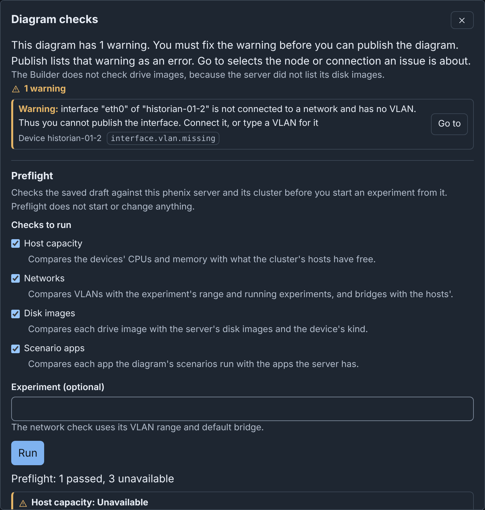

# Checks and Preflight: Details

!!! info
    This page goes deeper than the short guide:
    [The Editor](../editor.md#checks-and-warnings).

## Checks and Warnings

`Go to` on an issue about a network goes to its switch. An issue about the
whole diagram, or about a network with no switch, has no `Go to`. The
`Publish diagram` dialog shows the warnings that block publishing as errors
(see
[What blocks publishing](publishing.md#what-blocks-publishing)). For the code
and default severity of each issue, see [Codes](../reference.md#codes).

Devices from included topologies get no warnings, because they belong to
their own topology. A hostname that an included device also uses is still an
error, though, and an address that it also uses is a warning.

When the server doesn't list its disk images, the dialog says
`The Builder does not check drive images, because the server did not list its disk images.`
Otherwise, a drive image that the server doesn't have is a warning.

### Rulesets and Addresses

phēnix accepts these settings, but they don't work the way the diagram shows
them. None of these warnings blocks publishing. `Publish` and the Topology
YAML download list them too.

| Warning | Code | Go to opens |
| --- | --- | --- |
| A device that isn't a Router or a Firewall has firewall rulesets, or an interface that names one. The `vrouter` app ignores them. | `device.rulesets.ignored` | The `Type` of the device |
| An `Inbound ruleset` or `Outbound ruleset` of an interface names no ruleset of its device, so the `vrouter` app applies no firewall to that interface. | `interface.ruleset.unknown` | The ruleset field |
| An interface's address isn't a host address of its network's subnet. | `interface.ip.outside-subnet` | The `Address` |
| No interface on a network has the network's gateway address. Interfaces of external devices and of included topologies count. | `network.gateway.unowned` | The `Gateway` of the network |
| The subnets of two networks overlap. | `network.subnet.overlap` | The `Subnet` of the network |

Overlapping subnets are a problem only when the networks connect, for example
through a router. If you reuse a subnet on purpose in isolated enclaves, you
can ignore this warning.

### Device Settings

phēnix apps don't apply these device settings the way the diagram shows them.
The Inspector shows these warnings at the field, and `Publish` and the
Topology YAML download list them too. Three of them block publishing.

Devices from included topologies and external devices get none of these
warnings (phēnix still reads the `ntp-server` label of an external device). A
device whose `phenix/default-apps` annotation is `false` isn't configured by
the phēnix apps, so it gets no warning about its OS type, interfaces, OSPF or
`vrouter/enable-ssh`. It still gets the others.

| Warning | Code | Go to opens |
| --- | --- | --- |
| A device has no drive under `Drives`. phēnix needs a drive to start it. This blocks publishing. | `device.drives.none` | `Add drive` under `Drives` |
| A Router or Firewall has an OS type other than `vyatta`, `vyos` or `minirouter`, so phēnix doesn't configure its routing or firewall. phēnix still configures `linux` as Vyatta, but this is deprecated. | `device.router-os.unsupported` | `OS type` |
| A device that isn't a Router or Firewall has static interfaces, and an OS type other than `linux`, `rhel`, `centos` or `windows`, for example `other`. phēnix writes no interface configuration for it. | `device.interfaces.unconfigured` | `OS type` |
| A device has serial interfaces, but its OS type isn't exactly `linux`, the only one on which phēnix sets them up. | `device.serial.unconfigured` | `OS type` |
| A device has file injections or deletions, but `Snapshot` is off, or the `Inject partition` of its first drive is 0, so phēnix doesn't apply them. | `device.injections.unapplied` | `Snapshot`, or the `Inject partition` of the drive |
| A Vyatta or VyOS router (OS type `vyatta`, `vyos` or `linux`) has an `ospf` interface but no `network.ospf`. The experiment doesn't start. This blocks publishing. | `device.ospf.missing` | The `Protocol` of the interface |
| An `ospf` interface of a minirouter has an address in no area network of its `network.ospf`, or the device has no `network.ospf`. The interface is in no OSPF area. | `interface.ospf.outside-area` | The `Address` of the interface |
| An area network of a minirouter holds the address of none of its `ospf` interfaces, so minirouter doesn't advertise it. | `device.ospf-network.unused` | The area network |
| A minirouter has `network.ospf`, but no `ospf` interface. | `device.ospf.unused` | `network.ospf` |
| The `ntp-server` label names no interface of its device, or one with no IP address. The experiment doesn't start. This blocks publishing. | `device.ntp-server.invalid` | The value of the label |
| More than one device has the `ntp-server` label. phēnix uses only the first one, in the order of the diagram. | `device.ntp-server.ignored` | The value of the label |
| The diagram has Vyatta or VyOS routers, and the `ntp-server` device has no interface on VLAN `mgmt` (in any case). The routers get no NTP server, unless an `ntp` app of the scenario names one. | `device.ntp-server.no-mgmt` | The value of the label |
| The `vrouter/enable-ssh` annotation of a Vyatta or VyOS router isn't an IP address or the name of an interface with an IP address, so phēnix doesn't enable SSH. No other device reads this annotation. | `device.enable-ssh.invalid` | The value of the annotation |
| An entry of the `phenix/startup-autotunnel` annotation isn't `"port"`, `"port:dport"` or `"port:host:dport"` with ports from 1 to 65535 (a `dport` of `VNC`, in any case, permits an empty host). phēnix skips each bad entry, and opens no tunnel when the value isn't a list of texts. | `device.autotunnel.invalid` | The value of the annotation |
| The `phenix/default-apps` annotation isn't `true` or `false`, for example the text `"false"`. phēnix runs its default apps. | `device.default-apps.invalid` | The value of the annotation |
| The `phenix/startup-set-hostname` annotation is not `true` or `false`, for example the text `"false"`. phenix sets the hostname. | `device.set-hostname.invalid` | The value of the annotation |

phēnix matches interface names in any case, so `ETH0` names `eth0`. In the
Inspector, the values of the `ntp-server` label and the `vrouter/enable-ssh`
annotation suggest the device's interface names.

### Fixing an Issue in One Step

Some issues have a `Fix` button that says what it does, for example
`Fix: Rename web-01 to web-01-2`. The dialog stays open, and `Undo` reverts
each fix as one step.

| Issue | Code | What Fix does |
| --- | --- | --- |
| Two devices have the same hostname | `node.hostname.duplicate` | Renames the device to the next free hostname, such as `web-01-2`. When the other device is from an included topology, Fix renames the one in this diagram. |
| Interfaces on one network use the same IP address | `interface.ip.shared` | Gives the interface the first free address of the subnet, with the same gateway rules as [Assign addresses](editor.md#addresses-of-a-network). |
| Interfaces on one network use the same MAC address | `interface.mac.shared` | Clears the MAC address of the interface, so phēnix makes one when the experiment starts. |

There's no `Fix` when the draft is read only, or when the device is from an
included topology, which has to fix it. For an IP address, there's no `Fix`
when the interface is on no network, its network has no subnet, or the
subnet has no free address. Set a `Subnet` for the network, or type a new
address in the Inspector. A router keeps the gateway address, so its
interface gets no `Fix`. When several routers have the gateway address, the
first one keeps it, and Fix gives each other router a free address.

## Preflight

The steps to run Preflight are in the [guide](../editor.md#preflight).

| Check | What it compares |
|---|---|
| `Host capacity` | The `hardware.vcpus` and `hardware.memory` of each device that isn't external, against the free resources of the schedulable cluster hosts. Unset values count as 1 vCPU and 512 MB. Each device must fit on one host, and too little free memory fails the check. Too few free CPUs is only a warning, because VMs can share CPUs. |
| `Networks` | The VLANs of the devices and the VLAN aliases of the networks, against the VLAN range of the experiment that you name, if it sets one. The aliases, against the VLANs of the running experiments. The bridges of the interfaces and the experiment's default bridge (`phenix` without an experiment), against the bridges of the schedulable hosts. A missing bridge is only a warning, because minimega creates it when the experiment starts. |
| `Disk images` | Each drive image, by file name, against the disk images of the server. The kind must agree: a VM or ISO image for a kvm device, a container image for a container. A new image can take up to 10 seconds to show up. |
| `Scenario apps` | Each app that the diagram's scenarios run, against the default apps, the built-in apps and the user apps on the server's `PATH`. Disabled apps don't count. |

The report gives a total, for example `Preflight: 3 passed, 1 unavailable`.
Each issue has its code, and an issue about a device or a network has
`Go to`. The report stays until the diagram changes.

A check is `Unavailable` when Builder couldn't do all of it, and Builder still
does the other checks. The issue gives the cause:

- Your role doesn't have the permission the check needs (see
  [What each task needs](administration.md#what-each-task-needs)).
- Builder can't connect to minimega.
- The server lists no disk images, or doesn't list them within 10 seconds.
- The check took longer than 20 seconds.

## See Also

- [Troubleshooting](../troubleshooting.md): what to do when Builder or a
  publish doesn't behave.
- [Publishing: Details](publishing.md): what blocks publishing, and what
  publishing writes.
- [Apps](../../apps.md): the default apps that these warnings refer to.
- [Building a Diagram: Details](diagrams.md): subnets, addresses and
  connections.
