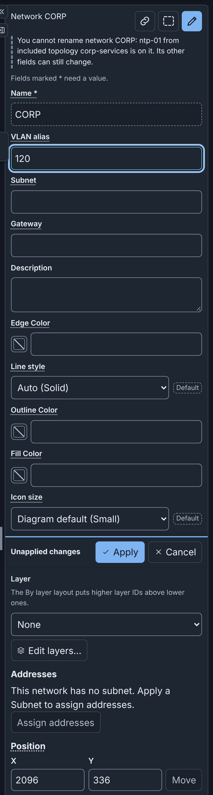
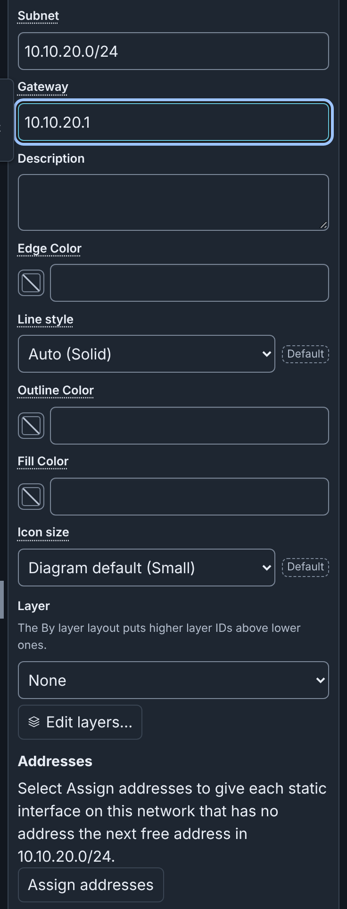
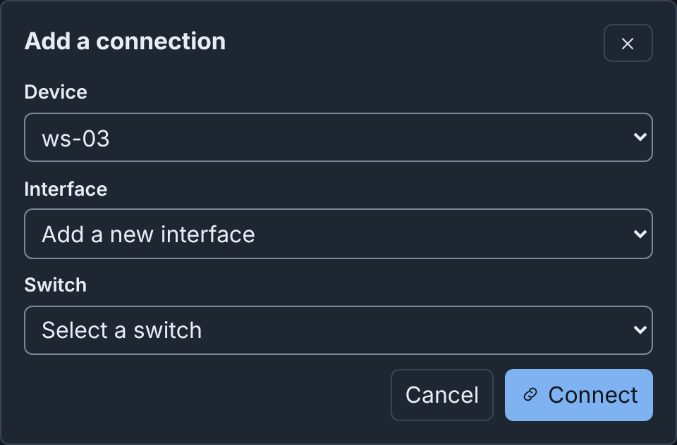
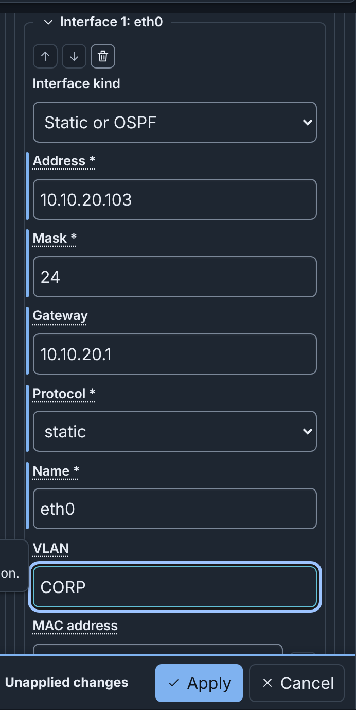
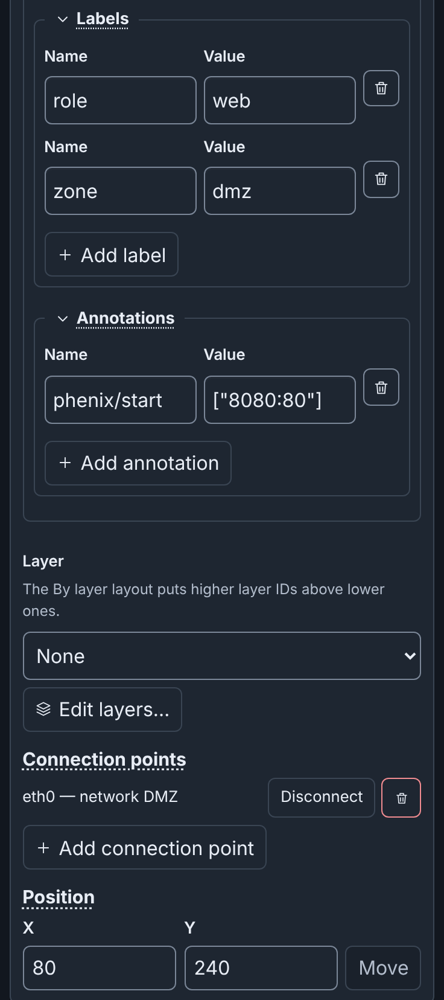
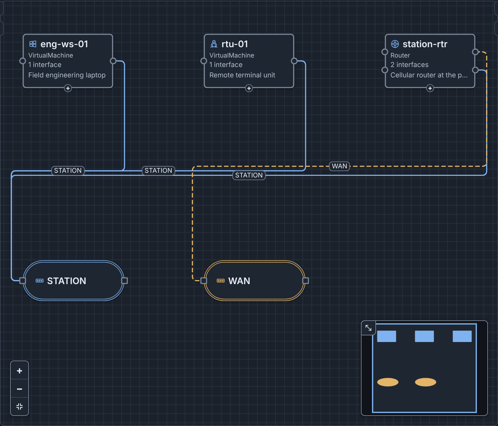
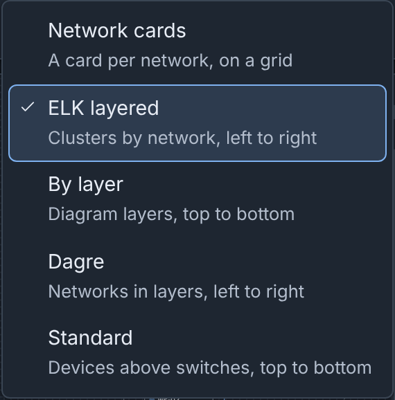
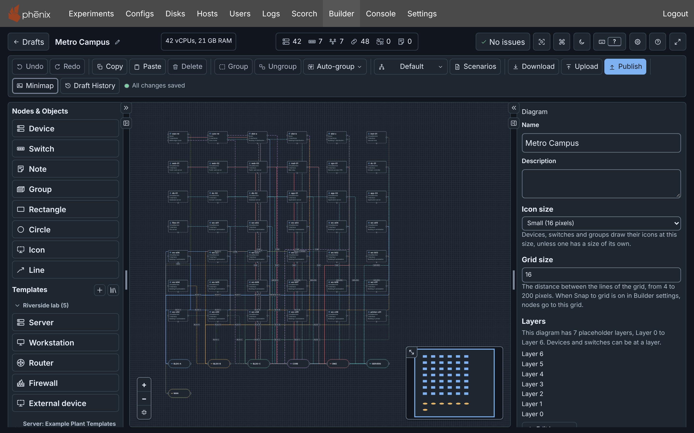
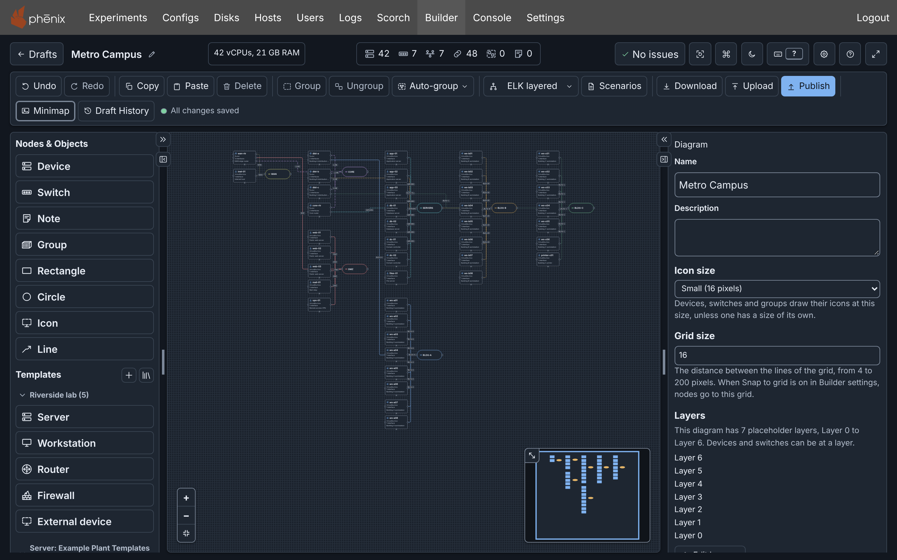

# Building a Diagram: details

!!! info
    This page holds every rule, limit and message of this feature. For the
    short guide, see [Diagrams](../diagrams.md).

This page shows how to draw and change a diagram. For the parts of the
editor, see [The Editor](editor.md). [Icons](icons.md), [Layers](layers.md)
and [Scenarios and Included Topologies](scenarios.md) have their own pages.
The examples use the Riverside Water
draft of the [example lab](../tutorial.md#the-example-lab).

## Devices, switches and connections

A diagram describes one phenix Topology config:

| In the diagram | In the published Topology |
|---|---|
| A device | A node in `spec.nodes`, with its settings |
| A switch | A network. Its name is the VLAN of each interface on it |
| A connection from a device to a switch | An interface of the device, with the network's name as its `vlan` |
| A device from an included topology | Nothing: `includeTopologies` names that topology |
| Notes, groups, shapes, icons, lines, colors, line styles, icon sizes, custom icons, layers and the diagram's templates | Nothing |

## Adding devices

To add a device from **Nodes & Objects**, at the top of the left column, do
one of these steps:

- Click the item. The device appears in free space in the visible part of
  the canvas, or outside it when that part is full. Builder selects it.
- Drag the item to the canvas.
- In the [command palette](palette-and-shortcuts.md#command-palette) (<kbd>⌘</kbd>+<kbd>K</kbd>/<kbd>Ctrl</kbd>+<kbd>K</kbd>), choose **Add device**, then select a template.

**Device** adds a device with default settings. The templates under
**Templates** set more settings. The table lists the **Device** item and the
five built-in templates, which the **Built-in** section always lists:

| Item | Hostname | Type | OS type | Image |
|---|---|---|---|---|
| **Device** | node | VirtualMachine | linux | `ubuntu.qc2` |
| **Server** | server | VirtualMachine | linux | `ubuntu.qc2` |
| **Workstation** | workstation | VirtualMachine | windows | `windows10.qc2` |
| **Router** | router | Router | minirouter | `minirouter.qc2` |
| **Firewall** | firewall | Firewall | vyos | `vyos.qc2` |
| **External device** | external | HIL (external) | None | None |

The built-in templates are read only. To change one, duplicate it into the
template library of the server (see [Node Templates](templates.md)).

To add an engineering workstation to Riverside Water:

1. Under **Templates**, click **Workstation**.
2. In the Inspector, set **Hostname** to `ws-03` and **Description** to
   `CAD workstation`.
3. Click **Apply**.

### Routers and firewalls

The `vrouter` app configures the interfaces, routes and
rulesets of a device of type Router or Firewall (see
[vrouter App](../../apps.md#vrouter-app)). For a VyOS router, such as
edge-rtr, set **OS type** to `vyos` and the drive's **Image** to `vyos.qc2`.

### External devices

An external device is hardware that the experiment connects to, such as a
PLC. phenix starts no VM for it, so it has no
image. Its interfaces tell phenix which VLANs the hardware is on (see
[External Nodes](../../configuration.md#external-nodes)).

## Adding switches and networks

A switch is one network. To add a network:

1. Under **Nodes & Objects**, click **Switch**, or choose **Add switch**
   in the command palette. A switch appears, with a new network named EXP,
   then EXP-2 and so on.
2. In the Inspector, set **Name**, for example `SCADA`, and click
   **Apply**.

When you rename a network, the VLAN of each interface on it changes.

A switch's outline has the color of its network's connections, unless the
switch has its own **Outline Color** (see [Colors](#colors)). A screen reader names the
switch, its network and its VLAN alias.

The Inspector of a switch has these network fields:

- **VLAN alias**: optional, from 1 to 4094. When you publish with an
  experiment, it becomes the network's entry in `vlans.aliases` (see
  [Publishing a topology and an experiment](publishing.md#publishing-a-topology-and-an-experiment)).
- **Subnet**: an optional IPv4 network in CIDR form, such as `10.1.0.0/24`.
- **Gateway**: an optional IPv4 address of the router on the network. It
  must be a host address of the subnet, such as `10.1.0.1` in
  `10.1.0.0/24`.

{ width="352" }

To find a network, type `#` in the command palette. **Remove network** in
the command palette deletes a network, its switches and their connections.
A network can have more than one switch, for example after a paste.

When you delete the last switch of a network, Builder deletes the network
in the same edit. **Undo** restores both. The network stays when the
**VLAN** of an interface with no connection still names it. The checks then
warn that the network has no switch. To correct this, add a switch, change
the VLAN, or use **Remove network**. A diagram that you open or upload
keeps all its networks.

### Subnets and addresses

Builder uses a network's **Subnet** and **Gateway** to give addresses to
the static interfaces on the network. A static interface has the
**Interface kind** **Static or OSPF**. Builder gives an address only to a
static interface that has no address. It never changes an address that an
interface has, or a device from an included topology.

An assigned address is the next free host address of the subnet. A free
address is not the gateway, and no other interface on the network uses it.
The interface also gets the subnet's prefix length as its **Mask**. When
the interface has no **Gateway**, it gets the network's gateway. For
example, with the subnet `10.1.0.0/24` and the gateway `10.1.0.1`, the
first interface gets `10.1.0.2`, mask `24` and gateway `10.1.0.1`.

A router holds the gateway. Here, a router is a device of type Router or
Firewall. Router interfaces get their addresses first, and never get a
**Gateway** of their own:

- When no interface on the network has the gateway address, the first
  router interface gets it.
- When the network has no gateway, the first router interface gets the next
  free address. That address becomes the network's **Gateway** in the same
  step, and the interfaces after it get that gateway.
- Other router interfaces get the next free addresses.

A new network gets a suggested subnet. It is the first `10.N.M.0/24` that
overlaps no subnet of the diagram. It also holds no interface or gateway
address of the diagram. In an empty diagram, that is `10.1.0.0/24`. You can change
or clear it. A network that you import or upload keeps its own subnet, or
has none.

Builder gives addresses at these times:

- When you connect a static interface to a switch of the network: with a
  drag, with **Add a connection**, or with **Paste** or **Duplicate** of a
  device and its switch. After a drag or **Add a connection**, Builder says
  the address, for example "Set the address of eth0 of ws-03 to
  10.1.0.2/24."
- When you click **Assign addresses** in the Inspector of a switch, or
  choose it and the network in the command palette. This is one step of
  **Undo**, for example "Assigned 3 addresses on network SCADA".

{ width="352" }

The **Assign addresses on connect** setting, in the **Editing** section of
[Settings](editor.md#settings), is on by default. When it is off, a
connection, paste or duplicate gives no address. After a drag or **Add a
connection**, Builder then says "No address set. Type an address for eth0
of ws-03 in the Inspector, or select Assign addresses." **Assign
addresses** and the suggested subnet work with the setting on or off.

A network without a subnet gives no address. When you connect a static
interface to it, Builder says "No address set: network CORP has no subnet.
Type an address for eth0 of ws-03 in the Inspector." **Assign addresses**
is then not available. When the subnet is full, Builder says, for example,
"No address set: subnet 10.1.0.0/30 of network SCADA is full."

A static interface without an address stops **Apply** of its device.

## Connecting interfaces

A connection puts a device's interface on a network. Each example below
connects ws-03 to CORP. CORP has no subnet, so eth0 gets no address. Type
its address in the Inspector, for example `10.10.20.103`, or give CORP a
subnet first.

### Drag on the canvas

1. Point at ws-03. Each interface has a connection point (a circle) on the
   device's sides. A **+** handle is at its bottom.
2. Drag from the **+** handle, or from an unconnected connection point, to
   the CORP switch.

A drag from **+** adds a new static interface. A published diagram and a
device from an included topology have no **+** handle.

A drag from one device to another adds a switch between them, with a new
network named EXP and a suggested subnet. You cannot connect two switches,
because each switch is one network.

### Add a connection without dragging

1. Select a device or a switch.
2. Click **Add connection** (the link button) in the Inspector header, or
   choose **Add a connection…** in the command palette. The dialog opens
   with the selection filled in.
3. In **Device**, choose `ws-03`.
4. Keep **Interface** set to **Add a new interface**, or choose an
   interface that has no connection.
5. In **Switch**, choose **CORP (CORP)**.
6. Click **Connect**.

The command has no default key (see
[Customizing shortcuts](palette-and-shortcuts.md#customizing-shortcuts)).

{ width="496" }

The dialog stays open in these cases:

- A field is empty. **Connect** names it and moves focus to it.
- Builder cannot make the connection. The dialog says why.

### Type the VLAN in the Inspector

When you apply a network's name in an interface's **VLAN** field, Builder
connects the interface to that network's switch. The
[quick start](../tutorial.md) connects ws-03 this way:

1. Select ws-03.
2. In the Inspector, under **Network**, click **Add interface**. The new
   interface eth0 is **Static or OSPF**, with **Mask** `24`.
3. Enter **Address** `10.10.20.103` and **Gateway** `10.10.20.1`.
4. Enter **VLAN** `CORP`.
5. Click **Apply**. **Draft History** names the change "Updated device
   ws-03 and connected eth0 to network CORP".

{ width="354" }

The VLAN matches a network's name in any letter case. The name of another
network moves the connection. A VLAN that names no network stays, but the
interface stays unconnected. A typed VLAN gives no address.

A renamed interface keeps its connection while its VLAN names the same
network. When you remove one interface and add another in the same
**Apply**, the new interface does not get the old connection. It connects
only when its VLAN names a network.

### Disconnecting

To disconnect an interface, do one of these steps:

- In the Inspector's **Connection points**, click **Disconnect** next to
  the interface, for example "eth0 — network CORP".
- Select the connection on the canvas and press <kbd>⌫</kbd> on macOS or
  <kbd>Delete</kbd> on Windows and Linux.

The interface stays, with no VLAN, and blocks publishing (see
[What blocks publishing](publishing.md#what-blocks-publishing)). Connect it
again, type a VLAN, or remove it with **Remove connection point** (the
trash button). **Add connection point** adds a static interface with no
connection and no address. The buttons under **Connection points** take
effect at once, without **Apply**.

### Hiding connections

To hide the connections on your canvas, choose **Hide connections** in the
command palette, or press <kbd>⌥</kbd>+<kbd>⇧</kbd>+<kbd>C</kbd>
(<kbd>Alt</kbd>+<kbd>Shift</kbd>+<kbd>C</kbd>) outside a text field. The
same command, now **Show connections**, shows them again. The **Show
connections** switch in [Settings](editor.md#settings) does the same.

This changes only your canvas. This browser keeps your choice for the next
diagram. The diagram, its checks, **Publish** and the downloads keep every
connection: a PNG or SVG still draws them. While connections are hidden:

- You cannot click, select or focus a connection. **Select all** selects
  only nodes.
- **Go to** on an issue about a connection selects the node it starts at.
- The marks of connections with errors or warnings do not show.
- A drag from a connection point still connects it.
- <kbd>PgDn</kbd> and <kbd>PgUp</kbd> do not move through connections.

## Editing device settings

Change the fields of a device in the Inspector or the
[Node Editor](editor.md#node-editor), then click **Apply** (see
[Editing a node](editor.md#editing-a-node)).

An interface has an **Interface kind**:

- **Static or OSPF**: an address that you give, or that Builder gives from
  the subnet. A new interface is this kind, with **Mask** `24`. When you
  add an interface in the Inspector, focus goes to its **Address**.
- **DHCP or manual**: the address comes from DHCP, or from a setting inside
  the VM.
- **Serial**: a serial link.

An interface of an external device has no **Interface kind**. It is a
static interface with **Mask** `24`.

When you change the kind, Builder asks, for example, "Switch Interface kind
to DHCP or manual?" **Switch and clear** changes the kind and empties all
fields of that interface, **Name** and **VLAN** included. **Keep current
value** changes nothing. Set the kind first.

A device shows its **Description** on the canvas. The eye button beside the
field hides it (see
[Hiding descriptions on the canvas](editor.md#hiding-descriptions-on-the-canvas)).

**Generate a random MAC address**, beside **MAC address**, writes a locally
administered unicast address that no other interface of the diagram uses.
Click **Apply** to keep it.

### Duplicating a device

**Duplicate** pastes a copy of the selected nodes next to them (see
[Copy, paste, duplicate and delete](#copy-paste-duplicate-and-delete)). The
copy keeps every setting, addresses included, but not its connections.

To add a second historian:

1. Select historian-01.
2. Press <kbd>⌘</kbd>+<kbd>D</kbd> (<kbd>Ctrl</kbd>+<kbd>D</kbd>). The copy
   historian-01-2 appears, with the address 10.10.30.20 and an unconnected
   eth0.

The header then says **1 warning**: eth0 of historian-01-2 has no VLAN.
When the copy's eth0 is on the network of historian-01, the shared address
is also a warning. To correct the warning, give the copy its own
hostname and address, and connect it (see
[Example: Riverside Water expansion](publishing.md#example-riverside-water-expansion)).

### Drive images

When your role can list the disk images of the server, a drive's **Image**
suggests them, and an image that the server does not have is a warning.
When the server lists no images, the checks do not examine images.

### Routes and rulesets

**Routes** and **Firewall rulesets** are under **Network**. For example:

- edge-rtr has **Route 1: 10.10.30.0/24**: **Destination**
  `10.10.30.0/24`, **Next hop** `10.10.20.254` (ot-fw) and **Cost** `1`.
- ot-fw has **Firewall ruleset 1: corp-to-ot**, with **Default** `drop` and
  **Rule 1: HTTPS to the historian**. The rule accepts `tcp` from
  `10.10.20.0/24` to `10.10.30.20` port `443`. The **Inbound ruleset** of
  eth0 is `corp-to-ot`.

The `vrouter` app applies them when the experiment starts. **Inbound
ruleset** and **Outbound ruleset** suggest the names of the device's
rulesets, unapplied ones included. The app applies rulesets only on a
Router or a Firewall, and skips a ruleset name that the device does not
have. The checks warn about both cases (see
[Rulesets and addresses](checks.md#rulesets-and-addresses)).

**miniccc commands**, under **More settings**, lists the commands that
phenix gives miniccc to run in the VM, such as `exec df -h`.

## Labels and annotations

A device's labels and annotations are under **More settings**. Each row has
a **Name** and a **Value**. For example, web-01 has the labels `zone: dmz`
and `role: web`, and the annotation `phenix/startup-autotunnel` with the
value `["8080:80"]`:

Builder reads an annotation value as YAML: `true`, `false` and numbers
become those values, and `["8080:80"]` is a list. Apps read annotations to
configure a node (see [Apps](../../apps.md)).

## Notes

A note is text on the canvas. Publishing ignores it.

1. Under **Nodes & Objects**, click **Note**.
2. In the Inspector, enter the **Text**, for example `OT has no route to the
   internet.`
3. Click **Apply**.

A screen reader names a note by the start of its text. A note also has a
**Color**.

## Groups

A group is a box with a title around nodes. Publishing ignores it. When you
move a group, its nodes move with it.

To group nodes:

1. Click the first node, then Shift-click the others.
2. Click **Group** in the toolbar, or press <kbd>⌘</kbd>+<kbd>G</kbd> on
   macOS or <kbd>Ctrl</kbd>+<kbd>G</kbd> on Windows and Linux.

The new group is "Group", or "Group 2" and so on when that name is in use.
Its Inspector has **Title**, **Description**, **Color**, **Border
pattern**, **Icon** and **Icon size**:

- The **Description** shows on one line under the title. Screen readers
  read it after the group's name.
- **Border pattern** is **Dashed** (the default), **Solid**, **Dotted** or
  **Double**.
- **Icon** is beside the title. It is the container icon by default.
- **Title** and **Description** wait for **Apply**. The other fields take
  effect at once.

To remove a group and keep its nodes in place, select the group, then
click **Ungroup** (<kbd>⇧</kbd>+<kbd>⌘</kbd>+<kbd>G</kbd> or
<kbd>Ctrl</kbd>+<kbd>Shift</kbd>+<kbd>G</kbd>).

**Group** under **Nodes & Objects** adds an empty group. A node that you
drag onto a group does not go into it. To move a node into a group:

1. Select the node.
2. Click **Move to group** (the group button) in the Inspector header, or
   choose **Move to a group…** in the command palette.
3. In **Group**, choose a group, or **No group** to remove the node from its
   group.
4. Click **Move**.

To resize a selected group or note, drag the handles on its corners and
sides, or press <kbd>⌥</kbd>+<kbd>⇧</kbd> (<kbd>Alt</kbd>+<kbd>Shift</kbd>)
with an arrow key. One press, or one hold, is one undo step. A group is
never smaller than its members need.

## Shapes, icons and lines

Rectangles, circles, icons and lines are drawings. Publishing ignores them,
and they take no connections. Add one under **Nodes & Objects** or in the
command palette. The layouts do not move a drawing. A drawing in a group
moves with its group. When a layout makes the group smaller, the group
grows to hold the drawing.

The Inspector of a drawing has these fields:

- A **rectangle** or a **circle** fills its box, so a circle in a box that
  is not square is an ellipse. It has a **Label** at its center, a **Fill
  Color** (without one, it is see-through), an **Outline Color**, a
  **Border pattern** (**Solid** by default), a **Width** and a **Height**.
- An **icon** shows a built-in or custom icon, scaled to its box. It has an
  optional **Label** under it, a **Width** and a **Height**.
- A **line** joins no node or network. It has a **Label** at its middle, a
  **Color** and a **Line style** (solid by default). It has **Arrowhead at
  the start** and **Arrowhead at the end**. Its **Points**, 2 to 64 from
  start to end, each have an **X** and a **Y**. A new line is 160 pixels
  long.

Some fields take effect at once (see
[Fields that take effect at once](editor.md#fields-that-take-effect-at-once)).
The others wait for **Apply**.

Rectangles, circles and lines stay under the devices and switches, also
when selected. Thus, a drawing never hides a device or its connection
points.

To resize a selected rectangle, circle or icon, drag its handles, or press
<kbd>⌥</kbd>+<kbd>⇧</kbd> (<kbd>Alt</kbd>+<kbd>Shift</kbd>) with an arrow
key. A selected line shows a circle handle on each end and a square handle
on each bend. Drag a handle to move its point. Double-click the line to add
a bend. While **Snap to grid** is on, a dragged point and a new bend go to
the grid. After you click a handle:

- The arrow keys move its point by one grid step, or one pixel with
  <kbd>⇧</kbd>.
- <kbd>Delete</kbd> or <kbd>Backspace</kbd> removes the point. A line keeps
  at least two points.
- <kbd>Esc</kbd> goes back to the line.

Without a mouse, use **Points** in the Inspector: change **X** and **Y**,
or use **Add point** (a new end), **Remove point N** and **Insert point
after point N** (a bend halfway to the next point). **Apply** makes all the
changes as one step of **Undo**.

## Auto-group

**Auto-group** in the toolbar puts nodes into new groups:

- **By network**: each network's switch with its devices. A device on
  several networks goes with the smallest one.
- **By name**: devices whose hostnames share a stem, such as web-01 and
  web-02. Switches stay out.
- **By name pattern…**: nodes whose names match a regular expression.

Auto-group groups only the devices and switches that are in no group. When
nodes are selected, it groups only those. A group needs at least two
members. Then Auto-group arranges the diagram with the draft's layout, so
the groups do not overlap. **Undo** removes the groups.

For example, **By network** on the imported riverside-water makes the
groups CORP, DMZ, INTERNET and OT.

Each choice is also a command palette command, such as **Auto-group by
network**, which has a key (see
[Keyboard shortcuts](palette-and-shortcuts.md#keyboard-shortcuts)).

### Grouping by a name pattern

1. In **Auto-group**, select **By name pattern…**.
2. In **Name pattern**, type a JavaScript regular expression.
3. Click **Group**.

Builder matches the pattern against each device hostname and switch name,
and ignores letter case. Names with the same matched text go in one group,
named after that text. When the pattern has parentheses, Builder uses the
text of the first pair. For example:

- `^[a-z]+` puts web-01 and web-02 in group web, and db-01 and db-02 in
  group db.
- `^(\w+)-(east|west)` groups by the part of the name before the site.
- `-(\d)\d$` groups by the tens digit of the number at the end.

The rules of [Auto-group](#auto-group) apply. Limits:

- A pattern has at most 200 characters.
- Builder matches only the first 255 characters of a name.
- A group's name is cut to 80 characters.
- Builder stops a pattern that takes more than 2 seconds, with "This pattern
  takes too long to match. Use a simpler one."

When nothing can be grouped, the dialog says why, for example "Nothing to
group: the pattern matches no ungrouped device or switch." The dialog
offers your last pattern. The browser keeps it until you log out. Builder
does not save it in the diagram or send it to the server.

When the pattern cannot run, the dialog says "The Builder could not check
the pattern. Reload the page to try again." (see
[Troubleshooting](administration.md#troubleshooting)).

## Colors

| Where | Field | What it colors | Values |
|---|---|---|---|
| Switch | **Edge Color** | The network: its connections, and the outline of its switches | Any CSS color |
| Connection | **Color** | This connection, in place of its network's color | Any CSS color |
| Device, switch | **Outline Color** | The node's border | `#rrggbb` only |
| Device, switch | **Fill Color** | The node's background | `#rrggbb` only |
| Note, group | **Color** | The note or the group | Any CSS color |
| Rectangle, circle | **Outline Color**, **Fill Color** | The shape's border and inside | `#rrggbb` only |
| Line | **Color** | The line and its arrowheads | `#rrggbb` only |

To set a color, type it in the field, or click the swatch button before
the field. The swatch offers Blue, Orange, Green, Purple, Red, Teal, Olive,
Plum, **Custom color** and **No color**. <kbd>Esc</kbd> closes only the
color choices, not a dialog such as the Node Editor.

A `#rrggbb` field takes no color names, no short form and no transparency.
Another value shows "Outline Color must be a hex color, such as #2f6fbf"
(or "Fill Color …"), and Builder does not apply it. The **Outline Color**
and **Fill Color** of a switch belong to that switch, so two switches of
one network can be different. Each color field takes effect at once.

On a fill, the text is black or white, for a contrast of at least 4.5 to 1.
An outline near the canvas color gets a thin ring, so the node stays
visible in both themes. In a Windows contrast theme (forced colors),
Builder shows the system colors.

The outline of a device or a switch has the first of these colors:

1. The node's own **Outline Color**.
2. The color of its layer, when the diagram colors node outlines with the
   layer color (see [Layer outlines](layers.md#layer-outlines)).
3. For a switch, the color of its network's connections.

The built-in icon of a device or a switch has the color of the node's
outline, or the theme's accent color without one. A group icon always has
the accent color. When the outline has a contrast of less than 3 to 1
against the node in a theme, the icon has the node's text color in that
theme. On a **Fill Color**, the icon has the node's text color, unless the
outline is a hex color with a contrast of at least 3 to 1 against the fill.

A new network gets the suggested color that the fewest networks use. The
suggested colors keep their contrast in both themes.

## Line styles

**Line style** sets the line pattern on a network, for all its connections,
or on one connection, in place of its network's pattern:

- **Auto**: Builder selects the pattern from the network's place in the
  diagram, so that networks are different without color. The choice names
  that pattern, for example "Auto (Solid)". On a connection, **Auto**
  follows its network.
- **Solid**, **Dashed**, **Dotted** or **Dash-dot**.

A pattern can repeat on several networks. The connection's label, its
switch and its name for screen readers still name its network. **Line
style** takes effect at once.

## Layouts

The layout menu in the toolbar arranges the whole diagram. It shows the
layout that last arranged the draft, or **Default** when no layout ran. An
imported, uploaded or blank draft starts at **Default**. An import puts its
devices in rows on a grid, with the switches below them.

{ width="296" }

| Layout | What it does |
|---|---|
| **Network cards** | A card for each network, on a grid. In a card, the switch is at the head of a column of its devices, grouped by name. |
| **ELK layered** | Clusters each network's switch with its devices, a device on several networks in its smallest one. Connections run left to right between the clusters. |
| **By layer** | Puts the layers from top to bottom (see [By layer](#by-layer)). |
| **Dagre** | Each network's devices in a column beside their switch, and the networks in layers along the connections between them. |
| **Standard** | Every device in a row above the switches, from top to bottom. |

**ELK layered** suits most diagrams. A layout always gives the same result
for the same diagram and the same selection. **ELK layered** and **By
layer** load when you first use one of them. When they cannot load, the
page shows "Auto layout failed. The Builder could not load the layout
engine. Reload the page to try again."

Earlier versions of Builder also had the **Yifan Hu**, **Force** and
**Radial** layouts. A draft that names one of them opens at **Default**.
When your **Default layout** setting names one of them, Builder uses **ELK
layered**.

Layouts keep groups together. A group's members stay inside it, and no
other node goes in.

For example, Metro Campus
([`metro-campus.topology.yaml`](../examples/metro-campus.topology.yaml))
has 42 devices on 7 networks. These images show
it after the import, then after **ELK layered**:

Right after a layout runs, the menu also offers **Restore previous
layout**, until you make a different change.

**Auto layout** in the command palette, and its key (see
[Keyboard shortcuts](palette-and-shortcuts.md#keyboard-shortcuts)), runs the draft's
layout again. On a draft at **Default**, **Auto layout** and **Auto-group**
use the **Default layout** of [Settings](editor.md#settings), which is
**ELK layered** by default.

Publishing and a Topology YAML download ignore positions and layouts.

### By layer

**By layer** arranges the diagram from top to bottom by
[layer](layers.md#layers), the highest layer ID at the top. Only the IDs count, so
an ID that is not in the diagram's list also works. Each connection goes
down from the higher layer to the lower one.

- A device or a switch without a layer goes to the layer of the nearest
  connected node that has one. When two such nodes are equally near, it
  goes to the higher layer.
- A connected node that no layer reaches goes below every layer. A node
  without connections, such as a note, goes at the bottom.
- A group is at the layer of its highest member. Inside the group, its
  members are in the order of their layers.

In a diagram whose devices and switches have no layer, and inside one
layer, the layout starts from a top node. Each other node goes below the
node that leads to it from the top node. The top node is the first of these
that the diagram has:

1. The selected device or switch.
2. A firewall.
3. A router.
4. The switch with the most connections.

The layout uses the icon or the node type to find a firewall or a router.
An [external device](#external-devices) is a top node only when you select
it, because hardware in the loop, such as a PLC, is usually low in a plant.

## Arranging by hand

- Drag a node, or several selected nodes. While **Snap to grid** is on,
  they go to the grid. A press is a click, which does not move the nodes,
  while the pointer stays within 4 screen pixels of the start point. With a
  finger or a pen, the limit is 8 pixels. When Builder cannot take a move,
  for example while a save conflict is open, the nodes go back.
- Press <kbd>⇧</kbd> (<kbd>Shift</kbd>) with an arrow key to move the
  selected nodes 10 pixels. They do not snap to the grid. Hold the keys to
  move the nodes more. When you release a key, the move is one undo step.
  Screen readers announce the new position one time.
- Under **Position** in the Inspector, enter **X** and **Y**, then click
  **Move**.

A move by hand does not change the layout that the layout menu shows.

### The grid

**Grid size**, in the Inspector with
nothing selected, sets the distance between the grid lines: a whole number
of pixels from 4 to 200. A new diagram has a grid size of 16. Another value
shows "Grid size must be a whole number from 4 to 200.", and the diagram
keeps its size.

The **Snap to grid** setting, in the **Editing** section of
[Settings](editor.md#settings), is off by default. While it is on, these go
to the nearest point of the grid:

- Nodes that you drag, and nodes that you drop from **Nodes & Objects**.
- New nodes that you add.
- The points of a line that you drag or add.

While it is off, they go where you put them, on a whole pixel. This browser
keeps the setting, and other users have their own. **Snap to grid** in the
command palette turns it on or off.

## Copy, paste, duplicate and delete

**Copy**, **Paste** and **Delete** are in the toolbar, and **Duplicate** is
in the command palette. Each has a key (see
[Keyboard shortcuts](palette-and-shortcuts.md#keyboard-shortcuts)).

**Copy** and **Paste** use the Builder clipboard, not the system clipboard.
They work between drafts that you open one after the other in the same
browser tab. **Duplicate** copies and pastes the selected nodes in one
step, and does not change the Builder clipboard.

- A paste goes 40 pixels down and to the right of the original, and each
  next paste 40 pixels more. Builder selects the pasted nodes.
- A pasted device gets a free hostname, such as server-2, and keeps its
  settings.
- Builder pastes or duplicates a connection only with both of its nodes.
  Copy a device with its switch to keep the connection. With only
  connections selected, **Duplicate** does nothing and says "Select the
  nodes to duplicate. A copy holds a connection only with both of its
  nodes."
- Copying a group copies the nodes in it.

**Delete** deletes the selected nodes and connections. When you delete a
device, Builder also deletes its connections.

## Undo and redo

**Undo** and **Redo** in the toolbar, and their keys, go back and forward
through your changes. Each change is a snapshot of the draft on the server,
so **Undo** moves the draft itself back. **Undo** and **Redo** reach only
the changes since you opened the draft in this tab, or since your last
restore. To go back further, use [Draft History](drafts.md#draft-history).

After an undo, a new change removes the snapshots that you undid, also those
that other users saved after them (see
[Newer snapshots](drafts.md#newer-snapshots)).
