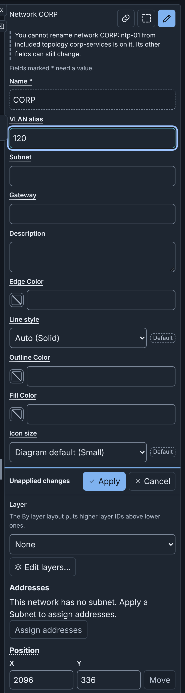
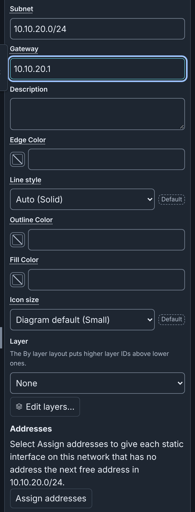
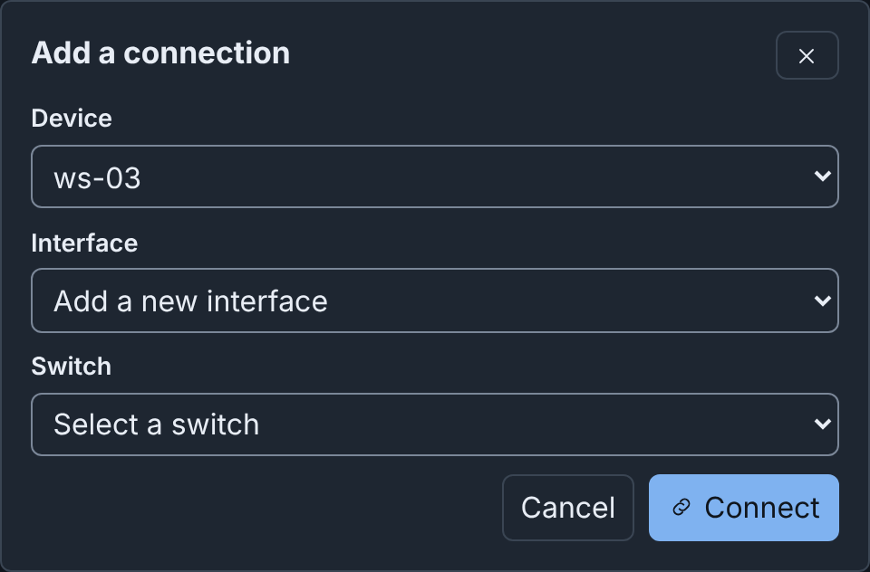
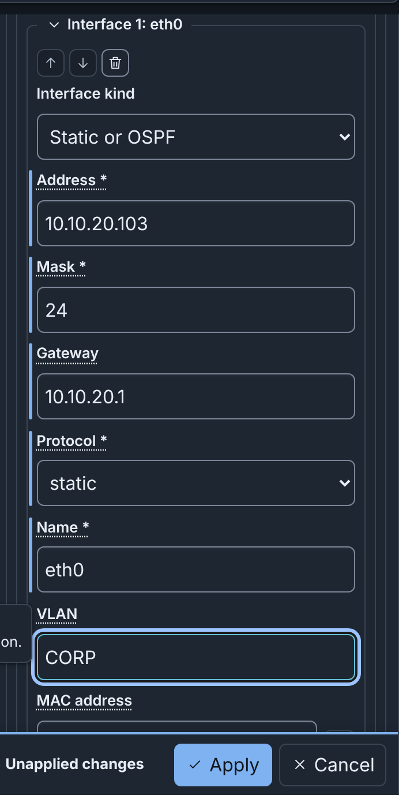
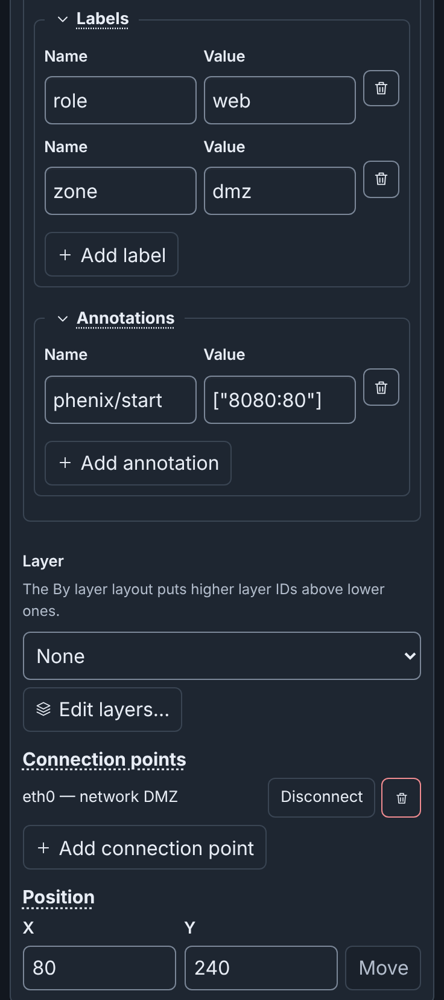
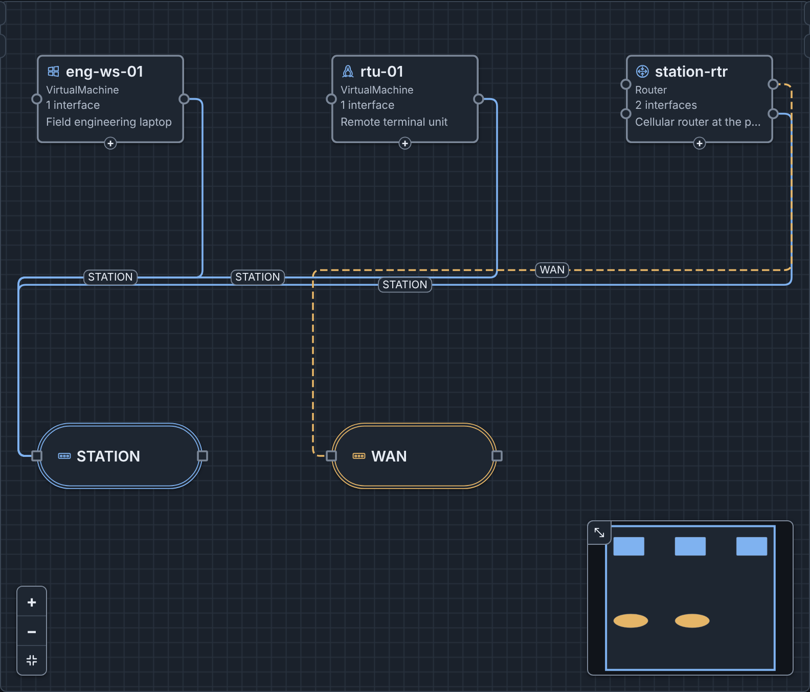
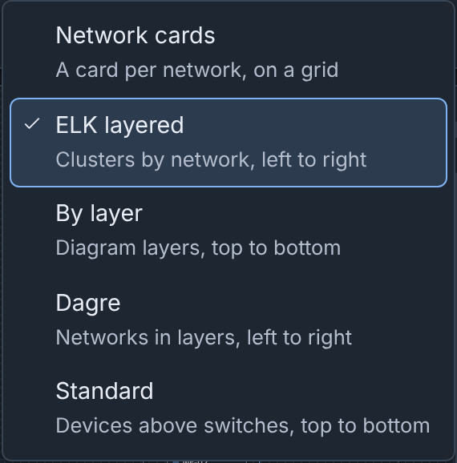
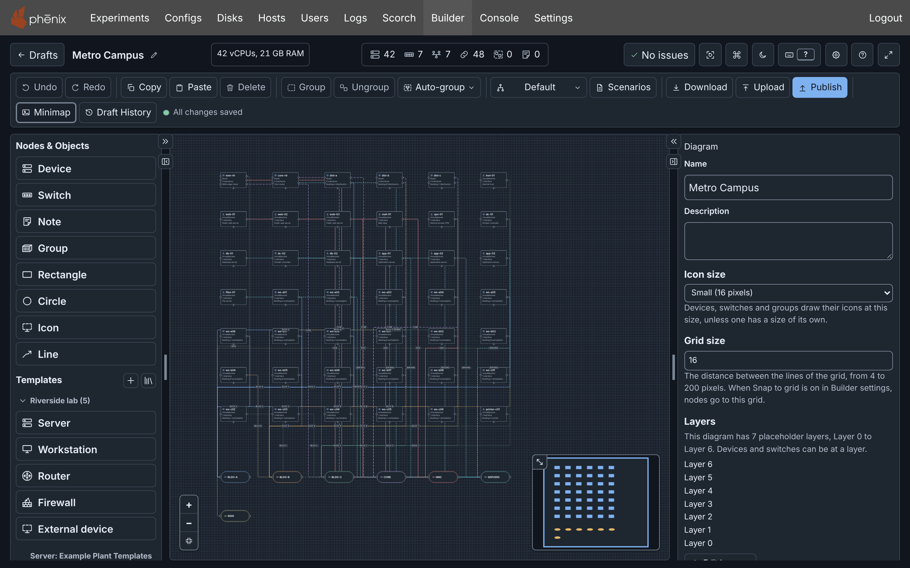
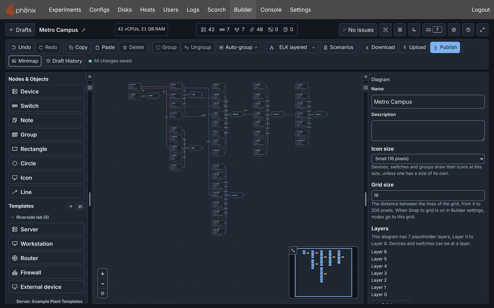

# Building a Diagram: Details

!!! note
    This page goes deeper than the short guide: [Diagrams](../diagrams.md).

The examples use the Riverside Water draft of the
[example lab](../tutorial.md#the-example-lab). [Icons](icons.md),
[Layers](layers.md) and [Scenarios and Included Topologies](scenarios.md)
have their own pages.

## Adding Devices

Clicking an item under `Nodes & Objects` drops the device in free space on
the visible canvas and selects it. For what `Device` and the five built-in
templates set, see [Built-in templates](../reference.md#built-in-templates).
The built-in templates are read only; to change one, duplicate it into the
server's template library (see [Node Templates](templates.md)).

For a VyOS router such as `edge-rtr`, set `OS type` to `vyos` and the
drive's `Image` to `vyos.qc2`. The `vrouter` app configures the interfaces,
routes and rulesets of a Router or Firewall (see
[vrouter App](../../apps.md#vrouter-app)).

## Adding Switches and Networks

A new switch comes with a new network named EXP, then EXP-2 and so on. A
network's fields are all optional:

- `VLAN alias`, from 1 to 4094. When you publish with an experiment, it
  becomes the network's entry in `vlans.aliases` (see
  [Publishing a topology and an experiment](publishing.md#publishing-a-topology-and-an-experiment)).
- `Subnet`, an IPv4 network in CIDR form such as `10.1.0.0/24`.
- `Gateway`, the address of the router on the network. It must be a host
  address in the subnet, such as `10.1.0.1` in `10.1.0.0/24`.

{ width="352" }

Type `#` in the command palette to find a network. A network can have more
than one switch (after a paste, for example), and `Remove network` in the
command palette deletes it with all its switches and connections.

Deleting the last switch of a network deletes the network too, unless an
unconnected interface's `VLAN` still names it. In that case the checks warn
that the network has no switch; add a switch, change the VLAN, or use
`Remove network`. A diagram that you open or upload keeps all its networks.

### Subnets and Addresses

Builder gives addresses only to static interfaces (`Interface kind`
`Static or OSPF`) that have none. It never changes an existing address, or
a device from an included topology.

An assigned address is the next free host address in the subnet: not the
gateway, and not used by another interface on the network. The interface
also gets the subnet's prefix length as its `Mask`, and the network's
gateway if it has no `Gateway` of its own. With `10.1.0.0/24` and gateway
`10.1.0.1`, the first interface gets `10.1.0.2`, mask `24` and gateway
`10.1.0.1`.

Routers (devices of type Router or Firewall) get their addresses first and
never get a `Gateway` of their own:

- If no interface on the network has the gateway address, the first router
  interface gets it.
- If the network has no gateway, the first router interface gets the next
  free address, which becomes the network's `Gateway` in the same step.
- Other router interfaces get the next free addresses.

The suggested subnet of a new network is the first `10.N.M.0/24` that
overlaps no subnet and holds no interface or gateway address of the
diagram, so in an empty diagram it's `10.1.0.0/24`. A network that you
import or upload keeps its own subnet, or has none.

Builder assigns addresses when you connect a static interface to a switch
(including by pasting or duplicating a device with its switch), and when
you click `Assign addresses`. Turning off the `Assign addresses on connect`
setting (in the `Editing` section of [Settings](editor.md#settings)) stops
the first case only.

{ width="352" }

When Builder gives no address on connect, it says why, such as
"No address set: network CORP has no subnet." or
"No address set: subnet 10.1.0.0/30 of network SCADA is full." A static
interface without an address stops `Apply` of its device.

## Connecting Interfaces

Dragging from one device to another adds a switch between them, with a
new network named EXP and a suggested subnet. You can't connect two
switches, since each switch is a network. A published diagram and an
included device have no `+` handle.

### Add a Connection Without Dragging

`Add connection` in the Inspector header, or `Add a connection…` in the
command palette, opens a dialog with the selection filled in. Pick the
`Device`, the `Interface` (`Add a new interface` or one with no connection)
and the `Switch`, then click `Connect`. The command has no default key (see
[Customizing shortcuts](palette-and-shortcuts.md#customizing-shortcuts)).

{ width="496" }

### Type the VLAN in the Inspector

Applying a network's name in an interface's `VLAN` field connects the
interface to that network's switch, as the [quick start](../tutorial.md)
does for `ws-03`:

{ width="354" }

The VLAN matches a network name in any letter case, and the name of another
network moves the connection. A renamed interface keeps its connection as
long as its VLAN names the same network. If you remove one interface and
add another in the same `Apply`, the new one doesn't inherit the old
connection; it connects only if its VLAN names a network.

Under `Connection points`, `Disconnect`, `Add connection point` and
`Remove connection point` take effect at once, without `Apply`. A
disconnected interface blocks publishing (see
[What blocks publishing](publishing.md#what-blocks-publishing)).

### Hiding Connections

`Hide connections` in the command palette, or
<kbd>Alt</kbd>+<kbd>Shift</kbd>+<kbd>C</kbd>
(<kbd>⌥</kbd>+<kbd>⇧</kbd>+<kbd>C</kbd> on macOS), hides the connections on
your canvas only; run it again, or use the `Show connections` switch in
[Settings](editor.md#settings), to show them. The diagram keeps every
connection, so the checks, `Publish` and the PNG and SVG downloads still
include them. While they're hidden you can't select a connection, but
dragging from a connection point still connects it.

## Editing Device Settings

See [Editing a node](editor.md#editing-a-node) for the Inspector and the
[Node Editor](editor.md#node-editor). An interface's `Interface kind` is
`Static or OSPF` (an address you give, or Builder assigns), `DHCP or manual`
(from DHCP or set inside the VM), or `Serial`. A new interface is
`Static or OSPF` with `Mask` `24`, and an external device's interfaces are
always static. Changing the kind asks first, and `Switch and clear` empties
every field of the interface, `Name` and `VLAN` included.

The eye button beside `Description` hides the description on the canvas
(see
[Hiding descriptions on the canvas](editor.md#hiding-descriptions-on-the-canvas)).
`Generate a random MAC address`, beside `MAC address`, writes a locally
administered unicast address that no other interface in the diagram uses;
click `Apply` to keep it.

`miniccc commands`, under `More settings`, lists the commands that phēnix
gives miniccc to run in the VM, such as `exec df -h`.

### Duplicating a Device

`Duplicate` pastes a copy of the selected nodes next to them, with every
setting, addresses included, but no connections. The unconnected interface
is a warning, and once the copy is on the same network, so is the shared
address. Give the copy its own hostname and address (see
[Example: Riverside Water expansion](publishing.md#example-riverside-water-expansion)).

### Drive Images

When Builder can list the server's disk images, a drive's `Image` suggests
them, and an image the server doesn't have is a warning. When the server
lists no images, the checks skip images.

### Routes and Rulesets

An interface's `Inbound ruleset` and `Outbound ruleset` suggest the
device's rulesets, including unapplied ones. The `vrouter` app applies
rulesets only on a Router or Firewall, and skips a ruleset name the device
doesn't have; the checks warn about both (see
[Rulesets and addresses](checks.md#rulesets-and-addresses)).

## Labels and Annotations

Each label or annotation under `More settings` is a `Name` and a `Value`,
as on `web-01`:

Builder reads an annotation value as YAML: `true`, `false` and numbers
become those values, and `["8080:80"]` is a list. Apps read annotations to
configure a node (see [Apps](../../apps.md)).

## Notes

A note also has a `Color`. Resize a selected note the same way as a group.

## Groups

A new group is named "Group" ("Group 2" and so on if that's taken). Its
`Description` shows on one line under the title, its `Border pattern` is
`Dashed` (the default), `Solid`, `Dotted` or `Double`, and its `Icon` is the
container icon by default. Only `Title` and `Description` wait for `Apply`.

`Group` under `Nodes & Objects` adds an empty group. To move a node into a
group, select it, click `Move to group` in the Inspector header (or pick
`Move to a group…` in the command palette), pick the group, and click
`Move`. Pick `No group` to take a node out of its group.

To resize a selected group or note, drag its handles, or press
<kbd>Alt</kbd>+<kbd>Shift</kbd> (<kbd>⌥</kbd>+<kbd>⇧</kbd> on macOS) with an
arrow key. A group is never smaller than its members need.

## Shapes, Icons and Lines

Drawings can also be added from the command palette. Layouts don't move a
drawing, but one in a group moves with the group, and a layout that makes
the group smaller still keeps the drawing inside it.

- A rectangle or circle fills its box (so a circle in a box that isn't
  square is an ellipse). It's see-through until you give it a
  `Fill Color`.
- An icon shows a built-in or custom icon scaled to its box.
- A line joins no node or network. It has arrowheads and 2 to 64 `Points`,
  and a new line is 160 pixels long.

Some fields take effect at once (see
[Fields that take effect at once](editor.md#fields-that-take-effect-at-once));
the others wait for `Apply`. Rectangles, circles and lines always stay under
devices and switches, so they never hide a device or its connection points.

Resize a rectangle, circle or icon like a group. To reshape a line, drag
the handles on its ends and bends, and double-click the line to add a bend.
A clicked handle also moves with the arrow keys, and <kbd>Delete</kbd>
removes its point. Without a mouse, edit the `Points` in the Inspector.

## Auto-group

Two of the choices have a rule of their own:

- `By network` puts a device on several networks with the smallest one.
- `By name` leaves switches out.

Auto-group only groups devices and switches that are in no group, and only
the selected ones if anything is selected. A group needs at least two
members. Afterwards, Auto-group arranges the diagram with the draft's
layout so the groups don't overlap, and `Undo` removes the groups.

### Grouping by a Name Pattern

1. In `Auto-group`, pick `By name pattern…`.
2. Type a JavaScript regular expression in `Name pattern`.
3. Click `Group`.

The pattern is matched against each device hostname and switch name,
ignoring case. Names with the same matched text go into one group named
after that text, or after the first parenthesized part when there is one.
For example:

- `^[a-z]+` puts `web-01` and `web-02` in group `web`, and `db-01` and
  `db-02` in group `db`.
- `^(\w+)-(east|west)` groups by the part of the name before the site.
- `-(\d)\d$` groups by the tens digit of the number at the end.

A pattern has at most 200 characters, only the first 255 characters of a
name are matched, and a group's name is cut to 80 characters. A pattern
that takes more than 2 seconds is stopped with "This pattern takes too long
to match. Use a simpler one." The dialog remembers your last pattern in
this browser until you log out; it isn't saved in the diagram or sent to
the server.

## Colors

| Where | Field | What it colors | Values |
|---|---|---|---|
| Switch | `Edge Color` | The network: its connections, and the outline of its switches | Any CSS color |
| Connection | `Color` | This connection, in place of its network's color | Any CSS color |
| Device, switch | `Outline Color` | The node's border | `#rrggbb` only |
| Device, switch | `Fill Color` | The node's background | `#rrggbb` only |
| Note, group | `Color` | The note or the group | Any CSS color |
| Rectangle, circle | `Outline Color`, `Fill Color` | The shape's border and inside | `#rrggbb` only |
| Line | `Color` | The line and its arrowheads | `#rrggbb` only |

The swatch button before a color field offers suggested colors,
`Custom color` and `No color`. A `#rrggbb` field takes no color names,
short forms or transparency. A switch's `Outline Color` and `Fill Color` belong to that switch, so two
switches of one network can differ.

A device's or switch's outline uses the first of these that applies: its
own `Outline Color`, its layer's color (when the diagram colors outlines by
layer, see [Layer outlines](layers.md#layer-outlines)), and, for a switch,
its network's color. A new network gets the suggested color that the
fewest networks use.

## Line Styles

On a connection, `Auto` follows its network. The `Auto` choice names the
pattern it picked, for example "Auto (Solid)". A pattern can repeat on
several networks, but a connection's label and switch still name its
network.

## Layouts

The layout menu shows the layout that last arranged the draft, or
`Default` if none has. Imported, uploaded and blank drafts start at
`Default`; an import puts its devices in rows on a grid with the switches
below them.

{ width="296" }

In `Network cards`, the devices in each card are grouped by name, and
`ELK layered` puts a device on several networks with its smallest one. A
layout gives the same result every time for the same diagram and
selection, and keeps group members inside their group and other nodes
out. `Restore previous layout` stays in the menu until you make some
other change.

`Auto layout` in the command palette runs the draft's layout again. On a
draft at `Default`, `Auto layout` and `Auto-group` use the `Default layout`
setting (see [Settings](editor.md#settings)), which is `ELK layered` unless
you change it.

Publishing and a Topology YAML download ignore positions and layouts.

Here's Metro Campus
([`metro-campus.topology.yaml`](../examples/metro-campus.topology.yaml)),
42 devices on 7 networks, after the import and then after `ELK layered`:

### By Layer

`By layer` stacks the diagram by [layer](layers.md#layers), highest ID at
the top. Only IDs count, so an ID that isn't in the diagram's layer list
works too. Each connection runs down from the higher layer to the lower.

- A device or switch without a layer goes to the layer of the nearest
  connected node that has one (the higher one on a tie).
- A connected node that no layer reaches goes below every layer, and an
  unconnected node, such as a note, goes at the bottom.
- A group sits at the layer of its highest member, with its members in
  layer order inside it.

When no device or switch has a layer, and within a single layer, the layout
starts from a top node and puts every other node below the node that leads
to it. The top node is the selected device or switch, else a firewall,
else a router, else the switch with the most connections. Firewalls and
routers are found by icon or node type. An external device is a top node
only when you select it, since hardware such as a PLC usually sits low in a
plant.

## Arranging by Hand

Nodes moved with <kbd>Shift</kbd> and an arrow key don't snap to the grid,
and holding the keys down makes one `Undo` step. A move by hand doesn't
change the layout shown in the layout menu.

### The Grid

`Grid size`, in the Inspector with nothing selected, is the spacing of the
grid: a whole number of pixels from 4 to 200, 16 for a new diagram.

`Snap to grid` (in the `Editing` section of [Settings](editor.md#settings),
or in the command palette) is off by default. When it's on, nodes that you
drag, drop or add, and the points of lines that you drag or add, go to the
nearest grid point. It's a per-browser setting, so other users have their
own.

## Copy, Paste, Duplicate and Delete

Each has a key (see
[Keyboard shortcuts](palette-and-shortcuts.md#keyboard-shortcuts)).
`Copy` and `Paste` use Builder's own clipboard, not the system clipboard,
and work between drafts that you open one after another in the same tab.
`Duplicate` copies and pastes in one step without touching that clipboard.

- A paste lands 40 pixels down and right of the original, and each further
  paste 40 pixels more.
- A pasted device gets a free hostname, such as `server-2`, and keeps its
  settings.
- A connection is pasted or duplicated only with both of its nodes, so
  `Duplicate` with only connections selected does nothing.
- Copying a group copies the nodes in it.

## Undo and Redo

Each change is a snapshot of the draft on the server, so `Undo` moves the
draft itself back. `Undo` and `Redo` reach only the changes since you
opened the draft in this tab, or since your last restore; to go back
further, use [Draft History](drafts.md#draft-history).

!!! warning
    After an undo, a new change removes the snapshots you undid, including
    any that other users saved after them (see
    [Newer snapshots](drafts.md#newer-snapshots)).

## See Also

- [The Editor](editor.md): the Inspector, Node Editor and settings.
- [Publishing: Details](publishing.md): what blocks publishing and what a
  publish writes.
- [Checks and Preflight: Details](checks.md): the warnings and errors a
  diagram can show.
