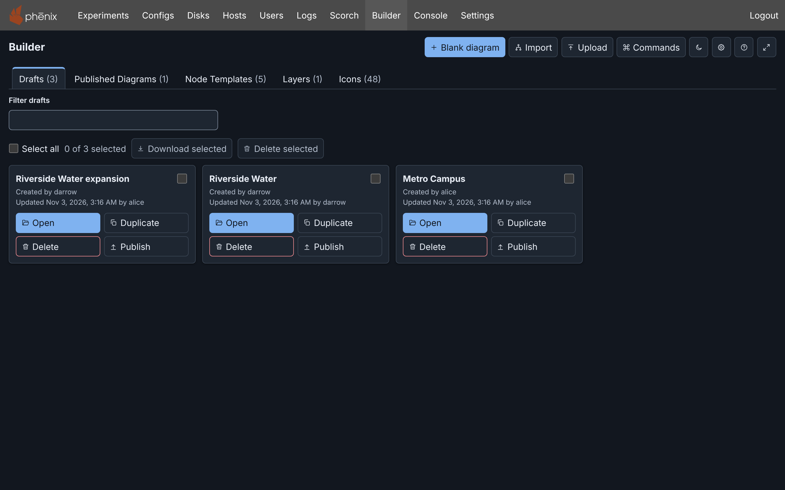
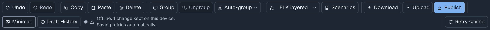
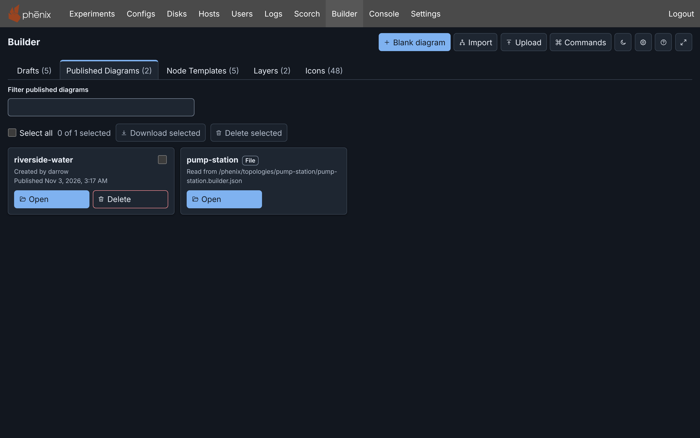
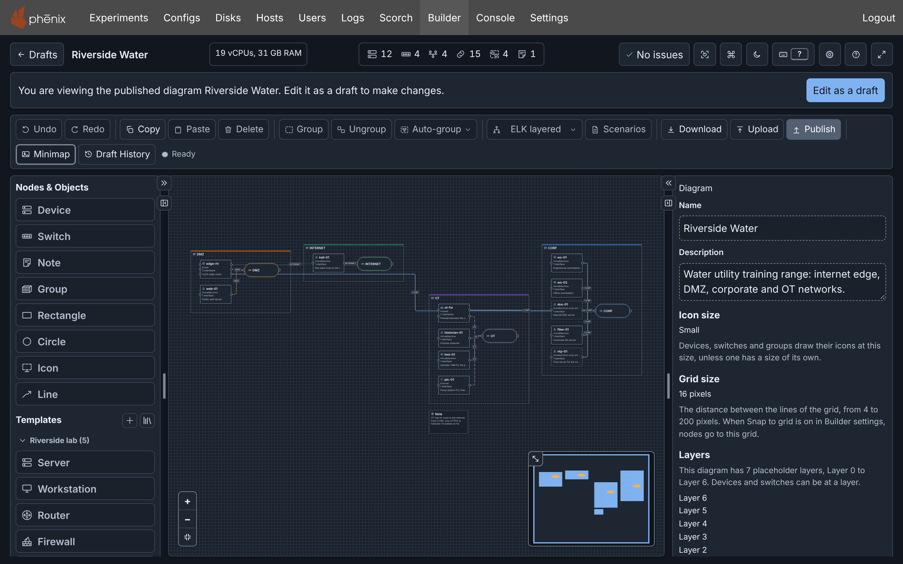
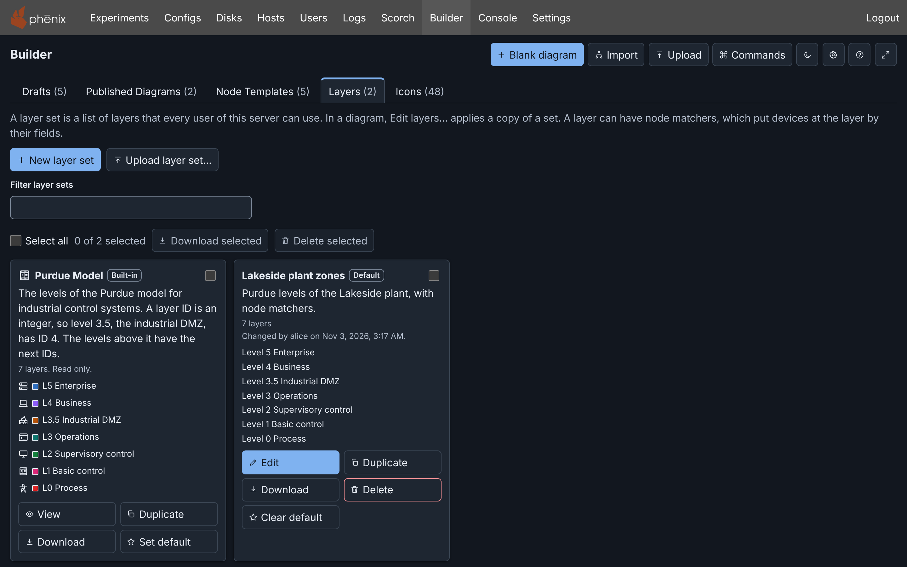
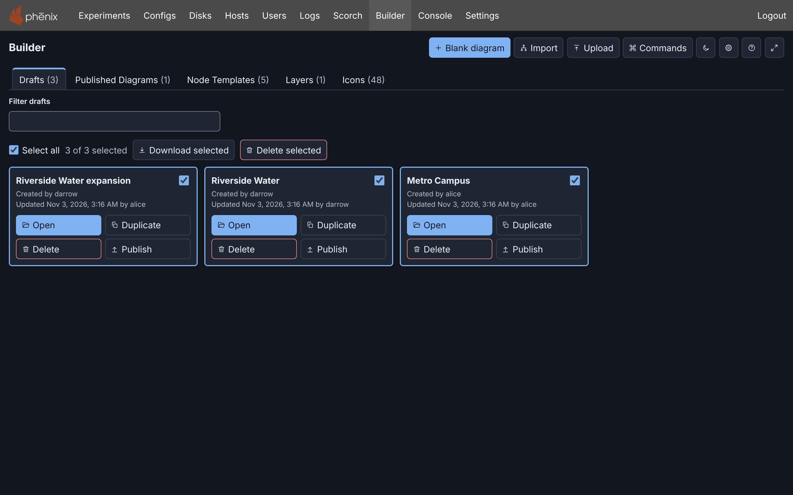
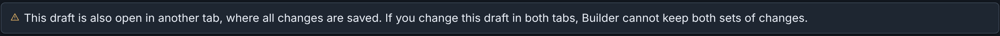
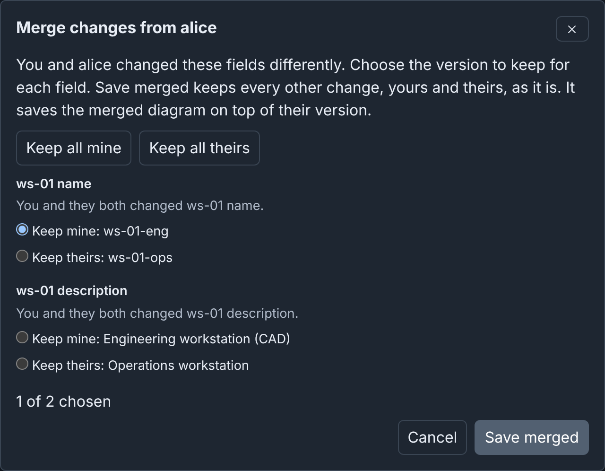

# Drafts: Details

!!! info
    This page goes deeper than the short guide: [Drafts](../drafts.md).

## The Drafts Page

The theme, `Settings`, `Help` and `Focus mode` buttons work as they do in the
[editor](editor.md#header). The `Node Templates` tab is the
[template library](templates.md#the-template-library), the `Icons` tab is the
[icon library](icons.md#the-icons-tab), and [damaged drafts](#damaged-drafts)
come last on the `Drafts` tab.

"Updated" on a draft card, for example "Updated Sep 29, 2026, 1:02 PM by
alice", counts any activity on the draft: an edit, an undo, a restore, a
deleted snapshot or a publish. That's why it can differ from `Last edited` in
the [Inspector](editor.md#with-nothing-selected), which shows when the
content was saved.

### Filtering the Lists

`Filter drafts` and `Filter published diagrams` match the name, or the user
who created or last changed the item. `Filter layer sets` matches the name or
description, and `Filter templates` matches the name and whatever `t:` finds
in the command palette (see
[The Node Templates tab](templates.md#the-node-templates-tab)).

Filters match the way the
[command palette](palette-and-shortcuts.md#command-palette) does: each word
you type must appear in the name or a user name, in any case, or the letters
must appear in the name in order (`pmpst` finds "Pump station"). `Select all`,
`Download selected` and `Delete selected` act only on the cards that show, and
a filter that hides a selected card clears its selection.

## Creating a Draft

`Blank diagram` names the new draft "Untitled topology", or "Untitled topology
2" and so on when a draft of any user already has that name (see [Renaming the
diagram](editor.md#renaming-the-diagram)). `Import` names the draft after its
config (see [Importing a topology or
experiment](import-upload-download.md#importing-a-topology-or-experiment)),
and `Upload` always makes a new draft. `Edit` on a Builder topology on the
`Configs` page works like `Edit as a draft` (see [Editing a published
topology](publishing.md#editing-a-published-topology)).

## Opening a Draft

In the command palette, `open draft` lists the published diagrams as well as
the drafts.

### Links to a Draft

A link to a draft looks like `<phenix-address>/builder?draft=<draft-id>`. The
address bar shows it while the draft is open, so a reload opens the same
draft.

## Publishing from the Drafts Page

`Publish` on a card opens the `Publish diagram` dialog without the editor (see
[Publishing](publishing.md)). If the diagram has errors, the dialog lists them
and won't publish; click `Open draft` to fix them. Closing the dialog doesn't
stop a running publish, and pending changes keep saving.

## How Drafts Save

Each saved change is a snapshot in [Draft History](#draft-history). Besides
sending pending changes, `Save now` applies the valid Inspector changes that
you haven't applied with `Apply`. For every save state, see
[Save states](../reference.md#save-states).

### Working Offline

Unsent changes stay in this browser even after you close the tab, and Builder
sends them the next time you open the draft in the same browser.
[Logging out](#logging-out) deletes them.

## Draft History

`Draft History` in the toolbar lists the snapshots, newest first. Each row
shows the snapshot's number (1 is the draft as Builder made it), a name that
says what the change did, such as "Added device", and the date and user. You
can't restore or delete the current snapshot. The tooltip on each other
`Restore` says how many newer snapshots your next change after that restore
removes. If the server doesn't move the draft to the snapshot, for example
while you're offline, the page says so and the draft stays as it was. `Undo`
and `Redo` skip a deleted snapshot (see [Undo and
redo](diagrams.md#undo-and-redo)).

### Newer Snapshots

While you're on an older snapshot, the notice above the toolbar reads like
"Your next change removes 2 newer snapshots (latest by bob, Oct 26, 2026,
10:00 AM)."

- After `Undo`, `Return to latest` works like `Redo` and keeps your undo
  steps. Otherwise it restores the newest snapshot.
- `Save newer history as a new draft` copies the newest snapshot to a new,
  unpublished draft, for example "Riverside Water (copy)". Like
  [a duplicate](#duplicating-a-draft), it publishes as a new topology.

### Automatic Snapshots

When you leave, publish or download a draft with Inspector changes that you
didn't apply, Builder applies and saves them. The snapshot is named after the
node, for example "Saved unapplied changes to Device web-01", and marked
`Automatic`.

### Limits

The server holds at most 2,000 drafts across all users. At that limit, delete
drafts or click `Clean up…` in [Settings](editor.md#settings), which deletes
every user's published, unchanged drafts (see
[Cleaning up storage](administration.md#cleaning-up-storage)).

A draft keeps at most 50 snapshots and 50 MiB of them, and Builder deletes the
oldest past either limit. A published diagram and a
[diagram read from a file](#diagrams-read-from-a-file) have no draft history;
to keep one, edit the diagram as a draft.

## Published Diagrams

The cards show the topology name, and the publish time for a topology that
Builder published. A published diagram records who made it and who last
edited it, taken from the draft at publish time.

After the first `Edit as a draft` by any user, the button opens the draft that
published the diagram or was made from it instead of making another one (see
[Publishing again](publishing.md#publishing-again)).

### Opening the Experiment

When a diagram was published with an experiment (see [Publishing a topology
and an experiment](publishing.md#publishing-a-topology-and-an-experiment)),
`Exp` on its card and in the editor toolbar, or `Open experiment` in the
command palette, opens the experiment page in the same tab. `Exp` shows only
while the experiment exists and you may view it, and it follows a renamed
experiment. It doesn't show for an experiment that you made from the topology
yourself. When one publish made several experiments, `Exp` opens one of them.

### Diagrams Read from a File

An administrator can point a topology at a Builder file on the phēnix server
as its diagram, without a publish (see
[Builder documents in files](administration.md#builder-documents-in-files)).
The card shows the tag `File` and the file path, and has no `Delete`; to
delete the topology, use the `Configs` page.

`Open` reads the file. If the stored topology isn't what the diagram in the
file would publish, the notice says so, and a draft made from it can publish
only as a new topology. `Edit as a draft` reopens the same draft as long as
the file holds the same diagram, and makes a new one after the file changes.
Such a draft can update the topology (see [Publishing to a topology that names
a Builder
file](publishing.md#publishing-to-a-topology-that-names-a-builder-file)). If
the file changes between `Open` and `Edit as a draft`, Builder makes no draft,
so open the diagram again. When phēnix can't use the file, the page says why
(see [When the file cannot be
used](administration.md#when-the-file-cannot-be-used)).

### Deleting a Published Topology

1. Click `Delete` on the card.
2. Click `Delete topology`.

If another user published or changed the topology after Builder read the
list, Builder deletes nothing and reloads the list, so check the topology and
try again. A draft that published the topology, was imported from it, or was
opened from its published diagram creates the topology again the next time it
publishes to that name.

## The Layers Tab

A layer set is a named list of [layers](layers.md#layers) and their options.
`Show Layers` in the command palette opens this tab from the drafts page, and
in a diagram, `Edit layers…` applies a copy of a set to the diagram.

`New layer set` opens the layers editor on a new set with the 7 placeholder
layers, and `Upload layer set…` adds a set from a
[layer set file](import-upload-download.md#layer-set-files). On the cards:

- `Edit` opens the layers editor (see
  [Editing the layers](layers.md#editing-the-layers)). Each save gives the set
  its next version.
- `Duplicate` adds a copy with a number after its name, such as
  "Purdue Model (2)".
- `Download` saves a layer set file.
- `Delete` can't be undone. Diagrams keep their copies of the set's layers.
- `Set default` makes the set the server's default (`Clear default` undoes
  it). Any Builder user can change the default.

The built-in `Purdue Model` set is read only and can't be deleted. Each
`Blank diagram` starts with a copy of the default set, linked to it, or with
the placeholder layers when there's no default. A library template also
offers the default set's layers in the
[template editor](templates.md#the-template-editor).

If another user changed the set or the default after the tab read the
library, `Delete`, `Set default` and `Clear default` change nothing and the
tab reloads the library, so try again. If another user saved the set after
you opened it, `Save` fails; close the editor and open the set again.

The tab doesn't list sets that the server can't read, such as sets saved by a
newer phēnix version, but it says how many there are. The library holds at
most 200 sets plus the built-in one (see [The
libraries](administration.md#the-libraries)).

### Selecting Several Layer Sets

Selection works as it does [for drafts](#selecting-several-drafts), except
that `Download selected` also saves the built-in set and `Delete selected`
skips it.

## Duplicating a Draft

`Duplicate draft…` in the
[command palette](palette-and-shortcuts.md#command-palette) works like
`Duplicate` on a card. In the editor it copies the open draft once its changes
are saved; on the drafts page it asks which draft to copy.

When a name ending in "(copy)" is taken, the copy gets "(copy 2)", "(copy 3)"
and so on, so a copy of "Pump station (copy)" is "Pump station (copy 2)".
You're the copy's creator, and it still includes the topologies that the
original included. A read-only published diagram has no `Duplicate`, so click
`Edit as a draft` first.

## Deleting a Draft

If another user has the draft open, their next save fails. A delete during a
publish of the draft waits until the publish is done.

## Selecting Several Drafts

A card has a checkbox when `Download selected` or `Delete selected` can act
on it: every card on `Drafts`, the cards on `Published Diagrams` (for
`Delete selected`, only those you can delete, and none for a diagram read
from a file), and each icon on `Icons` (see
[The Icons tab](icons.md#the-icons-tab)). Each tab keeps its own selection.

### Selecting with the Keyboard

The cards of a tab are one stop for the <kbd>Tab</kbd> key, which lands on the
card you were last on.

| Key | What it does |
|---|---|
| Arrow keys | Move to the next or previous card, also to the card above or below |
| Home, End | Move to the first or last card |
| Space | Select the focused card, or clear it |
| Shift+Space, Shift and an arrow key | Select the cards from the card you last selected or cleared to the focused card, also when you cleared that card |
| ⌘A (macOS), Ctrl+A | Select every card |
| Escape | Clear the selection |
| Delete (Backspace on macOS too) | Ask to delete the selected cards, where `Delete selected` can |

Shift-clicking a checkbox gives every card from the one you last selected or
cleared to that checkbox its new state. After `Select all`, ⌘A or Escape, it
changes only that card.

### Downloading Several Drafts

`Download selected` saves one Builder JSON file per card, with its custom
icons, as `Download` in the editor does. Each file holds the draft as the
server has it, or on `Published Diagrams`, the published diagram. Your
browser may ask you to allow the page to download several files.

### Deleting Several Drafts

1. Select the cards.
2. Click `Delete selected`.
3. Click `Delete 2 drafts` (the number of selected drafts).

When some items can't be downloaded or deleted, a summary under the row lists
each one with the reason, and failed deletes stay selected. If the server
can't be reached partway through, Builder stops and lists the rest as "Not
attempted."

## Damaged Drafts

A draft that this phēnix server can't read, for example one that a newer
phēnix version saved, has no `Open`. Open it with the version that saved it,
or delete it. Any Builder user can delete a damaged draft.

## Logging Out

Logging out, or signing in as another user in the same browser, deletes your
Builder data from the browser at once: unsent changes, recent commands, the
last Auto-group name pattern and the Preflight checks you last selected.
`Download` keeps a copy of a draft that hasn't finished saving. phēnix logs
you out the same way when your session ends (see
[Troubleshooting](../troubleshooting.md)) or after a long idle
time. Your preferences stay: theme, column widths, minimap size, keyboard
shortcuts and settings (see [Storage](administration.md#storage)).

## Same Draft in Multiple Tabs

When a draft is open in more than one browser tab, each tab shows a notice
under the header:

If more than one tab holds unsaved changes, for example after offline work,
Builder can save only one tab's changes, so it opens the
`Choose which changes to save` dialog:

1. Under `Version to save`, choose a version, for example "This tab: 1
   change, last at Sep 29, 2026, 1:01:26 PM". `Download` saves this tab's
   version as a file.
2. Click `Save this version`.

Builder saves each other version as a new draft with " (local copy)" after
its name, and the tab with that version switches to it. `Decide later` closes
the dialog without sending anything, and `Choose which to save` in the notice
opens it again.

## Draft Merging

When someone saves a newer version of the draft before your changes reach the
server, Builder merges their changes with yours, field by field, and the save
state says "Merging your changes with the server version…".

- A change that only one of you made stays, even on different fields of one
  device: if alice moves router-1 and you rename it, router-1 is moved and
  renamed.
- Items either of you added stay. An item one of you deleted is deleted,
  unless the other changed it or added a connection to it.
- An interface that one of you renamed keeps the other's changes.
- Scenarios that either of you added or removed are added or removed.
- Your zoom and position on the canvas don't change.

When nothing clashes, Builder saves the merged diagram on top of the newer
version and says "Merged alice's changes with yours." Draft History lists it
as "Merged changes from alice", and Undo goes back to alice's version.

These changes clash:

- A field you both changed to different values. A device's name, its hostname
  and the hostname in its settings are one choice, as are the new names of
  one interface (the diagram keeps one interface) and the whole link of a
  [linked template](templates.md#linked-templates).
- An item one of you deleted while the other changed it or connected to it.
  The choices read like `Keep theirs: delete ws-01 and drop your connection to
  it` and `Keep mine: keep ws-01 with your connection`.
- A group one of you deleted or ungrouped while the other put a node in it.
  If the group goes, the node moves to the group that held it, as `Ungroup`
  does, or to no group.
- A node one of you put in a group while the other put that group in the
  node. The choices name the groups, such as `Keep mine: Site` and
  `Keep theirs: no group`. If your choices still nest two groups in each
  other, Builder moves one of them out.

Builder tells you about each connection it drops and each node it moves.

When something clashes, or the merged diagram has an error such as two
devices with one hostname, the `This draft changed on the server` panel opens
under the header. Your unsaved changes stay on this device, and new edits
don't save until you choose:

- `Review and merge` opens the `Merge changes from alice` dialog.
- `Save my history as a new draft` saves your version as a new draft, for
  example "Riverside Water (local copy)", and opens it. If that save stops
  partway, Builder deletes the incomplete draft.
- `Discard mine and load the server version` asks first, then drops your
  changes for good. If Builder can't read the newer version, it keeps your
  changes.

In the dialog, pick `Keep mine` or `Keep theirs` for each clash, or click
`Keep all mine` or `Keep all theirs`. `Save merged` saves the result, with
every change that doesn't clash, on top of the newer version.

- If the result has an error, the dialog lists it and stays open. When the
  dialog opened only because of such an error, `Save merged` is unavailable:
  click `Cancel`, then save your history as a new draft or discard it.
- If yet another version arrives while Builder saves, it saves nothing and
  merges again.
- If the save fails, the dialog keeps your choices, so click `Save merged`
  again.

Merging needs the version your changes started from. The panel says "Merging
is not available", with no `Review and merge`, when the server no longer keeps
that version (a draft keeps its last 50 snapshots), when Builder can't read
it, or when the server doesn't send it within 15 seconds. If the merge fails,
the panel says "Merging failed" with the reason and offers the same choices.

## See Also

- [Troubleshooting](../troubleshooting.md): problems with saving, merging and
  offline work.
- [Publishing](publishing.md): what publishing a draft writes and replaces.
- [Administration](administration.md): permissions, storage and cleanup.
