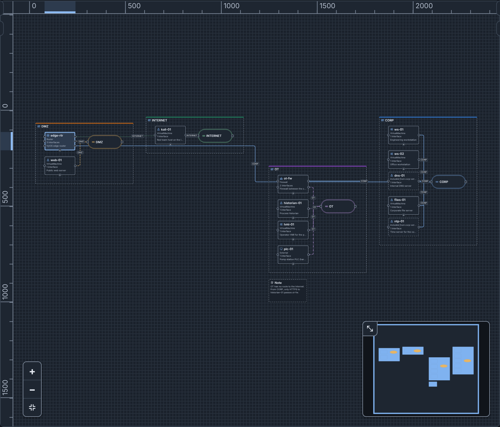
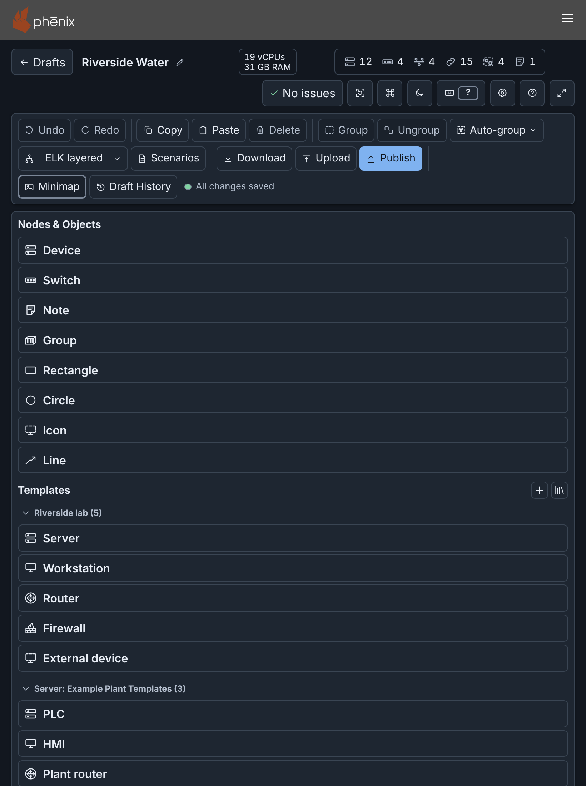
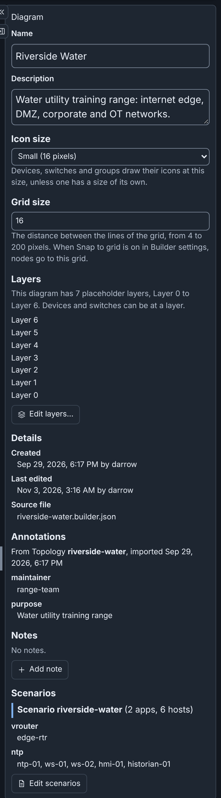
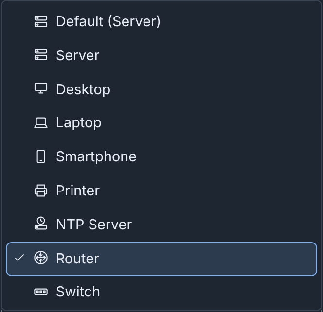
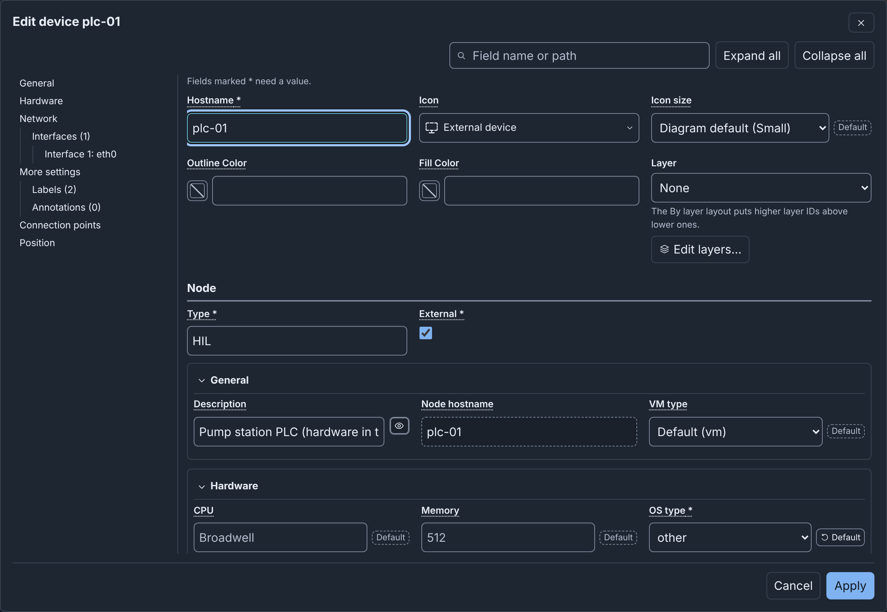
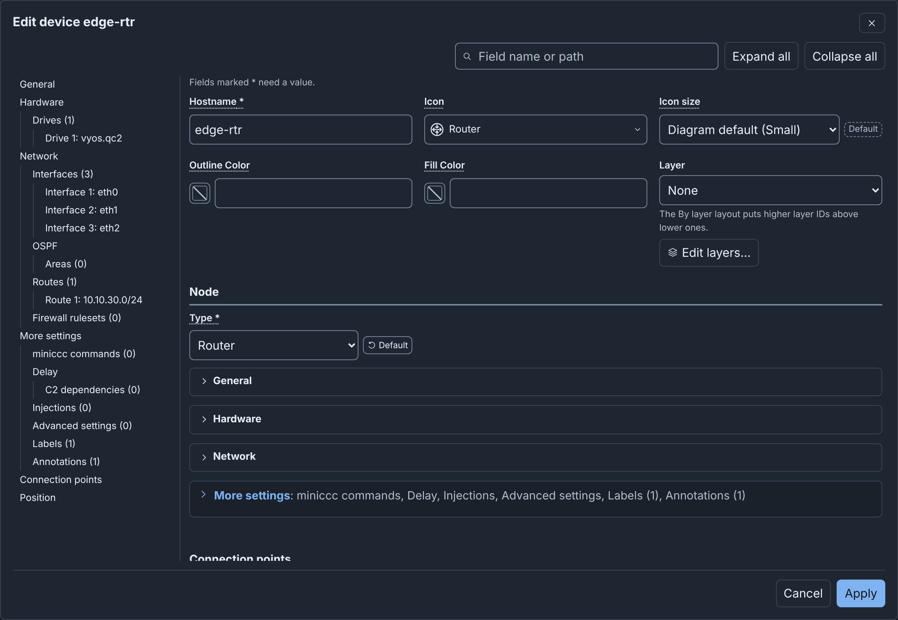
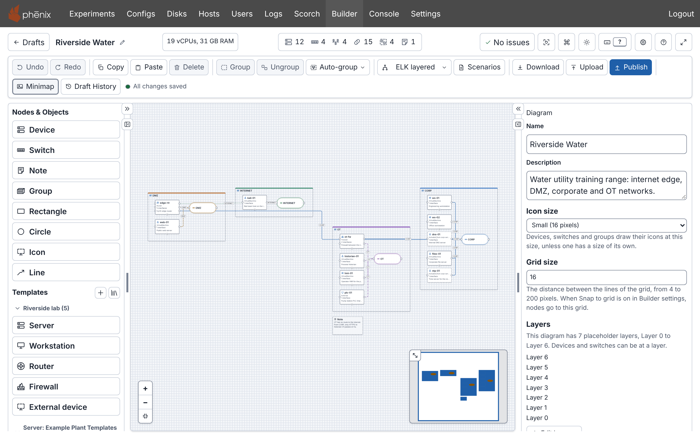

# The Editor: Details

!!! info
    This page goes deeper than the short guide: [The Editor](../editor.md).
    The examples use the Riverside Water draft of the
    [example lab](../tutorial.md#the-example-lab).

## Header

The [guide](../editor.md#header) lists what the header holds.

### Selecting by Kind

Click a count in the header to replace the selection with every item of that
kind. For example, `12 devices` selects the 12 devices.

- The networks count selects the networks' switches, because the canvas
  shows each network as its switch.
- While a device or a switch is at a layer, there's also a layers count. It
  includes the placeholder layers, and selects each device and switch that's
  at a layer, whether chosen for the node or matched by its fields (see
  [Layers](layers.md#layers)).

To select the nodes of one layer, the devices on one network, or the devices
that use one disk image, use `Select nodes on layer`,
`Select devices on network` or `Select devices using image` in the
[command palette](palette-and-shortcuts.md#command-palette).

### Resource Totals

The totals add up the vCPUs and memory of each device that phēnix starts, as
a VM or a container. External devices don't count, but devices from an
included topology do, because the experiment starts them too. A device with
no `VCPUs` or `Memory`, or with a value that isn't a whole number above 0,
counts as 1 vCPU and 512 MB, as phēnix starts it.

When devices are selected, their totals show below, for example
`Selected: 2 vCPUs, 1 GB RAM`. To compare the totals with the free resources
of the cluster, run the `Host capacity` check of [Preflight](checks.md#preflight).

### Renaming the Diagram

The steps are in the [guide](../editor.md#header). Moving focus out of the
field also renames the diagram, and <kbd>Esc</kbd> keeps the old name.
`Undo` restores the old name, and the `Name` field of the
[Inspector](#with-nothing-selected) changes the same name.

## Toolbar

Where to read more about each toolbar button:

| Button | See |
|---|---|
| `Undo`, `Redo` | [Undo and redo](diagrams.md#undo-and-redo), [Newer snapshots](drafts.md#newer-snapshots) |
| `Copy`, `Paste`, `Delete` | [Copy, paste, duplicate and delete](diagrams.md#copy-paste-duplicate-and-delete) |
| `Group`, `Ungroup`, `Auto-group` | [Groups](diagrams.md#groups), [Auto-group](diagrams.md#auto-group) |
| Layout menu | [Layouts](diagrams.md#layouts) |
| `Scenarios` | [Scenarios](scenarios.md#scenarios) |
| `Download`, `Upload` | [Import, Upload and Download](import-upload-download.md) |
| `Publish` | [Publishing](publishing.md) |
| `Exp` | [Opening the experiment](drafts.md#opening-the-experiment) |
| `Draft History` | [Draft History](drafts.md#draft-history) |
| `Minimap` | Shows or hides the minimap until the next diagram opens (see [Settings](#settings)) |

After an undo, a notice says how many newer snapshots your next change will
remove. In a published diagram, the editing buttons are unavailable. The
layout menu shows the layout of the draft, or `Default` when no layout has
run. The keys in the tooltips of the layout menu and `Auto-group` run
`Auto layout` and `Auto-group by network` directly, without the menu.

## Canvas

- With `Snap to grid` on in [Settings](#settings), nodes go to the diagram's
  grid (see `Grid size` in [With Nothing Selected](#with-nothing-selected)).
- <kbd>Shift</kbd> and an arrow key move the selected nodes 10 pixels,
  ignoring the grid. Builder saves the move as one undo step when you
  release the key (see [Arranging by hand](diagrams.md#arranging-by-hand)).
- After `Fit diagram to view`, that button becomes `Restore previous view`.
- Double-click a node to open the [Node Editor](#node-editor), or
  double-click a line to add a bend.

A device from an included topology has a dashed border and shows its source
in place of its type (see [Included topologies](scenarios.md#included-topologies)).
To resize the minimap, drag its top left corner.

With `Show coordinates` on in Settings, rulers show X and Y in canvas
pixels, and a band marks the extent of the selected nodes. For a node in a
group, `Position` counts from the group's top left corner, so it won't agree
with the rulers.

{ width="600" }

`Reset view` resets the zoom to your `Zoom when a diagram opens` setting,
shows the minimap (unless `Show the minimap` is off) and both side columns
at their default sizes, resets the collapsed and opened sections, and
scrolls the columns to the top. To hide
the connections on your canvas only, see
[Hiding connections](diagrams.md#hiding-connections).

### Info Tooltips

A device's info tooltip shows its description, each interface with its
address (or `DHCP`), and its OS type. A switch's shows its network, VLAN
alias, description and connected devices with their addresses. Descriptions
are cut to 80 characters, and lists to 8 entries. The tooltip shows when
you hover over a node or move focus to it, and <kbd>Esc</kbd> closes it.

## Side Columns

Each side column (`Nodes & Templates` and the Inspector) has a toggle that
widens it and one that hides it. Drag the splitter beside a column to resize
it, or double-click the splitter to restore the default width. Selecting
something on the canvas shows a hidden Inspector.

In a narrow window, or at a high browser zoom, the columns stack and the page
scrolls.

## Nodes & Objects

The drawings in `Nodes & Objects` are `Rectangle`, `Circle`, `Icon` and
`Line` (see [Shapes, icons and lines](diagrams.md#shapes-icons-and-lines)).
Builder puts a new node in free space and selects it (see
[Adding devices](diagrams.md#adding-devices)). For the template sections and
updates of linked templates, see
[Templates in the editor](templates.md#templates-in-the-editor) and
[Linked templates](templates.md#linked-templates).

To find a node, use `Go to node` in the command palette (type `@`), or
`Go to network` (type `#`) for a network. To rename a node, select it and
press <kbd>F2</kbd> to jump to its name in the Inspector. `Remove network`
in the command palette removes a network and its switches, even a network
that no switch shows (see
[Adding switches and networks](diagrams.md#adding-switches-and-networks)).

## Inspector

Hover over a field's label to see its help. For a field of the phēnix spec,
the help starts with its topology YAML path, such as `hardware.vcpus`.

### The Inspector Header

With one node selected, the Inspector header names it, for example
`Device edge-rtr`, and has three buttons:

- `Add connection` connects a device to a switch without a drag (see
  [Add a connection without dragging](diagrams.md#add-a-connection-without-dragging)).
  It shows for a device or a switch, but not for a device from an included
  topology.
- `Move to group` puts the node in a group, or takes it out of its group
  (see [Groups](diagrams.md#groups)).
- `Open Node Editor` (the pencil) opens the [Node Editor](#node-editor).

`Add connection` and `Move to group` have no keys until you set some (see
[Customizing shortcuts](palette-and-shortcuts.md#customizing-shortcuts)). A
published diagram shows only `Open Node Editor`.

### Collapsing Sections

Groups of fields (such as `General` or `Hardware`), lists (such as
`Interfaces` or `Drives`) and each list entry collapse when you click their
name. A collapsed part that holds a field with an error shows a cross after
its name, and it expands when you go to that field, or when `Apply` or
`Save now` stops because of the error.

Sections stay collapsed for the next node until you leave the page. The
Inspector, the Node Editor and the template editor each keep their own.
`Reset view` expands everything.

### With Nothing Selected

{ width="352" }

The `Diagram` section has these fields. A published diagram shows them as
text.

- `Name` and `Description`, which need `Apply`.
- `Template updates` shows only when a linked template of the diagram needs
  attention (see [Linked templates](templates.md#linked-templates)).
- `Icon size`: `Small`, `Medium` or `Large` (see
  [Icon size](icons.md#icon-size)). Your own `Node icon size` setting
  overrides it on your canvas, but the diagram keeps its size.
- `Grid size`: the spacing of the canvas grid in pixels, a whole number from
  4 to 200 (16 by default). Nodes go to the grid only while `Snap to grid` is
  on in [Settings](#settings).
- `Layers`: the diagram's layers, or a note that it has the 7 placeholder
  layers (see [Layers](layers.md#layers)). When the diagram's layer set has a
  newer version, `Update from layer set` copies it in. `Edit layers…` opens
  the [layers editor](#layers-editor).
- `Details`: who made and last saved the diagram, and its source file (see
  [Who made and last saved a diagram](import-upload-download.md#who-made-and-last-saved-a-diagram)).
- `Annotations`: for a draft imported from a config, that config's
  annotations. You can't change them, and publishing doesn't write them (see
  [What an import keeps](import-upload-download.md#what-an-import-keeps)).
- `Notes`: text about the whole diagram. `Add note` adds a box, and Builder
  saves a note when you leave its box. To remove a note, empty its box or
  click its `Delete` button. Builder JSON and YAML keep the notes, but
  publishing writes them to no config.
- `Scenarios`: each scenario with its apps and their hosts. `Edit scenarios`
  opens the `Scenarios` dialog (see [Scenarios](scenarios.md#scenarios)).

A diagram holds at most 100 notes of at most 4096 bytes each, in UTF-8.
Builder won't save a note that's too long, or that holds a control character
other than a line break or a tab.

### Editing a Node

The steps are in the [guide](../editor.md#editing-a-node). A device's less
common fields, such as `miniccc commands`, `Injections`, `Labels` and
`Annotations`, are under `More settings`, which you click to open. Under
`Layer`, a device with no chosen layer can be at the layer that its fields
match (see [Layers](layers.md#layers)), and `Use matched layer` removes the
chosen layer. For colors, see [Colors](diagrams.md#colors).

An empty optional field shows the value that phēnix uses, for example
`Default (kvm)` for `VM type`. `Default` empties an optional field, or gives
a required field its default value.

Some fields don't accept every value:

- A list of choices that holds a value that isn't one of them, as in an
  uploaded topology, shows the value with `(not one of the choices)` and a
  warning.
- A field for a whole number shows an error for text, or for a number such
  as 1.5 or 1e3.
- `Memory` and `VCPUs` can hold template text, such as `{{ .Memory }}`,
  until you type a number.

When the diagram changes while you edit, the Inspector keeps your unapplied
changes. Builder also saves them when you leave, publish or download the
draft (see [Automatic snapshots](drafts.md#automatic-snapshots)).

The fields come from the phēnix server. When the server can't send them, the
Inspector says so and shows the fields built into Builder, which may differ
from what this server accepts (see [Permissions](administration.md#permissions)).

### Other Kinds of Nodes

- A switch is one network. Its fields are the network's `Name`,
  `VLAN alias`, `Subnet`, `Gateway` and `Description`, plus its look,
  `Layer`, `Addresses` and `Position` (see
  [Adding switches and networks](diagrams.md#adding-switches-and-networks)
  and [Addresses of a Network](#addresses-of-a-network)).
- A connection's `Label` is the name of its network by default.
- For notes, groups and drawings, see [Notes](diagrams.md#notes),
  [Groups](diagrams.md#groups) and
  [Shapes, icons and lines](diagrams.md#shapes-icons-and-lines).

### Addresses of a Network

A switch's `Subnet` is the IPv4 network, for example `10.10.20.0/24`, and its
`Gateway` is the IPv4 address of the router on the network, which must be in
the subnet. Publishing doesn't write either of them to the topology.

`Assign addresses`, under `Addresses`, gives each static interface on the
network that has no address the next free address of the subnet, as one
`Undo` step. It uses the applied `Subnet`, and is unavailable while the
network has none. `Assign addresses` in the command palette does the same
for a network that you choose. For how Builder picks addresses and gateways,
see [Subnets and addresses](diagrams.md#subnets-and-addresses).

### Fields That Take Effect at Once

These fields change how a node or a connection looks, so they apply without
`Apply`, each as one `Undo` step:

| Where | Fields |
|---|---|
| Device | `Icon`, `Icon size`, `Outline Color`, `Fill Color` |
| Switch | `Edge Color`, `Line style`, `Outline Color`, `Fill Color`, `Icon size` |
| Group | `Color`, `Border pattern`, `Icon`, `Icon size` |
| Note | `Color` |
| Rectangle or circle | `Fill Color`, `Outline Color`, `Border pattern` |
| Icon | `Icon` |
| Line | `Label`, `Color`, `Line style` |
| Connection | `Label`, `Color`, `Line style` |

`Layer`, `Show description on the canvas`, and adding, disconnecting or
removing a connection point also take effect at once. A text field such as
`Label` takes effect when you press <kbd>Enter</kbd> or leave the field. In
the template editor, these fields change the template at once, and `Save`
saves the template.

### Hiding Descriptions on the Canvas

A device and a group show their `Description` on the canvas. To hide it for
one node, click the eye button (`Show description on the canvas`) beside
`Description`. The template editor and the Node Editor have the same button,
and the diagram keeps the choice. The node keeps its description, and the
info tooltip still shows it. PNG, SVG and draw.io downloads don't show it,
but `Publish` and the checks aren't affected.

To hide the descriptions of all nodes on your canvas, turn off
`Show node descriptions` in [Settings](#settings), or choose
`Hide node descriptions` in the command palette.

### The Icon Field

{ width="352" }

`Icon` opens the list of built-in icons. `Default`, at the start of the list,
is the icon a node gets when it has no icon of its own (an icon drawing has
no `Default`). `Custom icon…`, at the end, opens the `Custom icons` dialog
(see [Custom icons](icons.md#custom-icons)).

### Fields You Cannot Change

- A device from an included topology is read only, but you can still move
  it. `Combine into a new draft` makes a copy of the diagram in which the
  included devices are its own (see
  [Making included devices editable](scenarios.md#making-included-devices-editable)).
- You can't rename a network that an included device is on.
- A published diagram is read only (see
  [Published diagrams](drafts.md#published-diagrams)).

### Node Editor

Besides double-clicking a node or clicking `Open Node Editor`, you can open
the Node Editor by selecting or focusing a node and pressing
<kbd>Alt</kbd>+<kbd>Shift</kbd>+<kbd>E</kbd>
(<kbd>⌥</kbd>+<kbd>⇧</kbd>+<kbd>E</kbd> on macOS), or with `Open Node Editor`
in the command palette.

Before the Node Editor opens, the Inspector applies its unapplied changes.
If one of them has an error, the Node Editor doesn't open. `Edit layers…`
opens the [layers editor](#layers-editor) on top of the Node Editor, which
keeps your changes.

The changes that take effect at once in the Inspector do so here too
([Fields That Take Effect at Once](#fields-that-take-effect-at-once),
`Layer`, `Connection points` and `Move`). `Cancel` doesn't discard those, so
use `Undo`. When you leave or reload the draft, Builder applies and saves the
unapplied changes of the Node Editor. In a published diagram, the Node
Editor is read only.

#### Sections and the Table of Contents

For a device, the Node Editor has `Expand all`, `Collapse all` and a table
of contents, which also lists `Checks` when the node has issues and marks an
entry with a field error with a cross. In a narrow window, click
`Table of contents` to show it above the fields.

#### Searching the Fields

`Search fields` ignores letter case and field values. Part of a path also
matches, for example `interfaces.vlan`, and with two or more words, each word
must match. A section, list or entry whose name matches shows all its
fields.

<kbd>Esc</kbd> in the box empties it. When the box is already empty,
<kbd>Esc</kbd> closes the Node Editor. When `Apply` stops because of errors,
the search empties, and the sections stay expanded so you can see the
fields with errors.

## Settings

`Builder settings` also opens from the drafts page.

| Group | Setting | Default | What it does |
|---|---|---|---|
| Appearance | `Theme` | `System` | `System`, `Light` or `Dark` (see [Themes](#themes)). |
| Appearance | `Reduce motion` | Off | The canvas pans and zooms at once, and nothing animates. Motion is also reduced when your device asks for it. |
| Canvas | `Default layout` | `ELK layered` | The layout for a draft whose layout menu says `Default` (see [Layouts](diagrams.md#layouts)). The draft then keeps that layout. |
| Canvas | `Show the minimap` | On | Shows the minimap when a diagram opens. |
| Canvas | `Show node icons` | On | Shows the icons of devices, switches and groups on the canvas and in PNG, SVG and draw.io downloads. |
| Canvas | `Show node descriptions` | On | Shows the descriptions of devices and groups on the canvas and in PNG, SVG and draw.io downloads. |
| Canvas | `Show connections` | On | See [Hiding connections](diagrams.md#hiding-connections). |
| Canvas | `Node icon size` | `Off` | `Small`, `Medium` or `Large` replaces the diagram's icon sizes on your canvas and in your PNG, SVG and draw.io downloads. Other users see the diagram's sizes. |
| Canvas | `Show coordinates` | Off | See [Canvas](#canvas). |
| Canvas | `Zoom when a diagram opens` | `100%` | `100%`, `Fit the whole diagram in view`, or `Custom` with a percentage from 20 to 200, rounded to a multiple of 5. `Reset view` uses this zoom too. |
| Editing | `Snap to grid` | Off | Nodes and the points of lines go to the diagram's grid. |
| Editing | `Assign addresses on connect` | On | A static interface with no address gets the next free address of the subnet when you connect, paste or duplicate it. |
| Keyboard | `Single-key shortcuts` | On | See [Single-key shortcuts](palette-and-shortcuts.md#single-key-shortcuts). |
| Keyboard | `Change keyboard shortcuts` | | See [Customizing shortcuts](palette-and-shortcuts.md#customizing-shortcuts). |
| Layers | `Edit layers…` | | In the editor, opens the [layers editor](#layers-editor). On the drafts page, shows the `Layers` tab. |
| Storage | `Clean up…` | | See [Cleaning up storage](administration.md#cleaning-up-storage). |

The command palette has commands of the same names for `Show node icons`,
`Show node descriptions`, `Show connections`, `Node icon size` and
`Snap to grid`. `Reset to defaults` resets every setting, but not the layers
of a diagram, the default layer set or your shortcut keys.

`Clean up…` shows what it would delete and asks before it deletes. It saves
the open draft first, and deletes nothing if that save fails, or if a draft
it would delete has changes on this device that the server doesn't have.

!!! warning
    If `Clean up…` deletes the open draft, Builder doesn't save your next
    change. To keep a copy, click `Download` first.

## Layers Editor

The layers editor, `Layers of this diagram`, changes the layers of the open
diagram. Open it with `Edit layers…` in the Inspector (with nothing
selected, or beside the `Layer` of a device or a switch), in the Node Editor,
in `Builder settings`, or in the command palette.

Each change is one `Undo` step. A diagram with the placeholder layers saves
them with your first change. In a published diagram, the layers editor is
read only. For its parts, see [Editing the layers](layers.md#editing-the-layers).

## Focus Mode

To start or end focus mode, click `Focus mode` in the header, or press
<kbd>Ctrl</kbd>+<kbd>Shift</kbd>+<kbd>F</kbd>
(<kbd>⇧</kbd>+<kbd>⌘</kbd>+<kbd>F</kbd> on macOS).

Focus mode also asks the browser for full screen. If the browser refuses,
focus mode fills only the window. If you leave full screen from the browser,
focus mode stays on. Focus mode stays on between the drafts page and the
editor, and ends when you use its button or keys, or leave Builder.

## Themes

`System` follows the light or dark appearance of your device. Each click of
the theme button picks the next theme. On a device with a light appearance,
the order is System, Dark, Light; on a dark one, it's System, Light, Dark.
`Theme` in [Settings](#settings) sets the same choice.

The theme changes only Builder, not the rest of phēnix. PNG and SVG
downloads use the background of the theme in use, but a draw.io download
always has the colors of the light theme.

## Accessibility

For keyboard and screen reader use of Builder, see
[Accessibility](../../accessibility.md#builder).

## See Also

- [Diagrams](../diagrams.md): add, connect, group and lay out nodes.
- [Layers: Details](layers.md): layer rules and layer sets.
- [Drafts: Details](drafts.md): saving, snapshots and Draft History.
- [Reference](../reference.md): shortcuts, limits and codes in tables.
