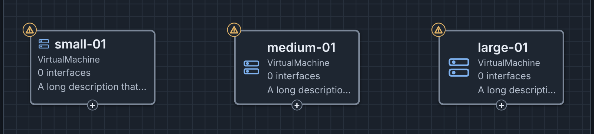
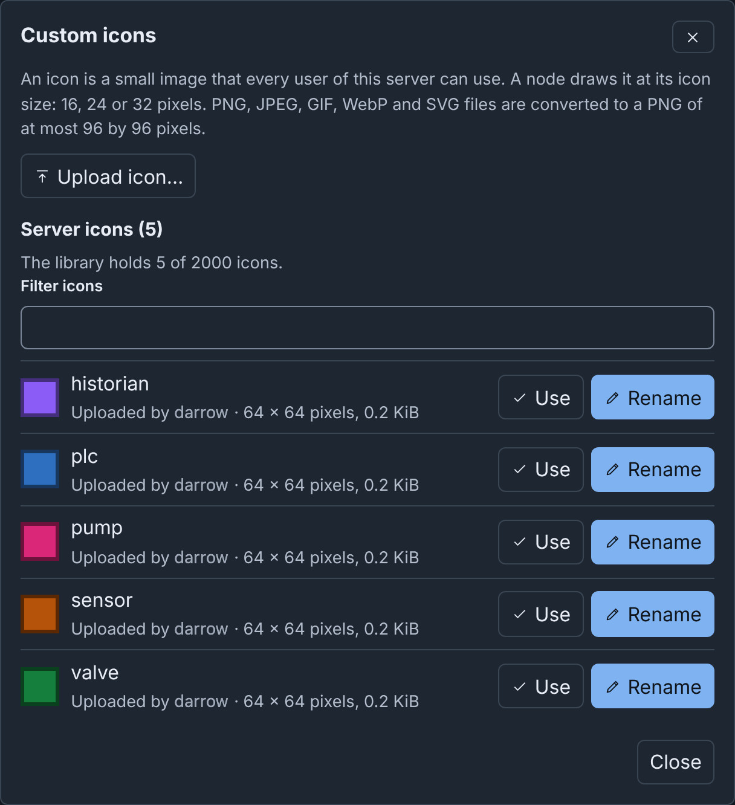
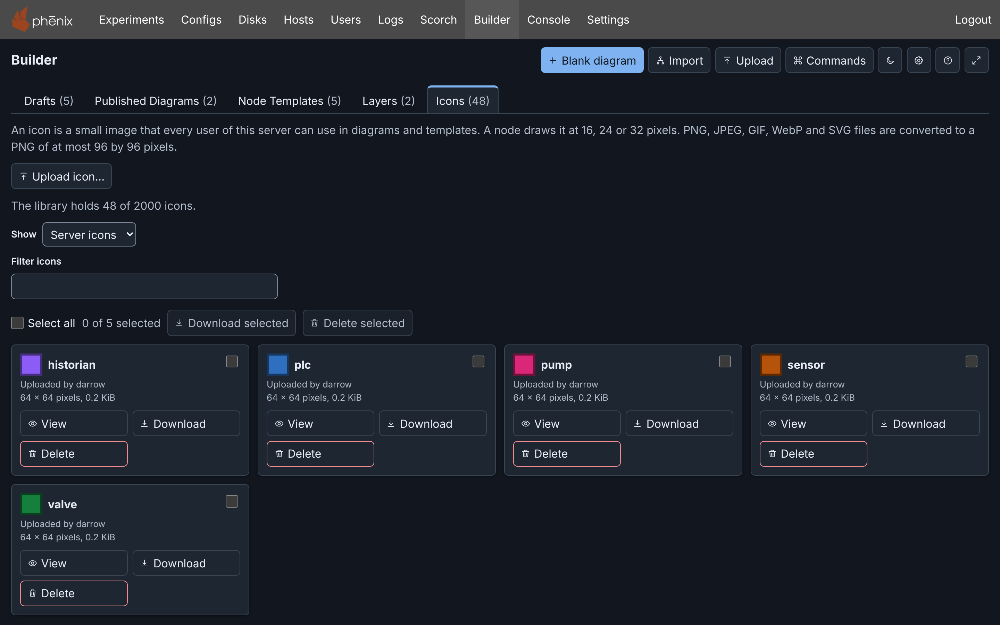
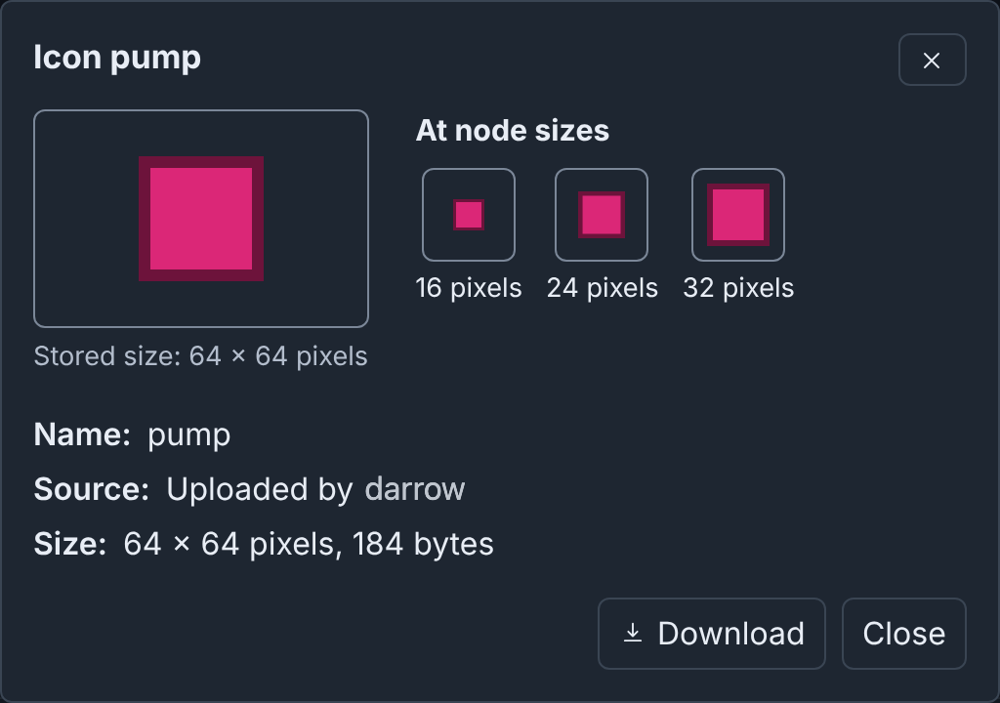

# Icons: Details

!!! note
    This page goes deeper than the short guide:
    [Templates and Icons](../templates.md#custom-icons).

## Built-in Icons

Devices, groups and icon drawings show one of the built-in icons listed in
[Built-in icons](../reference.md#built-in-icons). The icon is only a
picture and changes none of a device's phēnix settings. A device made from
a template gets the template's icon. To preview a built-in icon or download
it as a PNG, use the [Icons tab](#built-in-icons-in-the-icons-tab).

## Icon Size

Devices, switches and groups draw their icons `Small` (16 pixels), `Medium`
(24 pixels) or `Large` (32 pixels). Set the size for the whole diagram
under `Icon size` in the `Diagram` section of the Inspector (click an empty
part of the canvas); a new diagram uses `Small`. A device, switch or group
can have its own size, or `Diagram default`, which names the diagram's
size, as in "Diagram default (Large)".

Nodes stay the same size whatever the icon size, so text that doesn't fit
ends with an ellipsis. Downloads draw icons at their sizes.

### Your Own Icon Size and Hidden Icons

Two settings in the `Canvas` section of [Settings](editor.md#settings)
change how icons look for you only. They don't change the diagram, and
other users don't see them.

- `Node icon size` is `Off` (the default), `Small`, `Medium` or `Large`.
  Anything but `Off` draws every node icon at that size, on your canvas and
  in your PNG, SVG and draw.io downloads.
- `Show node icons` is on by default. Turn it off to hide the icons of
  devices, switches and groups, on the canvas and in downloads.

## Custom Icons

A device, group or icon drawing can show an image of your own in place of
its built-in icon; a switch or note can't. All users of the server share
one icon library of up to 2,000 custom icons (built-in icons don't count).
You manage it from the [Icons tab](#the-icons-tab), the editor, or the REST
API.

To pick a custom icon, select the node, click `Icon` in the Inspector, and
pick `Custom icon…` at the end of the list. In the `Custom icons` dialog,
click `Upload icon…` to add a new image, or `Use` on an icon already
listed. To go back to a built-in icon, pick it from the list.

{ width="624" }

A node stores the name of its custom icon and shows the server's icon of
that name. If the server has no such icon (because someone deleted it, or
the diagram came from another server), `Icon` says
"(custom icon not found: the node shows its built-in icon)", and the node
shows its built-in icon until someone uploads an icon of that name.

A custom icon keeps its own colors in both themes, so pick one that's clear
on light and dark, or give the node a `Fill Color`.

### The Icons Tab

The `Icons` tab of the drafts page shows the built-in icons and the
server's icons. Open it from `Show Icons` in the command palette, or type
`i:` and part of a name there to preview one icon (see
[Command palette](palette-and-shortcuts.md#command-palette)). `Show` picks
`Built-in icons` (the default) or `Server icons`.

Each server icon's card shows its size and who uploaded it ("Server" for an
icon from a template file). `View` shows the icon at its stored size (at
most 96 by 96 pixels) and at 16, 24 and 32 pixels.

{ width="528" }

`Download` saves the icon as a PNG exactly as the server stores it, named
after the icon, such as `plc.png`. `Download selected` and
`Delete selected` work on the checked cards (see
[Selecting several drafts](drafts.md#selecting-several-drafts)), and
`Delete selected` skips icons that no user uploaded.

#### Built-in Icons in the Icons Tab

Each built-in card shows the key that a diagram stores, such as
"Key: router". `Download` saves a 96 by 96 pixel PNG named after the key,
such as `router.png`: a dark icon on a clear background, meant for light
backgrounds.

### Uploading an Icon

`Upload icon…` takes a PNG, JPEG, GIF, WebP or SVG file of up to 5 MiB. The
browser converts it to a PNG of at most 96 by 96 pixels, keeping its
proportions. Small pictures aren't enlarged, but an SVG is drawn as large
as an icon can be. Then name the icon (the file name is suggested) and
click `Add icon`.

A name is 1 to 64 letters, digits, `_`, `@`, `.` or `-`, and is unique on
the server regardless of case: the first upload of a name keeps it. The
server refuses a name it already has for a different image, and names the
uploader. Uploading the same image again under its own name just tells you
the server already has it.

Builder doesn't load style sheets, images or fonts from outside an SVG
file, so those parts are missing from the icon.

### The Diagram and Its Icons

A draft normally only names its icons, so a saved draft stays small. A
Builder JSON or YAML download, though, carries a copy of each icon the
diagram names (up to 50), so the file shows its icons on another phēnix
server. An icon the server doesn't have is left out, and the download says
so.

Uploading a file that carries icons, or `Edit as a draft` on a topology's
diagram read from its Builder file, adds each icon the server doesn't have
to the library, as uploaded by you. If the server already has the same
image under that name, the copy is dropped. The draft keeps its own copy,
and tells you, when the server has a different image under that name or
couldn't take the icon (for example, because the library holds 2,000 icons).
`Add to server` in the `Custom icons` dialog adds a kept copy later.

Copy and paste carry the diagram's copies of the nodes' icons, even into
another diagram in the same browser tab.

### Renaming and Deleting Icons

`Rename` is in the `Custom icons` dialog, and `Delete` is on the
[Icons tab](#the-icons-tab). Icons that the server added from a template
file can't be renamed or deleted (see
[Template files on the server](administration.md#template-files-on-the-server)).
For who may rename and delete icons, see
[The libraries](administration.md#the-libraries).

A renamed icon keeps its old name as another name, so diagrams and
templates that use the old name still show it. An icon keeps at most 16
old names; past that, the server refuses a new name, so upload the image
under the new name instead. Renaming back to an old name still works.

!!! warning
    Deleting an icon also deletes its old names. Every diagram and template
    that uses it, by any name, then shows its built-in icon. The nodes keep
    the name, so uploading an icon under that name brings it back.

### Several Icons at Once

In the `Custom icons` dialog, each diagram copy under `In this diagram`
that the server doesn't have gets a checkbox, and `Add selected to server`
adds all the checked ones under their names. If some couldn't be added, a
summary gives the reason for each.

{ width="624" }

## See Also

- [Node Templates: Details](templates.md): templates carry icons too.
- [Import, Upload and Download: Details](import-upload-download.md): the
  files that carry icons between servers.
- [Limits](../reference.md#limits): every Builder limit in one table.
