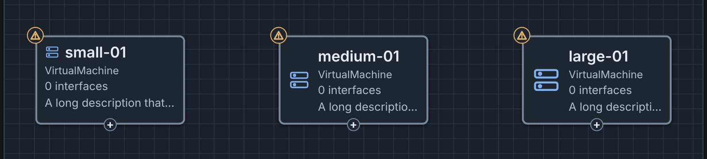
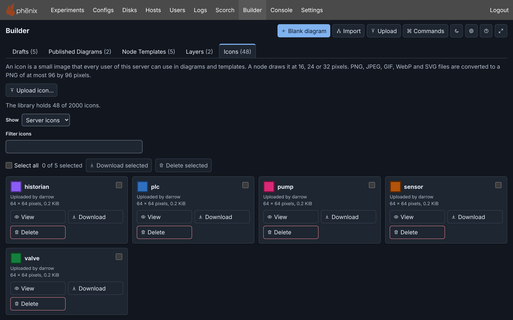
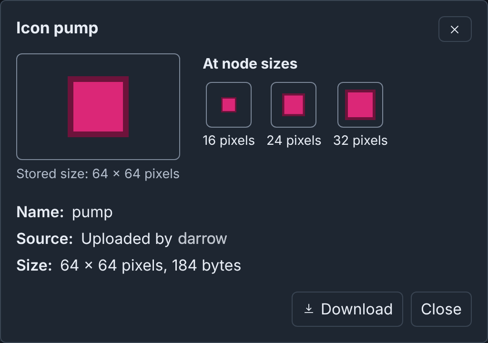
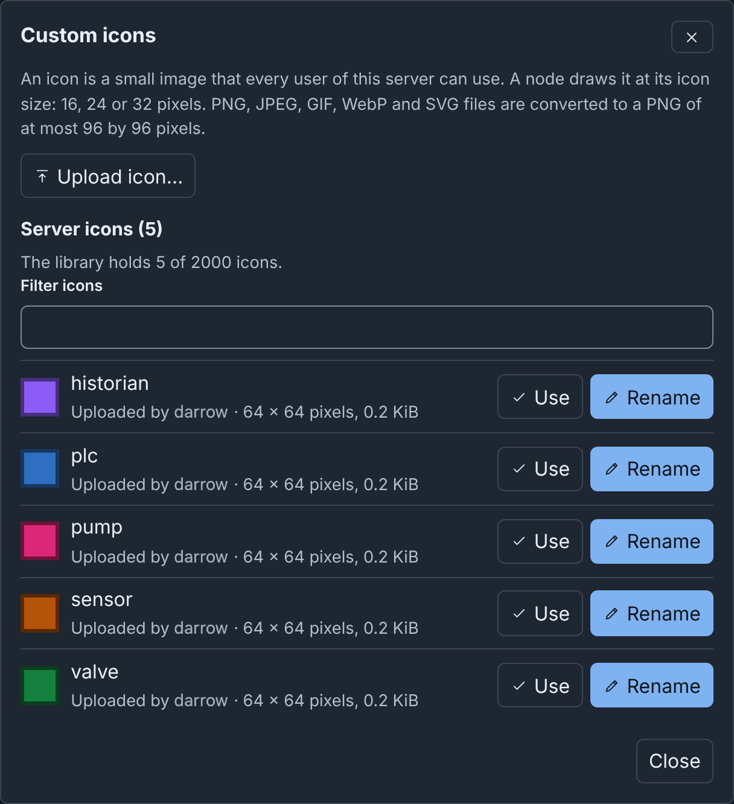

# Icons: details

!!! info
    This page holds every rule, limit and message of this feature. For the
    short guide, see [Templates and Icons](../templates.md#custom-icons).

## Built-in icons

Devices, groups and icon drawings show a built-in icon, which you select
under **Icon** in the Inspector. The icon is only a picture: it does not
change the phenix settings of a device. A device made from a template gets
the template's icon.

| Kind | Icons |
|---|---|
| Computers | **Server** (any virtual machine, and the default for a device), **Desktop**, **Laptop**, **Smartphone**, **Printer**, **NTP Server** |
| Networks | **Router**, **Switch**, **Firewall**, **VLAN**, **Container** (the default for a group), **External device** (hardware in the loop) |
| Industrial control | **PLC**, **RTU**, **RTAC** (an automation controller or a data gateway), **Relay**, **Transmission**, **Distribution**, **Cell Tower** |
| Operating systems | **Linux**, **CentOS**, **Red Hat**, **Ubuntu**, **Fedora**, **openSUSE**, **Alpine**, **Kali Linux**, **BSD**, **Windows**, **Apple**, **Android** |
| Tools | **Terminal**, **pfSense**, **Wireshark**, **Zeek** (a network sensor) |
| People and roles | **Hacker** (an attacker), **Black Hat** (a threat actor), **Human**, **Robot** (a bot or a script) |
| Other roles | **Lizard** and **Fox**, for a role with no other icon, such as a team mascot |
| Servers | **phēnix**, **minimega** |

To preview a built-in icon, or to download it as a PNG file, use the
[Icons tab](#built-in-icons-in-the-icons-tab).

Names and logos of products are trademarks of their owners. phenix is not
affiliated with or endorsed by them. The
[icon notices](https://github.com/sandialabs/sceptre-phenix/blob/main/src/js/src/components/builder/ICON_NOTICES.md)
give the source and the license of each icon that comes from another work.

## Icon size

Devices, switches and groups draw their icons at **Small** (16 pixels),
**Medium** (24 pixels) or **Large** (32 pixels). Set the size for the whole
diagram under **Icon size** in the **Diagram** section of the Inspector
(select an empty part of the canvas). A new diagram draws **Small** icons.

A device, a switch or a group can have its own size. Its **Icon size**
offers the three sizes and **Diagram default**, which names the diagram's
size, for example "Diagram default (Large)". Both fields take effect at
once.

Nodes keep their size on the canvas. Text that does not fit ends with an
ellipsis. The Inspector and the
node's tooltip show all of it. PNG, SVG and draw.io downloads draw the
icons at their sizes.

### Your own icon size and hidden icons

Two settings in the **Canvas** section of [Settings](editor.md#settings)
change how your canvas draws icons. They do not change the diagram, and
other users do not see them. This browser keeps them.

- **Node icon size**: **Off** (the default), **Small**, **Medium** or
  **Large**. A size other than **Off** draws each node icon at that size,
  on your canvas and in PNG, SVG and draw.io downloads. The diagram, its
  history and its files keep their own sizes. While the setting is not
  **Off**, each **Icon size** field says, for example, "Your Node icon size
  setting (Large) overrides this on your canvas." The command palette has a
  **Node icon size:** command for each value.
- **Show node icons**: on by default. When it is off, devices, switches and
  groups show no icon on the canvas and in PNG, SVG and draw.io downloads,
  and their text uses all the width. **Show or hide node icons** in the
  command palette changes the setting.

## Custom icons

A device, a group or an icon drawing can show an image of your own in place
of its built-in icon. A switch and a note cannot. All users of the server
share one icon library of at most 2,000 custom icons. The built-in icons do
not count against this limit. Use the [Icons tab](#the-icons-tab), the
editor or the REST API to manage the library.

To choose a custom icon:

1. Select the device, the group or the icon.
2. In the Inspector, click **Icon**.
3. At the end of the list, select **Custom icon…**.
4. In the **Custom icons** dialog, click **Upload icon…** and choose an
   image file, or click **Use** on a listed icon.

**Icon** then shows the image and its name, followed by "(custom icon)".
The change takes effect at once. To use a built-in icon again, select it in
the list.

A node stores the name of its custom icon, and shows the server's icon of
that name. When the server has no icon of that name, **Icon** adds "(custom
icon not found: the node shows its built-in icon)". This occurs when
someone deleted the icon, or the diagram came from another server. The
node shows its built-in icon until someone uploads an icon of that name.

Until Builder reads the image of an icon, the node shows an empty square of
the icon's size.

The dialog lists:

- **In this diagram**: copies of icons that the diagram holds from an
  uploaded file (see [The diagram and its icons](#the-diagram-and-its-icons)).
  Each has **Use**, and **Add to server** when the server does not have it.
  "On the server" marks a copy that the server has.
- **Server icons**: each icon on the server, with its uploader, its size
  and its other names, and the library count, for example "The library
  holds 2 of 2000 icons." **Filter icons** filters by name, other name or
  uploader. Each icon has **Use**, and **Rename** when a user uploaded it.

{ width="624" }

### The Icons tab

The **Icons** tab of the drafts page shows the built-in icons and each icon
on the server. To open it, select **Show Icons** in the command palette. To
open the preview of one icon, type `i:` and part of its name (see
[Command palette](palette-and-shortcuts.md#command-palette)).

**Show** selects **Built-in icons** (the default) or **Server icons**. An
upload, or a preview from `i:`, sets it to **Server icons**. The count, for
example "The library holds 45 of 2000 icons.", includes the built-in
icons. **Filter icons** filters by name, other name or uploader.

With **Server icons**, each icon on the server has a card with its size and
source. The source is "Uploaded by" and the user, or "Server" for an icon
from a template file. A card has a checkbox, **View**, **Download**, and
**Delete** when a user uploaded the icon.

**View** shows the icon at its stored size, at most 96 by 96 pixels, and at
16, 24 and 32 pixels.

{ width="528" }

**Download** saves the icon as a PNG file, exactly as the server stores it,
with the name of the icon, for example `plc.png`. **Download selected**
saves one PNG file for each selected icon, built-in icons included.

**Delete** and **Delete selected** ask first (see
[Renaming and deleting icons](#renaming-and-deleting-icons)). The cards use
the keys of the other tabs (see
[Selecting several drafts](drafts.md#selecting-several-drafts)). **Filter
icons** limits what **Select all** selects. A change of **Show** clears the
selection.

**Delete selected** deletes only icons that a user uploaded. Its question
also counts the others, for example "1 other selected icon cannot be
deleted." When no selected icon can be deleted, it asks nothing. A summary
under the selection row gives the reason for each icon that it could not
download or delete. An icon that the server no longer has leaves the list,
and the summary lists it.

When Builder cannot read the library, the tab says "Could not load the
server's icons." and why, with **Retry**.

#### Built-in icons in the Icons tab

With **Built-in icons**, the cards are in the order of the table in
[Built-in icons](#built-in-icons). **Filter icons** filters them by name,
key or the word "Built-in". Each card shows the key that a diagram stores,
for example "Key: router".

A built-in icon has a checkbox, **View** and **Download**. You cannot
delete or rename it. **Download** saves a PNG file of 96 by 96 pixels,
named after the key, for example `router.png`. The browser makes the file
from the icon's drawing: a dark icon on a clear background, for use on a
light background.

### Uploading an icon

**Upload icon…** takes a PNG, JPEG, GIF, WebP or SVG file of at most 5 MiB.
The browser converts it to a PNG of at most 96 by 96 pixels, in the
picture's own proportions. It does not enlarge a small picture, and it
draws an SVG as large as an icon can be. The dialog then asks for the
icon's name, proposed from the file name. **Add icon** uploads the icon.

A name is 1 to 64 letters, digits, `_`, `@`, `.` or `-`. It is unique on
the server, ignoring case, and the first upload of a name keeps it. The
server refuses a name that it has for another image, and names the
uploader, for example "icon name "plc" belongs to an icon alice uploaded.
Choose another name". When you upload the same image under its own name
again, the dialog says "The server already has this icon as" and its name.

Builder does not load style sheets, images or fonts from outside an SVG
file, so those parts are missing from the icon. When the SVG cannot be
converted, the dialog says "The Builder could not convert this image. Save
it as a PNG, and then upload it again."

A custom icon keeps its own colors in the light and the dark theme. Choose
an icon that is clear on both, or give the node a **Fill Color**.

### The diagram and its icons

A draft names its icons. Except in the cases below, it holds no image of
them, so a saved draft stays small. A Builder JSON or YAML download holds a
copy of each icon that the diagram names, at most 50, so the file shows its
icons on another phenix server. When the server has no icon of a name, the
file does not hold it, and the download says so.

These actions add icons from a file to the server's library:

- Uploading a file that holds icons.
- **Edit as a draft** on the diagram of a topology read from its Builder
  file.

Builder adds each icon that the server does not have, as uploaded by you.
When the server has the same image under that name, Builder discards the
copy. The draft keeps its own copy, and Builder says so, in these cases:

- The server has another image under that name.
- The server could not take the icon, for example because you reached your
  upload limit.

The draft shows its copy in place of the server's icon. **Add to server**
in the Custom icons dialog adds a kept copy later. When no node or template
of the diagram uses an icon, the icon leaves the diagram with the edit that
removed its last use.

Copy and paste include the diagram's copies of the nodes' icons, also into
another diagram in the same browser tab.

### Renaming and deleting icons

Each Builder user can rename and delete each icon that a user uploaded (see
[The libraries](administration.md#the-libraries)). **Rename** is in the
Custom icons dialog. **Delete** is on the [Icons tab](#the-icons-tab). No
user can rename or delete an icon that the server added from a template
file (see
[Template files on the server](administration.md#template-files-on-the-server)).

The old name continues to name a renamed icon, so diagrams and templates
that use it still show it: "Renamed OLD to NEW. OLD keeps working as
another name of it." An icon keeps at most 16 old names. Then the server
refuses a new name, and tells you to upload the image under the new name
instead. Renaming it back to an old name still works.

**Delete** asks you to confirm. Diagrams and templates that use the icon,
by any of its names, then show their built-in icon. Deleting an icon removes its other names too, and
changes no diagram: its nodes keep the name. When another user renamed the
icon after Builder read the list, the delete stops. Builder shows the
icon as it is now. Check it, and then try again.

### Several icons at once

In the Custom icons dialog, each diagram copy that the server does not have
has a checkbox. Above the copies, a row has **Select all**, the selected
count ("2 of 5 selected") and **Add selected to server**.

**Add selected to server** adds each selected copy under its name: "Added 2
icons to the server. The diagram drops its copies with its next edit." When
someone added a copy after the dialog opened, the dialog names it: "The
server already has plc." You cannot select the server icons in this dialog.

Here, a copy of the pump station diagram gives rtu-01 and eng-ws-01 the
icons gauge and tank. The diagram holds these icons and the server does not:

{ width="624" }

The rows use the keys of the drafts page (see
[Selecting with the keyboard](drafts.md#selecting-with-the-keyboard)), with
these differences:

- **Escape** with nothing selected closes the dialog.
- In the server icons, the keys only move focus. **Delete** does nothing.

When some copies could not be added, a summary under the row gives the
reason for each. When the server cannot be reached, Builder stops and lists
the rest as "Not attempted."
