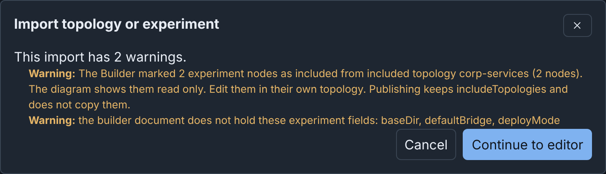
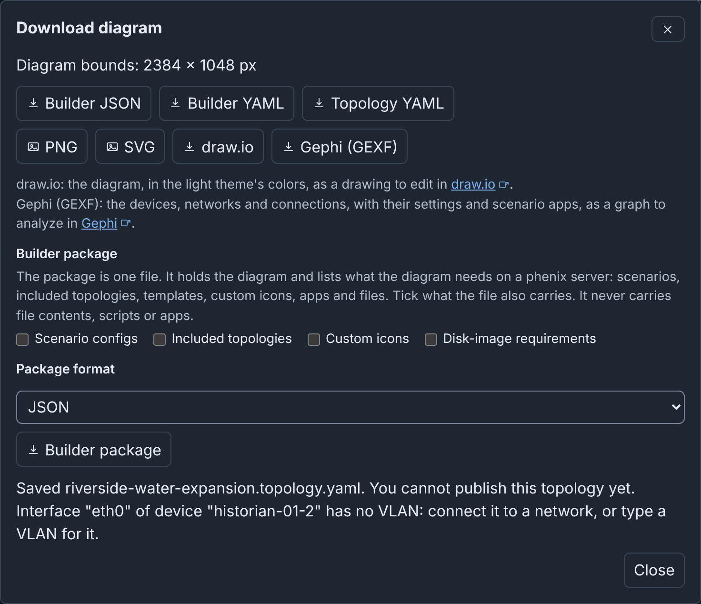
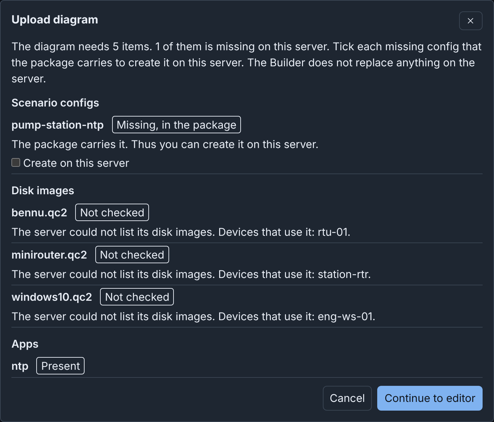

# Import, Upload and Download: Details

!!! info
    This page goes deeper than the short guide:
    [Import, Upload and Download](../import-upload-download.md).

The examples on this page use the [example lab](../tutorial.md#the-example-lab).

## Importing a Topology or Experiment

The phēnix server converts the config into a diagram that holds what phēnix
would read from the config.

### From a Stored Config

In `Source name`, "(legacy Builder diagram)" marks a topology that the
legacy Builder saved. The import converts its diagram, and publishing the
draft to the same topology replaces the legacy diagram (see
[Converting a Stored Topology](../legacy.md#converting-a-stored-topology)).

If you close the dialog while it shows "Importing…", nothing is imported,
even when the answer comes later.

### Importing an Experiment



When your role can't list the experiment's stored Scenario, the draft lists
no scenario and the import warns. The import also removes what phēnix added
to the nodes when it created the experiment, so the devices read like
topology nodes:

- Each empty or null field, except one that a topology must have, such as
  the `interfaces` of a network or the `vlan` of an interface. A 0 or false
  goes only when phēnix reads it as unset: a field that can be unset, such
  as `snapshot` or the `cost` of a route, keeps an explicit 0 or false.
- Each value equal to the phēnix default, even when the topology set it:
  `vm_type` kvm, `snapshot` true, `do_not_boot` false, `cpu` Broadwell,
  `vcpus` 1 and `memory` 512. External nodes keep these values, and
  `os_type` always stays.
- `bridge_set_in_topo`, and each interface bridge that phēnix set to the
  experiment's default bridge because the topology set none. A bridge that
  you change in the draft then stays when phēnix creates an experiment from
  the published topology.

### Importing a Config File

The file must name its config in `metadata.name`. The dialog doesn't offer
a copy for a config file, since its draft always publishes a new topology.
An Experiment config file's draft uses the stored Scenario of the same name,
not the copy in the file, and the import warns because the two can differ.

Builder keeps each `${NAME}` and `${NAME:default}` as written. For example,
this interface imports with the address
`${STATION_WAN_ADDRESS:198.51.100.20}`, so edit the address in the draft
before you publish it:

```yaml
- name: eth0
  type: ethernet
  vlan: WAN
  proto: static
  address: ${STATION_WAN_ADDRESS:198.51.100.20}
  mask: 24
  gateway: 198.51.100.1
```

### Import Options

An Experiment has no import options. `Combine into one new topology` doesn't
combine an included topology that you can't read, or that phēnix doesn't
store: the draft keeps that include, and the import warns. With
`Create a new topology as a copy`, included nodes stay read only. To make
the included nodes of a draft editable later, see
[Making Included Devices Editable](scenarios.md#making-included-devices-editable).

`New topology name` proposes the source name with `-copy` or `-combined`,
such as `riverside-water-copy`, numbered when a topology has that name. It
follows the config name rule (see
[Publishing a Topology](publishing.md#publishing-a-topology)), is at most 512
bytes, and can't be the name of an existing topology.

A copy or a combined draft links to no config. It gets a diagram note that
names the source, such as "Copied from riverside-water" (for a config file,
the file's `metadata.name`), and `Publish` proposes the new name. Later
changes to the source topology, or to the combined topologies, don't reach
the draft.

### From the Configs Page

| Topology | Tag | Viewer button | What opens |
|---|---|---|---|
| Has a Builder diagram (`builder-doc`) | `builder` | `Open in Builder` | The diagram, in a draft (see [Editing a Published Topology](publishing.md#editing-a-published-topology)) |
| Has a legacy Builder diagram (`builder-xml`) | `builder legacy` | `Import into Builder` | The `Import` dialog, set to the topology |
| Has no diagram | None | `Import into Builder` | The `Import` dialog, set to the topology |

The viewer opens when you select the name of a topology. The edit button of
a `builder` topology, and `Edit` in its viewer, also open Builder, or
show "Only Builder can edit this configuration" to a role that can't use
Builder. Other topologies, `builder legacy` ones included, open in the text
editor (see [Legacy Builder](../legacy.md#what-changed)).

### What an Import Keeps

- The node order: the devices of the config first, then those of each
  included topology. Publishing writes the nodes in this order, which is the
  order in which phēnix starts the VMs.
- A network for each VLAN that the interfaces use. An interface without a
  VLAN, or with white space in its VLAN, isn't connected, and white space
  gets a warning, because a network name can't contain it.
- Annotations of the config, such as `maintainer: range-team`, except
  `phenix/vm-defaults` and those whose names start with `builder-`. A draft keeps at most 100 annotations,
  and at most 256 KiB of them, and the import warns about the rest.
- No positions: an import always uses the `Default` layout (see
  [Layouts](diagrams.md#layouts)).
- No subnet or gateway. To make Builder give addresses to the interfaces of
  a network, give its switch a `Subnet` (see
  [Adding Switches and Networks](diagrams.md#adding-switches-and-networks)).

## Uploading a Builder Document

`Upload` opens a document as a new draft, and the open draft doesn't change.
A Builder document keeps everything, so a download and an upload give the
same diagram, with the maker and creation time that the document names (see
[Who Made and Last Saved a Diagram](#who-made-and-last-saved-a-diagram)).

The other sources:

- `Paste text`: paste the document into `Document text (JSON or YAML)`. The
  draft has no source file.
- `Published diagram`: choose a diagram, then click `Open`. This opens the
  same draft as `Edit as a draft` (see
  [Published Diagrams](drafts.md#published-diagrams)). "(File)" after a
  topology name marks a diagram that phēnix reads from a file on the server.
- `Legacy Builder diagram or Topology`: in `Legacy diagram or Topology file`,
  choose a legacy Builder diagram file, or a Topology config file that holds
  one in its `builder-xml` annotation, then click `Convert` (see
  [Converting a File](../legacy.md#converting-a-file)).

When `Upload` refuses a file, it tells you where the file belongs: a config
goes to `Import`, a template file to `Import templates` on the
`Node Templates` tab (see [Importing](templates.md#importing)), and a layer
set file to the `Layers` tab (see [Layer Set Files](#layer-set-files)). For an XML file, use the
`Legacy Builder diagram or Topology` source. Builder can't convert a draw.io
or GEXF file.

## Downloading

`Download` makes one file at a time. It works in every draft you can open,
view-only drafts and published diagrams included, and the command palette
has a command for each format, such as `Download PNG` (see
[Command Palette](palette-and-shortcuts.md#command-palette)). Before the
dialog opens, Builder saves the changes that you didn't apply in the
Inspector, and if it can't, the dialog says why and saves nothing. For the
file of each format, see [Download Formats](../reference.md#download-formats).

### Builder JSON and YAML

Builder JSON and Builder YAML hold the whole Builder document: everything
on the canvas with its settings, position and look, the networks' `subnet` and
`gateway`, the scenario names (`scenarios`), the source of an import, the
`metadata`, the `layers` and their `layerSet`, the device `templates` (a
linked one keeps its link in `source`), and a copy of each custom icon that
the diagram names (`icons`, see
[The Diagram and Its Icons](icons.md#the-diagram-and-its-icons)).

A document starts with `$schema: https://phenix.sandia.gov/schemas/builder/v1`
and `revision: 1`. The server serves the JSON Schema, with a title, a
description and examples for each field, at `/api/v1/schemas/builder/v1`.

#### The Metadata of a Diagram

The `metadata` object is required and holds only these fields. The server
refuses a document with one of them outside `metadata`, or with another
field in it. Publish writes no metadata to a config.

| Field | What it holds |
|---|---|
| `id` | The identifier of the document. Each document needs one |
| `name` | The diagram name, at most 512 bytes. A draft uses it as its title |
| `description` | Free text about the diagram |
| `createdBy`, `createdAt`, `updatedBy`, `updatedAt` | Who made the diagram and who saved it last (see below) |
| `notes` | The notes that the Inspector lists under `Notes`. At most 100, each not blank, at most 4096 bytes, and with no control characters other than line breaks and tabs |

#### Who Made and Last Saved a Diagram

The server, never the editor, writes these four optional fields when it
saves a draft, and the Inspector shows them under `Details` (see
[With Nothing Selected](editor.md#with-nothing-selected)). A new draft keeps
the `createdBy` and `createdAt` that its document names, or else gets you
and now, and each save sets `updatedBy` and `updatedAt`. Times are in UTC to
the second, such as `2026-09-29T18:17:59Z`, and a user name is at most 256
bytes.

- `Blank diagram`, `Import`, and a legacy diagram converted with `Upload`
  start with you as the maker.
- `Edit as a draft` takes all four fields from the document. After your
  first edit, you're the user who saved it last.
- `Undo`, `Redo` and `Restore` go back to the `updatedBy` and `updatedAt` of
  the snapshot's save.

`Publish` stores the document with its four fields, so they're part of its
digest. In a document from `Import`, `source.updatedAt` is a different time:
when the imported config last changed.

!!! note
    Anyone who uploads a document or writes a Builder file can put any name
    in these fields, so trust them only as much as you trust those people.

### Topology YAML

`Topology YAML` is the Topology config that `Publish` would write. The
server makes and checks it the same way, but writes nothing. In the file:

- `metadata.name` is the name that the Publish dialog proposes. Change it
  to store the file under another name. The metadata has no annotations.
- `nodes` leaves out the devices of included topologies, which
  `includeTopologies` names.
- The `vlan` of each interface is the name of its network.
- No notes, groups, drawings, colors, line styles, icons, layers,
  templates, positions, or network subnets and gateways. Each interface has
  its own `address`, `mask` and `gateway`, which Builder can set from them.

To store the file as a Topology config named `Riverside-Water`:

```bash
phenix config create riverside-water.topology.yaml
```

Builder didn't publish this config, so `Configs` doesn't open it in Builder.
To store the topology with its diagram, publish the draft, or name the
Builder file in the config (see
[A Builder File Beside a Topology](../administration.md#a-builder-file-beside-a-topology)).

When the diagram can't be published yet, the dialog still saves the file
and lists each problem that publishing would report (see
[What Blocks Publishing](publishing.md#what-blocks-publishing)). When phēnix
can't accept the config at all, it shows the error and saves nothing.



### PNG and SVG

`PNG` and `SVG` draw the whole diagram, in the bounds that the dialog shows,
with the longer side at most 4096 pixels and the background of the theme in
use (see [Themes](editor.md#themes)). They leave out the selection,
connection points, handles, warning marks and tooltips. If Builder can't
read the image of a custom icon, the picture leaves that icon out and the
dialog says so.

The SVG holds the diagram as HTML in `foreignObject` elements, so only web
browsers show all of it. Some drawing programs don't show the HTML parts.

### draw.io

In [draw.io](https://www.drawio.com/), select `File` > `Open from` >
`Device` to open the file. Changes in draw.io don't come back to the
diagram. The file has one page, in the light theme's colors:

- Devices and switches are boxes, groups are containers whose nodes move
  with them, and notes, shapes, icons and lines are separate shapes.
- Connections keep their labels, colors, line styles and layout routes.
- `Show node icons`, `Show node descriptions` and `Node icon size` apply
  (see [Settings](editor.md#settings)).
- Custom icons are included. If Builder can't read one, the file shows the
  built-in icon and the dialog says so.

Each device holds `hostname`, `type`, `os_type`, `image` (the first disk
image), `vcpus`, `memory` and `interfaces` as data (in draw.io, `Edit` >
`Edit Data`), with one line for each interface, such as "eth0: VLAN CORP,
10.10.20.254/24". The file holds no other settings, and no secrets.

### Gephi (GEXF)

`Gephi (GEXF)` saves the network as a graph for
[Gephi](https://gephi.org/) and other tools that read GEXF 1.3:

- A node for each device and each network. All the switches of a network
  are one node, and notes, groups and drawings aren't nodes.
- An edge from each device to its network for each connection, labeled
  with the interface and its address, such as "eth0 10.10.30.20/24".
- The diagram's positions and colors. A device has its fill color, else its
  outline color, else the color of its type, and a network has its
  `Edge Color`. A color name such as `red` is dropped.

The settings of each device, network and interface become columns, such as
`Hostname`, `VLANs (text)`, `IP address`, `Group` and `Label: zone`. The
`Scenario apps` columns list the apps of the diagram's scenarios that run on
each device. If the download can't read a scenario, the file has no app
columns, and the dialog says why.

#### Opening the File in Gephi

These steps use the menu names of Gephi 0.10 and 0.11.

1. In Gephi, select `File` > `Open`.
2. Choose `riverside-water.gexf`. The `Import report` shows 16 nodes (12
   devices and 4 networks), 15 edges and the graph type Undirected.
3. Click `OK`.
4. Select `Data Laboratory` to see the columns.

To filter the graph, use the `Network` and `IP address` columns of the
edges, or the `VLANs (text)` column of the nodes, which holds a device's
VLANs with `|` between them, such as `INTERNET|DMZ|CORP` for edge-rtr.

## Moving a Diagram With a Builder Package

The server serves the JSON Schema of the package format at
`/api/v1/schemas/builder/package/v1`.

### Downloading a Package

The ticks under `Builder package` choose what the file carries:

- `Scenario configs`: the Scenario configs that the diagram names.
- `Included topologies`: the Topology configs that the diagram includes. An
  include that names a file is listed, but not read.
- `Custom icons`: a copy of each custom icon that the diagram names.
- `Disk-image requirements`: the disk images that the devices boot from,
  each with the devices that use it.

Nothing is ticked at first. The file's `requirements` always list the
diagram's `scenarios`, `topologies`, `templates` and `icons`, the `apps` of
its scenarios, and the `files` that its devices and packaged configs name.
Disk `images`, each with its devices in `usedBy`, come with
`Disk-image requirements`. For an example, see
[pump-station.package.yaml](../examples/pump-station.package.yaml), with
`Scenario configs` and `Disk-image requirements` ticked.

If a config doesn't exist, or your role can't read it, the package lists it
but doesn't carry it, and the dialog names it: click `Save package` or
`Do not save`. A carried config has no creation and update times, and no
`builder-*` annotations. The list holds at most 1000 entries of each kind,
each at most 4096 bytes with no control characters, and the dialog names any
entry it leaves out, with its [error code](../reference.md#error-codes).

### Uploading a Package



Each entry shows its status, and "in the package" when the file carries it:

- `Present`: the server has it. For a config or an icon that the package
  carries, it has one of that name with the same content.
- `Missing`: the server doesn't have it. A disk image or an app that your
  role can't see also shows `Missing`.
- `Different`: the server has a config or icon of that name with other
  content. Builder doesn't change it.
- `Not checked`: the server can't check it, for example because your role
  can't read that config, or can't list disk images or apps. Disk images
  aren't checked when the server lists none, as when minimega isn't running,
  or doesn't list them within 10 seconds. Files are never checked.

A drive image counts as present when a server image has the same file name,
in any path, and the entry names the image that matched. Only a missing
Scenario or Topology config in the package has `Create on this server`.

Builder creates the ticked configs one at a time, and adds the missing
custom icons to the server's icon library. If a config or an icon fails, it
still creates the others, then names what it created and why each failure
happened before it opens the diagram (`Cancel` at that point opens nothing,
but the created configs stay). The diagram names its scenarios and
topologies as the file does, even the ones you didn't create.

The server refuses a package whose configs have `builder-*` annotations.

## Layer Set Files

A layer set file holds one layer set of the library, as YAML or JSON (see
[The Layers Tab](drafts.md#the-layers-tab)). A diagram carries its own
layers in its Builder document, not in a layer set file.

### Downloading a Layer Set

On the `Layers` tab of the drafts page, click `Download` on the card of the
set. Builder saves a YAML file named after the set, with `.layers.yaml` at
the end: the built-in set Purdue Model gives `purdue-model.layers.yaml`.

The file leaves out the set's ID, version, times and users, and lists the
layers with the highest layer ID first. It carries a copy of each custom
icon that the set and its layers name, at most 50, and names the built-in
icons without carrying them. Builder tells you about a custom icon that the
icon library doesn't have.

```yaml
$schema: https://phenix.sandia.gov/schemas/builder/layersets/v1
name: Plant layers
description: Layers of the plant network.
iconKey: plc
matchConflict: lowest
layerOutlines: true
layers:
  - id: 1
    label: Control
    iconKey: plc
    color: '#db2777'
    matchers:
      general.hostname: ^plc-
  - id: 0
    label: Field
    iconKey: transmission
    color: '#dc2626'
```

- `$schema` (required) names the format. Its JSON Schema is at
  `/api/v1/schemas/builder/layersets/v1`.
- `name` (required), `description`, `iconKey` (a built-in icon) and `icon`
  (a custom icon) describe the set.
- `matchConflict` (`lowest` or `highest`) picks the layer of a device that
  the matchers of more than one layer match.
- `layerOutlines: true` colors node outlines with the layer color.
- `layers` (required): each layer has an `id` and a `label`, and can have
  `iconKey`, `icon`, `color` and `matchers` (see [Layers](layers.md#layers)).
- `icons` (optional) holds copies of custom icons, by icon name.

### Uploading a Layer Set

1. On the `Layers` tab of the drafts page, click `Upload layer set…`.
2. Choose a YAML or JSON layer set file, up to 4 MiB.

Builder adds the file to the library as a new set, numbered when the library
has a set of that name, such as "Purdue Model (2)". The custom icons in the
file go to the server's icon library first (see
[The Diagram and Its Icons](icons.md#the-diagram-and-its-icons)), and if one
can't, Builder still adds the set and tells you why. If Builder can't use
the file at all, it adds nothing and lists each problem with its location in
the file.

## Builder Documents and phenix config create

A Builder document isn't a config. `phenix config create`,
`phenix config apply` and `phenix config diff` refuse one:

```console
$ phenix config create pump-station.builder.json
Error: pump-station.builder.json is a Builder document, not a configuration. Upload it in the Builder or send it to the Builder REST API (/api/v1/builder/drafts). Then publish it to create its topology
```

These commands take files only, so `examples/*` in a shell gives them each
file of a directory, and a subdirectory in the match is an error. Use a
pattern that leaves out the Builder files, such as
`examples/*.topology.yaml`.

They refuse a template file, a Builder package and a layer set file too:

```console
$ phenix config create node-templates.yaml
Error: node-templates.yaml is a Builder template file, not a configuration. To add its Node Templates, use Import templates in the Builder or the Builder REST API (POST /api/v1/builder/templates/items)
$ phenix config create pump-station.package.yaml
Error: pump-station.package.yaml is a Builder package, not a configuration. Upload it in the Builder to open its diagram
$ phenix config create purdue-model.layers.yaml
Error: purdue-model.layers.yaml is a Builder layer set file, not a configuration. Use Upload layer set on the Layers tab of the Builder to add its layer set
```

In `examples/*`, `examples` holds the
[example configs](../tutorial.md#the-example-lab). From a script, use the
Builder [REST API](administration.md#api).

## See Also

- [File Formats](../reference.md#file-formats): each Builder file, its size
  limit and its JSON Schema.
- [Builder Documents in Files](administration.md#builder-documents-in-files):
  topologies whose diagram phēnix reads from a Builder file.
- [Configuration](../../configuration.md#topology): the Topology config that
  an import reads and publishing writes.
