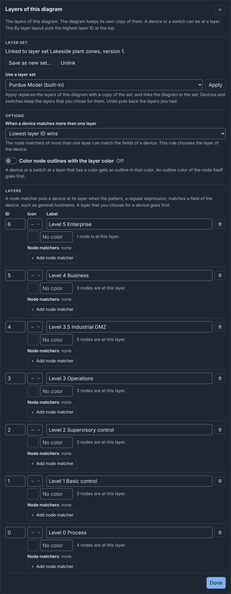
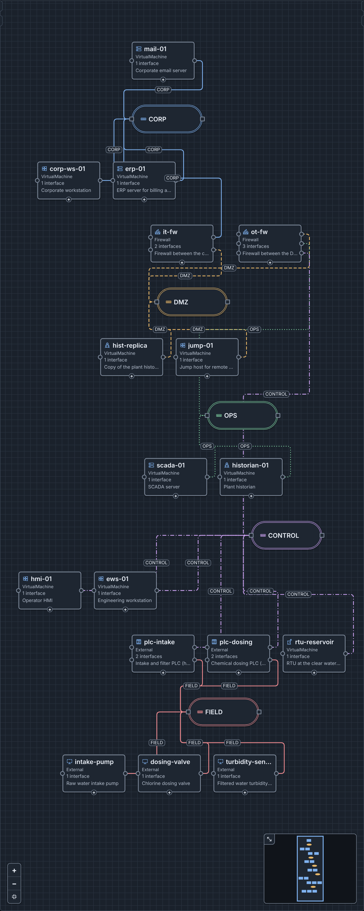

# Layers: details

!!! info
    This page holds every rule, limit and message of this feature. For the
    short guide, see [Diagrams](../diagrams.md#layers).

## Layers

A diagram has a list of **layers**. Each layer has an ID, an integer from 0
to 99, and a label, for example "Operations". A layer can also have an
icon, a color and node matchers. When two layers have the same label, the
editor adds the ID, for example "Control (ID 3)". A device or a switch can
be at one layer: a layer that you choose for it, or, for a device, a layer
that its fields match. The [By layer](diagrams.md#by-layer) layout puts the layers one
above the other, the highest ID at the top.

Layers are for the picture only. An import from a topology sets none.

Limits:

- A diagram has at most 32 layers. Each layer has a different ID.
- A label has 1 to 64 bytes, and no control characters, such as a tab.
- An icon is a built-in icon or a custom icon of the server.
- A color is `#` and 6 hex digits, such as `#2f6fbf`.
- A layer has at most 16 node matchers. A field has at most 128 bytes, and
  a pattern at most 256 bytes.

### Placeholder layers

A diagram that has no layers of its own has 7 **placeholder layers**: IDs 0
to 6, with the labels "Layer 0" to "Layer 6". Your first change to them in
the layers editor saves the 7 layers in the diagram. When the layers are
again the 7 placeholder layers, the diagram saves no list.

A new blank diagram starts with a copy of the default layer set, when the
server has one (see [Layers for new diagrams](#layers-for-new-diagrams)).

### Setting the layer of a device or a switch

1. Select the device or the switch.
2. In the Inspector, under **Layer**, select a layer, or **None**.

The list shows the highest ID first. The change takes effect at once. A
node can be at an ID that is not in the list, for example after you remove
its layer. The list then also shows that ID as "Layer N".

To set the layer of several devices and switches:

1. Select the devices and switches.
2. In the command palette, choose **Set layer of selection**.
3. Choose a layer, or **No layer**.

All the selected nodes change as one step of **Undo**. Devices from an
included topology do not change.

**Select nodes on layer** in the command palette selects the nodes at a
layer that you choose. These are the nodes that you put at the layer and
the devices that its node matchers put there. The command is available
while a device or a switch is at a layer.

A [node template](templates.md) can also have a layer, which a new device
gets.

### Node matchers

A node matcher puts a device at its layer by the device's fields. It has a
field and a pattern:

- The field is a path into the device's phenix spec, the fields of the Node
  Editor. It is keys of letters, digits, `_` or `-`, joined by dots, for
  example `general.hostname` or `network.interfaces.0.vlan`. A key of
  digits is the index of a list entry, from 0. A list at the end of the
  path matches when one of its entries matches.
- The pattern is a regular expression. It matches anywhere in the value of
  the field, and letter case counts. Use `^` and `$` to match the start and
  the end, for example `^plc-`.

A number or a boolean matches as its text, for example `10` or `true`. An
object, a null value and a field that the device does not have never match.
`general.hostname` also matches the device's hostname when the spec has no
hostname. A switch has no spec, so it is at a layer only when you choose
one for it.

The editor accepts only a pattern that the server and the editor read the
same way. It refuses these patterns, with "This is not a regular expression
that the server and the editor read the same way. Do not use lookarounds,
backreferences, flags or \p classes.":

- Lookarounds, such as `(?=x)` and `(?<!x)`.
- Backreferences, such as `\1` and `\k<name>`.
- Flags, such as `(?i)`, and `(?P<name>…)`.
- The escapes `\c`, `\u`, `\p`, `\A`, `\z`, `\Q…\E` and `\x{41}`.
- `[[:alpha:]]` and the empty class `[]`.
- A class escape at the end of a range, such as `[a-\d]`.
- Repeats in repeats that make more than 1000 copies, such as
  `(a{500}){500}`.

The editor and the server also refuse a pattern that the browser can take
a very long time to match:

- A group with a repeat or a `|` in it, when a repeat repeats the group
  more than once, such as `(a+)+`, `(a|aa)*` or `(\d{1,3}\.){3}`. The
  editor says "Do not repeat a group that has a repeat or | in it, as in
  (a+)+. Such a pattern can stop the editor.". The editor accepts an
  optional group, such as `(a+)?`. To match an IPv4 address, write each
  part, such as `^\d{1,3}\.\d{1,3}\.\d{1,3}\.\d{1,3}$`.
- More than 3 repeats with no upper count (`*`, `+` and `{n,}`), groups
  included, such as `a*a*a*a*b`. The editor says "Use at most 3 of *, +
  and {n,} in a pattern. More can stop the editor.". The editor accepts
  `^plc-.*-\d+$`. A repeat with an upper count, such as `{1,3}`, does not count.
  A `*` or `+` in a class, such as `[*+]`, or after a `\` does not count.

When the matchers of more than one layer match a device, the option **When
a device matches more than one layer** chooses: **Lowest layer ID wins**
(the default) or **Highest layer ID wins**.

A layer that you choose for a device goes first. A device with no chosen
layer is at its matched layer. Its first choice under **Layer** then names
the matched layer and the field in place of **None**, for example "Level 1
Basic control (matched general.hostname)". When you choose another layer,
the Inspector says "Its fields match Level 1 Basic control
(general.hostname). The layer that you chose goes first." **Use matched
layer** removes your choice.

The matched layer counts as the device's layer everywhere: in the **By
layer** layout, in the layer counts, in **Select nodes on layer** and in
the layer outlines.

### Layer outlines

The option **Color node outlines with the layer color** is off by default.
When it is on, a device or a switch at a layer that has a color gets an
outline in that color. The node's own **Outline Color** goes first. For a
switch, the layer color goes before the color of its network.

A layer's label has the layer's color when the label keeps a contrast of
4.5 to 1 in the current theme. Otherwise, a swatch of the color shows
beside the label.

### Editing the layers

To open the layers editor, **Layers of this diagram**, click **Edit
layers…** under **Layer** or **Layers** in the Inspector, in the Node
Editor, in [Settings](editor.md#settings) or in the command palette (see
[Layers editor](editor.md#layers-editor)). With nothing selected, the
**Layers** part of the Inspector also lists the layers.

The editor has the parts **Layer set** (see [Layer sets](#layer-sets)),
**Options** and **Layers**, with a row for each layer, the highest ID
first.

{ width="752" }

Each row has these fields:

- **ID** and **Label**: type a new value, then press <kbd>Tab</kbd> or
  <kbd>Enter</kbd>. The devices, switches and templates at the layer move
  to a new ID.
- **Icon**: **No icon**, a built-in icon or **Custom icon…**.
- **Color**, with a color picker.
- **Remove** (the trash can). The devices and switches at the layer keep
  its ID, which then shows as "Layer N". A line under the list names the
  IDs that are not in the list.
- **Node matchers**: a row for each matcher, with its field and its
  pattern. **Add node matcher** adds an empty row. The editor writes the
  matcher into the layer when both of its fields have a value. A layer has one
  matcher for each field. A new matcher with one empty field stops **Done**
  and **Save**. The editor discards a new matcher with two empty fields.

**Add layer** adds a layer with the next free ID, one above the highest,
and the label "Layer N".

A field changes the diagram when you leave it, so the text that you type in
one field is one step of **Undo**. **Done** first writes the text of the
field that you are in, then closes the editor. A value that the diagram
cannot keep shows an error under its row, and the diagram does not change
until you correct it. The errors follow the limits in [Layers](#layers). A
field must not be empty. When the layer refuses a matcher that **Done** or
**Save** wrote, the row says "Layer 1 cannot take this node matcher.
Change it, or remove it." When a field has an error, **Done** says "Some
layer fields have errors. Correct them. Then select Done." and moves
focus to that field.

In a published diagram, the fields are read only.

### Layer sets

A layer set is a list of layers, with the two options, in the server's
library. Each user of the server can use the sets. The built-in set
**Purdue Model** cannot change. The **Layers** tab of the drafts page
manages the sets (see [The Layers tab](drafts.md#the-layers-tab)).

A diagram holds a copy of a set's layers and options, and a link to the set
and its version. A change to the diagram's layers changes only the copy.
The **Layer set** part of the layers editor, and the Inspector with nothing
selected, give the state of the copy:

- No link to a layer set.
- A copy of a version of the set, for example "Linked to layer set NAME,
  version N."
- A copy that you changed.
- A copy of an earlier version, after someone saved the set.
- A link to a set that the server does not have. Someone deleted the set,
  or the diagram came from another server.

When the browser window becomes active again, the editor reads the library
again, so a newer version shows.

The layers editor has these buttons:

- **Use a layer set** and **Apply**: replace the layers and options with a
  linked copy of the set that you choose. Devices and switches keep the
  layers that you chose for them. The list first shows the linked set, or
  else the default set.
- **Update from layer set**: shows when the set has a newer version. It
  copies that version and replaces your changes. The Inspector with
  nothing selected also has this button.
- **Save to layer set**: shows when you changed the copy and the set has no
  newer version. It saves the layers and options as the set's next
  version, and links the diagram to it. The set keeps its name,
  description and icon. A built-in set has no **Save to layer set**. When
  the set has a newer version, the server refuses with "The layer set has
  a newer version. Update from the layer set first."
- **Save as new set…**: asks for **Name of the new set** and
  **Description**. **Save layer set** adds the set to the library and links
  the diagram to it.
- **Unlink**: removes the link and keeps the layers and options.

When you save a set, the custom icons of its layers that the server does
not have go into the icon library.

### Layers for new diagrams

On the **Layers** tab of the drafts page, **Set default** makes a set the
default set of the server. The server has one default set for all users,
and each Builder user can change it. Each new blank diagram starts with a
linked copy of the default set. **Clear default** removes the default, and
new diagrams then have the placeholder layers.

A diagram that you import or upload does not use the default set. It has
the layers of its file, or the placeholder layers.

### Example: map layers to the Purdue model

The Purdue model divides an industrial network into levels, from the
enterprise at the top to the physical process at the bottom. The built-in
layer set **Purdue Model** gives each level a layer:

| Layer ID | Label | Icon | Color | Typical devices |
|---|---|---|---|---|
| 6 | L5 Enterprise | Server | `#2f6fbf` | Enterprise IT, email and the internet connection |
| 5 | L4 Business | Laptop | `#8b5cf6` | Site business systems, such as ERP |
| 4 | L3.5 Industrial DMZ | Firewall | `#b45309` | Jump hosts, patch servers and historian copies |
| 3 | L3 Operations | Terminal | `#0f766e` | SCADA servers, historians and site operations systems |
| 2 | L2 Supervisory control | Desktop | `#15803d` | HMIs and engineering workstations |
| 1 | L1 Basic control | PLC | `#db2777` | PLCs, RTUs and IEDs |
| 0 | L0 Process | Transmission | `#dc2626` | Pumps, valves and sensors |

A layer ID is an integer. Thus, the set gives each level the next integer
from 0 at the bottom, and Level 3.5 gets ID 4. The set has no node
matchers.

To use these layers in a diagram:

1. Open the layers editor.
2. In **Use a layer set**, choose **Purdue Model (built-in)**.
3. Click **Apply**.

For example, Lakeside Water Treatment is a water treatment plant with 17
devices on 5 networks. Its layers have the IDs of the Purdue Model set,
with longer labels, such as "Level 5 Enterprise", and no icons or colors.
Each device and each switch is at the layer of its Purdue level, for
example mail-01 at layer 6 and the PLCs at layer 1. The firewalls and the
DMZ hosts are at layer 4. The pumps, the valve and the sensor are external
devices at layer 0. The PLCs control them through the FIELD network. The
saved diagram holds the layers in `layers`. Each device and switch holds
the ID of its layer in `layer`, for example `"layer": 3` in the `device` of
scada-01.

To try it, download
[lakeside-treatment.builder.json](../examples/lakeside-treatment.builder.json)
and upload it (see
[Uploading a Builder document](import-upload-download.md#uploading-a-builder-document)).
Then choose **By layer** in the layout menu.

{ width="476" }
