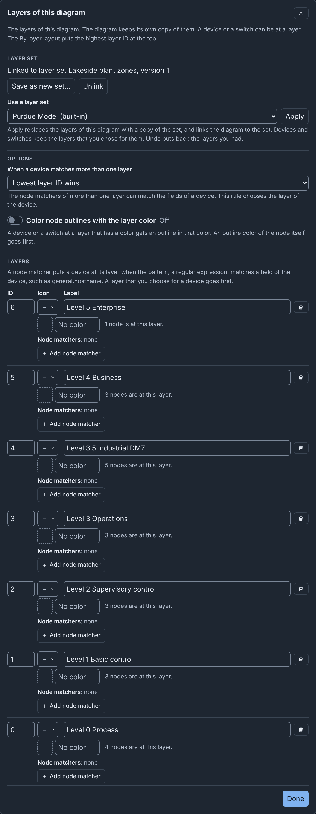
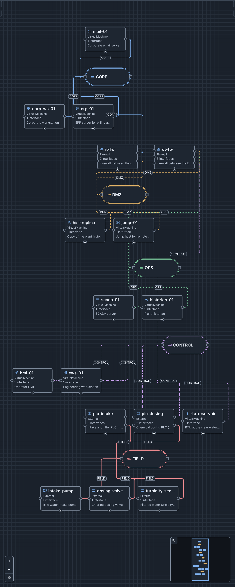

# Layers: Details

!!! note
    This page goes deeper than the short guide:
    [Diagrams](../diagrams.md#layers).

## Layers

A device or switch can be at one layer: one you pick for it, or, for a
device, one that its fields match (see [Node matchers](#node-matchers)).
The [By layer](diagrams.md#by-layer) layout stacks the layers with the
highest ID at the top. Limits:

- At most 32 layers in a diagram, each with a different ID from 0 to 99.
- A label has 1 to 64 bytes and no control characters, such as a tab.
- An icon is a built-in icon or one of the server's custom icons.
- A color is `#` and 6 hex digits, such as `#2f6fbf`.
- At most 16 node matchers on a layer. A matcher's field has at most 128
  bytes, and its pattern at most 256 bytes.

### Placeholder Layers

A diagram with no layers of its own shows 7 placeholder layers, IDs 0 to 6
labeled "Layer 0" to "Layer 6". Your first change to them in the layers
editor saves all 7 in the diagram. A new blank diagram starts with a copy
of the server's default layer set instead, if there is one (see
[Layers for new diagrams](#layers-for-new-diagrams)).

### Setting the Layer of a Device or a Switch

To set the layer of several nodes at once, select them and pick
`Set layer of selection` in the command palette (devices from an included
topology don't change). `Select nodes on layer` selects every node at a
layer, matched devices included. A [node template](templates.md) can also
carry a layer for new devices.

### Node Matchers

A node matcher puts a device at its layer by one of the device's fields.
It has a field and a pattern:

- The field is a path into the device's phēnix spec (the fields of the Node
  Editor): keys of letters, digits, `_` or `-` joined by dots, such as
  `general.hostname` or `network.interfaces.0.vlan`. A key of digits is a
  list index, from 0. A list at the end of the path matches when any of its
  entries matches.
- The pattern is a regular expression that matches anywhere in the value,
  and letter case counts. Use `^` and `$` to anchor it, as in `^plc-`.

A number or boolean matches as its text, such as `10` or `true`. An object,
a null value or a missing field never matches. `general.hostname` also
matches the device's hostname when the spec has none. A switch has no
spec, so it's at a layer only when you pick one for it.

The pattern must read the same way in the server and in the browser. The
editor refuses lookarounds (`(?=x)`, `(?<!x)`), backreferences (`\1`,
`\k<name>`), flags such as `(?i)`, `(?P<name>…)`, the escapes `\c`, `\u`,
`\p`, `\A`, `\z`, `\Q…\E` and `\x{41}`, `[[:alpha:]]`, the empty class
`[]`, a class escape that ends a range (`[a-\d]`), and nested repeats that
make more than 1000 copies (`(a{500}){500}`). It says "This is not a
regular expression that the server and the editor read the same way. Do not
use lookarounds, backreferences, flags or \p classes."

The editor and the server also refuse patterns that can take the browser a
very long time to match:

- A repeated group that has a repeat or `|` in it, such as `(a+)+`,
  `(a|aa)*` or `(\d{1,3}\.){3}` ("Do not repeat a group that has a repeat or
  | in it, as in (a+)+. Such a pattern can stop the editor."). An optional
  group such as `(a+)?` is fine. To match an IPv4 address, write each part:
  `^\d{1,3}\.\d{1,3}\.\d{1,3}\.\d{1,3}$`.
- More than 3 unbounded repeats (`*`, `+` and `{n,}`, groups included), such
  as `a*a*a*a*b` ("Use at most 3 of *, + and {n,} in a pattern. More can
  stop the editor."). `^plc-.*-\d+$` is fine. Bounded repeats such as
  `{1,3}`, and `*` or `+` inside a class or after a `\`, don't count.

When more than one layer matches a device, the option
`When a device matches more than one layer` decides: `Lowest layer ID wins`
(the default) or `Highest layer ID wins`.

A layer you pick for a device beats a matched one. For a device you haven't
picked a layer for, the first choice under `Layer` names the matched layer
and field, for example "Level 1 Basic control (matched general.hostname)".
If you pick another layer anyway, `Use matched layer` removes your pick. A
matched layer counts everywhere a picked one does: in the `By layer`
layout, the node counts of each layer, `Select nodes on layer` and the
layer outlines.

### Layer Outlines

Turn on `Color node outlines with the layer color` (off by default) to
outline each device or switch in its layer's color. A node's own
`Outline Color` still wins, and for a switch the layer color beats its
network's color.

### Editing the Layers

The layers editor, `Layers of this diagram`, opens from `Edit layers…`
under `Layer` or `Layers` in the Inspector, the Node Editor,
[Settings](editor.md#settings) or the command palette (see
[Layers editor](editor.md#layers-editor)). It has a `Layer set` part (see
[Layer sets](#layer-sets)), `Options`, and a row for each layer, highest ID
first.

{ width="752" }

- Changing a row's `ID` moves the devices, switches and templates at that
  layer to the new ID.
- Removing a layer leaves its devices and switches at its ID, which then
  shows as "Layer N" in the `Layer` list.
- `Add node matcher` adds an empty row. A matcher with one empty field
  blocks `Done` and `Save`, and one with both fields empty is dropped. A
  layer has one matcher for each field.
- `Add layer` adds a layer one above the highest ID, labeled "Layer N".

Each field changes the diagram when you leave it, as its own `Undo` step.
A value that breaks the [limits](#layers) shows an error under its row and
doesn't change the diagram until you fix it.

### Layer Sets

A layer set is a list of layers, plus the two options, in the server's
library. The built-in `Purdue Model` set can't be changed. Manage sets on
the `Layers` tab of the drafts page (see
[The Layers tab](drafts.md#the-layers-tab)).

A diagram holds its own copy of a set's layers and options, linked to the
set and version it came from, so changing the diagram's layers changes only
the copy. The `Layer set` part of the editor (and the Inspector with
nothing selected) says whether the copy is unlinked, current, changed, an
earlier version, or linked to a set the server no longer has.

- `Use a layer set` and `Apply` replace the layers and options with a
  linked copy of a set. Devices and switches keep the layers you picked for
  them.
- `Update from layer set` appears when the set has a newer version. It
  copies that version, replacing your changes.
- `Save to layer set` appears when you've changed the copy and the set has
  no newer version. It saves your layers and options as the set's next
  version (built-in sets have no `Save to layer set`).
- `Save as new set…` asks for a name and description, and adds a new set
  linked to the diagram.
- `Unlink` removes the link and keeps the layers.

Saving a set adds its layers' custom icons to the server's icon library if
the server doesn't have them.

### Layers for New Diagrams

`Set default` on the `Layers` tab makes a set the server's default for all
users, and each new blank diagram starts with a linked copy of it.
`Clear default` goes back to the placeholder layers. An imported or
uploaded diagram never uses the default set; it has the layers of its file,
or the placeholders.

### Example: Map Layers to the Purdue Model

The Purdue model divides an industrial network into levels, from the
enterprise at the top to the physical process at the bottom. The built-in
`Purdue Model` set gives each level a layer, numbered from 0 at the bottom,
so Level 3.5 gets ID 4. It has no node matchers. For the full list of
layers, icons and colors, see
[Purdue Model layer set](../reference.md#purdue-model-layer-set).

Lakeside Water Treatment, a plant with 17 devices on 5 networks, uses the
IDs of the Purdue Model set with longer labels such as "Level 5
Enterprise". Each device and switch is at its Purdue level, from `mail-01`
at layer 6 down to the pumps, valve and sensor (external devices) at
layer 0. In the saved file, the diagram's layers are in `layers`, and each
node has its layer ID in `layer`.

To try it, download
[lakeside-treatment.builder.json](../examples/lakeside-treatment.builder.json),
upload it (see
[Uploading a Builder document](import-upload-download.md#uploading-a-builder-document)),
and pick `By layer` in the layout menu.

{ width="476" }

## See Also

- [Layer set files](import-upload-download.md#layer-set-files): download a
  set as YAML and upload it to another server.
- [Limits](../reference.md#limits): every Builder limit in one table.
- [Icons: Details](icons.md): the custom icons a layer can use.
