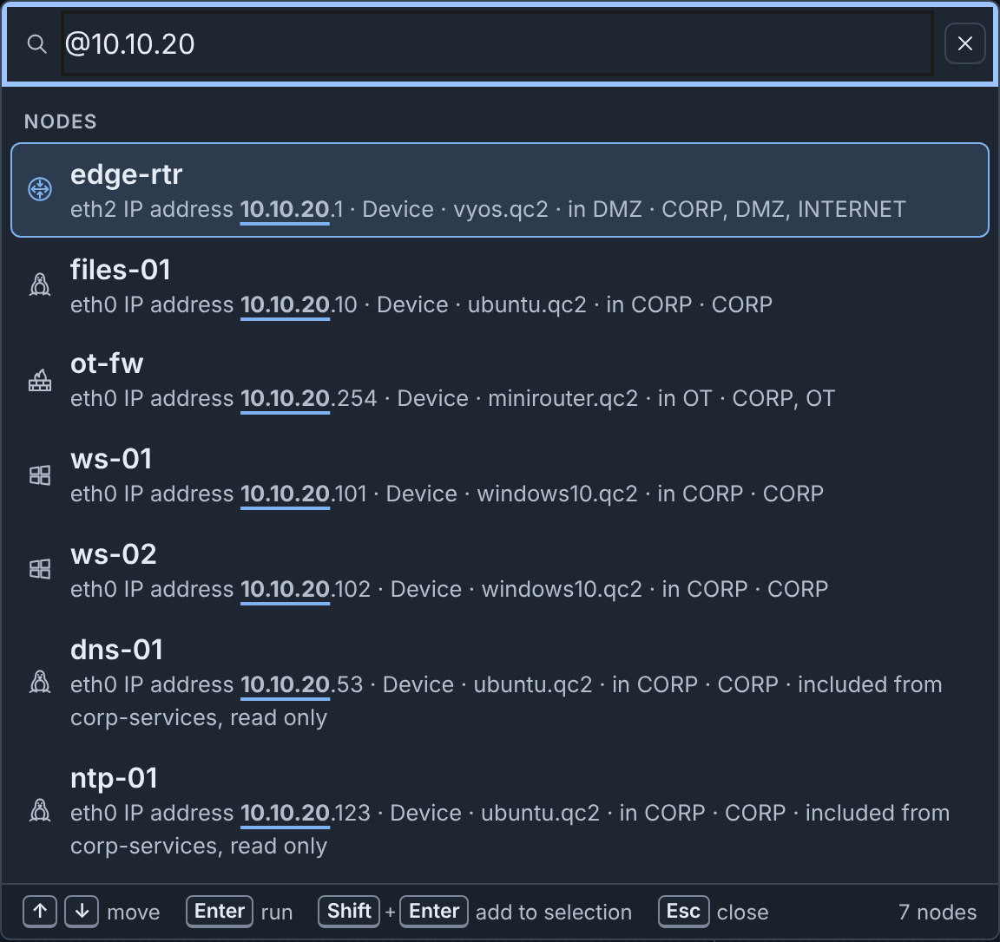
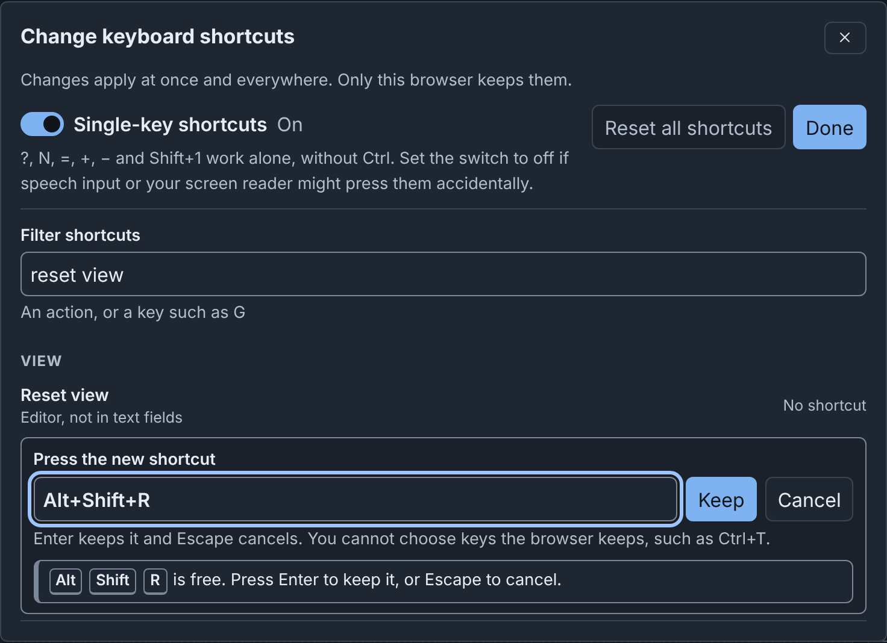

# Command Palette and Shortcuts: Details

!!! info
    This page goes deeper than the short guide:
    [The Editor](../editor.md#command-palette).

## Command Palette

The palette also works on the drafts page, and
<kbd>Ctrl</kbd>+<kbd>K</kbd> (<kbd>⌘</kbd>+<kbd>K</kbd> on macOS) opens it
even from a text field. When you open it, `Recent` shows your last commands,
and the first group holds commands for the selected items. A command that
doesn't apply says why, for example
`Unavailable: There is no earlier layout to restore.`

- Some commands also match other words. For example, type `export` to see
  every download format. Each one opens the `Download diagram` dialog and
  starts that download (see
  [Downloading](import-upload-download.md#downloading)).
- A command marked `›` has a second step. For example, `Add device` then
  lists `Device` and each device template. In the empty field, press
  <kbd>Backspace</kbd> to go back a step.
- Without a prefix, the palette also shows up to three matching templates,
  collections and icons.
- On a node, <kbd>Shift</kbd>+<kbd>Enter</kbd> adds it to the selection.

Some useful commands:

| Command | Group | What it does |
|---|---|---|
| `Open Node Editor` | Edit | Opens the [Node Editor](editor.md#node-editor) on the selected node. |
| `Edit layers…` | General | Opens the [layers editor](editor.md#layers-editor). On the drafts page, it shows the `Layers` tab. |
| `Set layer of selection` | Structure | Asks for a layer, or `No layer`, and puts each selected device and switch at it as one `Undo` step. A device with `No layer` goes to the layer that its fields match, if any. Nodes from included topologies keep their layers. |
| `Select nodes on layer` | Selection | Selects each node at a layer, chosen for the node or matched by its fields. |
| `Select devices on network` | Selection | Selects each device with an interface on a network: connected to one of its switches, or, with no connection, naming the network in its VLAN. |
| `Select devices using image` | Selection | Selects each device with a drive of a disk image. |
| `Assign addresses` | Structure | Assigns addresses on a network with a subnet (see [Addresses of a Network](editor.md#addresses-of-a-network)). |
| `Add a connection…`, `Move to a group…` | Add, Structure | Opens the dialog of the [Inspector header](editor.md#the-inspector-header). |
| `Show or hide connections` | View | Hides or shows the connections on your canvas. |

### Finding Templates, Collections and Icons

The palette finds templates, collections and icons by name and by the fields
below. When a field matches and the name doesn't, the second line shows the
field, for example `Updated by: bob` or `In collection: Pumps`.

| Prefix | Finds | Fields |
|---|---|---|
| `t:` | Node templates | Description, icon, custom icon, layer, type, hostname, image, collection, who created or updated it, and its source (`Library`, `Server` or `Built-in`, or in the editor, its section in `Nodes & Templates`) |
| `c:` | Template collections | Description, the names of its templates, who created or updated it, and its source (`Library collections` or `Server`) |
| `i:` | Custom icons | Other names, size, who created or updated it, and its source (the user who uploaded it, or `Server`) |

In the editor, a template adds a device. On the drafts page, it opens in the
template editor. A collection opens on the `Node Templates` tab, and an icon
on the `Icons` tab; from the editor, either one closes the editor first.

### Finding Nodes

Type `@` and some text to find a node by its name, then by these fields, in
this order: hostname, IP address, MAC address, VLAN or network (with its VLAN
alias), annotation, label, description and image. When a field matches and
the name doesn't, the second line shows it, for example
`eth0 IP address 10.10.30.20` or `label role=historian`.

{ width="592" }

To find the historian by name:

1. Press <kbd>Ctrl</kbd>+<kbd>K</kbd> (<kbd>⌘</kbd>+<kbd>K</kbd> on macOS).
2. Type `@hist`. The palette shows historian-01 and the note that names it.
3. Press <kbd>Enter</kbd>. The canvas selects historian-01, and the
   Inspector shows it.

If the zoom is below 60% when you go to a node, the canvas zooms to 100%, or
to your `Zoom when a diagram opens` percentage when that's larger. From 60%
up, the zoom stays the same, and the canvas only moves the node into view.
`Go to network` and `Go to` in the checks work the same way.

<kbd>Ctrl</kbd>+<kbd>Shift</kbd>+<kbd>O</kbd>
(<kbd>⇧</kbd>+<kbd>⌘</kbd>+<kbd>O</kbd> on macOS) opens the palette at
`Go to node`, which lists all nodes.

## Keyboard Shortcuts

The default shortcuts are in the
[Reference](../reference.md#keyboard-shortcuts). In the shortcuts sheet, type
in `Filter shortcuts` to find an action or a key, such as `G`.

<kbd>N</kbd> on the canvas adds a plain device in the visible part of the
canvas, and moves focus to it. Commands such as `Reset view` have no keys
until you set some (see [Customizing Shortcuts](#customizing-shortcuts)).

### Keys on the Canvas

The diagram is one <kbd>Tab</kbd> stop. The canvas keys work on the canvas,
its nodes and its connections, but not on the zoom buttons.

- From the canvas itself, the arrow keys go to the node nearest the middle
  of the view.
- When the focused node shows its [info tooltip](editor.md#info-tooltips),
  the first <kbd>Esc</kbd> closes the tooltip, and the second clears the
  selection.
- <kbd>Delete</kbd> deletes the focused item, or the whole selection when
  the focused item is part of it.
- With <kbd>Alt</kbd>+<kbd>Shift</kbd> (<kbd>⌥</kbd>+<kbd>⇧</kbd> on macOS),
  <kbd>→</kbd> and <kbd>↓</kbd> make the selected item larger, and
  <kbd>←</kbd> and <kbd>↑</kbd> make it smaller.
- A second <kbd>Shift</kbd>+<kbd>1</kbd> restores the view from before the
  fit.
- While the connections are hidden, the arrow keys go only to nodes, and
  <kbd>PgDn</kbd> and <kbd>PgUp</kbd> say `Connections are hidden.` with the
  keys that show them.

In a published diagram, you can select and copy items, but not change them.
For screen reader use, see
[Accessibility](../../accessibility.md#screen-readers).

### Single-Key Shortcuts

<kbd>?</kbd>, <kbd>N</kbd>, <kbd>=</kbd>, <kbd>+</kbd>, <kbd>−</kbd> and
<kbd>Shift</kbd>+<kbd>1</kbd> work without <kbd>Ctrl</kbd> or <kbd>⌘</kbd>.
To turn them off, switch off `Single-key shortcuts` in the shortcuts sheet or
in Settings. The palette and the buttons still run those commands. For when
to turn them off, see [Accessibility](../../accessibility.md#builder).

### Customizing Shortcuts

You can give any command other keys, or no keys. For example, to run
`Reset view` with <kbd>Alt</kbd>+<kbd>Shift</kbd>+<kbd>R</kbd>
(<kbd>⌥</kbd>+<kbd>⇧</kbd>+<kbd>R</kbd> on macOS):

1. Click `Shortcuts` in the header.
2. Click `Change shortcuts`. The sheet changes to
   `Change keyboard shortcuts` and lists all commands.
3. In `Filter shortcuts`, type `reset view`.
4. On the `Reset view` row, click `Change`. The row says
   `Press the new shortcut`.
5. Press <kbd>Alt</kbd>+<kbd>Shift</kbd>+<kbd>R</kbd>. The row shows the
   keys and says that they're free.
6. Press <kbd>Enter</kbd>, or click `Keep`.
7. Click `Done`, then close the sheet.

If another command already uses the keys, the row says so, for example that
<kbd>Ctrl</kbd>+<kbd>G</kbd> already runs `Group selection`. Click
`Use for` and the command name, such as `Use for Reset view`, to move the
keys to this command, or press other keys. You can't choose keys that the
browser keeps for itself, such as <kbd>Ctrl</kbd>+<kbd>T</kbd>.

Each changed row has `Remove` (no keys) and `Reset` (its default keys), and
`Reset all shortcuts` resets every command. Your keys belong to this browser,
and stay after you log out.

## See Also

- [Reference](../reference.md): the default shortcuts, limits and codes.
- [The Editor: Details](editor.md): the parts of the editor that these
  commands act on.
- [Templates and Icons](../templates.md): node templates, collections and
  custom icons.
