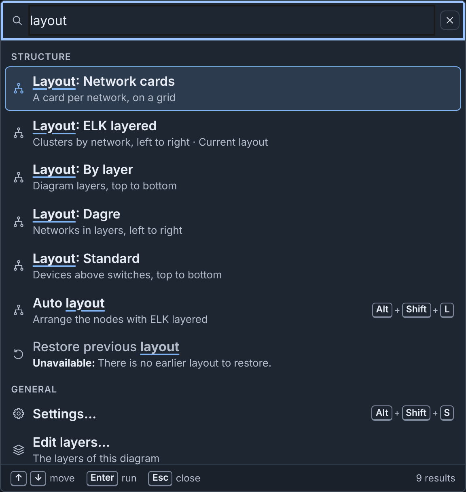
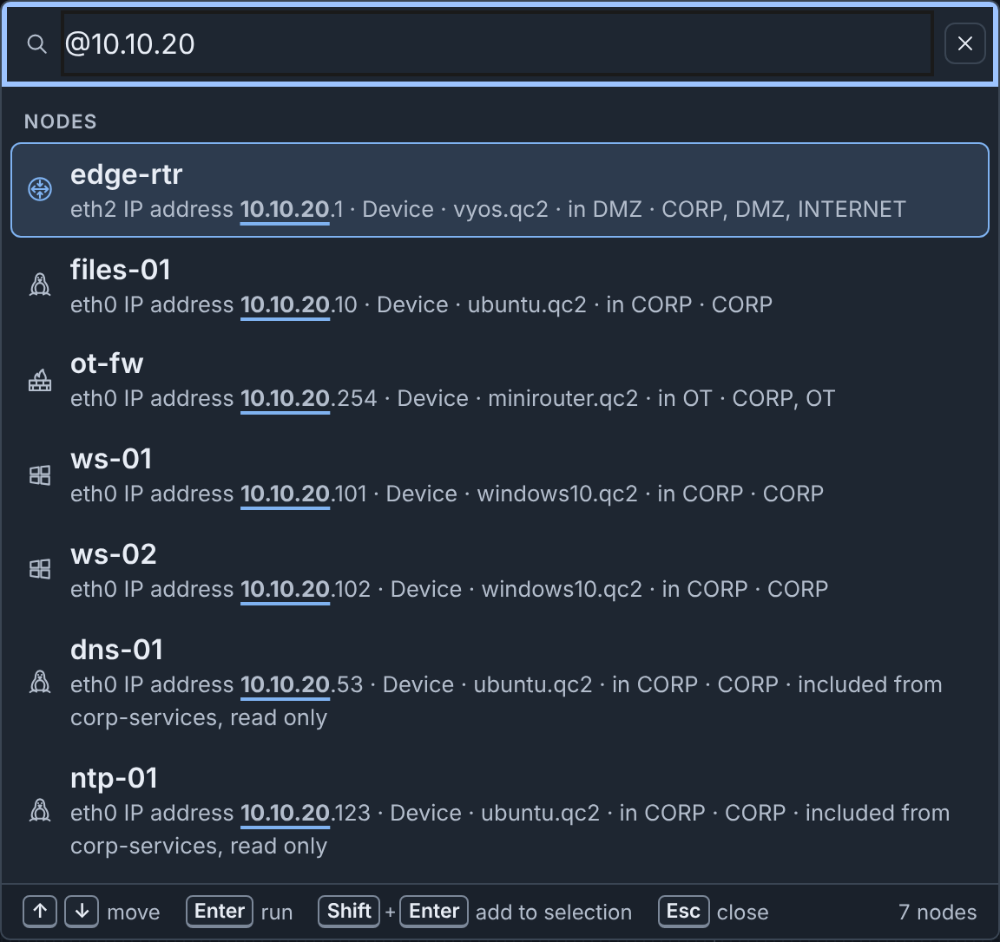
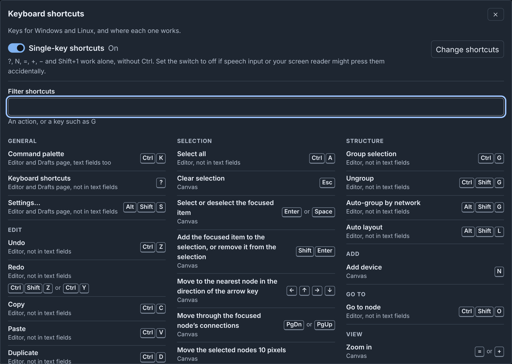
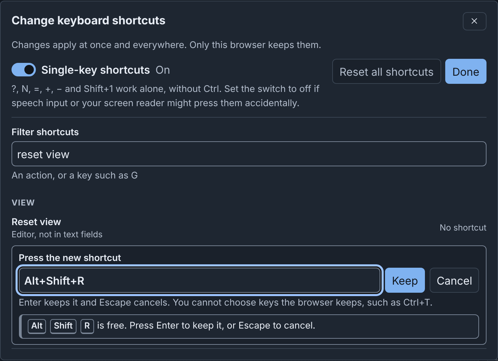

# Command Palette and Shortcuts: details

!!! info
    This page holds every rule, limit and message of this feature. For the
    short guide, see [The Editor](../editor.md#command-palette).

## Command palette

The command palette runs commands and finds nodes, networks, node templates,
template collections and custom icons.

To open it, click **Commands** in the header, or press
<kbd>⌘</kbd>+<kbd>K</kbd> on macOS or <kbd>Ctrl</kbd>+<kbd>K</kbd> on Windows
and Linux. The keys also work in text fields. The palette also works on the
drafts page.

- Type words to find commands, for example `layout`.
- The first group holds commands for the selected items. When you open the
  palette, **Recent** shows your last commands.
- A command that does not apply says why, for example "Unavailable: There is
  no earlier layout to restore."
- Some commands also match another word. Type `export` to see all download
  formats: **Download Builder JSON**, **Download Builder YAML**, **Download
  Topology YAML**, **Download PNG**, **Download SVG**, **Download draw.io**
  and **Download Gephi (GEXF)**. Each opens the **Download diagram** dialog
  and starts that download (see
  [Downloading](import-upload-download.md#downloading)).
- A command marked **›** has a second step. For example, **Add device**
  then lists **Device** and each device template. In the empty field, press
  <kbd>⌫</kbd> (<kbd>Backspace</kbd>) to go back one step.
- Type `@` to find nodes (see [Finding nodes](#finding-nodes)). Type `#` to
  find networks by name or VLAN alias, and select a switch.
- Type `t:` to find [node templates](templates.md), `c:` to find template
  collections, and `i:` to find [custom icons](icons.md#custom-icons). Type
  `?` to see all prefixes. Without a prefix, the palette also shows up to
  three matching templates, collections and icons.

Press <kbd>↑</kbd> and <kbd>↓</kbd> to move, <kbd>Enter</kbd> to run, and
<kbd>Esc</kbd> to close. On a node, <kbd>Shift</kbd>+<kbd>Enter</kbd> adds it
to the selection.

Some useful commands:

| Command | Group | Function |
|---|---|---|
| **Open Node Editor** | Edit | Opens the [Node Editor](editor.md#node-editor) on the selected node. |
| **Edit layers…** | General | Opens the [layers editor](editor.md#layers-editor). On the drafts page, it shows the **Layers** tab. |
| **Set layer of selection** | Structure | Asks for a layer, or **No layer**, and puts each selected device and switch at it, as one step of **Undo**. A device with **No layer** goes to the layer that its fields match, if one matches. Nodes from included topologies keep their layers. |
| **Select nodes on layer** | Selection | Asks for a layer, and selects each node at it: the layer chosen for the node, or the layer that its fields match. |
| **Select devices on network** | Selection | Asks for a network, and selects each device with an interface on it. The interface connects to a switch of the network, or, with no connection, names the network in its VLAN. |
| **Select devices using image** | Selection | Asks for a disk image, and selects each device with a drive of that image. |
| **Assign addresses** | Structure | Asks for a network with a subnet, and assigns addresses on it (see [Addresses of a network](editor.md#addresses-of-a-network)). |
| **Add a connection…**, **Move to a group…** | Add, Structure | Opens the dialog of the [Inspector header](editor.md#the-inspector-header). |
| **Show or hide connections** | View | Hides or shows the connections on your canvas. This browser keeps your choice. |

### Finding templates, collections and icons

The palette finds templates, collections and icons by their names and by the
fields in this table. When a field matches and the name does not, the second
line shows the field, for example "Updated by: bob" or "In collection:
Pumps".

| Prefix | Finds | Fields |
|---|---|---|
| `t:` | Node templates | Description, icon, custom icon, layer, type, hostname, image, collection ("In collection"), "Created by", "Updated by" and the source. The layer is "Layer 3" and its label, or the layer that the fields of the template match in the open diagram. The source is "Library", "Server" or "Built-in". In the editor, the source is the section of the template in Nodes & Templates, for example "This diagram". |
| `c:` | Template collections | Description, the names of its templates ("Template"), "Created by", "Updated by" and the source: "Library collections" or "Server" |
| `i:` | Custom icons | Other names ("Also named"), size, "Created by", "Updated by" and the source: "Uploaded by" and the user, or "Server" |

"Created by" is the user who added the item. "Updated by" is the user who
last changed the name, the description or the content of a template or a
collection. For an icon, "Updated by" is the user who renamed it. A built-in
template and an item from a server collection have neither. An icon that the
server added has no "Created by", and has "Updated by" only after a user
renames it. An icon from before phenix kept these names shows its uploader as
"Created by", and has no "Updated by".

A template adds a device in the editor. On the drafts page, it opens in the
template editor. A collection opens on the **Node Templates** tab, and an
icon opens on the **Icons** tab. From the editor, a collection or an icon
first closes the editor.

### Finding nodes

Type `@` and some text to find nodes. The palette finds a node by its name,
and by these fields, in this order:

1. Hostname
2. IP address
3. MAC address
4. VLAN or network, with its VLAN alias
5. Annotation
6. Label
7. Description
8. Image

Name matches come first, then field matches in the order of the fields. When
a field matches and the name does not, the second line starts with the
field. An address shows its interface, for example "eth0 IP address
10.10.30.20". A label shows its kind, for example "label
role=historian". Type `?` to see the fields again.

{ width="592" }

To find the historian by name:

1. Press <kbd>⌘</kbd>+<kbd>K</kbd> (<kbd>Ctrl</kbd>+<kbd>K</kbd>).
2. Type `@hist`. The palette shows historian-01 and the note that names it.
3. Press <kbd>Enter</kbd>. The canvas selects historian-01, and the
   Inspector shows it.

When you go to a node while the zoom is below 60%, the canvas zooms to 100%,
or to your **Zoom when a diagram opens** percentage when it is larger. From
60% up, the zoom stays, and the canvas only moves the node into view. **Go to
network** and **Go to** in the checks do the same.

<kbd>⇧</kbd>+<kbd>⌘</kbd>+<kbd>O</kbd> (<kbd>Ctrl</kbd>+<kbd>Shift</kbd>+<kbd>O</kbd>)
opens the palette at **Go to node**, which lists all nodes.

## Keyboard shortcuts

To see all shortcuts, click **Shortcuts** in the header, or press
<kbd>?</kbd> outside a text field. The sheet shows the keys of your platform.
To find an action or a key such as `G`, type in **Filter shortcuts**.

The default shortcuts:

| Action | Where it works | macOS | Windows and Linux |
|---|---|---|---|
| Command palette | Editor and Drafts page, text fields too | <kbd>⌘</kbd>+<kbd>K</kbd> | <kbd>Ctrl</kbd>+<kbd>K</kbd> |
| Keyboard shortcuts | Editor and Drafts page, not in text fields | <kbd>?</kbd> | <kbd>?</kbd> |
| Settings… | Editor and Drafts page, not in text fields | <kbd>⌥</kbd>+<kbd>⇧</kbd>+<kbd>S</kbd> | <kbd>Alt</kbd>+<kbd>Shift</kbd>+<kbd>S</kbd> |
| Undo | Editor, not in text fields | <kbd>⌘</kbd>+<kbd>Z</kbd> | <kbd>Ctrl</kbd>+<kbd>Z</kbd> |
| Redo | Editor, not in text fields | <kbd>⇧</kbd>+<kbd>⌘</kbd>+<kbd>Z</kbd> | <kbd>Ctrl</kbd>+<kbd>Shift</kbd>+<kbd>Z</kbd> or <kbd>Ctrl</kbd>+<kbd>Y</kbd> |
| Copy | Editor, not in text fields | <kbd>⌘</kbd>+<kbd>C</kbd> | <kbd>Ctrl</kbd>+<kbd>C</kbd> |
| Paste | Editor, not in text fields | <kbd>⌘</kbd>+<kbd>V</kbd> | <kbd>Ctrl</kbd>+<kbd>V</kbd> |
| Duplicate | Editor, not in text fields | <kbd>⌘</kbd>+<kbd>D</kbd> | <kbd>Ctrl</kbd>+<kbd>D</kbd> |
| Delete selection | Canvas | <kbd>⌫</kbd> or <kbd>⌦</kbd> | <kbd>Delete</kbd> or <kbd>Backspace</kbd> |
| Rename | Canvas | <kbd>F2</kbd> | <kbd>F2</kbd> |
| Open Node Editor | Editor, not in text fields | <kbd>⌥</kbd>+<kbd>⇧</kbd>+<kbd>E</kbd> | <kbd>Alt</kbd>+<kbd>Shift</kbd>+<kbd>E</kbd> |
| Select all | Editor, not in text fields | <kbd>⌘</kbd>+<kbd>A</kbd> | <kbd>Ctrl</kbd>+<kbd>A</kbd> |
| Clear selection | Canvas | <kbd>esc</kbd> | <kbd>Esc</kbd> |
| Select or deselect the focused item | Canvas | <kbd>↩</kbd> or <kbd>Space</kbd> | <kbd>Enter</kbd> or <kbd>Space</kbd> |
| Add the focused item to the selection, or remove it from the selection | Canvas | <kbd>⇧</kbd>+<kbd>↩</kbd> | <kbd>Shift</kbd>+<kbd>Enter</kbd> |
| Move to the nearest node in the direction of the arrow key | Canvas | <kbd>←</kbd> <kbd>↑</kbd> <kbd>→</kbd> <kbd>↓</kbd> | <kbd>←</kbd> <kbd>↑</kbd> <kbd>→</kbd> <kbd>↓</kbd> |
| Move through the connections of the focused node | Canvas | <kbd>⇟</kbd> or <kbd>⇞</kbd> | <kbd>PgDn</kbd> or <kbd>PgUp</kbd> |
| Move the selected nodes 10 pixels | Canvas | <kbd>⇧</kbd> with an arrow key | <kbd>Shift</kbd> with an arrow key |
| Resize the selected group, note, shape or icon 10 pixels | Canvas | <kbd>⌥</kbd>+<kbd>⇧</kbd> with an arrow key | <kbd>Alt</kbd>+<kbd>Shift</kbd> with an arrow key |
| Group selection | Editor, not in text fields | <kbd>⌘</kbd>+<kbd>G</kbd> | <kbd>Ctrl</kbd>+<kbd>G</kbd> |
| Ungroup | Editor, not in text fields | <kbd>⇧</kbd>+<kbd>⌘</kbd>+<kbd>G</kbd> | <kbd>Ctrl</kbd>+<kbd>Shift</kbd>+<kbd>G</kbd> |
| Auto-group by network | Editor, not in text fields | <kbd>⌥</kbd>+<kbd>⇧</kbd>+<kbd>G</kbd> | <kbd>Alt</kbd>+<kbd>Shift</kbd>+<kbd>G</kbd> |
| Auto layout | Editor, not in text fields | <kbd>⌥</kbd>+<kbd>⇧</kbd>+<kbd>L</kbd> | <kbd>Alt</kbd>+<kbd>Shift</kbd>+<kbd>L</kbd> |
| Add device | Canvas | <kbd>N</kbd> | <kbd>N</kbd> |
| Go to node | Editor, not in text fields | <kbd>⇧</kbd>+<kbd>⌘</kbd>+<kbd>O</kbd> | <kbd>Ctrl</kbd>+<kbd>Shift</kbd>+<kbd>O</kbd> |
| Zoom in | Canvas | <kbd>=</kbd> or <kbd>+</kbd> | <kbd>=</kbd> or <kbd>+</kbd> |
| Zoom out | Canvas | <kbd>−</kbd> | <kbd>−</kbd> |
| Fit diagram to view | Canvas | <kbd>⇧</kbd>+<kbd>1</kbd> | <kbd>Shift</kbd>+<kbd>1</kbd> |
| Show or hide connections | Editor, not in text fields | <kbd>⌥</kbd>+<kbd>⇧</kbd>+<kbd>C</kbd> | <kbd>Alt</kbd>+<kbd>Shift</kbd>+<kbd>C</kbd> |
| Focus mode | Editor and Drafts page, text fields too | <kbd>⇧</kbd>+<kbd>⌘</kbd>+<kbd>F</kbd> | <kbd>Ctrl</kbd>+<kbd>Shift</kbd>+<kbd>F</kbd> |
| Save now | Editor, text fields too | <kbd>⌘</kbd>+<kbd>S</kbd> | <kbd>Ctrl</kbd>+<kbd>S</kbd> |

"Not in text fields" means that the keys do nothing while focus is in a text
field, or in a field of the Inspector. On the drafts page, **Settings…** and
**Keyboard shortcuts** also work while focus is on a card checkbox or on
**Select all**.

<kbd>N</kbd> on the canvas adds a plain Device in the visible part of the
canvas, and moves focus to it. In a published diagram, <kbd>N</kbd> adds
nothing.

On a Mac keyboard without these keys, <kbd>⇟</kbd> and <kbd>⇞</kbd> are
<kbd>Fn</kbd> with <kbd>↓</kbd> and <kbd>↑</kbd>. <kbd>↖</kbd> and
<kbd>↘</kbd> (Home and End) are <kbd>Fn</kbd> with <kbd>←</kbd> and
<kbd>→</kbd>. <kbd>⌫</kbd> is Delete and <kbd>⌦</kbd> is Forward Delete.

Other commands, such as **Reset view**, have no keys until you set some (see
[Customizing shortcuts](#customizing-shortcuts)). The tooltips, the palette
and the sheet show your keys.

### Keys on the canvas

The diagram is one <kbd>Tab</kbd> stop. The canvas keys of the table work on
the canvas, its nodes and its connections, but not on the zoom buttons. These
details are not in the table:

- From the canvas itself, the arrow keys go to the node nearest the middle of
  the view.
- When the focused node shows its [info tooltip](editor.md#info-tooltips), the first
  <kbd>Esc</kbd> closes the tooltip, and the second clears the selection.
- <kbd>Delete</kbd> deletes the focused item, or the full selection when the
  focused item is in it.
- With <kbd>Alt</kbd>+<kbd>Shift</kbd> (<kbd>⌥</kbd>+<kbd>⇧</kbd>),
  <kbd>→</kbd> and <kbd>↓</kbd> make the item larger, and <kbd>←</kbd> and
  <kbd>↑</kbd> make it smaller.
- A second <kbd>Shift</kbd>+<kbd>1</kbd> (<kbd>⇧</kbd>+<kbd>1</kbd>) restores
  the view from before the fit.
- While the connections are hidden, the arrow keys go only to nodes.
  <kbd>PgDn</kbd> and <kbd>PgUp</kbd> say "Connections are hidden." with the
  keys that show them.

In a published diagram, you can select and copy items, but you cannot change
them. For keyboard and screen reader use, see [Accessibility](editor.md#accessibility).

### Single-key shortcuts

<kbd>?</kbd>, <kbd>N</kbd>, <kbd>=</kbd>, <kbd>+</kbd>, <kbd>−</kbd> and
<kbd>⇧</kbd>+<kbd>1</kbd> work without <kbd>⌘</kbd> or <kbd>Ctrl</kbd>. If
speech input or your screen reader can press them by mistake, disable
**Single-key shortcuts** in the sheet or in Settings. The palette and the
buttons still run those commands.

### Customizing shortcuts

You can give any command other keys, or no keys. For example, to run **Reset
view** with <kbd>⌥</kbd>+<kbd>⇧</kbd>+<kbd>R</kbd>
(<kbd>Alt</kbd>+<kbd>Shift</kbd>+<kbd>R</kbd> on Windows and Linux):

1. Click **Shortcuts** in the header.
2. Click **Change shortcuts**. The sheet changes to **Change keyboard
   shortcuts**, and lists all commands.
3. In **Filter shortcuts**, type `reset view`.
4. On the **Reset view** row, click **Change**. The row says "Press the new
   shortcut".
5. Press <kbd>⌥</kbd>+<kbd>⇧</kbd>+<kbd>R</kbd>. The row shows the keys and
   says that they are free.
6. Press <kbd>Enter</kbd>, or click **Keep**.
7. Click **Done**, then close the sheet.

When another command uses the keys, the row says so, for example that
<kbd>⌘</kbd>+<kbd>G</kbd> "already runs Group selection". To move the keys to
this command, click **Use for** and the command name, for example **Use for
Reset view**. Or press other keys. You cannot choose keys that the browser
keeps, such as <kbd>⌘</kbd>+<kbd>T</kbd>.

Each changed row has **Remove** (no keys) and **Reset** (its default keys).
**Reset all shortcuts** resets all commands to their default keys. The browser
keeps your keys after you log out.
