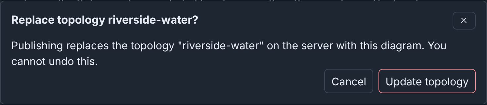
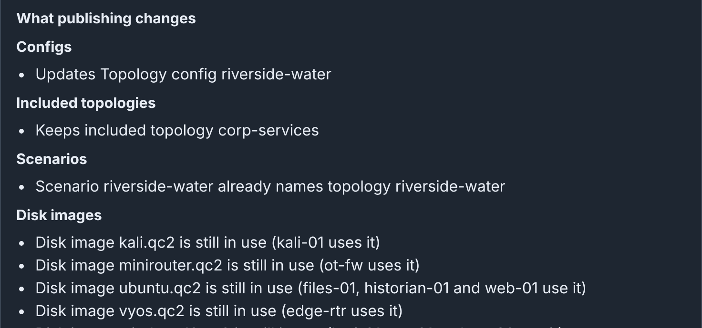

# Publishing: Details

!!! info
    This page goes deeper than the short guide:
    [Publishing](../publishing.md).

The examples publish the Riverside Water draft, which lists the scenario
`riverside-water` (see [The example lab](../tutorial.md#the-example-lab)).

!!! note
    If you published `riverside-water` in the [tutorial](../tutorial.md),
    the Riverside Water draft can't publish any more (see
    [When the Source Config Changed](#when-the-source-config-changed)). Use
    your tutorial draft instead, with the scenario `riverside-water` added.
    Its counts are one device and one connection higher.

## Publishing a Topology

For Riverside Water, `Checks` says "10 devices, 4 switches, 4 networks and
13 connections are ready to publish." It counts the 2 included devices and
their 2 connections separately. Before an update, Builder asks you to
confirm:



Each time the dialog opens, `Topology name` starts as the diagram name made
into a config name. When the draft can update a topology, a `Use` button
below the field fills in its name: the topology the draft last published
to, or else the one it comes from. `Experiment name` has the same button.

Config names can only use letters, numbers, `_`, `@`, `.` and `-`, with no
spaces. While a name breaks the rule, the field says why, such as "it
contains a space", and a refusal suggests a valid form, such as
`Riverside-Water`. The experiment name and the new topology name of an
[import](import-upload-download.md#import-options) use the same rule.

### What the Topology Holds

Builder uses the `Subnet` and `Gateway` of a network only to fill in the
`Address`, `Mask` and `Gateway` of the interfaces on it (see
[Adding switches and networks](diagrams.md#adding-switches-and-networks)).
They aren't published. `Download` > `Topology YAML` shows the topology
exactly as Publish writes it (see
[Topology YAML](import-upload-download.md#topology-yaml)).

### What Publishing Changes

`What publishing changes` is a dry run against the server, using the last
saved snapshot and the names in the form. It updates when you change the
form and after each save. Included topologies and disk images are compared
with the topology as it is now, and a new experiment gets every VLAN alias.

If your role can list the server's disk images, each disk image line ends
", and the server has it" or ", but the server does not have it".



With nothing to show, it says "Nothing outside the Topology changes." Below
the lists are the warnings that publishing would give, with their codes,
such as `publish.legacy.replaced`.

When the server would refuse the publish, its reasons come first, with
"The server would refuse this." These are only the problems that `Checks`
doesn't already list, such as a hostname that an included topology also
uses, or a scenario that doesn't exist. The button stays available, because
the server checks again when you publish.

### Create or Update

The hints and buttons are listed in
[Publish hints and buttons](../reference.md#publish-hints-and-buttons). On
top of the cases in the
[guide](../publishing.md#create-or-update), a draft can also update a
topology when:

- you opened the draft from the Builder file that the topology names (see
  [Publishing to a Topology That Names a Builder File](#publishing-to-a-topology-that-names-a-builder-file))
- you made it with `Save my history as a new draft` from a draft that can
  update the topology
- it's an import of an experiment made from the topology, and the topology
  has no legacy Builder diagram

A new topology gets only the `builder-doc` annotation, which names the
published diagram (see
[The builder-doc annotation](administration.md#the-builder-doc-annotation)).
Publish doesn't write the annotations that the Inspector shows from an
imported config.

### Replacing a Legacy Builder Diagram

An update replaces `builder-xml` with `builder-doc`, and warns
`publish.legacy.replaced` (see
[Converting a stored topology](../legacy.md#converting-a-stored-topology)).

### The Result

The stages and headlines are listed in
[Publish results](../reference.md#publish-results). A successful update
looks like this:

```text
Published. Every stage succeeded.
document: created — phenix stored the immutable Builder document
topology: updated
scenario: skipped — scenario riverside-water already names topology riverside-water
draft: ok
```

The `document` is the published copy of the diagram, which shows on the
`Published Diagrams` tab. After a failed publish, the button can say
`Update` for a config that the failed attempt created. If the server
refuses the publish before it writes anything, the form stays open and
`Checks` gives the reason after "Could not publish the diagram."

## Publishing a Topology and an Experiment

If you publish the topology and an experiment right after
[Publishing a Topology](#publishing-a-topology), the result is:

```text
document: created — phenix stored the immutable Builder document
topology: skipped
scenario: skipped — scenario riverside-water already names topology riverside-water
experiment: created
draft: ok
```

The topology stage is `skipped` because that config already holds this
snapshot. Start the experiment from the `Experiments` page (see
[Starting / Stopping Experiments](../../experiments.md#starting-stopping-experiments)).
While it exists, `Exp` in the toolbar opens it (see
[Opening the experiment](drafts.md#opening-the-experiment)).

With the VLAN alias `120` on the CORP switch, `riverside-lab` gets:

```yaml
spec:
  vlans:
    aliases:
      CORP: 120
      DMZ: 0
      INTERNET: 0
      OT: 0
    max: 0
    min: 0
```

### Scenarios

Publish changes nothing in a scenario except its `topology` annotation. The
annotation names topologies separated by commas, for example
`topology: riverside-water,riverside-water-b`. Only an exact name counts:
`riverside-water-old` doesn't name `riverside-water`.

`Experiment scenario` defaults to the first scenario the diagram lists. When
the diagram lists none, the dialog has no `Scenarios` part and the
experiment has no scenario.

Publish refuses before it writes anything when a listed scenario doesn't
exist or you can't read it ("Scenario NAME does not exist."), or when you
can't update a scenario whose annotation needs the topology. For a scenario
that shows "Not found on the server" in the `Scenarios` dialog, clear its
box and click `Save scenarios`, or store it again.

The `Scenarios` dialog writes its changes to Scenario configs at once, and
`Cancel` doesn't undo them.

### Experiment Names

An experiment name follows the config name rule. When Publish creates the
experiment, the name also can't be `all`, in any case, and when the server
names the bridge of each experiment after the experiment (auto bridge mode),
it can have at most 15 characters.

### Updating an Experiment

A draft can update an experiment that it was
[imported from](import-upload-download.md#importing-an-experiment) or
published to, but not one created outside Builder, such as `riverside`. To
update `riverside-lab`, publish again; the button says
`Update topology and experiment`.

Stop the experiment before you update it: Builder refuses to publish to a
running experiment, and writes nothing. An update runs the configure stage
of the apps, like any save of an Experiment config. If the configure stage
fails, the experiment doesn't change and the result says "Published with
failures. …".

### Host Pins

`spec.schedules` pins VMs to cluster hosts by hostname (see
[Scheduling an Experiment](../../experiments.md#scheduling-an-experiment)).
An update keeps each pin whose hostname exactly matches a device in the
topology, so `PLC-2` doesn't pin `plc-2`. It removes the other pins, so
they don't count toward their hosts when phēnix places the VMs, and warns
`publish.experiment.pins-removed`:

> Publish removed the host pins of VMs that are no longer in the topology:
> plc-2 (on compute3), plc-1 (on compute1, renamed to plc-1b).

"renamed to" shows for a device of the diagram that last published the
experiment, or a device imported from a config. To keep a renamed VM on its
host, edit `spec.schedules`, or schedule the experiment again. If you can't
read the experiment's schedule, the warning only counts the removed pins.

## What Blocks Publishing

The [guide](../publishing.md#what-blocks-publishing) lists the five kinds
of warnings that block publishing. phēnix would store most such topologies,
but the experiment would fail or run incorrectly. The rules in more detail
(see also [Checks and warnings](checks.md#checks-and-warnings)):

- An interface with no VLAN: minimega refuses the interface when the
  experiment starts (see
  [Connecting interfaces](diagrams.md#connecting-interfaces)).
- A shared IP or MAC address: two interfaces are on the same network when
  they have the same VLAN (the connected network, or else the typed VLAN)
  and the same bridge. A blank bridge and `phenix` are both the default
  bridge. Interfaces with no VLAN are compared with each other. IP addresses
  are compared without the prefix length, and MAC addresses in any case and
  with any separators. Blank values, the IP addresses of `dhcp` and
  `manual` interfaces, and the MAC addresses of external devices are
  ignored.
- A hostname phēnix refuses: external devices aren't checked. Other casings
  of `all`, and `phenix` on a device that isn't Windows, only give warnings
  that don't block publishing.
- A device setting that stops the experiment: see
  [Device settings](checks.md#device-settings).
- A device with no drive: phēnix refuses the topology.

`Checks` lists the errors first, then the warnings. An error about a
duplicate names the other device. In the dialog from the drafts page,
`Go to` opens the editor first. When the server refuses a publish, the
dialog shows its reason and its issues with their codes, and a refusal about
a name also marks its field.

### Example: Riverside Water Expansion

The Riverside Water expansion draft has `historian-01-2`, a copy of
`historian-01` (see [Duplicating a device](diagrams.md#duplicating-a-device)).
The copy keeps the address 10.10.30.20, and its eth0 isn't connected.
`Publish` shows this error, and `Create topology` isn't available:

```text
1 error blocks publishing
Error: interface "eth0" of "historian-01-2" is not connected to a network and has no VLAN. Thus you cannot publish the interface. Connect it, or type a VLAN for it
  Device historian-01-2  interface.vlan.missing
```

The address isn't an error yet, because historian-01-2 is on no network.

To fix the copy:

1. Click `Go to` beside the error. The Inspector opens on historian-01-2.
2. Set `Hostname` to `historian-02`.
3. In the eth0 interface, set `VLAN` to `OT`.
4. Set `Address` to `10.10.30.21`, so it doesn't share the address of
   historian-01 on OT.
5. Click `Apply`. The header says `No issues`.
6. Click `Publish`. `Checks` says "11 devices, 4 switches, 4 networks and
   14 connections are ready to publish."
7. Click `Cancel`.

This draft can't publish once another draft has published `riverside-water`
(see [When the Source Config Changed](#when-the-source-config-changed)).

## Included Topologies

Riverside Water includes `corp-services`, with `dns-01` and `ntp-01` (see
[Included topologies](scenarios.md#included-topologies)). The published
topology names it and doesn't copy them:

```yaml
spec:
  includeTopologies:
    - corp-services
  nodes:
    # edge-rtr, files-01, historian-01, hmi-01, kali-01, ot-fw, plc-01,
    # web-01, ws-01 and ws-02; no dns-01 or ntp-01
```

In a diagram imported with `Combine into one new topology` (see
[Import options](import-upload-download.md#import-options)), the included
topologies that Builder couldn't combine stay in `includeTopologies`, and
the `Checks` summary says so.

If an included topology gets a hostname that the diagram also uses after
the import, Publish refuses: "phenix cannot publish topology
riverside-water: node dns-01 is in this topology and in its included
topology corp-services. …". Rename the node here or in `corp-services`.

## Publishing Again

The draft remembers what it published, even when that snapshot is no
longer in `Draft History`. For the hints you see when another draft
published the topology, or someone changed it outside Builder, see
[Publish hints and buttons](../reference.md#publish-hints-and-buttons).

## When the Source Config Changed

A draft comes from a config by import, by upload of a Builder document made
from it, or from its published diagram. Publish doesn't refuse the draft
when the config still holds this draft's publication, or the published
diagram that the draft comes from. When the config no longer exists, the
draft publishes as a new diagram.

The warning at the top of the Publish dialog reads:

> This diagram comes from topology riverside-water. That topology changed
> on the server after Builder made the diagram. Publish refuses this
> diagram under any name. To continue, make a new draft of topology
> riverside-water: import it again or open its published diagram. Then copy
> your changes to the new draft.

For a draft made from an experiment, the message names the experiment and
tells you to import it again. `Copy` and `Paste` work between drafts that
you open one after the other in the same browser tab, so you can move your
changes across (see
[Importing a topology or experiment](import-upload-download.md#importing-a-topology-or-experiment)).

## Publishing to a Topology That Names a Builder File

A topology can name a Builder file on the phēnix server as its diagram (see
[Diagrams read from a file](drafts.md#diagrams-read-from-a-file)). A draft
made with `Edit as a draft` from that diagram can update the topology while
the file still holds the diagram that the draft comes from, and the
topology is still what that diagram publishes. If not, the server refuses
with one of these reasons, and the form stays open:

- "Could not publish the diagram. Topology pump-station or its Builder file
  changed after Builder opened this draft from the file."
- "Could not publish the diagram. Topology pump-station is not what its
  Builder file publishes. Thus this draft cannot update it."

Publish under a new topology name instead. The hint under `Topology name`
says "A topology with this name exists. Publishing updates it." in all
cases, so it won't warn you beforehand. When the file comes from an import
of a config, such as `pump-station.builder.json` from `pump-station`, the
rule in [When the Source Config Changed](#when-the-source-config-changed)
also applies.

Publish never writes the file. It stores the published diagram in phēnix,
the topology shows that diagram from then on, and its card on
`Published Diagrams` loses the `File` tag. The result warns:

```text
Warning: Topology pump-station names the Builder file /phenix/topologies/pump-station/pump-station.builder.json, which Publish does not change. Download the diagram and replace the file with it, so that the file and the topology stay the same.
```

To bring the file up to date, click `Download` > `Builder JSON` in the
draft and replace the file on the server (see
[Editing and publishing](administration.md#editing-and-publishing)).

## Editing a Published Topology

The `builder` tag and the other Builder controls on the `Configs` page (see
[From the Configs page](import-upload-download.md#from-the-configs-page))
open the first of these, whoever created the draft:

1. The draft that published the topology.
2. An earlier draft of the published diagram.
3. A new draft of the published diagram.

For a diagram in a Builder file, Builder opens or makes a draft from the
file. For a topology without a Builder diagram, the controls open the
`Import` dialog. See also
[Deleting a published topology](drafts.md#deleting-a-published-topology).

## See Also

- [What each task needs](administration.md#what-each-task-needs): the
  permissions behind each publish step.
- [Reference](../reference.md#error-codes): the codes in refusals and
  warnings.
- [Configuration Files](../../configuration.md#experiment): the Experiment
  config that Publish writes.
