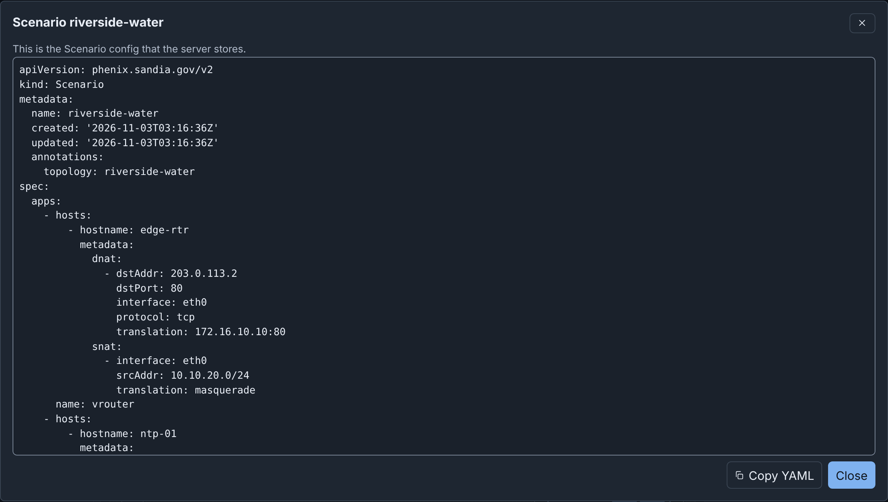
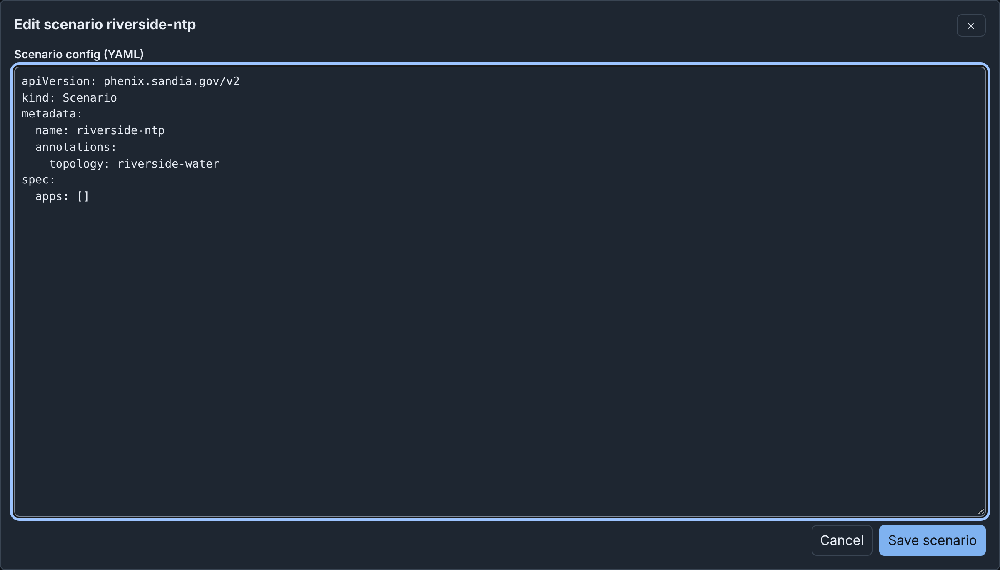

# Scenarios and Included Topologies: Details

!!! info
    This page goes deeper than the short guide:
    [Diagrams](../diagrams.md#scenarios).

## Scenarios

Publishing adds the topology to the `topology` annotation of each scenario
that the diagram lists (see [Scenarios](publishing.md#scenarios)). Besides
`Scenarios` in the toolbar, `Add scenario` in the Inspector (with nothing
selected) opens the dialog. The button says `Edit scenarios` once the
diagram lists one.

### The List of Scenarios

`Scenarios of this diagram` lists the scenarios on the server, and a
scenario that the diagram lists but the server doesn't have shows "Not found
on the server". With more than 8 scenarios, `Filter scenarios` filters the
list by name. A diagram lists at most 20, and the dialog tells you to clear
one before you select another.

`Cancel` leaves the diagram's list as it was, but a scenario that you stored
on the server stays there. In a published diagram, you can only view the
scenarios.

### Viewing and Editing a Scenario

`View` shows the scenario as read-only YAML, with `Copy YAML`.

{ width="1216" }

`Edit` opens the YAML in a text field, and `Save scenario` replaces the
stored scenario with your text, annotations included. The name can't
change: to store the scenario under a new name, use `Create new scenario`.
When the server refuses the config, the editor lists each problem and stays
open.

{ width="1216" }

### Creating a Scenario

`Create new scenario` opens the editor on a Scenario config with no apps,
named after the diagram plus `-scenario` (such as
`Riverside-Water-scenario`). Its `topology` annotation names the topology
that the [Publish dialog](publishing.md#scenarios) offers first.
`Create scenario` stores it on the server and checks it. Click
`Save scenarios` to keep it in the diagram.

### Uploading a Scenario File

To add a scenario from a file, choose a `phenix.sandia.gov/v2` Scenario
config (YAML or JSON, up to 5 MiB) in `Upload a scenario (YAML or JSON)`,
then click `Store and add`. `Scenario name` starts as the file's
`metadata.name`, or as the file name when that isn't a valid name.

If the server already has a scenario of that name, Builder asks before it
replaces it. The stored scenario gets the file's spec, and keeps its own
annotations while adding those of the file. Its `topology` annotation keeps
every topology it named, so their experiments can still use it.

## Included Topologies

When you try to change an included device, Builder tells you where it comes
from, for example "Included topology corp-services defines dns-01. This
device is read only here. Change it in corp-services." (see
[Fields You Cannot Change](editor.md#fields-you-cannot-change)). You also
can't delete their connections or remove their network, but you can change
the network's fields other than its name. The checks give included devices
no warnings,
but do check the diagram's own devices against them. Publishing doesn't copy
included devices (see [Included Topologies](publishing.md#included-topologies)).

### Making Included Devices Editable

Besides `Combine into a new draft` in the Inspector, you can run
`Combine included nodes into a new draft` from the command palette, or
choose `Combine into one new topology` when you import the topology.

The new draft is named after the diagram plus "-combined" (such as
`Riverside-Water-combined`, with a number when that name is taken), and the
open draft doesn't change. Its devices
are normal devices that the checks include, and it has no link to the
original topology. If the diagram never had the nodes of an included
topology, `includeTopologies` still names it, and Builder says so: "It still
includes NAME, whose nodes are not in the diagram."

## See Also

- [Scenario](../../configuration.md#scenario): what a Scenario config holds.
- [Create a New Experiment](../../experiments.md#create-a-new-experiment):
  starting an experiment from a topology and one of its scenarios.
