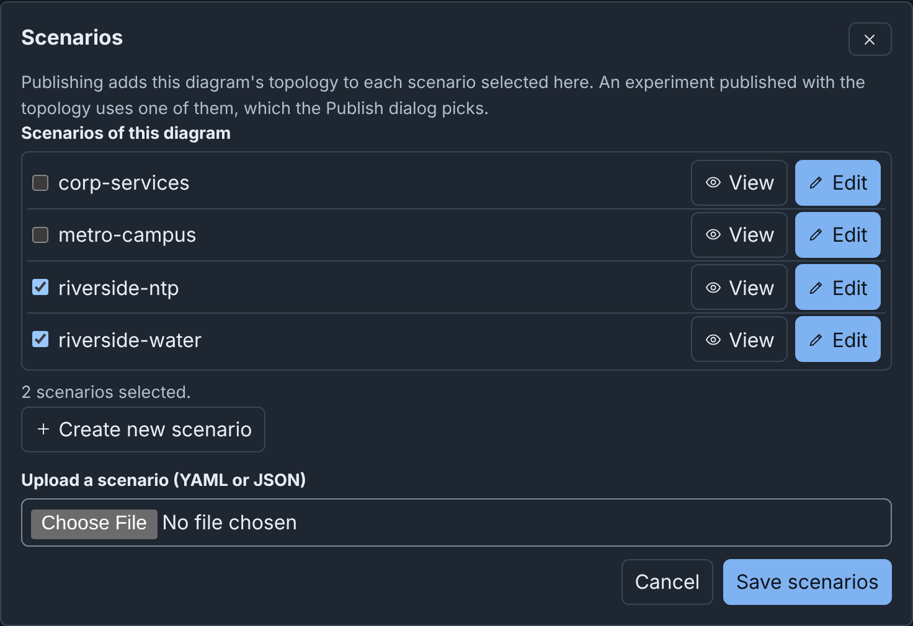
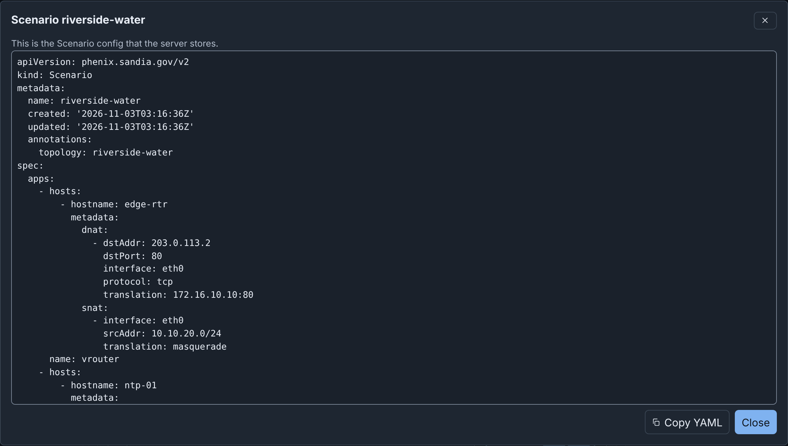
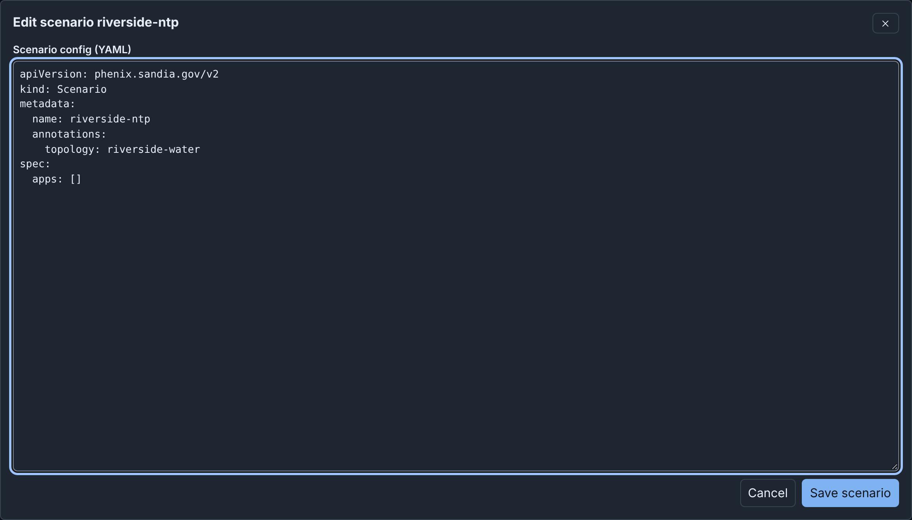

# Scenarios and Included Topologies: details

!!! info
    This page holds every rule, limit and message of this feature. For the
    short guide, see [Diagrams](../diagrams.md#scenarios).

## Scenarios

A diagram lists, by name, up to 20 Scenario configs that the diagram uses.
Publishing adds the topology to the `topology` annotation of each one. An
experiment published with the topology uses one of them (see
[Scenarios](publishing.md#scenarios)).

To add the stored scenario riverside-water to a diagram, such as your
[quick start](../tutorial.md) draft:

1. Click **Scenarios** in the toolbar, or **Add scenario** in the
   Inspector with nothing selected.
2. Under **Scenarios of this diagram**, select the checkbox of
   `riverside-water`.
3. Click **Save scenarios**.

### The list of scenarios

**Scenarios of this diagram** lists each scenario that your role can list
on the server, sorted by name. A checkbox adds the scenario to the end of
the diagram's list, or removes it. The scenario on the server does not
change.

- A scenario that the diagram lists, and that the server does not list,
  shows "Not found on the server".
- With more than 8 scenarios, **Filter scenarios** filters the list by
  name. <kbd>Enter</kbd> in this field does not save the dialog.
- When the diagram lists 20 scenarios, the dialog says "A diagram lists at
  most 20 scenarios. To select another, clear one first."

**Save scenarios** writes the list into the diagram. **Cancel** does not
change the list, but a scenario that you stored stays on the server.

### Viewing and editing a scenario

Each scenario of the server has **View** and **Edit**:

- **View** opens the scenario as read-only YAML, with **Copy YAML**.
- **Edit** opens the scenario as YAML in a text field. Change the config,
  then click **Save scenario**. Builder replaces the stored scenario with
  the text, its annotations included. The name must stay the same: "The
  name must stay NAME. To store the scenario with a new name, select Create
  new scenario."

{ width="1216" }

{ width="1216" }

When the server refuses the config, the editor shows each problem that the
server found and stays open. When you changed the text, **Cancel** asks
"Discard your changes?".

### Creating a scenario

**Create new scenario** opens the editor with a new Scenario config:

- Its name is the diagram's name made into a config name, then
  `-scenario`, for example `Riverside-Water-scenario`. When the name is in
  use, Builder adds a number, such as `-2`.
- Its `topology` annotation names the topology that the
  [Publish dialog](publishing.md#scenarios) offers first.
- It has no apps.

Change the config, then click **Create scenario**. Builder stores the
scenario on the server and selects its checkbox. Click **Save scenarios**
to keep the list in the diagram.

### Uploading a scenario file

To add a scenario from a file, choose the file in **Upload a scenario (YAML
or JSON)**. The file is a `phenix.sandia.gov/v2` Scenario config of at most
5 MiB. The dialog proposes the file's `metadata.name` as **Scenario name**,
or else the file name made into a config name. **Store and add** stores the
file on the server as a Scenario config and selects its checkbox.

When the server has a scenario of that name, Builder asks "Replace scenario
NAME?" first. The scenario gets the file's spec. It keeps its own
annotations and adds those of the file. Its `topology` annotation keeps
every topology that it named and adds those of the file. Thus, experiments
of those topologies can still use it.

To store a new scenario, your role needs `configs` `create`. To replace
one, it needs `configs` `get` and `update`. When the server refuses, the
dialog shows the server's message. A name that the list has in another
letter case shows one time, with the spelling of the stored scenario.

In a published diagram, the dialog only lists the scenarios, each with
**View**, and has **Close**.

## Included topologies

riverside-water includes the topology corp-services, so dns-01 and ntp-01
are in the diagram:

- They have a dashed border and say "Included from corp-services".
- Their fields are read only (see
  [Fields you cannot change](editor.md#fields-you-cannot-change)), but you
  can move them.
- You cannot delete or connect them, or delete their connections. Builder
  says, for example, "Included topology corp-services defines dns-01. This
  device is read only here. Change it in corp-services."
- You cannot rename or remove their network (CORP). Its other fields can
  change.
- The checks give them no warnings, but check this diagram's devices
  against them.

To change dns-01, change the topology corp-services, then import
riverside-water again (see
[Importing a topology or experiment](import-upload-download.md#importing-a-topology-or-experiment)).
Or make the included devices part of a new diagram. Publishing does not
copy included devices (see
[Included topologies](publishing.md#included-topologies)).

### Making included devices editable

To change included devices in the diagram itself, make a copy of the
diagram in which they are its own nodes:

- When you import the topology, choose **Combine into one new topology**
  under **Included topologies**.
- In an open draft, run **Combine included nodes into a new draft** from
  the command palette. Or select an included device and click **Combine
  into a new draft** in the Inspector.

The command makes a new draft and opens it. The draft that was open does
not change. The new draft has the diagram's name with "-combined" at the
end, for example Riverside-Water-combined. It gets a number when a topology
or a draft of any user has that name.

In the new draft, the included devices are normal devices. You can change,
delete and connect them, and the checks include them. The draft has no
link to riverside-water, so publishing it makes a new topology. When the
diagram never had the nodes of an included topology, `includeTopologies`
still names it. Builder says so: "It still includes", the topology's name,
and "whose nodes are not in the diagram."
