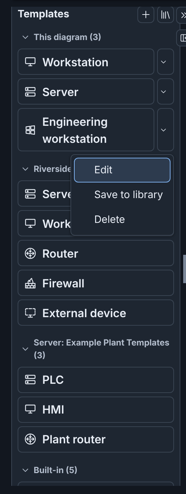
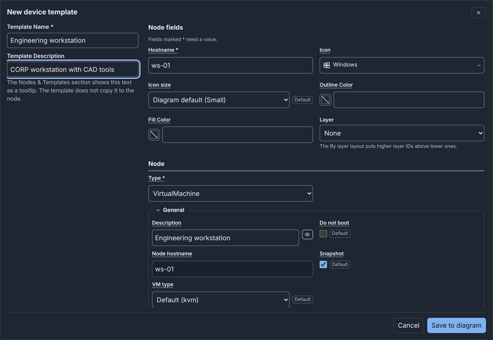
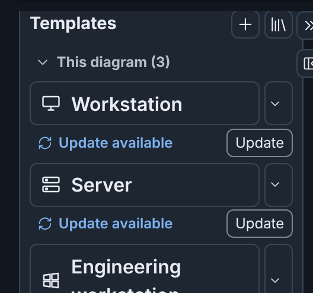
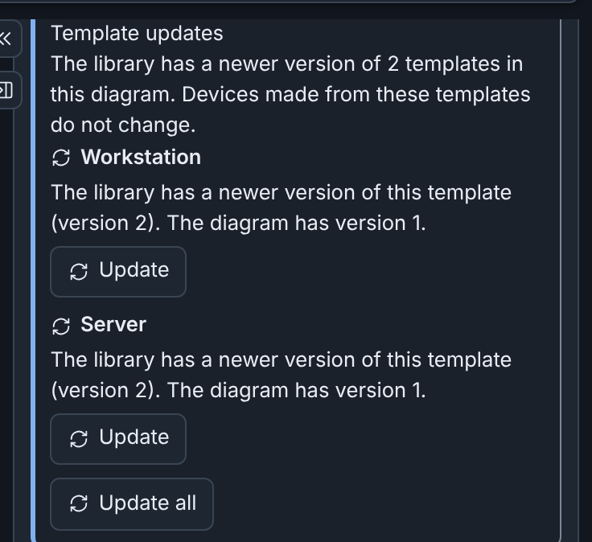
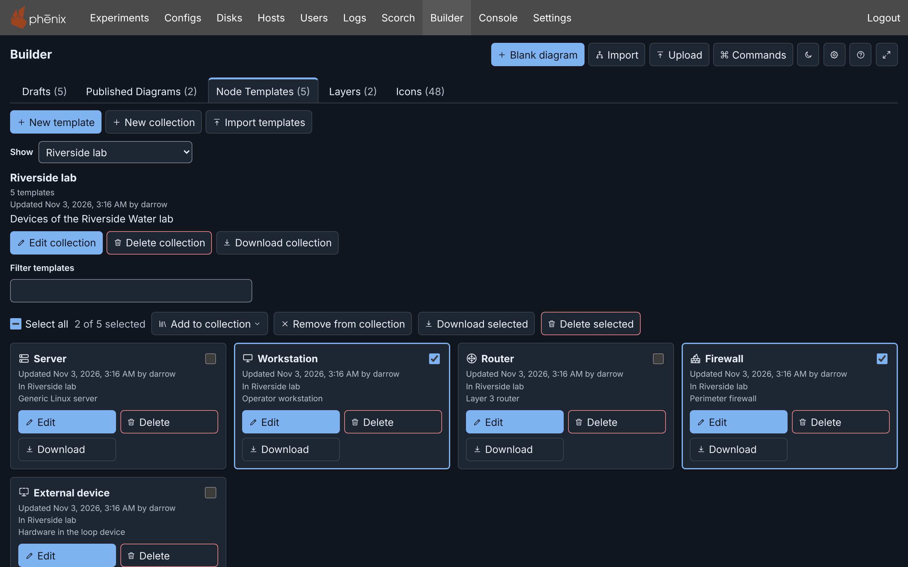
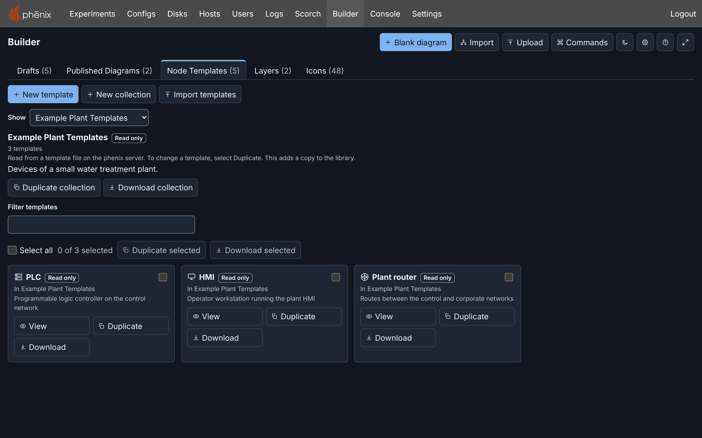

# Node Templates: Details

!!! info
    This page goes deeper than the short guide:
    [Templates and Icons](../templates.md).

## Templates in the Editor

{ width="240" }

Under `Templates`, `Library` holds the library templates that are in no
collection, and is called `Other library templates` when the library has
collections. A template in two collections shows in both, and an empty
collection doesn't show. In the command palette, `Add device` lists each
template once, and `t:` finds a template by its other fields (see
[Command Palette](palette-and-shortcuts.md#command-palette)).

A device made from a template also:

- Has an empty VLAN on each interface whose VLAN names a network of the
  diagram. Other VLAN text stays.
- Uses the template's icon size, or else the diagram's (see
  [Icon Size](icons.md#icon-size)).
- Shows a layer that the diagram doesn't have as "Layer N" (see
  [Layers](layers.md#layers)).
- Has no description, and no link to the template.

The linked copy that a library or server template adds goes in with the
device as one change, for example "Added device and template PLC". Builder
adds no copy when the diagram already has one, for a built-in template, or
when the diagram already holds 50 templates (it says so).

### When the Library Cannot Be Loaded

When Builder can't read the library, `Templates` says "The Builder could not
load the template library." with a `Retry` button. The diagram and built-in
templates stay listed, and so do the templates of the last read that worked.

A library that a newer version of phēnix saved gives "The Builder cannot read
the template library. A newer version of phenix may have saved it." with no
`Retry`. The `Node Templates` tab says the same, but still lists the
built-in templates and the server collections. Open the library with the
phēnix version that saved it.

Builder reads the library again when it reads the drafts lists, when a draft
opens, when you come back to the editor's window, and after each change you
make to it, so another user's change shows up then.

## Diagram Templates

### Making a Diagram Template

`New device template` is also in the command palette. A template made from
a device empties the VLAN of each interface, and takes in the Inspector
changes that you haven't applied yet. A template made with no device
selected starts from a plain device (hostname `device`, image `ubuntu.qc2`)
with no name. When the diagram holds 50 templates, the `+` does nothing, and
its tooltip says that the diagram is full.

`Save to library` first sends the diagram's own copy of the template's
custom icon, if it has one, to the server's icon library (see
[The Diagram and Its Icons](icons.md#the-diagram-and-its-icons)). If that
fails, Builder still saves the template and tells you why.

### The Template Editor



`Template Name` (required) and `Template Description` are one line each: a
pasted line break or tab becomes a space. Two templates can share a name,
but the field then shows a note.

`Node fields` has the Inspector's fields, with the same checks (see
[Editing a Node](editor.md#editing-a-node)), and the rarely used ones are
under `More settings`. `Hostname` is the name that new devices start from.
A few fields work differently:

- `Icon size` `Diagram default` uses the size of the diagram that the
  device goes into. In a diagram template it names that size, for example
  "Diagram default (Large)".
- `Layer` offers the diagram's layers for a diagram template. For a library
  template it offers the default layer set, or the placeholder layers when
  the server has no default set (see [The Layers Tab](drafts.md#the-layers-tab)).

The device of a template can be at most 16 KiB as JSON.

## Linked Templates

A diagram gets a linked template when you add a device from a library or
server template, or when you click `Save to library`. Builder compares it
with its source when a draft opens and each time it reads the library, and
marks it when something changed:

| Mark | What it means | Button on the mark |
|---|---|---|
| `Update available` | The library has a newer version. For a server template, an administrator changed the template file and restarted the server. | `Update` |
| `Deleted from library` | A user deleted the library template. | `Unlink` |
| `Removed from server` | The server collection no longer has the template. | `Unlink` |

{ width="240" }

With nothing selected, the Inspector lists them under `Template updates`
(see [With Nothing Selected](editor.md#with-nothing-selected)).

{ width="352" }

An update gives the diagram template the name, description and device
fields of its source, as one change that `Undo` can reverse. `Update all`
(there when two or more templates have an update) asks once, with an
`Update templates` button. `Unlink` doesn't ask, and is
also one change. You can change a linked template in the diagram and keep
the link, but an update replaces your changes.

## The Template Library

The server keeps one template library, which no user owns. Every Builder
user sees the same templates and collections, and can add, change and
delete them (see [The Libraries](administration.md#the-libraries)). Only the
built-in templates and the server collections are read only.

### The Node Templates Tab



The command palette has `Open Node Templates library` in the editor and
`Show Node Templates` on the drafts page. `c:` shows a collection, and `t:`
opens a template in the template editor.

`Filter templates` finds a template by its name, by the fields that `t:`
finds, and by its source (Library, Server or Built-in). The text stays when
you change `Show` (see [Filtering the Lists](drafts.md#filtering-the-lists)).

`New template` opens the template editor on a plain device with no name.
When a save fails, the editor stays open with the reason, for example "Could
not save the template. A library holds at most 200 templates." If someone
changed the template after you opened it, the editor tells you: click `Save`
again to replace their version, or `Cancel` to keep it.

`Delete` removes the template from the library and from its collections,
and you can't undo it. If someone changed the library after the tab read
it, `Delete`, `Delete collection` and `Delete selected` delete nothing and
the tab shows the library as it is now. Check it, then delete again.

### Missing Disk Images

The tab compares each template's drive images with the server's disk
images by file name, with the same case, like the drive image check of a
diagram (see [Checks and Warnings](checks.md#checks-and-warnings)). A card
with a missing image says, for example,
`The server has no disk image named "ubuntu.qc2".` Built-in and server
templates get the warning too, but `Templates with missing images` in `Show`
lists only library templates.

The tab reads the disk images when you show it, and again when you come
back to it after 30 seconds or more. When your role can't list disk images,
or the server lists none, no card shows the warning and `Show` doesn't offer
`Templates with missing images`. If the images become unknown while that
list shows, the choice stays, marked "(disk images unknown)", with an empty
list, until the tab can read them again.

### Built-in Templates

The five built-in templates (see
[Built-in Templates](../reference.md#built-in-templates)) are read only for
everyone, administrators included, and a device made from one adds no
template to the diagram. `Duplicate`, or `Duplicate to library` in the
editor that `View` opens, adds a copy to the library that you can change.

### Collections

`New collection…` in the `Add to collection` menu makes a collection from
the selected templates, and `Remove from collection` takes them out of the
collection that shows. Deleting a collection keeps its templates in the
library, and deleting a template takes it out of every collection.

### Selecting Several Templates

The row above the cards acts on the checked cards. For the library it has
`Add to collection` (and `Remove from collection` while a collection shows),
`Download selected` and `Delete selected`, which asks once. For the built-in
templates and a server collection, it has `Duplicate selected` and
`Download selected`.

Changing `Show` clears the selection. The keys of the drafts page also
select cards (see
[Selecting With the Keyboard](drafts.md#selecting-with-the-keyboard)).

## Downloading and Importing Templates

A download writes the same format that `Import templates` and the phēnix
server read, so you can import it on another server, or put it in the
template directory of a server (see [Server Collections](#server-collections)).

### Downloading Templates

Each download saves a YAML file of one collection: `Download` on a card
makes a collection named after the template, `Download selected` one named
after the list (such as "Library"), and `Download collection` keeps the
collection's name and description. The file name comes from that name, for
example `plant-floor.templates.yaml`.

The file carries a copy of each custom icon that its templates name, from
the server's icon library, and Builder names any icon that the library
doesn't have. Template names in a file must differ in more than case, so
when the library holds "PLC" and "plc", the download keeps the first and
numbers the others, such as "plc (2)".

This short file is only an illustration. The example file
[node-templates.yaml](../examples/node-templates.yaml) has three templates and
no icons.

```yaml
$schema: https://phenix.sandia.gov/schemas/builder/templates/v1
name: Plant floor
description: Devices of the plant's control network.
templates:
  - name: PLC
    description: Programmable logic controller
    device:
      iconKey: server
      icon: plc-icon
      spec:
        type: VirtualMachine
        general:
          hostname: plc
          vm_type: kvm
        hardware:
          os_type: linux
          drives:
            - image: ubuntu.qc2
icons:
  plc-icon:
    data: iVBORw0KGgoAAAANSUhEUgAAAAEAAAABCAYAAAAfFcSJAAAADUlEQVR42mNkYPhfDwAChwGA60e6kgAAAABJRU5ErkJggg==
```

- `$schema` (required) names the format. The server serves its JSON Schema
  at `/api/v1/schemas/builder/templates/v1`.
- `name` (required) and `description` describe the collection, each on one
  line.
- `templates` (required): each has a `name`, an optional `description`, and
  a `device` with the fields that the template fills in. Templates have no
  IDs: the place that keeps a template gives it one.
- `icons` (optional) holds copies of custom icons by name, each a PNG in
  base64. A template can also name an icon that the file doesn't carry, which
  the server's icon library must then hold.

YAML anchors and aliases (`&name`, `*name`) aren't allowed. For the size
limits, see [Limits](#limits).

### Importing

For a file that it can't import, the `Import templates` dialog lists each
problem and where it is in the file. The new collection takes the file's
name and description, with a number when the library already has that name,
such as "Plant floor (2)", and the dialog tells you before you import.

The file's custom icons go to the server's icon library first (see
[The Diagram and Its Icons](icons.md#the-diagram-and-its-icons)). If an icon
can't go there, the import continues and the dialog tells you what
happened. An import is refused when the library already holds 50
collections, or when the file would take the library past 200 templates.

## Server Collections

An administrator can give everyone on a server the same templates: phēnix
reads each template file in the server's template directory at startup, as
one collection (see
[Template Files on the Server](administration.md#template-files-on-the-server)).
Server collections are read only for everyone, administrators included, so
duplicate a template to change it. When an administrator changes a template
file and restarts the server, the linked copies of its templates show
`Update available`.

Here the template directory holds the example file
[node-templates.yaml](../examples/node-templates.yaml):



## Limits

A diagram holds at most 50 templates, and the library 200 templates in at
most 50 collections. Names and descriptions are one line each. For every
limit of templates, collections and template files, see
[Limits](../reference.md#limits).

## From a Script

- Scripts list, add, change and delete library templates and collections
  through the REST API (see [REST API](administration.md#api)). Each
  template and collection names the user who added it (`createdBy`) and the
  user who last changed it (`updatedBy`).
- `--base-dir.builder-templates` sets the template directory of the server
  collections.
- Diagram templates are part of the Builder document, so a Builder file can
  hold them. A linked template keeps its link in `source` (see
  [Builder JSON and YAML](import-upload-download.md#builder-json-and-yaml)).
  Publish never writes diagram templates into a Topology config.

## See Also

- [Adding Devices](diagrams.md#adding-devices): the other ways to add a
  device.
- [Custom Icons](icons.md#custom-icons): the icon library that templates
  use.
- [Schema](../../schema.md): the node spec that a template's device holds.
