# Building a Diagram

This page shows how to draw and change a diagram. For the parts of the
editor, see [The Editor](editor.md). The examples use the Riverside Water
draft of the [example lab](index.md#the-drafts-on-these-pages).

## Devices, switches and connections

A diagram describes one phenix Topology config:

| In the diagram | In the published topology |
|---|---|
| A device | A node in `spec.nodes`, with its settings |
| A switch | A network. Its name is the VLAN of each interface on it |
| A connection from a device to a switch | An interface of the device, with the network's name as its `vlan` |
| A device from an included topology | Nothing: `includeTopologies` names that topology |
| A network's **Subnet** and **Gateway** | Nothing. The interfaces hold the addresses that Builder gives from them |
| Notes, groups, shapes, icons, lines, colors, line styles, icon sizes, custom icons, layers and the diagram's templates | Nothing |

A connection always joins a device to a switch.

## Adding devices

To add a device from **Nodes & Objects**, at the top of the left column, do
one of these steps:

- Select the item. The device appears in free space in the visible part of
  the canvas, or outside it when that part is full. Builder selects it.
- Drag the item to the canvas.
- In the [command palette](editor.md#command-palette), choose **Add
  device**, then a template.

**Device** adds a device with default settings. The templates under
**Templates** set more settings. The **Built-in** section always lists the
five built-in templates:

| Item | Hostname | Type | OS type | Image |
|---|---|---|---|---|
| **Device** | node | VirtualMachine | linux | `ubuntu.qc2` |
| **Server** | server | VirtualMachine | linux | `ubuntu.qc2` |
| **Workstation** | workstation | VirtualMachine | windows | `windows10.qc2` |
| **Router** | router | Router | minirouter | `minirouter.qc2` |
| **Firewall** | firewall | Firewall | vyos | `vyos.qc2` |
| **External device** | external | HIL (external) | None | None |

The built-in templates are read only. To change one, duplicate it into the
template library of the server (see [Node Templates](templates.md)).

When the hostname is in use, the new device gets a number, for example
server-2. A new device has no interfaces, so the checks warn "device
"workstation" has no interfaces". **Go to** beside this warning moves focus
to **Add interface** in the Inspector.

To add an engineering workstation to Riverside Water:

1. Under **Templates**, select **Workstation**.
2. In the Inspector, set **Hostname** to `ws-03` and **Description** to
   `CAD workstation`.
3. Select **Apply**.

### Routers and firewalls

The `vrouter` app configures the interfaces, routes and
rulesets of a device of type Router or Firewall (see
[vrouter App](../apps.md#vrouter-app)). For a VyOS router, such as
edge-rtr, set **OS type** to `vyos` and the drive's **Image** to `vyos.qc2`.

### External devices

An external device is hardware that the experiment connects to, such as a
PLC. phenix starts no VM for it, so it has no
image. Its interfaces tell phenix which VLANs the hardware is on (see
[External Nodes](../configuration.md#external-nodes)).

## Adding switches and networks

A switch is one network. To add a network:

1. Under **Nodes & Objects**, select **Switch**, or choose **Add switch**
   in the command palette. A switch appears, with a new network named EXP,
   then EXP-2 and so on.
2. In the Inspector, set **Name**, for example `SCADA`, and select
   **Apply**.

When you rename a network, the VLAN of each interface on it changes.

A switch's outline has the color of its network's connections, unless the
switch has its own **Outline Color** (see [Colors](#colors)). A screen reader names the
switch, its network and its VLAN alias.

The Inspector of a switch has these network fields:

- **VLAN alias**: optional, from 1 to 4094. When you publish with an
  experiment, it becomes the network's entry in `vlans.aliases` (see
  [Publishing a topology and an experiment](publishing.md#publishing-a-topology-and-an-experiment)).
- **Subnet**: an optional IPv4 network in CIDR form, such as `10.1.0.0/24`.
- **Gateway**: an optional IPv4 address of the router on the network. It
  must be a host address of the subnet, such as `10.1.0.1` in
  `10.1.0.0/24`.

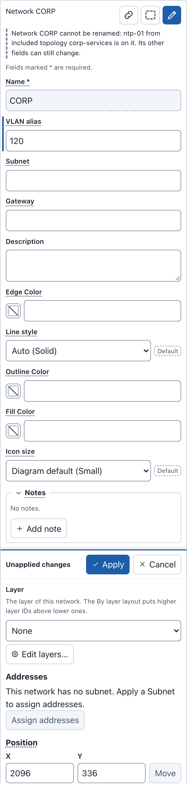{ width="352" }

To find a network, type `#` in the command palette. **Remove network** in
the command palette deletes a network, its switches and their connections.
A network can have more than one switch, for example after a paste.

When you delete the last switch of a network, Builder deletes the network
in the same edit. **Undo** restores both. The network stays when the
**VLAN** of an interface with no connection still names it. The checks then
warn that the network has no switch. To correct this, add a switch, change
the VLAN, or use **Remove network**. A diagram that you open or upload
keeps all its networks.

### Subnets and addresses

Builder uses a network's **Subnet** and **Gateway** to give addresses to
the static interfaces on the network. A static interface has the
**Interface kind** **Static or OSPF**. Builder gives an address only to a
static interface that has no address. It never changes an address that an
interface has, or a device from an included topology.

An assigned address is the next free host address of the subnet. A free
address is not the gateway, and no other interface on the network uses it.
The interface also gets the subnet's prefix length as its **Mask**. When
the interface has no **Gateway**, it gets the network's gateway. For
example, with the subnet `10.1.0.0/24` and the gateway `10.1.0.1`, the
first interface gets `10.1.0.2`, mask `24` and gateway `10.1.0.1`.

A router holds the gateway. Here, a router is a device of type Router or
Firewall. Router interfaces get their addresses first, and never get a
**Gateway** of their own:

- When no interface on the network has the gateway address, the first
  router interface gets it.
- When the network has no gateway, the first router interface gets the next
  free address. That address becomes the network's **Gateway** in the same
  step, and the interfaces after it get that gateway.
- Other router interfaces get the next free addresses.

A new network gets a suggested subnet: the first `10.N.M.0/24` that
overlaps no subnet of the diagram and holds no interface or gateway address
of the diagram. In an empty diagram, that is `10.1.0.0/24`. You can change
or clear it. A network that you import or upload keeps its own subnet, or
has none.

Builder gives addresses at these times:

- When you connect a static interface to a switch of the network: with a
  drag, with **Add a connection**, or with **Paste** or **Duplicate** of a
  device and its switch. After a drag or **Add a connection**, Builder says
  the address, for example "Set the address of eth0 of ws-03 to
  10.1.0.2/24."
- When you select **Assign addresses** in the Inspector of a switch, or
  choose it and the network in the command palette. This is one step of
  **Undo**, for example "Assigned 3 addresses on network SCADA".

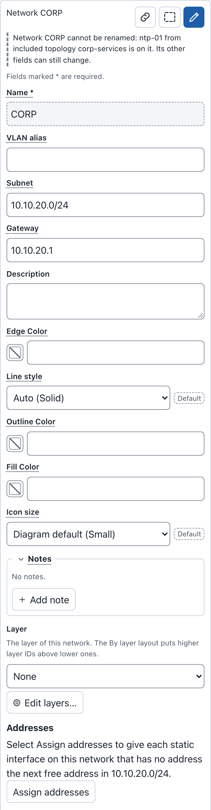{ width="352" }

The **Assign addresses on connect** setting, in the **Editing** section of
[Settings](editor.md#settings), is on by default. When it is off, a
connection, paste or duplicate gives no address. After a drag or **Add a
connection**, Builder then says "No address set. Type an address for eth0
of ws-03 in the Inspector, or select Assign addresses." **Assign
addresses** and the suggested subnet work with the setting on or off.

A network without a subnet gives no address. When you connect a static
interface to it, Builder says "No address set: network CORP has no subnet.
Type an address for eth0 of ws-03 in the Inspector." **Assign addresses**
is then not available. When the subnet is full, Builder says, for example,
"No address set: subnet 10.1.0.0/30 of network SCADA is full."

A static interface without an address stops **Apply** of its device.

## Connecting interfaces

A connection puts a device's interface on a network. Each example below
connects ws-03 to CORP. CORP has no subnet, so eth0 gets no address. Type
its address in the Inspector, for example `10.10.20.103`, or give CORP a
subnet first.

### Drag on the canvas

1. Point at ws-03. Each interface has a connection point (a circle) on the
   device's sides. A **+** handle is at its bottom.
2. Drag from the **+** handle, or from an unconnected connection point, to
   the CORP switch.

A drag from **+** adds a new static interface. A published diagram and a
device from an included topology have no **+** handle.

A drag from one device to another adds a switch between them, with a new
network named EXP and a suggested subnet. You cannot connect two switches,
because each switch is one network.

### Add a connection without dragging

1. Select a device or a switch.
2. Select **Add connection** (the link button) in the Inspector header, or
   choose **Add a connection…** in the command palette. The dialog opens
   with the selection filled in.
3. In **Device**, choose `ws-03`.
4. Keep **Interface** set to **Add a new interface**, or choose an
   interface that has no connection.
5. In **Switch**, choose **CORP (CORP)**.
6. Select **Connect**.

The command has no default key (see
[Customizing shortcuts](editor.md#customizing-shortcuts)).

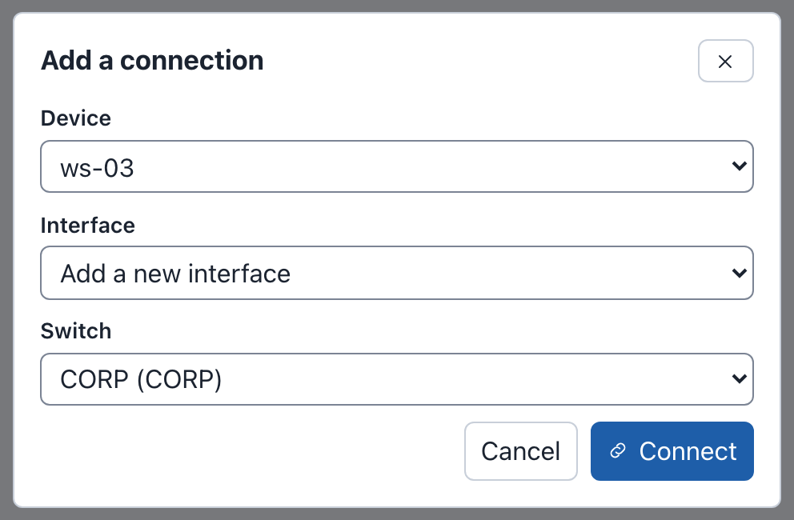{ width="496" }

The dialog stays open in these cases:

- A field is empty. **Connect** names it and moves focus to it.
- Builder cannot make the connection. The dialog says why.

### Type the VLAN in the Inspector

When you apply a network's name in an interface's **VLAN** field, Builder
connects the interface to that network's switch. The
[quick start](index.md#quick-start) connects ws-03 this way:

1. Select ws-03.
2. In the Inspector, under **Network**, select **Add interface**. The new
   interface eth0 is **Static or OSPF**, with **Mask** `24`.
3. Enter **Address** `10.10.20.103` and **Gateway** `10.10.20.1`.
4. Enter **VLAN** `CORP`.
5. Select **Apply**. **Draft History** names the change "Updated device
   ws-03 and connected eth0 to network CORP".

{ width="354" }

The VLAN matches a network's name in any letter case. The name of another
network moves the connection. A VLAN that names no network stays, but the
interface stays unconnected. A typed VLAN gives no address.

A renamed interface keeps its connection while its VLAN names the same
network. When you remove one interface and add another in the same
**Apply**, the new interface does not get the old connection. It connects
only when its VLAN names a network.

### Disconnecting

To disconnect an interface, do one of these steps:

- In the Inspector's **Connection points**, select **Disconnect** next to
  the interface, for example "eth0 — network CORP".
- Select the connection on the canvas and press <kbd>⌫</kbd> on macOS or
  <kbd>Delete</kbd> on Windows and Linux.

The interface stays, with no VLAN, and blocks publishing (see
[What blocks publishing](publishing.md#what-blocks-publishing)). Connect it
again, type a VLAN, or remove it with **Remove connection point** (the
trash button). **Add connection point** adds a static interface with no
connection and no address. The buttons under **Connection points** take
effect at once, without **Apply**.

### Hiding connections

To hide the connections on your canvas, choose **Hide connections** in the
command palette, or press <kbd>⌥</kbd>+<kbd>⇧</kbd>+<kbd>C</kbd>
(<kbd>Alt</kbd>+<kbd>Shift</kbd>+<kbd>C</kbd>) outside a text field. The
same command, now **Show connections**, shows them again. The **Show
connections** switch in [Settings](editor.md#settings) does the same.

This changes only your canvas. This browser keeps your choice for the next
diagram. The diagram, its checks, **Publish** and the downloads keep every
connection: a PNG or SVG still draws them. While connections are hidden:

- You cannot click, select or focus a connection. **Select all** selects
  only nodes.
- **Go to** on an issue about a connection selects the node it starts at.
- The marks of connections with errors or warnings do not show.
- A drag from a connection point still connects it.
- <kbd>PgDn</kbd> and <kbd>PgUp</kbd> do not move through connections.

## Editing device settings

Change the fields of a device in the Inspector or the
[Node Editor](editor.md#node-editor), then select **Apply** (see
[Editing a node](editor.md#editing-a-node)).

An interface has an **Interface kind**:

- **Static or OSPF**: an address that you give, or that Builder gives from
  the subnet. A new interface is this kind, with **Mask** `24`. When you
  add an interface in the Inspector, focus goes to its **Address**.
- **DHCP or manual**: the address comes from DHCP, or from a setting inside
  the VM.
- **Serial**: a serial link.

An interface of an external device has no **Interface kind**. It is a
static interface with **Mask** `24`.

When you change the kind, Builder asks, for example, "Switch Interface kind
to DHCP or manual?" **Switch and clear** changes the kind and empties all
fields of that interface, **Name** and **VLAN** included. **Keep current
value** changes nothing. Set the kind first.

A device shows its **Description** on the canvas. The eye button beside the
field hides it (see
[Hiding descriptions on the canvas](editor.md#hiding-descriptions-on-the-canvas)).

**Generate a random MAC address**, beside **MAC address**, writes a locally
administered unicast address that no other interface of the diagram uses.
Select **Apply** to keep it.

### Duplicating a device

**Duplicate** pastes a copy of the selected nodes next to them (see
[Copy, paste, duplicate and delete](#copy-paste-duplicate-and-delete)). The
copy keeps every setting, addresses included, but not its connections.

To add a second historian:

1. Select historian-01.
2. Press <kbd>⌘</kbd>+<kbd>D</kbd> (<kbd>Ctrl</kbd>+<kbd>D</kbd>). The copy
   historian-01-2 appears, with the address 10.10.30.20 and an unconnected
   eth0.

The header then says **1 warning**: eth0 of historian-01-2 has no VLAN.
When the copy's eth0 is on the network of historian-01, the shared address
is also a warning. To correct the warning, give the copy its own
hostname and address, and connect it (see
[Example: Riverside Water expansion](publishing.md#example-riverside-water-expansion)).

### Drive images

When your role can list the disk images of the server, a drive's **Image**
suggests them, and an image that the server does not have is a warning.
When the server lists no images, the checks do not examine images.

### Routes and rulesets

**Routes** and **Firewall rulesets** are under **Network**. For example:

- edge-rtr has **Route 1: 10.10.30.0/24**: **Destination**
  `10.10.30.0/24`, **Next hop** `10.10.20.254` (ot-fw) and **Cost** `1`.
- ot-fw has **Firewall ruleset 1: corp-to-ot**, with **Default** `drop` and
  **Rule 1: HTTPS to the historian**. The rule accepts `tcp` from
  `10.10.20.0/24` to `10.10.30.20` port `443`. The **Inbound ruleset** of
  eth0 is `corp-to-ot`.

The `vrouter` app applies them when the experiment starts. **Inbound
ruleset** and **Outbound ruleset** suggest the names of the device's
rulesets, unapplied ones included. The app applies rulesets only on a
Router or a Firewall, and skips a ruleset name that the device does not
have. The checks warn about both cases (see
[Rulesets and addresses](editor.md#rulesets-and-addresses)).

**miniccc commands**, under **More settings**, lists the commands that
phenix gives miniccc to run in the VM, such as `exec df -h`.

## Labels and annotations

A device's labels and annotations are under **More settings**. Each row has
a **Name** and a **Value**. For example, web-01 has the labels `zone: dmz`
and `role: web`, and the annotation `phenix/startup-autotunnel` with the
value `["8080:80"]`:

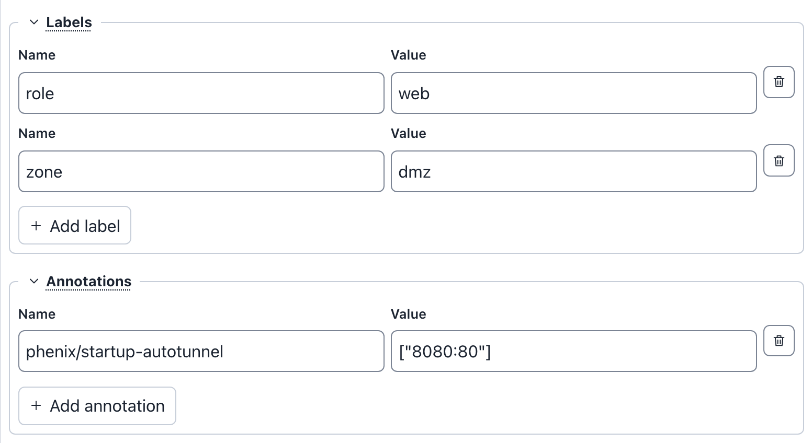

Builder reads an annotation value as YAML: `true`, `false` and numbers
become those values, and `["8080:80"]` is a list. Apps read annotations to
configure a node (see [Apps](../apps.md)).

## Notes

A note is text on the canvas. Publishing ignores it.

1. Under **Nodes & Objects**, select **Note**.
2. In the Inspector, enter the **Text**, for example `OT has no route to the
   internet.`
3. Select **Apply**.

A screen reader names a note by the start of its text. A note also has a
**Color**.

## Groups

A group is a box with a title around nodes. Publishing ignores it. When you
move a group, its nodes move with it.

To group nodes:

1. Click the first node, then Shift-click the others.
2. Select **Group** in the toolbar, or press <kbd>⌘</kbd>+<kbd>G</kbd> on
   macOS or <kbd>Ctrl</kbd>+<kbd>G</kbd> on Windows and Linux.

The new group is "Group", or "Group 2" and so on when that name is in use.
Its Inspector has **Title**, **Description**, **Color**, **Border
pattern**, **Icon** and **Icon size**:

- The **Description** shows on one line under the title. Screen readers
  read it after the group's name.
- **Border pattern** is **Dashed** (the default), **Solid**, **Dotted** or
  **Double**.
- **Icon** is beside the title. It is the container icon by default.
- **Title** and **Description** wait for **Apply**. The other fields take
  effect at once.

To remove a group and keep its nodes in place, select the group, then
select **Ungroup** (<kbd>⇧</kbd>+<kbd>⌘</kbd>+<kbd>G</kbd> or
<kbd>Ctrl</kbd>+<kbd>Shift</kbd>+<kbd>G</kbd>).

**Group** under **Nodes & Objects** adds an empty group. A node that you
drag onto a group does not go into it. To move a node into a group:

1. Select the node.
2. Select **Move to group** (the group button) in the Inspector header, or
   choose **Move to a group…** in the command palette.
3. In **Group**, choose a group, or **No group** to remove the node from its
   group.
4. Select **Move**.

To resize a selected group or note, drag the handles on its corners and
sides, or press <kbd>⌥</kbd>+<kbd>⇧</kbd> (<kbd>Alt</kbd>+<kbd>Shift</kbd>)
with an arrow key. One press, or one hold, is one undo step. A group is
never smaller than its members need.

## Shapes, icons and lines

Rectangles, circles, icons and lines are drawings. Publishing ignores them,
and they take no connections. Add one under **Nodes & Objects** or in the
command palette. The layouts do not move a drawing. A drawing in a group
moves with its group. When a layout makes the group smaller, the group
grows to hold the drawing.

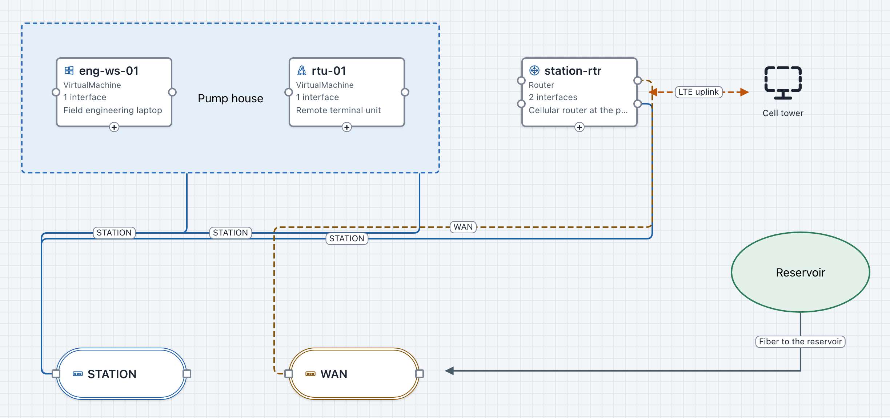

The Inspector of a drawing has these fields:

- A **rectangle** or a **circle** fills its box, so a circle in a box that
  is not square is an ellipse. It has a **Label** at its center, a **Fill
  Color** (without one, it is see-through), an **Outline Color**, a
  **Border pattern** (**Solid** by default), a **Width** and a **Height**.
- An **icon** shows a built-in or custom icon, scaled to its box. It has an
  optional **Label** under it, a **Width** and a **Height**.
- A **line** joins no node or network. It has a **Label** at its middle, a
  **Color** and a **Line style** (solid by default). It has **Arrowhead at
  the start** and **Arrowhead at the end**. Its **Points**, 2 to 64 from
  start to end, each have an **X** and a **Y**. A new line is 160 pixels
  long.

Some fields take effect at once (see
[Fields that take effect at once](editor.md#fields-that-take-effect-at-once)).
The others wait for **Apply**.

Rectangles, circles and lines stay under the devices and switches, also
when selected. Thus, a drawing never hides a device or its connection
points.

To resize a selected rectangle, circle or icon, drag its handles, or press
<kbd>⌥</kbd>+<kbd>⇧</kbd> (<kbd>Alt</kbd>+<kbd>Shift</kbd>) with an arrow
key. A selected line shows a circle handle on each end and a square handle
on each bend. Drag a handle to move its point. Double-click the line to add
a bend. While **Snap to grid** is on, a dragged point and a new bend go to
the grid. After you click a handle:

- The arrow keys move its point by one grid step, or one pixel with
  <kbd>⇧</kbd>.
- <kbd>Delete</kbd> or <kbd>Backspace</kbd> removes the point. A line keeps
  at least two points.
- <kbd>Esc</kbd> goes back to the line.

Without a mouse, use **Points** in the Inspector: change **X** and **Y**,
or use **Add point** (a new end), **Remove point N** and **Insert point
after point N** (a bend halfway to the next point). **Apply** makes all the
changes as one step of **Undo**.

## Auto-group

**Auto-group** in the toolbar puts nodes into new groups:

- **By network**: each network's switch with its devices. A device on
  several networks goes with the smallest one.
- **By name**: devices whose hostnames share a stem, such as web-01 and
  web-02. Switches stay out.
- **By name pattern…**: nodes whose names match a regular expression.

Auto-group groups only the devices and switches that are in no group. When
nodes are selected, it groups only those. A group needs at least two
members. Then Auto-group arranges the diagram with the draft's layout, so
the groups do not overlap. **Undo** removes the groups.

For example, **By network** on the imported riverside-water makes the
groups CORP, DMZ, INTERNET and OT.

Each choice is also a command palette command, such as **Auto-group by
network**, which has a key (see
[Keyboard shortcuts](editor.md#keyboard-shortcuts)).

### Grouping by a name pattern

1. In **Auto-group**, select **By name pattern…**.
2. In **Name pattern**, type a JavaScript regular expression.
3. Select **Group**.

Builder matches the pattern against each device hostname and switch name,
and ignores letter case. Names with the same matched text go in one group,
named after that text. When the pattern has parentheses, Builder uses the
text of the first pair. For example:

- `^[a-z]+` puts web-01 and web-02 in group web, and db-01 and db-02 in
  group db.
- `^(\w+)-(east|west)` groups by the part of the name before the site.
- `-(\d)\d$` groups by the tens digit of the number at the end.

The rules of [Auto-group](#auto-group) apply. Limits:

- A pattern has at most 200 characters.
- Builder matches only the first 255 characters of a name.
- A group's name is cut to 80 characters.
- Builder stops a pattern that takes more than 2 seconds, with "This pattern
  takes too long to match. Use a simpler one."

When nothing can be grouped, the dialog says why, for example "Nothing to
group: the pattern matches no ungrouped device or switch." The dialog
offers your last pattern. The browser keeps it until you log out. Builder
does not save it in the diagram or send it to the server.

When the pattern cannot run, the dialog says "The Builder could not check
the pattern. Reload the page to try again." (see
[Troubleshooting](administration.md#troubleshooting)).

## Colors

| Where | Field | What it colors | Values |
|---|---|---|---|
| Switch | **Edge Color** | The network: its connections, and the outline of its switches | Any CSS color |
| Connection | **Color** | This connection, in place of its network's color | Any CSS color |
| Device, switch | **Outline Color** | The node's border | `#rrggbb` only |
| Device, switch | **Fill Color** | The node's background | `#rrggbb` only |
| Note, group | **Color** | The note or the group | Any CSS color |
| Rectangle, circle | **Outline Color**, **Fill Color** | The shape's border and inside | `#rrggbb` only |
| Line | **Color** | The line and its arrowheads | `#rrggbb` only |

To set a color, type it in the field, or select the swatch button before
the field. The swatch offers Blue, Orange, Green, Purple, Red, Teal, Olive,
Plum, **Custom color** and **No color**. <kbd>Esc</kbd> closes only the
color choices, not a dialog such as the Node Editor.

A `#rrggbb` field takes no color names, no short form and no transparency.
Another value shows "Outline Color must be a hex color, such as #2f6fbf"
(or "Fill Color …"), and Builder does not apply it. The **Outline Color**
and **Fill Color** of a switch belong to that switch, so two switches of
one network can be different. Each color field takes effect at once.

On a fill, the text is black or white, for a contrast of at least 4.5 to 1.
An outline near the canvas color gets a thin ring, so the node stays
visible in both themes. In a Windows contrast theme (forced colors),
Builder shows the system colors.

The outline of a device or a switch has the first of these colors:

1. The node's own **Outline Color**.
2. The color of its layer, when the diagram colors node outlines with the
   layer color (see [Layer outlines](#layer-outlines)).
3. For a switch, the color of its network's connections.

The built-in icon of a device or a switch has the color of the node's
outline, or the theme's accent color without one. A group icon always has
the accent color. When the outline has a contrast of less than 3 to 1
against the node in a theme, the icon has the node's text color in that
theme. On a **Fill Color**, the icon has the node's text color, unless the
outline is a hex color with a contrast of at least 3 to 1 against the fill.

A new network gets the suggested color that the fewest networks use. The
suggested colors keep their contrast in both themes.

## Line styles

**Line style** sets the line pattern on a network, for all its connections,
or on one connection, in place of its network's pattern:

- **Auto**: Builder selects the pattern from the network's place in the
  diagram, so that networks are different without color. The choice names
  that pattern, for example "Auto (Solid)". On a connection, **Auto**
  follows its network.
- **Solid**, **Dashed**, **Dotted** or **Dash-dot**.

A pattern can repeat on several networks. The connection's label, its
switch and its name for screen readers still name its network. **Line
style** takes effect at once.

## Built-in icons

Devices, groups and icon drawings show a built-in icon, which you select
under **Icon** in the Inspector. The icon is only a picture: it does not
change the phenix settings of a device. A device made from a template gets
the template's icon.

| Kind | Icons |
|---|---|
| Computers | **Server** (any virtual machine, and the default for a device), **Desktop**, **Laptop**, **Smartphone**, **Printer**, **NTP Server** |
| Networks | **Router**, **Switch**, **Firewall**, **VLAN**, **Container** (the default for a group), **External device** (hardware in the loop) |
| Industrial control | **PLC**, **RTU**, **RTAC** (an automation controller or a data gateway), **Relay**, **Transmission**, **Distribution**, **Cell Tower** |
| Operating systems | **Linux**, **CentOS**, **Red Hat**, **Ubuntu**, **Fedora**, **openSUSE**, **Alpine**, **Kali Linux**, **BSD**, **Windows**, **Apple**, **Android** |
| Tools | **Terminal**, **pfSense**, **Wireshark**, **Zeek** (a network sensor) |
| People and roles | **Hacker** (an attacker), **Black Hat** (a threat actor), **Human**, **Robot** (a bot or a script) |
| Other roles | **Lizard** and **Fox**, for a role with no other icon, such as a team mascot |
| Servers | **phēnix**, **minimega** |

To preview a built-in icon, or to download it as a PNG file, use the
[Icons tab](#built-in-icons-in-the-icons-tab).

Names and logos of products are trademarks of their owners. phenix is not
affiliated with or endorsed by them. The
[icon notices](https://github.com/sandialabs/sceptre-phenix/blob/main/src/js/src/components/builder/ICON_NOTICES.md)
give the source and the license of each icon that comes from another work.

## Icon size

Devices, switches and groups draw their icons at **Small** (16 pixels),
**Medium** (24 pixels) or **Large** (32 pixels). Set the size for the whole
diagram under **Icon size** in the **Diagram** section of the Inspector
(select an empty part of the canvas). A new diagram draws **Small** icons.

A device, a switch or a group can have its own size. Its **Icon size**
offers the three sizes and **Diagram default**, which names the diagram's
size, for example "Diagram default (Large)". Both fields take effect at
once.

Nodes keep their size on the canvas. Text that does not fit ends with an
ellipsis. The Inspector and the
node's tooltip show all of it. PNG, SVG and draw.io downloads draw the
icons at their sizes.

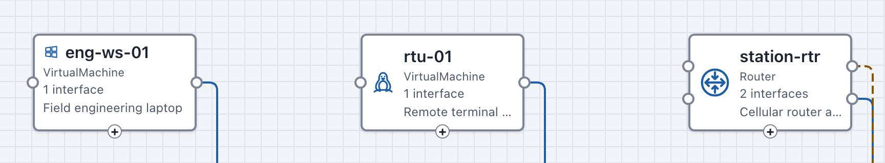

### Your own icon size and hidden icons

Two settings in the **Canvas** section of [Settings](editor.md#settings)
change how your canvas draws icons. They do not change the diagram, and
other users do not see them. This browser keeps them.

- **Node icon size**: **Off** (the default), **Small**, **Medium** or
  **Large**. A size other than **Off** draws each node icon at that size,
  on your canvas and in PNG, SVG and draw.io downloads. The diagram, its
  history and its files keep their own sizes. While the setting is not
  **Off**, each **Icon size** field says, for example, "Your Node icon size
  setting (Large) overrides this on your canvas." The command palette has a
  **Node icon size:** command for each value.
- **Show node icons**: on by default. When it is off, devices, switches and
  groups show no icon on the canvas and in PNG, SVG and draw.io downloads,
  and their text uses all the width. **Show or hide node icons** in the
  command palette changes the setting.

## Custom icons

A device, a group or an icon drawing can show an image of your own in place
of its built-in icon. A switch and a note cannot. All users of the server
share one icon library of at most 2,000 custom icons. The built-in icons do
not count against this limit. Use the [Icons tab](#the-icons-tab), the
editor or the REST API to manage the library.

To choose a custom icon:

1. Select the device, the group or the icon.
2. In the Inspector, select **Icon**.
3. At the end of the list, select **Custom icon…**.
4. In the **Custom icons** dialog, select **Upload icon…** and choose an
   image file, or select **Use** on a listed icon.

**Icon** then shows the image and its name, followed by "(custom icon)".
The change takes effect at once. To use a built-in icon again, select it in
the list.

A node stores the name of its custom icon, and shows the server's icon of
that name. When the server has no icon of that name, **Icon** adds "(custom
icon not found: the node shows its built-in icon)". This occurs when
someone deleted the icon, or the diagram came from another server. The
node shows its built-in icon until someone uploads an icon of that name.

Until Builder reads the image of an icon, the node shows an empty square of
the icon's size.

The dialog lists:

- **In this diagram**: copies of icons that the diagram holds from an
  uploaded file (see [The diagram and its icons](#the-diagram-and-its-icons)).
  Each has **Use**, and **Add to server** when the server does not have it.
  "On the server" marks a copy that the server has.
- **Server icons**: each icon on the server, with its uploader, its size
  and its other names, and the library count, for example "The library
  holds 2 of 2000 icons." **Filter icons** filters by name, other name or
  uploader. Each icon has **Use**, and **Rename** when a user uploaded it.

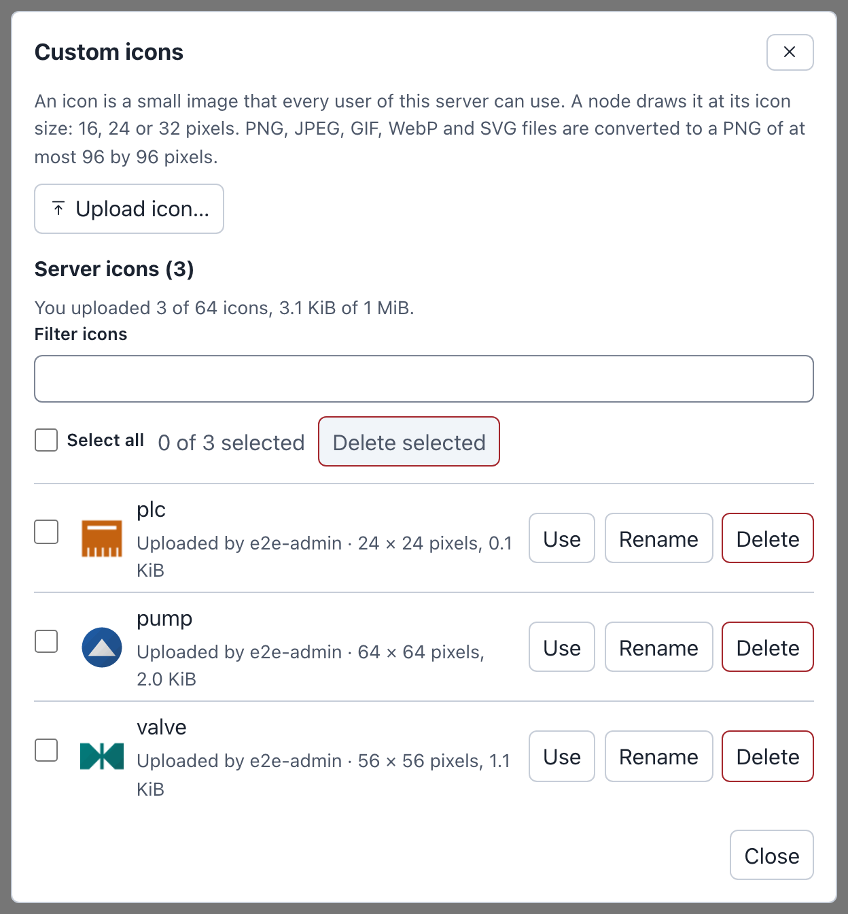{ width="624" }

### The Icons tab

The **Icons** tab of the drafts page shows the built-in icons and each icon
on the server. To open it, select **Show Icons** in the command palette. To
open the preview of one icon, type `i:` and part of its name (see
[Command palette](editor.md#command-palette)).

**Show** selects **Built-in icons** (the default) or **Server icons**. An
upload, or a preview from `i:`, sets it to **Server icons**. The count, for
example "The library holds 45 of 2000 icons.", includes the built-in
icons. **Filter icons** filters by name, other name or uploader.

With **Server icons**, each icon on the server has a card with its size and
source. The source is "Uploaded by" and the user, or "Server" for an icon
from a template file. A card has a checkbox, **View**, **Download**, and
**Delete** when a user uploaded the icon.

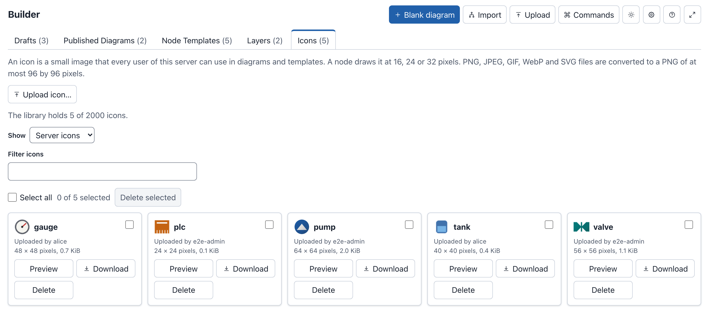

**View** shows the icon at its stored size, at most 96 by 96 pixels, and at
16, 24 and 32 pixels.

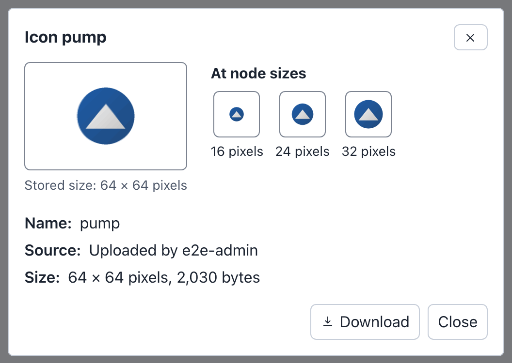{ width="528" }

**Download** saves the icon as a PNG file, exactly as the server stores it,
with the name of the icon, for example `plc.png`. **Download selected**
saves one PNG file for each selected icon, built-in icons included.

**Delete** and **Delete selected** ask first (see
[Renaming and deleting icons](#renaming-and-deleting-icons)). The cards use
the keys of the other tabs (see
[Selecting several drafts](drafts.md#selecting-several-drafts)). **Filter
icons** limits what **Select all** selects. A change of **Show** clears the
selection.

**Delete selected** deletes only icons that a user uploaded. Its question
also counts the others, for example "1 other selected icon cannot be
deleted." When no selected icon can be deleted, it asks nothing. A summary
under the selection row gives the reason for each icon that it could not
download or delete. An icon that the server no longer has leaves the list,
and the summary lists it.

When Builder cannot read the library, the tab says "Could not load the
server's icons." and why, with **Retry**.

#### Built-in icons in the Icons tab

With **Built-in icons**, the cards are in the order of the table in
[Built-in icons](#built-in-icons). **Filter icons** filters them by name,
key or the word "Built-in". Each card shows the key that a diagram stores,
for example "Key: router".

A built-in icon has a checkbox, **View** and **Download**. You cannot
delete or rename it. **Download** saves a PNG file of 96 by 96 pixels,
named after the key, for example `router.png`. The browser makes the file
from the icon's drawing: a dark icon on a clear background, for use on a
light background.

### Uploading an icon

**Upload icon…** takes a PNG, JPEG, GIF, WebP or SVG file of at most 5 MiB.
The browser converts it to a PNG of at most 96 by 96 pixels, in the
picture's own proportions. It does not enlarge a small picture, and it
draws an SVG as large as an icon can be. The dialog then asks for the
icon's name, proposed from the file name. **Add icon** uploads the icon.

A name is 1 to 64 letters, digits, `_`, `@`, `.` or `-`. It is unique on
the server, ignoring case, and the first upload of a name keeps it. The
server refuses a name that it has for another image, and names the
uploader, for example "icon name "plc" belongs to an icon alice uploaded.
Choose another name". When you upload the same image under its own name
again, the dialog says "The server already has this icon as" and its name.

Builder does not load style sheets, images or fonts from outside an SVG
file, so those parts are missing from the icon. When the SVG cannot be
converted, the dialog says "The Builder could not convert this image. Save
it as a PNG, and then upload it again."

A custom icon keeps its own colors in the light and the dark theme. Choose
an icon that is clear on both, or give the node a **Fill Color**.

### The diagram and its icons

A draft names its icons. Except in the cases below, it holds no image of
them, so a saved draft stays small. A Builder JSON or YAML download holds a
copy of each icon that the diagram names, at most 50, so the file shows its
icons on another phenix server. When the server has no icon of a name, the
file does not hold it, and the download says so.

These actions add icons from a file to the server's library:

- Uploading a file that holds icons.
- **Edit as a draft** on the diagram of a topology read from its Builder
  file.

Builder adds each icon that the server does not have, as uploaded by you.
When the server has the same image under that name, Builder discards the
copy. The draft keeps its own copy, and Builder says so, in these cases:

- The server has another image under that name.
- The server could not take the icon, for example because you reached your
  upload limit.

The draft shows its copy in place of the server's icon. **Add to server**
in the Custom icons dialog adds a kept copy later. When no node or template
of the diagram uses an icon, the icon leaves the diagram with the edit that
removed its last use.

Copy and paste include the diagram's copies of the nodes' icons, also into
another diagram in the same browser tab.

### Renaming and deleting icons

Each Builder user can rename and delete each icon that a user uploaded (see
[The libraries](administration.md#the-libraries)). **Rename** is in the
Custom icons dialog. **Delete** is on the [Icons tab](#the-icons-tab). No
user can rename or delete an icon that the server added from a template
file (see
[Template files on the server](administration.md#template-files-on-the-server)).

The old name continues to name a renamed icon, so diagrams and templates
that use it still show it: "Renamed OLD to NEW. OLD keeps working as
another name of it." An icon keeps at most 16 old names. Then the server
refuses a new name: "icon NAME already has 16 old names, the most an icon
keeps. Upload the image under the new name instead. Deleting the icon also
deletes its old names. Diagrams that use these names then stop showing the
icon." Renaming
it back to an old name still works.

**Delete** asks "Delete icon?" and says "Delete NAME from the server?
Diagrams and templates that use it, by any of its names, will show their
built-in icon instead." Deleting an icon removes its other names too, and
changes no diagram: its nodes keep the name. When another user renamed the
icon after Builder read the list, the delete stops: "The icon changed after
the Builder read the list. The list now shows it as it is. Check it, and
then try again."

### Several icons at once

In the Custom icons dialog, each diagram copy that the server does not have
has a checkbox. Above the copies, a row has **Select all**, the selected
count ("2 of 5 selected") and **Add selected to server**.

**Add selected to server** adds each selected copy under its name: "Added 2
icons to the server. The diagram drops its copies with its next edit." When
someone added a copy after the dialog opened, the dialog names it: "The
server already has plc." You cannot select the server icons in this dialog.

Here, rtu-01 and eng-ws-01 of the pump station use the icons gauge and
tank, which the diagram holds and the server does not:

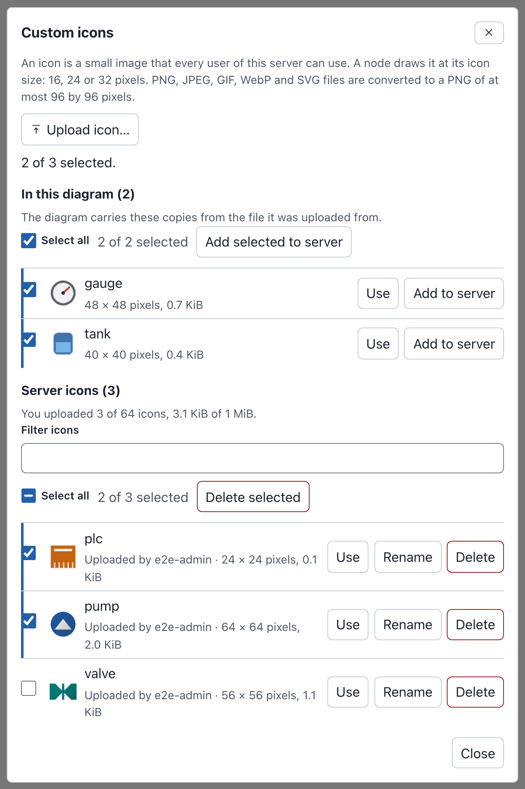{ width="624" }

The rows use the keys of the drafts page (see
[Selecting with the keyboard](drafts.md#selecting-with-the-keyboard)), with
these differences:

- **Escape** with nothing selected closes the dialog.
- In the server icons, the keys only move focus. **Delete** does nothing.

When some copies could not be added, a summary under the row gives the
reason for each. When the server cannot be reached, Builder stops and lists
the rest as "Not attempted."

## Layers

A diagram has a list of **layers**. Each layer has an ID, an integer from 0
to 99, and a label, for example "Operations". A layer can also have an
icon, a color and node matchers. When two layers have the same label, the
editor adds the ID, for example "Control (ID 3)". A device or a switch can
be at one layer: a layer that you choose for it, or, for a device, a layer
that its fields match. The [By layer](#by-layer) layout puts the layers one
above the other, the highest ID at the top.

Layers are for the picture only. An import from a topology sets none.

Limits:

- A diagram has at most 32 layers. Each layer has a different ID.
- A label has 1 to 64 bytes, and no control characters, such as a tab.
- An icon is a built-in icon or a custom icon of the server.
- A color is `#` and 6 hex digits, such as `#2f6fbf`.
- A layer has at most 16 node matchers. A field has at most 128 bytes, and
  a pattern at most 256 bytes.

### Placeholder layers

A diagram that has no layers of its own has 7 **placeholder layers**: IDs 0
to 6, with the labels "Layer 0" to "Layer 6". Your first change to them in
the layers editor saves the 7 layers in the diagram. When the layers are
again the 7 placeholder layers, the diagram saves no list.

A new blank diagram starts with a copy of the default layer set, when the
server has one (see [Layers for new diagrams](#layers-for-new-diagrams)).

### Setting the layer of a device or a switch

1. Select the device or the switch.
2. In the Inspector, under **Layer**, select a layer, or **None**.

The list shows the highest ID first. The change takes effect at once. A
node can be at an ID that is not in the list, for example after you remove
its layer. The list then also shows that ID as "Layer N".

To set the layer of several devices and switches:

1. Select the devices and switches.
2. In the command palette, choose **Set layer of selection**.
3. Choose a layer, or **No layer**.

All the selected nodes change as one step of **Undo**. Devices from an
included topology do not change.

**Select nodes on layer** in the command palette selects the nodes at a
layer that you choose. These are the nodes that you put at the layer and
the devices that its node matchers put there. The command is available
while a device or a switch is at a layer.

A [node template](templates.md) can also have a layer, which a new device
gets.

### Node matchers

A node matcher puts a device at its layer by the device's fields. It has a
field and a pattern:

- The field is a path into the device's phenix spec, the fields of the Node
  Editor. It is keys of letters, digits, `_` or `-`, joined by dots, for
  example `general.hostname` or `network.interfaces.0.vlan`. A key of
  digits is the index of a list entry, from 0. A list at the end of the
  path matches when one of its entries matches.
- The pattern is a regular expression. It matches anywhere in the value of
  the field, and letter case counts. Use `^` and `$` to match the start and
  the end, for example `^plc-`.

A number or a boolean matches as its text, for example `10` or `true`. An
object, a null value and a field that the device does not have never match.
`general.hostname` also matches the device's hostname when the spec has no
hostname. A switch has no spec, so it is at a layer only when you choose
one for it.

The editor accepts only a pattern that the server and the editor read the
same way. It refuses these patterns, with "This is not a regular expression
that the server and the editor read the same way. Do not use lookarounds,
backreferences, flags or \p classes.":

- Lookarounds, such as `(?=x)` and `(?<!x)`.
- Backreferences, such as `\1` and `\k<name>`.
- Flags, such as `(?i)`, and `(?P<name>…)`.
- The escapes `\c`, `\u`, `\p`, `\A`, `\z`, `\Q…\E` and `\x{41}`.
- `[[:alpha:]]` and the empty class `[]`.
- A class escape at the end of a range, such as `[a-\d]`.
- Repeats in repeats that make more than 1000 copies, such as
  `(a{500}){500}`.

The editor and the server also refuse a pattern that the browser can take
a very long time to match:

- A group with a repeat or a `|` in it, when a repeat repeats the group
  more than once, such as `(a+)+`, `(a|aa)*` or `(\d{1,3}\.){3}`. The
  editor says "Do not repeat a group that has a repeat or | in it, as in
  (a+)+. Such a pattern can stop the editor.". The editor accepts an
  optional group, such as `(a+)?`. To match an IPv4 address, write each
  part, such as `^\d{1,3}\.\d{1,3}\.\d{1,3}\.\d{1,3}$`.
- More than 3 repeats with no upper count (`*`, `+` and `{n,}`), groups
  included, such as `a*a*a*a*b`. The editor says "Use at most 3 of *, +
  and {n,} in a pattern. More can stop the editor.". The editor accepts
  `^plc-.*-\d+$`. A repeat with an upper count, such as `{1,3}`, does not count.
  A `*` or `+` in a class, such as `[*+]`, or after a `\` does not count.

When the matchers of more than one layer match a device, the option **When
a device matches more than one layer** chooses: **Lowest layer ID wins**
(the default) or **Highest layer ID wins**.

A layer that you choose for a device goes first. A device with no chosen
layer is at its matched layer. Its first choice under **Layer** then names
the matched layer and the field in place of **None**, for example "Level 1
Basic control (matched general.hostname)". When you choose another layer,
the Inspector says "Its fields match Level 1 Basic control
(general.hostname). The layer that you chose goes first." **Use matched
layer** removes your choice.

The matched layer counts as the device's layer everywhere: in the **By
layer** layout, in the layer counts, in **Select nodes on layer** and in
the layer outlines.

### Layer outlines

The option **Color node outlines with the layer color** is off by default.
When it is on, a device or a switch at a layer that has a color gets an
outline in that color. The node's own **Outline Color** goes first. For a
switch, the layer color goes before the color of its network.

A layer's label has the layer's color when the label keeps a contrast of
4.5 to 1 in the current theme. Otherwise, a swatch of the color shows
beside the label.

### Editing the layers

To open the layers editor, **Layers of this diagram**, select **Edit
layers…** under **Layer** or **Layers** in the Inspector, in the Node
Editor, in [Settings](editor.md#settings) or in the command palette (see
[Layers editor](editor.md#layers-editor)). With nothing selected, the
**Layers** part of the Inspector also lists the layers.

The editor has the parts **Layer set** (see [Layer sets](#layer-sets)),
**Options** and **Layers**, with a row for each layer, the highest ID
first.

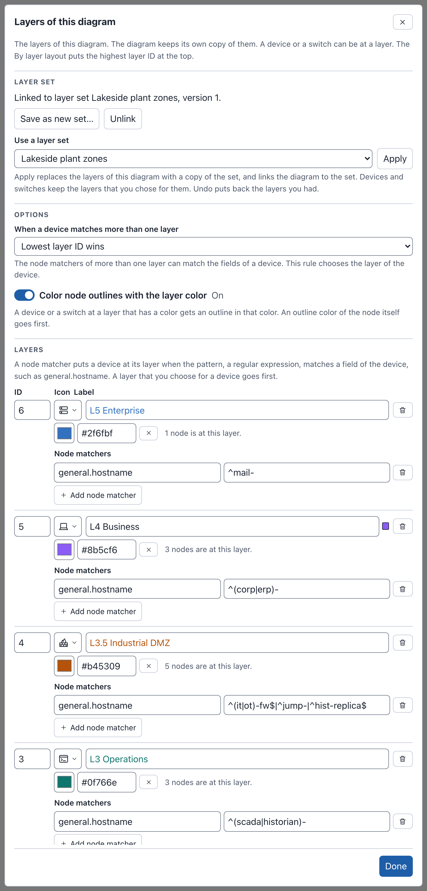{ width="752" }

Each row has these fields:

- **ID** and **Label**: type a new value, then press <kbd>Tab</kbd> or
  <kbd>Enter</kbd>. The devices, switches and templates at the layer move
  to a new ID.
- **Icon**: **No icon**, a built-in icon or **Custom icon…**.
- **Color**, with a color picker.
- **Remove** (the trash can). The devices and switches at the layer keep
  its ID, which then shows as "Layer N". A line under the list names the
  IDs that are not in the list.
- **Node matchers**: a row for each matcher, with its field and its
  pattern. **Add node matcher** adds an empty row. The editor writes the
  matcher into the layer when both of its fields have a value. A layer has one
  matcher for each field. A new matcher with one empty field stops **Done**
  and **Save**. The editor discards a new matcher with two empty fields.

**Add layer** adds a layer with the next free ID, one above the highest,
and the label "Layer N".

A field changes the diagram when you leave it, so the text that you type in
one field is one step of **Undo**. **Done** first writes the text of the
field that you are in, then closes the editor. A value that the diagram
cannot keep shows an error under its row, and the diagram does not change
until you correct it. The errors follow the limits in [Layers](#layers). A
field must not be empty. When the layer refuses a matcher that **Done** or
**Save** wrote, the row says "Layer 1 cannot take this node matcher.
Change it, or remove it." When a field has an error, **Done** says "Some
layer fields have errors. Correct them. Then select Done." and moves
focus to that field.

In a published diagram, the fields are read only.

### Layer sets

A layer set is a list of layers, with the two options, in the server's
library. Each user of the server can use the sets. The built-in set
**Purdue Model** cannot change. The **Layers** tab of the drafts page
manages the sets (see [The Layers tab](drafts.md#the-layers-tab)).

A diagram holds a copy of a set's layers and options, and a link to the set
and its version. A change to the diagram's layers changes only the copy.
The **Layer set** part of the layers editor, and the Inspector with nothing
selected, give the state of the copy:

- No link to a layer set.
- A copy of a version of the set, for example "Linked to layer set NAME,
  version N."
- A copy that you changed.
- A copy of an earlier version, after someone saved the set.
- A link to a set that the server does not have. Someone deleted the set,
  or the diagram came from another server.

When the browser window becomes active again, the editor reads the library
again, so a newer version shows.

The layers editor has these buttons:

- **Use a layer set** and **Apply**: replace the layers and options with a
  linked copy of the set that you choose. Devices and switches keep the
  layers that you chose for them. The list first shows the linked set, or
  else the default set.
- **Update from layer set**: shows when the set has a newer version. It
  copies that version and replaces your changes. The Inspector with
  nothing selected also has this button.
- **Save to layer set**: shows when you changed the copy and the set has no
  newer version. It saves the layers and options as the set's next
  version, and links the diagram to it. The set keeps its name,
  description and icon. A built-in set has no **Save to layer set**. When
  the set has a newer version, the server refuses with "The layer set has
  a newer version. Update from the layer set first."
- **Save as new set…**: asks for **Name of the new set** and
  **Description**. **Save layer set** adds the set to the library and links
  the diagram to it.
- **Unlink**: removes the link and keeps the layers and options.

When you save a set, the custom icons of its layers that the server does
not have go into the icon library.

### Layers for new diagrams

On the **Layers** tab of the drafts page, **Set default** makes a set the
default set of the server. The server has one default set for all users,
and each Builder user can change it. Each new blank diagram starts with a
linked copy of the default set. **Clear default** removes the default, and
new diagrams then have the placeholder layers.

A diagram that you import or upload does not use the default set. It has
the layers of its file, or the placeholder layers.

### Example: map layers to the Purdue model

The Purdue model divides an industrial network into levels, from the
enterprise at the top to the physical process at the bottom. The built-in
layer set **Purdue Model** gives each level a layer:

| Layer ID | Label | Icon | Color | Typical devices |
|---|---|---|---|---|
| 6 | L5 Enterprise | Server | `#2f6fbf` | Enterprise IT, email and the internet connection |
| 5 | L4 Business | Laptop | `#8b5cf6` | Site business systems, such as ERP |
| 4 | L3.5 Industrial DMZ | Firewall | `#b45309` | Jump hosts, patch servers and historian copies |
| 3 | L3 Operations | Terminal | `#0f766e` | SCADA servers, historians and site operations systems |
| 2 | L2 Supervisory control | Desktop | `#15803d` | HMIs and engineering workstations |
| 1 | L1 Basic control | PLC | `#db2777` | PLCs, RTUs and IEDs |
| 0 | L0 Process | Transmission | `#dc2626` | Pumps, valves and sensors |

A layer ID is an integer. Thus, the set gives each level the next integer
from 0 at the bottom, and Level 3.5 gets ID 4. The set has no node
matchers.

To use these layers in a diagram:

1. Open the layers editor.
2. In **Use a layer set**, choose **Purdue Model (built-in)**.
3. Select **Apply**.

For example, Lakeside Water Treatment is a water treatment plant with 17
devices on 5 networks. Its layers have the IDs of the Purdue Model set,
with longer labels, such as "Level 5 Enterprise", and no icons or colors.
Each device and each switch is at the layer of its Purdue level, for
example mail-01 at layer 6 and the PLCs at layer 1. The firewalls and the
DMZ hosts are at layer 4. The pumps, the valve and the sensor are external
devices at layer 0. The PLCs control them through the FIELD network. The
saved diagram holds the layers in `layers`. Each device and switch holds
the ID of its layer in `layer`, for example `"layer": 3` in the `device` of
scada-01.

To try it, download
[lakeside-treatment.builder.json](examples/lakeside-treatment.builder.json)
and upload it (see
[Uploading a Builder document](import-upload-download.md#uploading-a-builder-document)).
Then choose **By layer** in the layout menu.

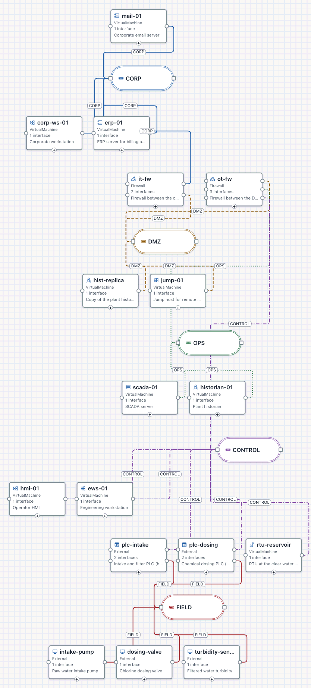{ width="476" }

## Layouts

The layout menu in the toolbar arranges the whole diagram. It shows the
layout that last arranged the draft, or **Default** when no layout ran. An
imported, uploaded or blank draft starts at **Default**. An import puts its
devices in rows on a grid, with the switches below them.

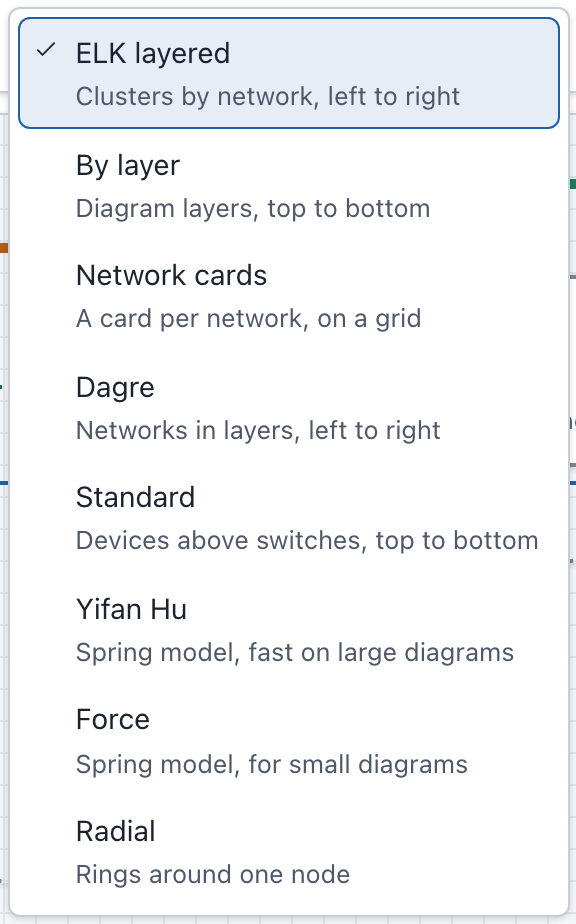{ width="296" }

| Layout | What it does |
|---|---|
| **Network cards** | A card for each network, on a grid. In a card, the switch is at the head of a column of its devices, grouped by name. |
| **ELK layered** | Clusters each network's switch with its devices, a device on several networks in its smallest one. Connections run left to right between the clusters. |
| **By layer** | Puts the layers from top to bottom (see [By layer](#by-layer)). |
| **Dagre** | Each network's devices in a column beside their switch, and the networks in layers along the connections between them. |
| **Standard** | Every device in a row above the switches, from top to bottom. |

**ELK layered** suits most diagrams. A layout always gives the same result
for the same diagram and the same selection. **ELK layered** and **By
layer** load when you first use one of them. When they cannot load, the
page shows "Auto layout failed. The Builder could not load the layout
engine. Reload the page to try again."

Earlier versions of Builder also had the **Yifan Hu**, **Force** and
**Radial** layouts. A draft that names one of them opens at **Default**.
When your **Default layout** setting names one of them, Builder uses **ELK
layered**.

Layouts keep groups together. A group's members stay inside it, and no
other node goes in.

For example, Metro Campus has 42 devices on 7 networks. These images show
it after the import, then after **ELK layered**:

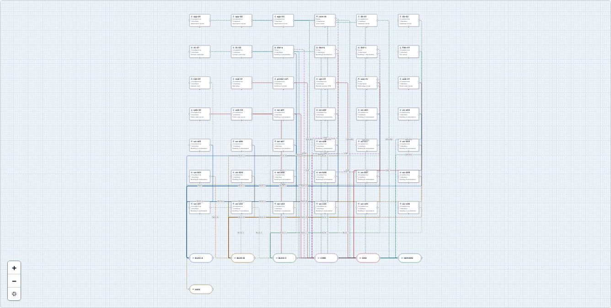

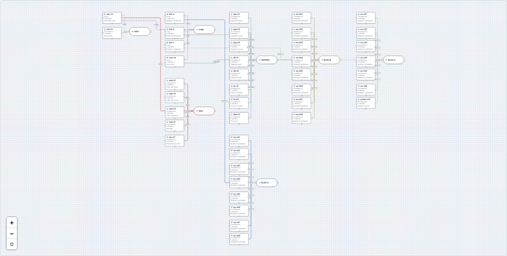

Right after a layout runs, the menu also offers **Restore previous
layout**, until you make a different change.

**Auto layout** in the command palette, and its key (see
[Keyboard shortcuts](editor.md#keyboard-shortcuts)), runs the draft's
layout again. On a draft at **Default**, **Auto layout** and **Auto-group**
use the **Default layout** of [Settings](editor.md#settings), which is
**ELK layered** by default.

Publishing and a Topology YAML download ignore positions and layouts.

### By layer

**By layer** arranges the diagram from top to bottom by
[layer](#layers), the highest layer ID at the top. Only the IDs count, so
an ID that is not in the diagram's list also works. Each connection goes
down from the higher layer to the lower one.

- A device or a switch without a layer goes to the layer of the nearest
  connected node that has one. When two such nodes are equally near, it
  goes to the higher layer.
- A connected node that no layer reaches goes below every layer. A node
  without connections, such as a note, goes at the bottom.
- A group is at the layer of its highest member. Inside the group, its
  members are in the order of their layers.

In a diagram whose devices and switches have no layer, and inside one
layer, the layout starts from a top node. Each other node goes below the
node that leads to it from the top node. The top node is the first of these
that the diagram has:

1. The selected device or switch.
2. A firewall.
3. A router.
4. The switch with the most connections.

The layout uses the icon or the node type to find a firewall or a router.
An [external device](#external-devices) is a top node only when you select
it, because hardware in the loop, such as a PLC, is usually low in a plant.

## Arranging by hand

- Drag a node, or several selected nodes. While **Snap to grid** is on,
  they go to the grid. A press is a click, which does not move the nodes,
  while the pointer stays within 4 screen pixels of the start point. With a
  finger or a pen, the limit is 8 pixels. When Builder cannot take a move,
  for example while a save conflict is open, the nodes go back.
- Press <kbd>⇧</kbd> (<kbd>Shift</kbd>) with an arrow key to move the
  selected nodes 10 pixels. They do not snap to the grid. Hold the keys to
  move the nodes more. When you release a key, the move is one undo step.
  Screen readers announce the new position one time.
- Under **Position** in the Inspector, enter **X** and **Y**, then select
  **Move**.

A move by hand does not change the layout that the layout menu shows.

### The grid

**Grid size**, in the Inspector with
nothing selected, sets the distance between the grid lines: a whole number
of pixels from 4 to 200. A new diagram has a grid size of 16. Another value
shows "Grid size must be a whole number from 4 to 200.", and the diagram
keeps its size.

The **Snap to grid** setting, in the **Editing** section of
[Settings](editor.md#settings), is off by default. While it is on, these go
to the nearest point of the grid:

- Nodes that you drag, and nodes that you drop from **Nodes & Objects**.
- New nodes that you add.
- The points of a line that you drag or add.

While it is off, they go where you put them, on a whole pixel. This browser
keeps the setting, and other users have their own. **Snap to grid** in the
command palette turns it on or off.

## Copy, paste, duplicate and delete

**Copy**, **Paste** and **Delete** are in the toolbar, and **Duplicate** is
in the command palette. Each has a key (see
[Keyboard shortcuts](editor.md#keyboard-shortcuts)).

**Copy** and **Paste** use the Builder clipboard, not the system clipboard.
They work between drafts that you open one after the other in the same
browser tab. **Duplicate** copies and pastes the selected nodes in one
step, and does not change the Builder clipboard.

- A paste goes 40 pixels down and to the right of the original, and each
  next paste 40 pixels more. Builder selects the pasted nodes.
- A pasted device gets a free hostname, such as server-2, and keeps its
  settings.
- Builder pastes or duplicates a connection only with both of its nodes.
  Copy a device with its switch to keep the connection. With only
  connections selected, **Duplicate** does nothing and says "Select the
  nodes to duplicate. A copy holds a connection only with both of its
  nodes."
- Copying a group copies the nodes in it.

**Delete** deletes the selected nodes and connections. When you delete a
device, Builder also deletes its connections.

## Undo and redo

**Undo** and **Redo** in the toolbar, and their keys, go back and forward
through your changes. Each change is a snapshot of the draft on the server,
so **Undo** moves the draft itself back. **Undo** and **Redo** reach only
the changes since you opened the draft in this tab, or since your last
restore. To go back further, use [Draft History](drafts.md#draft-history).

After an undo, a new change removes the snapshots that you undid, also those
that other users saved after them (see
[Newer snapshots](drafts.md#newer-snapshots)).

## Scenarios

A diagram lists, by name, up to 20 Scenario configs that the diagram uses.
Publishing adds the topology to the `topology` annotation of each one. An
experiment published with the topology uses one of them (see
[Scenarios](publishing.md#scenarios)).

To add the stored scenario riverside-water to a diagram, such as your
[quick start](index.md#quick-start) draft:

1. Select **Scenarios** in the toolbar, or **Add scenario** in the
   Inspector with nothing selected.
2. Under **Scenarios of this diagram**, select the checkbox of
   `riverside-water`.
3. Select **Save scenarios**.

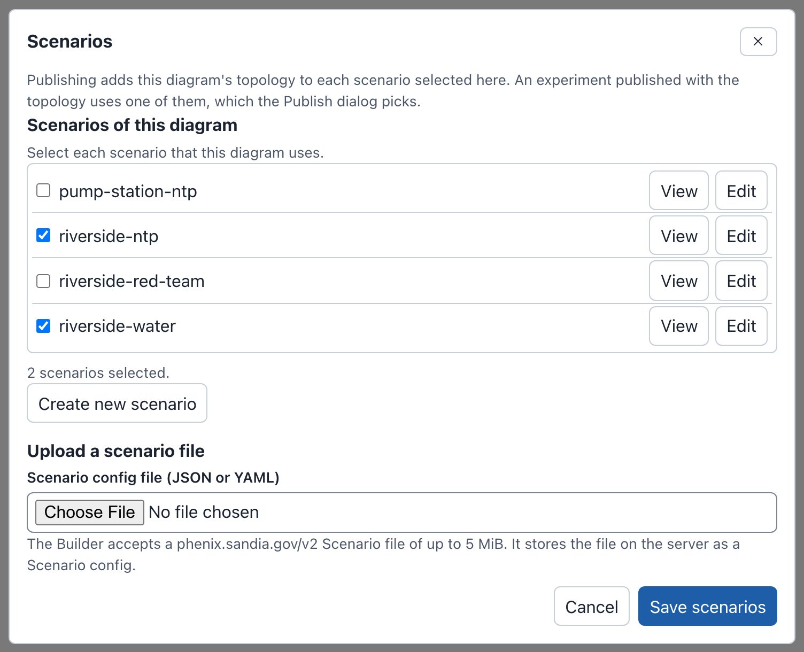

### The list of scenarios

**Scenarios of this diagram** lists each scenario that your role can list
on the server, sorted by name. A checkbox adds the scenario to the end of
the diagram's list, or removes it. The scenario on the server does not
change.

- A scenario that the diagram lists, and that the server does not list,
  shows "Not found on the server".
- With more than 8 scenarios, **Filter scenarios** filters the list by
  name. <kbd>Enter</kbd> in this field does not save the dialog.
- When the diagram lists 20 scenarios, the dialog says "A diagram lists at
  most 20 scenarios. To select another, clear one first."

**Save scenarios** writes the list into the diagram. **Cancel** does not
change the list, but a scenario that you stored stays on the server.

### Viewing and editing a scenario

Each scenario of the server has **View** and **Edit**:

- **View** opens the scenario as read-only YAML, with **Copy YAML**.
- **Edit** opens the scenario as YAML in a text field. Change the config,
  then select **Save scenario**. Builder replaces the stored scenario with
  the text, its annotations included. The name must stay the same: "The
  name must stay NAME. To store the scenario with a new name, select Create
  new scenario."

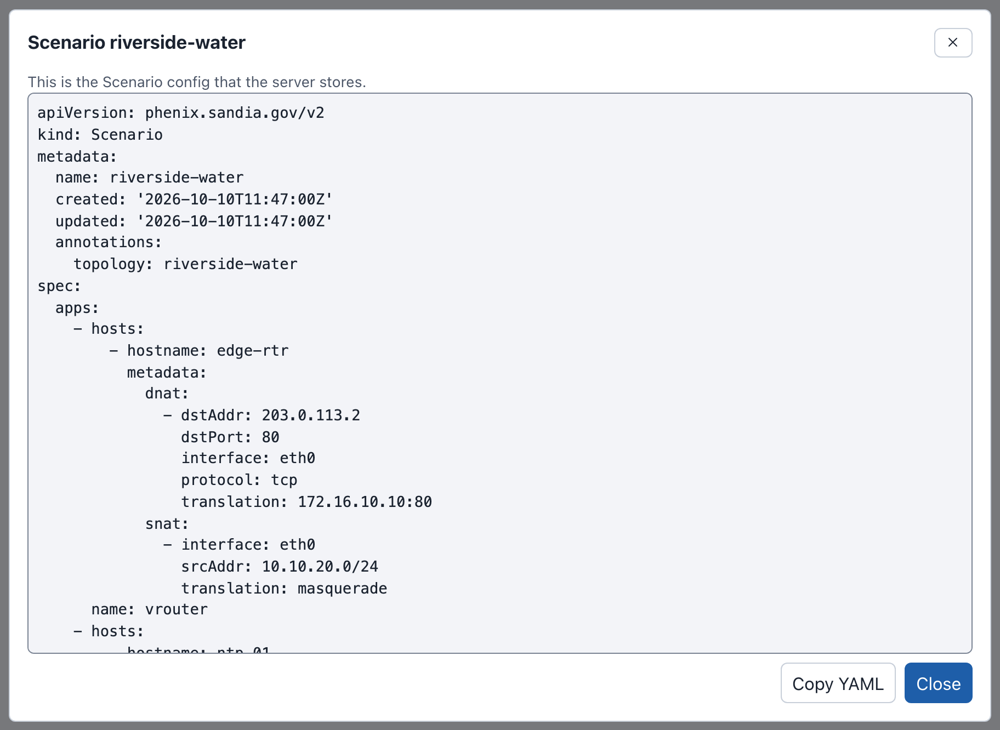{ width="1216" }

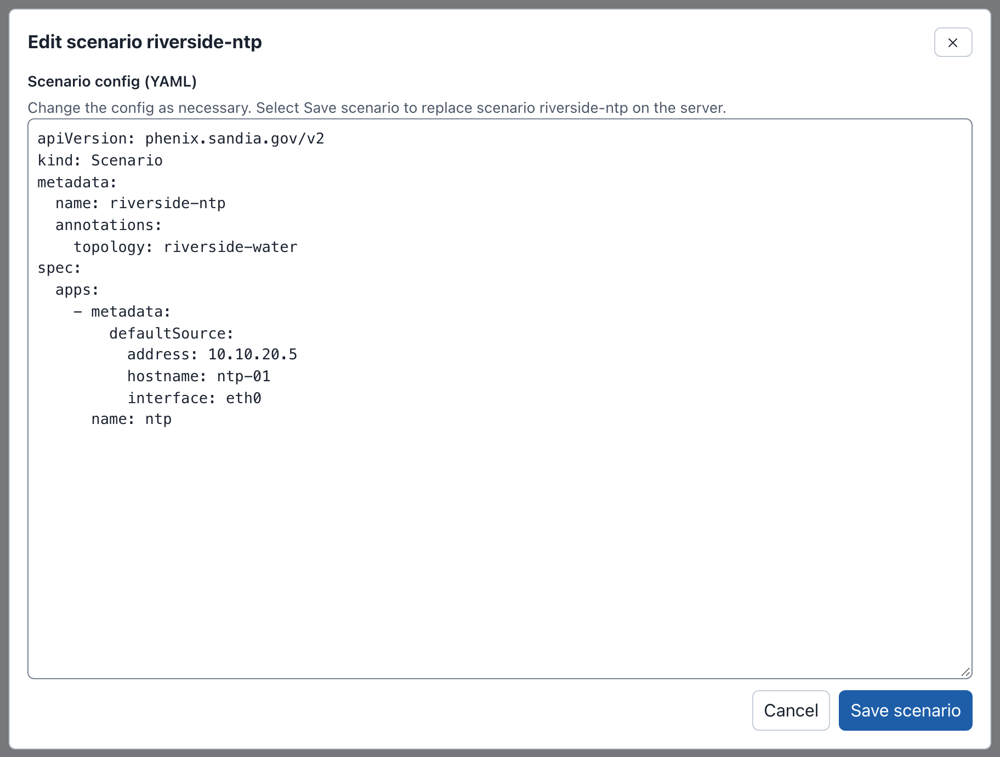{ width="1216" }

When the server refuses the config, the editor shows each problem that the
server found and stays open. When you changed the text, **Cancel** asks
"Discard your changes?".

### Creating a scenario

**Create new scenario** opens the editor with a new Scenario config:

- Its name is the diagram's name made into a config name, then
  `-scenario`, for example `Riverside-Water-scenario`. When the name is in
  use, Builder adds a number, such as `-2`.
- Its `topology` annotation names the topology that the
  [Publish dialog](publishing.md#scenarios) offers first.
- It has no apps.

Change the config, then select **Create scenario**. Builder stores the
scenario on the server and selects its checkbox. Select **Save scenarios**
to keep the list in the diagram.

### Uploading a scenario file

To add a scenario from a file, choose the file in **Upload a scenario (YAML
or JSON)**. The file is a `phenix.sandia.gov/v2` Scenario config of at most
5 MiB. The dialog proposes the file's `metadata.name` as **Scenario name**,
or else the file name made into a config name. **Store and add** stores the
file on the server as a Scenario config and selects its checkbox.

When the server has a scenario of that name, Builder asks "Replace scenario
NAME?" first. The scenario gets the file's spec. It keeps its own
annotations and adds those of the file. Its `topology` annotation keeps
every topology that it named and adds those of the file. Thus, experiments
of those topologies can still use it.

To store a new scenario, your role needs `configs` `create`. To replace
one, it needs `configs` `get` and `update`. When the server refuses, the
dialog shows the server's message. A name that the list has in another
letter case shows one time, with the spelling of the stored scenario.

In a published diagram, the dialog only lists the scenarios, each with
**View**, and has **Close**.

## Included topologies

riverside-water includes the topology corp-services, so dns-01 and ntp-01
are in the diagram:

- They have a dashed border and say "Included from corp-services".
- Their fields are read only (see
  [Fields you cannot change](editor.md#fields-you-cannot-change)), but you
  can move them.
- You cannot delete or connect them, or delete their connections. Builder
  says, for example, "Included topology corp-services defines dns-01. This
  device is read only here. Change it in corp-services."
- You cannot rename or remove their network (CORP). Its other fields can
  change.
- The checks give them no warnings, but check this diagram's devices
  against them.

To change dns-01, change the topology corp-services, then import
riverside-water again (see
[Importing a topology or experiment](import-upload-download.md#importing-a-topology-or-experiment)).
Or make the included devices part of a new diagram. Publishing does not
copy included devices (see
[Included topologies](publishing.md#included-topologies)).

### Making included devices editable

To change included devices in the diagram itself, make a copy of the
diagram in which they are its own nodes:

- When you import the topology, choose **Combine into one new topology**
  under **Included topologies**.
- In an open draft, run **Combine included nodes into a new draft** from
  the command palette. Or select an included device and select **Combine
  into a new draft** in the Inspector.

The command makes a new draft and opens it. The draft that was open does
not change. The new draft has the diagram's name with "-combined" at the
end, for example Riverside-Water-combined. It gets a number when a topology
or a draft of any user has that name.

In the new draft, the included devices are normal devices. You can change,
delete and connect them, and the checks include them. The draft has no
link to riverside-water, so publishing it makes a new topology. When the
diagram never had the nodes of an included topology, `includeTopologies`
still names it. Builder says so: "It still includes", the topology's name,
and "whose nodes are not in the diagram."
