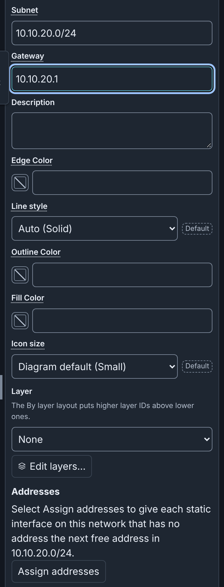
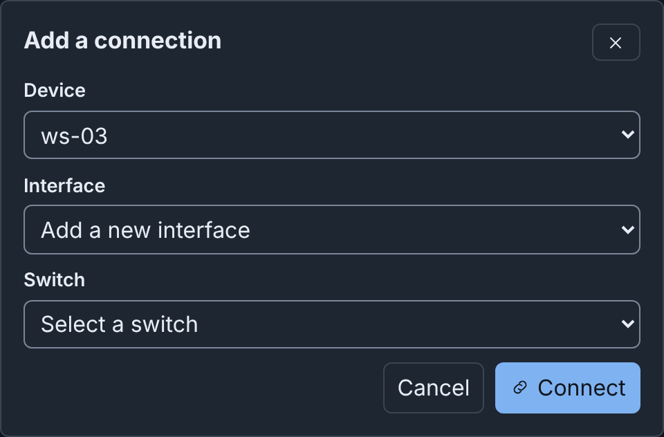
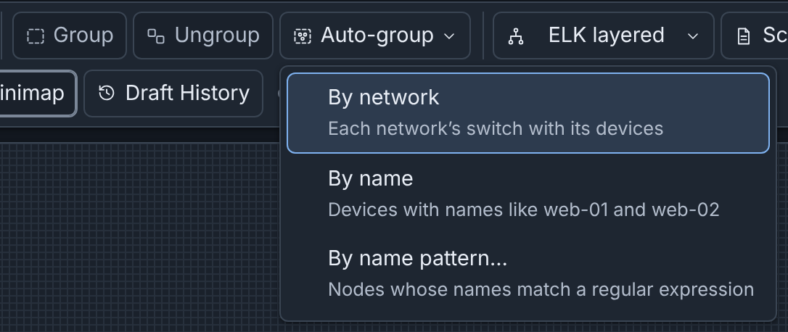
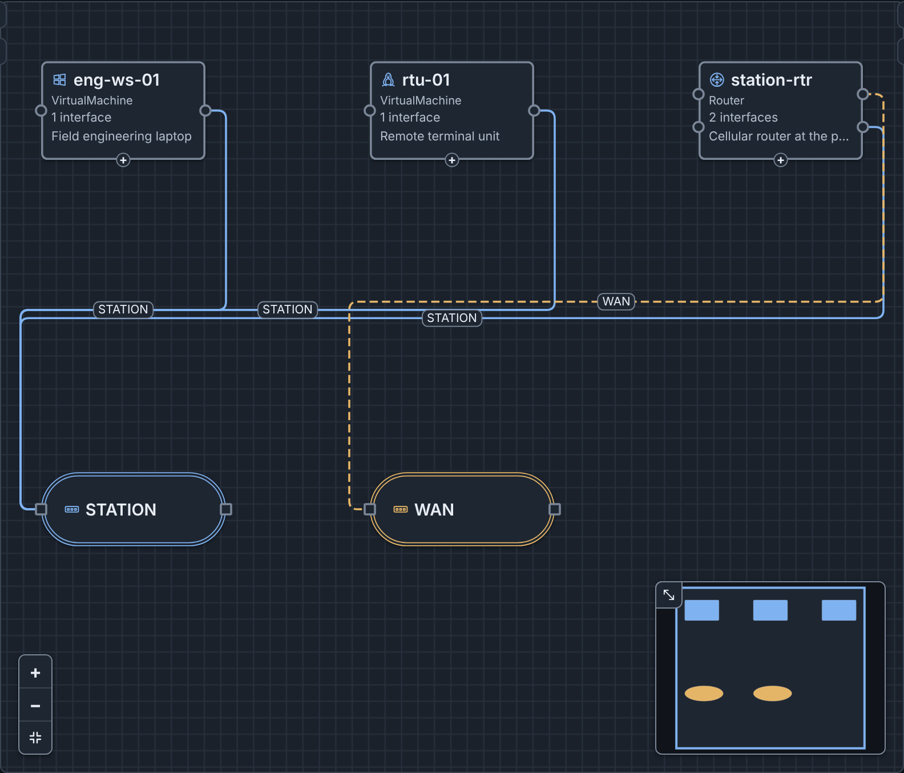
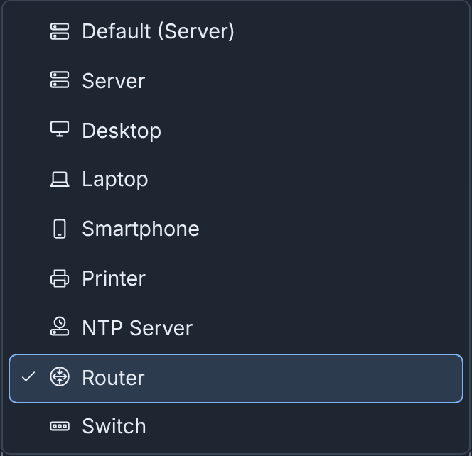
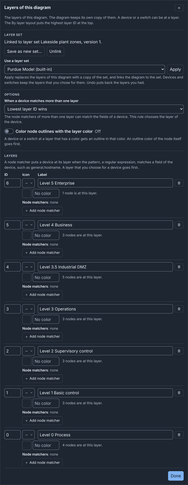
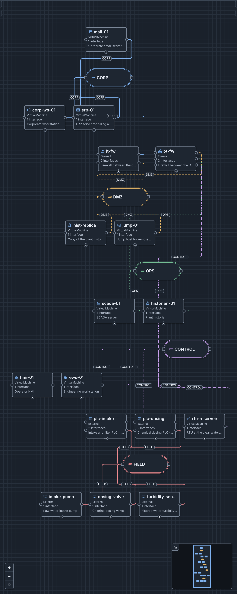
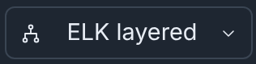
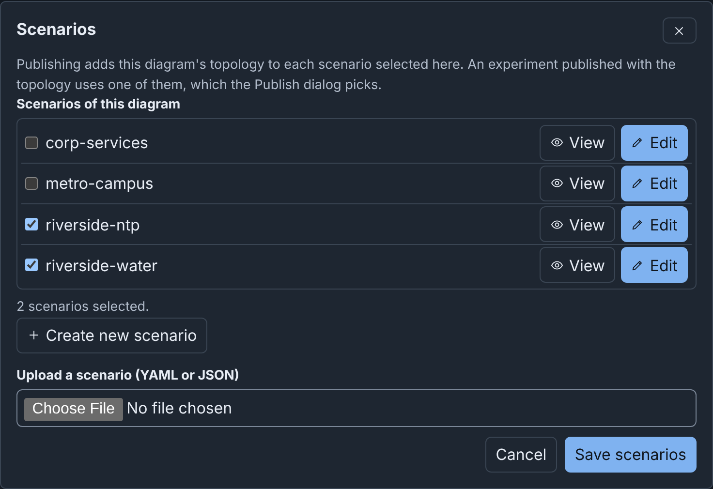
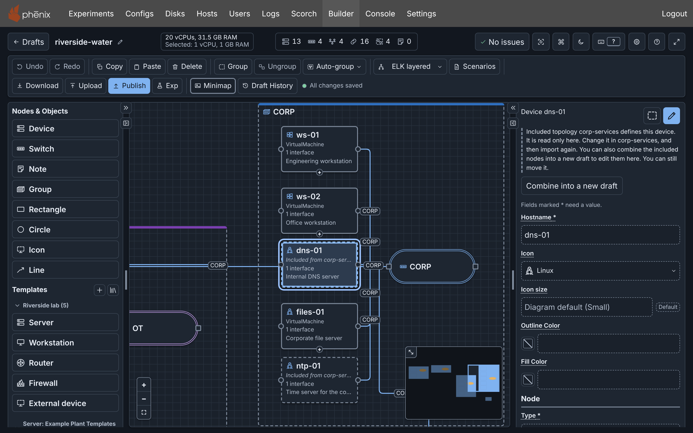

# Diagrams

This page shows how to draw a diagram, with the Riverside Water draft of
the [example lab](tutorial.md#the-example-lab) as the example. Keep one
idea in mind: a switch is one network, and a connection puts an interface
on that network.

## What a diagram is

A diagram describes one Topology config. Publishing writes only some of its
parts:

| In the diagram | In the Topology config |
|---|---|
| A device | A node in `spec.nodes`, with its settings |
| A switch | A network, whose name is the VLAN of its interfaces |
| A connection | An interface with the network's name as its `vlan` |
| A device from an included topology | Nothing. `includeTopologies` names that topology |
| Notes, groups, drawings, colors, icons, layers and templates | Nothing |

## Add devices

**Nodes & Objects**, in the left column, lists what you can add. Click an
item, or drag it to the canvas. Or press <kbd>Ctrl</kbd>+<kbd>K</kbd>
(<kbd>⌘</kbd>+<kbd>K</kbd> on macOS) and select **Add device** in the
command palette. **Device** has default settings. The five built-in
templates under **Templates** set more fields (see
[Built-in templates](reference.md#built-in-templates) and
[Templates and Icons](templates.md)).

The `vrouter` app configures a device of type Router or Firewall. An
external device is hardware, such as a PLC. phēnix starts no VM for it, and
its interfaces tell phēnix which VLANs the hardware is on (see
[External Nodes](../configuration.md#external-nodes)).

## Networks

A switch is one network. To add one:

1. Click **Switch** under **Nodes & Objects**.
2. In the Inspector, set **Name**.
3. Click **Apply**.

When you rename a network, the VLAN of each interface on it changes.

A network has these optional fields:

- **VLAN alias**, from 1 to 4094. When you publish with an experiment, it
  goes into `vlans.aliases`.
- **Subnet**, such as `10.1.0.0/24`.
- **Gateway**.

With a subnet, each static interface that you connect gets the next free
host address and the subnet's **Mask**. This needs the **Assign addresses
on connect** setting, which is on by default. If the interface has no
**Gateway** of its own, it also gets the network's gateway.

**Assign addresses** gives addresses to the static interfaces that have
none. Builder never changes an address that an interface has.

{ width="352" }

A new network gets a suggested subnet, which you can change or clear (see
[Subnets and addresses](details/diagrams.md#subnets-and-addresses)).

## Connect an interface

A connection puts an interface on a network. To connect `ws-03` to CORP:

- Drag from the **+** handle under `ws-03`, or from an unconnected
  connection point on its side, to the CORP switch. A drag from **+** adds
  a new static interface.
- Select `ws-03`. Click **Add connection** in the Inspector header. Select
  the switch **CORP (CORP)**, then click **Connect**.
- In the Inspector, click **Add interface** under **Network**. Enter
  **Address** `10.10.20.103` and **VLAN** `CORP`, then click **Apply**.

{ width="496" }

CORP has no subnet, so enter the address of `eth0` in the Inspector, or give
CORP a subnet first. A VLAN that names a network connects the interface to
that network's switch. A VLAN that names no network leaves the interface
unconnected, and a typed VLAN gives no address.

To disconnect an interface, do one of these steps:

- Click **Disconnect** next to the interface under **Connection points** in
  the Inspector.
- Select the connection and press <kbd>Delete</kbd> (<kbd>⌫</kbd> on
  macOS).

The interface stays with no VLAN and blocks publishing.

**Hide connections** in the command palette hides the connections on your
canvas only (see
[Hiding connections](details/diagrams.md#hiding-connections)).

## Edit device settings

Change the fields of a device in the Inspector or the Node Editor, then
click **Apply** (see [The Editor](editor.md)). **Interface kind** is
**Static or OSPF**, **DHCP or manual** or **Serial**. A new interface is
**Static or OSPF** with **Mask** `24`. When you change the kind, Builder
asks first, and **Switch and clear** empties the interface.

**Routes** and **Firewall rulesets** are under **Network**, and the
`vrouter` app applies them when the experiment starts. Labels and
annotations are under **More settings**, and Builder reads an annotation
value as YAML. When your role can list the server's disk images, a drive's
**Image** suggests them (see
[Drive images](details/diagrams.md#drive-images)).

To duplicate a device, select it, then press <kbd>Ctrl</kbd>+<kbd>D</kbd>
(<kbd>⌘</kbd>+<kbd>D</kbd> on macOS). The copy, such as `historian-01-2`,
keeps every setting but not its connections. The header says **1 warning**
until you give the copy its own hostname and address, and connect it.

## Notes

A note is text on the canvas, and publishing ignores it. To add one:

1. Click **Note** under **Nodes & Objects**.
2. In the Inspector, enter the **Text**.
3. Click **Apply**.

## Groups

A group is a box with a title around nodes, and publishing ignores it. When
you move a group, its nodes move with it. To group nodes:

1. Select the first node. Then hold <kbd>Shift</kbd> and select the others.
2. Click **Group** in the toolbar, or press <kbd>Ctrl</kbd>+<kbd>G</kbd>
   (<kbd>⌘</kbd>+<kbd>G</kbd> on macOS).

**Ungroup** keeps the nodes and deletes the group. Its key is
<kbd>Ctrl</kbd>+<kbd>Shift</kbd>+<kbd>G</kbd>
(<kbd>⇧</kbd>+<kbd>⌘</kbd>+<kbd>G</kbd> on macOS). A node that you drag
onto a group does not go into it. Click **Move to group** in the Inspector
header instead.

**Auto-group** in the toolbar puts nodes into new groups:

- **By network**: each network's switch with its devices.
- **By name**: devices whose hostnames share a stem, such as `web-01` and
  `web-02`.
- **By name pattern…**: nodes whose names match a regular expression (see
  [Grouping by a name pattern](details/diagrams.md#grouping-by-a-name-pattern)).

## Drawings

Rectangles, circles, icons and lines are drawings. Publishing ignores them,
and they take no connections. Add one under **Nodes & Objects**, then set
its fields, such as **Label**, in the Inspector. A line also has a
**Line style**, arrowhead fields and 2 to 64 **Points** (see
[Shapes, icons and lines](details/diagrams.md#shapes-icons-and-lines)).

## Colors, line styles and icon size

Switches, connections, devices, notes, groups, shapes and lines have color
fields in the Inspector. **Edge Color** of a switch colors its network: its
connections and switch outlines. **Outline Color** and **Fill Color** of a
device or a switch take only a hex color, such as `#2f6fbf`. Enter a color,
or click the swatch button before the field (see
[Colors](details/diagrams.md#colors)).

**Line style**, on a network or on one connection, is **Auto**, **Solid**,
**Dashed**, **Dotted** or **Dash-dot**. **Auto** selects a pattern by the
network's place in the diagram, so that networks differ without color.

**Icon size** in the **Diagram** section of the Inspector draws icons at
**Small**, **Medium** or **Large**, and a device, a switch or a group can
have its own. Two settings change your canvas only: every icon at one size,
or no icons (see
[Your own icon size and hidden icons](details/icons.md#your-own-icon-size-and-hidden-icons)).

## Icons

{ width="352" }

Select the icon of a device, a group or an icon drawing under **Icon** in
the Inspector. The icon is only a picture and changes no setting (see
[Built-in icons](reference.md#built-in-icons)). To show your own image,
select **Custom icon…** at the end of the list. Then upload an image file,
or click **Use** on an icon of the server (see
[Templates and Icons](templates.md)).

## Layers

A layer has an ID, from 0 to 99, and a label, and can have an icon, a color
and node matchers. A device or a switch can be at one layer. Layers are for
the picture only, and an import sets none. A diagram with no layers of its
own has 7 placeholder layers (see
[Placeholder layers](details/layers.md#placeholder-layers)).

To set the layer of a device or a switch, select it. Then select a layer
under **Layer** in the Inspector. A node matcher puts a device at a layer by
its fields, for example hostnames that start with `plc-` (see
[Node matchers](details/layers.md#node-matchers)). A layer's color can
also outline its nodes (see
[Layer outlines](details/layers.md#layer-outlines)). **Edit layers…**
under **Layer** opens the layers editor, with a row for each layer and
**Add layer**.

{ width="752" }

### Layer sets

A layer set is a list of layers in the server's library. In the layers
editor, **Use a layer set** gives the diagram a linked copy of a set.
**Save to layer set** saves your changes as the set's next version.
**Set default** on the **Layers** tab of the drafts page gives each new
blank diagram that set (see [Layer sets](details/layers.md#layer-sets)).

### Example: the Purdue model

The built-in layer set **Purdue Model** gives each Purdue level a layer,
from "L5 Enterprise" (ID 6) to "L0 Process" (ID 0). See
[Purdue Model layer set](reference.md#purdue-model-layer-set). To use it:

1. Open the layers editor.
2. Select **Purdue Model (built-in)** under **Use a layer set**.
3. Click **Apply**.

In Lakeside Water Treatment, each device and switch is at the layer of its
Purdue level. To try it, upload
[lakeside-treatment.builder.json](examples/lakeside-treatment.builder.json),
then select **By layer** in the layout menu.

{ width="476" }

## Layouts

{ width="158" }

The layout menu in the toolbar arranges the whole diagram.

| Layout | What it does |
|---|---|
| **Network cards** | A card for each network, the switch above its devices. |
| **ELK layered** | Clusters each network's switch with its devices, left to right. |
| **By layer** | Puts the layers from top to bottom. |
| **Dagre** | Devices beside their switch, networks along the connections. |
| **Standard** | Every device in a row above the switches. |

**ELK layered** suits most diagrams. Layouts keep groups together. Right
after a layout runs, the menu offers **Restore previous layout**.

**By layer** puts the highest layer ID at the top. For nodes with no layer,
see [By layer](details/diagrams.md#by-layer).

## Arrange by hand

Drag a node, or several selected nodes. Press <kbd>Shift</kbd> with an arrow
key to move them 10 pixels. Or enter **X** and **Y** under **Position** in
the Inspector, then click **Move**. The **Snap to grid** setting, off by
default, puts the nodes that you drag or add on the grid (see
[The grid](details/diagrams.md#the-grid)).

## Copy, paste, duplicate and delete

**Copy**, **Paste** and **Delete** are in the toolbar, and **Duplicate** is
in the command palette. **Copy** and **Paste** work between drafts that
you open in the same browser tab. Builder pastes a connection only with
both of its nodes, so copy a device with its switch. When you delete a
device, Builder also deletes its connections.

## Undo and redo

**Undo** and **Redo** in the toolbar go back and forward through your
changes. They reach only the changes since you opened the draft in this
tab. To go back further, use **Draft History** (see
[Drafts](drafts.md) and [Undo and redo](details/diagrams.md#undo-and-redo)).

## Scenarios

A diagram lists up to 20 Scenario configs, and an experiment published
with the topology uses one of them (see
[Publishing](publishing.md)). To add the stored scenario `riverside-water`:

1. Click **Scenarios** in the toolbar.
2. Under **Scenarios of this diagram**, select the checkbox of
   `riverside-water`.
3. Click **Save scenarios**.

The dialog lists the server's scenarios that your role can list. A checkbox
adds one to the diagram's list, and the scenario on the server does not
change. **View** shows a scenario as read-only YAML, and **Edit** opens
it in a text field, where **Save scenario** replaces the stored scenario.
**Create new scenario** and **Upload a scenario (YAML or JSON)** store a
scenario on the server (see [Scenarios](details/scenarios.md#scenarios)).

## Included topologies

`riverside-water` includes the topology `corp-services`, so `dns-01` and
`ntp-01` are in the diagram, with a dashed border and the text "Included
from corp-services". You can move them, but their fields are read only. You
cannot delete or connect them, delete their connections, or rename their
network, CORP. To change `dns-01`, change `corp-services`, then import
`riverside-water` again.

To change included devices in the diagram itself, select one, then click
**Combine into a new draft** in the Inspector. A new draft,
`Riverside-Water-combined`, opens with them as normal devices, and
publishing it makes a new topology (see
[Making included devices editable](details/scenarios.md#making-included-devices-editable)).

## More detail

- [Building a Diagram: details](details/diagrams.md): every rule, limit and
  message.
- [Layers: details](details/layers.md), [Icons: details](details/icons.md)
  and [Scenarios and Included Topologies: details](details/scenarios.md).
- [Node matchers](details/layers.md#node-matchers): fields and patterns for layers.
- [Layouts](details/diagrams.md#layouts): each layout, and the layouts of earlier versions.
- [Limits](reference.md#limits): the limits of layers, patterns, icons and scenarios.
