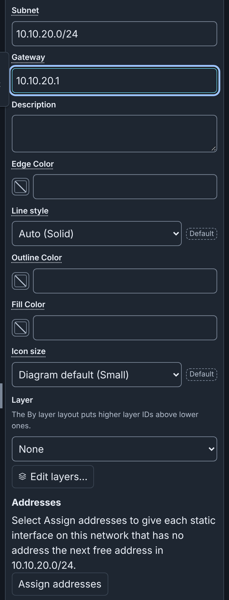
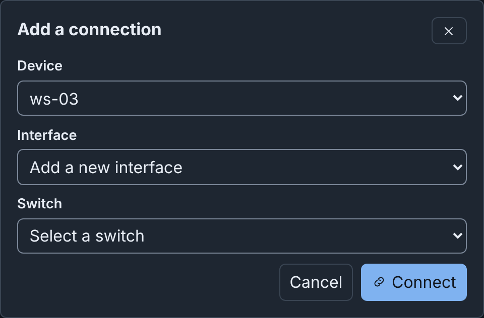
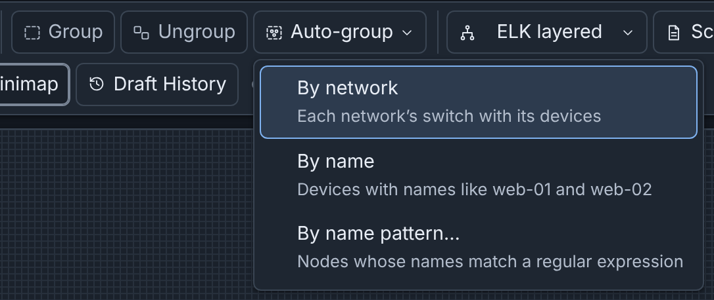
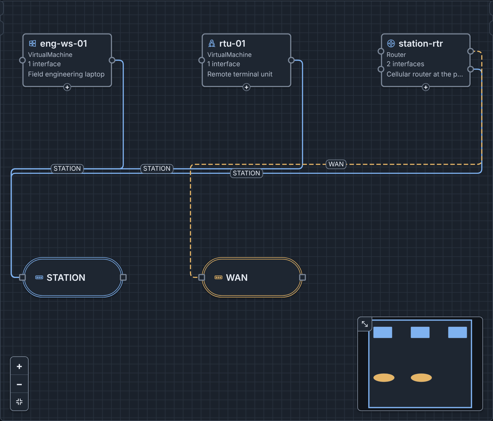
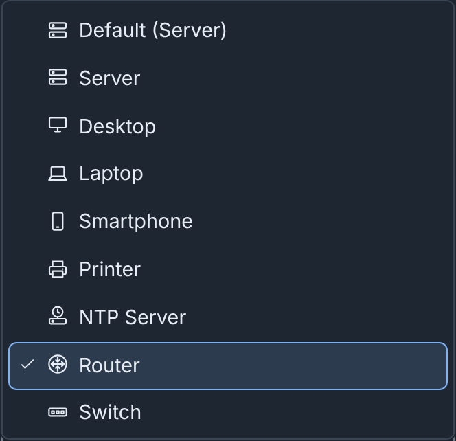
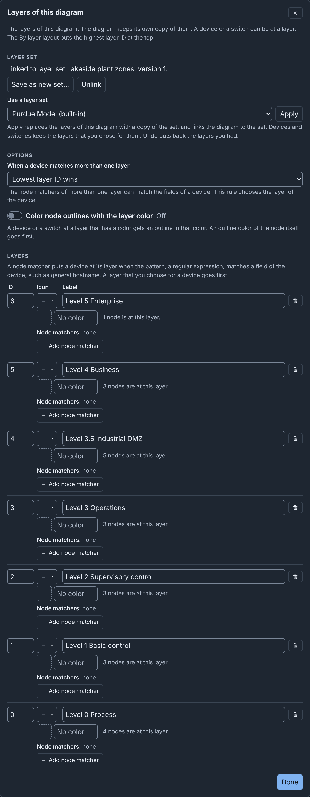
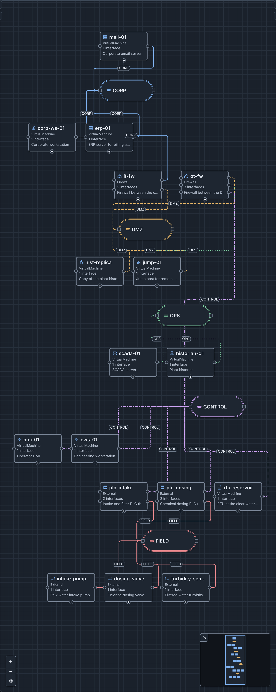
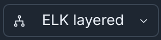
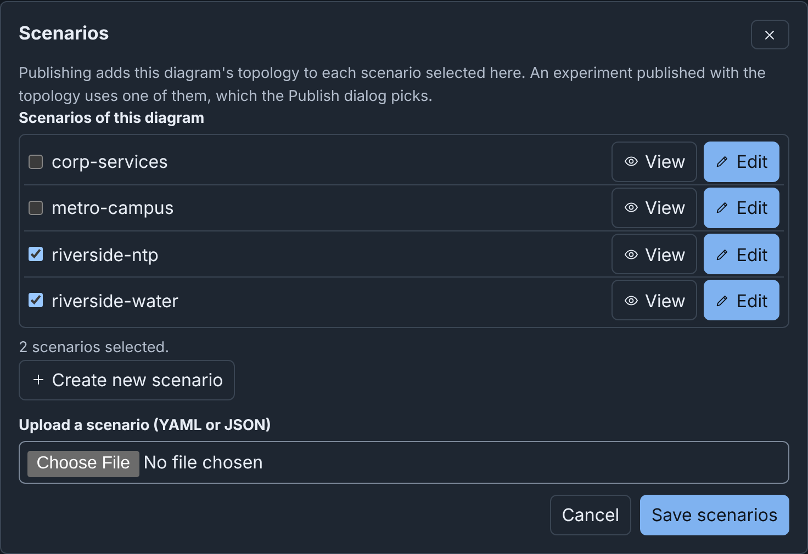
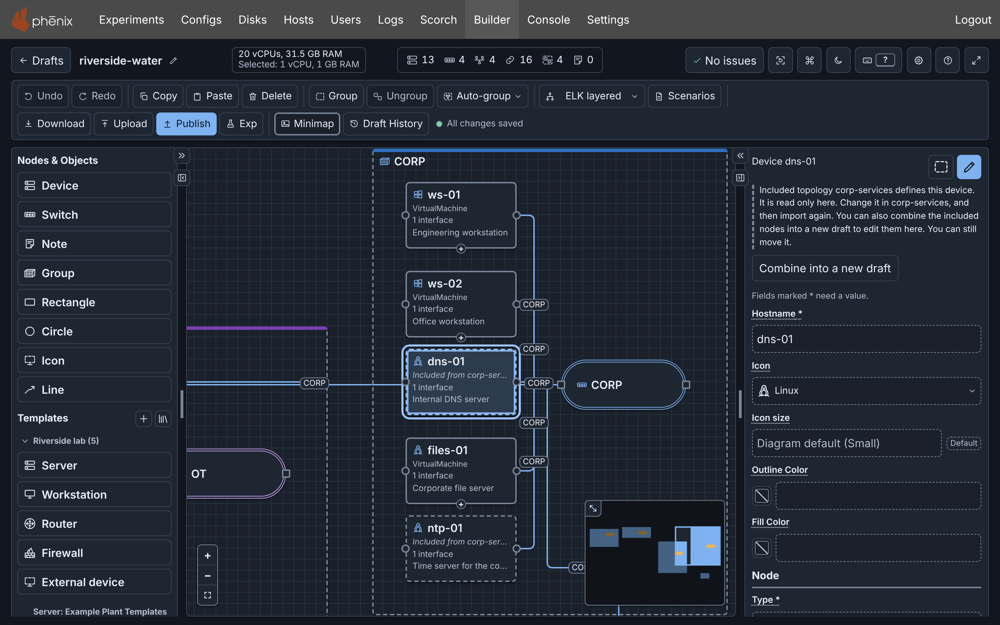

# Diagrams

This page shows how to draw a diagram, using the Riverside Water draft of
the [example lab](tutorial.md#the-example-lab). Keep one idea in mind: a
switch is one network, and a connection puts an interface on that network.

## What a Diagram Is

A diagram describes one Topology config, but publishing writes only some of
it:

| In the diagram | In the Topology config |
|---|---|
| A device | A node in `spec.nodes`, with its settings |
| A switch | A network, whose name is the VLAN of its interfaces |
| A connection | An interface with the network's name as its `vlan` |
| A device from an included topology | Nothing. `includeTopologies` names that topology |
| Notes, groups, drawings, colors, icons, layers and templates | Nothing |

## Add Devices

`Nodes & Objects`, in the left column, lists what you can add. Click an
item or drag it to the canvas, or press <kbd>Ctrl</kbd>+<kbd>K</kbd>
(<kbd>⌘</kbd>+<kbd>K</kbd> on macOS) and pick `Add device`. `Device` has
default settings, and the five built-in templates under `Templates` fill in
more (see [Built-in templates](reference.md#built-in-templates)). An
external device is hardware, such as a PLC: phēnix starts no VM for it, and
its interfaces say which VLANs the hardware is on (see
[External Nodes](../configuration.md#external-nodes)).

## Networks

A switch is one network. To add one, click `Switch` under
`Nodes & Objects`, set its `Name` in the Inspector, and click `Apply`.
Renaming a network changes the VLAN of each interface on it.

A network can also have a `VLAN alias` (1 to 4094, written to
`vlans.aliases` when you publish with an experiment), a `Subnet` and a
`Gateway`. A new network gets a suggested subnet, which you can change or
clear. With a subnet, each static interface you connect gets the next free
address, and `Assign addresses` fills in the ones that have none (see
[Subnets and addresses](details/diagrams.md#subnets-and-addresses)).

{ width="352" }

## Connect an Interface

To connect `ws-03` to CORP, use any of these:

- Drag from the `+` handle under `ws-03` (which adds a new interface), or
  from an unconnected connection point on its side, to the CORP switch.
- Select `ws-03`, click `Add connection` in the Inspector header, pick the
  switch `CORP (CORP)`, and click `Connect`.
- In the Inspector, click `Add interface` under `Network`, enter `Address`
  `10.10.20.103` and `VLAN` `CORP`, and click `Apply`.

{ width="496" }

CORP has no subnet, so type the address of `eth0` yourself or give CORP a
subnet first. A typed VLAN never gives an address, and one that names no
network leaves the interface unconnected.

To disconnect an interface, click `Disconnect` next to it under
`Connection points`, or select the connection and press <kbd>Delete</kbd>
(<kbd>⌫</kbd> on macOS). The interface stays with no VLAN, which blocks
publishing until you connect or remove it. To hide connections on your
canvas only, see
[Hiding connections](details/diagrams.md#hiding-connections).

## Edit Device Settings

Change a device's fields in the Inspector or the Node Editor, then click
`Apply` (see [The Editor](editor.md)). Changing an interface's
`Interface kind` clears the interface, so set the kind first. `Routes` and
`Firewall rulesets` are under `Network`, and the `vrouter` app applies them
on a Router or Firewall when the experiment starts. Labels and annotations
are under `More settings`.

To duplicate a device, select it and press <kbd>Ctrl</kbd>+<kbd>D</kbd>
(<kbd>⌘</kbd>+<kbd>D</kbd> on macOS). The copy, such as `historian-01-2`,
keeps every setting but not its connections, so you'll get a warning until
you give it its own hostname and address and connect it.

## Notes

A note is text on the canvas, and publishing ignores it. Click `Note` under
`Nodes & Objects`, enter the `Text` in the Inspector, and click `Apply`.

## Groups

A group is a box with a title around nodes; it moves with its nodes, and
publishing ignores it. To group nodes, select them (<kbd>Shift</kbd>-click
to add to the selection), then click `Group` in the toolbar or press
<kbd>Ctrl</kbd>+<kbd>G</kbd> (<kbd>⌘</kbd>+<kbd>G</kbd> on macOS). `Ungroup`
(<kbd>Ctrl</kbd>+<kbd>Shift</kbd>+<kbd>G</kbd>, or
<kbd>⇧</kbd>+<kbd>⌘</kbd>+<kbd>G</kbd> on macOS) deletes the group and keeps
its nodes. Dragging a node onto a group doesn't put it in; use
`Move to group` in the Inspector header instead.

`Auto-group` in the toolbar makes groups for you: `By network`, `By name`
(hostnames that share a stem, such as `web-01` and `web-02`), or
`By name pattern…` (see
[Grouping by a name pattern](details/diagrams.md#grouping-by-a-name-pattern)).

## Drawings

Rectangles, circles, icons and lines are drawings. Publishing ignores them,
and they take no connections. Add one under `Nodes & Objects`, then set its
`Label` and other fields in the Inspector (see
[Shapes, icons and lines](details/diagrams.md#shapes-icons-and-lines)).

## Colors, Line Styles and Icon Size

Most things on the canvas have color fields in the Inspector, and a
switch's `Edge Color` colors its whole network (see
[Colors](details/diagrams.md#colors)). `Line style`, on a network or a
single connection, is `Auto`, `Solid`, `Dashed`, `Dotted` or `Dash-dot`.
`Auto` picks a pattern from the network's place in the diagram, so networks
differ even without color.

`Icon size` in the `Diagram` section of the Inspector draws icons `Small`,
`Medium` or `Large`, and a device, switch or group can have its own size
(see [Icon size](details/icons.md#icon-size)).

## Icons

{ width="352" }

Pick the icon of a device, group or icon drawing under `Icon` in the
Inspector. It's just a picture and changes no setting (see
[Built-in icons](reference.md#built-in-icons)). To use your own image, pick
`Custom icon…` at the end of the list (see
[Custom icons](details/icons.md#custom-icons)).

## Layers

A layer has an ID from 0 to 99 and a label, and can have an icon, a color
and node matchers. Layers are only for the picture, and an import sets
none. To put a device or switch at a layer, select it and pick one under
`Layer` in the Inspector. A node matcher does this for you by the device's
fields, for example hostnames that start with `plc-` (see
[Node matchers](details/layers.md#node-matchers)). `Edit layers…` under
`Layer` opens the layers editor.

{ width="752" }

### Layer Sets

A layer set is a reusable list of layers in the server's library. In the
layers editor, `Use a layer set` gives the diagram a linked copy of a set,
and `Save to layer set` saves your changes back as its next version (see
[Layer sets](details/layers.md#layer-sets)).

### Example: The Purdue Model

The built-in set `Purdue Model` has a layer for each Purdue level, from
"L5 Enterprise" (ID 6) down to "L0 Process" (ID 0) (see
[Purdue Model layer set](reference.md#purdue-model-layer-set)). To use it,
open the layers editor, pick `Purdue Model (built-in)` under
`Use a layer set`, and click `Apply`. To see it in a full diagram, upload
[lakeside-treatment.builder.json](examples/lakeside-treatment.builder.json)
and pick `By layer` in the layout menu.

{ width="476" }

## Layouts

{ width="158" }

The layout menu in the toolbar arranges the whole diagram:

| Layout | What it does |
|---|---|
| `Network cards` | A card for each network, the switch above its devices. |
| `ELK layered` | Clusters each network's switch with its devices, left to right. |
| `By layer` | Puts the layers from top to bottom, highest ID first (see [By layer](details/diagrams.md#by-layer)). |
| `Dagre` | Devices beside their switch, networks along the connections. |
| `Standard` | Every device in a row above the switches. |

`ELK layered` suits most diagrams. Layouts keep groups together, and right
after a layout runs, the menu offers `Restore previous layout`.

## Arrange by Hand

Drag a node or several selected nodes, press <kbd>Shift</kbd> with an arrow
key to move them 10 pixels, or enter `X` and `Y` under `Position` in the
Inspector and click `Move`. Turn on `Snap to grid` (off by default) to put
the nodes you drag or add on the grid (see
[The grid](details/diagrams.md#the-grid)).

## Copy, Paste, Duplicate and Delete

`Copy`, `Paste` and `Delete` are in the toolbar, and `Duplicate` is in the
command palette. `Copy` and `Paste` work between drafts opened in the same
browser tab. A connection is pasted only along with both of its nodes, so
copy a device together with its switch. Deleting a device also deletes its
connections.

## Undo and Redo

`Undo` and `Redo` in the toolbar only reach the changes since you opened
the draft in this tab. To go back further, use `Draft History` (see
[Undo and redo](details/diagrams.md#undo-and-redo)).

## Scenarios

A diagram lists up to 20 Scenario configs, and an experiment published with
the topology uses one of them (see [Publishing](publishing.md)). To add the
stored scenario `riverside-water`:

1. Click `Scenarios` in the toolbar.
2. Under `Scenarios of this diagram`, check `riverside-water`.
3. Click `Save scenarios`.

Checking a scenario doesn't change it on the server. The same dialog can
also edit, create and upload scenarios (see
[Scenarios](details/scenarios.md#scenarios)).

## Included Topologies

`riverside-water` includes the topology `corp-services`, so `dns-01` and
`ntp-01` show up with a dashed border and the text "Included from
corp-services". You can move them, but you can't edit, delete or connect
them, or rename their network. To change `dns-01`, change `corp-services`
and import `riverside-water` again.

To edit them in the diagram itself, select one and click
`Combine into a new draft` in the Inspector. That opens a new draft with
them as normal devices, which publishes as a new topology (see
[Making included devices editable](details/scenarios.md#making-included-devices-editable)).

## See Also

- [Building a Diagram: Details](details/diagrams.md): addressing, drawings,
  colors and layouts in depth.
- [Layers: Details](details/layers.md): node matchers, layer sets and the
  layers editor.
- [Limits](reference.md#limits): the limits of layers, patterns, icons and
  scenarios.
- [Topology](../configuration.md#topology): the Topology config that
  publishing writes.
