# Drafts

A draft is a diagram saved on the phēnix server, along with its history.
Builder saves each change you make, and only `Publish` writes a config.

## The Drafts Page

Click `Builder` in the navigation bar to open the drafts page.

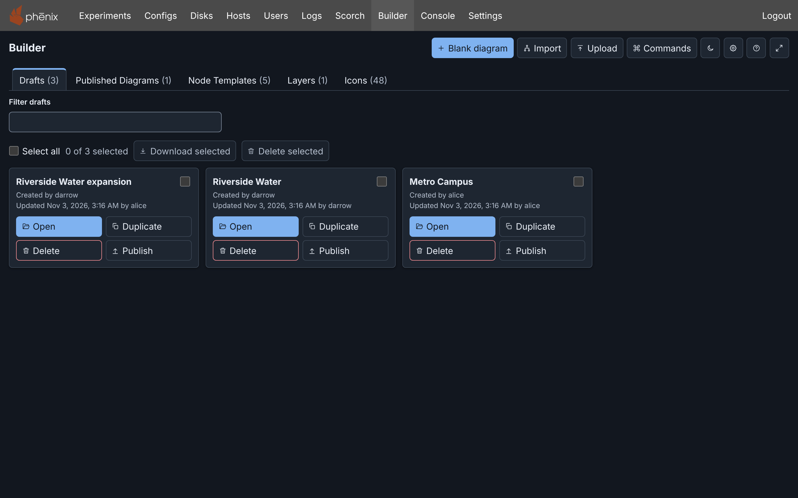

`Commands` opens the command palette (<kbd>Ctrl</kbd>+<kbd>K</kbd>, or
<kbd>⌘</kbd>+<kbd>K</kbd> on macOS). The `Node Templates` and `Icons` tabs
are covered in [Templates and Icons](templates.md).

The `Drafts` tab lists every user's drafts, most recently changed first, and
any Builder user can open, change and delete any of them. `Publish` on a card
opens the `Publish diagram` dialog without the editor (see
[Publishing from the drafts page](details/drafts.md#publishing-from-the-drafts-page)).
To find a draft, type part of its name or a user name in `Filter drafts`.

## Create a Draft

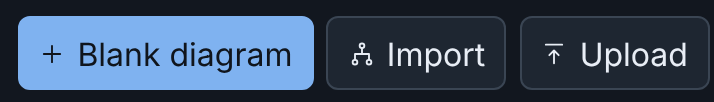{ width="357" }

- `Blank diagram` opens a new draft named "Untitled topology". It adds a
  number to the name when a draft has it.
- `Import` makes a draft from a Topology or Experiment config, stored in
  phēnix or in a file.
- `Upload` makes a draft from a Builder JSON or YAML file, pasted text, a
  published diagram, or a [legacy Builder](legacy.md) diagram.

See [Import, Upload and Download](import-upload-download.md) for the details.
To edit a published diagram, see
[The Published Diagrams Tab](#the-published-diagrams-tab).

## Open a Draft

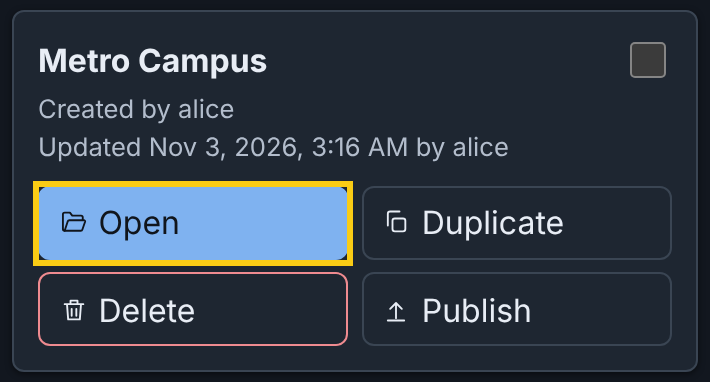{ width="355" }

Click `Open` on the draft card, or use the command palette:

1. Press <kbd>Ctrl</kbd>+<kbd>K</kbd>.
2. Enter `open draft` and press <kbd>Enter</kbd>.
3. Enter part of the name and press <kbd>Enter</kbd>.

To go back to the list, click `Drafts` in the editor header. While a draft is
open, the address bar shows a link to it that works for any Builder user.

## How Drafts Save

There's no Save button: Builder saves each change to the server as you make
it, and the save state in the toolbar shows where your changes are, for
example `All changes saved` (see [Save states](reference.md#save-states)).
`Save now` (<kbd>Ctrl</kbd>+<kbd>S</kbd>, or <kbd>⌘</kbd>+<kbd>S</kbd> on
macOS) sends them right away.

If the server can't be reached, Builder keeps your changes in this browser
and you can keep editing. It sends them on its own once the server answers
again, or when you click `Retry saving` (see
[Working offline](details/drafts.md#working-offline)).

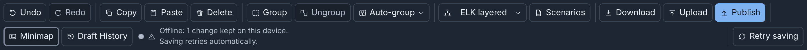

## Draft History

Each saved change is a snapshot. `Draft History` in the toolbar lists the
snapshots, newest first, with `Current` marking the one you're on.

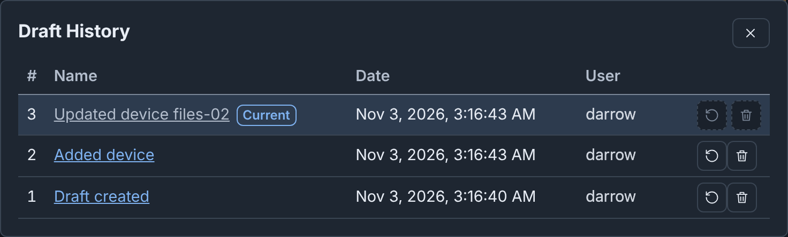

To go back, click `Restore` on an earlier snapshot. The newer snapshots
stay, and a notice above the toolbar says how many your next change will
delete. `Return to latest` goes back to the newest one, and
`Save newer history as a new draft` copies it to a new draft.

!!! warning
    A change after a restore or an undo deletes all newer snapshots,
    including other users' snapshots.

`Undo` and `Redo` also move the current snapshot, one change at a time. To
delete a snapshot (but not the current one), click `Delete` in its row, then
`Delete snapshot`; this can't be undone. A snapshot marked `Automatic` holds
Inspector changes you didn't apply, which Builder saved when you left,
published or downloaded the draft.

## Duplicate a Draft

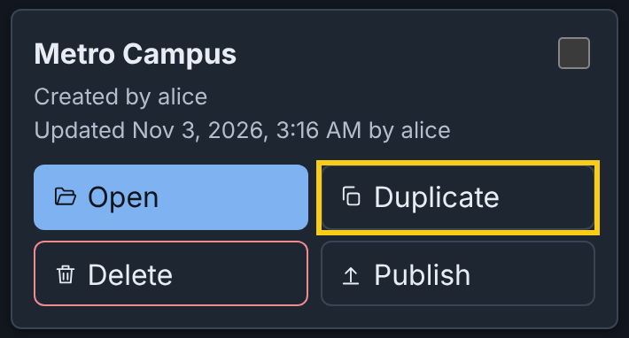{ width="355" }

`Duplicate` on a card makes a new draft from the current diagram and opens
it. The copy has "(copy)" after its name, no history, and no link to a
topology or experiment, so publishing it asks for a new topology name and
makes a new topology.

## Delete a Draft

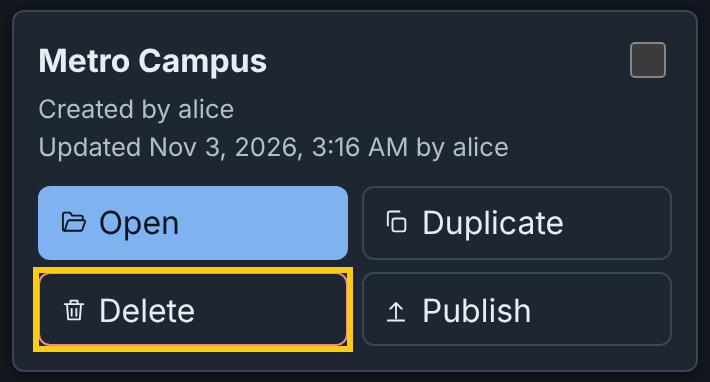{ width="355" }

1. Click `Delete` on the draft card.
2. Click `Delete draft`.

This deletes the draft and its history for good, but not the configs it
published.

## Select Several Drafts

Check the cards, then click `Download selected` to save a Builder JSON file
for each, or `Delete selected` to delete them all after one question. You can
also [select cards with the keyboard](details/drafts.md#selecting-with-the-keyboard).

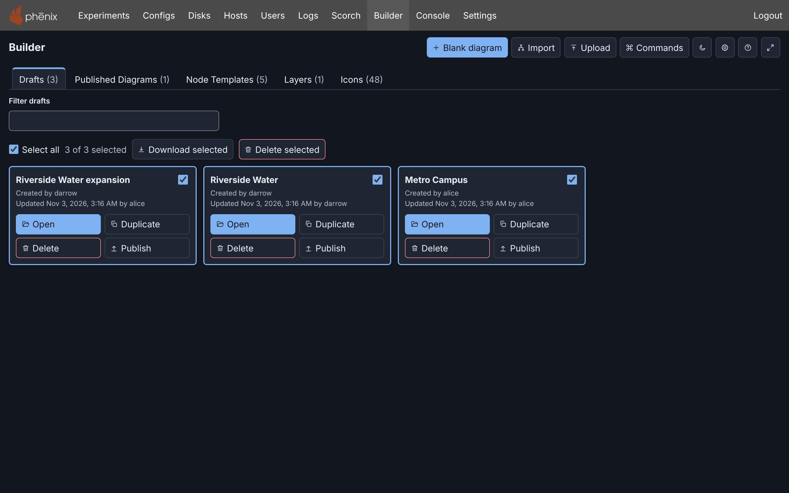

## The Published Diagrams Tab

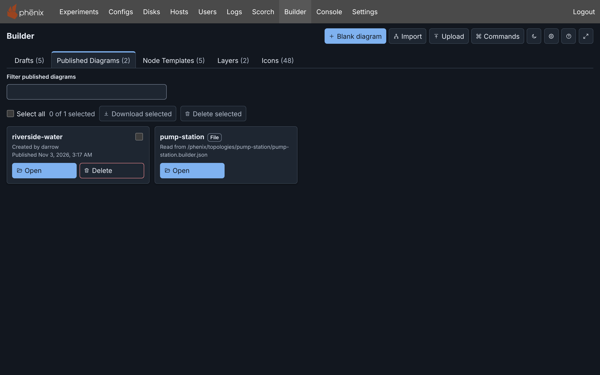

This tab lists each topology that has a Builder diagram, and `Open` shows
the diagram read only.

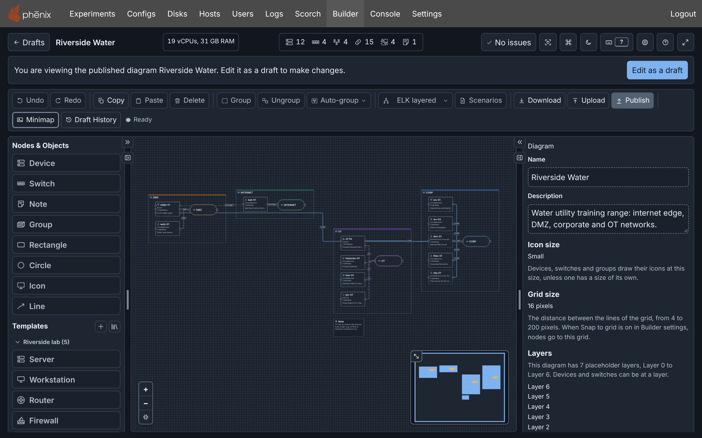

To change it, click `Edit as a draft` (the `builder` tag on the `Configs`
page does the same). Builder opens the draft that already published the
diagram or was made from it, or else makes a new one. That draft can publish
to the topology again. If the diagram was published with an experiment, `Exp`
on the card and in the editor toolbar opens the experiment.

`Delete` on a card deletes the Topology config from phēnix, but not the
drafts and experiments made from it. A card tagged `File` gets its diagram
from a [Builder file on the server](details/drafts.md#diagrams-read-from-a-file)
and has no `Delete`.

## The Layers Tab

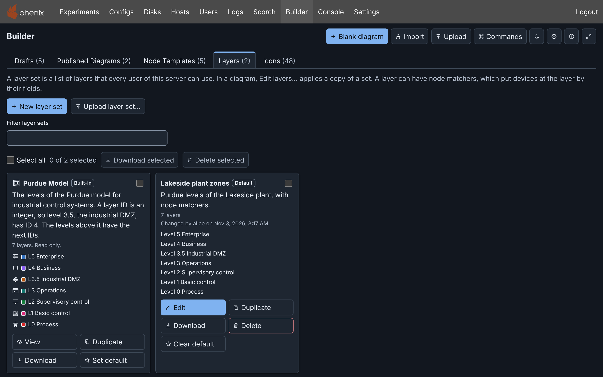

This tab is the server's library of layer sets (named lists of
[layers](diagrams.md) and their options), shared by all users. The built-in
`Purdue Model` set has the seven Purdue levels, from L0 Process to L5
Enterprise; to change it, `Duplicate` it and change the copy. `Set default`
makes a set the server's default, and each `Blank diagram` starts with a copy
of it (see [The Layers tab](details/drafts.md#the-layers-tab)).

## Advanced

### Damaged Drafts

A draft that this server can't read has `Delete` but no `Open` (see
[Damaged drafts](details/drafts.md#damaged-drafts)).

### Logging Out

Logging out deletes unsent changes from the browser, so wait until the save
state says `All changes saved` first (see
[Logging out](details/drafts.md#logging-out)).

### The Same Draft in Two Tabs

Don't open one draft in more than one browser tab: if both tabs hold unsaved
changes, Builder can save only one tab's changes (see
[Same draft in multiple tabs](details/drafts.md#same-draft-in-multiple-tabs)).

### Draft Merging

If another user saves the draft before your changes reach the server, Builder
merges their changes with yours, field by field. When changes clash, it shows
`This draft changed on the server` and you pick which changes to keep (see
[Draft merging](details/drafts.md#draft-merging)).

### The Draft Limit

At its draft limit, the server refuses new drafts. To make space, delete
drafts or click `Clean up…` in `Settings` (see
[Limits](details/drafts.md#limits)).

## See Also

- [The Editor](editor.md): the toolbar, Inspector and settings of an open
  draft.
- [Publishing](publishing.md): turn a draft into Topology and Experiment
  configs.
- [Troubleshooting](troubleshooting.md): save, merge and offline problems.
