# Drafts

A draft is a diagram saved on the phēnix server, with its history. Builder
saves each change that you make, and only **Publish** writes a config.

## The drafts page

The drafts page opens when you click **Builder** in the navigation bar.

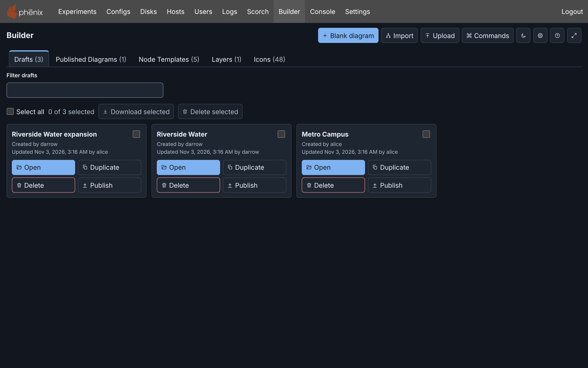

At the top right, **Blank diagram**, **Import** and **Upload** start a new
draft. **Commands** opens the command palette. The shortcut is
<kbd>Ctrl</kbd>+<kbd>K</kbd> (<kbd>⌘</kbd>+<kbd>K</kbd> on macOS). For the
other buttons, see
[Top right buttons](details/drafts.md#top-right-buttons).

The five tabs are **Drafts**, **Published Diagrams**, **Node Templates**,
**Layers** and **Icons**. [Templates and Icons](templates.md) describes
templates and icons.

The **Drafts** tab lists the drafts of all users, most recently changed
first. Each Builder user can open, change and delete each draft. A card
shows the name, the creator and the last change, with **Open**,
**Duplicate**, **Delete** and **Publish**. **Publish** opens the
**Publish diagram** dialog without the editor (see
[Publishing from the drafts page](details/drafts.md#publishing-from-the-drafts-page)
and [Item buttons](details/drafts.md#item-buttons)).

To find a draft, enter part of its name or a user name in
**Filter drafts** (see
[Filtering the lists](details/drafts.md#filtering-the-lists)).

## Create a draft

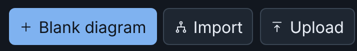{ width="357" }

- **Blank diagram** opens a new draft named "Untitled topology".
- **Import** makes a draft from a Topology or Experiment config, stored in
  phēnix or in a file.
- **Upload** makes a draft from a Builder JSON or YAML file, pasted text, a
  published diagram, or a legacy Builder diagram. See
  [Import, Upload and Download](import-upload-download.md) and
  [Legacy Builder](legacy.md).
- **Edit as a draft** makes a draft from a published diagram (see
  [The Published Diagrams tab](#the-published-diagrams-tab)). The tag
  `builder` on the **Configs** page does the same.

## Open a draft

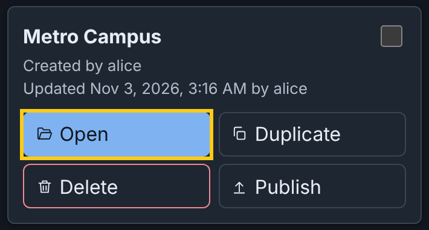{ width="355" }

Click **Open** on the draft card. Or use the command palette:

1. Press <kbd>Ctrl</kbd>+<kbd>K</kbd>.
2. Enter `open draft` and press <kbd>Enter</kbd>.
3. Enter part of the name and press <kbd>Enter</kbd>.

To go back to the list, click **Drafts** in the editor header. While a
draft is open, the address bar shows its link, which works for each
Builder user (see [Links to a draft](details/drafts.md#links-to-a-draft)).

## How drafts save

Builder saves each change to the server as you make it. There is no Save
button. The save state in the toolbar shows where your changes are, for
example **All changes saved** (see [Save states](reference.md#save-states)).
**Save now** sends the changes at once. The shortcut is
<kbd>Ctrl</kbd>+<kbd>S</kbd> (<kbd>⌘</kbd>+<kbd>S</kbd> on macOS).

When Builder cannot reach the server, it keeps your changes in this
browser, and you can continue to edit. The save state then shows
**Retry saving**. Builder sends the changes within a few seconds after the
server answers again, or when you click **Retry saving**. See
[Working offline](details/drafts.md#working-offline).

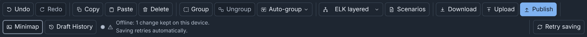

## Draft History

Each saved change is a snapshot. **Draft History** in the toolbar lists
the snapshots, newest first. **Current** marks the current snapshot.

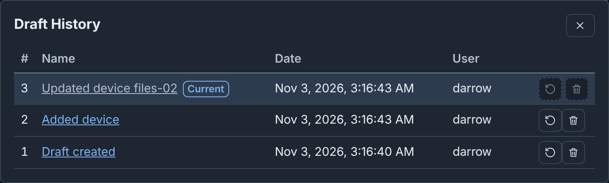

To go back to an earlier snapshot, click **Restore** in its row. Restoring
does not delete the newer snapshots.

!!! warning
    A change after a restore or an undo deletes all newer snapshots. This
    includes the snapshots of other users.

While the draft shows an older snapshot, a notice above the toolbar says
how many newer snapshots your next change deletes. **Return to latest**
shows the newest snapshot again. **Save newer history as a new draft**
makes a new draft of the newest snapshot, and you stay on this draft (see
[Newer snapshots](details/drafts.md#newer-snapshots)).

To delete a snapshot, click **Delete** in its row. Then click
**Delete snapshot**. You cannot undo this. You cannot delete the current
snapshot.

Sometimes the Inspector has changes that you did not apply. If you then
leave, publish or download the draft, Builder applies and saves these
changes. The snapshot has the mark **Automatic**.

**Undo** and **Redo** also move the current snapshot, one change at a time.
They skip a deleted snapshot (see
[Undo and redo](details/diagrams.md#undo-and-redo)).

## Duplicate a draft

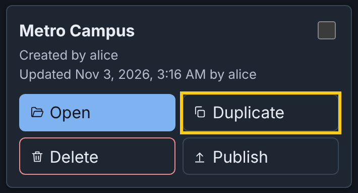{ width="355" }

**Duplicate** on a card makes a new draft with a copy of the current
diagram, and opens it. The copy has "(copy)" after its name, no history,
and no link to a topology or experiment. When you publish it,
Builder asks for a new topology name and makes a new topology (see
[Duplicating a draft](details/drafts.md#duplicating-a-draft)).

## Delete a draft

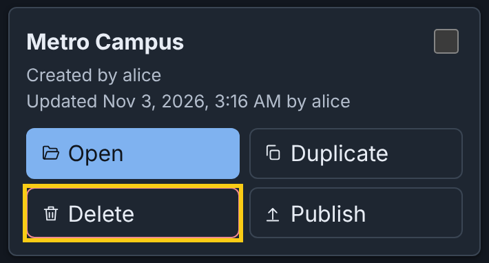{ width="355" }

1. Click **Delete** on the draft card.
2. Click **Delete draft**.

Builder deletes the draft and its history from the server. You cannot
undo this. The configs that the draft published do not change.

## Select several drafts

Each draft card has a checkbox. The row above the cards shows the number of
selected cards, **Select all**, **Download selected** and
**Delete selected**.

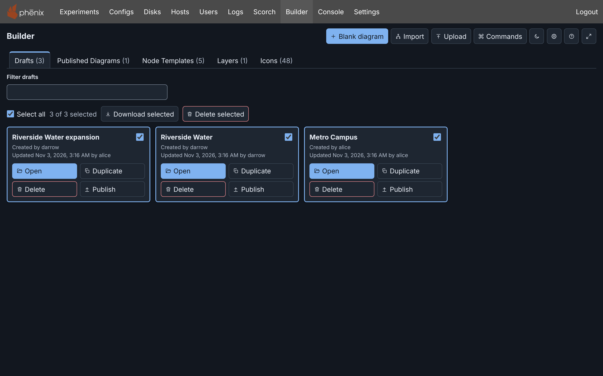

- **Download selected** saves a Builder JSON file for each selected draft.
- **Delete selected** asks once for all the drafts. A summary under the
  row lists the drafts that Builder could not delete.

You can also select cards with the keyboard (see
[Selecting with the keyboard](details/drafts.md#selecting-with-the-keyboard)).

## The Published Diagrams tab

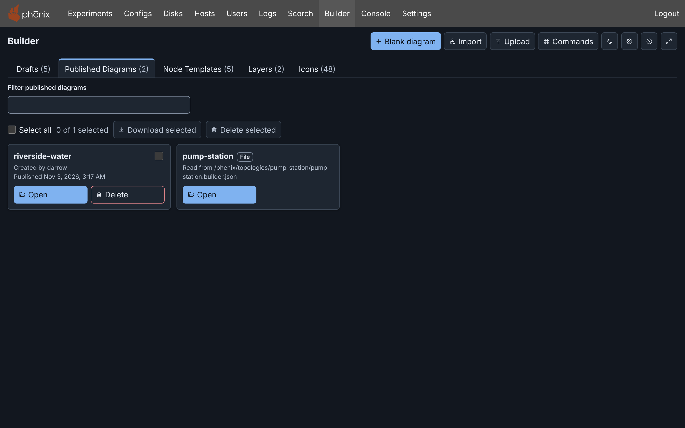

The **Published Diagrams** tab lists each topology that has a Builder
diagram. **Open** on a card shows the diagram read only.

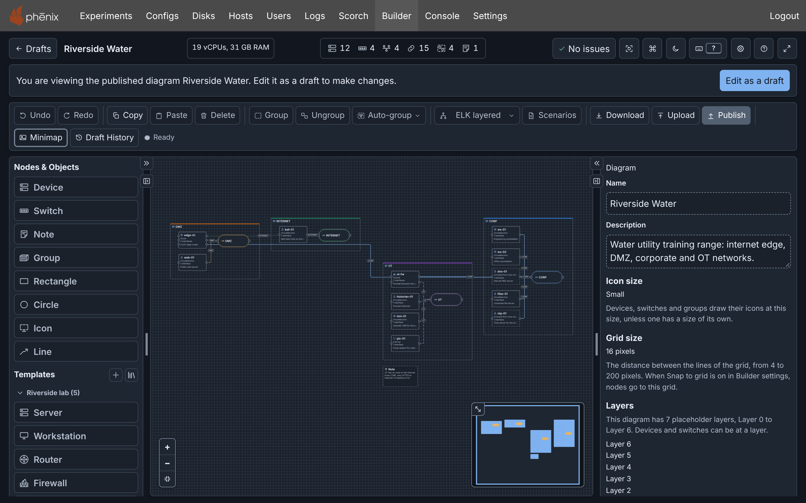

To change the diagram, click **Edit as a draft**. Builder makes a draft
from the published diagram and opens it. If a draft already published
this diagram, or was made from it, **Edit as a draft** opens that draft
instead. The draft can publish to the topology again (see
[Publishing](publishing.md)).

When Builder published a diagram with an experiment, its card and the
editor toolbar have **Exp**, which opens the experiment page (see
[Opening the experiment](details/drafts.md#opening-the-experiment)).

A card with the tag **File** is a topology whose diagram comes from a
Builder file on the server. It has no **Delete** (see
[Diagrams read from a file](details/drafts.md#diagrams-read-from-a-file)).
On the other cards, **Delete** deletes the Topology config from phēnix.
The drafts and experiments made from it do not change (see
[Deleting a published topology](details/drafts.md#deleting-a-published-topology)).

## The Layers tab

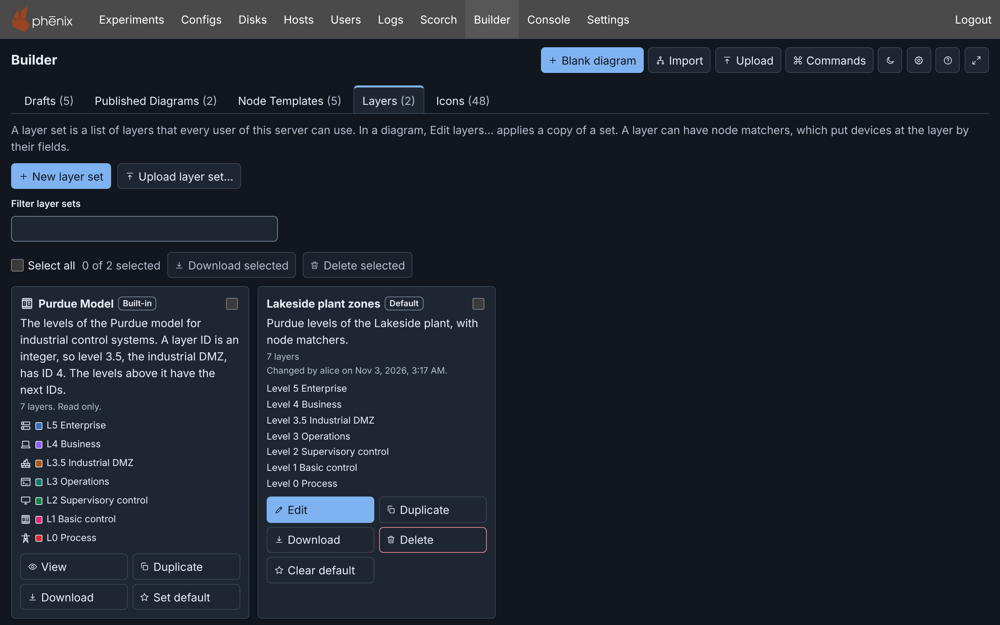

A layer set is a named list of layers and its options (see
[Diagrams](diagrams.md)). The **Layers** tab lists the layer set library,
which all users share. The built-in set **Purdue Model** has the seven
levels of the Purdue model, from L0 Process to L5 Enterprise. To change
it, click **Duplicate**. Then change the copy.

**Set default** makes a set the default set of the server. Each
**Blank diagram** starts with a copy of the default set (see
[The Layers tab](details/drafts.md#the-layers-tab) and
[Selecting several layer sets](details/drafts.md#selecting-several-layer-sets)).

## Advanced

### Damaged drafts

A draft that this phēnix server cannot read stays on the list, with
**Delete** but no **Open**. See
[Damaged drafts](details/drafts.md#damaged-drafts).

### Logging out

Logging out deletes the unsent changes from the browser. Before you log
out, wait until the save state says **All changes saved**. See
[Logging out](details/drafts.md#logging-out).

### The same draft in two tabs

Do not open one draft in more than one tab. When you do, each tab shows a
notice. When both tabs hold unsaved changes, Builder can save the changes
of only one tab. See
[Same draft in multiple tabs](details/drafts.md#same-draft-in-multiple-tabs).

### Draft merging

Another user can save a newer version of the draft before your changes
reach the server. Builder then merges their changes with yours, field by
field. When a change clashes, Builder shows
**This draft changed on the server**, and you select the changes to
keep. See [Draft merging](details/drafts.md#draft-merging).

### The draft limit

At its draft limit, the server refuses new drafts. To make space, delete
drafts, or click **Clean up…** in **Settings**. See
[Limits](reference.md#limits).

## More detail

- [Drafts: details](details/drafts.md): every rule and message.
- [Save states](reference.md#save-states): every save state message.
- [Draft limits](details/drafts.md#limits): the draft and snapshot limits.
