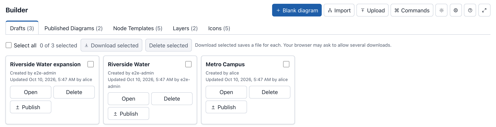
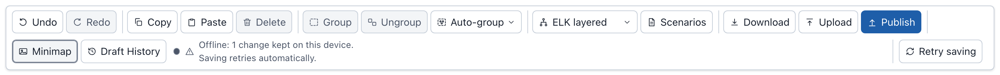
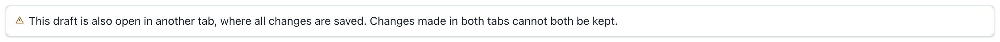
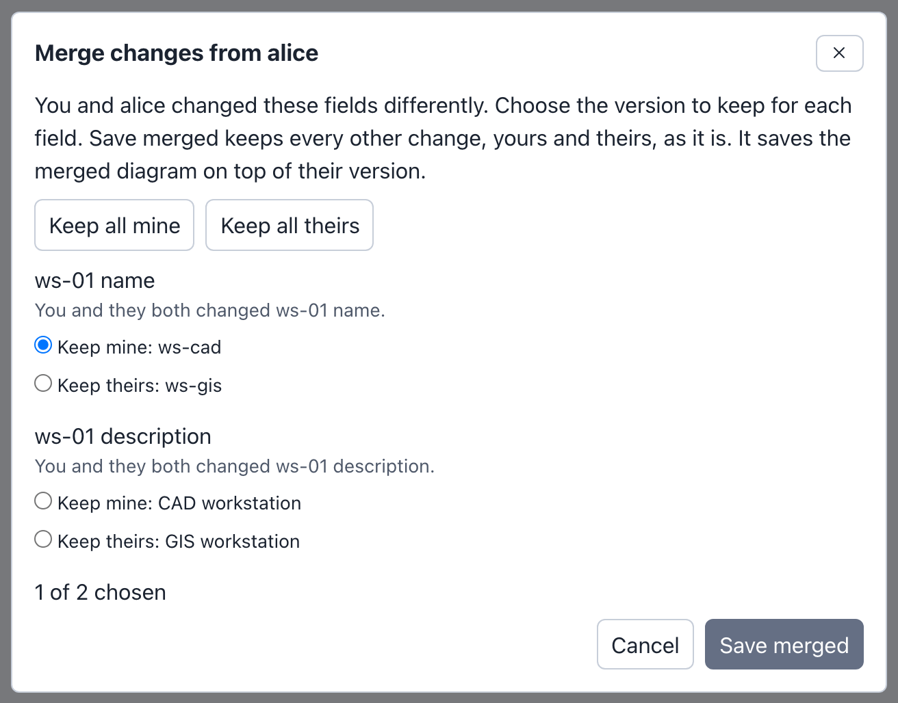
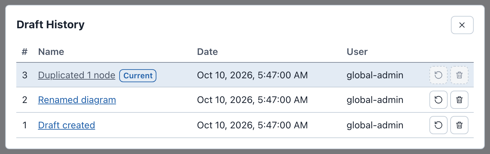
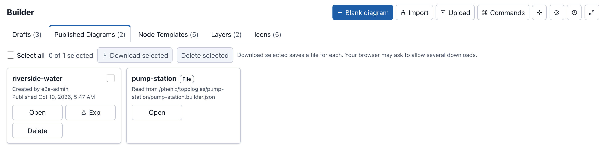
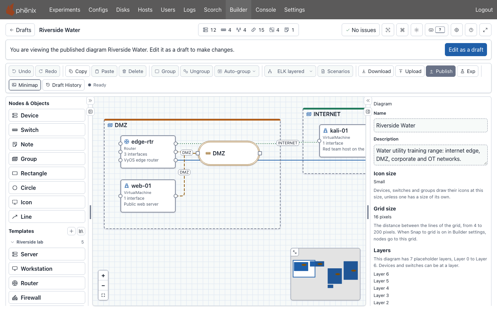
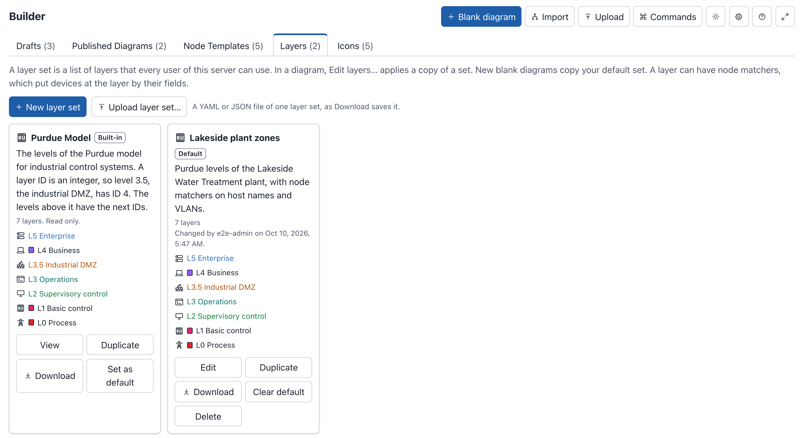
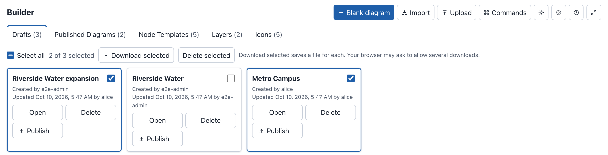

# Drafts

Each diagram in Builder is a draft on the phenix server, apart from the
phenix configs. Builder saves each change to the draft as you make it. Only
**Publish** writes configs from a draft (see [Publishing](publishing.md)).

## The drafts page

Select **Builder** in the navigation bar. The drafts page opens.

**Blank diagram**, **Import** and **Upload** start a new draft (see
[Creating a draft](#creating-a-draft)). **Commands** opens the
[command palette](editor.md#command-palette) (<kbd>⌘</kbd>+<kbd>K</kbd> on
macOS, <kbd>Ctrl</kbd>+<kbd>K</kbd> on Windows and Linux). The theme,
**Settings**, **Help** and **Focus mode** buttons work as in the
[editor header](editor.md#header).

Each tab shows its number of items, for example **Drafts (3)**:

- **Drafts**: the drafts of all users, the most recently changed first.
  [Damaged drafts](#damaged-drafts) come last.
- **Published Diagrams**: the topologies that have a Builder diagram (see
  [Published diagrams](#published-diagrams)).
- **Node Templates**: the
  [template library](templates.md#the-template-library). Its count includes
  only the library templates. The built-in templates and the server
  collections are under **Show**.
- **Layers**: the [layer set library](#the-layers-tab), with the built-in set
  **Purdue Model**.
- **Icons**: the [icon library](diagrams.md#the-icons-tab) and the built-in
  icons. Its count includes both.

Each Builder user can open, change and delete each draft (see
[Permissions](administration.md#permissions)).

A draft card shows the name of the draft, its creator, and its last change
and that user, for example "Updated Sep 29, 2026, 1:02 PM by alice". The
card has a checkbox (see [Selecting several drafts](#selecting-several-drafts)),
**Open**, [**Duplicate**](#duplicating-a-draft) and **Delete**.
[**Publish**](#publishing-from-the-drafts-page) shows when your role can
change configs.

"Updated" is the last activity on the draft: an edit, an undo, a restore, a
deleted snapshot or a publish. It can differ from **Last edited** in the
Inspector, which shows when Builder saved the content that you see (see
[With nothing selected](editor.md#with-nothing-selected)).

### Item buttons

The buttons that act on one item, such as a draft or a layer set, look the
same in all of Builder:

| Button | Icon | Color |
|---|---|---|
| **Edit** | Pencil | Blue |
| **Delete** | Trash can | Red |
| **Publish** | Arrow up | Default |
| **Duplicate** | Two sheets | Default |
| **Open** | Open folder | Blue |
| **View** | Eye | Default |
| **Download** | Arrow down | Default |

An item that you cannot change has **View** in place of **Edit**.

### Filtering the lists

The **Drafts**, **Published Diagrams**, **Node Templates** and **Layers**
tabs each have a filter field above their cards, for example
**Filter drafts**. The tab then shows only the cards that match, in the same
order. A line under the field shows the count, for example "2 of 12 drafts
shown.". On **Drafts** and **Published Diagrams**, the count of the tab
changes too, for example **Drafts (2 of 12)**.

The filters find:

- **Filter drafts** and **Filter published diagrams**: a name, or the user
  who created or last changed a draft.
- **Filter layer sets**: the name and the description of a set.
- **Filter templates**: the name of a template, and what `t:` in the command
  palette finds (see
  [The Node Templates tab](templates.md#the-node-templates-tab)).

The filter matches as the [command palette](editor.md#command-palette)
does. Each word that you type must be in the name or a user name, in any
letter case. Or, the letters must be in the name in order: `pmpst` finds
"Pump station". The words can match in different places, such as the name
and a user name.

- **Select all**, **Download selected** and **Delete selected** act only on
  the cards that show. When the filter hides a selected card, the card is
  no longer selected.
- Each tab keeps its filter while the browser tab is open.
- To show all cards again, press <kbd>Esc</kbd> in the field, or clear it.

## Creating a draft

### Blank diagram

Select **Blank diagram**. A new draft named "Untitled topology" opens in the
editor. When a draft of any user has that name, the new draft is "Untitled
topology 2", and so on. To rename it, see
[Renaming the diagram](editor.md#renaming-the-diagram).

### Import

**Import** makes a draft from a Topology or Experiment config, in phenix or
in a file. The draft has the name of the config. See
[Importing a topology or experiment](import-upload-download.md#importing-a-topology-or-experiment).

### Upload

**Upload** always makes a new draft. The source is a Builder JSON or YAML
file, pasted text, a published diagram, or a legacy Builder diagram. See
[Import, Upload and Download](import-upload-download.md) and
[Legacy Builder](legacy.md).

### From a published diagram

On the **Published Diagrams** tab, open a card and select **Edit as a draft**
(see [Published diagrams](#published-diagrams)). **Edit** on a Builder
topology on the **Configs** page does the same (see
[Editing a published topology](publishing.md#editing-a-published-topology)).
Until your first change, the Inspector shows who made the diagram and who
edited it last.

## Opening a draft

Select **Open** on the draft's card.

To open a draft from the command palette:

1. Select **Commands**.
2. Type `open draft` and press <kbd>Enter</kbd>. The palette lists the
   drafts and the published diagrams.
3. Type part of the name and press <kbd>Enter</kbd>.

To go back to the list, select **Drafts** in the editor header. Builder does
not wait to send your changes. The button says **Saving…** first only when
this browser cannot keep your changes. Builder sends the waiting
changes in the background, and the card of the draft shows the save state.

### Links to a draft

A link to a draft has the form `<phenix address>/builder?draft=<draft id>`.
The address bar shows it while a draft is open, so a reload opens the same
draft. The link works for each Builder user. A link with a `draft` value
that is not a draft ID, such as one with a `/`, opens no draft.

## Publishing from the drafts page

**Publish** on a draft's card opens the **Publish diagram** dialog without
the editor (see [Publishing](publishing.md)). It shows when your role has
`configs` `update`.

**Open draft** in the dialog opens the draft in the editor. When the
diagram has errors, the dialog lists them. Builder does not publish a draft
with errors, or with changes that the server does not have yet. The dialog
then tells you to open the draft.

When you close the dialog, the waiting changes continue to save. Closing the
dialog during a publish does not stop the publish.

## How drafts save

### Autosave and the save state

Builder saves each change to the server as you make it. Each saved change is
a snapshot in [Draft History](#draft-history). There is no Save button.
**Save now** (<kbd>⌘</kbd>+<kbd>S</kbd> on macOS, <kbd>Ctrl</kbd>+<kbd>S</kbd>
on Windows and Linux) sends the changes immediately. It also applies the
valid Inspector changes that you did not apply.

The save state, after **Draft History** in the toolbar, shows where your
changes are:

| Save state | What it means | What to do |
|---|---|---|
| All changes saved | The server has all changes. | Nothing. |
| Saving changes, Saving 2 changes | Builder sends changes. | Wait. |
| 2 unsaved changes | Changes wait. | Wait, or press **Save now**. |
| Offline: 1 change kept on this device. Saving retries automatically. | The server cannot be reached, or did not answer in time. This browser keeps the changes. | Continue to work. See [Working offline](#working-offline). |
| Offline: 2 changes not stored anywhere yet. Keep this tab open. Saving retries automatically. | The server cannot be reached, and the browser cannot store the changes. | Keep the tab open until the save state says All changes saved. |
| Offline: no unsaved changes | The server cannot be reached, and no changes wait. | Nothing. |
| 1 change not saved yet. Choose which changes to save. | Another tab of this browser has changes to this draft. | See [One draft in several tabs](#one-draft-in-several-tabs). |
| Merging your changes with the server version… | Someone saved a newer version first. Builder merges it with your changes. | Wait. See [When the draft changed on the server](#when-the-draft-changed-on-the-server). |
| This draft changed on the server | Someone saved a newer version first. Some changes clash, or merging is not available. | See [When the draft changed on the server](#when-the-draft-changed-on-the-server). |
| Not saved: you chose another tab's changes | You chose the changes of another tab. | Nothing. Builder keeps the changes of this tab as a new draft. |
| Could not save: someone deleted this draft from the server. Select Download to keep a copy of the diagram. | Another user deleted the draft. | Select **Download** (see [Downloading](import-upload-download.md#downloading)). Upload the file to make a new draft. |
| You cannot save changes to this draft | Your role no longer includes the Builder. | Ask an administrator for the Builder permission (see [Permissions](administration.md#permissions)). Select **Download** to keep a copy. |
| Could not save your last change. … When you fix the diagram, the Builder saves it again. | The server refused the diagram, for example for two devices with one hostname. The message names the problem. | Fix it (see [Checks and warnings](editor.md#checks-and-warnings)). The next change saves the diagram. |
| Could not save your changes. … Saving retries automatically. | The server refused the save for a different reason, which the message names. | Wait, or select **Retry saving**. |

**Retry saving** shows when the browser is offline, or when a new try can
fix a failed save. It sends the waiting changes immediately.

### Working offline

When the server cannot be reached, Builder keeps your changes in this
browser, and you can continue to edit. The save state then shows **Retry
saving**:

Within a few seconds after the server answers again, Builder sends the
changes. **Retry saving** sends them at once. The changes stay in this
browser when you close the tab. Builder sends them the next time that you
open the draft in this browser. Logging out deletes them (see
[Logging out](#logging-out)).

Builder waits at most 60 seconds for the server to answer a save, and 30
seconds for a read. A save with no answer in time counts as offline, and
the next try sends it again. For publishing, preflight checks, imports,
exports, packages and storage cleanup, Builder waits up to 10 minutes.

Sometimes the server saves a change, but its answer does not arrive. The
next time Builder reaches the server, it finds the saved change. The server
saves the change once, and Builder merges nothing.

### One draft in several tabs

You can open a draft in more than one tab of the same browser. Each tab then
shows a notice under the header:

When more than one tab holds unsaved changes, for example after offline work,
Builder can save the changes of only one tab. The notice shows how many
changes the other tab has. Builder opens the **Choose which changes to
save** dialog:

1. Under **Version to save**, choose a version, for example "This tab: 1
   change, last at Sep 29, 2026, 1:01:26 PM". **Download** saves a copy of
   the version of this tab as a file.
2. Select **Save this version**.

Builder saves each other version as a new draft, with " (local copy)" after
the name. The tab with that version changes to the new draft. **Decide
later** closes the dialog, and Builder sends nothing until you choose.
**Choose which to save** in the notice opens the dialog again.

### When the draft changed on the server

Another person can save a newer version of the draft before your changes
reach the server, for example while you work offline. Builder then merges
their changes with yours, field by field. During the merge, edits wait, and
the save state says "Merging your changes with the server version…".

- A change that only one of you made stays, also on different fields of one
  device. If alice moves router-1 and you rename it, router-1 is moved and
  renamed.
- Items that one of you added stay. An item that one of you deleted is
  deleted, unless the other changed it or added a connection to it.
- An interface that one of you renamed keeps the changes of the other.
- Builder adds or deletes the scenarios that one of you added or deleted.
- Your view of the canvas (zoom and position) does not change.

When nothing clashes, Builder saves the merged diagram on top of the newer
version and announces "Merged alice's changes with yours." Draft History
lists the save as "Merged changes from alice". Undo goes back to alice's
version. Redo brings back the merged diagram.

These changes clash:

- A field that you both changed to different values. A device's name, its
  hostname and the hostname in its settings are one choice. The new names
  of one interface are one choice, and the diagram keeps one interface. The
  whole link of a [linked template](templates.md#linked-templates) is one
  choice.
- An item that one of you deleted while the other changed it or added a
  connection to it. For a device or interface, the choices are, for
  example, **Keep theirs: delete ws-01 and drop your connection to it** and
  **Keep mine: keep ws-01 with your connection**. Builder announces each
  connection that it drops.
- A group that one of you deleted or ungrouped while the other put a node
  in it. When Builder deletes the group, the node goes to the group that
  held that group, as **Ungroup** does, or to no group. Builder announces
  each node that it moves.
- A node that one of you put in a group while the other put that group in
  the node. Two groups cannot be in each other.

For the group of a node, the choices name the groups, for example **Keep
mine: Site** and **Keep theirs: no group**. If your choices still put two
groups in each other, Builder moves one of them out of its group and
announces it.

When something clashes, or the merged diagram has an error such as two
devices with one hostname, the panel **This draft changed on the server**
opens under the header. Your unsaved changes stay on this device. Builder
does not save new edits until you choose one of these:

- **Review and merge**: opens the **Merge changes from alice** dialog.
- **Save my history as a new draft**: saves your version as a new draft, for
  example "Riverside Water (local copy)", and opens it. The draft that
  changed on the server does not change. If the save stops before it is
  complete, Builder deletes the incomplete draft and says why.
- **Discard mine and load the server version**: asks first, then deletes
  your changes and loads the newer version. You cannot undo this. If Builder
  cannot read the newer version, it keeps your changes and says why.

The **Merge changes from alice** dialog lists each clash with **Keep mine**
and **Keep theirs** and the value of each:

- Choose one for each clash, or select **Keep all mine** or **Keep all
  theirs**.
- **Save merged** saves the merged diagram on top of the newer version, with
  all changes that do not clash. If the merged diagram has an error, the
  dialog lists it and stays open.
- When the dialog opens only for such an error, **Save merged** is
  unavailable. Select **Cancel**, then save your history as a new draft or
  discard it.
- If a newer version arrives when you select **Save merged**, Builder saves
  nothing and merges again.
- If the save fails, the dialog says why and keeps your choices. Select
  **Save merged** again.
- **Cancel** goes back to the panel.

For example, alice and you both rename ws-01 and change its description:

Merging needs the version that your changes started from. The panel says
"Merging is not available" and does not offer **Review and merge** when:

- The server no longer keeps that version (a draft keeps its last 50
  snapshots).
- Builder cannot read it.
- The server does not send it within 15 seconds.

If the merge fails, the panel says "Merging failed" with the reason, and
offers the same choices. If a third person saves while Builder saves the
merged diagram, Builder merges again with their version.

## Draft History

Each change saved to a draft is a snapshot. **Draft History** in the toolbar
lists the snapshots, newest first, and restores an earlier one.

For example, in the Riverside Water draft:

1. Under **Templates**, select **Server**.
2. In the Inspector, set **Hostname** to `files-02`.
3. Select **Apply**.
4. Select **Draft History** in the toolbar.

The columns are:

- **#**: the snapshot number. 1 is the oldest, the draft as Builder made it.
- **Name**: what the change did, for example "Added device".
- **Date** and **User**: when and by whom Builder saved the snapshot. For
  the current snapshot, the Inspector shows these as **Last edited**. The
  exception is snapshot 1 of a draft made with **Edit as a draft**. Its row
  shows when you made the draft. The Inspector shows who last edited the
  diagram before that.
- The Restore and Delete buttons.

**Current** marks the current snapshot. You cannot restore or delete it. The
tooltip of each other Restore button shows how many newer snapshots your
next change after the restore removes. Screen readers announce the number
of snapshots and the tooltip.

### Restoring a snapshot

To go back to the draft as Builder made it, select **Draft created** or its
Restore button. The dialog closes, and the canvas shows the draft without
files-02. Riverside Water is now as you uploaded it, as the other pages
expect.

Restoring does not delete the newer snapshots. You can restore them the same
way. If the server does not move the draft to the snapshot, for example
while you are offline, the page says so, and the draft does not change.

**Undo** and **Redo** also move the current snapshot, one change at a time
(see [Undo and redo](diagrams.md#undo-and-redo)).

!!! warning
    A change after you restore or undo removes all newer snapshots, also
    the snapshots of other users. In the example, a note added after the
    restore removes "Added device" and "Updated device files-02".

### Newer snapshots

While the draft shows a snapshot older than its newest one, a notice above
the toolbar shows what your next change removes. For example: "Your next
change removes 2 newer snapshots (latest by bob, Oct 26, 2026, 10:00 AM)."
The notice has two buttons:

- **Return to latest**: shows the newest snapshot again. After **Undo**, it
  works as **Redo** and keeps your undo steps. Otherwise, it restores the
  newest snapshot.
- **Save newer history as a new draft**: makes a new draft of the newest
  snapshot, for example "Riverside Water (copy)". You stay on this draft.
  The new draft is not published, and its publish makes a new topology, as
  for [Duplicate draft](#duplicating-a-draft).

The notice closes when your next change removes the newer snapshots, or when
the draft shows its newest snapshot again. It does not show while a save
conflict is open.

### Deleting a snapshot

1. Select the Delete button of the snapshot.
2. Select **Delete snapshot**. You cannot undo this.

**Undo** and **Redo** skip a deleted snapshot.

### Automatic snapshots

When you leave, publish or download a draft with Inspector changes that you
did not apply, Builder applies and saves them. Their snapshot has the name
of the node, for example "Saved unapplied changes to Device web-01", and the
mark **Automatic**.

### Limits

The server holds at most 2,000 drafts of all users. At that limit, it
refuses new drafts. To make space, delete drafts, or select **Clean up…** in
[Settings](editor.md#settings). It deletes the published, unchanged drafts
of all users (see [Cleaning up storage](administration.md#cleaning-up-storage)).

A draft keeps at most 50 snapshots and 50 MiB of them. Past either limit,
Builder deletes the oldest snapshots. A published diagram and a
[diagram read from a file](#diagrams-read-from-a-file) have no draft
history. To keep one, edit the diagram as a draft.

## Published diagrams

The **Published Diagrams** tab lists each topology that has a Builder
diagram, by topology name. A topology published from Builder shows its
publish time.

**Open** on a card shows the diagram read only:

To change it, select **Edit as a draft**. Builder makes a draft and opens
it. The next time any Builder user does this, Builder opens a draft that
published the diagram or was made from it, and does not make another.
This draft can publish to the topology again (see
[Publishing again](publishing.md#publishing-again)).

A published diagram keeps who made it and who edited it last, from the
draft at publish time. The Inspector shows them under **Details** (see
[With nothing selected](editor.md#with-nothing-selected)).

### Opening the experiment

When a diagram was published with an experiment (see
[Publishing a topology and an experiment](publishing.md#publishing-a-topology-and-an-experiment)),
its card and the editor toolbar have **Exp**. **Exp**, and **Open experiment** in the command palette,
open the experiment page in the same tab and leave the editor.

**Exp** shows only while the experiment exists and your role has
`experiments` `get` on it. It follows a renamed experiment. It does not show
for an experiment that you made from the topology yourself. When one
publication made several experiments, **Exp** opens one of them. The others
are on the **Experiments** page.

### Diagrams read from a file

A topology can name a Builder file on the phenix server as its diagram,
without a publish. An administrator sets this up (see
[Builder documents in files](administration.md#builder-documents-in-files)).
Its card has the tag **File** and the file path, but no **Delete**. To
delete the topology, use the **Configs** page.

**Open** reads the file and shows its diagram read only. When the stored
topology is not what the diagram in the file publishes, the notice says so.
A draft made from that diagram can publish only as a new topology.

**Edit as a draft** makes a draft from the diagram in the file. Next time, it
opens the same draft while the file has the same diagram. After the file
changes, it makes a new draft. Such a draft can update the topology (see
[Publishing to a topology that names a Builder file](publishing.md#publishing-to-a-topology-that-names-a-builder-file)).

When phenix cannot use the file, the diagram does not open, and the page
says why (see
[When the file cannot be used](administration.md#when-the-file-cannot-be-used)).
When the file changes between **Open** and **Edit as a draft**, Builder
makes no draft. Open the diagram again.

### Deleting a published topology

**Delete** on a **Published Diagrams** card deletes the Topology config from
phenix. It needs `configs` `delete` on the topology. Drafts and experiments
made from the topology do not change.

1. Select **Delete** on the card.
2. Select **Delete topology**.

When another user published or changed the topology after Builder read the
list, Builder deletes nothing and reads the list again. Examine the
topology, and delete it again.

A draft that published the topology, was imported from it, or was opened
from its published diagram creates the topology again the next time it
publishes to that name.

## The Layers tab

A layer set is a named list of layers and its options (see
[Layers](diagrams.md#layers)). The **Layers** tab lists the layer set
library of the server, which all users share. On the drafts page, **Show
Layers** in the command palette opens the tab. In a diagram, **Edit
layers…** applies a copy of a set to the diagram.

**New layer set** opens the layers editor on a new set with the 7
placeholder layers. **Upload layer set…** adds a set from a
[layer set file](import-upload-download.md#layer-set-files). The tab also
has **Filter layer sets** (see [Filtering the lists](#filtering-the-lists))
and a row to [select several sets](#selecting-several-layer-sets).

On the cards, the tag **Default** marks the default set. The tag
**Built-in** marks a set that is part of phenix.

Each card has these buttons (see [Item buttons](#item-buttons)):

- **Edit** opens the layers editor. Change the **Name**, **Description**,
  **Icon**, options and layers, then select **Save**. **Save** first writes
  the text that you typed in the layer rows. When a layer field has an
  error, the editor stays open and moves focus to that field (see
  [Editing the layers](diagrams.md#editing-the-layers)). Each save gives the
  set its next version. When you made changes, **Cancel** asks first.
- **Duplicate** adds a copy with a number after its name, for example
  "Purdue Model (2)".
- **Download** saves the set as a
  [layer set file](import-upload-download.md#layer-set-files).
- **Delete** asks first. Diagrams keep their copies of its layers. You
  cannot undo this.
- **Set default** makes the set the default set of the server. On the
  default set, the button is **Clear default**.

When another user changed the set or the default after the tab read the
library, **Delete**, **Set default** and **Clear default** change nothing.
The tab reads the library again. Examine the set, and try again. When
another user saved the set after you opened it, **Save** fails. Close the
editor, and open the set again.

The built-in set **Purdue Model** has the seven levels of the Purdue model,
from L0 Process to L5 Enterprise, each with an icon and a color. It is read
only and has no **Delete**. To change it, duplicate it and change the copy.

The server keeps one default set for all users, and each Builder user can
change it. Each **Blank diagram** starts with a copy of the default set,
linked to the set. Without a default set, a new diagram has the placeholder
layers. In the template editor, a library template offers the layers of the
default set (see [The template editor](templates.md#the-template-editor)).

When Builder cannot read the library, the tab says why and shows **Retry**.
The tab does not list the sets that the server cannot read, for example
sets that a newer phenix version saved. It shows how many there are.

The library holds at most 200 sets, plus the built-in set (see
[The libraries](administration.md#the-libraries)).

### Selecting several layer sets

**Select all**, **Download selected** and **Delete selected** work as for
drafts (see [Selecting several drafts](#selecting-several-drafts)), with
these differences:

- **Download selected** saves a layer set file for each selected set, also
  the built-in set.
- **Delete selected** asks once for all sets. Diagrams keep their copies of
  the layers. It does not delete a built-in set, and the question and the
  summary say so. When only built-in sets are selected, Builder asks nothing
  and shows the summary.

The keys in [Selecting with the keyboard](#selecting-with-the-keyboard) also
select layer sets.

## Duplicating a draft

**Duplicate** makes a new draft with a copy of the current diagram of a
draft, and opens it.

**Duplicate draft…** in the [command palette](editor.md#command-palette)
does the same. In the editor, it copies the open draft after Builder saves
its changes. On the drafts page, it asks which draft to copy.

The new draft:

- Has the name of the draft with "(copy)" at the end. When a draft has that
  name, the copy is "(copy 2)", "(copy 3)" and so on. A copy of "Pump
  station (copy)" is "Pump station (copy 2)".
- Has no [Draft History](#draft-history). You are its creator.
- Is not published, and has no link to a topology or experiment. When you
  publish it, Builder asks for a new topology name and makes a new topology
  (see [Publishing](publishing.md)).
- Still includes the topologies that the original draft included.

A published diagram that shows read only has no **Duplicate**. Select
**Edit as a draft** first. When the server refuses the new draft, the page
says why, and you stay on the same page.

## Deleting a draft

1. Select **Delete** on the draft's card.
2. Select **Delete draft**. Builder deletes the draft and its whole history
   from the server. You cannot undo this.

Deleting a draft does not change the configs that it published. During a
publish of the draft, the server holds the delete until the publish is done.
It then answers 412 with the new ETag of the draft, and Builder tries the
delete again once with that ETag. When another user has the draft open,
their next save fails (see
[Autosave and the save state](#autosave-and-the-save-state)).

## Selecting several drafts

A card has a checkbox when one of these actions can act on it:

- **Download selected** on **Drafts** and **Published Diagrams**.
- **Delete selected** on **Drafts**, and on **Published Diagrams** for the
  cards that you can delete.
- **Download selected** and **Delete selected** on **Icons**, for each icon
  (see [The Icons tab](diagrams.md#the-icons-tab)).

The row above the cards has the actions, the number of selected cards, and
**Select all**. **Select all** selects all cards that have a checkbox, or
none. With a filter, it acts on the cards that show (see
[Filtering the lists](#filtering-the-lists)).

On **Published Diagrams**, a topology whose diagram is read from a file has
no checkbox. Each tab keeps its own selection.

### Selecting with the keyboard

The cards of a tab are one stop of the Tab key. Tab moves to the card that
you were last on, and the keys below work there.

| Key | What it does |
|---|---|
| Arrow keys | Move to the next or previous card, also to the card above or below |
| Home, End | Move to the first or last card |
| Space | Select the focused card, or clear it |
| Shift+Space, Shift and an arrow key | Select the cards from the card you last selected or cleared to the focused card, also when you cleared that card |
| ⌘A (macOS), Ctrl+A | Select every card |
| Escape | Clear the selection |
| Delete (Backspace on macOS too) | Ask to delete the selected cards, where **Delete selected** can |

When you hold Shift and select a checkbox, the cards from the card that you
last selected or cleared to that checkbox get its new state. After **Select
all**, ⌘A or Escape, Shift and a checkbox change only that card. Screen
readers announce each change of the selection.

### Downloading several drafts

1. Select the cards.
2. Select **Download selected**.

Builder saves a Builder JSON file for each card, one after another, with
its custom icons, as **Download** in the editor does. Each file has the
draft as the server has it. Your browser may ask you to let the page
download several files. On **Published Diagrams**, Builder saves each
published diagram. The summary under the row lists each card that Builder
could not save, with the reason.

### Deleting several drafts

1. Select the cards of the drafts.
2. Select **Delete selected**. Builder asks once for all the drafts.
3. Select **Delete 2 drafts** (the number of selected drafts).

On **Published Diagrams**, **Delete selected** deletes the topologies of the
selected cards. Drafts and experiments made from them do not change.

During the delete, the row shows the progress. When Builder cannot delete
some items, the summary under the row lists each with the reason. The
failed items stay selected. **Dismiss** removes the summary.

When the server cannot be reached during a delete or download of several
items, Builder stops and lists the remaining items as "Not attempted." Each
action uses your permissions for each item.

## Damaged drafts

A draft that this phenix server cannot read stays on the list, for example
a draft that a newer phenix version saved. Its card has **Delete** but no
**Open**. Open the draft with the phenix version that saved it, or delete
it. Any Builder user can delete a damaged draft.

## Logging out

Logging out, or signing in as another user in the same browser, deletes
these Builder data from the browser at once: unsent changes, recent
commands, the last Auto-group name pattern and the Preflight checks that
you last selected. Before you log out, wait until the save state says "All
changes saved", or select **Download** to keep a copy. When your session
ends (see [Troubleshooting](administration.md#troubleshooting)), or after a
long time with no activity, phenix logs you out in the same way.

Your preferences stay: the theme, column widths, minimap size, keyboard
shortcuts and settings (see [Storage](administration.md#storage)).
