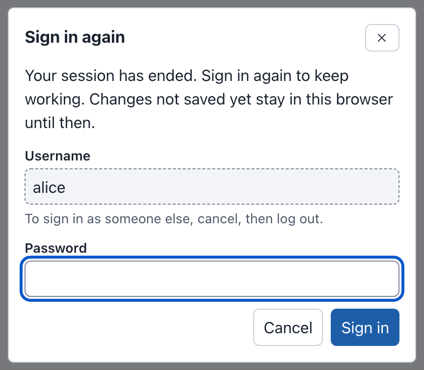

# Drafts

Every diagram in Builder is a draft. A draft is on the phenix server, apart
from the phenix configs, and Builder saves each change to it as you make it.
Only **Publish** writes configs from a draft (see [Publishing](publishing.md)).

## The drafts page

Select **Builder** in the phenix navigation bar. The drafts page opens.


The buttons at the top right are:

- **Blank diagram**: starts a new, empty draft.
- **Import**: starts a draft from a Topology or Experiment config (see
  [Import](#import)).
- **Upload**: starts a draft from a diagram you have: a Builder document,
  or a legacy Builder diagram (see [Upload](#upload)).
- **Commands**: opens the command palette (<kbd>⌘</kbd>+<kbd>K</kbd> on
  macOS, <kbd>Ctrl</kbd>+<kbd>K</kbd> on Windows and Linux). See
  [Command palette](editor.md#command-palette).
- The theme, **Settings**, **Help** and **Focus mode** buttons, as in the
  editor (see [Header](editor.md#header) and
  [Keyboard shortcuts](editor.md#keyboard-shortcuts)).

The tabs below the buttons list what you can open. Each tab shows how many
items it holds, for example **Drafts (3)**.

- **Drafts**: all the drafts on the server, whoever created them, the most
  recently changed first. The drafts that the server cannot read come last
  (see [Damaged drafts](#damaged-drafts)).
- **Published Diagrams**: the topologies that have a Builder diagram
  (see [Published diagrams](#published-diagrams)).
- **Node Templates**: the template library of the server, which all users
  share, the built-in templates and the server collections. Its count is the
  number of templates in the library (see
  [The template library](templates.md#the-template-library)).
- **Layers**: the layer set library of the server, which all users share,
  with the built-in set **Purdue Model**. Its count is the number of layer
  sets (see [The Layers tab](#the-layers-tab)).
- **Icons**: the icon library of the server, which all users share, and
  the built-in icons. Its count is the number of icons on the server (see
  [The Icons tab](diagrams.md#the-icons-tab)).

All Builder users see the same drafts, and each of them can open, change
and delete each draft (see [Permissions](administration.md#permissions)).
Each draft is a card with these lines:

- The draft's name.
- Who created the draft, for example "Created by e2e-admin".
- When the draft last changed, and who changed it, for example "Updated Sep
  29, 2026, 1:02 PM by alice".
- The buttons:
    - **Open**.
    - **Delete**.
    - **Publish**, when your role can change configs (see
      [Publishing from the drafts page](#publishing-from-the-drafts-page)).

Each card also has a checkbox at its top right. Use it to act on several drafts at once (see
[Selecting several drafts](#selecting-several-drafts)).

"Updated" on a card is the last activity on the draft: an edit, but also an
undo, a restore, a deleted snapshot or a publish. It is not the same as
**Last edited** in the Inspector, which says when the content you see was
saved, and by whom (see
[With nothing selected](editor.md#with-nothing-selected)). After an edit
the two agree. After an undo, for example, the card says when you undid,
and the Inspector says when the version you went back to was saved.

A role without the Builder permission, such as Global Viewer, has no
**Builder** link. At `/builder`, the page says only "Your role does not
include the Builder." (see
[What users without a permission see](administration.md#what-users-without-a-permission-see)).

## Creating a draft

### Blank diagram

Select **Blank diagram**. A new draft named "Untitled topology" opens in the
editor. When a draft of any user already has that name, the new one is
named "Untitled topology 2", and so on.

To rename it, for example to `Pump station`, select **Edit diagram name**
(the pencil after the name in the header), type the name and press
<kbd>Enter</kbd> (see [Renaming the diagram](editor.md#renaming-the-diagram)).
The drafts page then lists the draft under its new name.

### Import

**Import** makes a draft from a Topology or Experiment config, stored in
phenix or in a config file. The draft is named after the config, for
example riverside-water. For a topology, Import can also make the draft a
copy with a new topology name, or combine the topologies it includes into
one (see
[Making included devices editable](diagrams.md#making-included-devices-editable)).
See
[Importing a topology or experiment](import-upload-download.md#importing-a-topology-or-experiment).

### Upload

**Upload** makes a draft from a diagram you have: a Builder JSON or YAML file
that **Download** saved, pasted text, a published diagram, or a legacy
Builder diagram (**Legacy Builder diagram or Topology**, see
[Legacy Builder](legacy.md)). Uploading always makes a new draft. See
[Import, Upload and Download](import-upload-download.md).

### From a published diagram

Open a card on the **Published Diagrams** tab and select **Edit as a draft**
(see [Published diagrams](#published-diagrams)). Editing a Builder
topology on the **Configs** page does the same (see
[Editing a published topology](publishing.md#editing-a-published-topology)).
The draft starts as the published diagram, with no change. Until your first
change, the Inspector shows who made the diagram and who edited it last.

## Opening a draft

On the drafts page, select **Open** on the draft's card. The button says
**Opening…** until the diagram shows.

You can also open a draft from the command palette:

1. Select **Commands**.
2. Type `open draft` and press <kbd>Enter</kbd>. The palette lists the
   drafts and the published diagrams, each with its tab and who created it,
   for example "Metro Campus" with "Drafts · Created by e2e-admin".
3. Type part of the name, for example `metro`, and press <kbd>Enter</kbd>.

To go back to the list, select **Drafts** in the editor header. It
does not wait for Builder to send your changes. The button says **Saving…**
first only when this browser cannot keep your changes. It says **Loading…**
while the lists load, when they do not show the draft yet. Builder sends the
changes that wait in the background, and the draft's card shows the
progress. For example, the card of a draft you left while offline says
"Offline: 1 change kept on this device. Saving retries automatically.", and
then "All changes saved." when the server has the change.

### Links to a draft

A link to a draft has the form `<phenix address>/builder?draft=<draft id>`,
for example:

```text
https://phenix.example.com/builder?draft=968d2b25-04ec-489c-874c-2d53bfbfc8f1
```

The address bar shows this link while a draft is open, so a reload reopens
the same draft. Copy it from the address bar. The link opens the draft for
each Builder user. A link whose `draft` value is not a draft ID, such as one
with a `/`, opens no draft. Builder says "This link does not name a draft.
Open one from the lists instead."

## Publishing from the drafts page

**Publish** on a draft's card publishes the draft and does not open the
editor. It is on each draft when your role can change configs (`configs`
`update`).

1. On the Riverside Water card, select **Publish**. The button says
   **Loading…** while Builder loads the draft.
2. The **Publish Riverside Water** dialog opens over the drafts page. It is
   the editor's **Publish diagram** dialog, with the same choices and checks
   (see [Publishing](publishing.md)).
3. Choose what to publish, and select the dialog's publish button.

The dialog has one more button, **Open draft**, which opens the draft in the
editor. When the diagram has errors, the dialog lists them and says
"Open the draft to fix the errors. Then publish it." When the draft has changes
that the server does not have yet (while offline, for example), Builder does
not publish it, and the dialog adds "Open the draft to resolve it."

When you close the dialog, changes that wait continue to save in the
background, as after **Drafts**. Closing the dialog while it
publishes does not stop the publish.

## How drafts save

### Autosave and the save state

Builder saves every change to the draft on the server as you make it.
Each saved change is a snapshot in [Draft History](#draft-history). There is
no Save button. To send the changes immediately, press
<kbd>⌘</kbd>+<kbd>S</kbd> on macOS or <kbd>Ctrl</kbd>+<kbd>S</kbd> on
Windows and Linux (**Save now**). **Save now** also applies the Inspector
changes that you did not apply yet, when they are valid.

The save state, after **Draft History** at the end of the toolbar, says
where your changes are:

| Save state | What it means | What to do |
|---|---|---|
| All changes saved | The server has every change. | Nothing. |
| Saving changes, Saving 2 changes | Builder is sending changes. | Wait. |
| 2 unsaved changes | Changes wait to be sent. | Wait, or press **Save now**. |
| Offline: 1 change kept on this device. Saving retries automatically. | The server cannot be reached. The changes are kept in this browser. | Keep working. See [Working offline](#working-offline). |
| Offline: 2 changes not stored anywhere yet. Keep this tab open. Saving retries automatically. | The server cannot be reached, and the browser could not store the changes either. | Keep the tab open until the save state says All changes saved. |
| Offline: no unsaved changes | The server cannot be reached, and nothing is waiting. | Nothing. |
| 1 change not saved yet. Choose which changes to save. | Another tab of this browser also has changes to this draft. | See [One draft in several tabs](#one-draft-in-several-tabs). |
| Merging your changes with the server version… | Someone saved a newer version first, and Builder is merging it with your changes. Edits wait until it is done. | Wait. See [When the draft changed on the server](#when-the-draft-changed-on-the-server). |
| This draft changed on the server | Someone saved a newer version first, and some of your changes clash with theirs, or merging is not available. | See [When the draft changed on the server](#when-the-draft-changed-on-the-server). |
| Not saved: you chose another tab's changes | You chose to save another tab's changes. | Builder keeps this tab's changes as a new draft. |
| Could not save: this draft was deleted from the server. Select Download to keep a copy of the diagram. | Another user deleted the draft while you had it open. | Select **Download** to keep a copy (see [Downloading](import-upload-download.md#downloading)), then upload it to make a new draft. |
| You cannot save changes to this draft | Your role no longer includes the Builder. | Ask an administrator for the Builder permission (see [Permissions](administration.md#permissions)). Select **Download** to keep a copy. |
| Not saved: your session has ended. Sign in again to save your changes. | Your sign-in expired. | See [Signing in again](#signing-in-again). |
| Could not save your last change. … Fix the diagram and it saves again. | The server refused the diagram, for example because two devices have the same hostname. The message names the problem. | Fix it (see [Checks and warnings](editor.md#checks-and-warnings)). The next change saves the diagram. |
| Could not save your changes. … Saving retries automatically. | The server refused the save for another reason, which the message names. | Wait, or select **Retry saving**. |

**Retry saving** appears after the save state when the browser is offline,
or when a save failed for a reason that a new try can fix. It sends the
changes that wait immediately.

### Working offline

When the server cannot be reached, Builder keeps your changes in this
browser and sends them when the server answers again. You can continue to
edit.

For example, open the Riverside Water expansion draft, and suppose the
network between your browser and the server goes down:

1. Under **Templates**, select **Server**. A device named server
   appears. The save state says "Offline: 1 change kept on this device.
   Saving retries automatically.", and **Retry saving** appears.
2. When the server answers again, the save state says "All changes saved"
   within a few seconds. **Retry saving** sends the changes at once instead
   of waiting for the next try.

The save state in step 1:


The changes stay in this browser when you close the tab. The next time you
open the draft in this browser, Builder sends them. Logging out deletes the
changes that still wait (see [Logging out](#logging-out)).

Sometimes the connection drops after the server saved a change, but before
its answer reached the browser. The next time Builder reaches the server, it
finds that the change is saved. The server saves the change once, and
Builder merges nothing.

### One draft in several tabs

You can open a draft in more than one tab of the same browser. Each tab shows
a notice under the header:


When more than one tab holds changes that are not saved yet (after working
offline, for example), Builder can save the changes of only one tab to the
draft. The notice then says how many changes the other tab has, and
**Choose which to save** appears. Builder opens the **Choose which changes
to save** dialog:

1. Under **Version to save**, choose a version, for example "This tab: 1
   change, last at Sep 29, 2026, 1:01:26 PM" or "Another tab: 2 changes,
   last at Sep 29, 2026, 1:01:28 PM". **Download** next to this tab's version
   saves a copy of it as a file.
2. Select **Save this version**.

Builder saves the version you chose to the draft. It saves each other
version as a new draft, named after the diagram with " (local copy)", for
example "Riverside Water expansion (local copy)". The tab that held that
version changes to the new draft. **Decide later** closes the dialog.
Builder then sends nothing until you choose, and **Choose which to save**
opens the dialog again.

### When the draft changed on the server

Another person can save a newer version of the draft before your changes
reach the server. For example, two people edit the same draft at the same
time, or the other person edits it while you work
offline. Builder then merges their changes with yours, field by field.
While it merges, the save state says "Merging your changes with the server
version…", and edits wait until the merge is done:

- A change only one of you made is kept. Changes to different devices, or to
  different fields of one device, are both kept: if alice moves router-1 and
  you rename it, router-1 is moved and renamed.
- Devices, switches, connections and other items one of you added are kept.
  An item one of you deleted is deleted, unless the other changed it or
  connected it (added a connection to a device, switch or interface that the
  other deleted).
- An interface renamed by one of you is still the same interface, so the
  other's changes to it are kept on it.
- Scenarios that one of you added are added, and scenarios that one of you
  removed are removed.
- Your view of the canvas (its zoom and position) stays as it is.

When nothing clashes, Builder saves the merged diagram on top of the newer
version and announces "Merged alice's changes with yours." Changes from
another tab of yours are named "another tab's changes". Draft History
lists the save as "Merged changes from alice". Undo goes back to alice's
version, without your changes, and Redo brings the merged diagram back.

These changes clash:

- A field that you both changed to different values.
- An item that one of you deleted while the other changed or connected it.

Some clashes have special choices:

- A device's name, its hostname and the hostname in its settings are one
  choice. When one of them clashes, **Keep mine** or **Keep theirs** keeps
  all three as that version has them.
- An interface that you both renamed differently is one choice, for example
  "ws-01 interface eth0 name". The interface keeps the chosen name, and the
  diagram keeps one interface.
- The link of a linked template is one choice, for example "template PLC
  library link". The template keeps the whole link of the version that you
  choose (see [Linked templates](templates.md#linked-templates)).
- For a device or interface that one of you deleted and the other
  connected, the choices are, for example, **Keep theirs: delete ws-01 and
  drop your connection to it** and **Keep mine: keep ws-01 with your
  connection**. After Builder saves the merged diagram, it announces each
  connection it dropped, for example "Dropped the connection from ws-01 to
  EXP: the device or interface it connects was deleted."

When something clashes, or the merged diagram would have an error (two
devices with the same hostname, for example), a panel opens under the
header:

> **This draft changed on the server**
>
> alice saved a newer version of this draft, so your changes cannot
> replace it.
>
> Your 1 unsaved change is kept on this device. Choose how to keep your work.
> The Builder does not save the edits you make now until you choose.
>
> You and alice changed 1 field differently. Review and merge to choose
> which version to keep.

Choose one:

- **Review and merge**: opens the **Merge changes from alice** dialog (see
  below).
- **Save my history as a new draft**: saves your version as a new draft,
  named for example "Riverside Water (local copy)", and opens it.
  The draft that changed on the server stays as it is.
- **Discard mine and load the server version**: asks "Discard your unsaved
  changes?". Select **Discard and load the server version** to delete your
  changes and load the newer version. You cannot undo this.

The **Merge changes from alice** dialog lists each clash, for example
"ws-01 name", with **Keep mine** and **Keep theirs** and the value that each
keeps:

- Choose one for each clash, or select **Keep all mine** or **Keep all
  theirs**. The count, for example "1 of 2 chosen", says how many clashes
  have a choice.
- **Save merged** saves the merged diagram on top of the newer version,
  with every change that does not clash. If the merged diagram has an
  error, such as two devices with the same hostname, the dialog lists it
  and stays open.
- When nothing clashes and the dialog opens only for such an error, there is
  nothing to choose. The dialog lists the errors and says that **Cancel**
  lets you save your history as a new draft or discard it. **Save merged**
  is unavailable.
- If Builder already merges again with a newer version when you select
  **Save merged**, it saves nothing, and the dialog says "Another change
  arrived. The Builder starts the merge again."
- If the save fails, the dialog says why ("The merged diagram could not be
  saved: …") and keeps your choices, so you can select **Save merged**
  again.
- **Cancel** goes back to the panel.

For example, alice renames ws-01 of Riverside Water to ws-gis and describes
it as a GIS workstation, and saves first. You rename it ws-cad and describe
it as a CAD workstation. The dialog, with **Keep mine** chosen for the name:


Merging needs the version that your changes started from. The panel says
"Merging is not available" and offers only the other choices when one of
these occurs:

- The server no longer keeps that version (a draft keeps its last 50
  snapshots).
- Builder cannot read it.
- The server does not send it within 15 seconds.

If the merge itself fails, the panel says "Merging failed" with the reason,
and offers the same choices. If a third person saves while Builder saves the
merged diagram, Builder merges again with their version.

## Draft History

Each change saved to a draft is a snapshot. **Draft History** lists the
snapshots and restores an earlier one.

For example, in the Riverside Water draft:

1. Under **Templates**, select **Server**.
2. In the Inspector, set **Hostname** to `files-02` and select **Apply**.
3. Select **Draft History** in the toolbar.


The table lists the snapshots newest first, with these columns:

- **#**: the snapshot's number. 1 is the oldest, the draft as it was made.
- **Name**: what the change did, for example "Draft created", "Added device"
  and "Updated device files-02".
- **Date** and **User**: when the snapshot was saved, and who saved it. The
  Inspector shows them as **Last edited** while that snapshot is the current
  one. The exception is snapshot 1 of a draft made with **Edit as a draft**:
  its row says when you made the draft, and the Inspector says who last
  edited the diagram before that.
- The Restore and Delete buttons.

The draft's current snapshot is marked **Current**. You cannot restore or
delete it. Screen readers announce how many snapshots there are, for example
"3 snapshots, newest first."

### Restoring a snapshot

To go back to the draft as it was made:

1. Select the name **Draft created**, or its Restore button.
2. The dialog closes and the canvas shows the draft without files-02. The
   row of "Draft created" is now marked **Current**.

Riverside Water is now as you uploaded it, as the other pages expect.

Restoring does not delete the newer snapshots. They stay in **Draft
History**, and you can restore one of them the same way.

**Undo** and **Redo** in the toolbar also move the draft's current
snapshot, one change at a time (see [Undo and redo](diagrams.md#undo-and-redo)).

!!! warning
    A change made after you restore or undo removes every newer snapshot. In
    the example, adding a note after restoring "Draft created" removes
    "Added device" and "Updated device files-02", and the note becomes
    snapshot 2.

### Deleting a snapshot

1. Select the Delete button of the snapshot.
2. Builder asks "Delete snapshot?" and names it, for example "Draft
   created, Sep 29, 2026, 12:52:40 PM is removed from the draft history. You
   cannot undo this."
3. Select **Delete snapshot**.

**Undo** and **Redo** skip a deleted snapshot.

### Automatic snapshots

When you leave, publish or download a draft while the Inspector holds
changes that you did not apply, Builder applies and saves them for you.
Their snapshot is named for the node, for example "Saved unapplied changes to
Device web-01", and marked **Automatic**. A line under the table says
"Automatic: the Builder saved changes that you did not apply in the Inspector.
It saved them before you left, published or downloaded the diagram."

### Limits

A draft keeps at most 50 snapshots and 50 MiB of them. Past either limit,
Builder deletes the oldest snapshots. A published diagram
has no history: its **Draft History** says "A published diagram has no draft
history. Edit it as a draft to keep one." For a
[diagram read from a file](#diagrams-read-from-a-file) it says "A diagram
read from a Builder file has no draft history. Edit it as a draft to keep
one."

## Published diagrams

The **Published Diagrams** tab lists each topology that has a Builder
diagram, by topology name:

- A topology published from Builder, with when it was published, for
  example riverside-water with "Published Oct 10, 2026, 5:47 AM".
- A topology whose diagram is read from a file on the phenix server, with
  the tag **File** and where the file is (see
  [Diagrams read from a file](#diagrams-read-from-a-file)).


To see one:

1. Select the **Published Diagrams** tab.
2. Select **Open** on the riverside-water card. The diagram opens read only,
   with the notice "You are viewing the published diagram Riverside Water.
   Edit it as a draft to make changes."


To change it, select **Edit as a draft**. Builder makes a draft from the
published diagram and opens it. The next time any Builder user does this,
Builder opens a draft that published the diagram, or that was made from it,
whoever created that draft. It does not make another. A draft made this way
can publish to the topology again (see
[Publishing again](publishing.md#publishing-again)).

A published diagram keeps who made it and who edited it last, as the draft
had them at publish time. The Inspector shows them under **Details** (see
[With nothing selected](editor.md#with-nothing-selected)).

### Opening the experiment

When a diagram was published with an experiment (see
[Publishing a topology and an experiment](publishing.md#publishing-a-topology-and-an-experiment)),
its card on **Published Diagrams** has **Exp**. The editor's toolbar also
has **Exp**. Its tooltip names the experiment, for example
"Open experiment riverside-lab". **Exp** opens the experiment's page in the
same tab, and leaves the editor as any link out of Builder does. The
command palette has the same command, **Open experiment**.

**Exp** shows only while the experiment exists and your role has
`experiments` `get` on it. It follows a renamed experiment. There is no
**Exp** for an experiment made by hand from the topology, or for a topology
published without an experiment. When one publication made several
experiments, **Exp** opens one of them. The others are on the
**Experiments** page.

### Diagrams read from a file

A topology can name a Builder file on the phenix server as its diagram,
without a publish (an administrator sets this up, see
[Builder documents in files](administration.md#builder-documents-in-files)).
Its card on the **Published Diagrams** tab differs from a published
diagram's card:

- It has the tag **File**, and says where the file is, for example "Read
  from /phenix/topologies/pump-station/pump-station.builder.json".
- It has no **Delete**. Delete the topology on the **Configs** page instead.

**Open** reads the file and shows its diagram read only, with the notice
"You are viewing the diagram of topology pump-station, read from
/phenix/topologies/pump-station/pump-station.builder.json on the phenix
server. Edit it as a draft to make changes."

When the stored topology is not what the diagram in the file publishes (the
file or the topology changed), the notice adds: "It differs from topology
pump-station as stored. You can publish a draft made from it as a new
topology, not as an update of pump-station."

**Edit as a draft** makes a draft from the diagram in the file. The next
time, it opens the same draft again while the file holds the same diagram.
After the file changes, it makes a new draft from the new diagram. Such a
draft can update the topology (see
[Publishing to a topology that names a Builder file](publishing.md#publishing-to-a-topology-that-names-a-builder-file)).

When phenix cannot use the file, the diagram does not open, and the page
says why, for example "Could not open the diagram of topology pump-station.
Builder file /phenix/topologies/pump-station/pump-station.builder.json does
not exist on this phenix server." See
[When the file cannot be used](administration.md#when-the-file-cannot-be-used).
When the file changes between **Open** and **Edit as a draft**, no draft is
made: "Could not create the draft. The Builder file of topology pump-station
changed since it was opened. Open its diagram again."

### Deleting a published topology

**Delete** on a **Published Diagrams** card deletes the Topology config from
phenix. It needs `configs` `delete` on the topology. A card
with the tag **File** has no **Delete** (see
[Diagrams read from a file](#diagrams-read-from-a-file)).

1. Select the **Published Diagrams** tab.
2. Select **Delete** on the riverside-water card.
3. Builder asks "Delete topology riverside-water?" and says "The
   topology is deleted from phēnix. Drafts and experiments made from it are
   not changed."
4. Select **Delete topology**. The card is no longer on the tab.

A draft that published the topology, was imported from it, or was opened from
its published diagram creates the topology again the next time it publishes
to that name.

To delete several topologies at once, select their cards' checkboxes and
select **Delete selected** (see
[Selecting several drafts](#selecting-several-drafts)).

## The Layers tab

A layer set is a named list of layers, with the icon, the color and the
node matchers of each layer, and the options of the list (see
[Layers](diagrams.md#layers)). The phenix server keeps one layer set
library, which all of its users share and change. The **Layers** tab of the
drafts page lists it. On the drafts page, the command palette has **Show
Layers**. In a diagram, **Edit layers…** applies a copy of a set to the
diagram.

The tab holds:

- **New layer set**: opens the layers editor on a new set, which starts
  with the 7 placeholder layers.
- **Upload layer set…**: reads a layer set file into the library as a new
  set (see
  [Layer set files](import-upload-download.md#layer-set-files)).
- A card for each set. The card shows the icon and the name of the set, the
  tag **Default** on the default set, and the tag **Built-in** on a set
  that is part of phenix. It then shows the description, the number of
  layers, who changed the set last and when, for example "Changed by alice
  on Oct 15, 2026, 9:12 AM.", and each layer with its icon and color.

![The Layers tab: its description, New layer set, and Upload layer set… with the hint A YAML or JSON file of one layer set, as Download saves it. The card Purdue Model has the tag Built-in, its description, 7 layers. Read only., the layers L5 Enterprise to L0 Process, each with its icon and color, and View, Duplicate, Download and Set as default. The card Lakeside plant zones has the tag Default, its description, 7 layers, Changed by e2e-admin on Oct 10, 2026, 5:47 AM., the same layers, and Edit, Duplicate, Download, Clear default and Delete.](../images/builder/drafts-layers-tab.png)

Each card has these buttons:

- **Edit** opens the layers editor on the set, titled "Edit layer set" and
  the name. Change the **Name**, the **Description**, the **Icon**, the
  options and the layers, then select **Save**. The set gets its next
  version. **Cancel** asks first when you made changes: "Close without
  saving?", with **Close without saving** and **Keep editing**.
- **Duplicate** adds a copy of the set to the library, with a number after
  its name, for example "Added layer set Purdue Model (2), a copy of Purdue
  Model."
- **Download** saves the set as a layer set file (see
  [Layer set files](import-upload-download.md#layer-set-files)).
- **Set as default** makes the set the default set of the server: "New
  blank diagrams start with a copy of Purdue Model." On the default set, the
  button is **Clear default**: "New blank diagrams start with the
  placeholder layers."
- **Delete** asks first, for example "Delete layer set?": "Delete Plant
  layers from the server? Diagrams keep their copies of its layers. You
  cannot undo this." Select **Delete**.

The built-in set **Purdue Model** has the seven levels of the Purdue model,
from L0 Process to L5 Enterprise, each with an icon and a color. Its card
says "7 layers. Read only." It has **View** in place of **Edit**, and no
**Delete**. **View** opens the editor read only, with "This layer set is
part of phenix. You cannot change it. Select Duplicate on the Layers tab to
make a copy that you can change." and **Close**. To change it, duplicate it
and change the copy.

The server keeps one default set for all users. Each Builder user can
change it, and the change applies to all users. Each **Blank diagram**
starts with a copy of the default set, linked to the set. Without a default
set, a new diagram has the placeholder layers. In the template editor, a
library template offers the layers of the default set (see
[The template editor](templates.md#the-template-editor)).

When another user saved the set after you opened it, **Save** gives "Could
not save the layer set. Someone changed the layer set after it was read.
Read it again, and then make your change again." Close the editor, and open
the set again.

Until the first read is complete, the tab says "Loading…". When Builder
cannot read the library, the tab says "Could not load the layer sets." and
why, with **Retry**. When the server holds sets that it cannot read (for
example, because a newer version of phenix saved them), the tab says, for
example, "The server cannot read 1 layer set. A newer version of phenix may
have saved it." The tab lists the other sets.

Every Builder user can add, change and delete layer sets, apart from the
built-in set (see [The libraries](administration.md#the-libraries)). The
library holds at most 200 sets, apart from the built-in set.

## Deleting a draft

1. On the **Drafts** tab, select **Delete** on the draft's card, for
   example Metro Campus.
2. Builder asks "Delete draft Metro Campus, updated Sep 29, 2026, 12:52
   PM?" and says "The draft and its whole history are removed from the
   server. You cannot undo this."
3. Select **Delete draft**.

Deleting a draft does not change the configs it published. **Delete** is
on each draft, whoever created it. When another user has the draft open,
their next save fails with "Could not save: this draft was deleted from the
server." (see [Autosave and the save state](#autosave-and-the-save-state)).

## Selecting several drafts

On each tab of cards, you can act on several items at once. A card has a
checkbox when one of these actions can act on it:

- **Download selected** on **Drafts** and **Published Diagrams**.
- **Delete selected** on **Drafts**, and on **Published Diagrams** for the
  cards that you can delete.

Above the cards, a row holds:

- **Select all**, which selects every card that has a checkbox, or none. It
  shows a mixed state when only some cards are selected.
- How many cards are selected, for example "2 of 3 selected".
- The actions.

On **Published Diagrams**, a topology whose diagram is read from a file has
no checkbox. Each tab keeps its own selection.

### Selecting with the keyboard

The cards of a tab are one stop of the Tab key. Tab moves to the card you
were last on, and the keys below work there. A focused card has a focus
ring.

| Key | What it does |
|---|---|
| Arrow keys | Move to the next or previous card, also to the card above or below |
| Home, End | Move to the first or last card |
| Space | Select the focused card, or clear it |
| Shift+Space, Shift and an arrow key | Select the cards from the card you last selected or cleared to the focused card, also when you cleared that card |
| ⌘A (macOS), Ctrl+A | Select every card |
| Escape | Clear the selection |
| Delete (Backspace on macOS too) | Ask to delete the selected cards, where **Delete selected** can |

A checkbox pressed with Shift held makes the same range match it: checking
it selects the cards from the card you last selected or cleared to it, and
clearing it clears them. After **Select all**, ⌘A or Escape, a checkbox
pressed with Shift changes only its own card. Each change of the selection
is announced to screen readers, for example "3 of 12 selected."

### Downloading several drafts

1. Select the cards, for example of Metro Campus and Riverside Water
   expansion.
2. Select **Download selected**.

The tab in step 2:


Builder saves a Builder JSON file for each card, one after another, with the
custom icons it uses, as **Download** in the editor does. Each file holds
the draft as the server has it. Your browser may ask you to let the page
download several files. When every file is saved, Builder
says so, for example "Downloaded 2 drafts." On **Published Diagrams**, it
saves each published diagram ("Downloaded 2 diagrams."). A card whose draft
or diagram could not be saved, for example because it was deleted since
the list was read, is listed with the reason in a summary under the row,
as for **Delete selected**.

### Deleting several drafts

1. Select the checkboxes of the drafts, for example Metro Campus and
   Riverside Water expansion.
2. Select **Delete selected**. Builder asks once: "Delete 2 drafts?", names
   the drafts, and says "The drafts and their whole histories are removed
   from the server."
3. Select **Delete 2 drafts**.

On **Published Diagrams**, **Delete selected** deletes the topologies of the
selected cards: "Delete 2 topologies?", then **Delete 2 topologies**. Drafts
and experiments made from them are not changed.

While the drafts are deleted, the row says how far it is, for example
"Deleting 1 of 2…". When every item is deleted, Builder says so, for example
"Deleted 2 drafts." When Builder cannot delete some, a summary under the row
lists each with the reason, for example "1 of 2 drafts could not be deleted.
The other 1 was deleted." The items that failed stay selected. **Dismiss**
removes the summary.

When your session ends, or the server cannot be reached, while Builder
deletes or downloads several items, it stops and lists the rest as
"Not attempted." Each action uses your permissions for each item.

## Damaged drafts

A draft that this phenix server can no longer read (for example, because a
newer version of phenix saved it) stays on the list. Its card says "The
Builder cannot read this draft, so you cannot open it. A newer version of
phenix may have saved it." It has no **Open**, only **Delete**. Open it with
the phenix version that saved it, or delete it. Any Builder user can delete
a damaged draft.

## Signing in again and logging out

### Signing in again

When phenix has user sign-in, your session ends after some time (see
[Troubleshooting](administration.md#troubleshooting)). When it ends while
Builder is open, the **Sign in again** dialog opens: "Your session has
ended. Sign in again to keep working. Changes not saved yet stay in this
browser until then."

{ width="432" }

1. Enter your password in **Password**. **Username** shows your user name,
   and you cannot change it.
2. Select **Sign in**. Builder sends the changes that waited.

A wrong password shows "The password is incorrect." To sign in as someone
else, select **Cancel**, then log out.

**Cancel** keeps your changes in this browser. A notice then says "Your
session has ended. Changes not saved yet stay in this browser until you sign
in again." Select **Sign in again** in the notice to open the dialog again.

### Logging out

When you select **Logout** in the phenix navigation bar, Builder first
sends the changes that still wait. If it cannot send some (while offline,
for example), it shows a warning:

> **Log out with unsaved changes?**
>
> 1 change to Builder drafts has not reached the server. Logging out
> deletes it from this browser. Select Download to keep a copy.

- **Download**: saves each draft with unsent changes as a file.
- **Stay signed in**: closes the warning. Builder keeps sending.
- **Log out anyway**: logs out and deletes the unsent changes from this
  browser.

After a long time without activity, phenix logs you out automatically. The
warning then says "You will be logged out" and counts down, and its button
is **Log out now**.

Logging out, or signing in as another user in the same browser, deletes
these Builder data from the browser: unsent changes, recent commands, the
last Auto-group name pattern and the Preflight checks you last ticked. Your
preferences stay: the theme, column widths, minimap size, keyboard shortcuts
and settings (see [Storage](administration.md#storage)).
