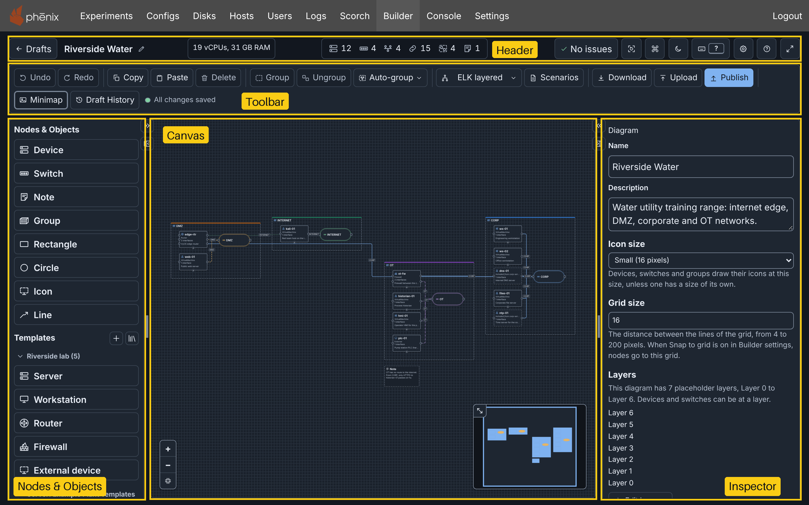
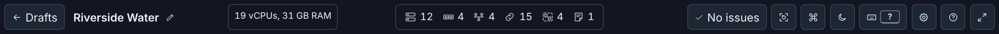
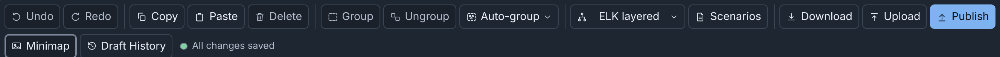
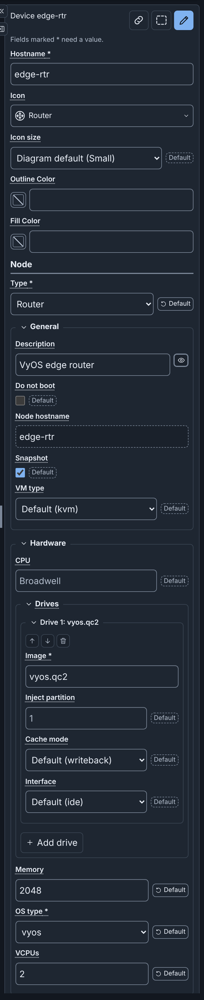
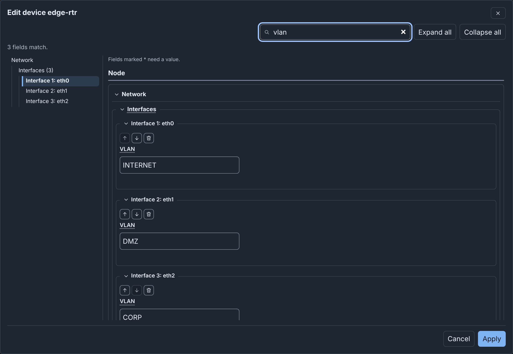
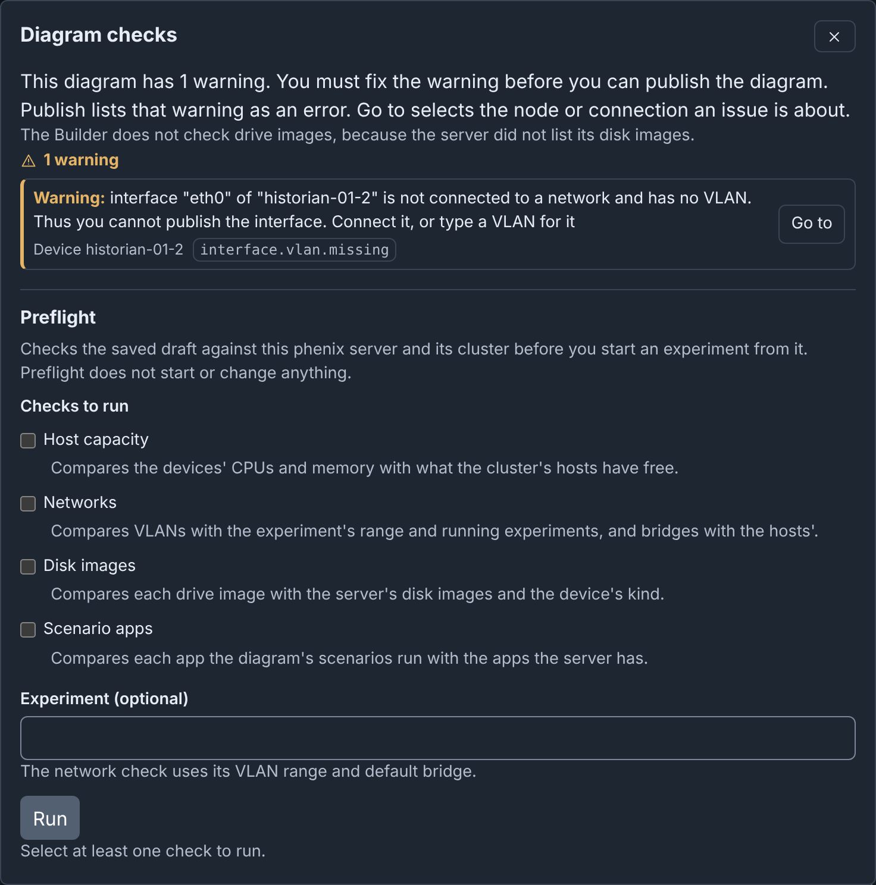
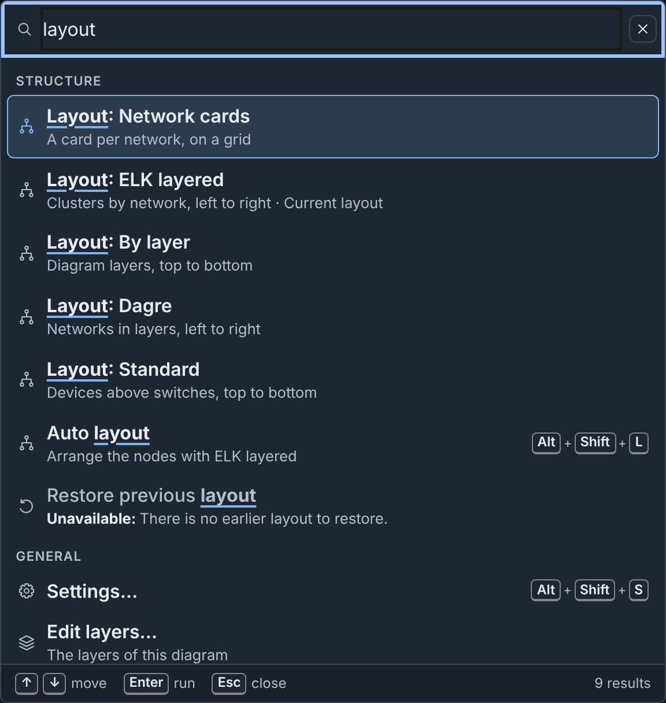
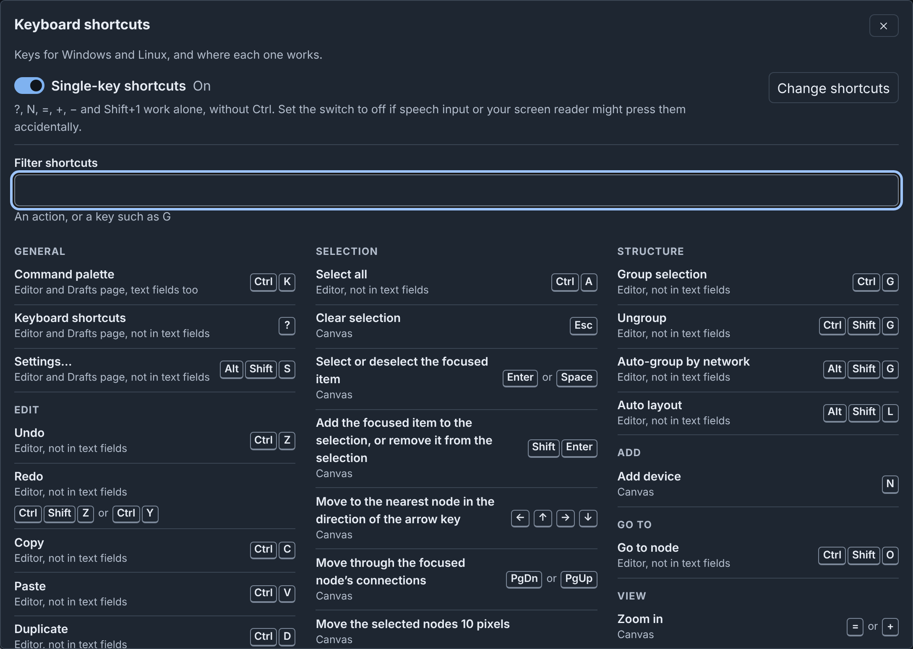
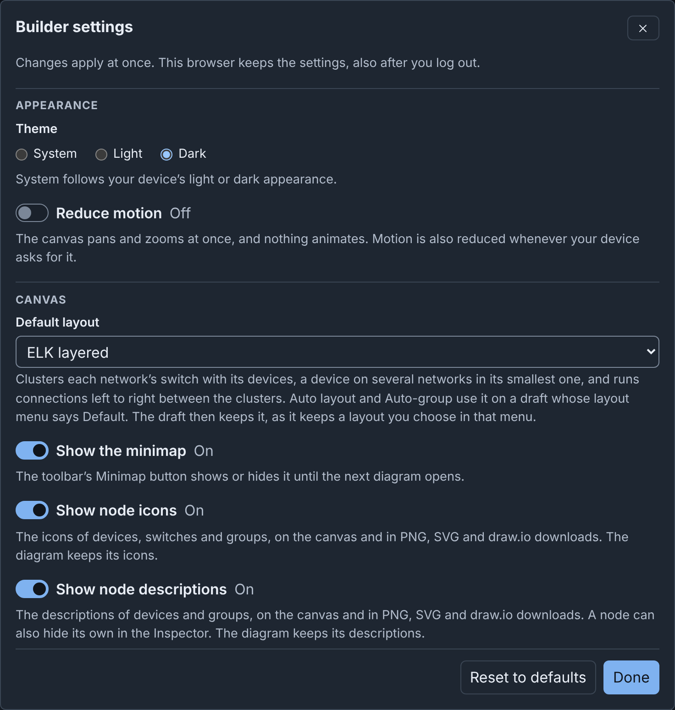

# The Editor

The editor is where you draw and change a diagram. Builder saves each change
and checks the diagram as you work. The editor has five areas: the header,
the toolbar, `Nodes & Objects` on the left, the canvas, and the Inspector on
the right.

## Header

The header has `Drafts` (back to the drafts page), the diagram name, the
vCPU and memory [totals](details/editor.md#resource-totals) of the devices
that phēnix starts, and a count of each kind of item. Click a count to
[select everything of that kind](details/editor.md#selecting-by-kind). Then
come the checks button and the view buttons.

To rename the diagram:

1. Click `Edit diagram name` (the pencil). A field replaces the name.
2. Type the new name.
3. Press <kbd>Enter</kbd>.

The diagram name isn't the topology name. You pick that when you
[publish](publishing.md).

## Toolbar

Most toolbar buttons do what their names say. `Ungroup` removes a selected
group but keeps its nodes, and `Auto-group` groups nodes by network or by
name. `Upload` opens a diagram file as a new draft. `Exp` opens the
experiment you published, while it exists, and `Draft History` restores an
earlier snapshot of the draft.

The save state comes last, for example `All changes saved`. If a save fails,
`Retry saving` shows up next to it (see [Drafts](drafts.md)).

## Canvas

- Click a node or a connection to select it. <kbd>Shift</kbd>+click adds a
  node to the selection or removes it. Click an empty spot to clear the
  selection.
- Drag a node to move it, or drag an empty spot to pan.
- Zoom with the mouse wheel or the zoom buttons at the bottom left.
- To connect a device to a switch, drag from the device's connection point
  to the switch (see [Diagrams](diagrams.md)).

Hover over a device or a switch to see its
[info tooltip](details/editor.md#info-tooltips). `Reset view` in the header
resets the zoom, the minimap and the side columns, and doesn't change the
diagram (see [Canvas](details/editor.md#canvas)).

## Side Columns

Click an item in `Nodes & Objects` (`Device`, `Switch`, `Note`, `Group` or a
drawing) to add it, or drag it onto the canvas. `Templates` lists the device
templates (see [Templates and Icons](templates.md)). You can widen, hide or
resize this column and the Inspector (see
[Side Columns](details/editor.md#side-columns)).

## Inspector

The Inspector shows the fields of the selected node or connection. With
nothing or several items selected, it shows the diagram's own fields, such as
`Name`, `Description`, `Layers`, `Notes` and `Scenarios` (see
[With Nothing Selected](details/editor.md#with-nothing-selected)).

### Editing a Node

{ width="352" }

Select a node to see its fields. A field marked \* is required, and a field
that isn't at its default has a `Default` button.

To change fields:

1. Change one or more fields. A bar at the bottom says `Unapplied changes`,
   with `Apply` and `Cancel`.
2. Click `Apply`, or press <kbd>Enter</kbd> in a field. Builder changes the
   diagram and saves it.

If you select another node without applying, the Inspector applies the
valid changes and drops the rest. `Icon`, the colors and `Layer` take effect
right away, without `Apply` (see
[Fields That Take Effect at Once](details/editor.md#fields-that-take-effect-at-once)).
`Custom icon…`, at the end of the `Icon` list, opens the `Custom icons`
dialog (see [Templates and Icons](templates.md)).

You can move a device from an included topology, but you can't change it,
and nothing in a published diagram can change (see
[Fields You Cannot Change](details/editor.md#fields-you-cannot-change)).
Other kinds of nodes have
[their own fields](details/editor.md#other-kinds-of-nodes). A switch's
`Assign addresses` fills in the addresses of its network (see
[Addresses of a Network](details/editor.md#addresses-of-a-network)).

## Node Editor

The Node Editor shows the fields of one node in a large dialog, along with
the node's checks. To open it, double-click the node, or click
`Open Node Editor` in the Inspector header.

`Search fields` finds a field by its label, such as `memory`, or by its YAML
path in the Topology config, such as `network.interfaces[0].vlan` (see
[Searching the Fields](details/editor.md#searching-the-fields)). Empty the
box to see all the fields again.

`Apply` applies all your changes as one `Undo` step and closes the Node
Editor. If you cancel with unapplied changes, Builder asks before it throws
them away.

## Checks and Warnings

Builder checks the diagram as you edit it. Each node and connection with an
issue gets a mark on the canvas: a cross for an error, or a triangle for
warnings only.

To fix an issue:

1. Click the checks button. The `Diagram checks` dialog lists the errors,
   then the warnings.
2. Click `Go to` beside the issue. The canvas selects its node, and the
   Inspector shows it.
3. Fix the field.

You can't publish until you fix the errors. Some warnings also block
`Publish`, and the dialog says so (see
[What Blocks Publishing](details/publishing.md#what-blocks-publishing)).
Some issues have a `Fix` button, and `Undo` reverts each fix (see
[Fixing an Issue in One Step](details/checks.md#fixing-an-issue-in-one-step)).

Builder also warns about settings that phēnix accepts but doesn't apply the
way the diagram shows them (see
[Rulesets and Addresses](details/checks.md#rulesets-and-addresses) and
[Device Settings](details/checks.md#device-settings)).

## Preflight

`Preflight`, at the bottom of `Diagram checks`, asks the phēnix server to
check the saved draft against the server and its cluster. Its four checks
(`Host capacity`, `Networks`, `Disk images` and `Scenario apps`) write
nothing and start no VMs or experiments.

To run Preflight:

1. Click the checks button in the header.
2. Under `Preflight`, tick the checks.
3. Optional: in `Experiment (optional)`, enter the name of the experiment.
4. Click `Run`. Builder saves your latest changes first.

Each check shows `Passed`, `Failed` or `Unavailable`. `Unavailable` means
Builder couldn't do all of the check, for example because it couldn't
connect to minimega (see [Preflight](details/checks.md#preflight)).

## Command Palette

The command palette runs commands and finds things. To open it, click
`Commands` in the header, or press <kbd>Ctrl</kbd>+<kbd>K</kbd>
(<kbd>⌘</kbd>+<kbd>K</kbd> on macOS).

- Type words to find commands, for example `layout`.
- Type `@` to find a node by its hostname, address, VLAN, label or
  description (see
  [Finding Nodes](details/palette-and-shortcuts.md#finding-nodes)).
- Type `#` to find a network by its name or VLAN alias.
- Type `t:`, `c:` or `i:` for node templates, template collections or custom
  icons, and `?` to see all the prefixes.

## Keyboard Shortcuts

To see all the shortcuts, click `Shortcuts` in the header, or press
<kbd>?</kbd> outside a text field. The ones you'll use most are
<kbd>Ctrl</kbd>+<kbd>Z</kbd> (`Undo`), <kbd>Ctrl</kbd>+<kbd>D</kbd>
(`Duplicate`), <kbd>Delete</kbd> and <kbd>N</kbd> (add a device). On macOS,
use <kbd>⌘</kbd> in place of <kbd>Ctrl</kbd>. The full list is in the
[Reference](reference.md#keyboard-shortcuts), and `Change shortcuts` in the
sheet gives any command other keys (see
[Customizing Shortcuts](details/palette-and-shortcuts.md#customizing-shortcuts)).

## Settings

To open `Builder settings`, click `Settings` in the header, or press
<kbd>Alt</kbd>+<kbd>Shift</kbd>+<kbd>S</kbd>
(<kbd>⌥</kbd>+<kbd>⇧</kbd>+<kbd>S</kbd> on macOS). Changes apply right
away. The settings belong to your browser, not to the diagram, and stay
after you log out. For each setting and its default, see
[Settings](details/editor.md#settings).

## Advanced

- <kbd>?</kbd>, <kbd>N</kbd> and the zoom keys work without <kbd>Ctrl</kbd>
  until you turn off `Single-key shortcuts` (see
  [Single-Key Shortcuts](details/palette-and-shortcuts.md#single-key-shortcuts)).
- `Clean up…`, in `Builder settings`, deletes the published, unchanged
  drafts of all users and the stored data that nothing uses (see
  [Administration](administration.md)).
- `Edit layers…`, in the Inspector, the Node Editor, `Builder settings` and
  the command palette, opens the
  [layers editor](details/editor.md#layers-editor) for the open diagram.
- Focus mode hides the phēnix navigation bar, so Builder fills the window.
  Click `Focus mode` in the header, or press
  <kbd>Ctrl</kbd>+<kbd>Shift</kbd>+<kbd>F</kbd>
  (<kbd>⇧</kbd>+<kbd>⌘</kbd>+<kbd>F</kbd> on macOS).
- The theme button cycles through `System`, `Light` and `Dark`. It changes
  only Builder (see [Themes](details/editor.md#themes)).
- You can use Builder with only a keyboard, or with a screen reader (see
  [Accessibility](../accessibility.md#builder)).

## See Also

- [The Editor: Details](details/editor.md): rules and limits of each part.
- [Checks and Preflight: Details](details/checks.md): each warning, fix and
  preflight check.
- [Command Palette and Shortcuts: Details](details/palette-and-shortcuts.md):
  search prefixes and custom shortcuts.
- [Diagrams](diagrams.md): add, connect, group and lay out nodes.
