# The Editor

In the editor, you draw and change a diagram. To open it, see
[Opening a draft](drafts.md#opening-a-draft). For tasks
such as adding and connecting devices, see [Building a Diagram](diagrams.md).
The examples use the Riverside Water draft of the
[example lab](index.md#the-example-lab).

The editor has five areas:

1. The [header](#header): the diagram name, the counts, the checks and the
   view buttons.
2. The [toolbar](#toolbar): the editing, layout, download and publish
   buttons, and the save state.
3. **Nodes & Templates**, the left column, with
   [Nodes & Objects](#nodes-objects).
4. The [canvas](#canvas).
5. The [Inspector](#inspector), which changes the selection.

## Header

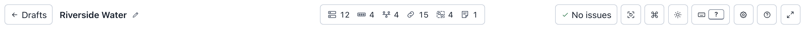

From left to right, the header holds:

- **Drafts**: opens the drafts page. Your changes continue to save.
- The diagram name. Point at a long name to see all of it.
- **Edit diagram name** (the pencil), except in a published diagram (see
  [Renaming the diagram](#renaming-the-diagram)).
- The [resource totals](#resource-totals).
- The counts of devices, switches, networks, connections, groups and notes,
  and of layers while a device or a switch is at a layer (see
  [Selecting by kind](#selecting-by-kind)).
- The checks button, which opens **Diagram checks** (see
  [Checks and warnings](#checks-and-warnings)).
- **Reset view** (see [Canvas](#canvas)).
- **Commands**: opens the [command palette](#command-palette).
- The theme button (see [Themes](#themes)).
- **Shortcuts**: opens the [keyboard shortcuts](#keyboard-shortcuts) sheet.
  The button shows the key that opens the sheet, if there is one.
- **Settings**: opens [Builder settings](#settings).
- **Help**: opens this documentation in a new tab.
- **Focus mode** (see [Focus mode](#focus-mode)).

In a narrow window, the buttons after the checks button show only their
icons. **Shortcuts** keeps its key.

### Selecting by kind

Select a count to replace the selection with all items of that kind. Focus
stays on the count. For example, **12 devices** selects the 12 devices, and
Builder announces "Selected 12 devices."

- The networks count selects the switches of the networks, because the
  canvas shows each network as its switch.
- The connections count selects only connections.
- The layers count includes the placeholder layers. It selects each device
  and switch that is at a layer: the layer chosen for the node, or the layer
  that its fields match (see [Layers](diagrams.md#layers)).
- A count of 0 selects nothing.

To select the nodes of one layer, use **Select nodes on layer** in the
[command palette](#command-palette). To select the devices on one network,
or the devices that use one disk image, use **Select devices on network** or
**Select devices using image**.

The counts are one <kbd>Tab</kbd> stop. The arrow keys, <kbd>Home</kbd> and
<kbd>End</kbd> move between them.

### Resource totals

The totals add the vCPUs and the memory of each device that phenix starts,
as a VM or as a container. An external device does not count. A device from
an included topology counts, because the experiment starts it too. A device
with no **vCPUs** or **Memory**, or with a value that is not a whole number
above 0, counts as 1 vCPU and 512 MB, as phenix starts it. Memory shows in MB
below 1 GB, else in GB (1 GB is 1024 MB).

When the selection holds devices, the totals of the selection show below,
for example "Selected: 2 vCPUs, 1 GB RAM". A device in a selected group
counts one time. The totals do not show when the diagram has no device that
phenix starts. In a narrow window, the vCPUs and the memory show on two
lines, and the totals of the selection do not show.

To compare the totals with the free resources of the cluster, run the
**Host capacity** check of [Preflight](#preflight).

### Renaming the diagram

1. Select **Edit diagram name**. A field replaces the name, with the name
   selected.
2. Type the new name.
3. Press <kbd>Enter</kbd>, or move focus out of the field.

<kbd>Esc</kbd> keeps the old name. **Undo** restores the old name. The
**Name** field of the [Inspector](#with-nothing-selected) changes the same
name. The topology name is different: you choose it when you publish (see
[Publishing](publishing.md)).

## Toolbar

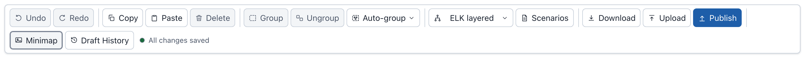

| Button | Function | More |
|---|---|---|
| **Undo**, **Redo** | Undo or redo the last change. After an undo, a notice says how many newer snapshots your next change removes. | [Undo and redo](diagrams.md#undo-and-redo), [Newer snapshots](drafts.md#newer-snapshots) |
| **Copy**, **Paste** | Copy the selection, or paste a copy of it. | [Copy, paste, duplicate and delete](diagrams.md#copy-paste-duplicate-and-delete) |
| **Delete** | Delete the selected nodes and connections. | [Copy, paste, duplicate and delete](diagrams.md#copy-paste-duplicate-and-delete) |
| **Group**, **Ungroup** | Put the selected nodes in a new group, or remove a selected group and keep its nodes. | [Groups](diagrams.md#groups) |
| **Auto-group** | A menu: **By network**, **By name** or **By name pattern…**. | [Auto-group](diagrams.md#auto-group) |
| Layout menu | Arrange the diagram. The menu shows the layout of the draft, or **Default** when no layout ran. | [Layouts](diagrams.md#layouts) |
| **Scenarios** | Choose, view, edit or create the scenarios of the diagram, or store a scenario file on the server. | [Scenarios](diagrams.md#scenarios) |
| **Download** | Save the diagram as a file. | [Downloading](import-upload-download.md#downloading) |
| **Upload** | Open a Builder document, a published diagram or a legacy Builder diagram as a new draft. | [Import, Upload and Download](import-upload-download.md) |
| **Publish** | Write Topology and Experiment configs, and add the topology to the scenarios of the diagram. | [Publishing](publishing.md) |
| **Exp** | Open the experiment that you published the diagram with. It shows only while that experiment exists and your role can read it. | [Opening the experiment](drafts.md#opening-the-experiment) |
| **Minimap** | Show or hide the minimap. | [Canvas](#canvas) |
| **Draft History** | List the snapshots of the draft, and restore one. | [Draft History](drafts.md#draft-history) |

The save state follows, for example "All changes saved". When a save fails,
**Retry saving** follows it (see [How drafts save](drafts.md#how-drafts-save)).

A button that does not apply is unavailable, for example **Ungroup** while
the selection holds no group. In a published diagram, the editing buttons are
unavailable.

The tooltip of a button shows its keys. The keys in the tooltips of the
layout menu and **Auto-group** run **Auto layout** and **Auto-group by
network** without the menu.

### Actions that take time

A button whose action can take time, such as **Publish**, shows a turning
ring while the action runs. The button keeps its name, its size and focus. A
second press does nothing. A dialog also says what it does, for example
"Preparing PNG…". With reduced motion, the ring does not turn.

## Canvas

- **Select**: click a node or a connection. Shift-click adds a node to the
  selection, or removes it. Click an empty spot to clear the selection.
- **Move**: drag a node. A drag of a group moves its nodes. With **Snap to
  grid** on in [Settings](#settings), nodes go to the grid of the diagram (see
  **Grid size** in [With nothing selected](#with-nothing-selected)).
- **Move with keys**: Shift and an arrow key move the selected nodes 10
  pixels, without the grid. Builder saves the move as one undo step when you
  release the key or focus leaves the canvas (see
  [Arranging by hand](diagrams.md#arranging-by-hand)).
- **Pan**: drag an empty spot.
- **Zoom**: use the mouse wheel, or **Zoom in**, **Zoom out** and **Fit
  diagram to view** at the bottom left. After a fit, the third button is
  **Restore previous view**.
- **Connect**: drag from the connection point of a device to a switch (see
  [Connecting interfaces](diagrams.md#connecting-interfaces)).
- **Edit**: double-click a node to open the [Node Editor](#node-editor). A
  double-click on a line adds a bend.

A press is a click, not a drag, while the pointer stays within 4 screen
pixels at any zoom, or 8 pixels with a finger or a pen. A click selects the
node and does not move it. When Builder cannot accept a move, for example
while a save conflict is open, the nodes return to their old positions.

A device shows its icon, hostname, **Type**, number of interfaces and
description. An external device shows External, and a device with no type
shows Device. A device from an included topology has a dashed border, and
shows its source in place of its type (see
[Included topologies](diagrams.md#included-topologies)). A node with an issue
has a mark at its top left corner (see
[Checks and warnings](#checks-and-warnings)).

A switch shows its icon and the name of its network. Its outline has the
color of its network connections, unless the switch has its own outline color
or the color of its layer. An icon has the color of the outline of its node.
A device with no outline color shows its icon in the accent color of the
theme (see [Colors](diagrams.md#colors)).

The minimap at the bottom right shows the full diagram. To resize it, drag
**Resize minimap** at its top left corner. **Minimap** in the toolbar shows
or hides it until the next diagram opens.

With **Show coordinates** on in Settings, rulers show X and Y in canvas
pixels, and a band shows the extent of the selected nodes. For a node in a
group, **Position** starts at the top left corner of the group, so it does
not agree with the rulers. PNG and SVG downloads do not show the rulers.

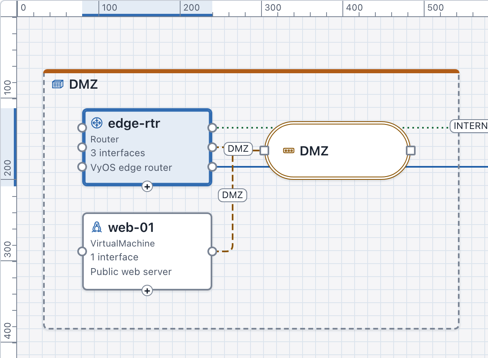{ width="600" }

To hide the connections on your canvas only, see
[Hiding connections](diagrams.md#hiding-connections). For the canvas keys,
see [Keys on the canvas](#keys-on-the-canvas).

**Reset view** in the header does not change the diagram. It does these
steps:

- It resets the zoom to **Zoom when a diagram opens** in
  [Settings](#settings): 100%, the full diagram, or your custom percentage.
- It shows the minimap at its default size, unless Settings turn it off.
- It shows both side columns at their default widths.
- It closes the sections that you opened, such as **More settings**, and
  expands the sections that you collapsed (see
  [Collapsing sections](#collapsing-sections)).
- It scrolls the columns to the top.

### Info tooltips

Rest the pointer on a device or a switch, or move focus to it, to see its info
tooltip:

| Node | Rows of the tooltip |
|---|---|
| Device | **Description**, cut to 80 characters. **Interfaces**: each interface with its address, for example "eth0 — 10.10.20.101/24", or "DHCP". **OS type**. |
| Switch | **Network**: the name of the network. **VLAN alias**, or "no alias". **Description**, cut to 80 characters. **Connected devices**, with their number: each device on this switch, with the address of its interface. |

A list shows its first 8 entries, then "+N more". An empty row says "None",
and a device with no OS type says "Not set".

The tooltip stays while the pointer is on the node or the tooltip, and while
the node has focus. While a node has focus, the pointer on another node shows
the tooltip of that node. <kbd>Esc</kbd> closes the tooltip until focus
moves, and keeps the selection. Screen readers read the same facts as the
description of the node. Notes, groups, drawings and connections have no
tooltip, and PNG and SVG downloads do not show it.

## Side columns

**Nodes & Templates** is the left column, and the **Inspector** is the right
column. Each column has two toggles:

- **Widen Nodes & Templates** and **Widen Inspector** make the column as wide
  as possible. Select the toggle again to restore the width.
- **Hide Nodes & Templates** and **Hide Inspector** fold the column into a
  narrow strip. The strip holds the toggle that shows the column.

To set a width, drag the splitter (**Resize Nodes & Templates**, **Resize
Inspector**). Double-click it to restore the default width. A selection on
the canvas shows a hidden Inspector. The browser keeps the widths and the
hidden columns.

In a window narrower than about 900 pixels, or at a high browser zoom, the
columns stack, and the page scrolls.

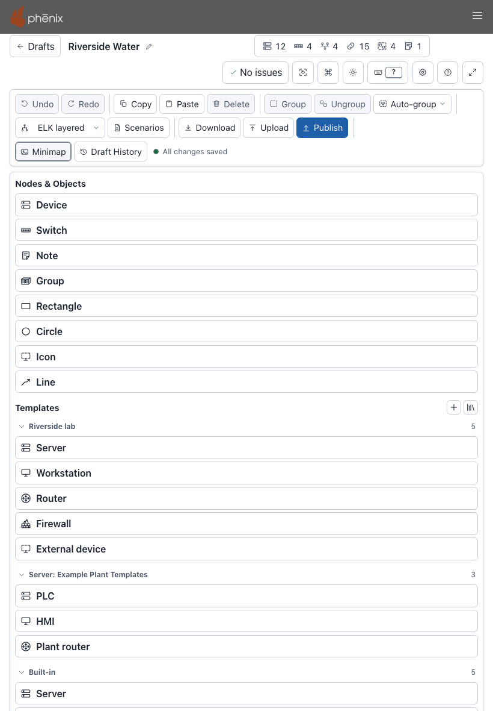

## Nodes & Objects

**Nodes & Objects** lists **Device**, **Switch**, **Note**, **Group**, and the
drawings **Rectangle**, **Circle**, **Icon** and **Line** (see
[Shapes, icons and lines](diagrams.md#shapes-icons-and-lines)). Under
**Templates**, it lists the device templates in sections. Select an item to
add it, or drag it onto the canvas. Builder puts the new node in free space
and selects it. Point at an item to see its description. See
[Adding devices](diagrams.md#adding-devices).

For the template sections, the template buttons and the updates of linked
templates, see [Templates in the editor](templates.md#templates-in-the-editor)
and [Linked templates](templates.md#linked-templates).

To find a node, use **Go to node** in the command palette (type **@**). To
find a network, use **Go to network** (type **#**). To rename a node, select
it and press <kbd>F2</kbd>: focus goes to its name in the Inspector.
**Remove network** in the command palette removes a network and its
switches, also a network that no switch shows (see
[Adding switches and networks](diagrams.md#adding-switches-and-networks)).

## Inspector

The **Inspector** shows and changes the fields of one selected node or
connection. With nothing selected, or with several items selected, it shows
the diagram.

A text box for more than one line, such as **Description**, grows with its
text to eight lines, then scrolls. To make it taller, drag its bottom right
corner.

### The Inspector header

When you select one node, the header names it, for example "Device
edge-rtr". It has three buttons:

- **Add connection**: opens **Add a connection**, which connects a device to
  a switch without a drag (see
  [Add a connection without dragging](diagrams.md#add-a-connection-without-dragging)).
  It shows for a device or a switch, but not for a device from an included
  topology.
- **Move to group**: opens **Move to a group**, which puts the node in a
  group, or removes it from its group (see [Groups](diagrams.md#groups)).
- **Open Node Editor** (the pencil): opens the [Node Editor](#node-editor).

Each dialog starts from the selection. The tooltip of each button shows its
name and keys. **Add connection** and **Move to group** have no keys until
you set some (see [Customizing shortcuts](#customizing-shortcuts)). A
published diagram shows only **Open Node Editor**.

### Collapsing sections

A group of fields (such as **General** or **Hardware**), a list (such as
**Interfaces** or **Drives**) and each list entry (such as "Interface 1:
eth0") can collapse. Select its name to collapse or expand it. A collapsed
entry keeps its buttons to move, insert and remove it.

- A collapsed part that holds a field with an error shows a cross after its
  name. Screen readers read "has errors".
- A collapsed section expands when you go to one of its fields, or when
  **Apply** or **Save now** stops because of an error in it.
- The sections stay collapsed for the next node until you leave the page. The
  Inspector, the Node Editor and the template editor each keep their own
  collapsed sections.
- **Reset view** expands all sections and entries.
- A search in the Node Editor expands the sections with a match until the
  search ends (see [Searching the fields](#searching-the-fields)).

Point at the label of a field to see its help. For a field of the phenix spec,
the help starts with its topology YAML path, for example `hardware.vcpus`.

### With nothing selected

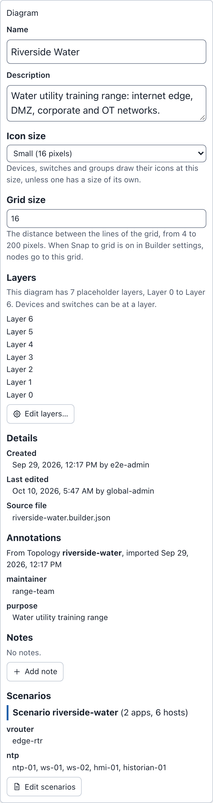{ width="352" }

The **Diagram** section has these fields. A published diagram shows them as
text.

- **Name** and **Description**. Select **Apply** to keep a change.
- **Template updates**: shows only when a linked template of the diagram
  needs attention. It has **Update**, **Update all** or **Unlink**, but no
  buttons in a published diagram (see
  [Linked templates](templates.md#linked-templates)).
- **Icon size**: **Small**, **Medium** or **Large** (see
  [Icon size](diagrams.md#icon-size)). While your **Node icon size** setting
  is not **Off**, a note says that the setting overrides this size on your
  canvas. The diagram keeps its size.
- **Grid size**: the spacing of the canvas grid in pixels, 16 by default.
  Type a whole number from 4 to 200, then press <kbd>Enter</kbd> or leave the
  field. Other values show an error and change nothing. Nodes go to the grid
  only while **Snap to grid** is on in [Settings](#settings).
- **Layers**: the list of layers, or a note that the diagram has the 7
  placeholder layers (see [Layers](diagrams.md#layers)). For layers from a
  layer set, a line names the set and its version. When the set has a newer
  version, **Update from layer set** copies it into the diagram. **Edit
  layers…** opens the [layers editor](#layers-editor). A published diagram
  shows neither button.
- **Details**, read only. A row shows only when the diagram has its value:
    - **Created**: the time and the user that made the diagram.
    - **Last edited**: when the server saved the content that you see, and
      by whom. After **Undo** or **Restore**, it shows the save of the
      earlier version.
    - **Source file**: the file of an **Upload**, or the config file of an
      **Import**.

    See
    [Who made and last saved a diagram](import-upload-download.md#who-made-and-last-saved-a-diagram).
- **Annotations**: for a draft imported from a config, the annotations of
  that config. You cannot change them, and publishing does not write them
  (see [What an import keeps](import-upload-download.md#what-an-import-keeps)).
- **Notes**: text about the full diagram, one box for each note. **Add
  note** adds a box. Builder saves a note when you leave its box. To remove a
  note, empty its box, or select its **Delete** button. Builder JSON and YAML
  keep the notes, but publishing writes them to no config.
- **Scenarios**: "No scenarios." and **Add scenario**, or a sub-heading for
  each scenario, for example "Scenario riverside-water (2 apps, 6 hosts)".
  **Edit scenarios** opens the **Scenarios** dialog (see
  [Scenarios](diagrams.md#scenarios)).

A diagram holds at most 100 notes of at most 4096 bytes each, in UTF-8. At
100 notes, **Add note** is unavailable. Builder does not save a note that is
too long, or that holds a control character other than a line break or a
tab. It shows an error under the box.

The app count of a scenario includes the disabled apps, and a host counts one
time. A scenario with disabled apps adds their number, for example "1
disabled app". Under the sub-heading, each app shows its hosts. An app with
no hosts shows "(no hosts)", and a disabled app shows "(disabled)". To read
the apps, Builder needs `configs` `get` on the scenario. Without it, the
Inspector says that it cannot read them.

### Editing a node

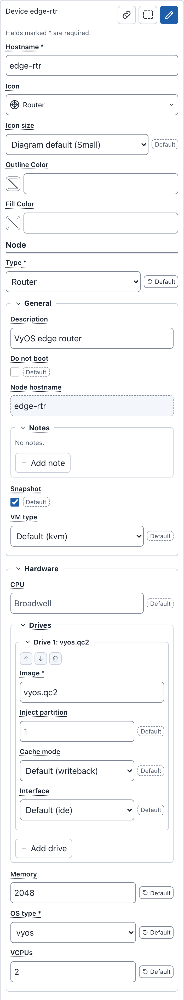{ width="352" }

Select a node to see its fields. A device has these sections:

- **Hostname**, **Icon**, **Icon size**, **Outline Color** and **Fill
  Color** (see [The Icon field](#the-icon-field),
  [Colors](diagrams.md#colors) and [Icon size](diagrams.md#icon-size)).
  While your **Node icon size** setting is not **Off**, **Icon size** has a
  note that the setting overrides it on your canvas.
- **Node**: the fields of the phenix spec of the node. These are **Type**,
  and **General** (**Description**, **Do not boot**, **Node hostname**,
  **Snapshot**, **VM type**).
- **Hardware**: **CPU**, **Drives** (**Image** and more for each drive),
  **Memory**, **OS type** and **VCPUs**.
- **Network**: **Interfaces**, **OSPF**, **Routes** and **Firewall
  rulesets**.
- **More settings**, a bar that you select to open: **miniccc commands**,
  **Delay**, **Injections**, **Advanced settings**, **Labels** and
  **Annotations**.
- **Layer**: the layer of the device (see [Layers](diagrams.md#layers)). A
  device with no chosen layer can be at the layer that its fields match.
  **Use matched layer** removes the chosen layer. **Edit layers…** opens the
  [layers editor](#layers-editor).
- **Connection points**: the interfaces of the device, each with a
  connection point on the canvas.
- **Position**: **X** and **Y**, and **Move**.

A field marked \* must have a value. An empty optional field shows the value that
phenix uses, for example "Default (kvm)" for **VM type**. A field that holds
a value other than its default shows a **Default** button. **Default**
empties an optional field, or gives a required field its default value.
Select **Apply** to keep the change.

Some fields do not accept all values:

- A list of choices with a value that is not a choice, as in an uploaded
  topology, shows that value with "(not one of the choices)" and a warning.
- A number field shows an error for text that is not a number. A field for a
  whole number also shows an error for a number such as 1.5 or 1e3.
- **Memory** and **VCPUs** can hold template text, such as `{{ .Memory }}`,
  until you type a number.

To change fields:

1. Change one or more fields. A bar at the bottom shows "Unapplied changes",
   with **Apply** and **Cancel**.
2. Select **Apply**, or press <kbd>Enter</kbd> in a field. Builder changes
   the diagram and saves it.

**Cancel** discards the changes. While a changed field has an error,
**Apply** is unavailable. When the diagram changes while you edit, the
Inspector keeps your unapplied changes.

When you select another node, the Inspector applies valid changes and
discards changes that are not valid. Builder also saves unapplied changes
when you leave, publish or download the draft (see
[Automatic snapshots](drafts.md#automatic-snapshots)).

These changes take effect at once, without **Apply**:

- The fields in
  [Fields that take effect at once](#fields-that-take-effect-at-once).
- **Layer**.
- **Show description on the canvas** (see
  [Hiding descriptions on the canvas](#hiding-descriptions-on-the-canvas)).
- An addition, disconnection or removal of a connection point.

The fields come from the phenix server. When the server cannot send them,
the Inspector says so, and shows the fields built into Builder. These may
differ from what this server accepts (see
[Permissions](administration.md#permissions)).

### Other kinds of nodes

- A switch is one network. Its Inspector ("Network CORP") has **Name**,
  **VLAN alias**, **Subnet**, **Gateway**, **Description**, **Edge Color**,
  **Line style**, **Outline Color**, **Fill Color**, **Icon size**,
  **Layer**, **Addresses** and **Position** (see
  [Adding switches and networks](diagrams.md#adding-switches-and-networks)
  and [Addresses of a network](#addresses-of-a-network)). **Layer** takes
  effect at once, as on a device.
- A note has **Text**, **Color** and **Position** (see
  [Notes](diagrams.md#notes)).
- A group has **Title**, **Description**, **Color**, **Border pattern**,
  **Icon**, **Icon size** and **Position** (see [Groups](diagrams.md#groups)).
- A connection has **Label** (by default, the name of the network),
  **Color** and **Line style**. Its Inspector names it, for example
  "Connection from ntp-01 (eth0) to CORP".
- A rectangle or a circle has **Shape**, **Label**, **Fill Color**,
  **Outline Color**, **Border pattern**, **Width** and **Height**.
- An icon has **Icon**, **Label**, **Width** and **Height**.
- A line has **Label**, **Color**, **Line style**, **Arrowhead at the
  start**, **Arrowhead at the end** and **Points**, with **X** and **Y** for
  each point (see [Shapes, icons and lines](diagrams.md#shapes-icons-and-lines)).

### Addresses of a network

The Inspector of a switch has these fields for the addresses of its network.
Publishing does not write them to the topology.

- **Subnet**: the IPv4 network, for example `10.10.20.0/24`.
- **Gateway**: the IPv4 address of the router on the network. It must be in
  the subnet.

**Assign addresses**, under **Addresses**, gives each static interface on the
network that has no address the next free address of the subnet. The change
is one step of **Undo**, for example "Assigned 3 addresses on network CORP".
The button uses the applied **Subnet**. When the network has no subnet, the
button is unavailable. **Assign addresses** in the command palette does the
same for a network that you choose.

For how Builder gives addresses and gateways, and what it announces, see
[Subnets and addresses](diagrams.md#subnets-and-addresses).

### Fields that take effect at once

These fields change how a node or a connection looks:

| Where | Fields that take effect at once |
|---|---|
| Device | **Icon**, **Icon size**, **Outline Color**, **Fill Color** |
| Switch | **Edge Color**, **Line style**, **Outline Color**, **Fill Color**, **Icon size** |
| Group | **Color**, **Border pattern**, **Icon**, **Icon size** |
| Note | **Color** |
| Rectangle or circle | **Fill Color**, **Outline Color**, **Border pattern** |
| Icon | **Icon** |
| Line | **Label**, **Color**, **Line style** |
| Connection | **Label**, **Color**, **Line style** |

Each change is one step of **Undo**, for example "Changed the fill color of
Device web-01 to #2f6fbf". A text field, such as **Label**, takes effect when
you press <kbd>Enter</kbd> or move focus out of the field. Before that,
<kbd>Esc</kbd> restores the text that the field had. In the template editor,
these fields change the template at once, and **Save** saves the template.

### Hiding descriptions on the canvas

A device and a group show their **Description** on the canvas. To hide it
for one node, select the eye button (**Show description on the canvas**)
beside **Description**. The button is on while the canvas shows the
description. The change takes effect at once, and is one step of **Undo**,
for example "Hid the description of Device web-01 on the canvas". The
template editor and the Node Editor have the same button. The diagram keeps
the choice.

The node keeps its description, and the info tooltip still shows it. PNG,
SVG and draw.io downloads do not show it. **Publish** and the checks do not
change.

To hide the descriptions of all nodes on your canvas, disable **Show node
descriptions** in [Settings](#settings), or choose **Hide node descriptions**
in the command palette. While the setting is off, each **Description** field
says "Your canvas shows no descriptions, because your Show node
descriptions setting is off."

### The Icon field

**Icon** shows the icon of the node and its name. To change the icon:

1. Select **Icon**, or move focus to it and press <kbd>↓</kbd>. The list of
   built-in icons opens, with focus on the icon in use.
2. Select an icon. To go to an icon, type its first letter.

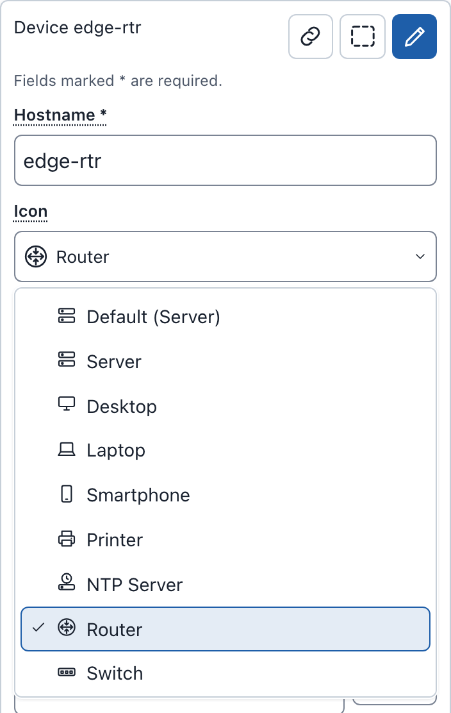{ width="352" }

**Default**, at the start of the list, is the icon of the node when it has no
icon of its own. An icon drawing has no **Default**. At the end of the list,
**Custom icon…** opens the **Custom icons** dialog (see
[Custom icons](diagrams.md#custom-icons)). In a published diagram, the list
does not open.

### Fields you cannot change

- A device from an included topology is read only, and the Inspector says
  so. You can still move it. **Combine into a new draft** makes a copy of the
  diagram in which the included devices are its own (see
  [Making included devices editable](diagrams.md#making-included-devices-editable)).
- You cannot rename a network that an included device is on. Its other
  fields can change.
- All fields are read only in a published diagram (see
  [Published diagrams](drafts.md#published-diagrams)).

### Node Editor

The **Node Editor** shows the fields of one node in a large dialog, in
columns. To open it, do one of these steps:

- Select the node, then select **Open Node Editor** in the Inspector
  header.
- Double-click the node on the canvas.
- Select the node, or move focus to it on the canvas. Then press
  <kbd>⌥</kbd>+<kbd>⇧</kbd>+<kbd>E</kbd> on macOS, or
  <kbd>Alt</kbd>+<kbd>Shift</kbd>+<kbd>E</kbd> on Windows and Linux.
- In the command palette, select **Open Node Editor**. With no single node
  selected, the palette asks for a device or a switch.

The Node Editor has the fields that the Inspector shows, and the checks of
the node. **Edit layers…** opens the [layers editor](#layers-editor) over
the Node Editor, which keeps your changes. The first field has focus.

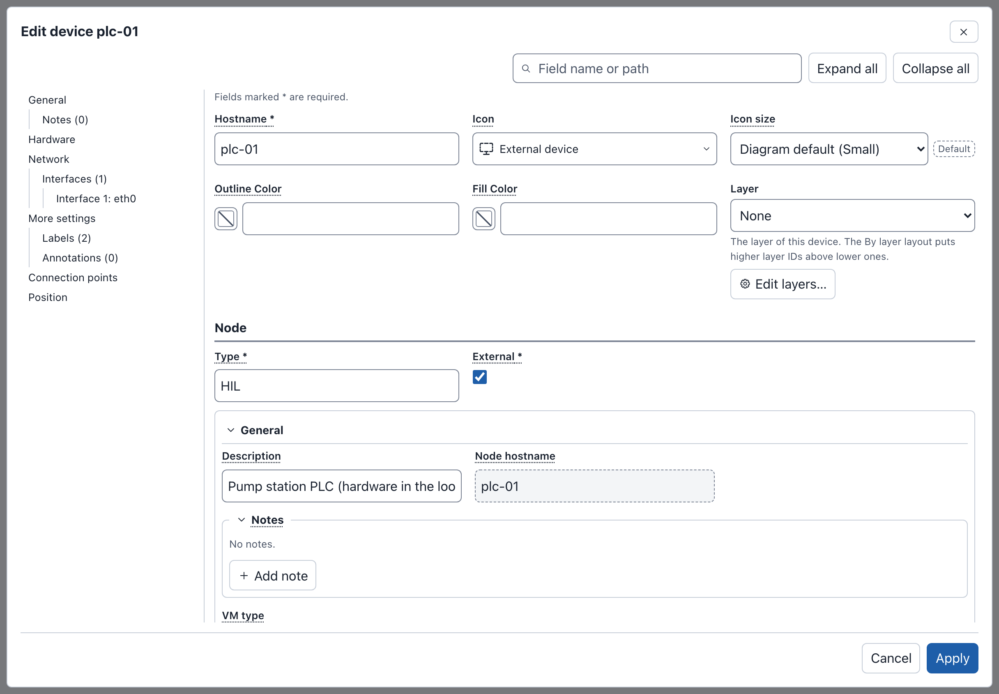

#### Sections and the table of contents

The Node Editor has these tools. **Expand all**, **Collapse all** and the
table of contents show only for a device.

- **Search fields** shows only the fields that match (see
  [Searching the fields](#searching-the-fields)).
- **Expand all** and **Collapse all** expand or collapse all sections and
  entries (see [Collapsing sections](#collapsing-sections)).
- The table of contents lists the sections, their lists and entries,
  **Connection points**, **Position**, and **Checks** when the node has
  issues. A list shows its number of entries. An entry with a field error
  shows a cross. Select an entry to expand it, scroll to it and move focus
  to it. The table of contents marks the entry in view. During a search, it
  lists only the parts that the search shows.
- In a window narrower than 900 pixels, select **Table of contents** to show
  it above the fields. A choice in it closes it again.

The section headers stay at the top while you scroll.

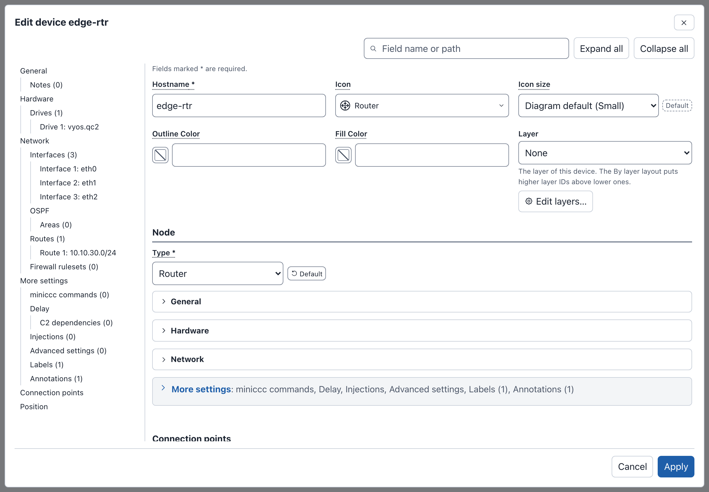

#### Searching the fields

**Search fields** finds a field by its label, such as `memory`, or by its path
in the topology YAML, such as `network.interfaces[0].vlan`. A part of a path
also matches, for example `interfaces.vlan`. The search ignores letter case
and field values. With two or more words, each word must match.

- Only the matching fields show, and their sections expand. A section, list
  or entry whose name matches shows all its fields.
- A line under the box counts the matches.
- To show all fields again, empty the box, or press <kbd>Esc</kbd> in it.
  When the box is empty, <kbd>Esc</kbd> closes the Node Editor.
- When **Apply** stops because of errors, the search empties. The sections
  stay expanded, so you can see the fields with errors.

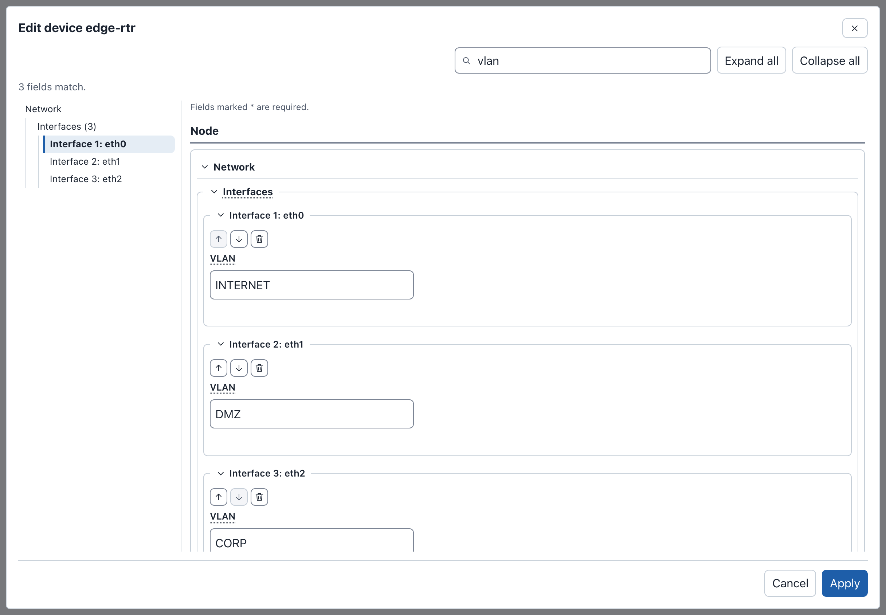

To edit a node in the Node Editor:

1. Change one or more fields.
2. Select **Apply**. Builder applies all changes as one step of **Undo**,
   closes the Node Editor and moves focus to the node on the canvas.

**Cancel**, <kbd>Esc</kbd> and **Close dialog** close the Node Editor. If you
did not apply your changes, Builder asks you to discard them or keep
editing.

The changes that take effect at once in the Inspector also do so here:
[Fields that take effect at once](#fields-that-take-effect-at-once),
**Layer**, **Connection points** and **Move**. **Cancel** does not discard
them. Use **Undo**.

Before the Node Editor opens, the Inspector applies its unapplied changes.
If one of them has an error, the Node Editor does not open. When you leave
or reload the draft, Builder applies and saves the unapplied changes of the
Node Editor.

In a published diagram, the Node Editor is read only and has only **Close**.
The fields of a device from an included topology are also read only.

## Checks and warnings

Builder checks the diagram while you edit it. The checks button in the header
shows the result: **No issues**, or a count such as **3 warnings**.

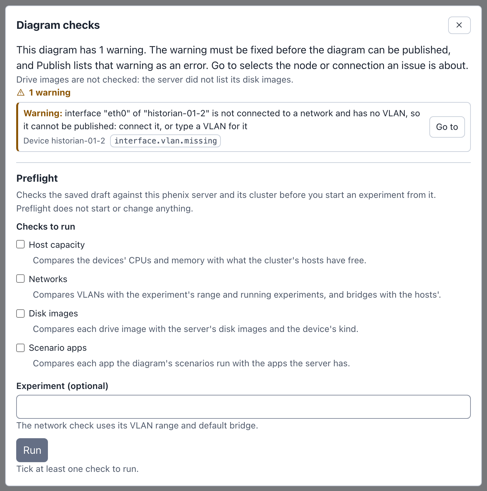

To fix an issue:

1. Select the checks button. The **Diagram checks** dialog lists the errors,
   then the warnings.
2. Select **Go to** beside the issue. The canvas selects its node, and the
   Inspector shows it.
3. Fix the field. In the Inspector, **Go to** beside an issue moves focus
   to its field.

Some issues also have **Fix** (see [Fixing an issue in one step](#fixing-an-issue-in-one-step)).

**Go to** shows a hidden Inspector and moves the view to the node. An issue
about a network goes to its switch. An issue that names no field moves focus
to its node or connection. An issue about the full diagram, or about a
network with no switch, has no **Go to**.

There are two levels:

- **Errors**, such as an empty required field. You cannot publish until you
  fix them.
- **Warnings**. Some warnings block **Publish**, which lists them as errors
  (see [What blocks publishing](publishing.md#what-blocks-publishing)). The
  dialog says so. Other warnings, such as a device with no interfaces, do not
  block publishing.

The canvas marks each node and connection with an issue: a cross for an
error, or a triangle for only warnings. Screen readers read the issues as the
description of the item.

Devices from included topologies get no warnings, because they belong to their
own topology. But a hostname that an included device also uses is an error,
and an address that it also uses is a warning.

When the server lists no disk images, the dialog says "The Builder does not
check drive images, because the server did not list its disk images." Otherwise, a drive image
that the server does not have is a warning.

### Rulesets and addresses

phenix accepts these settings, but they do not work as the diagram shows them.
None of these warnings blocks publishing. Publish and the Topology YAML
download also list them.

| Warning | Code | Go to opens |
| --- | --- | --- |
| A device that is not a Router or a Firewall has firewall rulesets, or an interface that names one. The `vrouter` app ignores them. | `device.rulesets.ignored` | The **Type** of the device |
| An **Inbound ruleset** or **Outbound ruleset** of an interface names no ruleset of its device. The `vrouter` app then applies no firewall to that interface. | `interface.ruleset.unknown` | The ruleset field |
| The address of an interface is not a host address of the subnet of its network. | `interface.ip.outside-subnet` | The **Address** |
| No interface on a network has the gateway address of the network. Interfaces of external devices and of included topologies count. | `network.gateway.unowned` | The **Gateway** of the network |
| The subnets of two networks overlap. | `network.subnet.overlap` | The **Subnet** of the network |

Overlapping subnets are a problem only when the networks connect, for example
through a router. Isolated enclaves that reuse a subnet on purpose can ignore
this warning.

### Device settings

phenix apps do not apply these device settings as the diagram shows them.
The Inspector shows the same warnings at
the field. Publish and the Topology YAML download also list them. Three of
them block publishing (see
[What blocks publishing](publishing.md#what-blocks-publishing)).

Devices from included topologies and external devices get none of these
warnings, but phenix reads the `ntp-server` label of an external device. A
device whose `phenix/default-apps` annotation is `false` gets no warning about
its OS type, interfaces, OSPF or `vrouter/enable-ssh`. phenix apps do not
configure that device. It still gets the warnings about no drive, file
injections, `phenix/startup-autotunnel` and the `ntp-server` label.

| Warning | Code | Go to opens |
| --- | --- | --- |
| A device has no drive under **Drives**. phenix needs a drive to start it. This blocks publishing. | `device.drives.none` | **Add drive** under **Drives** |
| A Router or Firewall has an OS type other than `vyatta`, `vyos` or `minirouter`. phenix does not configure its routing or firewall. phenix still configures `linux` as Vyatta, but this is deprecated. | `device.router-os.unsupported` | **OS type** |
| A device that is not a Router or Firewall has static interfaces. Its OS type is not `linux`, `rhel`, `centos` or `windows`, for example `other`. phenix writes no interface configuration for it. | `device.interfaces.unconfigured` | **OS type** |
| A device has serial interfaces, but its OS type is not exactly `linux`. phenix sets serial interfaces only on `linux`. | `device.serial.unconfigured` | **OS type** |
| A device has file injections or deletions, but **Snapshot** is off, or the **Inject partition** of its first drive is 0. phenix does not inject or delete its files. | `device.injections.unapplied` | **Snapshot**, or the **Inject partition** of the drive |
| A Vyatta or VyOS router (OS type `vyatta`, `vyos` or `linux`) has an interface with protocol `ospf`, but no `network.ospf`. The experiment does not start. This blocks publishing. | `device.ospf.missing` | The **Protocol** of the interface |
| An `ospf` interface of a minirouter has an address in no area network of its `network.ospf`, or the device has no `network.ospf`. The interface is in no OSPF area. | `interface.ospf.outside-area` | The **Address** of the interface |
| An area network of a minirouter holds the address of none of its `ospf` interfaces. minirouter does not advertise it. | `device.ospf-network.unused` | The area network |
| A minirouter has `network.ospf`, but no interface with protocol `ospf`. | `device.ospf.unused` | `network.ospf` |
| The `ntp-server` label names no interface of its device, or an interface with no IP address. The experiment does not start. This blocks publishing. | `device.ntp-server.invalid` | The value of the label |
| More than one device has the `ntp-server` label. phenix uses only the first device with it, in the order of the diagram. | `device.ntp-server.ignored` | The value of the label |
| The diagram has Vyatta or VyOS routers, and the `ntp-server` device has no interface on VLAN `mgmt`, in any case. The routers get no NTP server, unless an `ntp` app of the scenario names one. | `device.ntp-server.no-mgmt` | The value of the label |
| The `vrouter/enable-ssh` annotation of a Vyatta or VyOS router is not an IP address or the name of an interface with an IP address. phenix does not enable SSH. phenix reads this annotation on no other device. | `device.enable-ssh.invalid` | The value of the annotation |
| The `phenix/startup-autotunnel` annotation is not a list of `"port"`, `"port:dport"` or `"port:host:dport"` texts, with ports from 1 to 65535. A `dport` can also be `VNC`, in any case, and then the host can be empty. phenix skips each entry of another form. It opens no tunnel when an entry is not text or the value is not a list. | `device.autotunnel.invalid` | The value of the annotation |
| The `phenix/default-apps` annotation is not `true` or `false`, for example the text `"false"`. phenix runs its default apps. | `device.default-apps.invalid` | The value of the annotation |

phenix finds an interface by name in any case: `ETH0` names `eth0`. In the
Inspector, the values of the `ntp-server` label and the `vrouter/enable-ssh`
annotation suggest the interface names of the device.

### Fixing an issue in one step

Some issues have a **Fix** button, which says what it does, for example "Fix:
Rename web-01 to web-01-2". The dialog stays open, and focus moves to the
next issue. **Undo** reverts each fix as one step.

| Issue | Code | What Fix does |
| --- | --- | --- |
| Two devices have the same hostname | `node.hostname.duplicate` | Renames the device to the next free hostname, such as `web-01-2`. When the other device is from an included topology, Fix renames the device of this diagram. |
| Interfaces on one network use the same IP address | `interface.ip.shared` | Gives the interface the first free address of the subnet, as [Assign addresses](#addresses-of-a-network) does, with the same gateway rules. |
| Interfaces on one network use the same MAC address | `interface.mac.shared` | Clears the MAC address of the interface. phenix then makes one when the experiment starts. |

There is no **Fix** in these cases:

- The draft is read only.
- The device is from an included topology, which must fix it.
- For an IP address: the interface is on no network, its network has no
  subnet, or the subnet has no free address. Set a **Subnet** for the
  network, or type a new address in the Inspector.
- For a router interface with the gateway address: the router keeps the
  gateway. When several routers have the gateway, the first router keeps it.
  Fix gives each other router a free address.

### Preflight

The **Preflight** section of **Diagram checks** asks the phenix server to
check the saved draft against the server and its cluster. The checks write
nothing and start no VM or experiment. This browser keeps the checks that you
ticked last until you log out.

| Check | What it compares |
|---|---|
| **Host capacity** | The `hardware.vcpus` and `hardware.memory` of each device that is not external, against the free resources of the schedulable cluster hosts. Unset values count as 1 vCPU and 512 MB. Each device must fit on one host. A device that fits on no host fails the check. Too little free memory fails it. Too few free CPUs is a warning, because VMs can share CPUs. |
| **Networks** | The VLANs of the devices and the VLAN aliases of the networks, against the VLAN range of the experiment that you name. No range applies without an experiment, or when the experiment sets none. The aliases, against the VLANs of the running experiments that your role may list. The summary says when it left out experiments that your role may not list, but it does not name them. The bridges of the interfaces and the default bridge of the experiment (`phenix` without an experiment), against the bridges of the schedulable hosts. A missing bridge is a warning, because minimega creates it when the experiment starts. |
| **Disk images** | Each drive image, by file name, against the disk images of the server. The kind must agree: a VM or ISO image for a kvm device, a container image for a container. The server keeps its list of disk images for 10 seconds, so it may not find a new image yet. |
| **Scenario apps** | Each app that the scenarios of the diagram run, against the default apps, the built-in apps and the user apps on the `PATH` of the server. Disabled apps do not count. |

To run Preflight:

1. Select the checks button in the header.
2. Under **Preflight**, tick the checks.
3. Optional: in **Experiment (optional)**, type the name of the experiment.
4. Select **Run**. Builder first saves your latest changes.

The report gives a total, for example "Preflight: 3 passed, 1 unavailable".
Each check shows **Passed**, **Failed** or **Unavailable**, and a summary.
Each issue has its code. An issue about a device or a network has **Go to**.

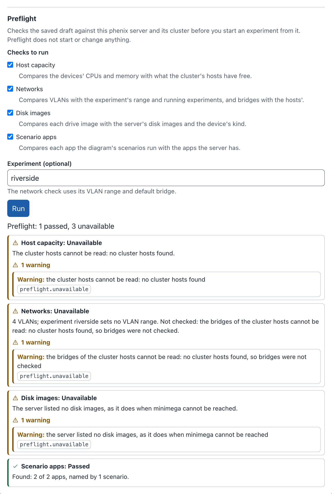

A check is **Unavailable** when Builder could not do all of it. An issue gives
one of these causes:

- Your role does not have the permission that the check needs (see
  [Administration](administration.md#what-each-task-needs)).
- Builder cannot connect to minimega.
- The server lists no disk images, or does not list them within 10 seconds.
- The check took longer than 20 seconds.

Builder still does the other checks. The report stays until the diagram
changes.

## Command palette

The command palette runs commands and finds nodes, networks, node templates,
template collections and custom icons.

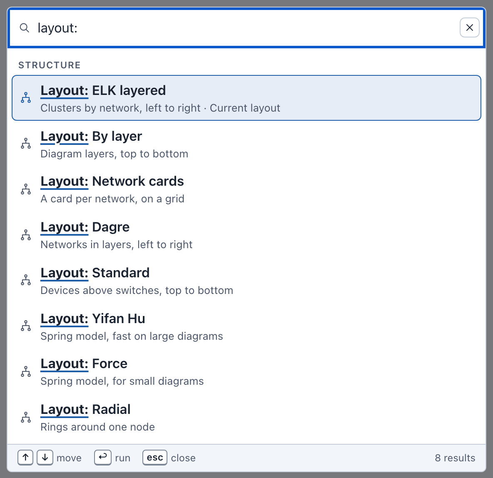

To open it, select **Commands** in the header, or press
<kbd>⌘</kbd>+<kbd>K</kbd> on macOS or <kbd>Ctrl</kbd>+<kbd>K</kbd> on Windows
and Linux. The keys also work in text fields. The palette also works on the
drafts page.

- Type words to find commands, for example `layout`.
- The first group holds commands for the selected items. When you open the
  palette, **Recent** shows your last commands.
- A command that does not apply says why, for example "Unavailable: There is
  no earlier layout to restore."
- Some commands also match another word. Type `export` to see all download
  formats: **Download Builder JSON**, **Download Builder YAML**, **Download
  Topology YAML**, **Download PNG**, **Download SVG**, **Download draw.io**
  and **Download Gephi (GEXF)**. Each opens the **Download diagram** dialog
  and starts that download (see
  [Downloading](import-upload-download.md#downloading)).
- A command marked **›** has a second step. For example, **Add device**
  then lists **Device** and each device template. In the empty field, press
  <kbd>⌫</kbd> (<kbd>Backspace</kbd>) to go back one step.
- Type `@` to find nodes (see [Finding nodes](#finding-nodes)). Type `#` to
  find networks by name or VLAN alias, and select a switch.
- Type `t:` to find [node templates](templates.md), `c:` to find template
  collections, and `i:` to find [custom icons](diagrams.md#custom-icons). Type
  `?` to see all prefixes. Without a prefix, the palette also shows up to
  three matching templates, collections and icons.

Press <kbd>↑</kbd> and <kbd>↓</kbd> to move, <kbd>Enter</kbd> to run, and
<kbd>Esc</kbd> to close. On a node, <kbd>Shift</kbd>+<kbd>Enter</kbd> adds it
to the selection.

Some useful commands:

| Command | Group | Function |
|---|---|---|
| **Open Node Editor** | Edit | Opens the [Node Editor](#node-editor) on the selected node. |
| **Edit layers…** | General | Opens the [layers editor](#layers-editor). On the drafts page, it shows the **Layers** tab. |
| **Set layer of selection** | Structure | Asks for a layer, or **No layer**, and puts each selected device and switch at it, as one step of **Undo**. A device with **No layer** goes to the layer that its fields match, if one matches. Nodes from included topologies keep their layers. |
| **Select nodes on layer** | Selection | Asks for a layer, and selects each node at it: the layer chosen for the node, or the layer that its fields match. |
| **Select devices on network** | Selection | Asks for a network, and selects each device with an interface on it. The interface connects to a switch of the network, or, with no connection, names the network in its VLAN. |
| **Select devices using image** | Selection | Asks for a disk image, and selects each device with a drive of that image. |
| **Assign addresses** | Structure | Asks for a network with a subnet, and assigns addresses on it (see [Addresses of a network](#addresses-of-a-network)). |
| **Add a connection…**, **Move to a group…** | Add, Structure | Opens the dialog of the [Inspector header](#the-inspector-header). |
| **Show or hide connections** | View | Hides or shows the connections on your canvas. This browser keeps your choice. |

### Finding templates, collections and icons

The palette finds templates, collections and icons by their names and by the
fields in this table. When a field matches and the name does not, the second
line shows the field, for example "Updated by: bob" or "In collection:
Pumps".

| Prefix | Finds | Fields |
|---|---|---|
| `t:` | Node templates | Description, icon, custom icon, layer, type, hostname, image, collection ("In collection"), "Created by", "Updated by" and the source. The layer is "Layer 3" and its label, or the layer that the fields of the template match in the open diagram. The source is "Library", "Server" or "Built-in". In the editor, the source is the section of the template in Nodes & Templates, for example "This diagram". |
| `c:` | Template collections | Description, the names of its templates ("Template"), "Created by", "Updated by" and the source: "Library collections" or "Server" |
| `i:` | Custom icons | Other names ("Also named"), size, "Created by", "Updated by" and the source: "Uploaded by" and the user, or "Server" |

"Created by" is the user who added the item. "Updated by" is the user who
last changed the name, the description or the content of a template or a
collection. For an icon, "Updated by" is the user who renamed it. A built-in
template and an item from a server collection have neither. An icon that the
server added has no "Created by", and has "Updated by" only after a user
renames it. An icon from before phenix kept these names shows its uploader as
"Created by", and has no "Updated by".

A template adds a device in the editor. On the drafts page, it opens in the
template editor. A collection opens on the **Node Templates** tab, and an
icon opens on the **Icons** tab. From the editor, a collection or an icon
first closes the editor.

### Finding nodes

Type `@` and some text to find nodes. The palette finds a node by its name,
and by these fields, in this order:

1. Hostname
2. IP address
3. MAC address
4. VLAN or network, with its VLAN alias
5. Annotation
6. Label
7. Description
8. Note
9. Image

Name matches come first, then field matches in the order of the fields. When
a field matches and the name does not, the second line starts with the
field. An address shows its interface, for example "eth0 IP address
10.10.30.20". A label or a note shows its kind, for example "label
role=historian". Type `?` to see the fields again.

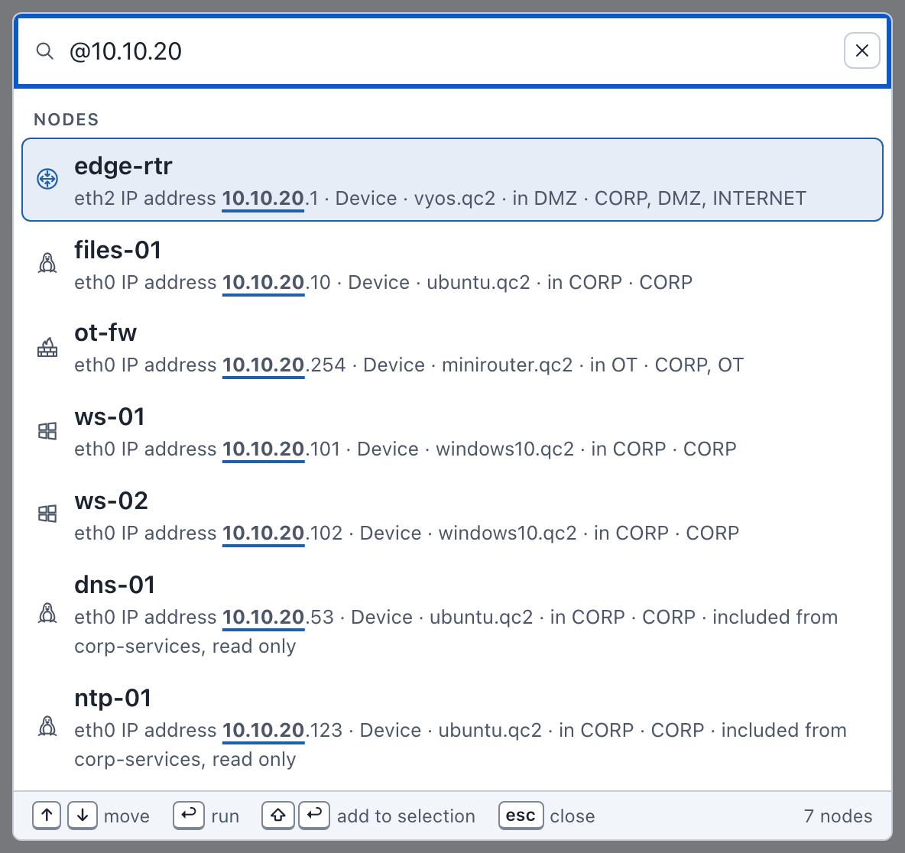{ width="592" }

To find the historian by name:

1. Press <kbd>⌘</kbd>+<kbd>K</kbd> (<kbd>Ctrl</kbd>+<kbd>K</kbd>).
2. Type `@hist`. The palette shows historian-01 and the note that names it.
3. Press <kbd>Enter</kbd>. The canvas selects historian-01, and the
   Inspector shows it.

When you go to a node while the zoom is below 60%, the canvas zooms to 100%,
or to your **Zoom when a diagram opens** percentage when it is larger. From
60% up, the zoom stays, and the canvas only moves the node into view. **Go to
network** and **Go to** in the checks do the same.

<kbd>⇧</kbd>+<kbd>⌘</kbd>+<kbd>O</kbd> (<kbd>Ctrl</kbd>+<kbd>Shift</kbd>+<kbd>O</kbd>)
opens the palette at **Go to node**, which lists all nodes.

## Keyboard shortcuts

To see all shortcuts, select **Shortcuts** in the header, or press
<kbd>?</kbd> outside a text field. The sheet shows the keys of your platform.
To find an action or a key such as `G`, type in **Filter shortcuts**.

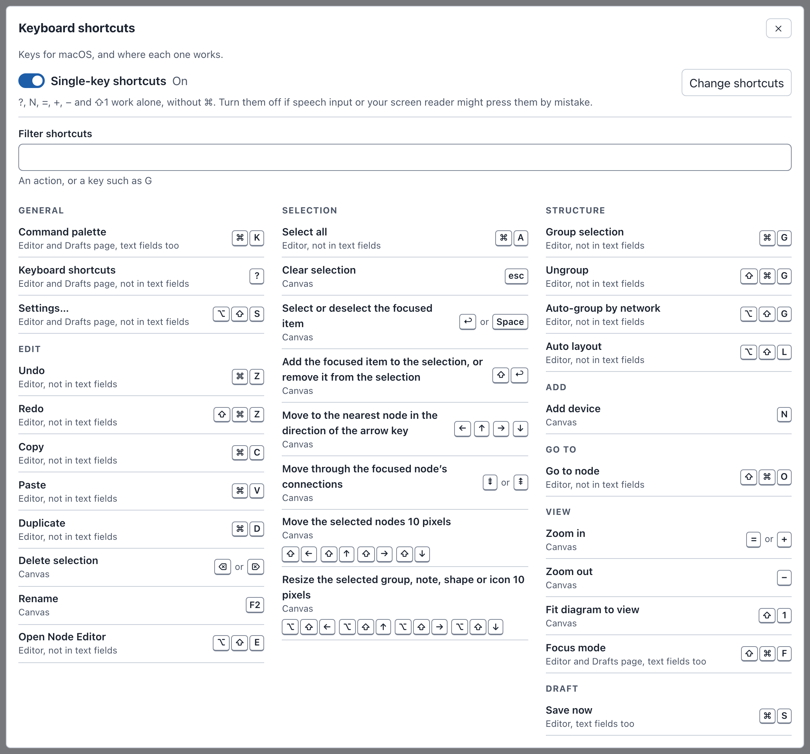

The default shortcuts:

| Action | Where it works | macOS | Windows and Linux |
|---|---|---|---|
| Command palette | Editor and Drafts page, text fields too | <kbd>⌘</kbd>+<kbd>K</kbd> | <kbd>Ctrl</kbd>+<kbd>K</kbd> |
| Keyboard shortcuts | Editor and Drafts page, not in text fields | <kbd>?</kbd> | <kbd>?</kbd> |
| Settings… | Editor and Drafts page, not in text fields | <kbd>⌥</kbd>+<kbd>⇧</kbd>+<kbd>S</kbd> | <kbd>Alt</kbd>+<kbd>Shift</kbd>+<kbd>S</kbd> |
| Undo | Editor, not in text fields | <kbd>⌘</kbd>+<kbd>Z</kbd> | <kbd>Ctrl</kbd>+<kbd>Z</kbd> |
| Redo | Editor, not in text fields | <kbd>⇧</kbd>+<kbd>⌘</kbd>+<kbd>Z</kbd> | <kbd>Ctrl</kbd>+<kbd>Shift</kbd>+<kbd>Z</kbd> or <kbd>Ctrl</kbd>+<kbd>Y</kbd> |
| Copy | Editor, not in text fields | <kbd>⌘</kbd>+<kbd>C</kbd> | <kbd>Ctrl</kbd>+<kbd>C</kbd> |
| Paste | Editor, not in text fields | <kbd>⌘</kbd>+<kbd>V</kbd> | <kbd>Ctrl</kbd>+<kbd>V</kbd> |
| Duplicate | Editor, not in text fields | <kbd>⌘</kbd>+<kbd>D</kbd> | <kbd>Ctrl</kbd>+<kbd>D</kbd> |
| Delete selection | Canvas | <kbd>⌫</kbd> or <kbd>⌦</kbd> | <kbd>Delete</kbd> or <kbd>Backspace</kbd> |
| Rename | Canvas | <kbd>F2</kbd> | <kbd>F2</kbd> |
| Open Node Editor | Editor, not in text fields | <kbd>⌥</kbd>+<kbd>⇧</kbd>+<kbd>E</kbd> | <kbd>Alt</kbd>+<kbd>Shift</kbd>+<kbd>E</kbd> |
| Select all | Editor, not in text fields | <kbd>⌘</kbd>+<kbd>A</kbd> | <kbd>Ctrl</kbd>+<kbd>A</kbd> |
| Clear selection | Canvas | <kbd>esc</kbd> | <kbd>Esc</kbd> |
| Select or deselect the focused item | Canvas | <kbd>↩</kbd> or <kbd>Space</kbd> | <kbd>Enter</kbd> or <kbd>Space</kbd> |
| Add the focused item to the selection, or remove it from the selection | Canvas | <kbd>⇧</kbd>+<kbd>↩</kbd> | <kbd>Shift</kbd>+<kbd>Enter</kbd> |
| Move to the nearest node in the direction of the arrow key | Canvas | <kbd>←</kbd> <kbd>↑</kbd> <kbd>→</kbd> <kbd>↓</kbd> | <kbd>←</kbd> <kbd>↑</kbd> <kbd>→</kbd> <kbd>↓</kbd> |
| Move through the connections of the focused node | Canvas | <kbd>⇟</kbd> or <kbd>⇞</kbd> | <kbd>PgDn</kbd> or <kbd>PgUp</kbd> |
| Move the selected nodes 10 pixels | Canvas | <kbd>⇧</kbd> with an arrow key | <kbd>Shift</kbd> with an arrow key |
| Resize the selected group, note, shape or icon 10 pixels | Canvas | <kbd>⌥</kbd>+<kbd>⇧</kbd> with an arrow key | <kbd>Alt</kbd>+<kbd>Shift</kbd> with an arrow key |
| Group selection | Editor, not in text fields | <kbd>⌘</kbd>+<kbd>G</kbd> | <kbd>Ctrl</kbd>+<kbd>G</kbd> |
| Ungroup | Editor, not in text fields | <kbd>⇧</kbd>+<kbd>⌘</kbd>+<kbd>G</kbd> | <kbd>Ctrl</kbd>+<kbd>Shift</kbd>+<kbd>G</kbd> |
| Auto-group by network | Editor, not in text fields | <kbd>⌥</kbd>+<kbd>⇧</kbd>+<kbd>G</kbd> | <kbd>Alt</kbd>+<kbd>Shift</kbd>+<kbd>G</kbd> |
| Auto layout | Editor, not in text fields | <kbd>⌥</kbd>+<kbd>⇧</kbd>+<kbd>L</kbd> | <kbd>Alt</kbd>+<kbd>Shift</kbd>+<kbd>L</kbd> |
| Add device | Canvas | <kbd>N</kbd> | <kbd>N</kbd> |
| Go to node | Editor, not in text fields | <kbd>⇧</kbd>+<kbd>⌘</kbd>+<kbd>O</kbd> | <kbd>Ctrl</kbd>+<kbd>Shift</kbd>+<kbd>O</kbd> |
| Zoom in | Canvas | <kbd>=</kbd> or <kbd>+</kbd> | <kbd>=</kbd> or <kbd>+</kbd> |
| Zoom out | Canvas | <kbd>−</kbd> | <kbd>−</kbd> |
| Fit diagram to view | Canvas | <kbd>⇧</kbd>+<kbd>1</kbd> | <kbd>Shift</kbd>+<kbd>1</kbd> |
| Show or hide connections | Editor, not in text fields | <kbd>⌥</kbd>+<kbd>⇧</kbd>+<kbd>C</kbd> | <kbd>Alt</kbd>+<kbd>Shift</kbd>+<kbd>C</kbd> |
| Focus mode | Editor and Drafts page, text fields too | <kbd>⇧</kbd>+<kbd>⌘</kbd>+<kbd>F</kbd> | <kbd>Ctrl</kbd>+<kbd>Shift</kbd>+<kbd>F</kbd> |
| Save now | Editor, text fields too | <kbd>⌘</kbd>+<kbd>S</kbd> | <kbd>Ctrl</kbd>+<kbd>S</kbd> |

"Not in text fields" means that the keys do nothing while focus is in a text
field, or in a field of the Inspector. On the drafts page, **Settings…** and
**Keyboard shortcuts** also work while focus is on a card checkbox or on
**Select all**.

<kbd>N</kbd> on the canvas adds a plain Device in the visible part of the
canvas, and moves focus to it. In a published diagram, <kbd>N</kbd> adds
nothing.

On a Mac keyboard without these keys, <kbd>⇟</kbd> and <kbd>⇞</kbd> are
<kbd>Fn</kbd> with <kbd>↓</kbd> and <kbd>↑</kbd>. <kbd>↖</kbd> and
<kbd>↘</kbd> (Home and End) are <kbd>Fn</kbd> with <kbd>←</kbd> and
<kbd>→</kbd>. <kbd>⌫</kbd> is Delete and <kbd>⌦</kbd> is Forward Delete.

Other commands, such as **Reset view**, have no keys until you set some (see
[Customizing shortcuts](#customizing-shortcuts)). The tooltips, the palette
and the sheet show your keys.

### Keys on the canvas

The diagram is one <kbd>Tab</kbd> stop. The canvas keys of the table work on
the canvas, its nodes and its connections, but not on the zoom buttons. These
details are not in the table:

- From the canvas itself, the arrow keys go to the node nearest the middle of
  the view.
- When the focused node shows its [info tooltip](#info-tooltips), the first
  <kbd>Esc</kbd> closes the tooltip, and the second clears the selection.
- <kbd>Delete</kbd> deletes the focused item, or the full selection when the
  focused item is in it.
- With <kbd>Alt</kbd>+<kbd>Shift</kbd> (<kbd>⌥</kbd>+<kbd>⇧</kbd>),
  <kbd>→</kbd> and <kbd>↓</kbd> make the item larger, and <kbd>←</kbd> and
  <kbd>↑</kbd> make it smaller.
- A second <kbd>Shift</kbd>+<kbd>1</kbd> (<kbd>⇧</kbd>+<kbd>1</kbd>) restores
  the view from before the fit.
- While the connections are hidden, the arrow keys go only to nodes.
  <kbd>PgDn</kbd> and <kbd>PgUp</kbd> say "Connections are hidden." with the
  keys that show them.

In a published diagram, you can select and copy items, but you cannot change
them. For keyboard and screen reader use, see [Accessibility](#accessibility).

### Single-key shortcuts

<kbd>?</kbd>, <kbd>N</kbd>, <kbd>=</kbd>, <kbd>+</kbd>, <kbd>−</kbd> and
<kbd>⇧</kbd>+<kbd>1</kbd> work without <kbd>⌘</kbd> or <kbd>Ctrl</kbd>. If
speech input or your screen reader can press them by mistake, disable
**Single-key shortcuts** in the sheet or in Settings. The palette and the
buttons still run those commands.

### Customizing shortcuts

You can give any command other keys, or no keys. For example, to run **Reset
view** with <kbd>⌥</kbd>+<kbd>⇧</kbd>+<kbd>R</kbd>
(<kbd>Alt</kbd>+<kbd>Shift</kbd>+<kbd>R</kbd> on Windows and Linux):

1. Select **Shortcuts** in the header.
2. Select **Change shortcuts**. The sheet changes to **Change keyboard
   shortcuts**, and lists all commands.
3. In **Filter shortcuts**, type `reset view`.
4. On the **Reset view** row, select **Change**. The row says "Press the new
   shortcut".
5. Press <kbd>⌥</kbd>+<kbd>⇧</kbd>+<kbd>R</kbd>. The row shows the keys and
   says that they are free.
6. Press <kbd>Enter</kbd>, or select **Keep**.
7. Select **Done**, then close the sheet.

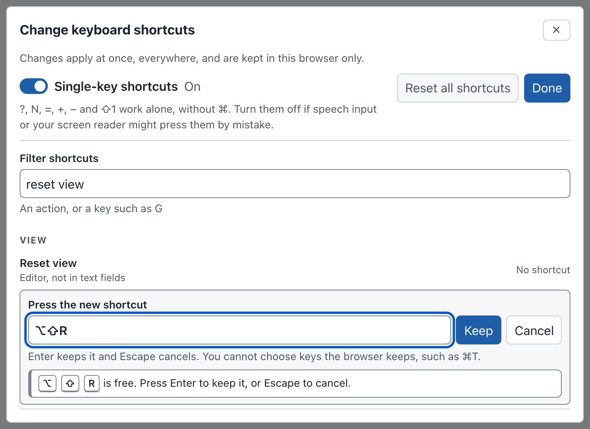

When another command uses the keys, the row says so, for example that
<kbd>⌘</kbd>+<kbd>G</kbd> "already runs Group selection". To move the keys to
this command, select **Use for** and the command name, for example **Use for
Reset view**. Or press other keys. You cannot choose keys that the browser
keeps, such as <kbd>⌘</kbd>+<kbd>T</kbd>.

Each changed row has **Remove** (no keys) and **Reset** (its default keys).
**Reset all shortcuts** resets all commands to their default keys. The browser
keeps your keys after you log out.

## Settings

To open **Builder settings**, select **Settings** in the header, or press
<kbd>⌥</kbd>+<kbd>⇧</kbd>+<kbd>S</kbd> on macOS or
<kbd>Alt</kbd>+<kbd>Shift</kbd>+<kbd>S</kbd> on Windows and Linux. This works
in the editor and on the drafts page. Changes apply at once, and the browser
keeps them after you log out. They do not change the diagram.

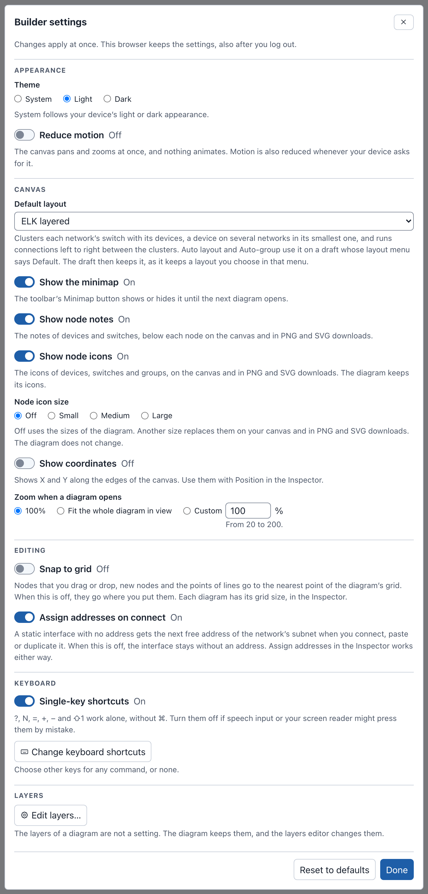

| Group | Setting | Default | Function |
|---|---|---|---|
| Appearance | **Theme** | **System** | **System**, **Light** or **Dark** (see [Themes](#themes)). |
| Appearance | **Reduce motion** | Off | The canvas pans and zooms at once, and nothing moves. Motion is also reduced when your device asks for it. |
| Canvas | **Default layout** | **ELK layered** | The layout that **Auto layout** and **Auto-group** use on a draft whose layout menu says **Default**. The draft then keeps it. A change moves no node (see [Layouts](diagrams.md#layouts)). |
| Canvas | **Show the minimap** | On | Shows the minimap when a diagram opens. |
| Canvas | **Show node icons** | On | Shows the icons of devices, switches and groups on the canvas and in PNG, SVG and draw.io downloads. |
| Canvas | **Show node descriptions** | On | Shows the descriptions of devices and groups on the canvas and in PNG, SVG and draw.io downloads (see [Hiding descriptions on the canvas](#hiding-descriptions-on-the-canvas)). |
| Canvas | **Show connections** | On | Shows the connections on your canvas (see [Hiding connections](diagrams.md#hiding-connections)). |
| Canvas | **Node icon size** | **Off** | **Off** uses the icon sizes of the diagram. **Small**, **Medium** or **Large** replaces them on your canvas and in your PNG, SVG and draw.io downloads. Other users see the sizes of the diagram. |
| Canvas | **Show coordinates** | Off | Shows X and Y rulers on the canvas (see [Canvas](#canvas)). |
| Canvas | **Zoom when a diagram opens** | **100%** | **100%**, **Fit the whole diagram in view**, or **Custom** with a percentage from 20 to 200. Builder rounds it to a multiple of 5. A number out of range shows an error. **Reset view** also uses this zoom. |
| Editing | **Snap to grid** | Off | Nodes that you drag or drop, new nodes and the points of lines go to the grid of the diagram. See **Grid size** in [With nothing selected](#with-nothing-selected). |
| Editing | **Assign addresses on connect** | On | A static interface with no address that you connect, paste or duplicate gets the next free address of the subnet (see [Addresses of a network](#addresses-of-a-network)). |
| Keyboard | **Single-key shortcuts** | On | See [Single-key shortcuts](#single-key-shortcuts). |
| Keyboard | **Change keyboard shortcuts** | | See [Customizing shortcuts](#customizing-shortcuts). |
| Layers | **Edit layers…** | | In the editor, opens the [layers editor](#layers-editor). On the drafts page, shows the **Layers** tab (see [The drafts page](drafts.md#the-drafts-page)). The layers of a diagram are not a setting. |
| Storage | **Clean up…** | | Deletes the published, unchanged drafts of all users, and the stored data that nothing uses (see [Cleaning up storage](administration.md#cleaning-up-storage)). |

Commands of the same names in the command palette change **Show node
icons**, **Show node descriptions**, **Show connections**, **Node icon size**
and **Snap to grid**.

**Clean up…** shows what it would delete, and asks before it deletes. If it
deletes the open draft, Builder does not save your next change. To keep a
copy, select **Download**. **Clean up** first saves the open draft. It
deletes nothing when that save fails, or when a draft that it would delete
has changes on this device that the server does not have.

**Reset to defaults** resets all settings, but not the layers of a diagram,
the default layer set or your shortcut keys.

## Layers editor

The layers editor, **Layers of this diagram**, changes the layers of the open
diagram. To open it, select **Edit layers…** in one of these places:

- The Inspector, under **Layers** with nothing selected, or beside the
  **Layer** of a device or a switch.
- The Node Editor, beside **Layer**. The layers editor opens over the Node
  Editor, which keeps your unapplied changes.
- **Builder settings**.
- The command palette.

Each change is one step of **Undo**. A diagram with the placeholder layers
saves them with your first change. In a published diagram, the layers
editor is read only. For its parts, see [Editing the layers](diagrams.md#editing-the-layers).

## Focus mode

Focus mode hides the phenix navigation bar, so Builder fills the window.
Select **Focus mode** in the header, or press
<kbd>⇧</kbd>+<kbd>⌘</kbd>+<kbd>F</kbd>
(<kbd>Ctrl</kbd>+<kbd>Shift</kbd>+<kbd>F</kbd>). To end it, select **Exit
focus mode** or press the same keys.

Focus mode also asks the browser for full screen. If the browser refuses
full screen, focus mode fills the window only. When you leave full screen
from the browser, focus mode stays on in the window. Focus mode stays on
between the drafts page and the editor. It ends when you use its button or
its keys, or leave Builder. Ending focus mode also leaves full screen.

## Themes

The theme button in the header shows the theme in use: **System**, **Light**
or **Dark**. System follows the light or dark appearance of your device.
Each press selects the next theme. On a device with a light appearance, the
order is System, Dark, Light. On a dark one, it is System, Light, Dark.
**Theme** in [Settings](#settings) sets the same choice.

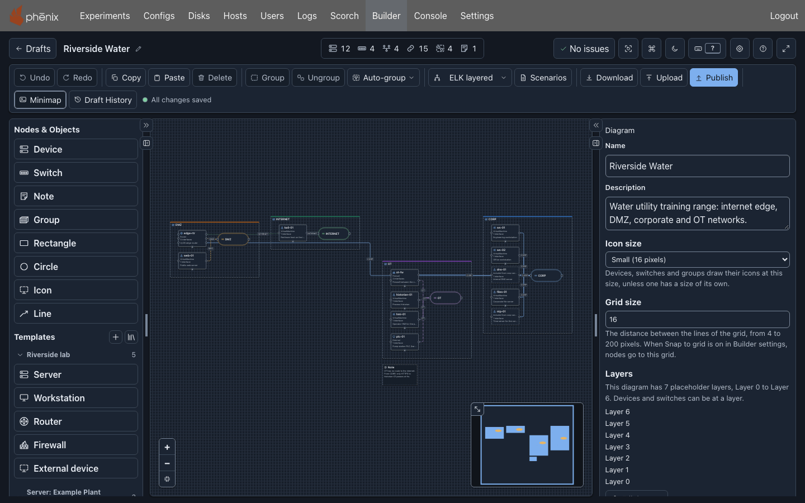

The theme changes only Builder, not the rest of phenix. PNG and SVG downloads
use the background of the theme in use. A draw.io download always has the
colors of the light theme.

## Accessibility

You can use Builder with only a keyboard, and with a screen reader.

- From the top of the page, press <kbd>Tab</kbd> to reach **Skip to diagram
  canvas**.
- The diagram, the toolbar and the header counts are each one <kbd>Tab</kbd>
  stop (see [Keys on the canvas](#keys-on-the-canvas)). The arrow keys,
  <kbd>Home</kbd> and <kbd>End</kbd> move between the toolbar buttons. With
  a screen reader, use its focus mode (forms mode in JAWS) for the canvas
  keys.
- A custom icon is decoration. It does not change the screen reader text of
  a node.
- To add and connect nodes without a pointer, use **Nodes & Objects** and
  the [Inspector header](#the-inspector-header). In the command palette, type
  `connect` or `group` to open the same dialogs. To find a node, use **Go to
  node**. <kbd>Esc</kbd> closes a dialog and returns focus to where you
  opened it.
- Builder announces the result of each change, for example "Updated device
  ws-01.", and each setting change from the command palette.
- A field that suggests values, such as the **Image** of a drive, announces
  the number of matching suggestions.
- An open dialog announces what its changes did. Builder announces the other
  messages when the dialog closes.

Builder aims to meet WCAG 2.2 level AA.
