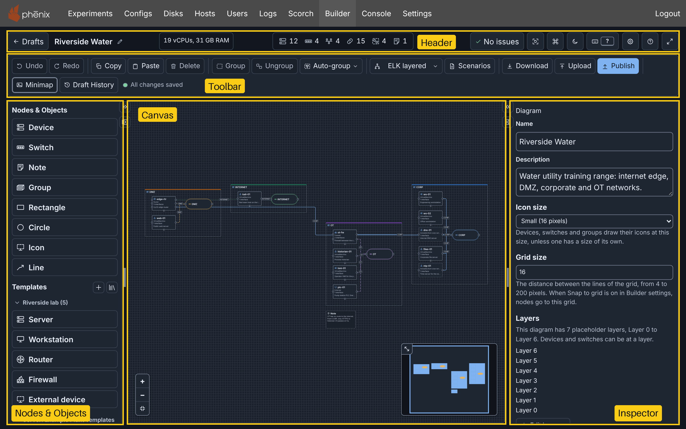
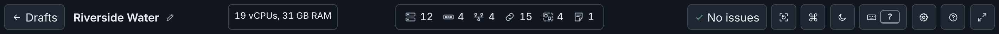
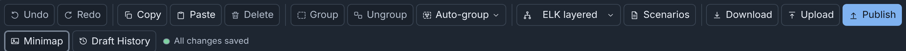
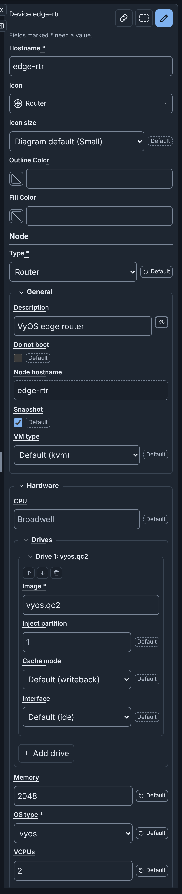
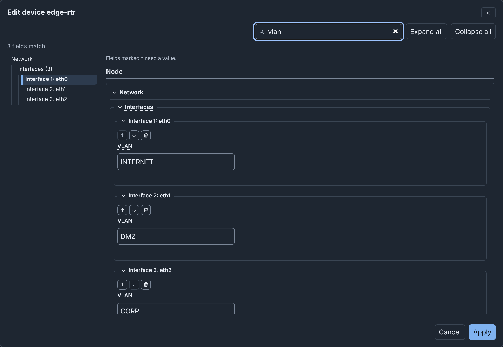
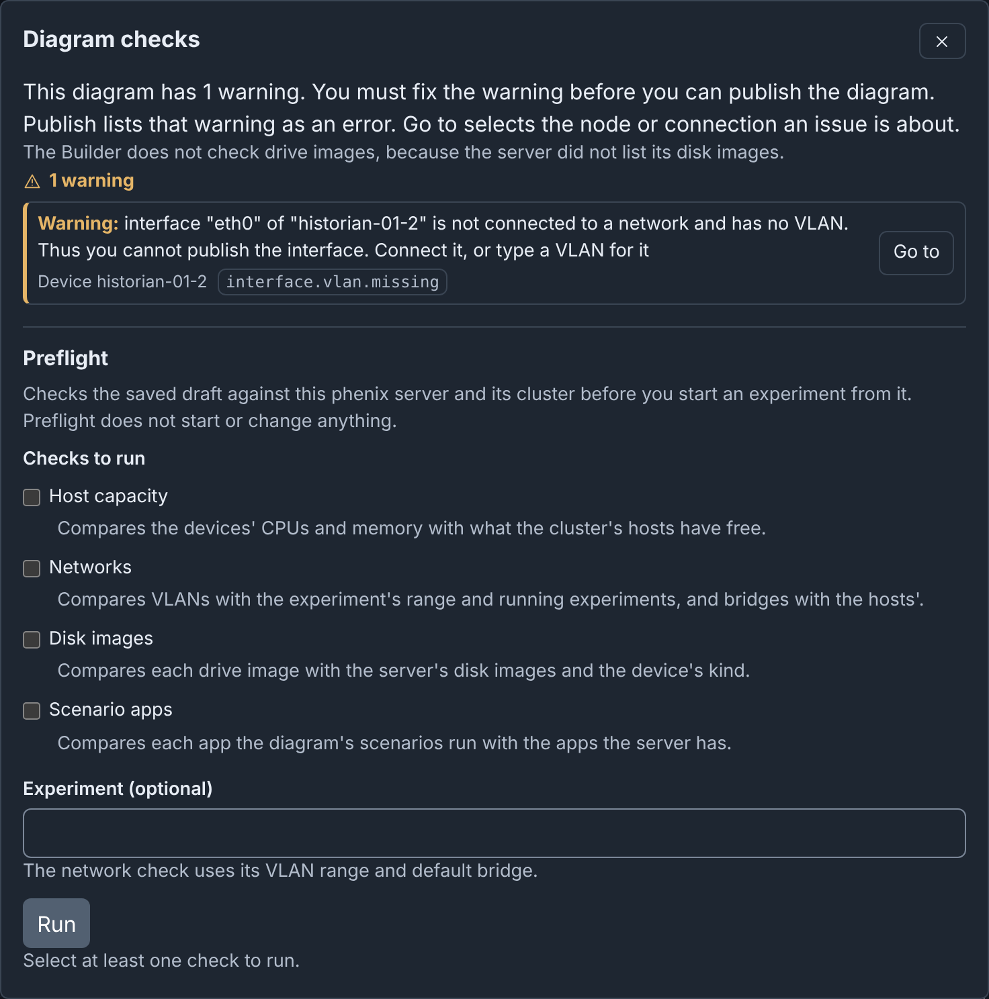
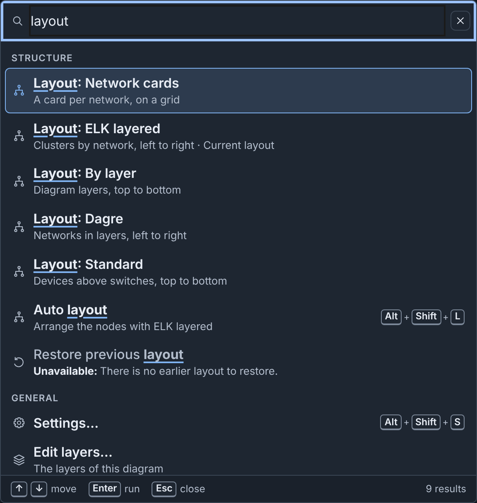
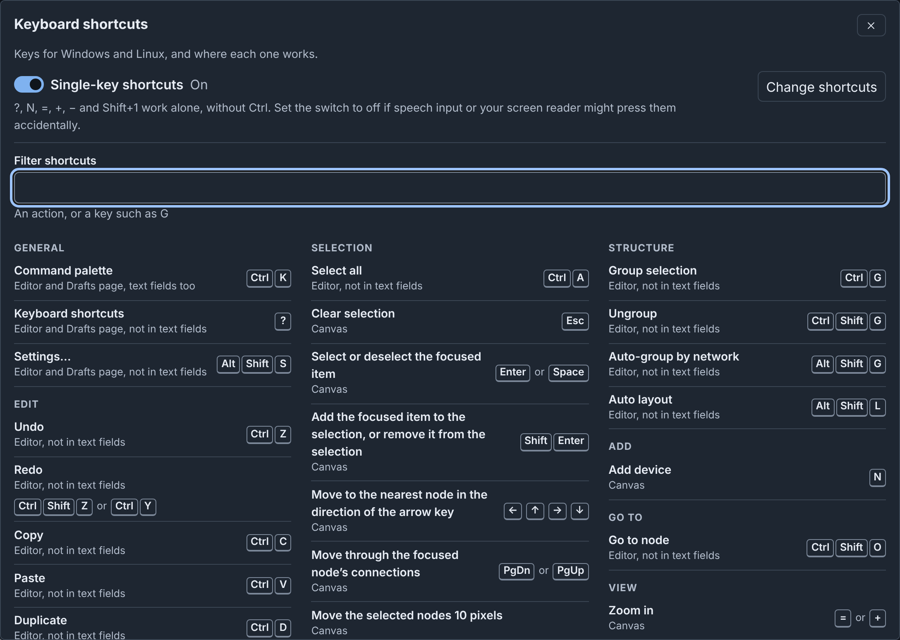
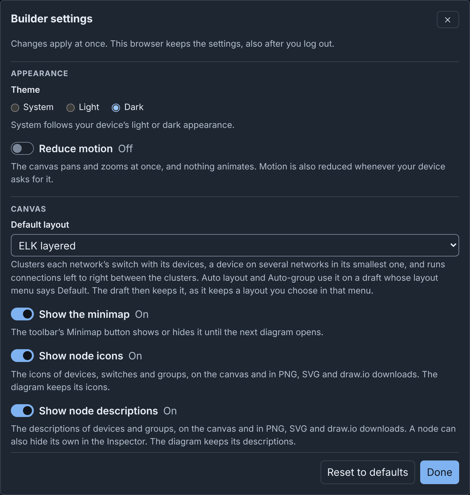

# The Editor

In the editor, you draw and change a diagram, and Builder saves each change
and checks the diagram while you work. This page explains the parts of the
editor, the checks, the command palette and the settings.

## The five areas

The editor has five areas: the header, the toolbar, **Nodes & Objects**
at the left, the canvas, and the Inspector at the right.

## Header

From left to right, the header holds:

- **Drafts**, which opens the drafts page.
- The diagram name, with **Edit diagram name** (the pencil), except in a
  published diagram.
- The resource totals of the devices that phēnix starts (see
  [Resource totals](details/editor.md#resource-totals)).
- The counts of devices, switches, networks, connections, groups and notes.
  Click a count to select all items of that kind (see
  [Selecting by kind](details/editor.md#selecting-by-kind)).
- The checks button: **No issues**, or a count such as **3 warnings**.
- The view buttons: **Reset view**, **Commands**, the theme button,
  **Shortcuts**, **Settings**, **Help** and **Focus mode**.

To rename the diagram:

1. Click **Edit diagram name**. A field replaces the name.
2. Enter the new name.
3. Press <kbd>Enter</kbd>.

The topology name is different: you enter it when you publish (see
[Publishing](publishing.md)).

## Toolbar

- **Undo**, **Redo**: undo or redo the last change.
- **Copy**, **Paste**, **Delete**: copy, paste or delete the selection.
- **Group**, **Ungroup**, **Auto-group**: put the selected nodes in a new
  group, delete a selected group and keep its nodes, or group by network or
  by name.
- The layout menu: arrange the diagram.
- **Scenarios**: select, view, edit or create the scenarios.
- **Download**, **Upload**: save the diagram as a file, or open a diagram
  file as a new draft.
- **Publish**, **Exp**: write the configs, or open the experiment that you
  published. **Exp** shows only while that experiment exists and your role
  can read it.
- **Minimap**, **Draft History**: show or hide the minimap, or restore a
  snapshot of the draft.

The save state follows, for example **All changes saved**. When a save
fails, **Retry saving** follows it (see [Drafts](drafts.md)). A button
whose action can take time shows a turning ring (see
[Actions that take time](details/editor.md#actions-that-take-time)).

## Canvas

- To select: click a node or a connection. <kbd>Shift</kbd>+click adds a
  node to the selection, or deselects it. Click an empty spot to clear the
  selection.
- To move: drag a node.
- To pan: drag an empty spot.
- To zoom: use the mouse wheel, or the zoom buttons at the bottom left.
- To connect: drag from the connection point of a device to a switch (see
  [Diagrams](diagrams.md)).

The minimap at the bottom right shows the full diagram. **Reset view** in
the header resets the zoom, the minimap and the side columns, and does not
change the diagram (see [Canvas](details/editor.md#canvas)).

Rest the pointer on a device or a switch to see its info tooltip (see
[Info tooltips](details/editor.md#info-tooltips)).

## Side columns

You can widen, hide or resize the left column and the **Inspector** at the
right (see [Side columns](details/editor.md#side-columns)). The buttons for
the left column use the name **Nodes & Templates**.

**Nodes & Objects** lists **Device**, **Switch**, **Note**, **Group** and
the drawings. Click an item to add it, or drag it onto the canvas.
**Templates** lists the device templates (see
[Templates and Icons](templates.md)).

## Inspector

The **Inspector** shows and changes the fields of one selected node or
connection. With nothing selected, or with several items selected, it shows
the diagram:

- **Name** and **Description**. Click **Apply** to keep a change.
- **Layers**: **Edit layers…** opens the
  [layers editor](details/editor.md#layers-editor).
- **Notes**: text about the full diagram.
- **Scenarios**: **Edit scenarios** opens the **Scenarios** dialog (see
  [Diagrams](diagrams.md)).

For the other fields, see
[With nothing selected](details/editor.md#with-nothing-selected).

### Editing a node

{ width="352" }

Select a node to see its fields. A device has **Hostname**, **Icon** and the
colors at the top, then the sections **Node**, **Hardware**, **Network**,
**More settings**, **Layer**, **Connection points** and **Position**.

A field marked \* must have a value. A field with a value other than its
default shows a **Default** button.

To change fields:

1. Change one or more fields. A bar at the bottom says "Unapplied changes",
   with **Apply** and **Cancel**.
2. Click **Apply**, or press <kbd>Enter</kbd> in a field. Builder changes
   the diagram and saves it.

**Cancel** discards the changes. While a changed field has an error,
**Apply** is unavailable. When you select another node, the Inspector
applies valid changes and discards changes that are not valid. **Icon**,
the colors and **Layer** take effect at once, without **Apply** (see
[Fields that take effect at once](details/editor.md#fields-that-take-effect-at-once)).

**Icon** opens the list of built-in icons. **Default** is the icon of the
node when it has no icon of its own. **Custom icon…** opens the
**Custom icons** dialog (see [Templates and Icons](templates.md)).

You cannot change a device from an included topology, but you can move it.
You cannot rename a network that an included device is on. In a published
diagram, you cannot change any field (see
[Fields you cannot change](details/editor.md#fields-you-cannot-change)).

With one node selected, the Inspector header has **Add connection**,
**Move to group** and **Open Node Editor** (see
[The Inspector header](details/editor.md#the-inspector-header)). Click the
name of a section to collapse or expand it (see
[Collapsing sections](details/editor.md#collapsing-sections)). The eye
button beside **Description** hides it on the canvas (see
[Hiding descriptions on the canvas](details/editor.md#hiding-descriptions-on-the-canvas)).

A switch, a note, a group, a connection and a drawing have their own fields
(see [Other kinds of nodes](details/editor.md#other-kinds-of-nodes)). A
switch also has **Subnet**, **Gateway** and **Assign addresses** (see
[Addresses of a network](details/editor.md#addresses-of-a-network)).

## Node Editor

The **Node Editor** shows the fields of one node in a large dialog, with
the checks of the node. To open it, double-click the node, or click
**Open Node Editor** in the Inspector header.

**Search fields** finds a field by its label, such as `memory`, or by its
YAML path in the Topology config, such as `network.interfaces[0].vlan`. Only
the matching fields show. To show all fields again, empty the box.

Click **Apply** to apply all changes as one step of **Undo** and close the
Node Editor. **Cancel** closes it. Builder asks before it discards
unapplied changes. See also
[Sections and the table of contents](details/editor.md#sections-and-the-table-of-contents)
and [Searching the fields](details/editor.md#searching-the-fields).

## Checks and warnings

Builder checks the diagram while you edit it. The canvas marks each node
and connection with an issue: a cross for an error, or a triangle for only
warnings.

To fix an issue:

1. Click the checks button. The **Diagram checks** dialog lists the
   errors, then the warnings.
2. Click **Go to** beside the issue. The canvas selects its node, and the
   Inspector shows it.
3. Fix the field.

An error stops publishing until you fix it. Some warnings also block
**Publish**, and the dialog says so (see [Publishing](publishing.md)).
Other warnings do not block publishing.

Some issues have a **Fix** button. **Undo** reverts each fix as one step
(see
[Fixing an issue in one step](details/checks.md#fixing-an-issue-in-one-step)).

Builder also warns about settings that phēnix accepts but does not apply as
the diagram shows them (see
[Rulesets and addresses](details/checks.md#rulesets-and-addresses) and
[Device settings](details/checks.md#device-settings)).

## Preflight

**Preflight**, at the bottom of **Diagram checks**, asks the phēnix server
to check the saved draft against the server and its cluster. The checks
write nothing and start no VM or experiment. There are four: **Host
capacity**, **Networks**, **Disk images** and **Scenario apps**.

To run Preflight:

1. Click the checks button in the header.
2. Under **Preflight**, tick the checks.
3. Optional: in **Experiment (optional)**, enter the name of the experiment.
4. Click **Run**. Builder first saves your latest changes.

Each check shows **Passed**, **Failed** or **Unavailable**. **Unavailable**
means that Builder could not do all of the check, for example without a
permission or a connection to minimega (see
[Preflight](details/checks.md#preflight)).

## Command palette

The command palette runs commands and finds nodes, networks, templates and
icons. To open it, click **Commands** in the header,
or press <kbd>Ctrl</kbd>+<kbd>K</kbd> (<kbd>⌘</kbd>+<kbd>K</kbd> on macOS).

- Type words to find commands, for example `layout`.
- Type `@` to find a node by its hostname, address, VLAN, label or
  description (see [Finding nodes](details/palette-and-shortcuts.md#finding-nodes)).
- Type `#` to find a network by its name or VLAN alias.
- Type `t:` for node templates, `c:` for template collections and `i:` for
  custom icons (see
  [Finding templates, collections and icons](details/palette-and-shortcuts.md#finding-templates-collections-and-icons)).
- Type `?` to see all prefixes.

## Keyboard shortcuts

To see all shortcuts, click **Shortcuts** in the header, or press
<kbd>?</kbd> outside a text field. The keys that you use most are
<kbd>Ctrl</kbd>+<kbd>Z</kbd> (<kbd>⌘</kbd>+<kbd>Z</kbd> on macOS) for
**Undo** and <kbd>Ctrl</kbd>+<kbd>D</kbd> (<kbd>⌘</kbd>+<kbd>D</kbd> on
macOS) for **Duplicate**. <kbd>Delete</kbd> deletes the selection, and
<kbd>N</kbd> adds a device.

Most keys do nothing while focus is in a text field. The full table, with
the macOS keys, is in the [Reference](reference.md#keyboard-shortcuts). For
the canvas keys, see [Keys on the canvas](details/palette-and-shortcuts.md#keys-on-the-canvas).

## Settings

To open **Builder settings**, click **Settings** in the header, or press
<kbd>Alt</kbd>+<kbd>Shift</kbd>+<kbd>S</kbd>
(<kbd>⌥</kbd>+<kbd>⇧</kbd>+<kbd>S</kbd> on macOS). Changes apply at once.
The settings belong to this browser: it keeps them after you log out, and
they do not change the diagram. For each setting and its default, see
[Settings](details/editor.md#settings).

## Advanced

- **Single-key shortcuts**: <kbd>?</kbd>, <kbd>N</kbd> and the zoom keys
  work without <kbd>Ctrl</kbd>. If speech input or your screen reader can
  press them by mistake, disable the setting. See
  [Single-key shortcuts](details/palette-and-shortcuts.md#single-key-shortcuts).
- **Change shortcuts**, in the shortcuts sheet, gives any command other
  keys, or no keys. See
  [Customizing shortcuts](details/palette-and-shortcuts.md#customizing-shortcuts).
- **Clean up…**, under **Storage** in **Builder settings**, deletes the
  published, unchanged drafts of all users and the stored data that nothing
  uses. It asks before it deletes. See [Administration](administration.md).
- The layers editor changes the layers of the open diagram.
  **Edit layers…** opens it from the Inspector, the Node Editor,
  **Builder settings** or the command palette. See [Diagrams](diagrams.md)
  and [Layers editor](details/editor.md#layers-editor).
- Focus mode hides the phēnix navigation bar, so Builder fills the window.
  Click **Focus mode** in the header, or press
  <kbd>Ctrl</kbd>+<kbd>Shift</kbd>+<kbd>F</kbd>
  (<kbd>⇧</kbd>+<kbd>⌘</kbd>+<kbd>F</kbd> on macOS). See
  [Focus mode](details/editor.md#focus-mode).
- The theme button in the header shows **System**, **Light** or **Dark**,
  and each click selects the next theme. The theme changes only Builder,
  not the rest of phēnix. See [Themes](details/editor.md#themes).
- Accessibility: you can use Builder with only a keyboard, and with a
  screen reader. Builder aims to meet WCAG 2.2 level AA. See
  [Accessibility](details/editor.md#accessibility).

## More detail

- [The Editor: details](details/editor.md): every rule, limit and message.
- [Checks and Preflight: details](details/checks.md): every check, fix and
  preflight result.
- [Command Palette and Shortcuts: details](details/palette-and-shortcuts.md):
  every command, search prefix and key.
- [Codes](reference.md#codes): the code of each issue.
- [What blocks publishing](details/publishing.md#what-blocks-publishing):
  the warnings that **Publish** lists as errors.
