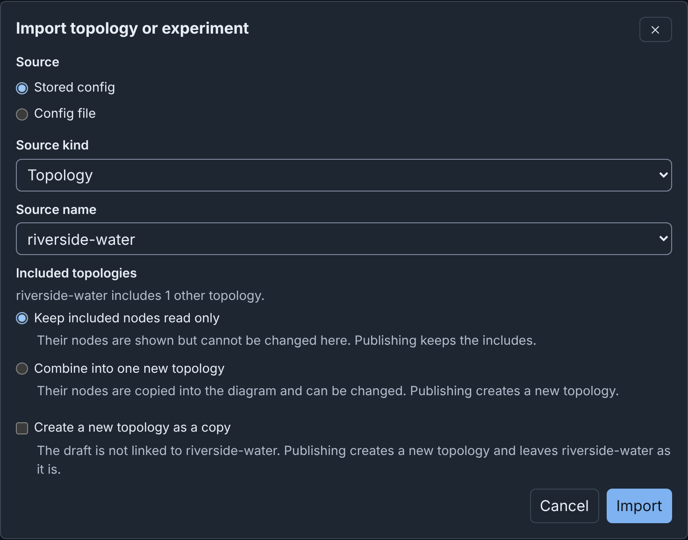
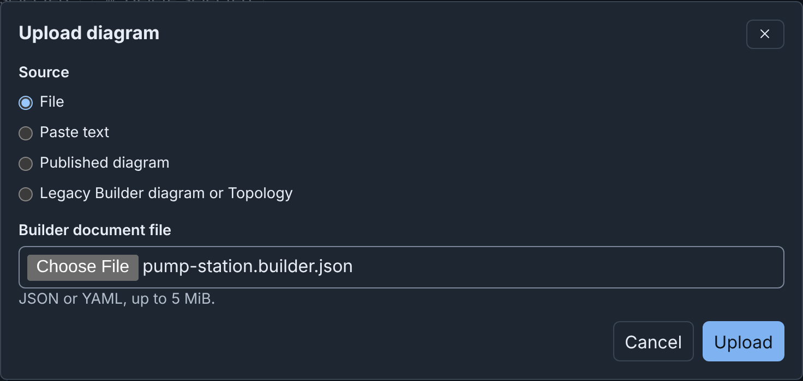
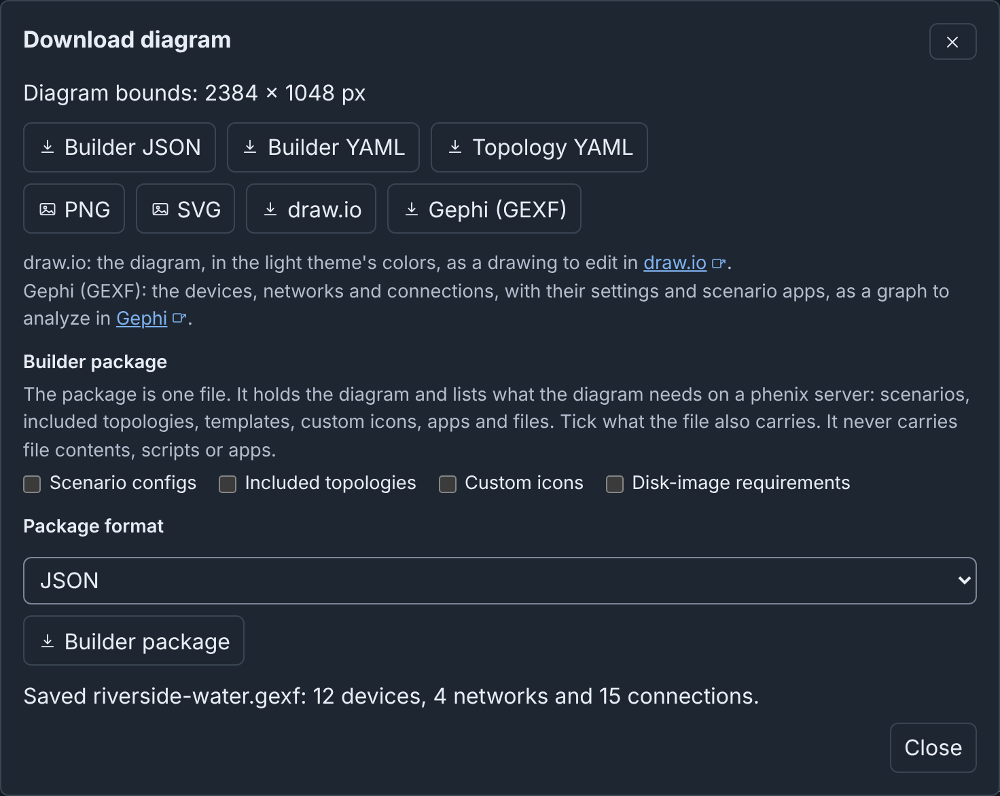
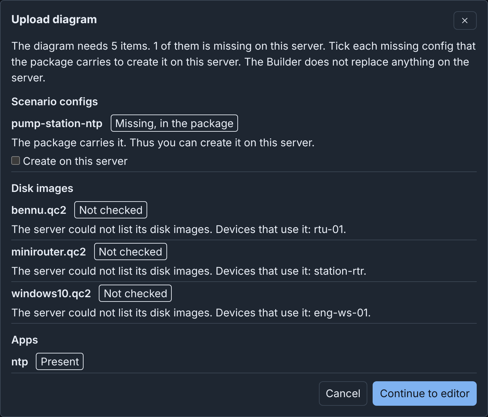

# Import, Upload and Download

Builder uses three words for three tasks:

- **Import** makes a draft from a Topology or Experiment config, stored in
  phēnix or in a file.
- **Upload** opens a file that is already a diagram as a new draft. The
  file can be a Builder document, a Builder package, a published diagram
  or a legacy Builder diagram.
- **Download** saves the open diagram as a file, in one of seven formats or as a Builder package.

None of these tasks changes a config. In the Web-UI, only **Publish**
writes configs (see [Publishing](publishing.md)).

## Import a stored topology

1. On the drafts page, click **Import**.
2. Keep **Source** set to **Stored config** and **Source kind** set to
   **Topology**.
3. In **Source name**, select `riverside-water`. The dialog shows
   **Included topologies**, because `riverside-water` includes
   `corp-services`.
4. Click **Import**. The dialog shows 1 warning: the 2 devices from
   `corp-services` are read only.
5. Click **Continue to editor**.

The draft has the name of the config. An import without warnings opens the
editor at once. **Cancel** makes no draft.

## Import an experiment

Set **Source kind** to **Experiment**. In **Source name**, select the
experiment, for example `riverside`. An imported experiment differs from
an imported topology:

- The draft lists the scenario of the experiment, when your role can list
  it, but never keeps the copy in the experiment.
- The VLAN aliases of the experiment become the **VLAN alias** of each
  network.
- The import does not keep the VLAN range, or experiment fields such as
  `baseDir`, and warns about them.
- The import does not keep the files that experiment apps injected into
  VMs at start, and does not warn about them. It keeps the injections of
  the topology.

The import also removes the values that phēnix added when it created the
experiment (see
[Importing an experiment](details/import-upload-download.md#importing-an-experiment)).

## Import a config file

1. Click **Import**.
2. Set **Source** to **Config file**.
3. In **Topology or Experiment config**, choose the file, for example
   [pump-station.topology.yaml](examples/pump-station.topology.yaml). The
   file can be JSON or YAML, up to 5 MiB.
4. Click **Import**.

A draft from a config file can only publish a new topology, also when a
stored config has the same name. Builder keeps each `${NAME}` and
`${NAME:default}` in the file as written. Unlike `phenix config create`,
it never replaces them with values from the environment of the server.
Edit such a value in the draft before you publish (see
[Importing a config file](details/import-upload-download.md#importing-a-config-file)).

## Import options

When the topology includes other topologies, the dialog offers:

- **Keep included nodes read only**, the default. You cannot change the
  included nodes in the draft, and publishing keeps the includes.
- **Combine into one new topology**. The import copies the included nodes
  into the diagram as ordinary devices, and publishing creates a new
  topology.

**Create a new topology as a copy** shows for a stored topology when you
do not combine. With a copy or a combined import, **New topology name**
proposes the source name with `-copy` or `-combined`. Such a draft is not
linked to the source topology and cannot update it (see
[Import options](details/import-upload-download.md#import-options)).

## From the Configs page

On the **Configs** page, the tag `builder` marks a topology with a Builder
diagram and opens it in Builder. A topology without a diagram has
**Import into Builder** in its viewer, which opens the **Import** dialog
set to that topology. The tag `builder legacy` marks a topology from the
legacy Builder (see
[From the Configs page](details/import-upload-download.md#from-the-configs-page)).

## What an import keeps

- Every node, as a device, with all of its settings, in the order of the
  config.
- One network and one switch for each VLAN, with each interface connected
  to the switch of its VLAN.
- The devices of included topologies, read only, unless you combine them.
- The annotations of the config, which the Inspector shows with nothing
  selected. Publishing does not write them.

An import uses the **Default** layout: the devices in rows on a grid, and
the switches below them. It sets no subnet or gateway, because a config
has none. A warning names every other change (see
[What an import keeps](details/import-upload-download.md#what-an-import-keeps)).

## Upload a Builder document

A Builder document is the file that **Download** > **Builder JSON** or
**Builder YAML** saves (see
[Builder JSON and YAML](details/import-upload-download.md#builder-json-and-yaml)).
**Upload** opens one as a new draft:

1. On the drafts page or in the editor toolbar, click **Upload**.
2. Keep **Source** set to **File**.
3. In **Builder document file**, choose the file, for example
   [pump-station.builder.json](examples/pump-station.builder.json).
4. Click **Upload**. The new draft has the name in the document.

**Source** has three other choices:

- **Paste text** takes the document as text.
- **Published diagram** opens the draft of a published diagram.
- **Legacy Builder diagram or Topology** converts a diagram from the
  legacy Builder (see [Legacy Builder](legacy.md)).

**Upload** refuses a config, a template file, a layer set file, a file
that is not JSON or YAML, and a file over 5 MiB. The dialog gives the
reason (see
[Uploading a Builder document](details/import-upload-download.md#uploading-a-builder-document)).

## Download

1. Open the draft.
2. Click **Download**.
3. Click a format. The browser saves the file.
4. Click **Close**.

| Button | What the file holds | Open it with |
|---|---|---|
| **Builder JSON** | The whole diagram, with its icons and templates | **Upload** |
| **Builder YAML** | The same, as YAML | **Upload** |
| **Topology YAML** | The Topology config that **Publish** would write | `phenix config create`, or **Import** |
| **PNG** | A picture of the whole diagram | An image viewer |
| **SVG** | The same picture, as SVG | A web browser |
| **draw.io** | The diagram, in the draw.io format | [draw.io](https://www.drawio.com/) |
| **Gephi (GEXF)** | The devices, networks and connections, in the GEXF format | [Gephi](https://gephi.org/) |
| **Builder package** | The diagram with the configs and icons that you tick | **Upload** |

The file name is the diagram name in lower case with hyphens, for example
`riverside-water.png` (see [Download formats](reference.md#download-formats)).

For **Topology YAML**, when the diagram cannot be published yet, the
dialog saves the file and lists each reason. Thus the download is a quick
way to see what blocks publishing (see
[Topology YAML](details/import-upload-download.md#topology-yaml)).
`phenix config create` stores this file as a topology without its diagram.
To store both, publish the draft (see [Publishing](publishing.md)).

**PNG** and **SVG** draw the whole diagram, with the background of the
theme in use (see
[PNG and SVG](details/import-upload-download.md#png-and-svg)).
Builder cannot open a draw.io or GEXF file (see
[draw.io](details/import-upload-download.md#drawio) and
[Gephi (GEXF)](details/import-upload-download.md#gephi-gexf)).

## Move a diagram with a Builder package

Another phēnix server may not have the scenarios, included topologies,
custom icons and disk images that a diagram names. A Builder package is
one JSON or YAML file. It holds the diagram, the configs and icons that
you tick, and a list of everything that the diagram needs.

To download a package:

1. Click **Download**.
2. Under **Builder package**, tick **Scenario configs**,
   **Included topologies**, **Custom icons** or
   **Disk-image requirements**.
3. In **Package format**, select JSON or YAML.
4. Click **Builder package**.

To upload a package on the other server:

1. Click **Upload**.
2. In **Builder document file**, choose the package file.
3. Click **Upload**. The dialog lists each item that the diagram needs as
   **Present**, **Missing**, **Different** or **Not checked**.
4. For each missing config to create, tick **Create on this server**.
   Builder never replaces a config that the server has.
5. Click **Continue to editor**. Builder creates the ticked configs, adds
   the missing icons, and opens the diagram as a new draft.

A package never holds disk images, apps or files. It lists them by name
(see
[Moving a diagram with a Builder package](details/import-upload-download.md#moving-a-diagram-with-a-builder-package)).

## Advanced

- A layer set file holds one layer set of the library. You download and
  upload it on the **Layers** tab of the drafts page. See
  [Layer set files](details/import-upload-download.md#layer-set-files).
- `phenix config create`, `phenix config apply` and `phenix config diff`
  refuse a Builder document, a template file, a package and a layer set
  file. See
  [Builder documents and `phenix config create`](details/import-upload-download.md#builder-documents-and-phenix-config-create).
- A topology in a repository can name its Builder file in its
  `builder-doc` annotation, and its diagram then opens from the file.
  See [A Builder file beside a topology](administration.md#a-builder-file-beside-a-topology).
- A Builder document records who made the diagram and who saved it last.
  See
  [Who made and last saved a diagram](details/import-upload-download.md#who-made-and-last-saved-a-diagram).

## More detail

- [Import, Upload and Download: details](details/import-upload-download.md):
  every rule, option and message.
- [File formats](reference.md#file-formats).
- [Legacy Builder](legacy.md): converting diagrams of the old editor.
