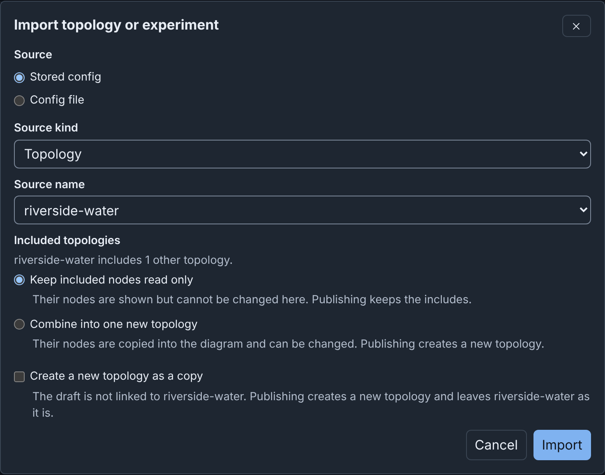
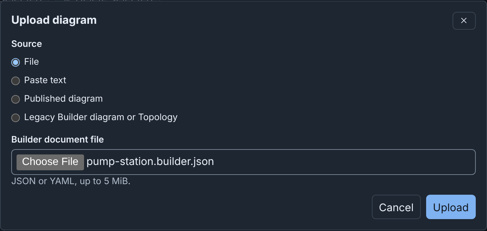
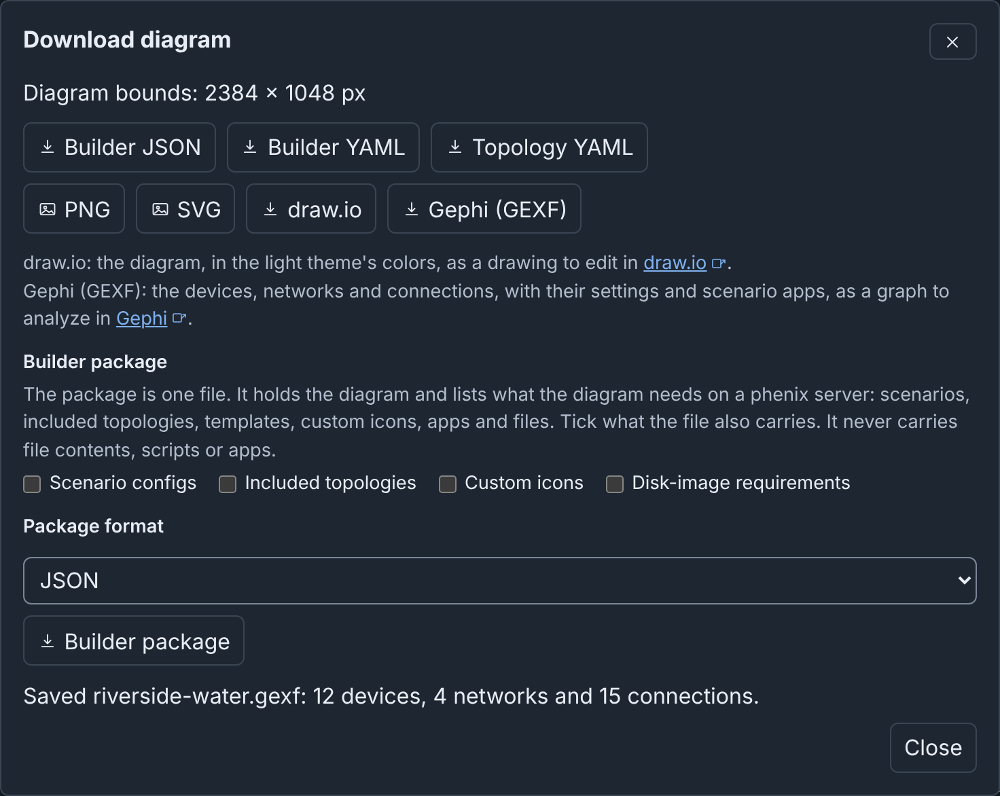
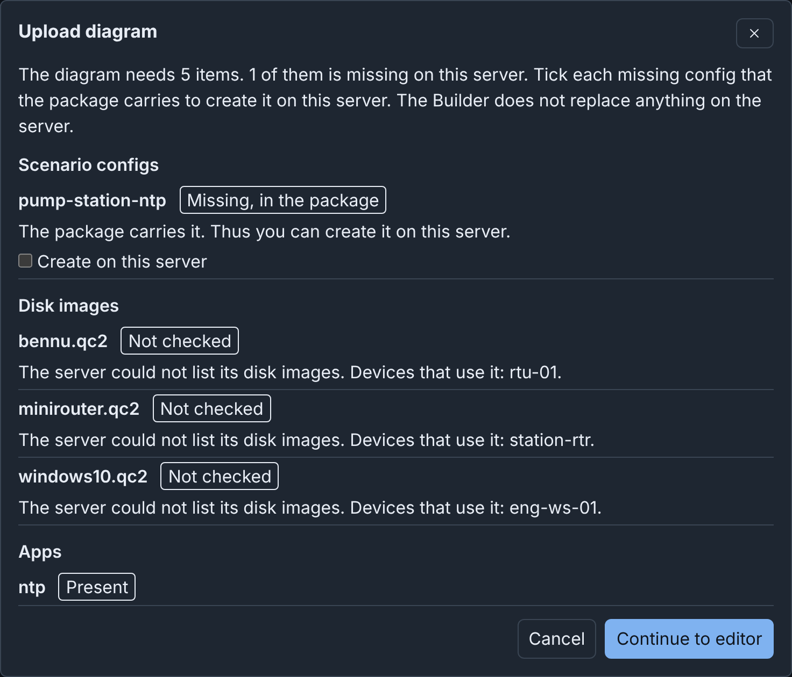

# Import, Upload and Download

Builder uses three words for three tasks:

- `Import` makes a draft from a Topology or Experiment config, stored in
  phēnix or in a file.
- `Upload` opens a file that is already a diagram as a new draft: a Builder
  document, a Builder package, a published diagram or a legacy Builder
  diagram.
- `Download` saves the open diagram as a file, in one of seven formats or as
  a Builder package.

Apart from `Create on this server` in a
[Builder package](#move-a-diagram-with-a-builder-package) upload, none of
these change a config: that's what `Publish` does (see
[Publishing](publishing.md)). For the rules and the less common cases, see
[Import, Upload and Download: Details](details/import-upload-download.md).

## Import a Stored Topology

1. On the drafts page, click `Import`.
2. Keep `Source` set to `Stored config` and `Source kind` set to `Topology`.
3. In `Source name`, select `riverside-water`. The dialog shows
   `Included topologies`, because `riverside-water` includes
   `corp-services`.
4. Click `Import`. The dialog shows 1 warning: the 2 devices from
   `corp-services` are read only.
5. Click `Continue to editor`.

The draft gets the name of the config. An import without warnings opens the
editor straight away.

## Import an Experiment

Set `Source kind` to `Experiment`, and select the experiment (such as
`riverside`) in `Source name`. The draft lists the experiment's stored
scenario (when your role can list it), never the copy in the experiment, and
the experiment's VLAN aliases become the `VLAN alias` of each network. It
doesn't keep the VLAN range or experiment fields such as `baseDir`, and warns
about them. Files that experiment apps injected into VMs at start are left
out without a warning, but the topology's own injections stay. The import
also removes the values that phēnix added when it created the experiment
(see
[Importing an Experiment](details/import-upload-download.md#importing-an-experiment)).

## Import a Config File

1. Click `Import`.
2. Set `Source` to `Config file`.
3. In `Topology or Experiment config`, choose the file, for example
   [pump-station.topology.yaml](examples/pump-station.topology.yaml). It can
   be JSON or YAML, up to 5 MiB.
4. Click `Import`.

A draft from a config file can only publish a new topology, even when a
stored config has the same name.

!!! note
    Builder keeps each `${NAME}` and `${NAME:default}` in the file as
    written. Unlike `phenix config create`, it never fills them in from the
    server's environment, so edit such values in the draft before you
    publish.

## Import Options

When the topology includes other topologies, the dialog offers:

- `Keep included nodes read only` (the default). Publishing keeps the
  includes.
- `Combine into one new topology`, which copies the included nodes into the
  diagram as ordinary devices. Publishing creates a new topology.

For a stored topology that you don't combine, `Create a new topology as a
copy` is also offered. A copy or a combined import proposes a
`New topology name` ending in `-copy` or `-combined`, and the draft can't
update the source topology.

## From the Configs Page

On the `Configs` page, the tag `builder` marks a topology with a Builder
diagram and opens it in Builder, and `builder legacy` marks one from the
legacy Builder. A topology without a diagram has `Import into Builder` in
its viewer, which opens the `Import` dialog set to that topology.

## What an Import Keeps

An import keeps every node, as a device with all of its settings, in the
order of the config. Each VLAN becomes a network with a switch, and each
interface connects to the switch of its VLAN. Devices of included
topologies are read only, unless you combine them. The config's annotations
show in the Inspector with nothing selected, but publishing doesn't write
them.

Devices are laid out in rows on a grid with the switches below them (the
`Default` layout). A config has no subnets or gateways, so networks get
none. A warning names every other change (see
[What an Import Keeps](details/import-upload-download.md#what-an-import-keeps)).

## Upload a Builder Document

A Builder document is the file that `Download` > `Builder JSON` or
`Builder YAML` saves. To open one as a new draft:

1. On the drafts page or in the editor toolbar, click `Upload`.
2. Keep `Source` set to `File`.
3. In `Builder document file`, choose the file, for example
   [pump-station.builder.json](examples/pump-station.builder.json).
4. Click `Upload`. The new draft has the name in the document.

`Source` can also be `Paste text`, `Published diagram`, or
`Legacy Builder diagram or Topology`, which converts a diagram of the legacy
Builder (see [Legacy Builder](legacy.md)). `Upload` refuses configs, template
and layer set files, files that aren't JSON or YAML, and files over 5 MiB,
and the dialog tells you why.

## Download

1. Open the draft.
2. Click `Download`.
3. Click a format. The browser saves the file.
4. Click `Close`.

[Download Formats](reference.md#download-formats) says what each file holds,
what opens it, and how it's named. Builder itself can't open a draw.io or
Gephi (GEXF) file.

`Topology YAML` saves even when the diagram can't be published yet, and
lists each reason, so it's a quick way to see what blocks publishing.
`phenix config create` stores the file as a topology without its diagram. To
store both, publish the draft.

## Move a Diagram With a Builder Package

A Builder package moves a diagram to another phēnix server. It's one JSON or
YAML file with the diagram, the configs and icons that you tick, and a list
of everything the diagram needs, such as scenarios, included topologies and
disk images. It never holds disk images, apps or files, only their names.

To download a package:

1. Click `Download`.
2. Under `Builder package`, tick `Scenario configs`, `Included topologies`,
   `Custom icons` or `Disk-image requirements`.
3. In `Package format`, select JSON or YAML.
4. Click `Builder package`.

To upload it on the other server:

1. Click `Upload`.
2. In `Builder document file`, choose the package file.
3. Click `Upload`. The dialog lists each item that the diagram needs as
   `Present`, `Missing`, `Different` or `Not checked`.
4. For each missing config that you want, tick `Create on this server`.
   Builder never replaces a config that the server has.
5. Click `Continue to editor`. Builder creates the ticked configs, adds the
   missing icons, and opens the diagram as a new draft.

## See Also

- [File Formats](reference.md#file-formats): each Builder file, its size
  limit and its JSON Schema.
- [A Builder File Beside a Topology](administration.md#a-builder-file-beside-a-topology):
  keeping a diagram in a repository next to its topology.
- [Troubleshooting](troubleshooting.md#import-and-upload): imports and
  uploads that don't work as expected.
- [Configuration](../configuration.md): `phenix config create` and the
  configs that an import reads.
