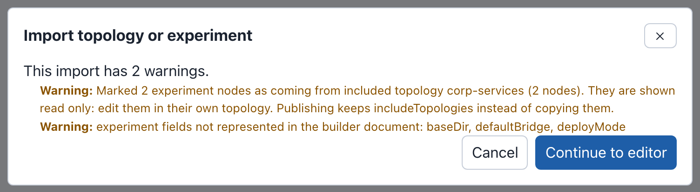
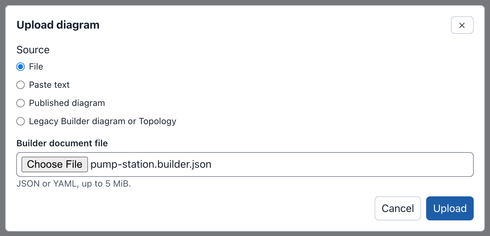
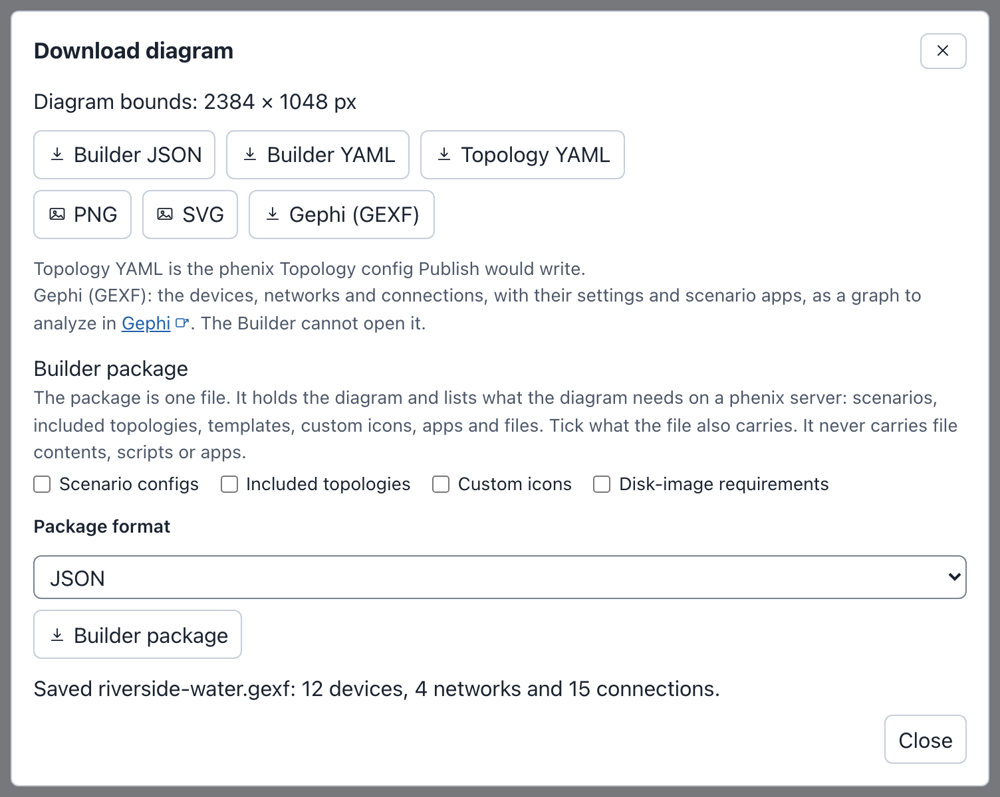
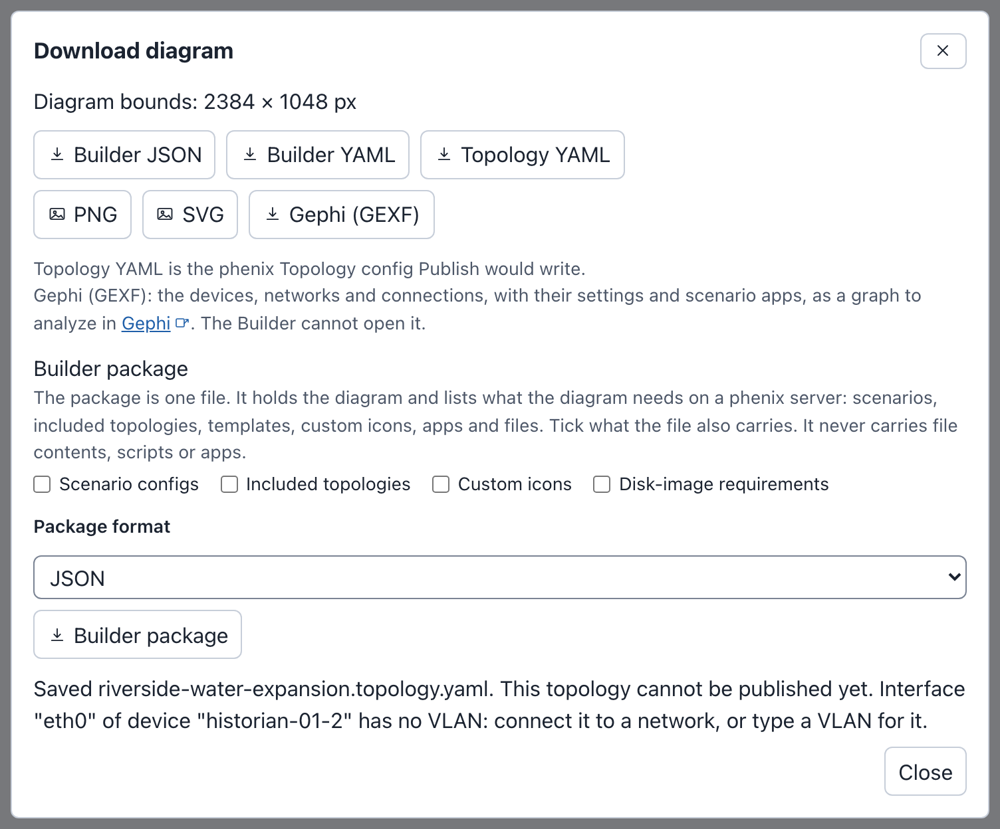
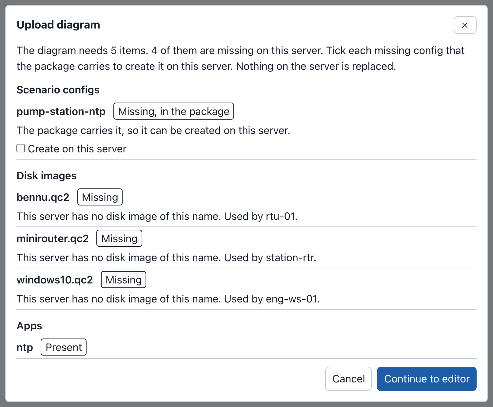

# Import, Upload and Download

These pages use three words for these tasks:

- **Import**, on the drafts page or the **Configs** page, makes a draft
  from a Topology or Experiment config, stored in phenix or in a file. The
  phenix server converts the config into a diagram.
- **Upload**, on the drafts page or in the editor toolbar, opens a file
  that is already a diagram as a new draft: a Builder document, a Builder
  package, a published diagram or a [legacy Builder](legacy.md) diagram.
- **Download**, in the editor toolbar, saves the open diagram as a file, in
  one of seven formats.

None of these tasks changes a config on the phenix server. In the web UI,
only **Publish** writes configs (see [Publishing](publishing.md)).

To move a diagram, and what it needs, to another phenix server, download a
Builder package and upload it there (see
[Moving a diagram with a Builder package](#moving-a-diagram-with-a-builder-package)).
To show the diagram of a topology kept in files, see
[A Builder file beside a topology](#a-builder-file-beside-a-topology).

The examples on this page use the [example lab](index.md#the-example-lab).

## Importing a topology or experiment

The draft holds what phenix would read from the config. The draft has the
name of the source config, or the new topology name for a copy or a
combined import.

### From a stored config

To import the riverside-water topology:

1. On the drafts page, select **Import**.
2. Keep **Source** set to **Stored config** and **Source kind** set to
   **Topology**.
3. In **Source name**, choose `riverside-water`. The dialog shows
   **Included topologies**, because riverside-water includes corp-services.
4. Keep the default [import options](#import-options).
5. Select **Import**. The dialog shows 1 warning: the 2 nodes from
   corp-services are read only, and publishing keeps `includeTopologies`.
6. Select **Continue to editor**.


An import without warnings opens the editor immediately. **Cancel** makes
no draft. The open diagram does not change until the editor opens. If you
close the dialog while it shows "Importing…", nothing is imported, even
when the answer comes later.

In **Source name**, "(legacy Builder diagram)" marks a topology that the
legacy Builder saved. The import converts its diagram. Publishing the draft
to the same topology replaces the legacy diagram (see
[Converting a stored topology](legacy.md#converting-a-stored-topology)).

### Importing an experiment

To import the riverside experiment:

1. Select **Import**.
2. Set **Source kind** to **Experiment**.
3. In **Source name**, choose `riverside`.
4. Select **Import**. The dialog shows 2 warnings.
5. Select **Continue to editor**.



An imported experiment is different from an imported topology:

- If your role can list the stored Scenario that the experiment names, the
  draft lists it. If not, the draft lists no scenario, and the import
  warns. The import never keeps the copy of the scenario in the
  experiment, because a diagram names its scenarios and holds none.
- The VLAN aliases of the experiment become the **VLAN alias** of each
  network.
- The import does not keep the VLAN range, or experiment fields that have
  no place in a diagram, such as `baseDir`, `defaultBridge` and
  `deployMode`. A warning names these fields.
- The import does not keep the files that experiment apps injected into
  VMs at start, and does not warn about them. It keeps the injections of
  the topology.
- The import removes the values that phenix added to the nodes when it
  created the experiment, so the devices read like topology nodes:
    - Each empty or null field, except a field that a topology must have,
      such as the `interfaces` of a network or the `vlan` of an interface.
      It removes a 0 or false only when phenix reads it as unset. A field
      that can be unset, such as `snapshot` or the `cost` of a route, keeps
      an explicit 0 or false.
    - Each value equal to the phenix default, also when the topology set
      it: `vm_type` kvm, `snapshot` true, `do_not_boot` false, `cpu`
      Broadwell, `vcpus` 1 and `memory` 512. External nodes keep these
      values. `os_type` stays, because a topology must have it.
    - `bridge_set_in_topo`, and each interface bridge that phenix set to
      the default bridge of the experiment because the topology set none.
      Thus a bridge that you change in the draft stays when phenix creates
      an experiment from the published topology.

### Importing a config file

To import [pump-station.topology.yaml](examples/pump-station.topology.yaml):

1. Select **Import**.
2. Set **Source** to **Config file**.
3. In **Topology or Experiment config**, choose `pump-station.topology.yaml`.
   The file can be JSON or YAML, up to 5 MiB.
4. Select **Import**.

With nothing selected, the Inspector of the new draft shows "Source file
pump-station.topology.yaml" under **Details**.

The file must name its config in `metadata.name`. A draft from a config
file can only publish a new topology, also when a stored config has the
same name (see [Publishing](publishing.md)). Thus the dialog does not
offer a copy for a config file. It offers **Included topologies** when the
topology in the file includes others.

For an Experiment config file, the import finds the scenario by name among
the stored Scenarios that your role can list. The copy in the file can be
different, so the import warns when the draft lists the stored scenario.

Builder keeps each `${NAME}` and `${NAME:default}` in a config file as
written. Unlike `phenix config create`, it never fills them in from the
environment of the server. For example, this interface imports with the
address `${STATION_WAN_ADDRESS:198.51.100.20}`:

```yaml
          - name: eth0
            type: ethernet
            vlan: WAN
            proto: static
            address: ${STATION_WAN_ADDRESS:198.51.100.20}
            mask: 24
            gateway: 198.51.100.1
```

Edit the address in the draft before you publish it.

### Import options

An Experiment has no import options.

**Included topologies** shows when the topology, stored or in a file, has
`includeTopologies`:

- **Keep included nodes read only** (the default): you cannot change the
  included nodes in the draft. Publishing keeps the includes (see
  [Included topologies](diagrams.md#included-topologies)).
- **Combine into one new topology**: the import copies the included nodes
  into the diagram as ordinary nodes. Publishing creates a new topology. The import
  does not combine an included topology that you cannot read, or that
  phenix does not store. The draft keeps that include, and the import
  warns.

**Create a new topology as a copy** shows for a stored topology when
**Combine into one new topology** is not selected. The draft is not linked
to the source topology, and included nodes stay read only.

With either option, **New topology name** proposes the source name with
`-copy` or `-combined`, such as `riverside-water-copy`, and adds a number if
a topology has that name. The name follows the config name rule (see
[Publishing a topology](publishing.md#publishing-a-topology)). It is at
most 512 bytes, and cannot be the name of an existing topology.

The draft links to no config. It gets a diagram note that names the
source, such as "Copied from riverside-water". For a config file, the note
gives the `metadata.name` of the file. **Publish** proposes the new name
and creates a new topology. It cannot update the source topology. Later
changes to the source topology, or to the combined topologies, do not reach
the draft.

To make the included nodes of a draft editable without a new import, use
**Combine included nodes into a new draft** (see
[Included topologies](diagrams.md#included-topologies)).

### From the Configs page

On the **Configs** page, the tag `builder` marks a topology with a Builder
diagram. The tag `builder legacy` marks a topology that the legacy Builder
saved. The tag is a link. When you select the name of a topology, a viewer
opens, with a button to the left of **Edit Config**:

| Topology | Tag (tooltip) | Viewer button | What opens |
|---|---|---|---|
| Has a Builder diagram (`builder-doc`) | `builder` ("open in Builder") | **Open in Builder** | The diagram, in a draft (see [Editing a published topology](publishing.md#editing-a-published-topology)) |
| Has a legacy Builder diagram (`builder-xml`) | `builder legacy` ("import into Builder") | **Import into Builder** | The **Import** dialog, set to the topology |
| Has no diagram | None | **Import into Builder** | The **Import** dialog, set to the topology |

The tag links and the viewer buttons need `builder` `use`, `configs`
`list`, and `configs` `get` on the topology. The import controls also need
`configs` `create`. Without these permissions, the tag is plain text and
the viewer has no button.

The edit button of a `builder` topology, and **Edit Config** in its viewer,
also open Builder. Without `builder` `use`, they show the alert "Only
Builder can edit this configuration". Other topologies, also
`builder legacy` topologies, open in the text editor (see
[Legacy Builder](legacy.md#what-changed)).

### What an import keeps

- Every node, as a device, with all of its settings.
- The node order: the devices of the config first, then those of each
  included topology. Publishing writes the nodes in this order, which is
  the order in which phenix starts the VMs.
- One network and one switch for each VLAN that the interfaces use, with
  each interface connected to the switch of its VLAN. The import does not
  connect an interface without a VLAN, or with white space in its VLAN.
  It warns about white space, because a network name cannot contain it.
- The devices of included topologies, read only, unless you combine them.
- The annotations of the config, such as `maintainer: range-team`. The
  Inspector shows them when nothing is selected. Publishing does not write
  them. The import does not keep annotations whose names start with
  `builder-`. A draft keeps at most 100 annotations, and at most 256 KiB of
  them in total. The import warns about the others.
- No positions: an import always uses the **Default** layout, with the
  devices in rows on a grid and the switches below them (see
  [Layouts](diagrams.md#layouts)).
- No subnet or gateway for a network, because a config has none. To make
  Builder give addresses to the interfaces of a network, give its switch a
  **Subnet** (see
  [Adding switches and networks](diagrams.md#adding-switches-and-networks)).

A warning names all other changes.

Import needs `configs` `get`, and more permissions for some sources (see
[What each task needs](administration.md#what-each-task-needs)).

## Uploading a Builder document

A Builder document is the Builder file format (see
[Builder JSON and YAML](#builder-json-and-yaml)). **Upload** opens one as a
new draft. The open draft does not change.

To upload [pump-station.builder.json](examples/pump-station.builder.json):

1. Select **Upload**.
2. Keep **Source** set to **File**.
3. In **Builder document file**, choose `pump-station.builder.json`.
4. Select **Upload**. The new draft gets the name in the document, "Pump
   station".



The dialog has three other sources:

- **Paste text**: paste the document into **Document text (JSON or YAML)**.
  The draft has no source file.
- **Published diagram**: choose a diagram, then select **Open**. This
  opens the same draft as **Edit as a draft** (see
  [Published diagrams](drafts.md#published-diagrams)). "(File)" after
  the name of a topology marks a diagram that phenix reads from a file on
  the server.
- **Legacy Builder diagram or Topology**: in **Legacy diagram or Topology
  file**, choose a legacy Builder diagram file, or a Topology config file
  that holds one in its `builder-xml` annotation. Then select **Convert**
  (see [Converting a file](legacy.md#converting-a-file)).

**Upload** refuses these files, and gives the reason:

- A Topology or Experiment config. Import it (see
  [Importing a config file](#importing-a-config-file)).
- A node template file. Import it on the **Node Templates** tab (see
  [Importing templates](templates.md#importing)).
- A layer set file. Upload it on the **Layers** tab (see
  [Layer set files](#layer-set-files)).
- A file that is not JSON or YAML.
- An XML file. For a legacy Builder diagram, use the **Legacy Builder
  diagram or Topology** source. Builder cannot convert a draw.io or GEXF
  file.
- A file over 5 MiB.

A Builder document keeps everything, so a download and an upload give the
same diagram. The draft keeps the maker and creation time that the document
names (see
[Who made and last saved a diagram](#who-made-and-last-saved-a-diagram)).

A Builder document from **File** or **Paste text** needs only `builder`
`use`. The other sources need more permissions (see
[What each task needs](administration.md#what-each-task-needs)).

## Downloading

To download the Riverside Water diagram:

1. Open the Riverside Water draft.
2. Select **Download**. The dialog shows the size of the whole diagram,
   such as "Diagram bounds: 2384 × 1048 px".
3. Select a format. The browser saves the file.
4. Select **Close**.

The dialog makes one file at a time.



The command palette has a command for each format, such as
**Download PNG** (see [Command palette](editor.md#command-palette)).

| Button | File for Riverside Water | What it holds | Open it with |
|---|---|---|---|
| **Builder JSON** | `riverside-water.json` | The whole Builder document | **Upload** |
| **Builder YAML** | `riverside-water.yaml` | The same, as YAML | **Upload** |
| **Topology YAML** | `riverside-water.topology.yaml` | The Topology config that **Publish** would write | `phenix config create`, or **Import** as a config file |
| **PNG** | `riverside-water.png` | A picture of the whole diagram | An image viewer |
| **SVG** | `riverside-water.svg` | The same picture, as SVG | A web browser |
| **draw.io** | `riverside-water.drawio` | The diagram as a drawing | draw.io (diagrams.net) |
| **Gephi (GEXF)** | `riverside-water.gexf` | The devices, networks and connections as a graph | Gephi |
| **Builder package** | `riverside-water.package.json` or `.package.yaml` | The Builder document, the configs and icons that you tick, and the list of what the diagram needs | **Upload** |

The file name is the diagram name in lower case, with one hyphen for each
run of characters other than letters, digits, `.`, `_` and `-`.

Download works in each draft that you can open, also a view-only draft,
and in a published diagram. Before the dialog opens, Builder saves the
changes that you did not apply in the Inspector (see
[Automatic snapshots](drafts.md#automatic-snapshots)). If it cannot apply
them, the dialog gives the reason and saves no file.

### Builder JSON and YAML

Builder JSON and Builder YAML hold the whole Builder document:

- Each node with its settings and position, and the networks, connections,
  groups, notes and layout.
- The scenario names (`scenarios`), and the source of an import.
- The `metadata` of the diagram.
- The colors and line styles of nodes and connections, and the
  description, border pattern and icon of each group.
- The subnet and gateway of each network that has them
  (`networks[].subnet` and `networks[].gateway`).
- The layers (`layers`), and the layer set that they came from, with its
  options (`layerSet`, see [Layers](diagrams.md#layers)).
- The device templates (`templates`). A linked template keeps its link in
  `source` through a download and an upload (see
  [Linked templates](templates.md#linked-templates)).
- A copy of each custom icon that the diagram names (`icons`), so the file
  opens the same on another phenix server (see
  [The diagram and its icons](diagrams.md#the-diagram-and-its-icons)).

A document starts with `$schema: https://phenix.sandia.gov/schemas/builder/v1`
and `revision: 1`. The phenix server gives the JSON Schema of the format at
`/api/v1/schemas/builder/v1`, with a title, a description and examples for
each field.

#### The metadata of a diagram

The `metadata` object is required. It holds only these fields:

| Field | What it holds |
|---|---|
| `id` | The identifier of the document. Each document needs one |
| `name` | The diagram name, at most 512 bytes. A draft uses it as its title |
| `description` | Free text about the diagram |
| `createdBy`, `createdAt`, `updatedBy`, `updatedAt` | Who made the diagram and who saved it last (see below) |
| `notes` | The notes of the diagram, which the Inspector lists under **Notes**. At most 100 notes. Each note is not blank, is at most 4096 bytes, and has no control characters other than line breaks and tabs |

The server refuses a document that has one of these fields outside
`metadata`, or another field in `metadata`. Publish writes no metadata to a
config.

#### Who made and last saved a diagram

The phenix server writes these four `metadata` fields each time it saves a
draft. The editor never writes them. The Inspector shows them under
**Details** (see [With nothing selected](editor.md#with-nothing-selected)).

| Field | What it holds | Set |
|---|---|---|
| `createdBy` | The user who made the diagram | When a draft is created: the `createdBy` that the document names, else the user who creates the draft. Each later save keeps it. |
| `createdAt` | When the diagram was made | With `createdBy`, the same way |
| `updatedBy` | The user whose save stored this content | On each save: the user who saves |
| `updatedAt` | When that save occurred | On each save: the time of the save |

The times are in UTC, to the second, such as `2026-09-29T18:17:59Z`. A user
name is at most 256 bytes. All four fields are optional. A diagram without
them that opens read only from a file shows no **Details**.

- **Blank diagram**, **Import**, and a legacy diagram converted with
  **Upload** start with you as the maker, now.
- **Edit as a draft** on a published diagram or on a diagram read from a
  file takes all four fields from the document. After your first edit, you
  are the user who saved it last.
- **Undo**, **Redo** and **Restore** go back to an earlier snapshot, with
  the `updatedBy` and `updatedAt` of the save that made it.

**Publish** stores the document with the four fields that it has. They are
part of the document, so they change its digest.

!!! note
    `createdBy` and `createdAt` are what the document says. A person who
    uploads a document can name anyone in it. A diagram read from a Builder
    file keeps all four fields from the file. So does its **Edit as a
    draft** draft until the first edit, and you can publish that draft.
    Those values are only as trustworthy as the people who can write the
    file.

`source.updatedAt`, in a document from **Import**, is a different time:
when the imported config last changed.

### Topology YAML

**Topology YAML** is the Topology config that **Publish** would write for
the diagram. The server makes and checks it the same way as **Publish**,
but writes nothing. In the file:

- `metadata.name` is the name that the Publish dialog proposes: the
  diagram name with a hyphen for each run of characters that a config name
  cannot hold. Change it to store the file under another name.
- The metadata has no annotations, from an imported config or from
  publishing.
- `nodes` does not hold the devices of included topologies.
  `includeTopologies` names those topologies, as publishing does.
- The `vlan` of each interface is the name of its network.
- The file does not hold note nodes, groups, drawings, colors, line
  styles, icons, icon sizes, layers, device templates, positions, or the
  subnet and gateway of a network. Each interface has its own `address`,
  `mask` and `gateway`, which Builder can set from them.

To store the file in phenix as a Topology config named `Riverside-Water`:

```bash
phenix config create riverside-water.topology.yaml
```

Builder did not publish this config, so **Configs** does not open it in
Builder. To store the topology with its diagram, publish the draft (see
[Publishing](publishing.md)), or name the Builder file in the config (see
[A Builder file beside a topology](#a-builder-file-beside-a-topology)).

When the diagram cannot be published yet, the dialog saves the file and
lists each reason. Thus **Topology YAML** is a quick way to see each
problem that publishing would report (see
[What blocks publishing](publishing.md#what-blocks-publishing)). When
phenix cannot accept the config at all, the dialog shows the error and
saves no file.



Topology YAML needs `configs` `get`.

### PNG and SVG

**PNG** and **SVG** draw the whole diagram, in the diagram bounds that the
dialog shows. The longer side is at most 4096 pixels. On a high-resolution
screen, a PNG gets more pixels within that limit.

The picture shows the diagram as the canvas draws it, but without the
selection, connection points, handles, warning marks and info tooltips. Its
background is white in the light theme and dark in the dark theme (see
[Themes](editor.md#themes)).

Builder reads the images of custom icons from the server first. If it
cannot read an image, the picture does not show that icon, and the dialog
says so.

The SVG holds the diagram as HTML, and each custom icon as a PNG, in the
SVG. Web browsers show it. Some drawing programs cannot.

### draw.io

**draw.io** saves the diagram for [draw.io](https://www.drawio.com/)
(diagrams.net). In draw.io, select **File** > **Open from** > **Device**
to open it. Builder cannot open the file, and a change in draw.io does not
go back to the diagram.

The file has one page, with the diagram at its size in pixels:

- Each device and switch is a box with its icon, text, and fill and
  outline colors. A switch is round at its ends.
- Each group is a container: its nodes move with it. Its color is the
  color of its border.
- Each note, rectangle, circle, icon and line is a separate shape. A line
  keeps its points, line style and arrowheads.
- Each connection joins its two ends, with its label, color and line
  style, on the route from a layout.
- The **Show node icons**, **Show node descriptions** and **Node icon
  size** settings apply (see [Settings](editor.md#settings)). A
  description that its node hides is not in the file.
- The colors are those of the light theme.
- The file holds the custom icons. If Builder cannot read the image of an
  icon, the file shows the built-in icon, and the dialog says so.

Each device holds these settings as data (in draw.io, **Edit** > **Edit
Data**): `hostname`, `type`, `os_type`, `image` (the first disk image),
`vcpus`, `memory`, and `interfaces`, with one line for each interface, such
as "eth0: VLAN CORP, 10.10.20.254/24". The file holds no other settings,
and no secrets.

In draw.io:

- A double border is a thick single line.
- The color bar of a note or a group has the color of its border.
- A line in a light color has no dark edge.
- The checks, the selection and the tooltips are not shown.

### Gephi (GEXF)

**Gephi (GEXF)** saves the network as a graph for
[Gephi](https://gephi.org/) and other tools that read GEXF 1.3. Builder
cannot open this file.

The graph has:

- A node for each device and each network. All the switches of a network
  are one node.
- An edge for each connection, from the device to its network. The edge
  label is the interface and its address, such as "eth0 10.10.30.20/24".
- The colors and positions of the diagram. A device has its fill color,
  else its outline color, else the color of its type. A network has its
  **Edge Color**. Hex and `rgb()` colors stay. A color name, such as
  `red`, does not.

Notes, groups and drawings are not nodes. The **Group** and **Groups**
columns of a node give its groups.

A column is in the file only when a node or edge has a value for it. For
Riverside Water:

- Node columns: **Node kind** (device or switch), **Hostname**,
  **Description**, **Device type**, **OS type**, **vCPUs**, **Memory (MB)**,
  **Disk images**, **External**, **Icon**, **Included from**, **Group**,
  **Groups**, **Interfaces**, **Interfaces (text)**, **Interface count**,
  **VLANs**, **VLANs (text)**, **IP addresses**, **IP addresses (CIDR)**,
  **Gateways**, **Routes**, **Route count**, **Rulesets**, **Injection
  count**, **Scenario apps**, **Scenario apps (text)**, **Scenario app
  count**, **Labels**, **Labels (text)**, **Network** and **Attached
  interfaces** (for networks), and one column for each label and annotation
  name, such as **Label: zone** and **Annotation: vrouter/enable-ssh**.
- Edge columns: **Device**, **Network**, **Interface**, **Interface type**,
  **Protocol**, **IP address**, **Prefix length**, **IP address (CIDR)**,
  **Gateway**, **Ruleset in**, **QinQ** and **Autostart**.

Other diagrams can have more, such as **MAC addresses**, **VLAN alias** and
**Disabled scenario apps**.

The **Scenario apps** columns list the apps of the diagram scenarios that
run on each device. Download reads each scenario from the server first. If
it cannot read one, the file has no app columns, and the dialog gives the
reason.

#### Opening the file in Gephi

These steps use the menu names of Gephi 0.10 and 0.11.

1. In Gephi, select **File** > **Open**.
2. Choose `riverside-water.gexf`. The **Import report** shows 16 nodes
   (12 devices and 4 networks), 15 edges and the graph type Undirected.
3. Select **OK**.
4. Select **Data Laboratory** to see the columns.

#### Filtering by network or address

To show only the connections on the OT network:

1. In **Overview**, open the **Filters** panel.
2. In **Library**, open **Attributes** > **Equal**.
3. Drag the **Network** column of the edges ("Network String (Edge)") into
   **Queries**.
4. Type `OT` in its field.
5. Select **Filter**.

To filter by address, use the **IP address** column of the edges. Select
**Use regex**, and type an expression that matches the whole value, such
as `10\.10\.30\..*`.

To filter devices by VLAN, use the **VLANs (text)** column of the nodes.
It holds the VLANs of a device with `|` between them, such as
`INTERNET|DMZ|CORP` for edge-rtr. Select **Use regex** and type
`(.*\|)?OT(\|.*)?` to keep the devices on OT and the OT network.

## Moving a diagram with a Builder package

Another phenix server may not have the scenarios, included topologies,
custom icons and disk images that a diagram names. A **Builder package** is
one JSON or YAML file. It holds the Builder
document, the configs and icons that you tick, and a list of all items that
the diagram needs. On upload, it shows which items the server has.

A package never holds the content of a file, a script or an app. It lists
disk images, apps and files, such as injection sources, only by name.

### Downloading a package

1. Open the draft.
2. Select **Download**.
3. Under **Builder package**, tick the items that the file carries:
    - **Scenario configs**: the Scenario configs that the diagram names.
    - **Included topologies**: the Topology configs that the diagram
      includes. The package lists an include that names a file, but does
      not read it.
    - **Custom icons**: a copy of each custom icon that the diagram names.
    - **Disk-image requirements**: the disk images that the devices boot
      from, each with the devices that use it.

    At first, no box is ticked. The file always lists the scenarios, included
    topologies, templates and custom icons of the diagram, the apps of its
    scenarios, and the files that its devices and packaged configs name.

4. In **Package format**, choose JSON or YAML.
5. Select **Builder package**.

If a config does not exist, or your role cannot read it, the package lists
it but does not carry it. The dialog names that config. Select **Save
package** or **Do not save**. A carried config has no creation and update
times, and no `builder-*` annotations.

The list of requirements holds at most 1000 entries of each kind. Each
entry is at most 4096 bytes long and has no control characters. The list
does not hold an entry outside these limits, and the dialog names it. Each
warning shows its [error code](error-codes.md).

The `requirements` of a package list `scenarios`, `topologies`,
`templates`, `icons`, `images` (each with the devices in `usedBy`), `apps`
and `files`. For an example, see
[pump-station.package.yaml](examples/pump-station.package.yaml), with
**Scenario configs** and **Disk-image requirements** ticked.

### Uploading a package

1. Select **Upload**.
2. Choose the package file, as for a Builder document (see
   [Uploading a Builder document](#uploading-a-builder-document)).
3. Select **Upload**. The dialog lists what the diagram needs. Each entry
   shows its status, and "in the package" when the file carries it:
    - **Present**: the server has it. For a config or an icon, the server
      has one of that name with the same content as the package copy.
    - **Missing**: the server does not have it.
    - **Different**: the server has a config or icon of that name with
      other content. Builder does not change it.
    - **Not checked**: the server cannot check it, for example because your
      role cannot read that config, or cannot list disk images or apps. The
      server does not check disk images when it lists none, as when
      minimega is not running, or when it does not list them in 10
      seconds. It never checks files.

    Builder looks for a disk image or an app among those that your role can
    list. An image or an app that your role cannot see shows **Missing**.
    A drive image is present when a server image has the same file name,
    in another path. The entry names the image that matched.

4. For each missing config to create, tick **Create on this server**. Only
   a missing Scenario or Topology config in the package has this checkbox.
   Builder never replaces a config that the server has.
5. Select **Continue to editor**. Builder creates the ticked configs, one
   at a time. Each needs `configs` `create`. Builder adds the missing
   custom icons to the icon library of the server. Then it opens the
   diagram as a new draft.

The diagram names its scenarios and topologies as the file does, also when
you did not create them.



While Builder creates the configs and adds the icons, **Cancel** and
closing the dialog have no effect. If a config or an icon fails, Builder
still creates the other configs. The dialog names the created configs and
gives the reason for each failure before it opens the diagram. **Cancel**
then opens nothing, but the created configs stay.

The server refuses a package whose configs have `builder-*` annotations.
The phenix server gives the JSON Schema of the format at
`/api/v1/schemas/builder/package/v1`.

## Layer set files

A layer set file holds one layer set of the library, as YAML or JSON (see
[The Layers tab](drafts.md#the-layers-tab)). A diagram carries its own
layers in its Builder document, not in a layer set file.

### Downloading a layer set

On the **Layers** tab of the drafts page, select **Download** on the card
of the set. Builder saves a YAML file with the name of the set, in the
same form as a diagram file name, and `.layers.yaml` at the end. The
built-in set Purdue Model gives `purdue-model.layers.yaml`.

The file does not hold the ID, version, times or users of the set. It
holds the layers with the highest layer ID first. It carries a copy of
each custom icon that the set and its layers name, at most 50. It names
the built-in icons, but does not carry them. If the icon library does not
have a custom icon, Builder says so.

```yaml
$schema: https://phenix.sandia.gov/schemas/builder/layersets/v1
name: Plant layers
description: Layers of the plant network.
iconKey: plc
matchConflict: lowest
layerOutlines: true
layers:
  - id: 1
    label: Control
    iconKey: plc
    color: '#db2777'
    matchers:
      general.hostname: ^plc-
  - id: 0
    label: Field
    iconKey: transmission
    color: '#dc2626'
```

- `$schema` (required) names the format. Its JSON Schema is at
  `/api/v1/schemas/builder/layersets/v1`.
- `name` (required), `description`, `iconKey` (a built-in icon) and `icon`
  (a custom icon) describe the set.
- `matchConflict` (`lowest` or `highest`) selects the layer of a device
  that the matchers of more than one layer match.
- `layerOutlines: true` colors node outlines with the layer color.
- `layers` (required): each layer has an `id` and a `label`, and can have
  `iconKey`, `icon`, `color` and `matchers` (see
  [Layers](diagrams.md#layers)).
- `icons` (optional) holds copies of custom icons, by icon name.

### Uploading a layer set

1. On the **Layers** tab of the drafts page, select **Upload layer set…**.
2. Choose a YAML or JSON layer set file, up to 4 MiB.

Builder adds the file to the library as a new set. If the library has a
set of that name, the new set gets a number, such as "Purdue Model (2)".
The custom icons in the file go to the icon library of the server first
(see [The diagram and its icons](diagrams.md#the-diagram-and-its-icons)).
If an icon cannot go there, Builder adds the set and gives the reason.

If Builder cannot use the file, it adds nothing. The tab lists each
problem and its location in the file. **Upload** on the drafts page and in
the editor refuses a layer set file.

## Builder documents and phenix config create

A Builder document is not a config. `phenix config create` refuses one
named on the command line, and skips one in a directory:

```console
$ phenix config create pump-station.builder.json
Error: pump-station.builder.json is a Builder document, not a configuration. Upload it in the Builder or send it to the Builder REST API (/api/v1/builder/drafts). Then publish it to create its topology
$ phenix config create examples
2026-10-01 21:51:05.962 INF skipped Builder document. Upload it in the Builder to publish it type=SYSTEM path=examples/pump-station.builder.json
2026-10-01 21:51:05.994 INF configuration created type=SYSTEM kind=Topology name=pump-station
```

The same is true for a template file, a Builder package and a layer set
file. `phenix config create` skips one in a directory, with a debug log
line. It refuses one named on the command line:

```console
$ phenix config create node-templates.yaml
Error: node-templates.yaml is a Builder template file, not a configuration. To add its Node Templates, use Import templates in the Builder or the Builder REST API (POST /api/v1/builder/templates/items)
$ phenix config create pump-station.package.yaml
Error: pump-station.package.yaml is a Builder package, not a configuration. Upload it in the Builder to open its diagram
$ phenix config create purdue-model.layers.yaml
Error: purdue-model.layers.yaml is a Builder layer set file, not a configuration. Use Upload layer set on the Layers tab of the Builder to add its layer set
```

Here `examples` holds the
[example configs](index.md#load-the-example-configs). From a script, use
the Builder [REST API](administration.md#rest-api).

## A Builder file beside a topology

A topology in a repository can keep its diagram there too, as a Builder
JSON or Builder YAML file. Name the file in the `builder-doc` annotation of
the Topology config:

```yaml
metadata:
    name: pump-station
    annotations:
        builder-doc:
            path: /phenix/topologies/pump-station/pump-station.builder.json
```

After `phenix config create`, the **Published Diagrams** tab lists the
topology with the tag **File**. Its diagram opens from the file. The file
must be on the phenix server, below `/phenix`. See
[Builder documents in files](administration.md#builder-documents-in-files)
for the rules, and what **Publish** does with such a topology.
