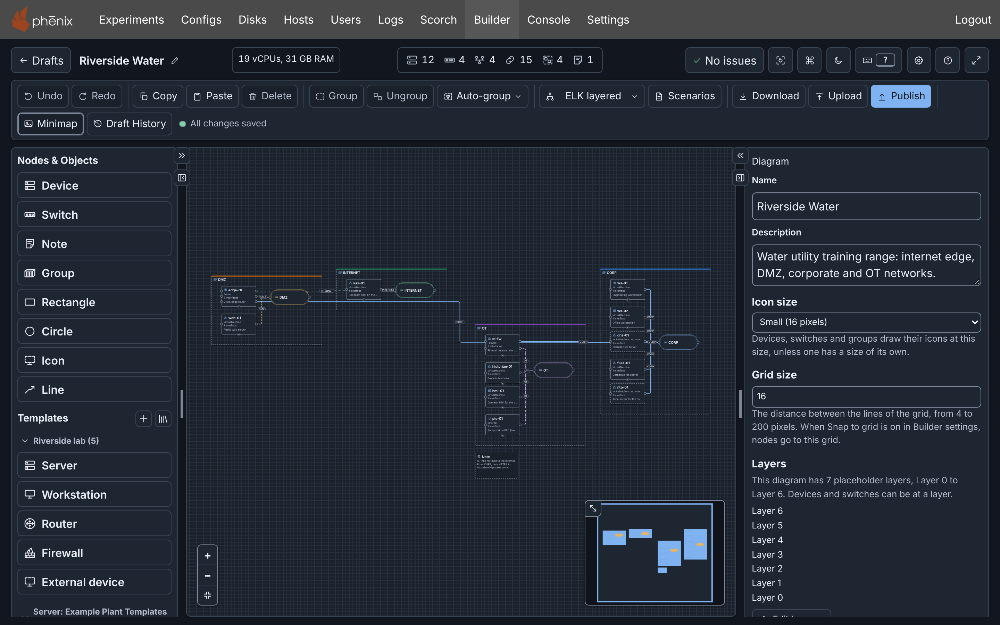
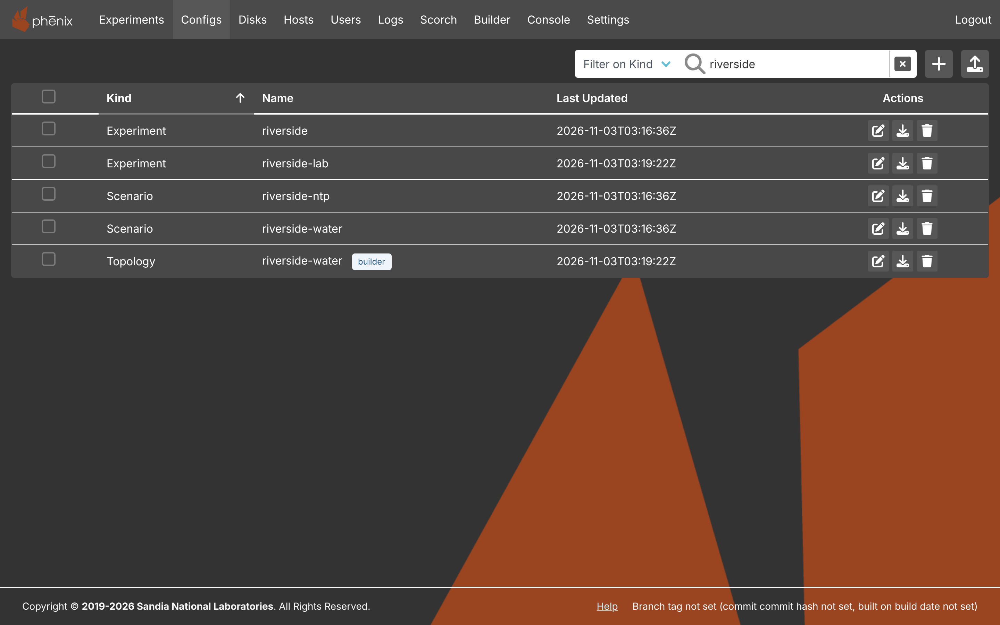

# Builder

Builder is the graphical topology editor of the phēnix Web-UI. You draw
devices, switches and connections on a canvas, and when you publish,
Builder writes the Topology config for you.

## What you can do

- [Draw a diagram](diagrams.md): devices, switches, connections, groups,
  notes and drawings, with your own colors and icons. A switch is one
  network.
- [Import](import-upload-download.md) a stored Topology or Experiment
  config, or a config file, as a new draft. Upload a file that is already
  a diagram, for example from another phēnix server.
- Arrange the diagram with one of five automatic layouts, or by hand.
- Add devices from [templates](templates.md), kept in the diagram or in a
  library that all users share.
- [Check](editor.md) the diagram while you work. Builder marks an
  interface with no VLAN, two devices with one hostname, and other issues
  before you publish.
- [Publish](publishing.md) the diagram as a Topology config, and
  optionally an Experiment config with one of its scenarios.
- Go back. Builder [saves each change](drafts.md) to the server, and
  **Draft History** restores an earlier snapshot.
- [Download](import-upload-download.md) the diagram as a PNG or SVG
  picture, a draw.io file, a Gephi (GEXF) file, or a Topology YAML file.
- Work from the keyboard alone, with a [command palette](editor.md) and
  shortcuts.

## How Builder fits phēnix

A diagram lives in a draft on the phēnix server. Drafts are separate from
configs: the **Configs** page does not list them, and a change to a draft
writes no config. Only **Publish** writes a Topology or Experiment config
from the draft. Until then, you can draw, check and change as much as you
want.

A published topology names its diagram. On the **Configs** page it has
the tag `builder`, and the tag opens the diagram in Builder again. An
experiment runs from the Topology config, not from the diagram.

The diagram holds more than the topology: positions, groups, notes,
colors, icons and layers. Publishing leaves them out. A Builder JSON
download keeps them.

## Where to start

Click **Builder** in the navigation bar to open it.

1. Do the [Tutorial](tutorial.md). It takes about 10 minutes and ends with
   a published topology and an experiment.
2. Read the page of the feature that you need. The feature pages are
   [Drafts](drafts.md), [The Editor](editor.md), [Diagrams](diagrams.md),
   [Templates and Icons](templates.md),
   [Import, Upload and Download](import-upload-download.md) and
   [Publishing](publishing.md).
3. When something does not work, see [Troubleshooting](troubleshooting.md).
   Messages, codes, shortcuts and limits are in the
   [Reference](reference.md).

Each feature page ends with links into its details page, which holds every
rule, limit and message of the feature.

!!! note
    Earlier phēnix releases had a different graphical editor, also named
    Builder. Builder converts its diagrams when you import or upload them:
    see [Legacy Builder](legacy.md).
