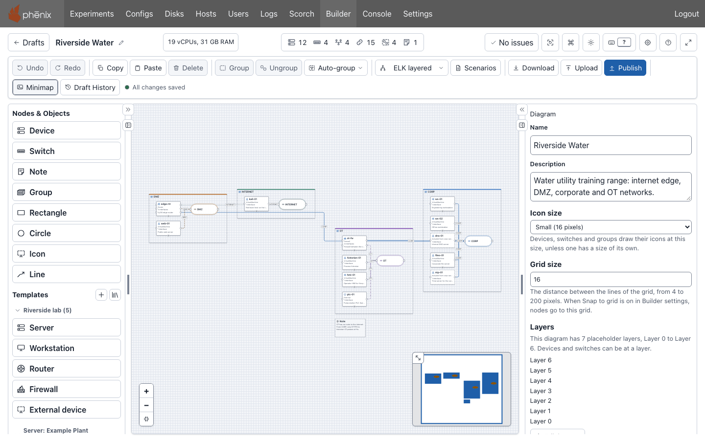
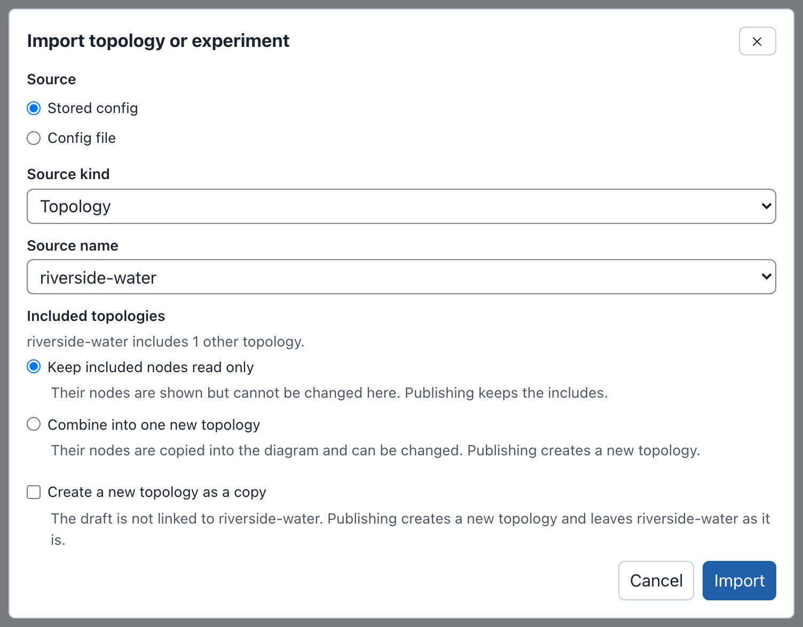
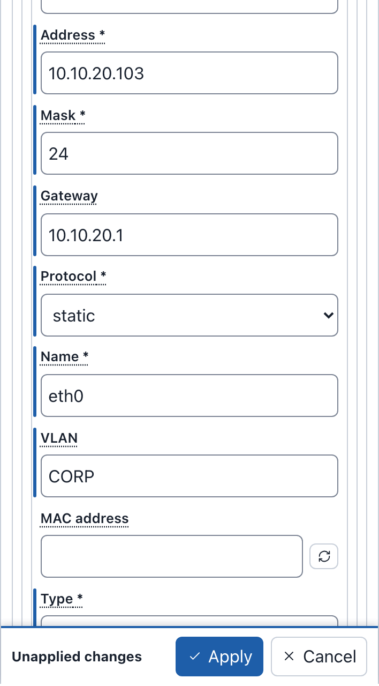
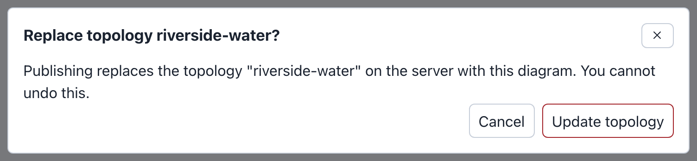
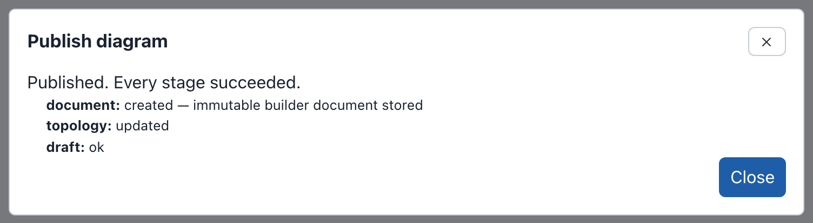

# Builder

Builder is the phenix web editor for topology diagrams. Builder saves your
work as a draft on the phenix server, apart from the phenix configs. Only
**Publish** writes Topology and Experiment configs and adds a topology to its
scenarios. Only the **Scenarios** dialog stores a Scenario config.

To use Builder, your role needs the Builder permission. The built-in Builder
and Global Admin roles have it. A role without it sees no **Builder** link
(see [Permissions](administration.md#permissions)).



## What you can do with Builder

- [Draw](diagrams.md) devices, switches (one per network), connections,
  notes, groups and drawings, with your own colors, line styles and icons.
  Arrange them with one of five automatic layouts.
- Give a network a [subnet and a gateway](diagrams.md#adding-switches-and-networks).
  Builder then gives the next free address to each static interface with no
  address that you connect to it.
- Put nodes on your own [layers](diagrams.md#layers), such as the Purdue
  model levels, and stack them with the **By layer** layout. All users share
  the [layer set library](drafts.md#the-layers-tab) of the server.
- Make a draft from a Topology or Experiment config with **Import**, or from
  a file with **Upload** (see
  [Import, Upload and Download](import-upload-download.md)). Open a topology
  in Builder [from the Configs page](import-upload-download.md#from-the-configs-page).
- [Download](import-upload-download.md#downloading) the diagram as Builder
  JSON or YAML, Topology YAML, PNG, SVG, draw.io or Gephi (GEXF).
- Keep [device templates](templates.md) in the diagram, or in the shared
  **Node Templates** library. Diagrams with a copy of a changed library
  template offer the update.
- View, edit, create or upload the [Scenario configs](diagrams.md#scenarios)
  of the diagram.
- Restore earlier versions with **Draft History**. Builder
  [saves each edit](drafts.md#how-drafts-save) to the server.
- All Builder users [see, open and change](drafts.md#the-drafts-page) the
  same drafts.
- [Find problems](editor.md#checks-and-warnings) before you publish, such as
  an interface with no network.
- [Publish](publishing.md) a Topology config, or a Topology and an Experiment
  config, from the editor or the drafts page.
- Keep a diagram as a [file next to its topology](administration.md#builder-documents-in-files)
  on the phenix server.
- See [who made a diagram and who edited it last](editor.md#with-nothing-selected).
- Use the [command palette](editor.md#command-palette) and
  [keyboard shortcuts](editor.md#keyboard-shortcuts).

## The legacy Builder

Earlier phenix releases had a different editor with the same name. Its
topologies have the tag `builder legacy` on the **Configs** page. **Import**
and **Upload** convert its topologies and diagram files into drafts (see
[Legacy Builder](legacy.md)).

## The example lab

The examples on these pages use one small lab, **Riverside Water**. It is a
water utility with an internet edge, a DMZ, a corporate network, and an OT
(control) network behind a firewall. Its Topology config is
`riverside-water`. It includes a second topology, `corp-services`, which
holds the servers `dns-01` and `ntp-01`. The Scenario config
`riverside-water` configures NAT on the edge router (the `vrouter` app) and
time service from `ntp-01` (the `ntp` app).

| Network (VLAN) | Subnet | Devices and their addresses |
|---|---|---|
| `INTERNET` | 203.0.113.0/24 | `kali-01` .50, `edge-rtr` .2 (gateway .1) |
| `DMZ` | 172.16.10.0/24 | `edge-rtr` .1, `web-01` .10 |
| `CORP` | 10.10.20.0/24 | `edge-rtr` .1, `files-01` .10, `ws-01` .101, `ws-02` .102, `ot-fw` .254, and from `corp-services`: `dns-01` .53, `ntp-01` .123 |
| `OT` | 10.10.30.0/24 | `ot-fw` .1, `hmi-01` .10, `historian-01` .20, `plc-01` .50 |

| Device | What it is |
|---|---|
| `edge-rtr` | VyOS edge router (type Router, image `vyos.qc2`), with a route to 10.10.30.0/24 through `ot-fw` |
| `ot-fw` | Firewall between CORP and OT (type Firewall, image `minirouter.qc2`). Its ruleset `corp-to-ot` allows only HTTPS from CORP to `historian-01` |
| `kali-01` | Red team host on the internet (`kali.qc2`) |
| `web-01` | Public web server (`ubuntu.qc2`) |
| `files-01` | Corporate file server (`ubuntu.qc2`) |
| `ws-01`, `ws-02` | Engineering and office workstations (`windows10.qc2`) |
| `hmi-01` | Operator HMI (`windows10.qc2`) |
| `historian-01` | Process historian (`ubuntu.qc2`) |
| `plc-01` | Pump station PLC, an external (hardware in the loop) device |
| `dns-01`, `ntp-01` | DNS and time servers, from `corp-services` (`ubuntu.qc2`) |

Some pages use two more topologies: `metro-campus` (42 devices on 7
networks) for the layouts, and `pump-station`, a file that you import
without storing it in phenix.

### Load the example configs

Download the example files:

- [corp-services.topology.yaml](examples/corp-services.topology.yaml)
- [riverside-water.topology.yaml](examples/riverside-water.topology.yaml)
- [riverside-water.scenario.yaml](examples/riverside-water.scenario.yaml)
- [metro-campus.topology.yaml](examples/metro-campus.topology.yaml)
- [pump-station.topology.yaml](examples/pump-station.topology.yaml)
- [pump-station.builder.json](examples/pump-station.builder.json)
- [riverside-water.builder.json](examples/riverside-water.builder.json) (see
  [The drafts on these pages](#the-drafts-on-these-pages))
- [lakeside-treatment.builder.json](examples/lakeside-treatment.builder.json),
  with layers (see
  [Example: map layers to the Purdue model](diagrams.md#example-map-layers-to-the-purdue-model))

Store the first four configs in phenix, and create the experiment
`riverside` from them.

#### From the Command Line Binary

```bash
phenix config create corp-services.topology.yaml riverside-water.topology.yaml riverside-water.scenario.yaml metro-campus.topology.yaml
phenix experiment create riverside -t riverside-water -s riverside-water
```

#### From the Web-UI

1. On the **Configs** page, upload the four configs (see
   [Create a Config](../configuration.md#create-a-config)).
2. On the **Experiments** page, create the experiment `riverside` with
   **Experiment Topology** `riverside-water` and **Experiment Scenario**
   `riverside-water` (see
   [Create a New Experiment](../experiments.md#create-a-new-experiment)).

### The drafts on these pages

Most pages show these drafts:

- **Riverside Water**: the import of `riverside-water`, renamed, laid out with
  **ELK layered**, grouped with **Auto-group** > **By network**, with a note
  and the scenario `riverside-water`. To get it,
  [upload](import-upload-download.md#uploading-a-builder-document)
  `riverside-water.builder.json` on the drafts page.
- **Riverside Water expansion**: a copy of Riverside Water with a duplicate
  of `historian-01`, which causes a warning. To make it:
    1. On the drafts page, upload `riverside-water.builder.json` again.
       Upload always makes a new draft, and the new draft opens.
    2. Use [**Edit diagram name**](editor.md#renaming-the-diagram) to rename
       the draft `Riverside Water expansion`.
    3. Select `historian-01`.
    4. Press <kbd>⌘</kbd>+<kbd>D</kbd> on macOS or
       <kbd>Ctrl</kbd>+<kbd>D</kbd> on Windows and Linux to
       [duplicate it](diagrams.md#duplicating-a-device). The copy is
       `historian-01-2`, and the header says **1 warning**.
- **Metro Campus**: the import of `metro-campus`, renamed Metro Campus, with
  no layout.

The [quick start](#quick-start) and
[Publishing a topology](publishing.md#publishing-a-topology) each publish
`riverside-water`. After that, the other drafts made from `riverside-water`
cannot publish. Drafts that you then upload from
`riverside-water.builder.json` cannot publish either (see
[When the source config changed](publishing.md#when-the-source-config-changed)).

## Quick start

First, [load the example configs](#load-the-example-configs).

### Import the topology

1. Select **Builder** in the navigation bar. The drafts page opens.
2. Select **Import**.
3. In the **Import topology or experiment** dialog, keep **Stored config**
   and **Source kind** **Topology**. Choose `riverside-water` under
   **Source name**. Keep **Keep included nodes read only**, and leave
   **Create a new topology as a copy** clear.
4. Select **Import**. The dialog says "This import has 1 warning." The
   warning says that `dns-01` and `ntp-01` come from the included topology
   `corp-services` and are read only.
5. Select **Continue to editor**. A new draft named riverside-water opens,
   with its devices in rows on a grid.
6. In the toolbar, open the layout menu (**Default**) and choose
   **ELK layered**. Each switch moves next to its devices.

The dialog in step 3:



### Add a workstation

1. Under **Templates**, select **Workstation**. A device named workstation
   appears on the canvas, and the Inspector shows its settings.
2. In the Inspector, set **Hostname** to `ws-03` and **Description** to
   `Engineering workstation`.
3. Under **Network**, select **Add interface**. The new interface has
   **Interface kind** **Static or OSPF**, **Name** `eth0` and **Mask** `24`.
   Focus moves to **Address**.
4. Enter **Address** `10.10.20.103`, **Gateway** `10.10.20.1` and **VLAN**
   `CORP`.
5. Select **Apply**. Builder connects eth0 to the CORP switch because of the
   VLAN `CORP`.
6. Make sure that the header shows **No issues**, 13 devices and 16
   connections, and the toolbar shows **All changes saved**.

The interface before step 5:

{ width="354" }

### Publish the topology

1. Select **Publish** in the toolbar. The **Publish diagram** dialog opens.
2. Keep **Topology only** and **Topology name** `riverside-water`. The
   dialog says "A topology with this name exists. Publishing updates it."
   **Checks** says that 11 devices, 4 switches, 4 networks and 14
   connections are ready to publish. The topology includes `dns-01` and
   `ntp-01` by reference from `corp-services`.
3. Select **Update topology**. Builder asks "Replace topology
   riverside-water?".
4. Select **Update topology** again. The dialog says "Published. Every stage
   succeeded."
5. Select **Close**.

Steps 3 and 4:





The Topology config `riverside-water` now has `ws-03`, and the tag `builder`
on the **Configs** page. The tag, the **Edit** button and **Open in
Builder** [open the quick start draft](publishing.md#editing-a-published-topology).
Experiments made from the topology before, such as `riverside`, keep their
copy of it. To run the new topology,
[create an experiment](../experiments.md#create-a-new-experiment) from it,
or [publish a topology and an experiment](publishing.md#publishing-a-topology-and-an-experiment).
