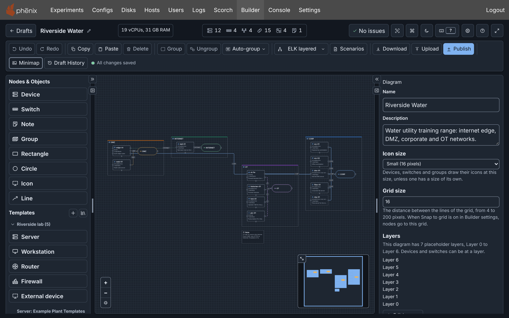
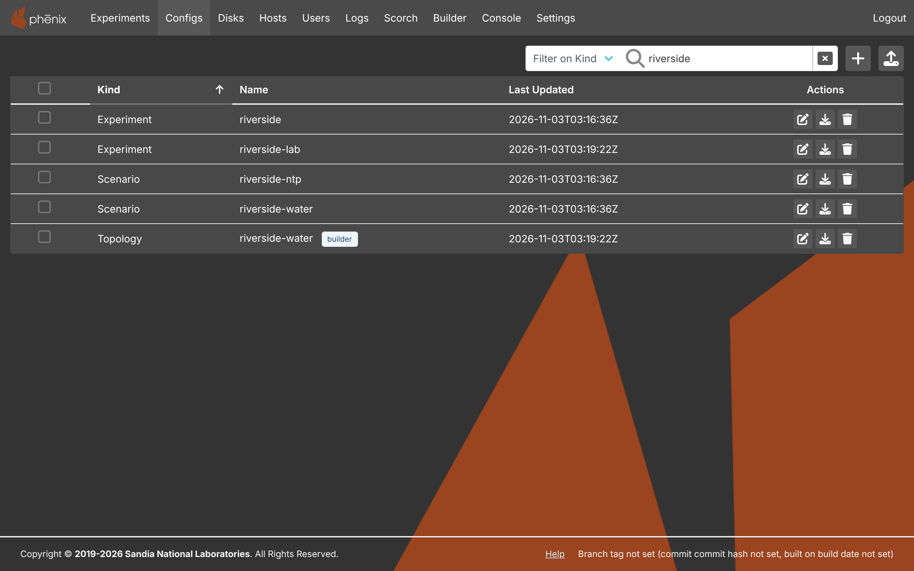

# Builder

Builder is the graphical topology editor in the phēnix web UI. You draw
devices, switches and connections on a canvas, and when you publish, Builder
writes the Topology config for you.

## What You Can Do

- [Draw a diagram](diagrams.md) with devices, switches (one network each),
  connections, groups, notes and drawings, and arrange it by hand or with one
  of five automatic layouts.
- [Import](import-upload-download.md) a Topology or Experiment config as a new
  draft, or upload a diagram file, for example from another phēnix server.
- Add devices from [templates](templates.md), kept in the diagram or in a
  shared library.
- [Check](editor.md) the diagram as you work, for issues such as an interface
  with no VLAN or two devices with one hostname.
- [Publish](publishing.md) a Topology config, and optionally an Experiment
  config with one of its scenarios.
- Go back: Builder [saves each change](drafts.md), and `Draft History`
  restores an earlier snapshot.
- [Download](import-upload-download.md) a PNG or SVG picture, a draw.io file,
  a Gephi (GEXF) file, or a Topology YAML file.
- Work from the keyboard with a [command palette](editor.md) and shortcuts.

## How Builder Fits phēnix

A diagram lives in a draft on the phēnix server. Drafts aren't configs: the
`Configs` page doesn't list them, and editing one writes nothing. Only
`Publish` writes a Topology or Experiment config, so until then you can change
as much as you want.

A published topology names its diagram. On the `Configs` page it has the tag
`builder`, which opens the diagram in Builder again. An experiment runs from
the Topology config, not from the diagram.

Positions, groups, notes, colors, icons and layers live only in the diagram.
Publishing leaves them out, but a Builder JSON download keeps them.

## Where to Start

Click `Builder` in the navigation bar to open it.

1. Do the [Tutorial](tutorial.md). It takes about 10 minutes and ends with a
   published topology and an experiment.
2. Read the page for the feature you need. Each one links to a details page
   with the rules and limits.
3. When something doesn't work, see [Troubleshooting](troubleshooting.md).
   Messages, codes, shortcuts and limits are in the [Reference](reference.md).

!!! note
    Earlier phēnix releases had a different graphical editor, also named
    Builder. Builder converts its diagrams when you import or upload them (see
    [Legacy Builder](legacy.md)).

## See Also

- [Administration](administration.md): Builder permissions, libraries and
  storage.
- [Configuration](../configuration.md): the configs that Builder publishes.
- [Experiments](../experiments.md): create and start an experiment from a
  published topology.
