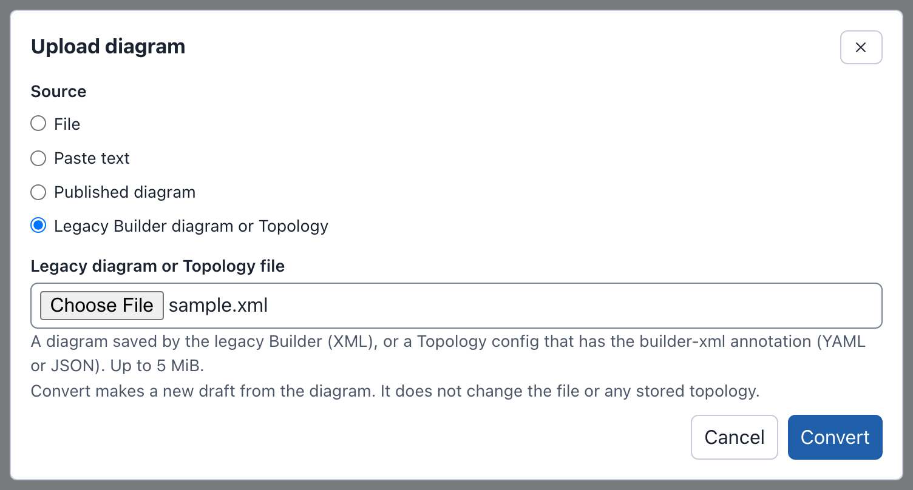

# Legacy Builder

Earlier phenix releases had a different graphical editor, also named Builder,
built on mxGraph. It opened at `/builder` in a new browser tab.

[sandialabs/sceptre-phenix#442](https://github.com/sandialabs/sceptre-phenix/pull/442)
removed the legacy Builder. The [Builder](index.md) replaces it and converts
its diagrams.

## What changed

| | Legacy Builder | Builder |
|---|---|---|
| Where phenix keeps a diagram | XML in the `builder-xml` annotation of the topology | A draft on the phenix server. **Publish** stores the diagram and names it in the `builder-doc` annotation |
| What writes the topology | **Save to phēnix** | **Publish** (see [Publishing](publishing.md)) |
| A line between two devices | A direct connection | A switch for each network. Converting adds the missing switch |
| Experiment variables | Placeholders such as `$DEFAULT_MEMORY` | The values, in each node |
| Tag on the **Configs** page | `builder legacy` | `builder` |
| REST routes | `POST /builder/save`, `/api/v1/builder/topologies`, `/api/v1/experiments/builder` | Removed (see [REST API](administration.md#rest-api)) |

Topologies from the legacy Builder still run, because phenix never read the
diagram to run an experiment. Convert a diagram only to edit it as a
diagram.

On the **Configs** page, the viewer and **Edit** show the annotation as
`builder-xml: <SNIPPED>`. phenix keeps the diagram while that line does not
change. If you delete the line, phenix deletes the diagram.

## Converting a stored topology

**Import** converts the diagram of a stored topology that has `builder-xml`
and no `builder-doc`:

1. In the phenix navigation bar, select **Builder**.
2. Select **Import**.
3. Keep **Stored config** and the **Source kind** **Topology**.
4. In **Source name**, choose the topology. Its name has the suffix
   "(legacy Builder diagram)".
5. Select **Import**.
6. If the dialog lists warnings (see [Warnings](#warnings)), select
   **Continue to editor**.
7. Edit the draft.
8. Select **Publish**.
9. In **Topology name**, enter the name of the topology.
10. Select **Update topology**.
11. Select **Update topology** again.

The result shows the warning "This diagram replaced the legacy Builder
diagram of topology NAME."

The draft uses the nodes of the topology. The old diagram gives only the
position of each node, matched by hostname, and the notes and groups.

Nothing changes on the server until you publish. Publishing to the same
topology deletes `builder-xml`, writes `builder-doc` and keeps the other
annotations. The topology then has the tag `builder`.

On the **Configs** page, the `builder legacy` tag and the **Import into
Builder** button of the viewer open the same **Import** dialog, set to that
topology (see
[Import, Upload and Download](import-upload-download.md#from-the-configs-page)).

With the [import options](import-upload-download.md#import-options), a
copy, or a draft that combines the included topologies, publishes a new
topology. The legacy topology then keeps its `builder-xml`.

Only the draft imported from the topology itself can replace its legacy
diagram. Other drafts cannot update the topology, such as a draft imported
from an experiment of the topology, or an uploaded file. Publish them under
a different name.

If the topology or its legacy diagram changes after the import, Publish
refuses (see
[When the source config changed](publishing.md#when-the-source-config-changed)).

When the import cannot read the diagram, the draft has no layout from it
(see [Warnings](#warnings)). Publishing then deletes `builder-xml` too, with
the warning "The server could not read the legacy Builder diagram of
topology NAME. The server removed it."

## Converting a file

**Upload** converts a legacy diagram in a file:

1. On the drafts page or in the editor toolbar, select **Upload**.
2. Under **Source**, choose **Legacy Builder diagram or Topology**.
3. In **Legacy diagram or Topology file**, choose the file.
4. Select **Convert**.
5. If the dialog lists warnings, select **Continue to editor**.

The editor opens a new draft. Its name is the file name without its last
extension.

The file can be up to 5 MiB, and it must be one of these:

- An XML file from **Save to Disk** in the legacy Builder. Its root element
  is `mxGraphModel` (or a bare `root`).
- A Topology config, as YAML or JSON, with the `builder-xml` annotation,
  such as one downloaded from the **Configs** page.

The converter does not read draw.io files (`mxfile`), or compressed or
base64-encoded diagrams. The **File** and **Paste text** sources do not
convert a legacy diagram. They say "This is possibly a
legacy Builder diagram (XML). Select "Legacy Builder diagram or Topology" to
convert it."

Upload refuses other files, for example with "Could not convert the legacy
diagram. This is not a legacy Builder diagram. A legacy diagram is mxGraph
XML, or a Topology config with the builder-xml annotation." A Topology config without
the annotation gives "Could not convert the legacy diagram. Topology NAME
has no legacy Builder diagram (no builder-xml annotation). Select Import to
make a diagram from it."

A diagram without its topology has only the node settings that the diagram
holds. A draft converted from a file always publishes a new topology. It
cannot update a stored topology, even one with the same name.

Converting a file needs `configs` `get` and `create`. phenix keeps each
`${NAME}` in a Topology config file as written (see
[Importing a config file](import-upload-download.md#importing-a-config-file)).
If you close the dialog during the conversion, the conversion stops.

## What is converted

| In the legacy diagram | In the Builder |
|---|---|
| A device | A device. Its settings come from the topology, or from the diagram when there is no topology |
| A router, firewall, desktop or server icon, in any color | The `router`, `firewall`, `desktop` or `server` icon. An external device gets `external`. Other icons become the icon of the device type |
| A switch | The switch of its network, named after the network |
| A VLAN ID on a switch or a line | The **VLAN alias** of the network, when it is a number from 1 to 4094. `0`, `auto` or none give no alias |
| A line from a device to a switch | A connection |
| A line between two devices | A connection to a switch added for that network, between its devices |
| Text | A note |
| A rectangle or container around nodes | A group, with its text as the title |
| A placeholder such as `$DEFAULT_VCPU` | Only for a diagram without a topology: the variable of the diagram, else the legacy default (`DEFAULT_MEMORY` 2048, `DEFAULT_VCPU` 1, `DEFAULT_VM_IMAGE` `ubuntu.qc2`, `DEFAULT_ROUTER_IMAGE` `vyos.qc2`). The value stays text, such as `vcpus: "1"`, as the legacy Builder wrote it |
| Positions | Doubled, on the 16-pixel grid, with each device centered where its icon was |
| The grid setting | Kept |

Positions double because a node card is about twice the size of the old
icon. Each device shows its type, such as `Router` or `External`.

For a topology, the conversion leaves out a node that is in the diagram but
not in the topology. It puts a node of the topology that is not in the
diagram below the diagram. Each gives a warning.

### What is left out

- The name of the legacy switch. A switch has the name of its network.
- The variables of the diagram, after the conversion fills them in, and the
  `schema` and `device` keys of each node.
- Icon colors and artwork, and the `mobile` icon.
- Shapes, fills, strokes, fonts, rotation, shadows, dashes and arrows, and
  the HTML formatting of labels.
- Edge labels, waypoints and lines that are not links between a device and a
  network.
- Layers (merged into one), whether a cell was hidden, collapsed or locked,
  and the stacking order.
- Tooltips, links and inserted images.
- Shapes without text.
- Page settings, such as the page size, background and grid size.
- The parent of a group nested more than 32 deep.

## Warnings

The dialog lists each warning before it makes the draft. A list of names
shows at most 8 names, then the number of the others.

| Warning | What it means |
|---|---|
| "The Builder could not read the legacy diagram of topology NAME (…). The Builder did not use its layout. The Builder placed the nodes automatically." | The converter cannot read the `builder-xml` of the topology. The draft has the nodes of the topology, on a grid. Publishing deletes the old diagram |
| "1 node of the legacy diagram is not in the topology. The Builder did not import it: …" | The topology changed after the last save of its diagram. The draft uses the nodes of the topology |
| "1 node of the topology was not in the legacy diagram. The Builder placed it below the diagram: …" | The same, in the other direction |
| "The Builder added a switch for 1 network that had none in the legacy diagram: …" | The diagram joined two devices with a line, or did not draw the network |
| "The Builder did not import 1 link whose node has no interface on that network: NODE to NETWORK." | A line joins a device to a network that none of its interfaces uses |
| "VLAN ID VALUE of network NAME is not a number from 1 to 4094. The Builder did not import it." | The network has no VLAN alias |
| "Network NAME has more than one VLAN ID in the legacy diagram. The Builder kept the first, ID." | Its switches or lines gave other IDs |
| "VLAN ID ID occurs on networks A and B. The Builder kept it only for A." | Two networks cannot share an alias |
| "The legacy diagram had N layers. The Builder merged them into one layer." | All nodes are on one canvas |
| "1 item has settings that the Builder could not read. The Builder did not import it: …" | A node in the diagram has damaged settings |
| "1 node has interfaces that the Builder could not read. The Builder did not import these interfaces: …" | Only for a diagram without a topology. The node stays, without those interfaces |
| "The Builder renamed node "OLD" to "NEW": a hostname cannot hold spaces." | Spaces became hyphens. A network gets the same change, with "a network name cannot hold spaces" |
| "Used the legacy defaults for variables the diagram does not define: $DEFAULT_MEMORY = 2048, …" | Check the values in the Inspector |
| "1 placeholder has no value in the diagram. The Builder kept it as text: $NAME." | Replace the text in the Inspector before you publish |
| "The Builder did not import 1 line that was not a network link." or "The Builder did not import 1 shape that had no text." | See [What is left out](#what-is-left-out) |
| "The Builder kept text and containers as notes and groups. The Builder did not convert their colors, fonts and other formatting." | Given once, when the diagram has text or containers |
| "The diagram has no nodes." | The draft is empty |

## Keeping a copy of the old diagram

Before you publish, download the topology from the **Configs** page. The
file holds the XML, and **Upload** can convert it again. To open the old
editor, use a phenix release before Builder v2.
