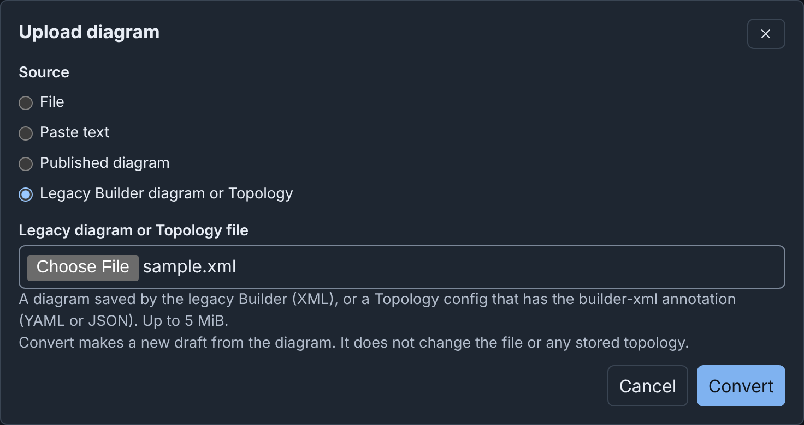

# Legacy Builder

Earlier phēnix releases had a different graphical editor, also named Builder,
built on mxGraph. It opened at `/builder` in a new browser tab. This release
doesn't include it, but you can convert its diagrams.

## What Changed

| | Legacy Builder | Builder |
|---|---|---|
| Where phēnix keeps a diagram | XML in the `builder-xml` annotation of the topology | A draft on the phēnix server. `Publish` stores the diagram and names it in the `builder-doc` annotation |
| What writes the topology | `Save to phēnix` | `Publish` (see [Publishing](publishing.md)) |
| Tag on the `Configs` page | `builder legacy` | `builder` |
| REST routes | `POST /builder/save`, `/api/v1/builder/topologies`, `/api/v1/experiments/builder` | Removed (see [REST API](details/administration.md#api)) |

Legacy topologies still run, since phēnix never read the diagram to run an
experiment. Convert one only if you want to edit it as a diagram.

!!! warning
    On the `Configs` page, the annotation shows as `builder-xml: <SNIPPED>`.
    phēnix keeps the diagram as long as that line is unchanged. If you delete
    the line, phēnix deletes the diagram.

## Converting a Stored Topology

`Import` converts the diagram of a stored topology that has `builder-xml` and
no `builder-doc`:

1. In the phēnix navigation bar, click `Builder`.
2. Click `Import`.
3. Keep `Stored config` and the `Source kind` `Topology`.
4. In `Source name`, choose the topology. Its name ends in
   "(legacy Builder diagram)".
5. Click `Import`.
6. If the dialog lists [warnings](#warnings), click `Continue to editor`.

On the `Configs` page, the `builder legacy` tag and the viewer's
`Import into Builder` button open the same dialog.

The draft takes its nodes from the topology. The old diagram supplies only
each node's position and icon (matched by hostname), the switches, the VLAN
IDs, the notes and the groups. Edit the draft as needed, then replace the
legacy diagram:

1. Click `Publish`.
2. In `Topology name`, enter the name of the topology.
3. Click `Update topology`.
4. Click `Update topology` again.

Nothing changes on the server until you publish. Publishing deletes
`builder-xml`, writes `builder-doc`, and changes the tag to `builder`. It
deletes the old diagram even if the import couldn't read it.

Only the draft imported from the topology itself can replace its legacy
diagram. Any other draft has to publish under a new name. If the topology or
its legacy diagram changes after the import, publishing is refused (see
[When the source config changed](details/publishing.md#when-the-source-config-changed)).

## Converting a File

`Upload` converts a legacy diagram in a file:

1. On the drafts page or in the editor toolbar, click `Upload`.
2. Under `Source`, choose `Legacy Builder diagram or Topology`.
3. In `Legacy diagram or Topology file`, choose the file.
4. Click `Convert`.
5. If the dialog lists warnings, click `Continue to editor`.

The file can be up to 5 MiB, and must be one of these:

- An XML file from `Save to Disk` in the legacy Builder. Its root element is
  `mxGraphModel` (or a bare `root`).
- A Topology config, as YAML or JSON, with the `builder-xml` annotation, such
  as one downloaded from the `Configs` page.

draw.io files (`mxfile`) and compressed or base64-encoded diagrams don't
convert. For a Topology config without the annotation, use `Import` instead.

A diagram file without its topology has only the node settings that the
diagram itself holds. A draft converted from a file always publishes a new
topology, even if a stored one has the same name.

## What Is Converted

Devices, switches, connections, text (as notes) and rectangles or containers
around nodes (as groups) carry over, at twice their old spacing. A line
between two devices was a direct connection; Builder adds a switch for its
network. A VLAN ID becomes the
network's `VLAN alias` when it's a number from 1 to 4094.

For a diagram without a topology, a placeholder such as `$DEFAULT_VCPU` takes
the diagram's variable, else the legacy default (`DEFAULT_MEMORY` 2048,
`DEFAULT_VCPU` 1, `DEFAULT_VM_IMAGE` `ubuntu.qc2`, `DEFAULT_ROUTER_IMAGE`
`vyos.qc2`).

Styling (colors, fonts, shapes, arrows), edge labels, waypoints, layers
(merged into one), page settings, tooltips, links, images, shapes without
text, and lines that don't join a device to a network are left out.

## Warnings

The dialog lists warnings before it makes the draft. Most of them only say
what changed or what Builder placed for you. These are worth a look:

| Warning | What it means |
|---|---|
| "The Builder could not read the legacy diagram of topology NAME (…). …" | The draft has the topology's nodes on a grid, and publishing deletes the old diagram |
| "1 node of the legacy diagram is not in the topology. The Builder did not import it: …" | The topology changed after the diagram was last saved. The draft follows the topology |
| "Used the legacy defaults for variables the diagram does not define: …" | Check the values in the Inspector |
| "1 placeholder has no value in the diagram. The Builder kept it as text: $NAME." | Replace the text in the Inspector before you publish |
| "1 item has settings that the Builder could not read. The Builder did not import it: …" | A node in the diagram has damaged settings, so the draft doesn't have it |
| "1 node has interfaces that the Builder could not read. The Builder did not import these interfaces: …" | The node stays, without those interfaces |
| "The Builder did not import 1 link whose node has no interface on that network: NODE to NETWORK." | None of the device's interfaces uses that network |
| "VLAN ID VALUE of network NAME is not a number from 1 to 4094. …", "Network NAME has more than one VLAN ID …" or "VLAN ID ID occurs on networks A and B. The Builder kept it only for A." | A network has no VLAN alias, or kept only one of the IDs it had |
| "The Builder renamed node "OLD" to "NEW": a hostname cannot hold spaces." | Spaces became hyphens. Networks get the same treatment |

## Keeping a Copy of the Old Diagram

Before you publish, download the topology from the `Configs` page. The file
holds the XML, and `Upload` can convert it again. To open the old editor,
use phēnix 1.0.0 or an earlier release.

## See Also

- [Import, Upload and Download](import-upload-download.md): the other ways
  to bring a topology into Builder.
- [Troubleshooting](troubleshooting.md#import-and-upload): import and upload
  problems.
- [Configuration Files](../configuration.md): Topology configs and their
  annotations.
