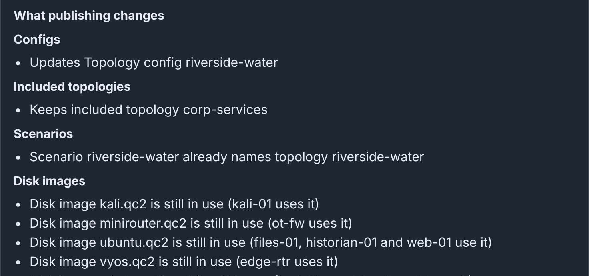
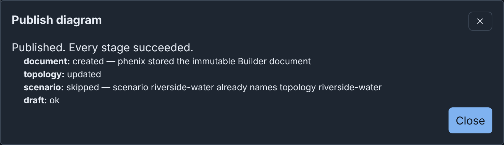
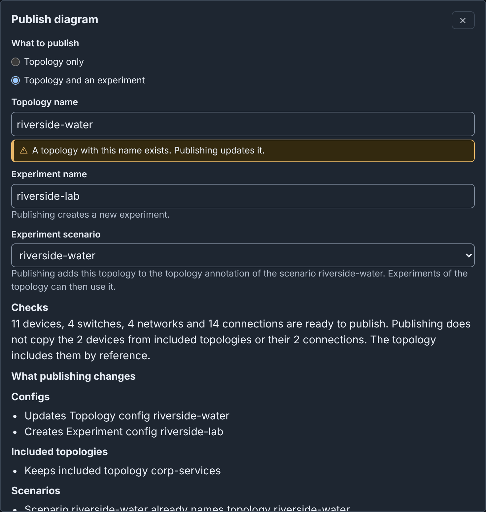
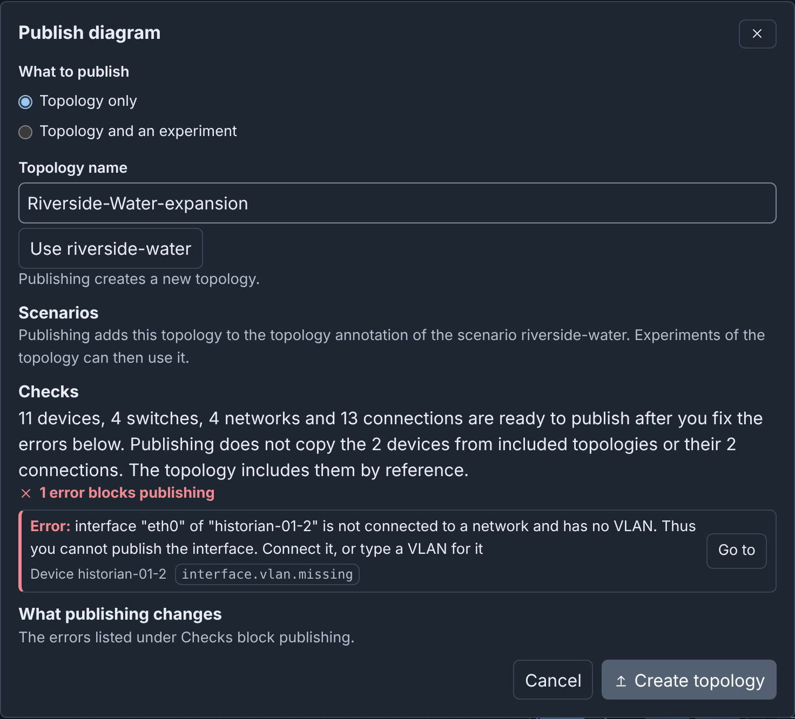

# Publishing

Publish writes a Topology config from a draft, and optionally an
Experiment config with one of the scenarios that the diagram lists. It
uses the last saved snapshot, and the server checks that snapshot again
before it writes.

## Before you publish

- Fix the errors, and the warnings that block publishing (see
  [What blocks publishing](#what-blocks-publishing)).
- Apply or cancel your changes in the Inspector. Publish applies and saves
  valid changes. Changes that it cannot apply block publishing, and the
  dialog names them.
- Check your permissions. **Publish** is not available in a published
  diagram, which opens read only, or when your role cannot update configs.

**Publish** is in the toolbar, in the command palette as **Publish…**, and
on each card of the drafts page.

## Publish a topology

To update the topology `riverside-water` from the Riverside Water draft:

1. Open the draft.
2. Click **Publish**.
3. Under **What to publish**, keep **Topology only**.
4. Below **Topology name**, click **Use riverside-water**. The hint says
   "A topology with this name exists. Publishing updates it." A config name
   holds only letters, numbers, `_`, `@`, `.` and `-`.
5. Read **Checks**. It says what is ready to publish.
6. Click **Update topology**. Builder asks "Replace topology
   riverside-water?".
7. Click **Update topology** again.
8. Click **Close**.

### What the topology holds

The Topology config holds the settings of each device, and the network of
each connected interface as its `vlan`. It does not hold the parts that
only Builder uses: positions, groups, notes, drawings, colors, line
styles, icons, layers and templates. It also does not hold the **Subnet**
and **Gateway** of a network.

### What publishing changes

**What publishing changes**, above the buttons, compares the server with
the result of the publish:

- The configs that Publish creates, updates or does not change.
- The included topologies that it adds, removes or keeps.
- The scenarios that get the topology.
- The disk images that the devices use.
- With an experiment, the VLAN aliases that change.

### Create or update

The hint under **Topology name** says what publishing does with that name,
and the button names the action. When a topology with that name exists
and this draft cannot update it, the dialog refuses the name (see
[Publish hints and buttons](reference.md#publish-hints-and-buttons)).

A draft can update a topology in these cases:

- The draft published the topology.
- The draft is an import of the stored topology.
- You opened the draft from the published diagram.
- The draft is an upload of a Builder document from such a draft.

A copy, a combined import and an import of a config file cannot update
the source topology (see
[Create or update](details/publishing.md#create-or-update)).

You cannot undo an update. phēnix keeps no earlier version of a config.
To go back, restore an earlier snapshot in **Draft History**. Then publish
again. An update keeps the other annotations of the topology and adds
`builder-doc`.

### The result

The dialog lists each stage and its result (see
[Publish results](reference.md#publish-results)). When a stage fails, the
dialog says "Published with failures." or "Publish failed. It wrote no
configs." Remove the cause, for example stop a running experiment. Then
click **Back** and publish again with the same names. The stages that are
done show `skipped`, and Publish writes nothing twice.

## Publish a topology and an experiment

To update `riverside-water` and create the experiment `riverside-lab`:

1. Open the draft.
2. Click **Publish**.
3. Under **What to publish**, select **Topology and an experiment**.
4. Below **Topology name**, click **Use riverside-water**.
5. In **Experiment name**, enter `riverside-lab`.
6. Keep **Experiment scenario** `riverside-water`.
7. Click **Update topology and create experiment**. Builder asks "Replace
   topology riverside-water?".
8. Click **Update topology and create experiment** again.
9. Click **Close**.

Publish writes the **VLAN alias** of each network to `vlans.aliases` of
the experiment.

An experiment name follows the config name rule, and it cannot be `all`.
Some servers name each network bridge after its experiment. On these
servers, an experiment name has at most 15 characters.

A draft can update only the experiment that it comes from, or that it
published. An update runs the configure stage of the apps. Stop the
experiment before you update it. An update removes the host pins of
devices that are no longer in the topology, with a warning (see
[Host pins](details/publishing.md#host-pins)).

### Scenarios

In both modes, Publish adds the topology to the `topology` annotation of
each listed scenario, when the annotation does not name it yet.
**Experiment scenario** selects the scenario of the experiment, or
**No scenario**. Publish refuses when a listed scenario does not exist or
your role cannot read it. It also refuses when your role cannot update a listed
scenario whose annotation needs the topology (see
[Scenarios](details/publishing.md#scenarios)).

## What blocks publishing

Errors block publishing, for example two devices with one hostname. Five
kinds of warnings also block publishing. The draft saves with them, but
the Publish dialog lists them as errors:

- An interface with no network and no VLAN, on a device that is not
  external.
- Two interfaces on one network with the same IP address or MAC address.
- A hostname that phēnix refuses: one character, `all`, all digits, or
  `phenix` on a Windows device.
- A device setting that stops the experiment:
    - An interface with protocol `ospf` on a Router or Firewall of OS type
      `vyatta`, `vyos` or `linux`, with no `network.ospf`.
    - An `ntp-server` label that names no interface with an IP address.
- A device that is not external, with no drive.

Under **Checks**, the dialog lists the errors first, then the warnings,
each with **Go to**. When the server refuses a publish, the dialog shows
its reason and its issues with their codes.

If you copy `historian-01`, as in the
[tutorial](tutorial.md#step-4-fix-a-warning), Publish lists one error (see
[Example: Riverside Water expansion](details/publishing.md#example-riverside-water-expansion)).

!!! tip
    **Download** > **Topology YAML** saves the topology that Publish would
    write, and lists every issue that blocks publishing.

## Publish again

Publish again with the same names after each set of edits. The draft
remembers what it published. Two things can stop a second publish:

- Another draft published the topology.
- Someone changed the topology outside Builder, for example with
  `phenix config edit`.

The hint under **Topology name** gives the reason. In both cases, edit a
draft of the topology as it is now (see
[Edit a published topology](#edit-a-published-topology)), or publish
under another name.

### When the source config changed

A draft remembers the config that it comes from. Publish refuses the draft
under any name when that config changed after Builder made the draft. The
dialog shows a warning at the top. To keep your work:

1. Make a draft of the config as it is now. Click the edit button of the
   topology on the **Configs** page, or import it again.
2. Copy the changed devices from the old draft, and paste them into the
   new draft.
3. Connect the pasted devices again. A pasted device keeps its settings
   but not its connections.

See [When the source config changed](details/publishing.md#when-the-source-config-changed).

## Included topologies

Riverside Water includes the topology `corp-services`. The published
topology names `corp-services` and does not copy its devices. A diagram
imported with **Combine into one new topology** publishes the included
devices as its own. When the diagram and an included topology use one
hostname, Publish refuses (see
[Included topologies](details/publishing.md#included-topologies)).

## Edit a published topology

On the **Configs** page, click the tag `builder` in the row of the
topology. Builder opens the draft that published it, or else a draft of the
published diagram. **Edit as a draft** on the
**Published Diagrams** tab opens the same draft (see
[Editing a published topology](details/publishing.md#editing-a-published-topology)).

## Advanced

- A topology can name a Builder file as its diagram. See
  [A Builder file beside a topology](administration.md#a-builder-file-beside-a-topology)
  and
  [Publishing to a topology that names a Builder file](details/publishing.md#publishing-to-a-topology-that-names-a-builder-file).
- A draft imported from a legacy Builder topology replaces its legacy
  diagram when it publishes to the same topology. See
  [Converting a stored topology](legacy.md#converting-a-stored-topology).
- The **Scenarios** dialog writes Scenario configs to the server at once,
  and **Cancel** does not undo them. See
  [Storing scenarios from the Scenarios dialog](details/publishing.md#storing-scenarios-from-the-scenarios-dialog).

## More detail

- [Publishing: details](details/publishing.md): every rule, refusal and
  message.
- [What each task needs](details/administration.md#what-each-task-needs):
  the permissions of publishing.
