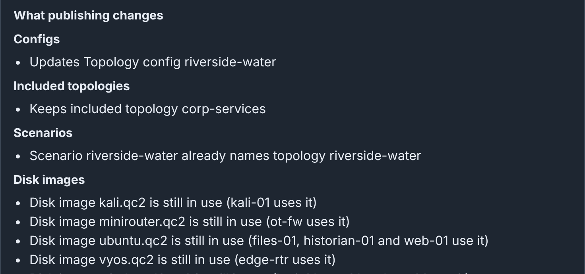
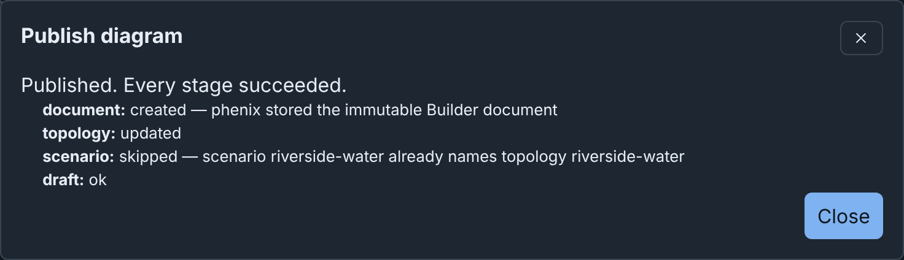
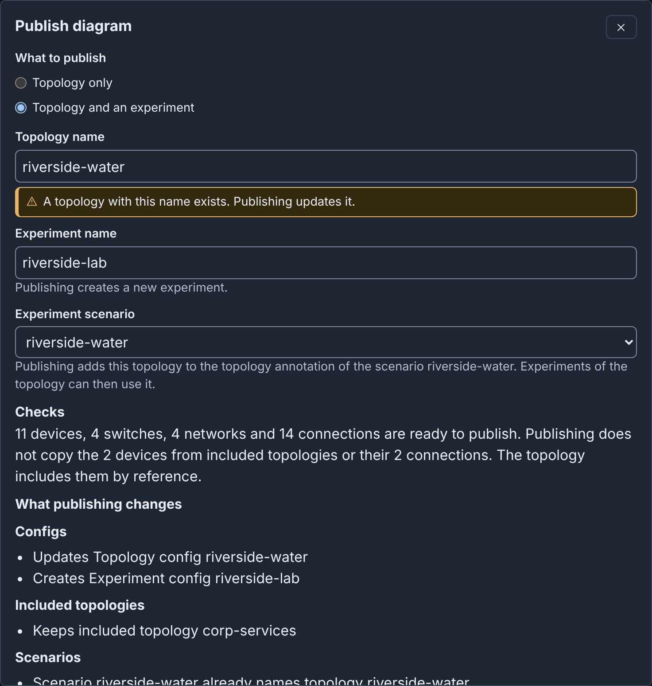
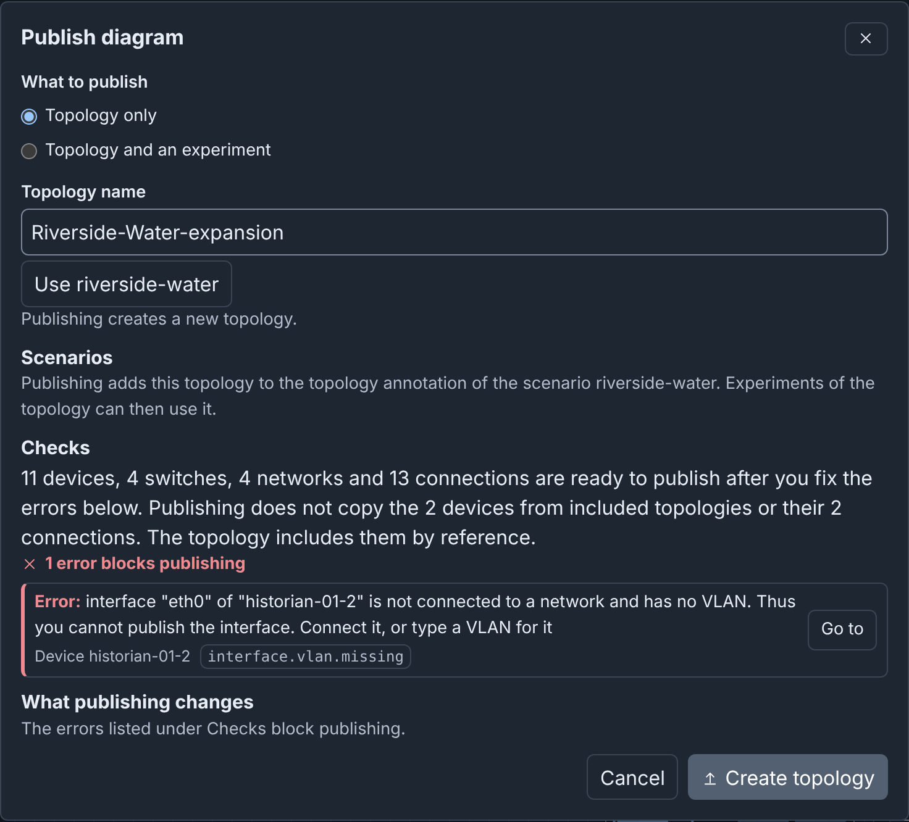

# Publishing

Publishing turns a draft into a Topology config, and optionally an
Experiment config with one of the scenarios that the diagram lists. Builder
publishes the last saved snapshot, and the server checks it again before it
writes anything.

## Before You Publish

Fix the errors, and the warnings that
[block publishing](#what-blocks-publishing). Publish applies and saves any
valid changes still open in the Inspector, and names the ones it can't
apply. You'll find `Publish` in the toolbar, in the command palette as
`Publish…`, and on each card of the drafts page (for the permissions, see
[What each task needs](details/administration.md#what-each-task-needs)).

## Publish a Topology

To update the topology `riverside-water` from the Riverside Water draft:

1. Open the draft.
2. Click `Publish`.
3. Under `What to publish`, keep `Topology only`.
4. Below `Topology name`, click `Use riverside-water`. The hint says "A
   topology with this name exists. Publishing updates it."
5. Read `Checks`. It says what is ready to publish.
6. Click `Update topology`. Builder asks "Replace topology
   riverside-water?".
7. Click `Update topology` again.
8. Click `Close`.

A config name can only hold letters, numbers, `_`, `@`, `.` and `-`.

### What the Topology Holds

The Topology config holds the settings of each device, and the network of
each connected interface as its `vlan`. Everything else, such as positions,
groups, notes, drawings, icons, layers, and the `Subnet` and `Gateway` of a
network, stays in Builder.

### What Publishing Changes

`What publishing changes`, above the buttons, previews the effect on the
server.

### Create or Update

The hint under `Topology name` says whether publishing creates or updates
that topology, and the button names the action (see
[Publish hints and buttons](reference.md#publish-hints-and-buttons)). A
draft can update an existing topology when it published that topology, is
an import of it, was opened from its published diagram, or is an upload of
a Builder document from such a draft. A copy, a combined import, or an
import of a config file can't, so the dialog refuses the name.

!!! warning
    You can't undo an update: phēnix keeps no earlier version of a config.
    To go back, restore an earlier snapshot in `Draft History` and publish
    again.

An update keeps the topology's other annotations and adds `builder-doc`.

### The Result

The dialog lists each stage and its result (see
[Publish results](reference.md#publish-results)). If a stage fails, fix
the cause (stop a running experiment, for example), click `Back` and
publish again with the same names. Stages that are already done show
`skipped`, so nothing is written twice.

## Publish a Topology and an Experiment

To update `riverside-water` and create the experiment `riverside-lab`:

1. Open the draft.
2. Click `Publish`.
3. Under `What to publish`, select `Topology and an experiment`.
4. Below `Topology name`, click `Use riverside-water`.
5. In `Experiment name`, enter `riverside-lab`.
6. Keep `Experiment scenario` at `riverside-water`.
7. Click `Update topology and create experiment`. Builder asks "Replace
   topology riverside-water?".
8. Click `Update topology and create experiment` again.
9. Click `Close`.

Publish writes the `VLAN alias` of each network to `vlans.aliases` of the
experiment. A new experiment's name can't be `all`, and on some servers it
can have at most 15 characters (see
[Experiment names](details/publishing.md#experiment-names)).

A draft can only update the experiment it comes from, or the one it
published. Stop the
experiment first, because an update runs the configure stage of the apps.
An update also removes the host pins of devices that are no longer in the
topology (see [Host pins](details/publishing.md#host-pins)).

### Scenarios

Publish adds the topology to the `topology` annotation of each listed
scenario, and refuses if a listed scenario doesn't exist or you can't read
it (see [Scenarios](details/publishing.md#scenarios)).

## What Blocks Publishing

Errors block publishing, for example two devices with one hostname. So do
these warnings, which the Publish dialog lists as errors:

- an interface with no network and no VLAN, on a device that isn't external
- two interfaces on one network with the same IP or MAC address
- a hostname that phēnix refuses: one character, `all`, all digits, or
  `phenix` on a Windows device
- an `ospf` interface on a `vyatta`, `vyos` or `linux` Router or Firewall
  with no `network.ospf`, or an `ntp-server` label that names no interface
  with an IP address
- a device that isn't external, with no drive

Under `Checks`, click `Go to` beside an issue to fix it. Here, a copy of
`historian-01` has an interface with no VLAN (see
[Example: Riverside Water expansion](details/publishing.md#example-riverside-water-expansion)).

!!! tip
    `Download` > `Topology YAML` saves the topology that Publish would
    write, and lists every issue that blocks publishing.

## Publish Again

After each set of edits, publish again with the same names. Builder won't
publish again if another draft published the topology since, or someone
changed it outside Builder (with `phenix config edit`, for example). The
hint under `Topology name` says which. Either way, edit a draft of the
topology as it is now (see
[Edit a Published Topology](#edit-a-published-topology)), or publish under
another name.

### When the Source Config Changed

If the config a draft comes from changed after Builder made the draft,
Publish refuses the draft under any name, and the dialog shows a warning at
the top. To keep your work:

1. Make a draft of the config as it is now. Click the edit button of the
   topology on the `Configs` page, or import it again.
2. Copy the changed devices from the old draft, and paste them into the new
   draft.
3. Connect the pasted devices again. A pasted device keeps its settings but
   not its connections.

## Included Topologies

The published topology names an included topology, such as
`corp-services`, without copying its devices. A diagram imported with
`Combine into one new topology` publishes them as its own. If the diagram
and an included topology use the same hostname, Publish refuses (see
[Included topologies](details/publishing.md#included-topologies)).

## Edit a Published Topology

On the `Configs` page, click the `builder` tag in the topology's row, or
click `Edit as a draft` on the `Published Diagrams` tab. Builder opens the
draft that published it, or else a draft of the published diagram.

## Advanced

- A topology can name a Builder file as its diagram (see
  [Publishing to a topology that names a Builder file](details/publishing.md#publishing-to-a-topology-that-names-a-builder-file)).
- A draft imported from a legacy Builder topology replaces the legacy
  diagram when it publishes back (see
  [Converting a stored topology](legacy.md#converting-a-stored-topology)).
- The `Scenarios` dialog writes Scenario configs to the server at once, and
  `Cancel` doesn't undo them.

## See Also

- [Publishing: Details](details/publishing.md): the rules and messages
  behind each step.
- [Experiments](../experiments.md#starting-stopping-experiments): start the
  experiment you published.
- [Configuration Files](../configuration.md#topology): the Topology config
  that Publish writes.
- [Troubleshooting](troubleshooting.md#publishing): what to do when a
  publish fails.
