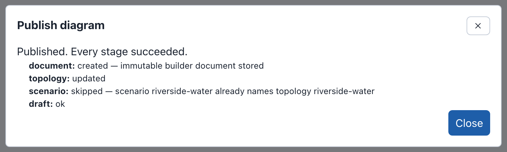
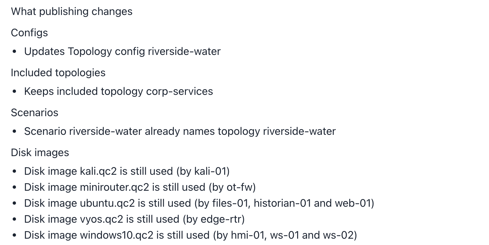
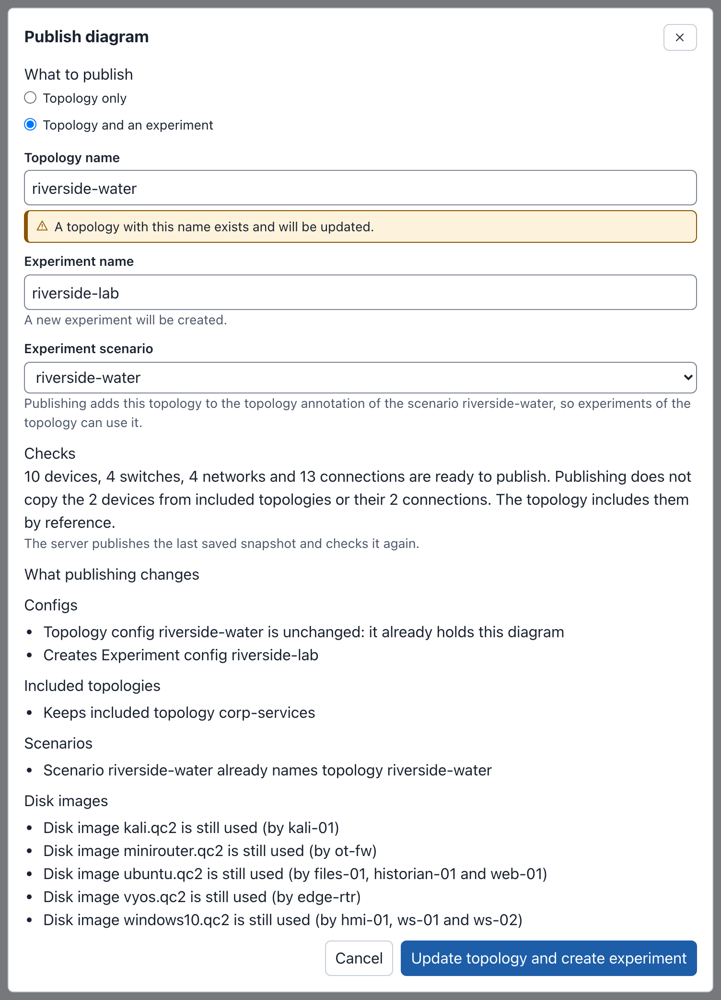
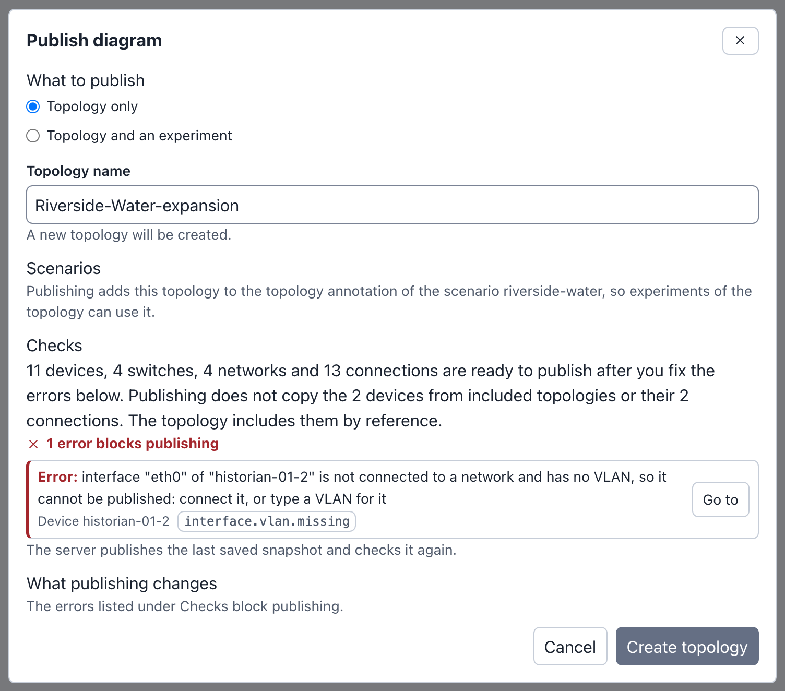

# Publishing

**Publish** writes these configs from the last saved snapshot of a draft:

- A Topology config.
- The topology name, in the `topology` annotation of each scenario that the
  diagram lists.
- Optionally, an Experiment config with one of those scenarios.

The server checks the snapshot again before it writes. The only other part
of Builder that writes a config is the [Scenarios](diagrams.md#scenarios)
dialog.

The examples publish the Riverside Water draft, which lists the scenario
`riverside-water` (see
[The drafts on these pages](index.md#the-drafts-on-these-pages)).

!!! note
    If you published `riverside-water` in the
    [quick start](index.md#quick-start), the Riverside Water draft cannot
    publish (see
    [When the source config changed](#when-the-source-config-changed)). Use
    your quick start draft, with the scenario `riverside-water` added (see
    [Scenarios](diagrams.md#scenarios)). Its counts are one device and one
    connection higher.

## Before you publish

- Fix the errors, and the five kinds of warnings, that block publishing
  (see [What blocks publishing](#what-blocks-publishing)).
- Apply or cancel your changes in the Inspector. Publish applies and saves
  valid changes (see [Automatic snapshots](drafts.md#automatic-snapshots)).
  Changes that it cannot apply block publishing, and the dialog names them.
- Check your permissions. **Publish** is not available on a published
  diagram, which opens read only, or when your role cannot update configs.
  Each config also needs its own permission (see
  [What each task needs](administration.md#what-each-task-needs)).

**Publish** is in the toolbar, and in the command palette as **Publish…**.
When your role can update configs, each card on the drafts page also has
**Publish** (see
[Publishing from the drafts page](drafts.md#publishing-from-the-drafts-page)).

## Publishing a topology

To update the topology `riverside-water` from the Riverside Water draft:

1. Open the Riverside Water draft.
2. Select **Publish** in the toolbar.
3. Under **What to publish**, keep **Topology only**.
4. Below **Topology name**, select **Use riverside-water**. The hint says
   "A topology with this name exists. Publishing updates it."
5. Read **Checks**: "10 devices, 4 switches, 4 networks and 13 connections
   are ready to publish." It counts the 2 included devices and their 2
   connections separately.
6. Select **Update topology**. Builder asks "Replace topology
   riverside-water?".
7. Select **Update topology** again.
8. Select **Close**.

The question in step 6, and the result after step 7:




Config names can use only letters, numbers, underscores (_), at signs (@),
periods (.) and hyphens (-). Spaces are not allowed. While a name breaks
this rule, the field gives the rule and the reason, such as "it contains a
space". The reason quotes up to five characters that are not allowed. A
refusal of such a name also gives a valid form, such as `Riverside-Water`.
The experiment name, and the new topology name of an
[import](import-upload-download.md#import-options), use the same rule.

!!! tip
    Each time the dialog opens, **Topology name** starts as the diagram
    name made into a config name. When the draft can update a topology, a
    **Use** button below the field gives its name. This is the topology
    that the draft last published to, or else the topology that it comes
    from. **Experiment name** has the same button.

### What the topology holds

The Topology config holds the settings of each device. It holds the network
of each connected interface as its `vlan`. It does not hold the parts of
the diagram that only Builder uses: positions, groups, note nodes,
drawings, colors, line styles, icons, layers and device templates.

It also does not hold the **Subnet** and **Gateway** of a network. Builder
uses them only to set the **Address**, **Mask** and **Gateway** of the
interfaces on the network (see
[Adding switches and networks](diagrams.md#adding-switches-and-networks)).
**Download** > **Topology YAML** shows the topology as Publish writes it
(see [Topology YAML](import-upload-download.md#topology-yaml)).

### What publishing changes

**What publishing changes**, above the buttons, compares the server now with
the result of a publish to the names in the form. The server uses the last
saved snapshot and the checks of Publish, and writes nothing. The list
updates when you change the form and after each save.

- **Configs**: if Publish creates, updates or does not change each config.
- **Included topologies**: each included topology that Publish adds,
  removes or keeps, compared with `includeTopologies` of the topology now.
- **Scenarios**: each scenario that gets the topology, or already names it.
- **Disk images**: each image that the devices use, and the devices that
  use it. Each image is new, still used, or no longer used, compared with
  the topology now.
- **VLAN aliases**, with an experiment: each alias that Publish sets,
  changes, removes or keeps. A new experiment gets every alias.

When your role can list the disk images of the server, each disk image
line ends ", and the server has it" or ", but the server does not have it".
The line has neither ending in these cases:

- minimega is not running.
- The server does not list its disk images within 10 seconds.
- Your role does not have the `disks` `list` permission, or cannot list
  that image.

The server keeps its list of disk images for 10 seconds.

For Riverside Water, on a server without minimega running:



With no included topologies, scenarios, disk images or VLAN aliases, it
says "Nothing outside the Topology changes." Below the lists are the
warnings that publishing would give, with their codes, such as
`publish.legacy.replaced` (see also [Host pins](#host-pins)).

When the server would refuse the publish, the reasons come first, under a
heading such as "1 error", with "The server would refuse this." The
button stays available, because the server checks the diagram again when
you publish. Problems that **Checks** lists do not show again. While they
block publishing, it says "The errors listed under Checks block
publishing." It then lists only the other problems that the server finds.
Examples are a hostname that an included topology also uses, and a
scenario that does not exist. When the server cannot answer, it says so.

### Create or update

The hint under **Topology name** says what publishing does with that name,
and the button names the action. The hint under
**Experiment name** works the same way.

| Hint | Button |
|---|---|
| "Publishing creates a new topology." | **Create topology** |
| "A topology with this name exists. Publishing updates it." | **Update topology** |
| "A topology with this name already exists. This diagram cannot update it. …" | Publishing is refused. Enter another name. |
| "A topology with this name changed after this diagram published it. Publishing would overwrite that change. …" | Publishing is refused. See [Publishing again](#publishing-again). |
| "… This diagram replaces its legacy Builder diagram." or "… Builder could not read its legacy Builder diagram. Publishing removes it." | **Update topology**. See [Replacing a legacy Builder diagram](#replacing-a-legacy-builder-diagram). |

A draft can update a topology in these cases:

- The topology holds a diagram that the draft published.
- The draft is an import of the stored topology. An import from a config
  file, a copy, and an import that combines included topologies cannot
  update it (see [Import options](import-upload-download.md#import-options)).
- The draft is an upload of a Builder document from such a draft, such as
  `riverside-water.builder.json`.
- You opened the draft from the published diagram (**Edit as a draft**, or
  the edit button on the **Configs** page).
- You opened the draft from the Builder file that the topology names (see
  [Publishing to a topology that names a Builder file](#publishing-to-a-topology-that-names-a-builder-file)).
- You made the draft with **Save my history as a new draft** from a draft
  that can update the topology.
- The draft is an import of an experiment made from the topology, and the
  topology has no legacy Builder diagram.

### Replacing a config

Before an update, Builder names each config that it replaces:

> **Replace topology riverside-water?**
>
> Publishing replaces the topology "riverside-water" on the server with this
> diagram. You cannot undo this.

phenix keeps no earlier version of a config. To go back, restore an earlier
snapshot in [Draft History](drafts.md#draft-history) and publish again.

An update keeps the annotations of the topology, such as `maintainer`, and
adds `builder-doc`, which names the published diagram (see
[The builder-doc annotation](administration.md#the-builder-doc-annotation)).
A new topology gets only `builder-doc`. Publish does not write the
annotations that the Inspector shows from an imported config.

### Replacing a legacy Builder diagram

The update replaces `builder-xml` with `builder-doc`, and warns
`publish.legacy.replaced` (see
[Converting a stored topology](legacy.md#converting-a-stored-topology)).

### The result

The dialog lists each stage and its result, for example:

```text
Published. Every stage succeeded.
document: created — phenix stored the immutable Builder document
topology: updated
scenario: skipped — scenario riverside-water already names topology riverside-water
draft: ok
```

- **document**: the published copy of the diagram, on the
  **Published Diagrams** tab. It keeps who made the diagram and who edited
  it last (see
  [Who made and last saved a diagram](import-upload-download.md#who-made-and-last-saved-a-diagram)).
- **topology**, **experiment**: `created` or `updated`. `skipped` means
  that the config already holds this snapshot.
- **scenario**: `updated`, with the changed scenarios, or `skipped` (see
  [Scenarios](#scenarios)).
- **draft**: the draft records what it published.

When a stage fails, the dialog says "Published with failures. …" or
"Publish failed. It wrote no configs." To finish a publish that wrote
only some configs, remove the cause, for example stop a running
experiment. Then select **Back** and publish again with the same names.
The stages that are done show `skipped`, and nothing is written twice.
The button can say **Update** for a config that the failed publish created.

When the server refuses the publish before it writes anything, the form
stays open, and **Checks** gives the reason after "Could not publish the
diagram."

## Publishing a topology and an experiment

To update `riverside-water` and create the experiment `riverside-lab` from
it:

1. Open the Riverside Water draft.
2. Select **Publish**.
3. Under **What to publish**, choose **Topology and an experiment**.
4. Set **Topology name** to `riverside-water`.
5. In **Experiment name**, enter `riverside-lab`.
6. Keep **Experiment scenario** at `riverside-water`.
7. Select **Update topology and create experiment**.
8. When Builder asks "Replace topology riverside-water?", select
   **Update topology and create experiment** again.
9. Select **Close**.

The dialog before step 7:



The result after step 8:

```text
document: created — phenix stored the immutable Builder document
topology: skipped
scenario: skipped — scenario riverside-water already names topology riverside-water
experiment: created
draft: ok
```

The topology stage is `skipped`, because
[Publishing a topology](#publishing-a-topology) wrote this snapshot. If you
changed the diagram after that, or did not do that section, it says
`updated`. Start
the experiment from the **Experiments** page (see
**Starting / Stopping Experiments** in [Experiments](../experiments.md)).
While it exists, **Exp** in the toolbar opens it (see
[Opening the experiment](drafts.md#opening-the-experiment)).

Publish writes the **VLAN alias** of each network (see
[Adding switches and networks](diagrams.md#adding-switches-and-networks))
to `vlans.aliases` of the experiment. With the VLAN alias `120` on the CORP
switch, `riverside-lab` has:

```yaml
spec:
  vlans:
    aliases:
      CORP: 120
      DMZ: 0
      INTERNET: 0
      OT: 0
    max: 0
    min: 0
```

### Scenarios

In both modes, Publish adds the topology to the `topology` annotation of
each scenario that the diagram lists, if the annotation does not name it
yet (see [Scenarios](diagrams.md#scenarios)). It changes nothing else in
the scenarios. The annotation names topologies separated by commas, for
example `topology: riverside-water,riverside-water-b`. Only an exact name
counts: `riverside-water-old` does not name `riverside-water`.

**Experiment scenario** selects the scenario of the experiment: one that
the diagram lists (the first by default), or **No scenario**. When the
diagram lists no scenarios, the dialog has no **Scenarios** part, and the
experiment has no scenario.

Publish refuses before it writes anything in these cases:

- A listed scenario does not exist on the server, or your role cannot read
  it ("Scenario NAME does not exist.").
- Your role cannot update a listed scenario whose annotation needs the
  topology (see
  [What each task needs](administration.md#what-each-task-needs)).

For a scenario that shows "Not found on the server" in the **Scenarios**
dialog, clear its box and select **Save scenarios**, or store it again.

### Storing scenarios from the Scenarios dialog

The **Scenarios** dialog also views, edits, creates and uploads Scenario
configs (see [Scenarios](diagrams.md#scenarios)). It writes these changes
to the server at once, and **Cancel** does not undo them. Each change needs
the `configs` permission of its verb on the scenario: `get` to view,
`update` to edit or replace, and `create` to create or upload. In a draft
that you can only view, the dialog has only **View**.

### Experiment names

An experiment name follows the config name rule, and also:

- It cannot be `all`, in any case.
- When the server names the bridge of each experiment after the experiment
  (auto bridge mode), the name can have at most 15 characters.

### Updating an experiment

A draft can update an experiment that it was imported from (see
[Importing an experiment](import-upload-download.md#importing-an-experiment))
or published to. It cannot update other experiments, such as `riverside`,
which was created outside Builder. To update `riverside-lab`, publish
again. The button says **Update topology and experiment**.

An update runs the configure stage of the apps, as a save of an Experiment
config does. When the configure stage fails, or the experiment is running,
the experiment does not change, and the result says "Published with
failures. …". Stop the experiment before you update it.

### Host pins

`spec.schedules` of an experiment pins VMs to cluster hosts by hostname
(see [Scheduling an Experiment](../experiments.md#scheduling-an-experiment)).
An update keeps each pin whose hostname exactly matches a device in the
topology, so `PLC-2` does not pin `plc-2`. It removes the other pins, so
that they do not count toward their hosts when phenix places the VMs.

**What publishing changes** and the result then give the warning
`publish.experiment.pins-removed`:

> Publish removed the host pins of VMs that are no longer in the topology:
> plc-2 (on compute3), plc-1 (on compute1, renamed to plc-1b).

"renamed to" shows for a device of the diagram that last published the
experiment, or a device imported from a config. To keep a renamed VM on its
host, edit `spec.schedules`, or schedule the experiment again. Without the
`experiments/schedule` `get` permission, the warning gives only the number
of removed pins.

## What blocks publishing

Errors block publishing, for example a hostname that two devices use. An
error about a duplicate names the other device.

Five kinds of warnings also block publishing (see
[Checks and warnings](editor.md#checks-and-warnings)). The draft saves with
them, but the Publish dialog lists them as errors. phenix would store most
such topologies, but the experiment would fail or operate incorrectly.

- **An interface with no VLAN**: an interface of a device that is not
  external, with no network and no VLAN typed. minimega refuses the
  interface when the experiment starts (see
  [Connecting interfaces](diagrams.md#connecting-interfaces)).
- **A shared IP or MAC address**: two interfaces on the same network with
  the same IP address or MAC address.
    - Two interfaces are on the same network when they have the same VLAN
      and the same bridge. The VLAN is the connected network, or else the
      VLAN typed for the interface.
    - A blank bridge and `phenix` are the default bridge of the experiment.
    - The check compares interfaces with no VLAN with each other.
    - It compares IP addresses without the prefix length, and MAC
      addresses in any case and with any separators.
    - It ignores blank values, the IP addresses of `dhcp` and `manual`
      interfaces, and the MAC addresses of external devices.
- **A hostname phenix refuses**: one character long, `all`, all digits, or
  `phenix` on a device of OS type `windows`. External devices are not
  checked. Other casings of `all`, and `phenix` on a device that is not
  Windows, give
  warnings that do not block publishing.
- **A device setting that stops the experiment**: an interface with protocol
  `ospf` on a Router or Firewall of OS type `vyatta`, `vyos` or `linux` with no
  `network.ospf`, or an `ntp-server` label
  that names no interface with an IP address (see
  [Device settings](editor.md#device-settings)).
- **A device with no drive**: a device that is not external, with no drive
  under **Drives**. phenix refuses the topology.

Under **Checks**, the Publish dialog lists the errors first, under a
heading such as "2 errors block publishing", then the warnings. Each issue
has **Go to** (see [Checks and warnings](editor.md#checks-and-warnings)).
In the dialog from the drafts page, **Go to** opens the editor first.

When the server refuses a publish, the dialog shows the reason, and the
errors and warnings of the server with their codes. A refusal about a name
also marks its field.

!!! tip
    **Download** > **Topology YAML** saves the topology that Publish would
    write, and lists every problem that blocks publishing (see
    [Topology YAML](import-upload-download.md#topology-yaml)).

### Example: Riverside Water expansion

The Riverside Water expansion draft has `historian-01-2`, a copy of
`historian-01` (see
[Duplicating a device](diagrams.md#duplicating-a-device)). The copy keeps
the address 10.10.30.20, and its eth0 is not connected. **Publish** shows
this error, and **Create topology** is not available:

```text
1 error blocks publishing
Error: interface "eth0" of "historian-01-2" is not connected to a network and has no VLAN. Thus you cannot publish the interface. Connect it, or type a VLAN for it
  Device historian-01-2  interface.vlan.missing
```

The address is not an error yet, because historian-01-2 is on no network.



To fix the copy:

1. Select **Go to** beside the error. The Inspector opens on
   historian-01-2.
2. Set **Hostname** to `historian-02`.
3. In the eth0 interface, set **VLAN** to `OT`.
4. Set **Address** to `10.10.30.21`, so that it does not share the address
   of historian-01 on OT.
5. Select **Apply**. The header says **No issues**.
6. Select **Publish**. **Checks** says "11 devices, 4 switches, 4 networks
   and 14 connections are ready to publish."
7. Select **Cancel**.

This draft cannot publish after another draft published `riverside-water`
(see [When the source config changed](#when-the-source-config-changed)).

## Included topologies

Riverside Water includes the topology `corp-services`, with `dns-01` and
`ntp-01` (see [Included topologies](diagrams.md#included-topologies)).
The published topology names `corp-services`, and does not copy them:

```yaml
spec:
  includeTopologies:
    - corp-services
  nodes:
    # edge-rtr, files-01, historian-01, hmi-01, kali-01, ot-fw, plc-01,
    # web-01, ws-01 and ws-02; no dns-01 or ntp-01
```

A diagram imported with **Combine into one new topology** publishes the
included nodes as its own (see
[Import options](import-upload-download.md#import-options)). Included
topologies that it could not combine stay in `includeTopologies`, and the
**Checks** summary says so.

When an included topology gets a hostname that the diagram also uses after
the import, Publish refuses: "phenix cannot publish topology
riverside-water: node dns-01 is in this topology and in its included
topology corp-services. …". Rename the node here or in `corp-services`.

## Publishing again

Publish again with the same names after each set of edits. The draft
remembers what it published, even when that snapshot is no longer in
**Draft History**.

Another user or draft can change the topology after you publish:

- When another draft published the topology, the hint says "A topology
  with this name already exists. This diagram cannot update it. …".
- When someone changed the topology outside Builder, for example with
  `phenix config edit`, Publish refuses. The message and the hint say "…
  changed after this diagram published it. Publishing would overwrite that
  change. …". For a draft that comes from the topology, see
  [When the source config changed](#when-the-source-config-changed).

In both cases, make your changes in a draft of the topology as it is now
(see [Editing a published topology](#editing-a-published-topology)), or
publish under another name.

## When the source config changed

A draft remembers the config that it comes from: by import, by upload of a
Builder document made from it, or from its published diagram. Publish
refuses the draft, under any name, when the config changed after you made
the draft. It does not refuse when the config still holds the publication
of this draft, or the published diagram that the draft comes from.

When the Publish dialog finds the change, it shows a warning at the top:

> This diagram comes from topology riverside-water. That topology changed
> on the server after Builder made the diagram. Publish refuses this
> diagram under any name. To continue, make a new draft of topology
> riverside-water: import it again or open its published diagram. Then copy
> your changes to the new draft.

If you publish, the dialog shows the same message after "Could not publish
the diagram.". For a draft made from an experiment, the message names the
experiment and tells you to import it again.

To keep the work of such a draft:

1. Make a draft of the config as it is now. Select the edit button of the
   topology on the **Configs** page, or import it again (see
   [Importing a topology or experiment](import-upload-download.md#importing-a-topology-or-experiment)).
2. Copy the changed devices from the old draft, and paste them into the new
   draft. **Copy** and **Paste** work between drafts that you open one after
   the other in the same browser tab.
3. Connect the pasted devices again. A pasted device keeps its settings but
   not its connections, so its interfaces have no VLAN.

When the config no longer exists, the draft publishes as a new diagram.

## Publishing to a topology that names a Builder file

A topology can name a Builder file on the phenix server as its diagram (see
[Diagrams read from a file](drafts.md#diagrams-read-from-a-file)). A draft
made with **Edit as a draft** from that diagram can update the topology
while both of these are true:

- The file still holds the diagram that the draft comes from.
- The topology is still what that diagram publishes.

If not, the server refuses, and the form stays open with the reason.
Publish under a new topology name instead. The hint under
**Topology name** says "A topology with this name exists. Publishing
updates it." in all cases. The reasons are:

- "Could not publish the diagram. Topology pump-station or its Builder file
  changed after Builder opened this draft from the file."
- "Could not publish the diagram. Topology pump-station is not what its
  Builder file publishes. Thus this draft cannot update it."

When the diagram in the file comes from an import of a config, such as
`pump-station.builder.json` from `pump-station`, the rule in
[When the source config changed](#when-the-source-config-changed) also
applies.

Publish does not write the file. It stores the published diagram in phenix,
and the topology shows that diagram from then on. Its card on
**Published Diagrams** no longer has the tag **File**. The result gives a
warning:

```text
Warning: Topology pump-station names the Builder file /phenix/topologies/pump-station/pump-station.builder.json, which Publish does not change. Download the diagram and replace the file with it, so that the file and the topology stay the same.
```

To make the file match the diagram, select **Download** > **Builder JSON**
in the draft, and replace the file on the server (see
[Editing and publishing](administration.md#editing-and-publishing)).

## Editing a published topology

To edit `riverside-water` in Builder:

1. Select **Configs** in the phenix navigation bar.
2. In the row of `riverside-water`, select the tag `builder`.

Other controls on the **Configs** page do the same (see
[From the Configs page](import-upload-download.md#from-the-configs-page)).
Builder opens the first of these, whoever created the draft:

1. The draft that published the topology.
2. An earlier draft of the published diagram.
3. A new draft of the published diagram.

For a diagram in a Builder file, Builder opens or makes a draft from the
file. For a topology without a Builder diagram, the controls open the
**Import** dialog.

**Edit as a draft** on the **Published Diagrams** tab opens the same draft
(see [Published diagrams](drafts.md#published-diagrams)). See also
[Deleting a published topology](drafts.md#deleting-a-published-topology).
