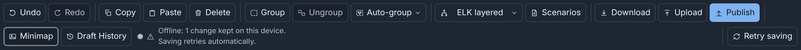
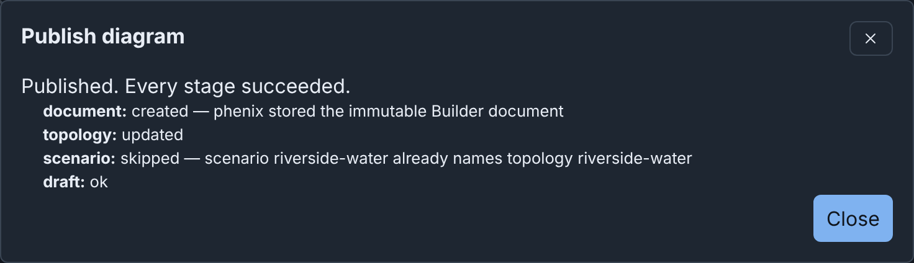

# Reference

This page holds the tables that the other pages point to, from the save
states to the error codes. For the rules behind them, see the details
page of each feature.

## Save states

The save state follows **Draft History** in the editor toolbar (see
[How drafts save](details/drafts.md#how-drafts-save)).

| Save state | What it means | What to do |
|---|---|---|
| All changes saved | The server has all changes. | Nothing. |
| Saving changes, Saving 2 changes | Builder sends changes. | Wait. |
| 2 unsaved changes | Changes wait. | Wait, or press <kbd>Ctrl</kbd>+<kbd>S</kbd> (<kbd>⌘</kbd>+<kbd>S</kbd> on macOS) to run **Save now**. |
| Offline: 1 change kept on this device. Saving retries automatically. | The server cannot be reached, or did not answer in time. This browser keeps the changes. | Continue to work. See [Working offline](details/drafts.md#working-offline). |
| Offline: 2 changes not stored anywhere yet. Keep this tab open. Saving retries automatically. | The server cannot be reached, and the browser cannot store the changes. | Keep the tab open until the save state says All changes saved. |
| Offline: no unsaved changes | The server cannot be reached, and no changes wait. | Nothing. |
| 1 change not saved yet. Choose which changes to save. | Another tab of this browser has changes to this draft. | See [Same draft in multiple tabs](details/drafts.md#same-draft-in-multiple-tabs). |
| Merging your changes with the server version… | Someone saved a newer version first. Builder merges it with your changes. | Wait. See [Draft merging](details/drafts.md#draft-merging). |
| This draft changed on the server | Someone saved a newer version first. Some changes clash, or merging is not available. | See [Draft merging](details/drafts.md#draft-merging). |
| Not saved: you chose another tab's changes | In another tab of this browser, you chose to save the changes of that tab. This tab does not save its changes. | Nothing. Builder keeps the changes of this tab as a new draft. |
| Could not save: someone deleted this draft from the server. Select Download to keep a copy of the diagram. | Another user deleted the draft. | Click **Download** (see [Downloading](details/import-upload-download.md#downloading)). Upload the file to make a new draft. |
| You cannot save changes to this draft | Your role no longer includes Builder. | Ask an administrator for the Builder permission (see [Permissions](details/administration.md#permissions)). Click **Download** to keep a copy. |
| Could not save your last change. … When you fix the diagram, the Builder saves it again. | The server refused the diagram, for example for two devices with one hostname. The message names the error. | Fix it (see [Checks and warnings](details/checks.md#checks-and-warnings)). The next change saves the diagram. |
| Could not save your last undo or redo: the server no longer keeps that step. … | You went with **Undo** or **Redo** to a snapshot that the server deleted, such as an old snapshot past the limit of 50. | Nothing. Your next edit saves the diagram as it shows. |
| Could not save. … Remove part of the diagram, or select Download to keep a copy. | The diagram is too large for the server to save. The message names the reason. | Remove part of the diagram. Or click **Download** to keep a copy. |
| Could not save your changes. … Saving retries automatically. | The server refused the save for a different reason, which the message names. | Wait, or click **Retry saving**. |

**Retry saving** shows when the browser is offline, or when a new try can
fix a failed save. It sends the waiting changes immediately.



## Keyboard shortcuts

To see the shortcuts of your platform, click **Shortcuts** in the header,
or press <kbd>?</kbd> outside a text field. "Not in text fields" means
that the keys do nothing while focus is in a text field, or in a field of
the Inspector. You can give any command other keys (see
[Customizing shortcuts](details/palette-and-shortcuts.md#customizing-shortcuts)).

| Action | Where it works | Windows and Linux | macOS |
|---|---|---|---|
| Command palette | Editor and Drafts page, text fields too | <kbd>Ctrl</kbd>+<kbd>K</kbd> | <kbd>⌘</kbd>+<kbd>K</kbd> |
| Keyboard shortcuts | Editor and Drafts page, not in text fields | <kbd>?</kbd> | <kbd>?</kbd> |
| Settings… | Editor and Drafts page, not in text fields | <kbd>Alt</kbd>+<kbd>Shift</kbd>+<kbd>S</kbd> | <kbd>⌥</kbd>+<kbd>⇧</kbd>+<kbd>S</kbd> |
| Undo | Editor, not in text fields | <kbd>Ctrl</kbd>+<kbd>Z</kbd> | <kbd>⌘</kbd>+<kbd>Z</kbd> |
| Redo | Editor, not in text fields | <kbd>Ctrl</kbd>+<kbd>Shift</kbd>+<kbd>Z</kbd> or <kbd>Ctrl</kbd>+<kbd>Y</kbd> | <kbd>⇧</kbd>+<kbd>⌘</kbd>+<kbd>Z</kbd> |
| Copy | Editor, not in text fields | <kbd>Ctrl</kbd>+<kbd>C</kbd> | <kbd>⌘</kbd>+<kbd>C</kbd> |
| Paste | Editor, not in text fields | <kbd>Ctrl</kbd>+<kbd>V</kbd> | <kbd>⌘</kbd>+<kbd>V</kbd> |
| Duplicate | Editor, not in text fields | <kbd>Ctrl</kbd>+<kbd>D</kbd> | <kbd>⌘</kbd>+<kbd>D</kbd> |
| Delete selection | Canvas | <kbd>Delete</kbd> or <kbd>Backspace</kbd> | <kbd>⌫</kbd> or <kbd>⌦</kbd> |
| Rename | Canvas | <kbd>F2</kbd> | <kbd>F2</kbd> |
| Open Node Editor | Editor, not in text fields | <kbd>Alt</kbd>+<kbd>Shift</kbd>+<kbd>E</kbd> | <kbd>⌥</kbd>+<kbd>⇧</kbd>+<kbd>E</kbd> |
| Select all | Editor, not in text fields | <kbd>Ctrl</kbd>+<kbd>A</kbd> | <kbd>⌘</kbd>+<kbd>A</kbd> |
| Clear selection | Canvas | <kbd>Esc</kbd> | <kbd>esc</kbd> |
| Select or deselect the focused item | Canvas | <kbd>Enter</kbd> or <kbd>Space</kbd> | <kbd>↩</kbd> or <kbd>Space</kbd> |
| Add the focused item to the selection, or remove it from the selection | Canvas | <kbd>Shift</kbd>+<kbd>Enter</kbd> | <kbd>⇧</kbd>+<kbd>↩</kbd> |
| Move to the nearest node in the direction of the arrow key | Canvas | <kbd>←</kbd> <kbd>↑</kbd> <kbd>→</kbd> <kbd>↓</kbd> | <kbd>←</kbd> <kbd>↑</kbd> <kbd>→</kbd> <kbd>↓</kbd> |
| Move through the connections of the focused node | Canvas | <kbd>PgDn</kbd> or <kbd>PgUp</kbd> | <kbd>⇟</kbd> or <kbd>⇞</kbd> |
| Move the selected nodes 10 pixels | Canvas | <kbd>Shift</kbd> with an arrow key | <kbd>⇧</kbd> with an arrow key |
| Resize the selected group, note, shape or icon 10 pixels | Canvas | <kbd>Alt</kbd>+<kbd>Shift</kbd> with an arrow key | <kbd>⌥</kbd>+<kbd>⇧</kbd> with an arrow key |
| Group selection | Editor, not in text fields | <kbd>Ctrl</kbd>+<kbd>G</kbd> | <kbd>⌘</kbd>+<kbd>G</kbd> |
| Ungroup | Editor, not in text fields | <kbd>Ctrl</kbd>+<kbd>Shift</kbd>+<kbd>G</kbd> | <kbd>⇧</kbd>+<kbd>⌘</kbd>+<kbd>G</kbd> |
| Auto-group by network | Editor, not in text fields | <kbd>Alt</kbd>+<kbd>Shift</kbd>+<kbd>G</kbd> | <kbd>⌥</kbd>+<kbd>⇧</kbd>+<kbd>G</kbd> |
| Auto layout | Editor, not in text fields | <kbd>Alt</kbd>+<kbd>Shift</kbd>+<kbd>L</kbd> | <kbd>⌥</kbd>+<kbd>⇧</kbd>+<kbd>L</kbd> |
| Add device | Canvas | <kbd>N</kbd> | <kbd>N</kbd> |
| Go to node | Editor, not in text fields | <kbd>Ctrl</kbd>+<kbd>Shift</kbd>+<kbd>O</kbd> | <kbd>⇧</kbd>+<kbd>⌘</kbd>+<kbd>O</kbd> |
| Zoom in | Canvas | <kbd>=</kbd> or <kbd>+</kbd> | <kbd>=</kbd> or <kbd>+</kbd> |
| Zoom out | Canvas | <kbd>−</kbd> | <kbd>−</kbd> |
| Fit diagram to view | Canvas | <kbd>Shift</kbd>+<kbd>1</kbd> | <kbd>⇧</kbd>+<kbd>1</kbd> |
| Show or hide connections | Editor, not in text fields | <kbd>Alt</kbd>+<kbd>Shift</kbd>+<kbd>C</kbd> | <kbd>⌥</kbd>+<kbd>⇧</kbd>+<kbd>C</kbd> |
| Focus mode | Editor and Drafts page, text fields too | <kbd>Ctrl</kbd>+<kbd>Shift</kbd>+<kbd>F</kbd> | <kbd>⇧</kbd>+<kbd>⌘</kbd>+<kbd>F</kbd> |
| Save now | Editor, text fields too | <kbd>Ctrl</kbd>+<kbd>S</kbd> | <kbd>⌘</kbd>+<kbd>S</kbd> |

The canvas keys of the table work on the canvas, its nodes and its
connections, but not on the zoom buttons. These details are not in the
table:

- From the canvas itself, the arrow keys go to the node nearest the middle of
  the view.
- When the focused node shows its [info tooltip](details/editor.md#info-tooltips), the first
  <kbd>Esc</kbd> closes the tooltip, and the second clears the selection.
- <kbd>Delete</kbd> deletes the focused item, or the full selection when the
  focused item is in it.
- With <kbd>Alt</kbd>+<kbd>Shift</kbd> (<kbd>⌥</kbd>+<kbd>⇧</kbd> on macOS),
  <kbd>→</kbd> and <kbd>↓</kbd> make the item larger, and <kbd>←</kbd> and
  <kbd>↑</kbd> make it smaller.
- A second <kbd>Shift</kbd>+<kbd>1</kbd> (<kbd>⇧</kbd>+<kbd>1</kbd> on macOS)
  restores the view from before the fit.
- While the connections are hidden, the arrow keys go only to nodes.
  <kbd>PgDn</kbd> and <kbd>PgUp</kbd> say "Connections are hidden." with the
  keys that show them.

<kbd>?</kbd>, <kbd>N</kbd>, <kbd>=</kbd>, <kbd>+</kbd>, <kbd>−</kbd> and
<kbd>Shift</kbd>+<kbd>1</kbd> work without <kbd>Ctrl</kbd> (<kbd>⌘</kbd> on
macOS). If speech input or your screen reader can press them by mistake,
disable **Single-key shortcuts** in the sheet or in **Builder settings**.

On a Mac keyboard without these keys, <kbd>⇟</kbd> and <kbd>⇞</kbd> are
<kbd>Fn</kbd> with <kbd>↓</kbd> and <kbd>↑</kbd>. <kbd>↖</kbd> and
<kbd>↘</kbd> (Home and End) are <kbd>Fn</kbd> with <kbd>←</kbd> and
<kbd>→</kbd>. <kbd>⌫</kbd> is Delete and <kbd>⌦</kbd> is Forward Delete.

For the keys that select cards on the drafts page, see
[Selecting with the keyboard](details/drafts.md#selecting-with-the-keyboard).

## Publish hints and buttons

The hint under **Topology name** in the **Publish diagram** dialog says
what publishing does with that name, and the button names the action. The
hint under **Experiment name** works the same way (see
[Create or update](details/publishing.md#create-or-update)).

| Hint | Button |
|---|---|
| "Publishing creates a new topology." | **Create topology** |
| "A topology with this name exists. Publishing updates it." | **Update topology** |
| "A topology with this name already exists. This diagram cannot update it. …" | Builder refuses to publish. Enter another name. |
| "A topology with this name changed after this diagram published it. Publishing would overwrite that change. …" | Builder refuses to publish. See [Publishing again](details/publishing.md#publishing-again). |
| "… This diagram replaces its legacy Builder diagram." or "… Builder could not read its legacy Builder diagram. Publishing removes it." | **Update topology**. See [Replacing a legacy Builder diagram](details/publishing.md#replacing-a-legacy-builder-diagram). |

## Publish results

After a publish, the dialog lists each stage and its result (see
[The result](details/publishing.md#the-result)).



| Stage | What it is | Results |
|---|---|---|
| `document` | The published copy of the diagram, on the **Published Diagrams** tab | `created`, or `skipped` when you publish again and the publication was already complete |
| `topology` | The Topology config | `created`, `updated`, or `skipped` when the config already holds this snapshot |
| `scenario` | The `topology` annotation of each listed scenario | `updated`, with the changed scenarios, or `skipped` |
| `experiment` | The Experiment config, with **Topology and an experiment** | `created`, `updated` or `skipped` |
| `draft` | The draft records what it published | `ok`, or `skipped` when you publish again and the publication was already complete |

The headline is one of these:

| Headline | What it means |
|---|---|
| "Published. Every stage succeeded." | Every stage succeeded. |
| "Published with failures. …" | A stage failed after the server wrote earlier stages. Fix the cause. Click **Back**. Publish again with the same names. The stages that succeeded show `skipped`. |
| "Publish failed. It wrote no configs." | A stage failed before the server wrote any config. The list shows the failed stage. Fix the cause. Click **Back**. Publish again. |

When the server refuses the publish before it writes anything, the form
stays open, and **Checks** gives the reason after "Could not publish the
diagram."

## Built-in templates

**Device** under **Nodes & Objects** adds a device with default settings.
The table lists it with the five built-in templates, which are read only
(see [Adding devices](details/diagrams.md#adding-devices)).

| Item | Hostname | Type | OS type | Image |
|---|---|---|---|---|
| **Device** | node | VirtualMachine | linux | `ubuntu.qc2` |
| **Server** | server | VirtualMachine | linux | `ubuntu.qc2` |
| **Workstation** | workstation | VirtualMachine | windows | `windows10.qc2` |
| **Router** | router | Router | minirouter | `minirouter.qc2` |
| **Firewall** | firewall | Firewall | vyos | `vyos.qc2` |
| **External device** | external | HIL (external) | None | None |

## Built-in icons

Devices, groups and icon drawings show a built-in icon, which you select
under **Icon** in the Inspector. The icon is only a picture: it does not
change the phēnix settings of a device (see
[Built-in icons](details/icons.md#built-in-icons)).

| Kind | Icons |
|---|---|
| Computers | **Server** (any virtual machine, and the default for a device), **Desktop**, **Laptop**, **Smartphone**, **Printer**, **NTP Server** |
| Networks | **Router**, **Switch**, **Firewall**, **VLAN**, **Container** (the default for a group), **External device** (hardware in the loop) |
| Industrial control | **PLC**, **RTU**, **RTAC** (an automation controller or a data gateway), **Relay**, **Transmission**, **Distribution**, **Cell Tower** |
| Operating systems | **Linux**, **CentOS**, **Red Hat**, **Ubuntu**, **Fedora**, **openSUSE**, **Alpine**, **Kali Linux**, **BSD**, **Windows**, **Apple**, **Android** |
| Tools | **Terminal**, **pfSense**, **Wireshark**, **Zeek** (a network sensor) |
| People and roles | **Hacker** (an attacker), **Black Hat** (a threat actor), **Human**, **Robot** (a bot or a script) |
| Other roles | **Lizard** and **Fox**, for a role with no other icon, such as a team mascot |
| Servers | **phēnix**, **minimega** |

Names and logos of products are trademarks of their owners. phēnix is not
affiliated with or endorsed by them. The
[icon notices](https://github.com/sandialabs/sceptre-phenix/blob/main/src/js/src/components/builder/ICON_NOTICES.md)
give the source and the license of each icon that comes from another work.

## Purdue Model layer set

The built-in layer set **Purdue Model** gives each level of the Purdue
model a layer (see
[Example: map layers to the Purdue model](details/layers.md#example-map-layers-to-the-purdue-model)).
Level 3.5 gets ID 4, because a layer ID is an integer. The set has no
node matchers.

| Layer ID | Label | Icon | Color | Typical devices |
|---|---|---|---|---|
| 6 | L5 Enterprise | Server | `#2f6fbf` | Enterprise IT, email and the internet connection |
| 5 | L4 Business | Laptop | `#8b5cf6` | Site business systems, such as ERP |
| 4 | L3.5 Industrial DMZ | Firewall | `#b45309` | Jump hosts, patch servers and historian copies |
| 3 | L3 Operations | Terminal | `#0f766e` | SCADA servers, historians and site operations systems |
| 2 | L2 Supervisory control | Desktop | `#15803d` | HMIs and engineering workstations |
| 1 | L1 Basic control | PLC | `#db2777` | PLCs, RTUs and IEDs |
| 0 | L0 Process | Transmission | `#dc2626` | Pumps, valves and sensors |

## Download formats

**Download** in the editor toolbar saves the open diagram as one file
(see [Downloading](details/import-upload-download.md#downloading)).

| Button | File for Riverside Water | What it holds | Open it with |
|---|---|---|---|
| **Builder JSON** | `riverside-water.json` | The whole Builder document | **Upload** |
| **Builder YAML** | `riverside-water.yaml` | The same, as YAML | **Upload** |
| **Topology YAML** | `riverside-water.topology.yaml` | The Topology config that **Publish** would write | `phenix config create`, or **Import** as a config file |
| **PNG** | `riverside-water.png` | A picture of the whole diagram | An image viewer |
| **SVG** | `riverside-water.svg` | The same picture, as SVG | A web browser |
| **draw.io** | `riverside-water.drawio` | The diagram, as a draw.io file | draw.io (diagrams.net) |
| **Gephi (GEXF)** | `riverside-water.gexf` | The devices, networks and connections, as a GEXF file | Gephi |
| **Builder package** | `riverside-water.package.json` or `.package.yaml` | The Builder document, the configs and icons that you tick, and the list of what the diagram needs | **Upload** |

The file name is the diagram name in lower case. Each run of characters
other than letters, digits, `.`, `_` and `-` becomes one hyphen.

## File formats

| File | Starts with | Size limit | Where to use it | JSON Schema |
|---|---|---|---|---|
| Builder document (JSON or YAML) | `$schema: https://phenix.sandia.gov/schemas/builder/v1` and `revision: 1` | 5 MiB | **Upload** on the drafts page or in the editor, or the REST API (see [REST API](details/administration.md#rest-api)) | `/api/v1/schemas/builder/v1` |
| Builder package (`.package.json` or `.package.yaml`) | The package `$schema` | 5 MiB | **Upload** | `/api/v1/schemas/builder/package/v1` |
| Template file (`.templates.yaml`) | `$schema: https://phenix.sandia.gov/schemas/builder/templates/v1` | 8 MiB, 1 to 200 templates, 50 custom icons | **Import templates** on the **Node Templates** tab, or the template directory of the server | `/api/v1/schemas/builder/templates/v1` |
| Layer set file (`.layers.yaml`) | `$schema: https://phenix.sandia.gov/schemas/builder/layersets/v1` | 4 MiB | **Upload layer set…** on the **Layers** tab | `/api/v1/schemas/builder/layersets/v1` |
| Legacy Builder diagram (XML) | The root element `mxGraphModel` (or a bare `root`), or a Topology config with the `builder-xml` annotation | 5 MiB | **Upload** with the source **Legacy Builder diagram or Topology** | None |
| Topology or Experiment config (JSON or YAML) | `apiVersion` and `kind` | 5 MiB | **Import** with the source **Config file** | See [Schema](../schema.md) |

`phenix config create` refuses the first four files, and
`phenix config apply` skips them in a directory (see
[Builder documents and phenix config create](details/import-upload-download.md#builder-documents-and-phenix-config-create)).
For the fields of each file, see
[Builder JSON and YAML](details/import-upload-download.md#builder-json-and-yaml),
[Downloading and importing templates](details/templates.md#downloading-and-importing-templates)
and [Layer set files](details/import-upload-download.md#layer-set-files).

## Limits

| What | Limit | More |
|---|---|---|
| Drafts on the server, damaged drafts included | 2,000 | [Limits](details/drafts.md#limits) |
| Snapshots of a draft | 50, and 50 MiB of them. Past either limit, phēnix deletes the oldest. | [Limits](details/drafts.md#limits) |
| A diagram (a Builder document) | 5 MiB | [Storage](details/administration.md#storage) |
| Custom icons that a diagram holds | 50 | [The diagram and its icons](details/icons.md#the-diagram-and-its-icons) |
| Templates in a diagram | 50 | [Limits](details/templates.md#limits) |
| Notes of a diagram | 100, each at most 4096 bytes | [With nothing selected](details/editor.md#with-nothing-selected) |
| Annotations that a draft keeps from an imported config | 100, at most 256 KiB in total | [What an import keeps](details/import-upload-download.md#what-an-import-keeps) |
| Scenarios that a diagram lists | 20 | [Scenarios](details/scenarios.md#scenarios) |
| VLAN alias of a network | 1 to 4094 | [Adding switches and networks](details/diagrams.md#adding-switches-and-networks) |
| Layers of a diagram | 32, IDs from 0 to 99 | [Layers](details/layers.md#layers) |
| Layer label | 1 to 64 bytes, no control characters | [Layers](details/layers.md#layers) |
| Node matchers of a layer | 16. A field has at most 128 bytes, and a pattern at most 256 bytes | [Layers](details/layers.md#layers) |
| Points of a line drawing | 2 to 64 | [Shapes, icons and lines](details/diagrams.md#shapes-icons-and-lines) |
| Grid size | 4 to 200 pixels | [The grid](details/diagrams.md#the-grid) |
| Auto-group name pattern | 200 characters. Builder matches the first 255 characters of a name, cuts a group name to 80, and stops a pattern after 2 seconds | [Grouping by a name pattern](details/diagrams.md#grouping-by-a-name-pattern) |
| Icons on the server | 2,000. An icon is a PNG of at most 96 × 96 pixels and 40,960 bytes, from a file of at most 5 MiB. An icon keeps at most 16 old names | [Custom icons](details/icons.md#custom-icons) |
| Custom icon name | 1 to 64 letters, digits, `_`, `@`, `.` or `-` | [Uploading an icon](details/icons.md#uploading-an-icon) |
| Icons from template files | 1,000 of the 2,000 | [Template files on the server](details/administration.md#template-files-on-the-server) |
| Templates in the library | 200 | [Limits](details/templates.md#limits) |
| Collections in the library | 50 | [Limits](details/templates.md#limits) |
| Templates in a collection | 200 | [Limits](details/templates.md#limits) |
| Whole template library | 512 KiB | [Limits](details/templates.md#limits) |
| Template name, collection name | 1 to 128 bytes, one line | [Limits](details/templates.md#limits) |
| Template description, collection description | 1024 bytes, one line | [Limits](details/templates.md#limits) |
| A template's device, as JSON | 16 KiB | [Limits](details/templates.md#limits) |
| Template file | 8 MiB, 1 to 200 templates, 50 custom icons | [Limits](details/templates.md#limits) |
| Template files the server reads | 50, each at most 8 MiB | [Template files on the server](details/administration.md#template-files-on-the-server) |
| Layer sets in the library | 200, plus the built-in set. A set has 1 to 32 layers | [The Layers tab](details/drafts.md#the-layers-tab) |
| A layer set file | 4 MiB. A request that adds or replaces a set, 1 MiB | [Storage](details/administration.md#storage) |
| Package requirements | 1000 entries of each kind, each at most 4096 bytes | [Downloading a package](details/import-upload-download.md#downloading-a-package) |
| A Builder file, a config file, an uploaded document or package | 5 MiB | [Which files phenix reads](details/administration.md#which-files-phenix-reads) |
| PNG and SVG downloads | The longer side at most 4096 pixels | [PNG and SVG](details/import-upload-download.md#png-and-svg) |
| Diagram name | 512 bytes | [The metadata of a diagram](details/import-upload-download.md#the-metadata-of-a-diagram) |
| Experiment name | 15 characters, when the server names the bridge of each experiment after the experiment | [Experiment names](details/publishing.md#experiment-names) |
| Time Builder waits for the server | 60 seconds for a save, 30 for a read, 15 for the version that a merge starts from, and 20 for each preflight check. 10 minutes for publishing, preflight, imports, downloads, packages and cleanup | [Working offline](details/drafts.md#working-offline) |

## Error codes

Each issue that Builder reports has a code: a stable, machine-readable
name of the rule that it breaks, such as `node.hostname.duplicate`. The
editor checks and the Builder REST API use the same code for the same rule.
Thus a script can act on the code and ignore the message.

A code is lowercase words joined by dots. A word can contain hyphens, such
as `not-found`. The first word names the subject
of the rule, such as `node`, `edge` (a connection) or `layerset` (a layer
set). A released code keeps its meaning. A new rule gets a new code.

### Issues

Builder reports each warning and error as an issue:

| Field | Value |
|---|---|
| `code` | The code of the rule |
| `severity` | `error` if the issue refuses the request, `warning` if not |
| `message` | The text that a person sees |
| `path` | The location in the document, such as `nodes[3].device.hostname`, when the issue is about a part of it |
| `nodeId`, `edgeId`, `networkId` | The ID of the node, connection or network, when the issue is about one |
| `field` | The device field, such as `spec.network.interfaces.0.vlan`, when the issue is about one |

The table in [Codes](#codes) gives the default severity of each code. Some
issues block only publishing, such as an interface without a VLAN. The
editor shows them as warnings on the canvas, because a draft may keep them.
The **Publish diagram** dialog shows them as errors.

An unknown key in an object of the document (`document.field.unknown`) is
an issue at its path. A value of the wrong type is an issue only where the
editor also checks the type, such as a number in `createdBy`
(`metadata.user.not-text`). The server refuses other values of the wrong
type, such as a node position that is text, with a message of its own.

### Errors of the REST API

When a Builder route refuses a request, the JSON body gives the code in
`code`, with `message` and `cause`. For a document that does not pass the
checks (`document.invalid`), or a draft that only publishing refuses
(`publish.blocked`), `issues` lists each warning and error:

```json
{
  "code": "publish.blocked",
  "message": "topology lab cannot be published: interface \"eth1\" of device \"web\" has no VLAN: connect it to a network, or type a VLAN for it",
  "cause": "validating topology projection: interface \"eth1\" of device \"web\" has no VLAN: connect it to a network, or type a VLAN for it",
  "issues": [
    {
      "code": "interface.vlan.missing",
      "severity": "error",
      "message": "interface \"eth1\" of device \"web\" has no VLAN: connect it to a network, or type a VLAN for it",
      "path": "nodes[2].device.spec.network.interfaces[1]",
      "nodeId": "4113dfc0-f4be-57f9-8115-6cecd1f1aea3",
      "field": "spec.network.interfaces.1.vlan"
    }
  ]
}
```

A refusal about a scenario that a draft lists (`publish.scenario.*`) names
that scenario in `metadata.scenario`.

These codes have these HTTP statuses. A refusal without a code of its own
gets the `request.*` or `server.*` code of its status.

| Status | Codes |
|---|---|
| 400 | `request.invalid`, `publish.target.invalid` |
| 403 | `request.forbidden`, `layerset.read-only` |
| 404 | `request.not-found` |
| 405 | `request.method-not-allowed` |
| 409 | `request.conflict`, `draft.conflict`, `draft.snapshot.current`, `template.item.read-only`, `publish.topology.exists`, `publish.topology.missing`, `publish.topology.not-source`, `publish.topology.changed`, `publish.topology.file-mismatch`, `publish.experiment.exists`, `publish.experiment.missing`, `publish.experiment.not-source`, `publish.experiment.changed` |
| 412 | `request.stale`, `draft.stale`, `template.item.stale`, `layerset.stale` |
| 413 | `request.too-large`, `draft.limit`, `layerset.library.full`, `package.too-large` |
| 422 | `request.unprocessable`, `document.invalid`, `publish.blocked`, `publish.topology.invalid`, `import.name.invalid`, `layerset.default.unknown`, `layerset.invalid`, `package.invalid` |
| 500 | `server.error` |
| 503 | `server.busy` |

`OPTIONS` on a Builder route gets 204 and the same `Allow` header as a 405
answer for that path, and does nothing else.

More about issues in answers:

- In `package.invalid`, each issue has a `package.*` code, or, for the
  document of the package, a document code at a path below `document`.
- A publication that goes through lists its warnings in `warnings`. A
  partial publication lists its failures in `errors`.
- The Topology YAML download (`POST /builder/export/topology`) lists issues
  in `warnings` and `publishBlockers`. `publishBlockers` has one issue for
  each check that only publishing makes, with the code of its first issue.
- `POST /builder/package` lists its `package.*` warnings in `warnings`.

The dependencies of `POST /builder/package/resolve` are data, not issues,
and have no codes. The warnings of an import or a legacy diagram conversion
(`POST /builder/generate`, `POST /builder/legacy`, and the
`source.warnings` of a document) are plain text, without codes.

### Codes

<!-- codes:start -->

| Code | Severity | Rule |
|---|---|---|
| `document.invalid` | error | The document does not validate. The issues field lists each reason. |
| `document.content.missing` | error | There is no document at all. |
| `document.schema.mismatch` | error | The document's $schema is not the Builder document schema. |
| `document.revision.mismatch` | error | The document's revision is not the one this phenix reads. |
| `document.list.missing` | error | nodes, networks or edges is missing, null or not a list. |
| `document.viewport.not-finite` | error | A viewport value is not a finite number. |
| `document.zoom.not-positive` | error | The viewport zoom is not a positive number. |
| `document.grid.invalid` | error | The grid size is not a whole number from 4 to 200. |
| `document.icon-size.unknown` | error | The document's icon size is not small, medium or large. |
| `document.layout.not-text` | error | The document's layout is not text. |
| `document.field.unknown` | error | An object of the document holds a key that is not one of its fields. |
| `metadata.not-object` | error | The document's metadata is not an object. |
| `metadata.id.required` | error | The document has no ID. |
| `metadata.id.invalid` | error | The document ID is not a UUID. |
| `metadata.name.too-long` | error | The document name is longer than 512 bytes. |
| `metadata.name.control` | error | The document name holds a control character. |
| `metadata.user.not-text` | error | createdBy or updatedBy is not text. |
| `metadata.user.too-long` | error | createdBy or updatedBy is longer than 256 bytes. |
| `metadata.user.control` | error | createdBy or updatedBy holds a control character. |
| `metadata.time.not-text` | error | createdAt or updatedAt is not text. |
| `metadata.time.invalid` | error | createdAt or updatedAt is not a UTC time of the form YYYY-MM-DDTHH:MM:SSZ. |
| `metadata.notes.not-list` | error | The diagram's notes are not a list of text. |
| `metadata.notes.too-many` | error | The diagram has more than 100 notes. |
| `metadata.note.not-text` | error | A note of the diagram is not text. |
| `metadata.note.blank` | error | A note of the diagram is blank. |
| `metadata.note.too-long` | error | A note of the diagram is longer than 4096 bytes. |
| `metadata.note.control` | error | A note of the diagram holds a control character other than newline and tab. |
| `network.id.required` | error | A network has no ID. |
| `network.id.invalid` | error | A network ID is not a UUID. |
| `network.id.duplicate` | error | Two networks have the same ID, ignoring case. |
| `network.name.required` | error | A network has no name. |
| `network.name.whitespace` | error | A network name holds white space. |
| `network.name.duplicate` | error | Two networks have exactly the same name. |
| `network.line-style.unknown` | error | A network's line style is not one the Builder draws. |
| `network.alias.out-of-range` | error | A network's VLAN alias is not from 1 to 4094. |
| `network.alias.duplicate` | error | Two networks have the same VLAN alias. |
| `network.switch.missing` | warning | A network has no switch on the canvas. |
| `network.subnet.invalid` | error | A network's subnet is not an IPv4 network such as 10.1.0.0/24. |
| `network.gateway.invalid` | error | A network's gateway is not an IPv4 address. |
| `network.gateway.outside-subnet` | error | A network's gateway is not a host address of its subnet. |
| `network.gateway.unowned` | warning | No interface on a network has the network's gateway address. |
| `network.subnet.overlap` | warning | The subnets of two networks overlap. It is a problem only for networks that connect, not for isolated enclaves that reuse a subnet on purpose. |
| `node.id.required` | error | A node has no ID. |
| `node.id.invalid` | error | A node ID is not a UUID. |
| `node.id.duplicate` | error | Two nodes have the same ID, ignoring case. |
| `node.position.not-finite` | error | A node's position is not finite numbers. |
| `node.size.invalid` | error | A node's size is not positive finite numbers. |
| `node.kind.unknown` | error | A node's kind is not one the Builder knows. |
| `node.payload.missing` | error | A node lacks the payload of its kind. |
| `node.payload.extra` | error | A node carries the payload of another kind. |
| `node.hostname.required` | error | A device has no hostname. |
| `node.hostname.whitespace` | error | A device hostname holds white space. |
| `node.hostname.duplicate` | error | Two devices have the same hostname, ignoring case. |
| `node.hostname.short` | error | A device hostname is 1 character long, which phenix refuses. |
| `node.hostname.reserved` | error | A device hostname is "all", which minimega takes for every VM. |
| `node.hostname.numeric` | error | A device hostname is all digits, which phenix refuses in an experiment. |
| `node.hostname.windows-phenix` | error | A Windows device has the hostname "phenix", which phenix refuses in an experiment. |
| `node.hostname.reserved-case` | warning | A device hostname differs from "all" only by case. |
| `node.hostname.phenix` | warning | A device that is not Windows has the hostname "phenix", the hostname of phenix's own images. |
| `node.parent.self` | error | A node is its own parent. |
| `node.parent.unknown` | error | A node's parent is no node of the document. |
| `node.parent.not-group` | error | A node's parent is not a group. |
| `node.parent.cycle` | error | Groups contain each other in a cycle. |
| `device.spec.required` | error | A device has no spec. |
| `device.hostname.mismatch` | warning | The spec of a device names a hostname other than the device hostname. The topology uses the device hostname. |
| `device.icon-key.unknown` | error | A device's icon key is not a built-in icon. |
| `device.icon.invalid` | error | A device's custom icon is not an icon name. |
| `device.icon-size.unknown` | error | A device's icon size is not small, medium or large. |
| `device.color.invalid` | error | A device's outline or fill color is not #rrggbb. |
| `device.layer.out-of-range` | error | A device's layer is not an integer from 0 to 99. |
| `device.hide-description.not-boolean` | error | A device's hideDescription is not true or false. |
| `device.included-from.invalid` | error | A device names an included topology, but the name is blank or holds white space. |
| `device.included-from.no-includes` | error | A device names an included topology, but the document includes no topology. |
| `device.interfaces.none` | warning | A device has no interfaces. |
| `device.drives.none` | error | A device phenix starts has no drive, which blocks publishing. |
| `device.image.unknown` | warning | A device's drive image is not one of the server's disk images. |
| `device.rulesets.ignored` | warning | A device that is not a Router or a Firewall has firewall rulesets, which phenix does not apply. |
| `device.router-os.unsupported` | warning | A Router or Firewall has an os_type other than vyatta, vyos or minirouter, so phenix does not configure it as a router. |
| `device.interfaces.unconfigured` | warning | A device has static interfaces, but its os_type is one for which phenix writes no interface configuration. |
| `device.serial.unconfigured` | warning | A device has serial interfaces, but phenix sets them up only when its os_type is linux. |
| `device.injections.unapplied` | warning | A device has file injections or deletions that phenix does not apply, because its snapshot is off or its first drive's inject partition is 0. |
| `device.ospf.missing` | error | A Vyatta or VyOS router has an interface with proto ospf but no network.ospf, so the experiment fails to start, which blocks publishing. |
| `device.ospf.unused` | warning | A minirouter has network.ospf, but none of its interfaces has proto ospf. |
| `device.ospf-network.unused` | warning | An OSPF area network of a minirouter holds the address of none of its interfaces with proto ospf, so minirouter does not advertise it. |
| `device.ntp-server.invalid` | error | The ntp-server label names no interface of its device, or one with no IP address, so the experiment fails to start, which blocks publishing. |
| `device.ntp-server.ignored` | warning | More than one device has the ntp-server label, and phenix uses only the first. |
| `device.ntp-server.no-mgmt` | warning | Routers get their NTP server from an interface of the ntp-server device on VLAN mgmt, and it has none. |
| `device.enable-ssh.invalid` | warning | The vrouter/enable-ssh annotation of a Vyatta or VyOS router is neither an IP address nor the name of an interface with an address. |
| `device.autotunnel.invalid` | warning | The phenix/startup-autotunnel annotation is not a list of "port", "port:dport" or "port:host:dport" texts. |
| `device.default-apps.invalid` | warning | The phenix/default-apps annotation is not true or false. |
| `interface.id.required` | error | A connection point has no ID. |
| `interface.id.invalid` | error | A connection point ID is not a UUID. |
| `interface.id.duplicate` | error | Two connection points have the same ID, ignoring case. |
| `interface.name.required` | error | A connection point has no name. |
| `interface.name.duplicate` | error | Two connection points of a device have the same name, ignoring case. |
| `interface.name.unmatched` | warning | A connection point names no interface of the device's spec, so publishing drops it. |
| `interface.vlan.missing` | error | An interface of a device phenix starts has no VLAN, which blocks publishing. |
| `interface.vlan.implicit` | warning | A publish puts an unconnected interface on the network of the diagram that its VLAN names. |
| `interface.vlan.case-mismatch` | warning | An interface's VLAN differs from a network's name only in case, and phenix does not match them. |
| `interface.vlan.unknown` | warning | An interface's VLAN names no network of the diagram. |
| `interface.network.unconnected` | warning | An interface is not connected to a network. |
| `interface.ip.shared` | error | Interfaces on one network use the same IP address, which blocks publishing. |
| `interface.mac.shared` | error | Interfaces on one network use the same MAC address, which blocks publishing. |
| `interface.ip.outside-subnet` | warning | An interface's IP address is not a host address of the subnet of its network. |
| `interface.ruleset.unknown` | warning | An interface names a firewall ruleset that its device does not have, so phenix applies no firewall to that interface. |
| `interface.ospf.outside-area` | warning | An interface with proto ospf of a minirouter is in no OSPF area network of the device, or the device has no network.ospf. As a result, the interface is in no OSPF area. |
| `switch.network.required` | error | A switch names no network. |
| `switch.network.unknown` | error | A switch names a network the document does not have. |
| `switch.color.invalid` | error | A switch's outline or fill color is not #rrggbb. |
| `switch.icon-size.unknown` | error | A switch's icon size is not small, medium or large. |
| `switch.layer.out-of-range` | error | A switch's layer is not an integer from 0 to 99. |
| `group.border-style.unknown` | error | A group's border style is not one the Builder draws. |
| `group.icon-key.unknown` | error | A group's icon key is not a built-in icon. |
| `group.icon.invalid` | error | A group's custom icon is not an icon name. |
| `group.icon-size.unknown` | error | A group's icon size is not small, medium or large. |
| `group.hide-description.not-boolean` | error | A group's hideDescription is not true or false. |
| `drawing.shape.unknown` | error | A shape's figure is not rectangle or circle. |
| `drawing.color.invalid` | error | A shape's or a line's color is not #rrggbb. |
| `drawing.border-style.unknown` | error | A shape's border style is not one the Builder draws. |
| `drawing.icon.ambiguous` | error | An icon drawing names both or neither of a built-in icon and a custom icon. |
| `drawing.icon-key.unknown` | error | An icon drawing's icon key is not a built-in icon. |
| `drawing.icon.invalid` | error | An icon drawing's custom icon is not an icon name. |
| `drawing.points.too-few` | error | A line has fewer than 2 points. |
| `drawing.points.too-many` | error | A line has more than 64 points. |
| `drawing.points.not-finite` | error | A point of a line is not finite numbers. |
| `drawing.line-style.unknown` | error | A line's style is not one the Builder draws. |
| `drawing.arrow.not-boolean` | error | A line's startArrow or endArrow is not true or false. |
| `edge.id.required` | error | A connection has no ID. |
| `edge.id.invalid` | error | A connection ID is not a UUID. |
| `edge.id.duplicate` | error | Two connections have the same ID, ignoring case. |
| `edge.route.too-few` | error | A connection's route has fewer than 2 points. |
| `edge.route.not-finite` | error | A point of a connection's route is not finite numbers. |
| `edge.line-style.unknown` | error | A connection's line style is not one the Builder draws. |
| `edge.source.unknown` | error | A connection's source is no node of the document. |
| `edge.target.unknown` | error | A connection's target is no node of the document. |
| `edge.endpoints.same` | error | A connection joins a node to itself. |
| `edge.endpoints.invalid` | error | A connection does not join one device interface to one switch. |
| `edge.handle.unknown` | error | A connection names a connection point its device does not have. |
| `edge.interface.connected` | error | More than one connection attaches to an interface. |
| `edge.network.required` | error | A connection names no network. |
| `edge.network.unknown` | error | A connection names a network the document does not have. |
| `edge.network.mismatch` | error | A connection names a network other than the network of its switch. |
| `scenario.list.too-many` | error | The document lists more than 20 scenarios. |
| `scenario.name.required` | error | A listed scenario has no name. |
| `scenario.name.too-long` | error | A scenario name is longer than 256 bytes. |
| `scenario.name.invalid` | error | A scenario name is not a config name. |
| `scenario.name.duplicate` | error | The document lists a scenario twice, ignoring case. |
| `layer.list.too-many` | error | The document defines more than 32 layers. |
| `layer.id.out-of-range` | error | A layer ID is not an integer from 0 to 99. |
| `layer.id.duplicate` | error | Two layers have the same ID. |
| `layer.label.required` | error | A layer has no label. |
| `layer.label.too-long` | error | A layer label is longer than 64 bytes. |
| `layer.label.control` | error | A layer label holds a control character. |
| `layer.icon-key.unknown` | error | A layer's icon key is not a built-in icon. |
| `layer.icon.invalid` | error | A layer's custom icon is not an icon name. |
| `layer.color.invalid` | error | A layer's color is not #rrggbb. |
| `layer.matchers.not-object` | error | A layer's node matchers are not an object of patterns by field. |
| `layer.matchers.too-many` | error | A layer has more than 16 node matchers. |
| `layer.matcher-path.too-long` | error | A node matcher field is longer than 128 bytes. |
| `layer.matcher-path.invalid` | error | A node matcher field is not keys of letters, digits, _ or - joined by dots. |
| `layer.matcher-pattern.not-text` | error | A node matcher pattern is not text. |
| `layer.matcher-pattern.required` | error | A node matcher has no pattern. |
| `layer.matcher-pattern.too-long` | error | A node matcher pattern is longer than 256 bytes. |
| `layer.matcher-pattern.invalid` | error | A node matcher pattern is not a regular expression, or it has a repeat that Builder refuses. Builder refuses a repeated group that holds a repeat or an alternation, such as (a+)+. It also refuses more than 3 *, + or {n,} repeats. |
| `layerset.not-object` | error | The document's layer set options are not an object. |
| `layerset.name.required` | error | A layer set has no name. |
| `layerset.name.too-long` | error | A layer set name is longer than 128 bytes. |
| `layerset.name.control` | error | A layer set name holds a control character. |
| `layerset.description.too-long` | error | A layer set description is longer than 1024 bytes. |
| `layerset.description.control` | error | A layer set description holds a control character. |
| `layerset.icon-key.unknown` | error | A layer set's icon key is not a built-in icon. |
| `layerset.icon.invalid` | error | A layer set's custom icon is not an icon name. |
| `layerset.match-conflict.unknown` | error | A layer set's match conflict rule is not lowest or highest. |
| `layerset.layer-outlines.not-boolean` | error | The layer outlines option of a layer set is not true or false. |
| `layerset.layers.empty` | error | A layer set holds no layer. |
| `layerset.source-id.invalid` | error | The layer set ID that a document names is not a layer set ID. |
| `layerset.source-version.invalid` | error | The layer set version that a document names is not an integer of 1 or more. |
| `layerset.file.schema-mismatch` | error | A layer set file's $schema is not the layer set file schema. |
| `layerset.invalid` | error | A layer set does not validate. The issues field lists each reason. |
| `layerset.read-only` | error | A request cannot change or delete a built-in layer set. Duplicate it to change it. |
| `layerset.stale` | error | The If-Match entity tag names a version of the layer set that is no longer current. |
| `layerset.library.full` | error | The layer set library holds 200 sets, the most it may. |
| `layerset.default.unknown` | error | The layer set chosen as the default does not exist. |
| `source.kind.unknown` | error | The source's kind is not manual, topology or experiment. |
| `source.digest.malformed` | error | The source digest is not sha256: and 64 hex digits. |
| `source.annotations.not-object` | error | The source annotations are not an object of text values. |
| `source.annotations.too-many` | error | The source carries more than 100 annotations. |
| `source.annotations.too-large` | error | The source annotations take more than 256 KiB. |
| `source.annotation.not-text` | error | A source annotation's value is not text. |
| `source.annotation-key.blank` | error | A source annotation key is blank. |
| `source.annotation-key.too-long` | error | A source annotation key is longer than 512 bytes. |
| `source.annotation-key.control` | error | A source annotation key holds a control character. |
| `include.list.not-list` | error | The included topologies are not a list of names. |
| `include.name.required` | error | An included topology has no name. |
| `include.name.whitespace` | error | The name of an included topology holds white space. |
| `template.list.not-list` | error | The document's templates are not a list. |
| `template.list.too-many` | error | The document carries more than 50 templates. |
| `template.id.required` | error | A template has no ID. |
| `template.id.invalid` | error | A template ID is not a UUID. |
| `template.id.duplicate` | error | Two templates have the same ID, ignoring case. |
| `template.name.required` | error | A template has no name. |
| `template.name.too-long` | error | A template name is longer than 128 bytes. |
| `template.name.control` | error | A template name holds a control character. |
| `template.name.duplicate` | error | Two templates of a template file have the same name, ignoring case. |
| `template.description.too-long` | error | A template description is longer than 1024 bytes. |
| `template.description.control` | error | A template description holds a control character. |
| `template.spec.required` | error | A template's device has no spec. |
| `template.hostname.required` | error | A template's spec has no general.hostname. |
| `template.hostname.whitespace` | error | A template's hostname holds white space. |
| `template.icon-key.unknown` | error | A template's icon key is not a built-in icon. |
| `template.icon.invalid` | error | A template's custom icon is not an icon name. |
| `template.icon-size.unknown` | error | A template's icon size is not small, medium or large. |
| `template.color.invalid` | error | A template's outline or fill color is not #rrggbb. |
| `template.layer.out-of-range` | error | A template's layer is not an integer from 0 to 99. |
| `template.hide-description.not-boolean` | error | A template's hideDescription is not true or false. |
| `template.device.unencodable` | error | Builder cannot encode a template's device as JSON. |
| `template.device.too-large` | error | A template's device takes more than 16 KiB as JSON. |
| `template.source.kind-unknown` | error | A template's source kind is not library, builtin or preloaded. |
| `template.source.id-invalid` | error | A template's source has no ID, or an ID that is not a template ID. |
| `template.source.version-invalid` | error | A template's source version is less than 1. |
| `template.source.digest-invalid` | error | A template's source digest is not sha256 and 64 lowercase hex digits. |
| `template.file.invalid` | error | A template file does not validate. The issues field lists each reason. |
| `template.file.schema-mismatch` | error | A template file's $schema is not the template file schema. |
| `template.file.empty` | error | A template file holds no template. |
| `template.file.too-many` | error | A template file holds more than 200 templates. |
| `template.collection-name.required` | error | A template file's collection has no name. |
| `template.collection-name.too-long` | error | A collection name is longer than 128 bytes. |
| `template.collection-name.control` | error | A collection name holds a control character. |
| `template.collection-description.too-long` | error | A collection description is longer than 1024 bytes. |
| `template.collection-description.control` | error | A collection description holds a control character. |
| `template.item.read-only` | error | A request changes a built-in template or an item of a template file. These are read only. |
| `template.item.stale` | error | A template or collection changed after the request read it. Reload the template library. |
| `icon.list.not-object` | error | The custom icons are not an object of icons by name. |
| `icon.list.too-many` | error | The document carries more than 50 custom icons. |
| `icon.name.invalid` | error | A custom icon's name is not an icon name. |
| `icon.data.invalid` | error | A custom icon's data is not base64 of at most 40960 bytes. |
| `icon.png.invalid` | error | A custom icon is not a PNG the Builder accepts. |
| `package.invalid` | error | A Builder package does not decode or validate. The issues field lists each item that does not validate. |
| `package.too-large` | error | A Builder package is larger than 5 MiB. |
| `package.schema.mismatch` | error | A package's $schema is not the Builder package schema. |
| `package.document.missing` | error | A package holds no Builder document. |
| `package.document.invalid` | error | A package's document does not decode as a Builder document. |
| `package.configs.too-many` | error | A package carries more than 20 Scenario configs or 100 Topology configs. |
| `package.config-key.invalid` | error | The key a package keeps a config under is not a config name. |
| `package.config-kind.mismatch` | error | A carried config's kind is not the kind of its list. |
| `package.config-name.mismatch` | error | A carried config's metadata.name is not the key the package keeps it under. |
| `package.config-api-version.invalid` | error | A carried config's apiVersion is not phenix.sandia.gov/v and a number. |
| `package.config-spec.missing` | error | A carried config has no spec. |
| `package.config.unlisted` | error | A package carries a config its requirements do not name. |
| `package.config-annotation.builder` | error | A carried config has a Builder annotation, which a package never carries. |
| `package.requirements.missing` | error | A list of a package's requirements is missing or null. |
| `package.requirements.too-many` | error | A list of a package's requirements holds more than 1000 entries. |
| `package.requirement.blank` | error | An entry of a package's requirements is blank. |
| `package.requirement.too-long` | error | An entry of a package's requirements is longer than 4096 bytes. |
| `package.requirement.control` | error | An entry of a package's requirements holds a control character. |
| `package.config.unreadable` | warning | A Scenario config or included topology that the document names does not exist, or the caller may not read it. The package does not carry it. |
| `package.include.file-path` | warning | An included topology is a file path, which a package never carries. |
| `package.icon.missing` | warning | A custom icon the document names is not in the icon library, so the package does not carry it. |
| `package.icons.too-many` | warning | The document names more custom icons than the 50 a package carries. The package does not carry the rest. |
| `package.requirement.left-out` | warning | A name or path that the document or a config holds is blank, longer than 4096 bytes or holds a control character. The package does not list it. |
| `package.requirements.truncated` | warning | A list of the requirements would hold more than 1000 entries, so the package lists the first 1000. |
| `publish.blocked` | error | Only publishing refuses the topology. The issues field lists each interface, address or hostname to fix. |
| `publish.topology.invalid` | error | phenix's topology schema refuses the topology the document publishes as. |
| `publish.topology.exists` | error | The topology a publish creates already exists. |
| `publish.topology.missing` | error | The topology a publish updates does not exist. |
| `publish.topology.not-source` | error | The topology is not the source of this draft, so the draft cannot update it. |
| `publish.topology.changed` | error | The topology changed after this draft published it. |
| `publish.topology.file-mismatch` | error | The topology is not what its Builder file publishes, so a publish cannot update it. |
| `publish.topology.file-changed` | error | The topology or its Builder file changed after Builder opened this draft from the file. |
| `publish.experiment.exists` | error | The experiment a publish creates already exists. |
| `publish.experiment.missing` | error | The experiment a publish updates does not exist. |
| `publish.experiment.not-source` | error | The experiment is not the source of this draft, so the draft cannot update it. |
| `publish.experiment.changed` | error | The experiment changed after this draft published it. |
| `publish.experiment.running` | error | A publish cannot update a running experiment. |
| `publish.experiment.invalid` | error | phenix refuses the experiment a publish would write. |
| `publish.experiment.reserved` | error | The experiment is named "all", which phenix reserves. |
| `publish.experiment.name-too-long` | error | This server names a bridge after the experiment, and the experiment name is too long for a bridge name. |
| `publish.experiment.unmergeable` | error | An update cannot merge an included topology into the experiment that it writes. |
| `publish.source.changed` | error | The topology or experiment that is the source of a diagram changed on the server after Builder made the diagram. |
| `publish.scenario.missing` | error | A scenario the document lists does not exist, or the caller may not read it. |
| `publish.scenario.not-listed` | error | The experiment's scenario is not one the document lists. |
| `publish.scenario.invalid` | error | A listed scenario is not valid if the publish adds the topology. |
| `publish.include.clash` | error | The topology and a topology that it includes have the same hostname. |
| `publish.include.hostname` | error | An included topology has a hostname phenix refuses in an experiment. |
| `publish.target.invalid` | error | A topology, experiment or scenario name is not a config name. |
| `publish.stage.failed` | error | A publish stage failed after the server wrote earlier stages. |
| `publish.cleanup.failed` | warning | The publication is complete, but the server could not remove the content that it replaces. |
| `publish.broadcast.failed` | warning | The server stored a config, but it could not broadcast the live update of the config. |
| `publish.file.unchanged` | warning | The topology names a Builder file that publishing does not change. |
| `publish.legacy.replaced` | warning | This diagram replaced the topology's legacy Builder diagram. |
| `publish.legacy.removed` | warning | The server could not read the topology's legacy Builder diagram. The server removed it. |
| `publish.experiment.unrecorded` | warning | The server stored the experiment, but not which draft published it. |
| `publish.experiment.pins-removed` | warning | The experiment update removed the host pins of VMs that are no longer in the topology. |
| `publish.scenario.partial` | warning | The server updated some scenarios before the scenario stage failed. |
| `publish.retry.complete` | warning | The same publication was already complete. The server wrote nothing. |
| `publish.retry.available` | warning | A stage failed after the server wrote other stages. Publish again with the same choices to finish. The server skips the steps that are already done. |
| `preflight.capacity.cpu` | warning | The schedulable hosts have fewer free CPUs than the devices take. VMs would share CPUs. |
| `preflight.capacity.memory` | error | The schedulable hosts have less free memory than the diagram's devices take. |
| `preflight.capacity.vm-too-large` | error | A device fits on no single schedulable host: none has both its CPUs and its memory. |
| `preflight.network.vlan-range` | error | The experiment's VLAN range is too small for the diagram, or leaves out a VLAN alias. |
| `preflight.network.alias-in-use` | error | A network's VLAN alias is a VLAN a running experiment already uses. |
| `preflight.network.bridge-missing` | warning | A bridge the diagram's interfaces or the experiment use does not exist on a host yet. |
| `preflight.disk.missing` | error | A drive image is not one of the server's disk images. |
| `preflight.disk.kind` | error | A drive image is not of the kind its device needs: VM or ISO for kvm, container otherwise. |
| `preflight.app.missing` | error | A scenario names an app that is not a default, built-in or user app of this server. |
| `preflight.app.scenario-missing` | error | A scenario the diagram lists does not exist. |
| `preflight.app.scenario-unreadable` | warning | The caller may not read a scenario the diagram lists, or the server cannot read it now. |
| `preflight.unavailable` | warning | The server could not do a preflight check, or part of one. The message says why. |
| `draft.stale` | error | The If-Match entity tag names a version of the draft that is no longer current. |
| `draft.conflict` | error | The draft changed while the server handled the request. Read the draft again and retry. |
| `draft.snapshot.current` | error | A request cannot delete the current version of a draft. |
| `draft.limit` | error | The server holds 2000 drafts, the most it may. Delete some, or run Clean up in the settings. |
| `import.name.invalid` | error | The new topology name of a copy or a combined import is not a config name. |
| `import.name.source` | error | The new topology name of a copy or a combined import is the imported topology's own name. |
| `request.invalid` | error | The body, a header or a parameter of the request is not valid. |
| `request.forbidden` | error | The caller's role does not allow the operation. |
| `request.not-found` | error | What the request names does not exist, or the caller may not see it. |
| `request.method-not-allowed` | error | The route does not take the method of the request. The Allow header names the methods it takes. |
| `request.conflict` | error | The request conflicts with what is stored. |
| `request.stale` | error | The If-Match entity tag names a version that is no longer current. |
| `request.too-large` | error | The request or what it stores is larger than a limit. |
| `request.unprocessable` | error | The request is well formed, but the server cannot do what it asks for. |
| `server.error` | error | The server failed. Its log says why. |
| `server.busy` | error | The server stopped trying because what the request asked for kept changing. Try again. |

<!-- codes:end -->
