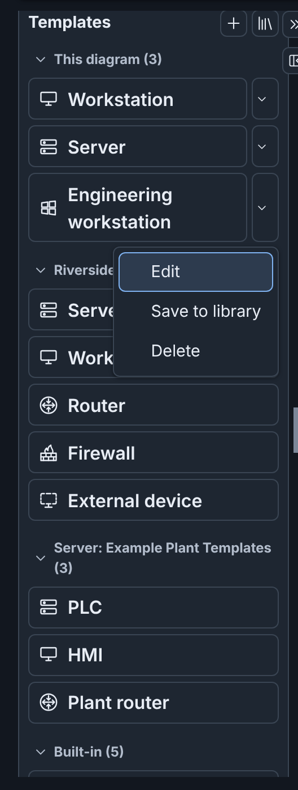
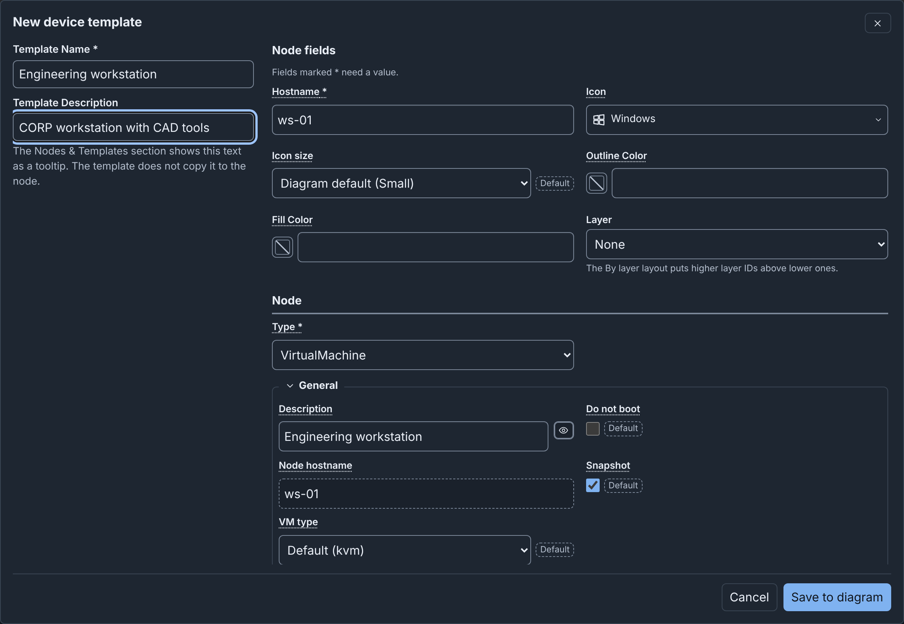
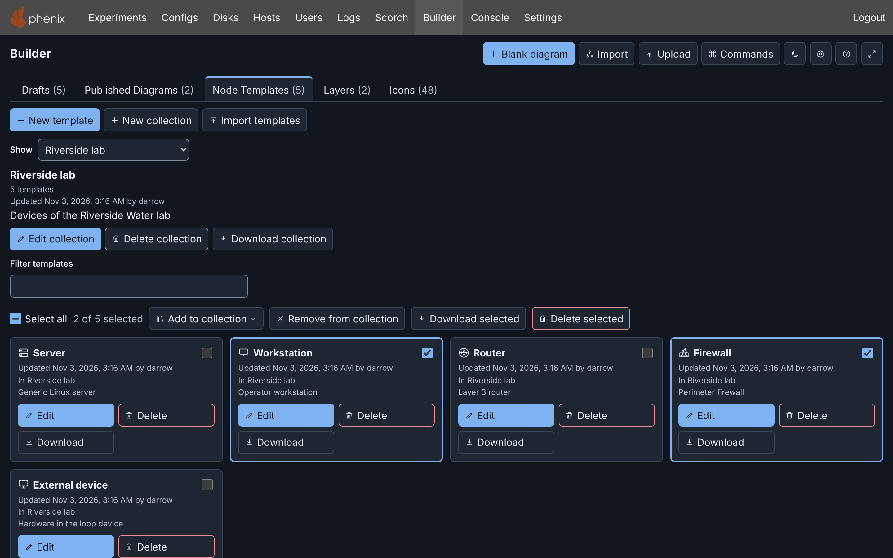
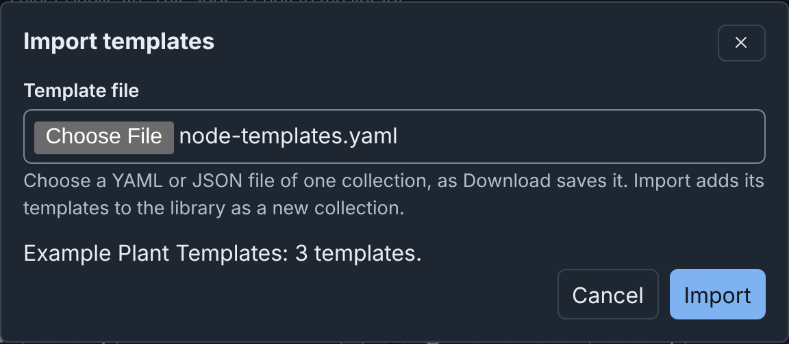
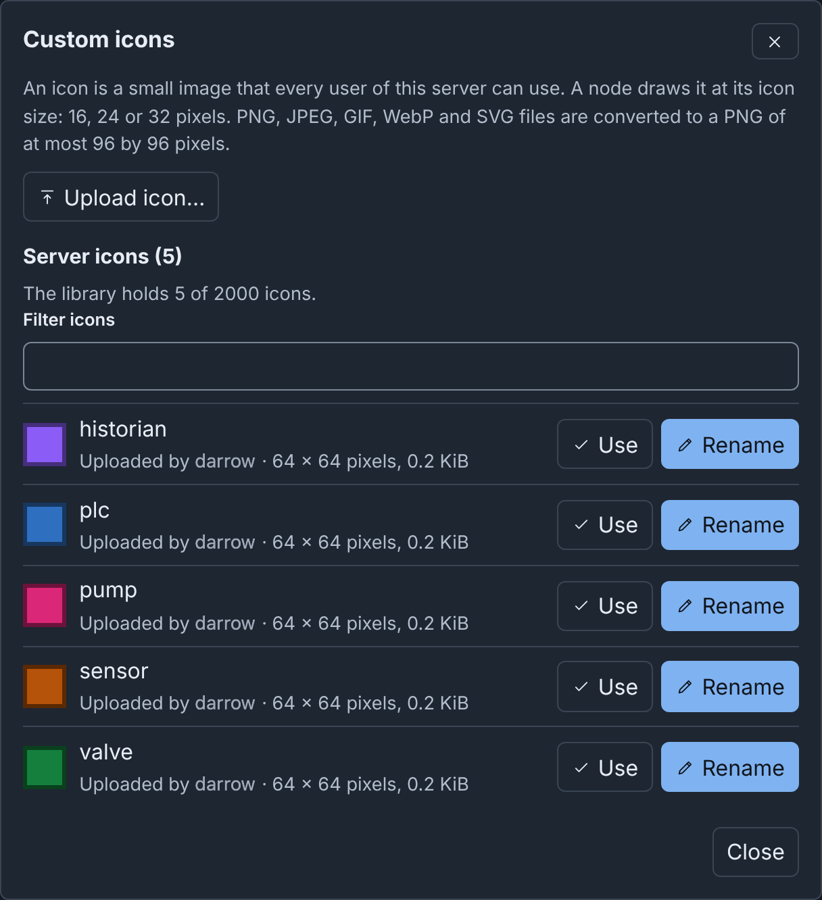

# Templates and Icons

A device template holds the fields of a new device: its icon, colors,
layer and the whole node spec. A custom icon is an image of your own on a
device, a group or an icon drawing.

## Where templates live

| Place | What it is |
|---|---|
| **This diagram** | Templates saved in the diagram, which go everywhere the diagram goes. |
| **Library** | One library on the phēnix server, shared by all its users. |
| **Built-in** | Five read-only templates: **Server**, **Workstation**, **Router**, **Firewall** and **External device**. |
| **Server** | Template files that an administrator put on the server, as read-only collections. |

## Add a device from a template

Under **Templates** in **Nodes & Objects**, the sections are
**This diagram**, **Library** or **Other library templates**, each
collection, and **Built-in**. Click a template, or drag it onto the canvas.

{ width="240" }

The new device has the hostname of the template, with a number when the
diagram already has that name, for example `plc-2`. It has a connection
point for each interface of the template, and no connections. It has the
icon, icon size and layer of the template. A change to the template
changes no device.

When you add a device from a library template or a server template,
Builder also adds a linked copy to **This diagram** (see
[Linked templates](#linked-templates)).

## Make a diagram template

To save `ws-01` of Riverside Water as a template of the diagram:

1. Select `ws-01` on the canvas.
2. Click **New device template**, the **+** beside **Templates**.
3. Change **Template Name** from `ws-01` to `Engineering workstation`.
4. Enter **Template Description** `CORP workstation with CAD tools`.
5. Click **Save to diagram**.

The template shows under **This diagram**. **Undo** reverses the save. A
template made from a device keeps all of the device except its
connections. With no device or with several nodes selected, the template
starts from a plain device.

In the template editor, **Hostname** is the name that new devices start
from (see [The template editor](details/templates.md#the-template-editor)).

Each template of **This diagram** has a menu with **Edit**,
**Save to library** and **Delete**. A linked template also has **Unlink**,
and **Update** when its source has a newer version. **Save to library**
adds a copy to the library and links the template to it.
**Delete** asks no question, and **Undo** brings the template back.

## Linked templates

A linked template is a diagram template that is a copy of a library
template or a server template. A mark under the template says when it
needs your attention, for example **Update available** or
**Deleted from library**.

To update a linked template:

1. Click **Update** on its mark, in its menu, or in the Inspector.
2. Read the question. It says if the update replaces your changes to the
   template.
3. Click **Update template**.

Devices made from the template do not change. **Update all** in the
Inspector updates every linked template with a newer version. **Unlink**
ends the link and keeps the template as it is (see
[Linked templates](details/templates.md#linked-templates)).

## The template library

To see the library, click the **Node Templates** tab on the drafts page.
In the editor, click **Node Templates library** beside **Templates**.

The tab has **New template**, **New collection** and **Import templates**.
**Show** selects the list: **All library templates**,
**Templates with missing images**, a collection, **Built-in templates**,
or a server collection. Each library card has **Edit**, **Delete** and
**Download**. A read-only card has **View**, **Duplicate** and
**Download**.

**Save** in the template editor sends the template to the server, and
**Undo** cannot reverse this. **Delete** asks first. It deletes the
template for all users, and diagrams keep their copies, which then show
**Deleted from library**.

### Collections

A collection is a named group of library templates, and a template can be
in several. To make a collection:

1. Click **New collection**.
2. Enter a **Name**.
3. Click **Create collection**.

To fill it, select templates under **All library templates**. Then select
the collection in **Add to collection**. While a collection shows,
**Edit collection** changes its name and description. **Delete collection**
deletes it and keeps its templates (see
[Collections](details/templates.md#collections)).

### Missing disk images

A card with a drive image that the server does not have shows a warning.
**Templates with missing images** in **Show** lists only those
templates. The check needs a role that can list disk images (see
[Missing disk images](details/templates.md#missing-disk-images)).

## Template files

A template file holds one collection of templates, as YAML or JSON. A
download also carries a copy of each custom icon that its templates name
and the server has. **Download** on a card, **Download selected** and
**Download collection** each save a template file.

To import a template file:

1. Click **Import templates** on the **Node Templates** tab.
2. Select the file. Builder describes it, for example "Plant floor: 2
   templates and 1 custom icon."
3. Click **Import**.

{ width="592" }

Import adds the templates to a new collection, named by the `name` in the
file. For the format, see [File formats](reference.md#file-formats) and
the example [node-templates.yaml](examples/node-templates.yaml).

## Server collections

Each template file in the template directory of the server becomes one
read-only collection, shown as **Server:** and its name. See
[Template files on the server](administration.md#template-files-on-the-server).
**Duplicate collection** copies it into the library, where you can change
the copy.

## Custom icons

All users of the server share one icon library. To use a custom icon:

1. Select the device, the group or the icon drawing.
2. In the Inspector, click **Icon**.
3. At the end of the list, select **Custom icon…**.
4. In the **Custom icons** dialog, click **Use** on a listed icon. Or click
   **Upload icon…** and select an image file.
5. For an upload, enter the icon name. Then click **Add icon**.

{ width="624" }

**Upload icon…** takes a PNG, JPEG, GIF, WebP or SVG file of at most 5 MiB.
The icon name is unique on the server. The change takes effect at once. A
custom icon keeps its own colors in the light and the dark theme, so use
an image that is clear on both.

### The Icons tab

The **Icons** tab of the drafts page lists the built-in icons and the
server icons. **View** shows an icon at its stored size and at three small
sizes. **Download** saves it as PNG. **Delete** deletes an icon that a user
uploaded, after a question.

**Rename** in the **Custom icons** dialog gives a new name to an icon that
a user uploaded, and the old name still works. Deleting an icon
changes no diagram: its nodes show their built-in icon until someone
uploads an icon of that name (see
[Renaming and deleting icons](details/icons.md#renaming-and-deleting-icons)).

### Icons in a diagram file

A draft names its icons. Except for a copy that it kept from an uploaded
file, it holds no image of them. A Builder JSON or YAML download carries a
copy of each icon that the diagram names. An upload adds the icons that
the server does not have (see
[The diagram and its icons](details/icons.md#the-diagram-and-its-icons)).

## Advanced

- The library, a diagram and a template file each have limits. See
  [Limits](reference.md#limits).
- Each template card has a checkbox, and a row above the cards acts on
  the selection. See
  [Selecting several templates](details/templates.md#selecting-several-templates).
- The **Custom icons** dialog lists the copies that the diagram holds under
  **In this diagram**, and **Add selected to server** adds several at once.
  See [Several icons at once](details/icons.md#several-icons-at-once).
- When Builder cannot read the library, **Templates** says so, with
  **Retry**. See
  [When the library cannot be loaded](details/templates.md#when-the-library-cannot-be-loaded).
- Scripts manage the library through the REST API. See
  [From a script](details/templates.md#from-a-script).

## More detail

- [Templates: details](details/templates.md): every rule and message of
  templates and collections.
- [Custom icons](details/icons.md#custom-icons): every rule of the icon
  library.
- [Built-in templates](reference.md#built-in-templates) and
  [Built-in icons](reference.md#built-in-icons).
