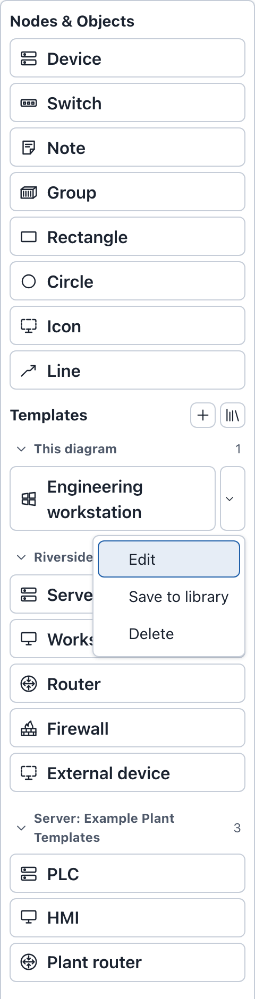
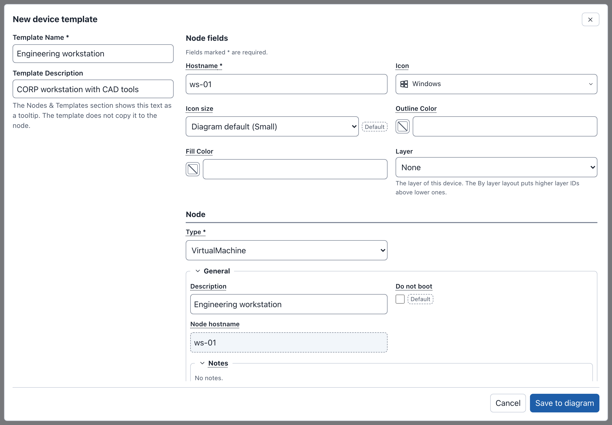
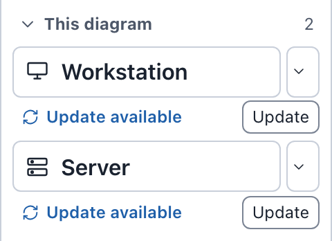
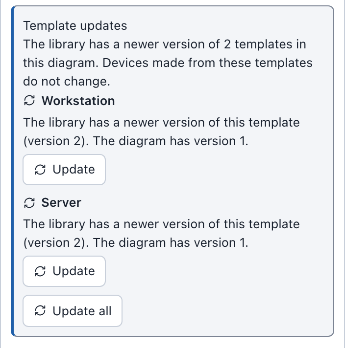
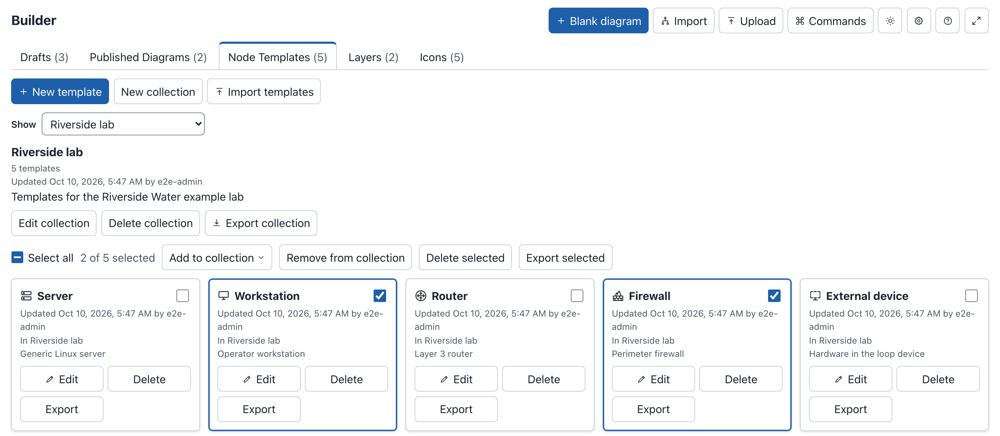
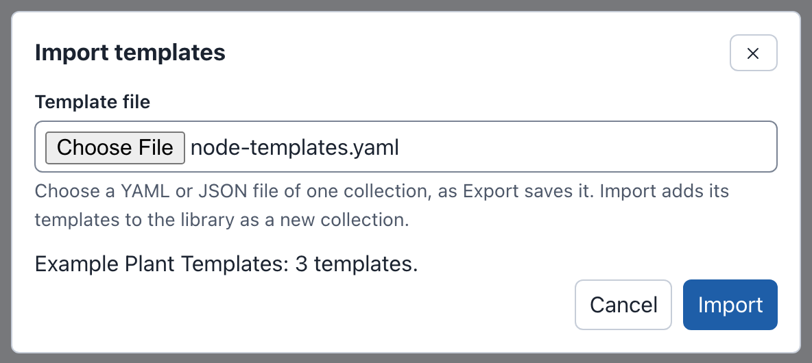
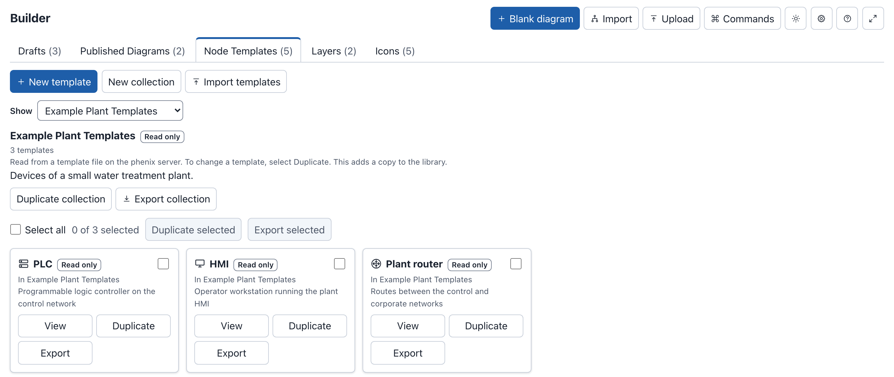

# Node Templates

A device template holds the fields of a new device: icon, custom icon, icon
size, outline and fill colors, layer, and the whole node spec. To add a
device made from a template, select the template under **Templates** in
**Nodes & Objects**, or drag it onto the canvas (see
[Adding devices](diagrams.md#adding-devices)).

Templates are kept in four places:

- **In a diagram.** A diagram template is part of the Builder document, so
  it goes everywhere that the diagram goes. See
  [Diagram templates](#diagram-templates).
- **In the template library.** The phenix server keeps one library for all
  of its users. See [The template library](#the-template-library).
- **Built in.** phenix has five read-only templates. See
  [Built-in templates](#built-in-templates).
- **On the phenix server.** Template files of an administrator become
  read-only collections. See [Server collections](#server-collections).

Template files move templates between these places (see
[Downloading and importing templates](#downloading-and-importing-templates)).

## Templates in the editor

{ width="240" }

Under **Templates**, **Nodes & Objects** lists the device templates in
sections, in this order:

| Section | Templates |
|---|---|
| **This diagram** | The templates of the diagram, linked templates included. |
| **Library** or **Other library templates** | The library templates that are in no collection. The name is **Other library templates** when the library has collections. |
| *Each collection* | The collections of the library, then the server collections, such as **Server: NLR Node Templates**. |
| **Built-in** | The five built-in templates, always. |

A template in two collections shows in both sections. A collection with no
templates does not show. Section names show only when two or more sections
have templates. Each section name is a button that collapses or expands the
section, and shows its number of templates. The browser keeps the collapsed
sections until you log out.

The tooltip of a template gives its description. It also names the
read-only collection of a server template, and the reason for the mark of a
linked template.

Two buttons follow the **Templates** heading:

- **New device template** (the **+**) makes a diagram template (see
  [Making a diagram template](#making-a-diagram-template)).
- **Node Templates library** leaves the draft and shows the
  **Node Templates** tab. It also works in a draft that you can only view.

A device made from a template has these properties:

- Its name is the hostname of the template. When that name is taken,
  Builder adds a number, for example `plc-2`.
- It has a connection point for each interface of the template, and no
  connections. Builder empties a VLAN that names a network of the diagram,
  and keeps other VLAN text.
- It uses the custom icon of the template, from the icon library of the
  server (see [Custom icons](diagrams.md#custom-icons)).
- It uses the icon size of the template, or else the icon size of the
  diagram (see [Icon size](diagrams.md#icon-size)).
- It has the layer ID of the template, if any. When the diagram does not
  have that layer, it shows as "Layer N" (see [Layers](diagrams.md#layers)).
- It has no description, and no link to the template. When you change,
  update or delete a template, no device changes.

When you add a device from a library template or a server template, Builder
also adds a linked copy of the template to **This diagram**. The device and
the copy are one change, for example "Added device and template PLC". When
the diagram already has a linked copy of the template, Builder adds only the
device. A built-in template gives no copy. When the diagram holds 50
templates, Builder adds only the device, and says so.

In the command palette, **Add device** lists each template once, with its
section and its image. Type `t:` to find a template by its other fields
(see [Command palette](editor.md#command-palette)).

### When the library cannot be loaded

When Builder cannot read the library, **Templates** says "The Builder could
not load the template library." and shows **Retry**. The diagram templates and
the built-in templates stay listed. If a later read fails, the templates of
the earlier read stay listed.

The server can hold a library that this version of phenix cannot read,
for example from a newer version. **Templates** says "The Builder
cannot read the template library. A newer version of phenix may have saved
it." with no **Retry**. The **Node Templates** tab says the same, and still
lists the built-in templates and the server collections. Open the library
with the phenix version that saved it.

Builder reads the library when it opens, and again:

- Each time it reads the drafts lists.
- When a draft opens in the editor.
- When the browser window comes to the front while the editor is open.
- After each change that you make to the library.

## Diagram templates

### Making a diagram template

To save ws-01 of Riverside Water as a template of the diagram:

1. Select ws-01 on the canvas.
2. Select **New device template** (the **+** beside **Templates**), or run
   **New device template** from the command palette.
3. Change **Template Name** from ws-01 to `Engineering workstation`.
4. In **Template Description**, enter `CORP workstation with CAD tools`.
5. Select **Save to diagram**.

The template shows under **This diagram**. The save is one change that
**Undo** can reverse.

A template made from a selected device keeps all of the device except its
connections, so Builder empties the VLAN of each interface. Builder first
saves the unapplied Inspector changes of that device. With no device or
with several nodes selected, the template starts from a plain device
(hostname `device`, image `ubuntu.qc2`) with no name.

In a draft that you can only view, the **+** does nothing. When the
diagram holds 50 templates, its tooltip says that the diagram is full.

### The template editor



On the left are **Template Name** (required) and **Template Description**.
Each is one line: a pasted line break or tab becomes a space (see
[Limits](#limits)). Two templates can have the same name, but the field
then shows a note.

On the right, **Node fields** has the fields of the Inspector: **Hostname**,
**Icon**, **Icon size**, **Outline Color**, **Fill Color**, **Layer** and the
node spec, with the same checks (see
[Editing a node](editor.md#editing-a-node)). **Hostname** is the name that
new devices start from. Rarely used fields are in **More settings** at the
bottom. There is no **Apply**, **Position**, **Connection points** or
**Edit layers…**.

- **Icon** also chooses a custom icon (see
  [The Icon field](editor.md#the-icon-field)).
- **Icon size** **Diagram default** uses the icon size of the diagram that
  the device is in. For a diagram template, the choice names that size,
  for example "Diagram default (Large)".
- **Layer** offers the layers of the diagram for a diagram template. For a
  library template, it offers the default layer set, or the placeholder
  layers when the server has no default set (see
  [The Layers tab](drafts.md#the-layers-tab)). For a template with no layer
  of its own, it shows the layer that the node matchers give (see
  [Layers](diagrams.md#layers)).

**Save**, or **Save to diagram** for a new template, first checks the
fields. On an error, focus moves to the list of fields that need attention.
The device of a template can have at most 16 KiB as JSON. <kbd>Enter</kbd> in
**Template Name** or **Template Description** saves.

**Cancel**, <kbd>Esc</kbd>, the close button or a click outside closes the
editor. If you made changes, it asks first.

### Editing and deleting a diagram template

Each template of **This diagram** has a menu:

- **Edit** opens the template editor.
- **Update**, on a linked template with a newer version (see
  [Linked templates](#linked-templates)).
- **Save to library** adds a copy to the library, and links the diagram
  template to it, as one change of the diagram. When the diagram carries
  its own copy of the custom icon, Builder first sends it to the icon
  library of the server (see
  [The diagram and its icons](diagrams.md#the-diagram-and-its-icons)). If
  that fails, Builder still saves the template and tells you why.
- **Unlink**, on a linked template.
- **Delete** deletes the template from the diagram, without a question.
  **Undo** brings it back.

## Linked templates

A linked template is a diagram template that is a copy of a library
template or a server template. The diagram gets one when you add a device
from such a template, or when you select **Save to library**.

The link names the source template and the version that the diagram has.
Builder compares each linked template with its source when a draft opens,
and each time it reads the library. A mark under the template shows when it
needs your attention:

| Mark | What it means | Button on the mark |
|---|---|---|
| **Update available** | The library has a newer version of the template. For a server template, an administrator changed the template file and restarted the server. | **Update** |
| **Deleted from library** | A user deleted the library template. | **Unlink** |
| **Removed from server** | The server collection no longer has the template. | **Unlink** |

The tooltip of the template gives the full reason, with the version
numbers. A draft that you can only view shows the marks without buttons.

{ width="240" }

With nothing selected, the Inspector lists the same templates under
**Template updates**, each with **Update** or **Unlink** (see
[With nothing selected](editor.md#with-nothing-selected)). With two or more
newer versions, **Update all** updates all of them.

{ width="352" }

To update a linked template:

1. Select **Update** on its mark, in its menu, or in the Inspector.
2. Read the question. It tells you if the update replaces changes that you
   made to the template in the diagram.
3. Select **Update template**.

The diagram template gets the name, the description and the device fields
of its source. Devices made from it do not change. The update is one
change, so **Undo** can reverse it. **Update all** asks once, and its button
is **Update templates**.

**Unlink** removes the link and keeps the template as it is, without a
question. It is one change.

You can change a linked template in the diagram. It keeps its link, and an
update replaces your changes.

## The template library

The phenix server keeps one template library for all of its users, and no
user owns it. Each Builder user sees the same templates and collections,
and can add, change and delete them (see
[The libraries](administration.md#the-libraries)). Only the built-in
templates and the server collections are read only. A change shows for all
users the next time Builder reads the library.

### The Node Templates tab

To see the library, select the **Node Templates** tab on the drafts page,
or **Node Templates library** in the editor. The command palette has
**Open Node Templates library** in the editor, and **Show Node Templates**
on the drafts page. In the command palette, `c:` shows a collection, and
`t:` opens a template in the template editor.



The tab holds:

- **New template**, **New collection** and **Import templates** (see
  [Downloading and importing templates](#downloading-and-importing-templates)).
- **Show**, which selects the list: **All library templates**,
  **Templates with missing images**, the collections under
  **Library collections**, **Built-in templates**, and the server
  collections under **Server**.
- **Filter templates**, which shows only the cards that match the text. It
  finds a template by its name, by the fields that `t:` in the command
  palette finds, and by its source (Library, Server or Built-in). The text
  stays when **Show** selects another list (see
  [Filtering the lists](drafts.md#filtering-the-lists)).
- A row that acts on several of the cards that show (see
  [Selecting several templates](#selecting-several-templates)).
- A card for each template, with its last change and the user who made it,
  its collections, and **Edit** (or **View**), **Delete** and **Download**.

The cards of the built-in templates and of the server collections have the
tag **Read only**, and **View**, **Duplicate** and **Download**.

When the tab cannot read the library, it gives the reason, with **Retry**.

**New template** opens the template editor on a plain device with no name.
**Edit** on a card opens the editor on that template. **Save to library**
(or **Save**) sends the template to the server, and **Undo** cannot
reverse this. When the save fails, the editor stays open and gives the
reason, for example "Could not save the template. A library holds at most
200 templates."

Another user, or you in another window, can change the template after you
open it. The editor then says so. Select **Save** again to replace that
version, or **Cancel** to keep it.

**Delete** asks first. It deletes the template from the library and its
collections, for all users, and you cannot undo this. Diagrams keep their
copies, which then show **Deleted from library**.

When someone changed the library after the tab read it, **Delete**,
**Delete collection** and **Delete selected** delete nothing. The tab then
shows the library as it is now. Check it, and then delete again.

### Missing disk images

The **Node Templates** tab compares the drive images of each template with
the disk images of the server. It compares file names with the same case,
as the drive image check of a diagram does (see
[Checks and warnings](editor.md#checks-and-warnings)). A card with an image
that the server does not have shows a warning, for example
`The server has no disk image named "ubuntu.qc2".` Screen readers read it
as the description of the card. Built-in and server templates get the
warning too.

To list only the library templates with a missing image, choose
**Templates with missing images** in **Show**.

The tab reads the disk images when you show it, and again when the page
shows again after 30 seconds or more. When your role cannot list the disk
images, or the server lists none, no card shows the warning, and **Show**
does not offer **Templates with missing images**. If the disk images become
unknown while that list shows, the choice stays, marked "(disk images
unknown)", and the list is empty. The page announces it. The list comes
back when the tab reads the disk images again.

### Built-in templates

phenix has five built-in templates: **Server**, **Workstation**,
**Router**, **Firewall** and **External device** (see
[Adding devices](diagrams.md#adding-devices)). They are read only for
everyone, administrators included. Every diagram lists them under
**Built-in**. A device made from a built-in template adds no template to
the diagram.

To see them, choose **Built-in templates** in **Show** on the
**Node Templates** tab. Each card has these buttons:

- **View** opens the template editor read only. **Duplicate to library** in
  the editor adds a copy to the library.
- **Duplicate** adds a copy to the library. Change the copy.
- **Download** saves the template as a file (see
  [Downloading templates](#downloading-templates)).

### Collections

A collection is a named group of library templates. A template can be in
several collections.

To make a collection:

1. Select **New collection**.
2. Enter a **Name** (required) and, if necessary, a **Description**.
3. Select **Create collection**.

To fill it, select templates under **All library templates**. Then choose
the collection in **Add to collection** in the selection row. **New
collection…** in that menu makes a collection with the selected templates.

Choose a collection in **Show** to list its templates. Above them are the
details of the collection, with **Edit collection**, **Delete collection**
and **Download collection**. **Edit collection** changes only the name and
the description. While a collection shows, **Remove from collection**
removes the selected templates from it.

**Delete collection** asks first. It deletes the collection for all users,
and its templates stay in the library. When you delete a template, Builder
also takes it out of its collections.

### Selecting several templates

Each card has a checkbox. The row above the cards has **Select all**, a
count such as "2 of 5 selected", and these actions for a list of the
library:

- **Add to collection**, and **Remove from collection** while a collection
  shows.
- **Download selected** (see
  [Downloading templates](#downloading-templates)).
- **Delete selected**, which asks one time. Devices made from the templates
  do not change.

For the built-in templates and a server collection, the row has
**Duplicate selected** and **Download selected**.

When you choose another list in **Show**, the selection clears. The keys of
the drafts page also select cards (see
[Selecting with the keyboard](drafts.md#selecting-with-the-keyboard)).

## Downloading and importing templates

A template file holds one collection of templates, as YAML or JSON.
Download writes the format that Import and the phenix server read. You can
import a downloaded file on another phenix server, or put it in the
template directory of a server (see [Server collections](#server-collections)).

### Downloading templates

**Download** saves a YAML file:

- **Download** on a card saves one template, as a collection with the name
  of the template.
- **Download selected** saves the selected templates, as a collection
  named after the list, for example "Library".
- **Download collection** saves the collection with its name and
  description.

The file name comes from the collection or template, for example
`plant-floor.templates.yaml`. The file carries a copy of each custom icon
that its templates name, from the icon library of the server. Builder
names each icon that the icon library does not have, which the file then
does not carry.

The template names in a file must be different when case is ignored. When
the library holds "PLC" and "plc", Download keeps the first name. It adds a
number to the others, such as "plc (2)", and says so.

A file looks like this (the example file
[node-templates.yaml](examples/node-templates.yaml) has three templates and
no icons):

```yaml
$schema: https://phenix.sandia.gov/schemas/builder/templates/v1
name: Plant floor
description: Devices of the plant's control network.
templates:
  - name: PLC
    description: Programmable logic controller
    device:
      iconKey: server
      icon: plc-icon
      spec:
        type: VirtualMachine
        general:
          hostname: plc
          vm_type: kvm
        hardware:
          os_type: linux
          drives:
            - image: ubuntu.qc2
icons:
  plc-icon:
    data: iVBORw0KGgoAAAANSUhEUgAAAAEAAAABCAYAAAAfFcSJAAAADUlEQVR42mNkYPhfDwAChwGA60e6kgAAAABJRU5ErkJggg==
```

- `$schema` (required) names the format. The server serves its JSON Schema
  at `/api/v1/schemas/builder/templates/v1`.
- `name` (required) and `description` are the name and description of the
  collection, each on one line.
- `templates` (required) holds the templates. Each has a `name`, an
  optional `description`, and a `device` with the fields that the template
  fills in. Names cannot differ only in case. Templates have no IDs: the
  place that keeps a template gives it an ID.
- `icons` (optional) holds copies of custom icons by name, each a PNG in
  base64 (see [Custom icons](diagrams.md#custom-icons)). A template can also
  name an icon that the file does not carry. The icon library of the server
  must then hold it.

YAML anchors and aliases (`&name`, `*name`) are not allowed. For the size
limits of a file, see [Limits](#limits).

### Importing

To import a template file into the library:

1. Select **Import templates** on the **Node Templates** tab.
2. Choose the file. Builder reads it and describes it, for example "Plant
   floor: 2 templates and 1 custom icon." For a file that it cannot import,
   it gives each problem and its location in the file.
3. Select **Import**.

The dialog in step 3, with the example file
[node-templates.yaml](examples/node-templates.yaml):

{ width="592" }

Import adds copies of the templates to the library, in a new collection
with the name and description of the file. When a collection of the library
has that name, the new collection gets a number, such as "Plant floor (2)".
The dialog says so before you import.

The custom icons of the file go to the icon library of the server first
(see [The diagram and its icons](diagrams.md#the-diagram-and-its-icons)).
If an icon cannot go there, the import continues, and the dialog tells you
what happened.

Import refuses a file when the library holds 50 collections, or when the
file would put more than 200 templates in the library (see
[Limits](#limits)).

## Server collections

An administrator can give everyone on a phenix server the same templates.
Each template file in the template directory of the server becomes one
collection, which phenix reads when it starts (see
[Template files on the server](administration.md#template-files-on-the-server)).

Server collections show under **Templates** in the editor, as **Server:**
and the name, and under **Server** in **Show** on the **Node Templates**
tab. They are read only for everyone, administrators included. To change a
template, duplicate it and change the copy. **Duplicate collection** adds a
copy of the collection and its templates to the library.

When an administrator changes a template file and restarts the server, the
linked templates of its templates show **Update available** (see
[Linked templates](#linked-templates)).

Here the template directory holds the example file
[node-templates.yaml](examples/node-templates.yaml):



## Limits

| What | Limit |
|---|---|
| Templates in a diagram | 50 |
| Templates in the library | 200 |
| Collections in the library | 50 |
| Templates in a collection | 200 |
| Whole library: templates and collections | 512 KiB |
| Template name | 1 to 128 bytes, one line |
| Template description | 1024 bytes, one line |
| Collection name | 1 to 128 bytes, one line |
| Collection description | 1024 bytes, one line |
| A template's device, as JSON | 16 KiB |
| Template file | 8 MiB, 1 to 200 templates, 50 custom icons |
| Template files the server reads | 50 |

## From a script

Scripts use the REST API to list, add, change and delete the templates and
collections of the library (see [REST API](administration.md#rest-api)).
Each template and collection names the user who added it (`createdBy`) and
the user who last changed it (`updatedBy`). `--base-dir.builder-templates`
names the template directory of the server collections (see
[Template files on the server](administration.md#template-files-on-the-server)).
Diagram templates are part of the Builder document, so a Builder file can
hold them. A linked template keeps its link in `source` (see
[Builder JSON and YAML](import-upload-download.md#builder-json-and-yaml)).
Publish never writes diagram templates into a Topology config.
