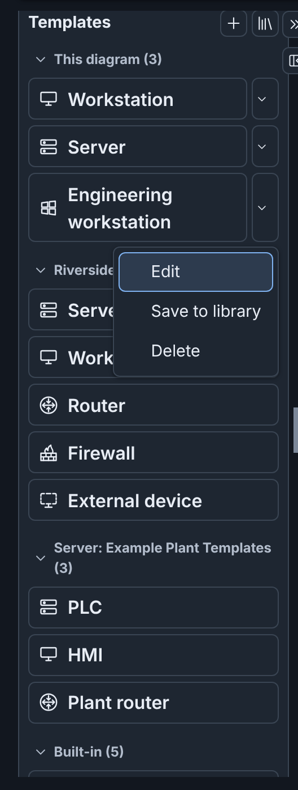
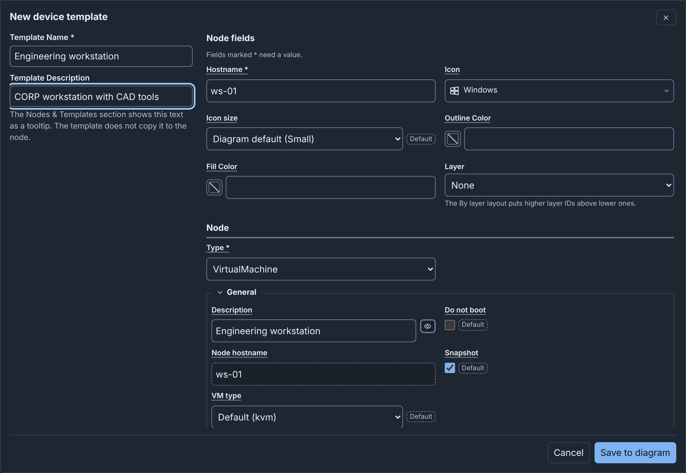
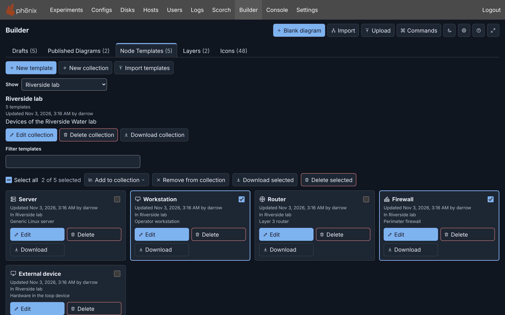
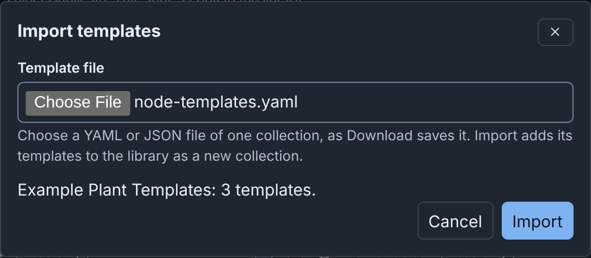
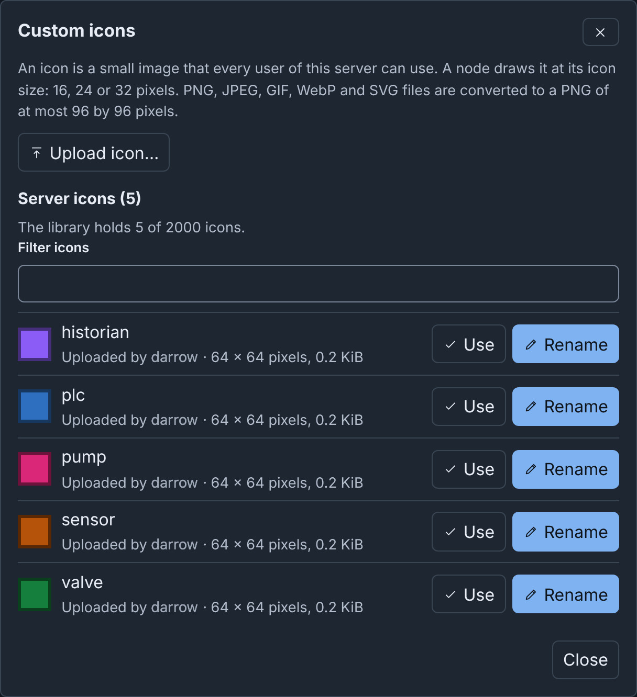

# Templates and Icons

A device template holds everything a new device starts with: its icon,
colors, layer and the whole node spec. A custom icon is an image of your own
on a device, a group or an icon drawing. For the rules and the less common
operations, see [Node Templates: Details](details/templates.md) and
[Custom Icons](details/icons.md#custom-icons).

## Where Templates Live

| Place | What it is |
|---|---|
| `This diagram` | Templates saved in the diagram, which go everywhere the diagram goes. |
| `Library` | One library on the phēnix server, shared by all its users. |
| `Built-in` | Five read-only templates (see [Built-in Templates](reference.md#built-in-templates)). |
| `Server` | Read-only collections from template files that an administrator put on the server. |

## Add a Device From a Template

Under `Templates` in `Nodes & Objects`, click a template or drag it onto the
canvas.

{ width="240" }

The new device gets the template's hostname (numbered when the name is
taken, such as `plc-2`), icon, icon size and layer, and a connection point
for each interface, but no connections. Later changes to the template don't
change the device. A library or server template also adds a linked copy of
itself to `This diagram`.

## Make a Diagram Template

To save `ws-01` of Riverside Water as a template of the diagram:

1. Select `ws-01` on the canvas.
2. Click `New device template`, the `+` beside `Templates`.
3. Change `Template Name` from `ws-01` to `Engineering workstation`.
4. Enter `CORP workstation with CAD tools` in `Template Description`.
5. Click `Save to diagram`.

The template keeps everything of the device except its connections, and
`Undo` reverses the save. With no device, or several nodes, selected, it
starts from a plain device.

In the template's menu, `Save to library` adds a copy to the library and
links the template to it. `Delete` doesn't ask first, but `Undo` brings the
template back.

## Linked Templates

A linked template is a diagram template copied from a library or server
template. A mark under it, such as `Update available` or
`Deleted from library`, tells you when it needs your attention.

To update a linked template:

1. Click `Update` on its mark, in its menu, or in the Inspector.
2. Read the question. It says if the update replaces your changes to the
   template.
3. Click `Update template`.

Devices made from the template don't change. When two or more linked
templates have a newer version, `Update all` in the Inspector updates them
all. `Unlink` ends the link and keeps the template as it is.

## The Template Library

Click the `Node Templates` tab on the drafts page, or
`Node Templates library` beside `Templates` in the editor.

`Show` picks the list: all library templates, the ones with missing disk
images, a collection, the built-in templates, or a server collection. A
read-only card has `View` and `Duplicate` instead of `Edit` and `Delete`.

`Save` in the template editor sends the template to the server, so `Undo`
can't reverse it. `Delete` asks first and deletes the template for all
users. Diagrams keep their copies, which then show `Deleted from library`.

### Collections

A collection is a named group of library templates, and a template can be in
several. To make one:

1. Click `New collection`.
2. Enter a `Name`.
3. Click `Create collection`.

To fill it, select templates under `All library templates`, then pick the
collection in `Add to collection`. While a collection shows,
`Edit collection` changes its name and description, and `Delete collection`
deletes it but keeps its templates.

## Template Files

A template file holds one collection of templates, as YAML or JSON, with a
copy of each custom icon that its templates name and the server has.
`Download` on a card, `Download selected` and `Download collection` each save
one. To import one:

1. Click `Import templates` on the `Node Templates` tab.
2. Select the file. Builder describes it, for example "Plant floor: 2
   templates and 1 custom icon."
3. Click `Import`.

{ width="592" }

The templates go into a new collection named after the `name` in the file.
For the format, see [File Formats](reference.md#file-formats) and the example
[node-templates.yaml](examples/node-templates.yaml).

## Server Collections

Each template file in the server's template directory becomes a read-only
collection, shown as `Server:` and its name (see
[Template Files on the Server](administration.md#template-files-on-the-server)).
`Duplicate collection` copies it into the library, where you can change it.

## Custom Icons

All users of the server share one icon library. To use a custom icon:

1. Select the device, the group or the icon drawing.
2. In the Inspector, click `Icon`.
3. Select `Custom icon…` at the end of the list.
4. In the `Custom icons` dialog, click `Use` on a listed icon, or click
   `Upload icon…` and select an image file.
5. For an upload, enter the icon name, then click `Add icon`.

{ width="624" }

A custom icon keeps its own colors in both themes, so use an image that is
clear on light and dark backgrounds. For the files that `Upload icon…`
takes, see [Uploading an Icon](details/icons.md#uploading-an-icon).

The `Icons` tab of the drafts page lists the built-in and server icons. You
can view and download them there, and delete the ones that users uploaded.
`Rename` in the `Custom icons` dialog renames an uploaded icon, and the old
name keeps working. Deleting an icon changes no diagram: its nodes show their
built-in icon until someone uploads an icon of that name.

A Builder JSON or YAML download carries a copy of each icon that the diagram
names, so it shows them on another server (see
[The Diagram and Its Icons](details/icons.md#the-diagram-and-its-icons)).

## See Also

- [Limits](reference.md#limits): how many templates, collections and icons
  fit in a diagram, the library and a template file.
- [Diagrams](diagrams.md#add-devices): the other ways to add devices.
- [Disks](../disks.md): the disk images that templates boot from.
