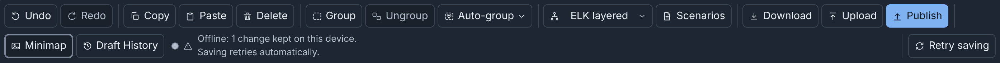

# Troubleshooting

What you might see when something goes wrong in Builder, and what to do about
it. The save states, codes and limits are in the [Reference](reference.md).

## Permissions

For what each permission allows, see
[Permissions](administration.md#permissions).

| What you see | Why | What to do |
|---|---|---|
| No `Builder` link in the navigation bar, or "Your role does not include the Builder." | Your role has no `builder` `use` permission. | Ask an administrator for the `Builder` role or the `builder` policy. |
| A button such as `Publish` or `Import` is missing or grayed out, or "Your role cannot publish diagrams." in the command palette | Your role doesn't allow that task (publishing needs `configs` `update`), or it's a published diagram, which opens read only. | See [What each task needs](details/administration.md#what-each-task-needs) and [Published diagrams](details/drafts.md#published-diagrams). |
| "Only Builder can edit this configuration" on the `Configs` page | The topology has a Builder diagram, and your role has no `builder` `use`. | Ask for the `builder` policy. |
| "Topology … does not exist, or you do not have permission to read it." | The topology was deleted, or your role can't list it. | Ask for `configs` `list` and `topologies` `list` on it. |
| "You cannot save changes to this draft" | Your role no longer includes Builder. | Ask for the permission, and click `Download` to keep a copy. |

## Saving

| What you see | Why | What to do |
|---|---|---|
| "Offline: …" | The server can't be reached or didn't answer in time. The browser keeps your changes. | Keep the tab open, or click `Retry saving`. See [Working offline](details/drafts.md#working-offline). |
| "This draft changed on the server" | Someone saved a newer version first, and the changes can't merge on their own. | Click `Review and merge`, `Save my history as a new draft` or `Discard mine and load the server version`. See [Draft merging](details/drafts.md#draft-merging). |
| "This draft is also open in another tab" | The draft is open in two tabs. | Close one. If both have unsaved changes, pick one in `Choose which changes to save`. |
| "Could not save: someone deleted this draft from the server. …" | Another user deleted the draft. | `Download` a copy, then upload it as a new draft. |
| "Could not save your last change. …" | The server refused the diagram (two devices with one hostname, say). The message names the issue. | Fix it; the next change saves. |
| The sign-in page opens while you work | Your session ended (by default after 24 hours). | Log in. Changes the server didn't have yet are lost. See [Logging out](details/drafts.md#logging-out). |
| A new draft is refused, with a hint to delete drafts or run `Clean up…` | The server holds 2,000 drafts, its limit. | Delete drafts, or run `Clean up…` in `Settings`. |

## Publishing

| What you see | Why | What to do |
|---|---|---|
| "N errors block publishing" under `Checks` | The diagram has errors, or a warning that blocks publishing (such as an interface with no VLAN). | Click `Go to` next to each issue and fix it. See [What blocks publishing](publishing.md#what-blocks-publishing). |
| "A topology with this name already exists. This diagram cannot update it. …" | The draft didn't come from that topology and never published to it. | Use another name, or import the topology and edit that draft. See [Publish again](publishing.md#publish-again). |
| "A topology with this name changed after this diagram published it. …" | The topology was changed outside Builder after this draft published it. | Import it again, or use another name. |
| "This diagram comes from topology …. … Publish refuses this diagram under any name. …" | The source config changed after Builder made the draft from it. | Make a new draft from the config and copy your changes over. See [When the source config changed](publishing.md#when-the-source-config-changed). |
| "Could not publish the diagram. Scenario … does not exist.", "… does not have permission", or "Not found on the server" in the `Scenarios` dialog | A listed scenario doesn't exist, or your role can't read or update it. | Create the scenario, ask for access to it, or clear its checkbox and click `Save scenarios`. See [Scenarios](details/scenarios.md#the-list-of-scenarios). |
| "Phenix cannot publish topology …: node … is in this topology and in its included topology …" | The diagram and an included topology share a hostname. | Rename one of the devices. |
| "Published with failures. …" | A stage failed after earlier ones were written, for example because the experiment is running. | Fix the cause, click `Back`, and publish again with the same names. See [Publish results](reference.md#publish-results). |

## Import and Upload

| What you see | Why | What to do |
|---|---|---|
| `Upload` refuses a Topology or Experiment config, a template file or a layer set file | Each has its own place. | Use `Import` with `Config file`, `Import templates` on the `Node Templates` tab, or `Upload layer set…` on the `Layers` tab. |
| "Could not convert the legacy diagram. …" | The file isn't a legacy diagram, or it's a Topology config without `builder-xml`. | See [Converting a File](legacy.md#converting-a-file). |
| A package upload shows `Missing`, `Different` or `Not checked` items | The server lacks the item, has another version, or can't check it. | Tick `Create on this server` for a missing config in the package. Builder adds missing custom icons itself; add other items yourself. See [Uploading a package](details/import-upload-download.md#uploading-a-package). |
| `phenix config create`, `phenix config apply` or `phenix config diff` refuses a file as "not a configuration" | It's a Builder document, package, template file or layer set file. | Add it in Builder instead. See [Builder documents](details/import-upload-download.md#builder-documents-and-phenix-config-create). |

## Other Problems

| What you see | Why | What to do |
|---|---|---|
| "A newer version of phenix may have saved it." on a draft card, the template library or a layer set | A newer phēnix saved it, so this one can't read it. | Use that version. A draft can also be deleted: see [Damaged drafts](details/drafts.md#damaged-drafts). |
| "Auto layout failed. The layout engine could not start.", "… could not load the layout engine. …", or "The Builder could not check the pattern." in `Auto-group` | A proxy or content security policy may be blocking the layout engine. | Reload the page. Ask the administrator to let the proxy serve the phēnix scripts and allow same-origin workers ([Availability](details/administration.md#availability)). |
| A Preflight check shows `Unavailable` | Your role lacks its permission, Builder can't reach minimega, the server lists no disk images, or the check took over 20 seconds. | Read the cause under the check; the others still run. See [Preflight](details/checks.md#preflight). |
| `Icon` shows "(custom icon not found: the node shows its built-in icon)" | The icon was deleted, or the diagram came from another server. | Upload an icon with that name. See [Custom icons](details/icons.md#custom-icons). |
| "The layer set has a newer version. Update from the layer set first." | Someone saved the layer set after the diagram copied it. | Click `Update from layer set` (this replaces your changes to the copy), redo your changes, then `Save to layer set`. |
| "A library holds at most 200 templates." when you save a template | The library is full. | Delete templates nobody uses. See [Limits](reference.md#limits). |

## See Also

- [Administration](administration.md): the permissions, storage and files
  that an administrator manages.
- [Legacy Builder](legacy.md): converting old diagrams, and the conversion
  warnings that need action.
- [Troubleshooting](../troubleshooting.md): problems outside Builder, such as
  minimega, images and experiments.
