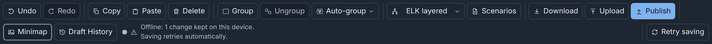

# Troubleshooting

This page lists what you can see when something goes wrong in Builder,
why it happens, and what to do. The exact messages, codes, save states and
limits are in the [Reference](reference.md), and most rows link to the
page that has more.

## Permissions

| What you see | Why | What to do |
|---|---|---|
| No **Builder** link in the navigation bar, or "Your role does not include the Builder." | The role has no `builder` `use` permission. | Ask an administrator for the **Builder** role, or for the `builder` policy. See [Permissions](administration.md#permissions). |
| A button is missing or unavailable, for example **Publish** or **Import**. | The role does not allow that task. A published diagram also opens read only, without **Publish**. | See [What each task needs](details/administration.md#what-each-task-needs) and [Published diagrams](details/drafts.md#published-diagrams). |
| "Only Builder can edit this configuration" on the **Configs** page | The topology has a Builder diagram, and the role has no `builder` `use`. | Ask for the `builder` policy. See [From the Configs page](details/import-upload-download.md#from-the-configs-page). |
| "Your role cannot publish diagrams." in the command palette | The role has no `configs` `update`. | Ask for the permission, or let a user with the Builder role publish the draft. |
| "The Builder does not check drive images, because the server did not list its disk images." | The role has no `disks` `list`, or the server lists no images, for example while minimega is not running. | Nothing. The other checks still run. See [Checks and warnings](details/checks.md#checks-and-warnings). |
| "Topology … does not exist, or you do not have permission to read it." | Someone deleted the topology, or the role cannot list it. | Ask for `configs` `list` and `topologies` `list` on the topology. |
| "You cannot save changes to this draft" | The role no longer includes Builder. | Ask for the permission. Click **Download** to keep a copy. |

## Saving

The save state is after **Draft History** in the toolbar (see
[Save states](reference.md#save-states)):

| What you see | Why | What to do |
|---|---|---|
| The save state says "Offline: …" | The browser cannot reach the server, or the server did not answer in time. The browser keeps the changes. | Keep the tab open, or click **Retry saving**. See [Working offline](details/drafts.md#working-offline). |
| "This draft changed on the server" | Someone saved a newer version of the draft first. A change clashes with yours, the merged diagram has an error, or merging is not available. | Click **Review and merge**, **Save my history as a new draft** or **Discard mine and load the server version**. See [Draft merging](details/drafts.md#draft-merging). |
| "This draft is also open in another tab" | You opened one draft in two tabs. | Close one tab. When both tabs hold unsaved changes, choose which to save in **Choose which changes to save**. See [Same draft in multiple tabs](details/drafts.md#same-draft-in-multiple-tabs). |
| "Could not save: someone deleted this draft from the server. …" | Another user deleted the draft. | Click **Download** to keep a copy, then upload the file as a new draft. |
| "Could not save your last change. …" | The server refused the diagram, for example two devices with one hostname. The message names the issue. | Fix the issue. The next change saves the diagram. See [Checks and warnings](details/checks.md#checks-and-warnings). |
| The sign-in page opens while you work | The session ended, by default after 24 hours. | Log in. The logout deleted the changes that the server did not have. See [Logging out](details/drafts.md#logging-out). |
| A notice above the toolbar counts the newer snapshots that your next change deletes | You restored or undid to an older snapshot. | To keep the newer snapshots, click **Return to latest** or **Save newer history as a new draft**. See [Newer snapshots](details/drafts.md#newer-snapshots). |
| A draft card says "You cannot open this draft, because the Builder cannot read it. A newer version of phenix may have saved it." | A newer phēnix saved the draft. | Open the draft with that phēnix version, or delete it. See [Damaged drafts](details/drafts.md#damaged-drafts). |
| The server refuses a new draft, and says to delete drafts or to run **Clean up…** | The server holds 2,000 drafts, its limit. | Delete drafts, or click **Clean up…** in **Settings**. See [Limits](details/drafts.md#limits). |

## Publishing

| What you see | Why | What to do |
|---|---|---|
| "N errors block publishing" under **Checks** | The diagram has errors, or one of the five warnings that block publishing, for example an interface with no VLAN. | Click **Go to** beside each issue and fix it. See [What blocks publishing](publishing.md#what-blocks-publishing). |
| "A topology with this name already exists. This diagram cannot update it. …" | The draft did not come from that topology and did not publish to it. For a topology from the legacy Builder, only the draft imported from it can update it. | Publish under another name, or import the topology and change that draft. See [Publish again](publishing.md#publish-again). |
| "A topology with this name changed after this diagram published it. Publishing would overwrite that change. …" | Someone changed the topology outside Builder after this draft published it. | Import the topology again, or publish under another name. See [Publish again](publishing.md#publish-again). |
| "This diagram comes from topology …. That topology changed on the server after Builder made the diagram. Publish refuses this diagram under any name. …" | The source config changed after Builder made the draft, by import, by upload of a document made from it, or from its published diagram. | Make a new draft of the config, and copy your changes into it. See [When the source config changed](publishing.md#when-the-source-config-changed). |
| "Could not publish the diagram. Scenario … does not exist.", or "Not found on the server" beside a scenario in the **Scenarios** dialog | The diagram lists a scenario that does not exist, or that the role cannot read. | Store the scenario, or ask for `configs` `get` and `scenarios` `list` on it. Or clear its checkbox and click **Save scenarios**. See [The list of scenarios](details/scenarios.md#the-list-of-scenarios). |
| "Could not publish the diagram. Adding topology … to scenario …: user … does not have permission" | The role cannot update a scenario that the diagram lists. | Ask for `configs` `update` on the scenario, or clear its checkbox in the **Scenarios** dialog. |
| "phenix cannot publish topology …: node … is in this topology and in its included topology …" | The diagram and an included topology use one hostname. | Rename the device here, or in the included topology. See [Included topologies](publishing.md#included-topologies). |
| "Published with failures. …" | A stage failed after the server wrote earlier stages, for example because the experiment is running. | Fix the cause, for example stop the experiment. Then click **Back** and publish again with the same names. See [Publish results](reference.md#publish-results). |
| The result warns about deleted host pins | The experiment update deleted the `spec.schedules` pins of VMs that are no longer in the topology. | To keep a renamed VM on its host, edit `spec.schedules`, or schedule the experiment again. See [Host pins](details/publishing.md#host-pins). |
| "Could not publish the diagram. Topology … or its Builder file changed after Builder opened this draft from the file." or "Could not publish the diagram. Topology … is not what its Builder file publishes. …" | The topology names a Builder file. The file or the topology changed, or the topology is not what the diagram in the file publishes. | Publish under a new topology name. See [Publishing to a topology that names a Builder file](details/publishing.md#publishing-to-a-topology-that-names-a-builder-file). |

## Import and upload

| What you see | Why | What to do |
|---|---|---|
| **Upload** refuses a Topology or Experiment config | A config is not a diagram. | Click **Import** and choose **Config file**. See [Import a config file](import-upload-download.md#import-a-config-file). |
| **Upload** refuses a template file or a layer set file | Each has its own place. | Click **Import templates** on the **Node Templates** tab. Click **Upload layer set…** on the **Layers** tab. |
| "This is possibly a legacy Builder diagram (XML). Select "Legacy Builder diagram or Topology" to convert it." | The file is XML. | In **Upload**, choose the source **Legacy Builder diagram or Topology**. See [Converting a file](legacy.md#converting-a-file). |
| "Could not convert the legacy diagram. …" | The file is not a legacy Builder diagram, or it is a Topology config without the `builder-xml` annotation. | See [Converting a file](legacy.md#converting-a-file). |
| The import dialog lists warnings | The import changed or omitted something, for example an interface with white space in its VLAN, or an included topology that you cannot read. | Read each warning, then click **Continue to editor**. See [What an import keeps](details/import-upload-download.md#what-an-import-keeps). |
| A package upload shows **Missing**, **Different** or **Not checked** items | The server does not have the item, has another version, or cannot check it. | Tick **Create on this server** for a missing config in the package. Builder adds the missing custom icons itself. Add the other items yourself. See [Uploading a package](details/import-upload-download.md#uploading-a-package). |
| "Could not open the diagram of topology …. Builder file …" | phēnix cannot use the Builder file that the topology names. The message says why. | See [When the file cannot be used](details/administration.md#when-the-file-cannot-be-used). |
| `phenix config apply` skips a file as a "Builder document", or `phenix config create` refuses it as "not a configuration" | The file is a Builder document, a package, a template file or a layer set file, not a config. | Upload a document or a package in Builder. Click **Import templates** on the **Node Templates** tab for a template file, or **Upload layer set…** on the **Layers** tab for a layer set file. See [Builder documents and phenix config create](details/import-upload-download.md#builder-documents-and-phenix-config-create). |
| `phenix config create` refuses a topology with "builder-doc.path: must be an absolute path" or a similar reason | The `builder-doc` annotation is not valid. | Fix the annotation. See [What phenix checks](details/administration.md#what-phenix-checks). |

## Libraries

| What you see | Why | What to do |
|---|---|---|
| "The Builder could not load the template library." with **Retry** | Builder could not read the library from the server. | Click **Retry**. The diagram templates and the built-in templates stay listed. |
| "The Builder cannot read the template library. A newer version of phenix may have saved it." | A newer phēnix saved the library. The server refuses each library change. | Use that phēnix version. The tab still lists the built-in templates and the server collections. See [When the library cannot be loaded](details/templates.md#when-the-library-cannot-be-loaded). |
| "The server cannot read 1 layer set. A newer version of phenix may have saved it." on the **Layers** tab | A newer phēnix saved that layer set. The list omits it. | Use that phēnix version. The tab still lists the other layer sets. |
| "Could not load the server's icons." with **Retry** on the **Icons** tab | Builder could not read the icon library from the server. The tab says why. | Click **Retry**. See [The Icons tab](details/icons.md#the-icons-tab). |
| **Update available** or **Deleted from library** under a template, or a mark that the server collection no longer has it | The library template changed, someone deleted it, or the server collection no longer has it. | Click **Update** or **Unlink**. See [Linked templates](templates.md#linked-templates). |
| **Icon** shows "(custom icon not found: the node shows its built-in icon)" | Someone deleted the icon, or the diagram came from another server. | Upload an icon of that name. See [Custom icons](details/icons.md#custom-icons). |
| "The Builder could not convert this image. Save it as a PNG, and then upload it again." | The browser could not make a PNG icon from the file, for example an SVG that draws nothing on its own. | Save the picture as a PNG and upload that. |
| "icon name "…" belongs to an icon … uploaded. Choose another name" | The server has another image under that name. | Enter another name. |
| "The layer set has a newer version. Update from the layer set first." | Someone saved the layer set after the diagram copied it. | Click **Update from layer set**. It replaces your changes to the copy. Make your changes again, then click **Save to layer set**. See [Layer sets](details/layers.md#layer-sets). |
| "Could not save the template. A library holds at most 200 templates." | The library is full. | Delete templates that nobody uses. See [Limits](reference.md#limits). |

## Other problems

| What you see | Why | What to do |
|---|---|---|
| "Auto layout failed. The layout engine could not start." or "Auto layout failed. The Builder could not load the layout engine. Reload the page to try again." | A proxy or a content security policy may block the layout engine. | Reload the page. Ask the administrator to let the proxy serve the phēnix scripts and to allow workers from the same origin. See [Availability](details/administration.md#availability). |
| "The Builder could not check the pattern. Reload the page to try again." in **Auto-group** by name pattern | The same cause: the policy may block the pattern check. | Reload the page. |
| "This pattern takes too long to match. Use a simpler one." | The regular expression took more than 2 seconds. | Use a simpler pattern. See [Grouping by a name pattern](details/diagrams.md#grouping-by-a-name-pattern). |
| "Nothing to group: …" in **Auto-group** | No ungrouped device or switch matches, or a group would have one member. | For **By name pattern…**, change the pattern. Otherwise select other nodes, or ungroup first. See [Auto-group](details/diagrams.md#auto-group). |
| A Preflight check shows **Unavailable** | The role lacks the permission of the check, Builder cannot connect to minimega, or the server lists no disk images. Or the check took longer than 20 seconds. | Read the cause under the check. The other checks still run. See [Preflight](details/checks.md#preflight). |
| A draft opens at the **Default** layout although it had one | The draft named a layout of an earlier Builder version, such as **Yifan Hu**. | Select a layout in the layout menu. See [Layouts](details/diagrams.md#layouts). |
| The **Icon size** field says that your setting overrides it | Your **Node icon size** setting is not **Off**. Other users see the sizes of the diagram. | Set **Node icon size** to **Off** in **Settings**. See [Your own icon size and hidden icons](details/icons.md#your-own-icon-size-and-hidden-icons). |

## More detail

- [Reference](reference.md): save states, codes, shortcuts and limits.
- [Administration: Troubleshooting](details/administration.md#troubleshooting):
  the table for administrators.
- [Legacy Builder](legacy.md): the warnings of a conversion.
