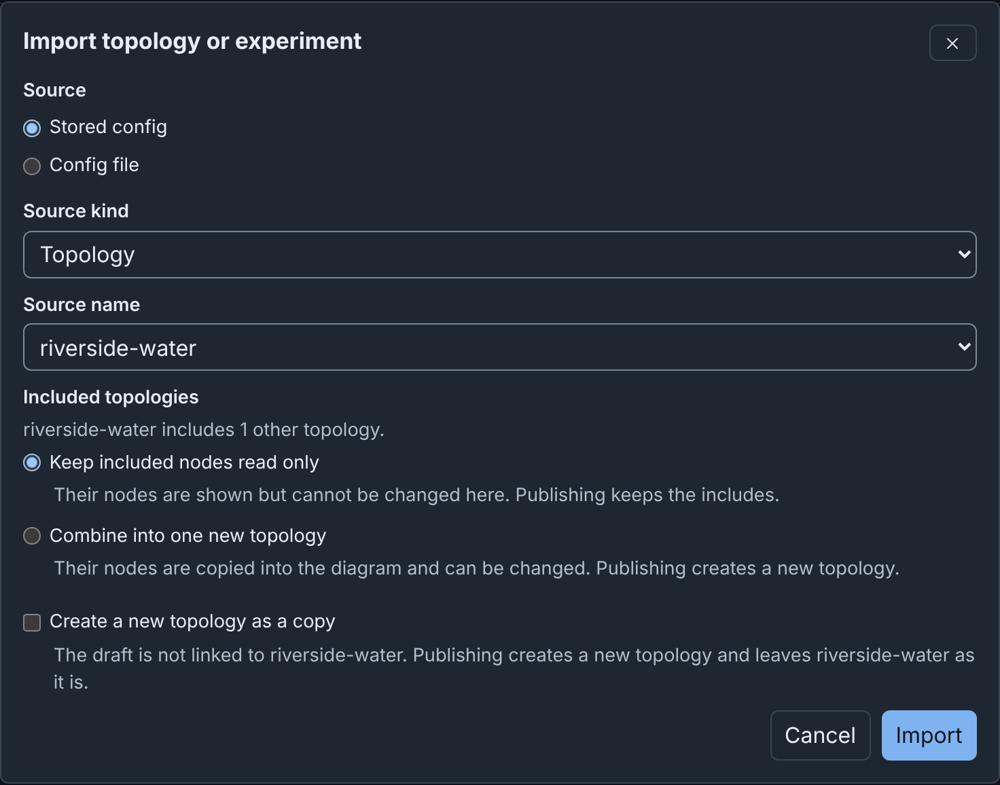
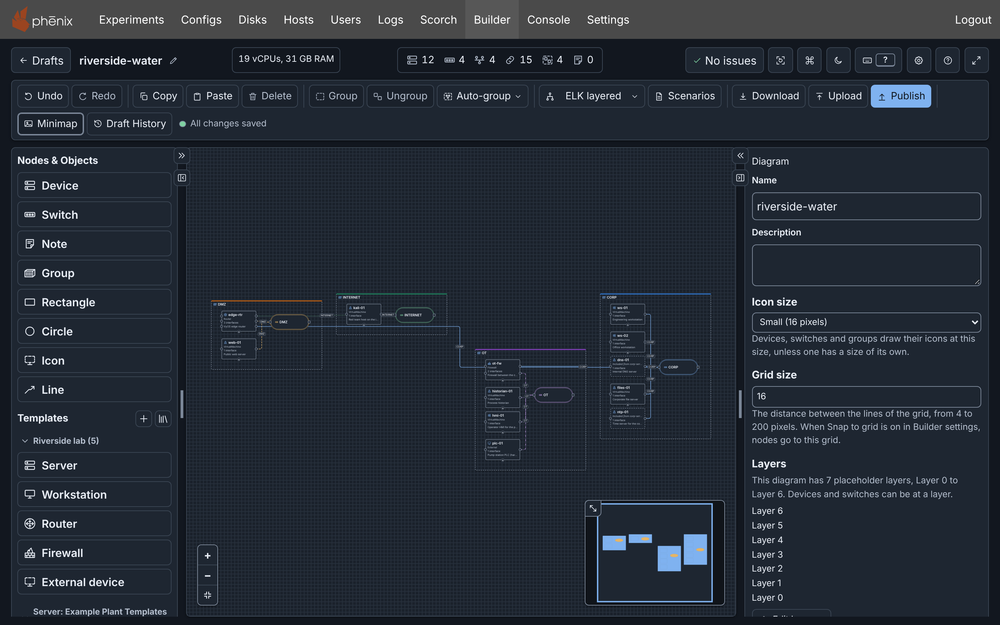
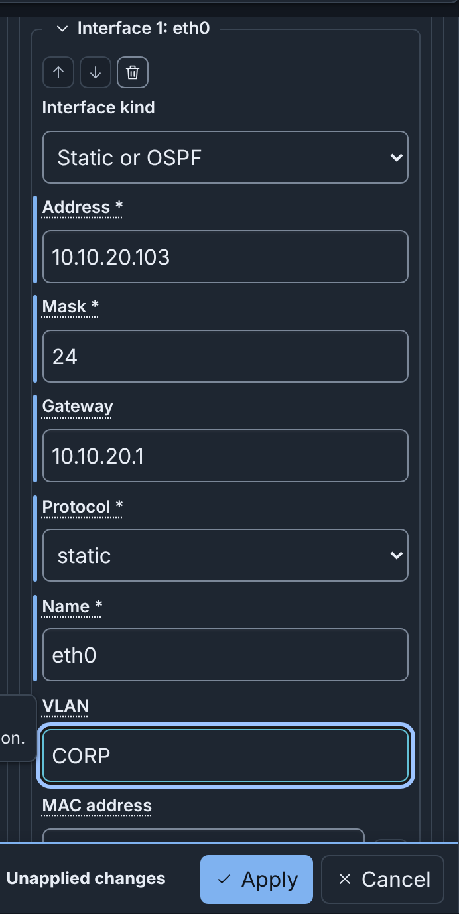
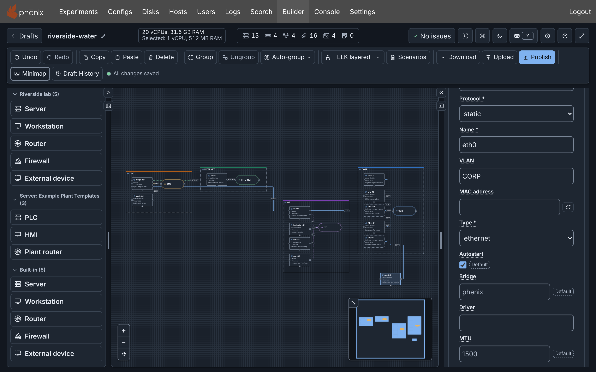
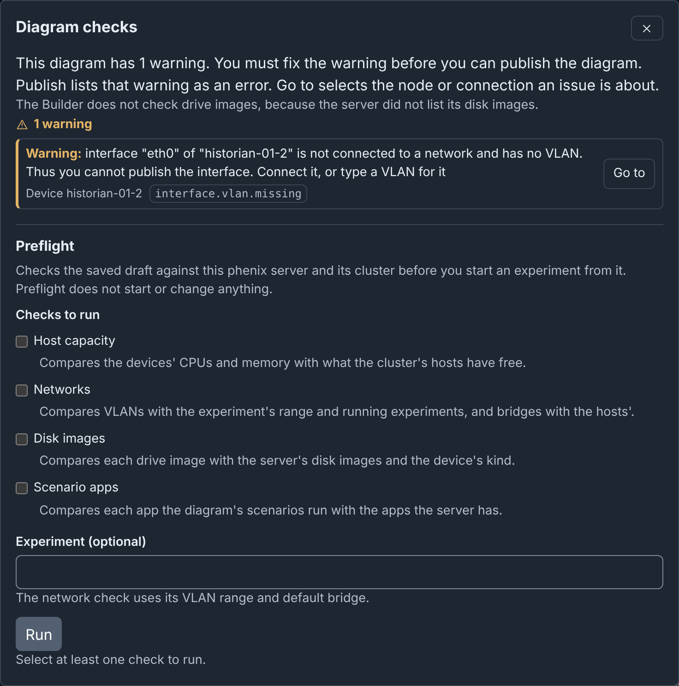
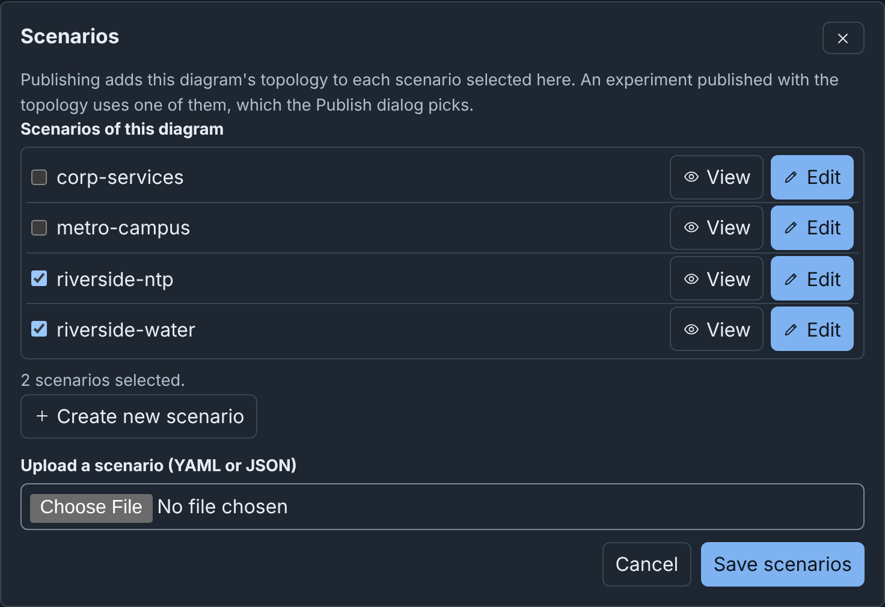
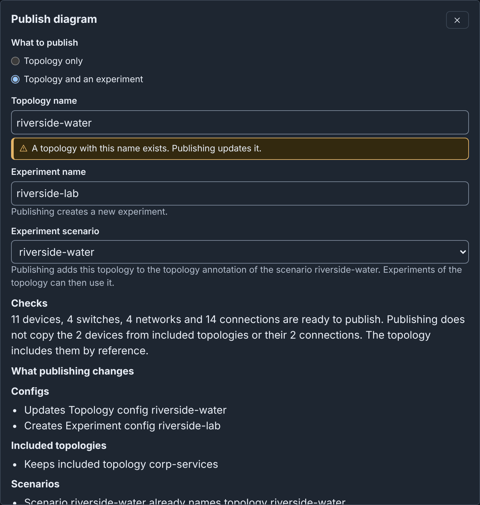
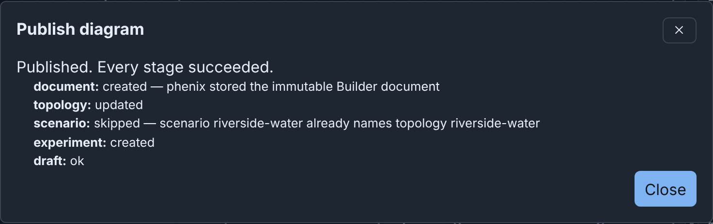
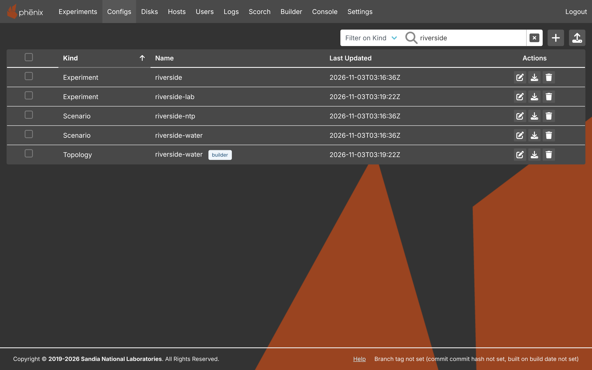
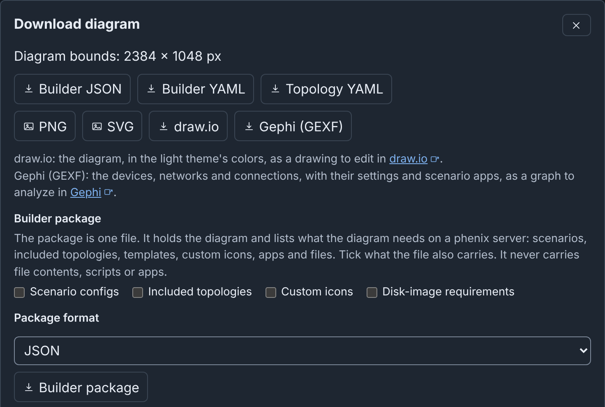

# Tutorial

In about 10 minutes, you import a topology, arrange it, add a workstation,
fix a warning, and publish a topology and an experiment. The example is
Riverside Water, a small water utility with an internet edge, a DMZ, a
corporate network and an OT network behind a firewall.

## The example lab

You need a phēnix server, and a role that can use Builder, such as
**Global Admin** or **Builder** (see [Administration](administration.md)).

Download these files:

- [corp-services.topology.yaml](examples/corp-services.topology.yaml)
- [riverside-water.topology.yaml](examples/riverside-water.topology.yaml)
- [riverside-water.scenario.yaml](examples/riverside-water.scenario.yaml)

Store the three configs, and create the experiment `riverside` from them.
From the command line:

```bash
phenix config create corp-services.topology.yaml riverside-water.topology.yaml riverside-water.scenario.yaml
phenix experiment create riverside -t riverside-water -s riverside-water
```

Or use the Web-UI. Upload the three configs on the **Configs** page (see
[Create a Config](../configuration.md#create-a-config)). Then create the
experiment `riverside` on the **Experiments** page, with the topology and
the scenario `riverside-water` (see
[Create a New Experiment](../experiments.md#create-a-new-experiment)).

The other pages use more example files:
[pump-station.topology.yaml](examples/pump-station.topology.yaml),
[pump-station.builder.json](examples/pump-station.builder.json),
[pump-station.package.yaml](examples/pump-station.package.yaml),
[riverside-water.builder.json](examples/riverside-water.builder.json),
[lakeside-treatment.builder.json](examples/lakeside-treatment.builder.json)
and [node-templates.yaml](examples/node-templates.yaml). You do not need
them now.

## Step 1: Import the topology

1. Click **Builder** in the navigation bar. The drafts page opens.
2. Click **Import**.
3. In the **Import topology or experiment** dialog, select
   `riverside-water` under **Source name**. Keep the other fields as they
   are.
4. Click **Import**. The dialog says "This import has 1 warning." The
   warning says that `dns-01` and `ntp-01` come from the included topology
   `corp-services` and are read only.
5. Click **Continue to editor**.



A new draft named `riverside-water` opens in the editor, with its devices
in rows on a grid. Builder saves every change that you make from now on.
The toolbar shows the save state, for example **All changes saved**.

## Step 2: Arrange the diagram

1. In the toolbar, open the layout menu. It says **Default**.
2. Select **ELK layered**. Each switch moves next to its devices.
3. Click **Auto-group**. Select **By network**. Builder puts each
   network in a group: CORP, DMZ, INTERNET and OT.
4. Click **Fit diagram to view** at the bottom left of the canvas.



The two devices with a dashed border, `dns-01` and `ntp-01`, come from the
included topology `corp-services`. You can move them, but you cannot change
them here.

## Step 3: Add a workstation

1. Under **Templates** in the left column, click **Workstation**. A device
   named `workstation` appears on the canvas, and the Inspector on the
   right shows its settings.
2. In the Inspector, set **Hostname** to `ws-03` and **Description** to
   `Engineering workstation`.
3. Under **Network**, click **Add interface**. The new interface is
   `eth0`, with **Interface kind** **Static or OSPF** and **Mask** `24`.
4. Enter **Address** `10.10.20.103`, **Gateway** `10.10.20.1` and **VLAN**
   `CORP`.
5. Click **Apply**.

{ width="354" }

Builder connects `eth0` to the CORP switch, because the VLAN names that
network. The header now counts 13 devices and 16 connections, and says
**No issues**. On a server that lists its disk images, the header can
also show a warning for an image that the server does not have. That
warning does not block publishing (see [The Editor](editor.md)).



!!! tip
    You can also connect a device with the mouse. Drag from the **+**
    handle under the device to a switch. Builder adds the interface and,
    when the network has a subnet, gives it the next free address.

## Step 4: Fix a warning

Builder checks the diagram while you work. To see a warning:

1. Select `historian-01` on the canvas.
2. Press <kbd>Ctrl</kbd>+<kbd>D</kbd> (<kbd>⌘</kbd>+<kbd>D</kbd> on macOS).
   A copy named `historian-01-2` appears, with an interface that is not
   connected. The header says **1 warning**.
3. Click **1 warning**. The **Diagram checks** dialog says that `eth0` of
   `historian-01-2` has no VLAN.
4. Click **Go to** beside the warning. The canvas selects the copy.
5. Click **Delete** in the toolbar. The header says **No issues** again.



A warning like this blocks publishing, because the experiment would fail
or operate incorrectly with it. Other warnings only inform you. See
[The Editor](editor.md).

## Step 5: Add the scenario

To give the experiment a scenario, add it to the diagram. The diagram
lists the scenarios that it uses:

1. Click **Scenarios** in the toolbar.
2. Under **Scenarios of this diagram**, select the checkbox of
   `riverside-water`.
3. Click **Save scenarios**.



## Step 6: Publish

1. Click **Publish** in the toolbar. The **Publish diagram** dialog opens.
2. Under **What to publish**, select **Topology and an experiment**.
3. Keep **Topology name** `riverside-water`. The hint says "A topology
   with this name exists. Publishing updates it."
4. Enter **Experiment name** `riverside-lab`.
5. Keep **Experiment scenario** `riverside-water`.
6. Read **Checks**. It says that 11 devices, 4 switches, 4 networks and 14
   connections are ready to publish. Publish does not copy the two
   included devices: the topology includes `corp-services` by reference.
7. Click **Update topology and create experiment**. Builder asks "Replace
   topology riverside-water?".
8. Click **Update topology and create experiment** again.
9. The dialog says "Published. Every stage succeeded." Click **Close**.





phēnix keeps no earlier version of a config. Before Builder replaces a
config, it always asks. See [Publishing](publishing.md).

## Step 7: Open the result

- The Topology config `riverside-water` now has `ws-03`. On the
  **Configs** page, its row has the tag `builder`. Click the tag to open
  the diagram in Builder again.
- The experiment `riverside-lab` is on the **Experiments** page. In the
  editor, **Exp** in the toolbar opens it. To start it, see
  [Experiments](../experiments.md).
- Publish does not update experiments that you made outside Builder, such
  as `riverside`.



## Step 8: Download a picture

1. Click **Download** in the toolbar.
2. Click **PNG**. The browser saves `riverside-water.png`.
3. Click **Close**.

{ width="480" }

The same dialog saves the diagram as **Builder JSON**, which **Upload**
opens, or as **Topology YAML**, the Topology config that Publish would
write. To move the diagram to another phēnix server, download a
**Builder package**. See
[Import, Upload and Download](import-upload-download.md).

## Next steps

- Builder saves each later edit to the same draft. To publish the changes,
  click **Publish** again with the same names. See
  [Publishing](publishing.md).
- To go back to an earlier version, click **Draft History** in the
  toolbar. See [Drafts](drafts.md).
- To draw more, see [Diagrams](diagrams.md). To reuse device settings, see
  [Templates and Icons](templates.md).
- When something does not work as this page says, see
  [Troubleshooting](troubleshooting.md).

## More detail

- [From a stored config](details/import-upload-download.md#from-a-stored-config)
- [Layouts](details/diagrams.md#layouts)
- [Type the VLAN in the Inspector](details/diagrams.md#type-the-vlan-in-the-inspector)
- [Publishing a topology and an experiment](details/publishing.md#publishing-a-topology-and-an-experiment)
- [Publish results](reference.md#publish-results)
