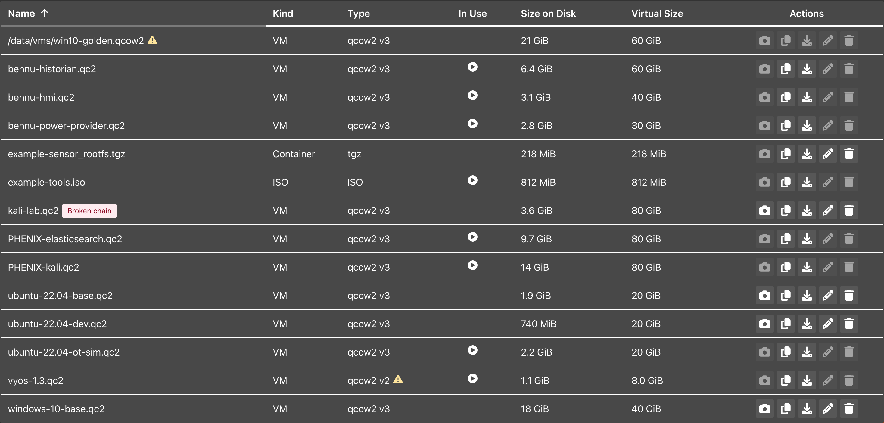
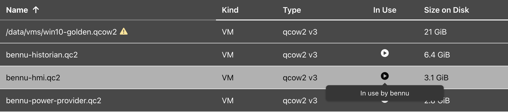
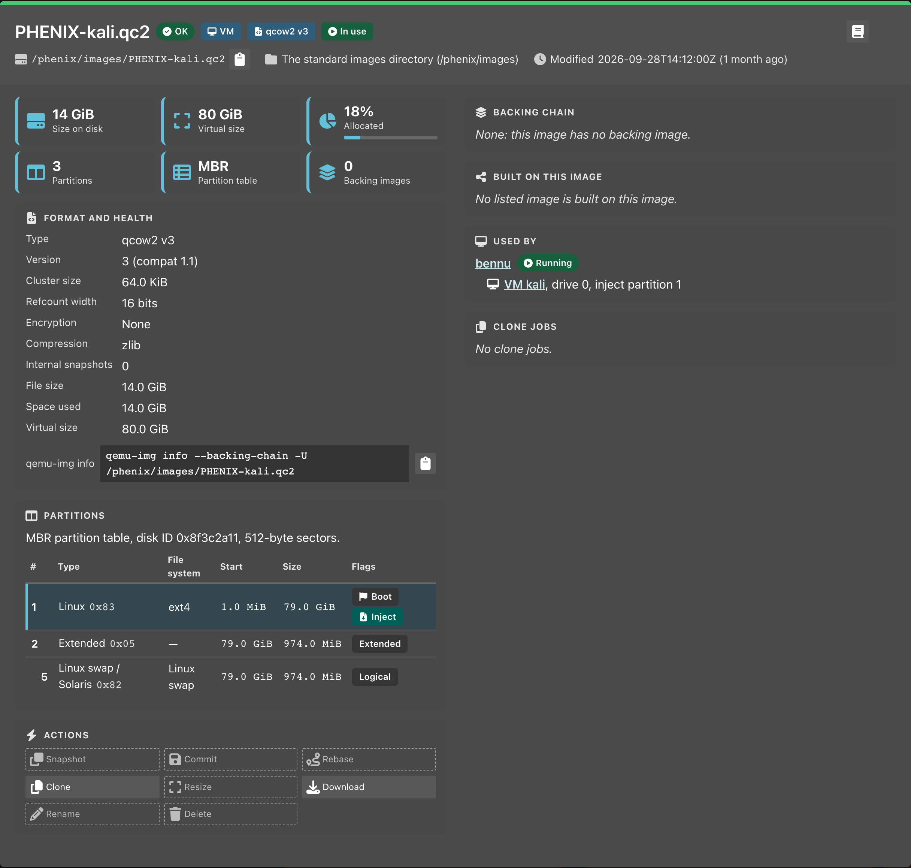
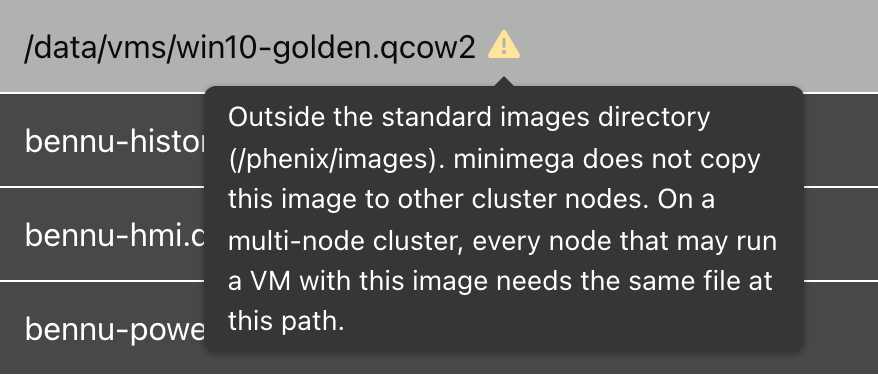
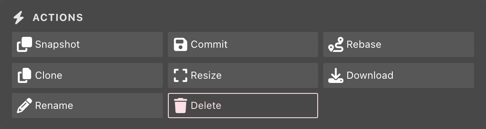
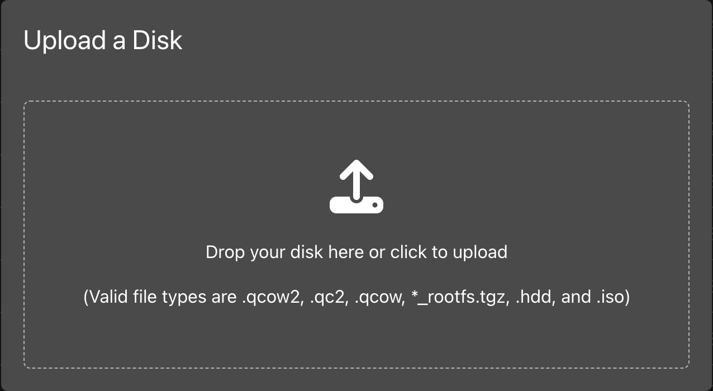
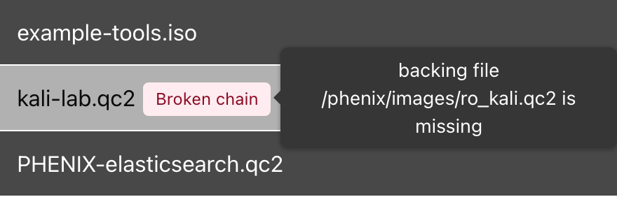
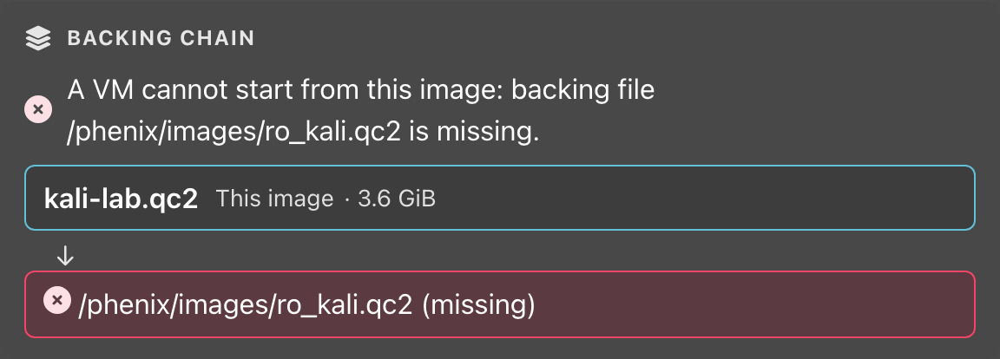

# Disks

The `Disks` page (in the `Resources` menu) lists the disk images phēnix
knows about:

* the images with a known extension (`.qcow2`, `.qc2`, `.qcow`, `_rootfs.tgz`,
  `.hdd`, `.iso`) in the minimega files directory and the folders under it
  (see [Images in Folders](#images-in-folders))
* every image an experiment's topology names, wherever it is
* the images those are backed by

{: width=800 .center}

Disk images are built from the command line. See
[Virtual Disk Images Management](image.md).

## The Disks Table

`Size on Disk` is how much room the file takes now, and `Virtual Size` is how
large the disk looks to the guest. The `Type` column marks an old format
version or a format problem (see [Image Format Versions](#image-format-versions)).

`In Use` marks an image that a running VM holds open. A base image isn't in
use just because VMs run off images built on it, so you can still snapshot it.

{: width=600 .center}

The list reloads on its own when the minimega files directory changes, and the
header's refresh button makes the server inspect every image again. phēnix
inspects images with `qemu-img`, which the phēnix container image includes.
Without it, phēnix asks minimega instead, which lists fewer images.

## The Details Card

Click a row, or go to `/disks?disk=<full-path>`, to open the image's details
card.

{: width=800 .center}

The health tag at the top is `OK`, `Warning` (such as an old format version,
an image outside the files directory, or a bad inject partition) or `Error`
(a broken backing chain, or an image that qemu refuses), and a `Problems` box
lists each problem. Besides the format and partitions, the card shows the
image's backing chain, the listed images built on it, each experiment that
uses it (running or stopped) with its VMs, and its running clones. Its
`Actions` section adds `Commit`, `Rebase` and `Resize` to the table's actions.

The `Inject` flag marks the partition phēnix injects files into (the
`inject_partition` of the VM's first drive). The card warns when that
partition doesn't exist, or holds no file system phēnix can write to.

## Images in Folders

A topology names an image in a folder by its path within the minimega files
directory (`image: win/10/win10.qcow2`) or by its full path. The list leaves
out:

* hidden files and folders, and `lost+found`
* the `files`, `tmp` and `miniccc_responses` folders of an experiment, which
  the experiment's [Files](experiments.md#experiment-files) tab manages
* minimega's own `saved` folder and `transfer_*` files

Symlinked folders aren't followed. An image the list leaves out is still
listed when a topology names it, but phēnix doesn't act on it.

## Images Outside the Files Directory

A topology can also name an image anywhere else phēnix can read it, such as
`/data/vms/win10.qcow2`. The list shows it by its full path with a warning
icon. phēnix won't change these images, so every action, `Download` included,
is disabled: to manage one here, copy it into the minimega files directory and
point the topology at the copy.

{: width=500 .center}

minimega doesn't copy such an image to the other cluster nodes, so every node
that may run a VM with it needs the same file at the same path. In the Docker
Compose setup, a path outside `/phenix` also needs the same mount in the
phēnix and minimega containers.

!!! warning
    With minimega's `-abssnapshot` flag, which the Docker Compose setup turns
    on, minimega cannot launch a snapshot VM from an image outside its files
    directory on a cluster of more than one node. Keep such images in the
    files directory.

## Permissions

A `disks` permission names an image by its file name, such as `win10.qcow2`,
so one name covers the files of that name in every folder. A role sees an
image outside the files directory only when it may also `get` an experiment
whose topology uses the image, or when the image backs an image the role sees.
See [User Administration](user-administration.md) for the rest.

## Actions

{: width=500 .center}

`Snapshot` creates a new image backed by this one, `Commit` writes the
image's changes into its backing image, `Rebase` moves it onto a different
backing image, and `Resize` changes the virtual size of the disk. A few limits:

* An image that a running VM holds open can only be cloned or downloaded.
* `Snapshot`, `Commit` and `Rebase` work on VM images only, and `Commit` needs
  a backing image to commit into.
* `Commit`, `Rebase` and `Resize` refuse an image whose backing chain leaves
  the files directory, or has a vmdk, qed or external data file in it. An
  unsafe `Rebase` doesn't check the chain.

`Snapshot`, `Clone` and `Rename` ask for a new name, relative to the image's
own folder. The folder must already exist, and no action replaces an existing
file. A snapshot is always a qcow2 image, while a clone or a renamed image
keeps its format: phēnix adds the image's extension to a name that has none
(`.qcow2` for a `.qc2` image), and refuses a name with the extension of
another format (a `.qcow` image can also take `.qcow2` or `.qc2`). Since
minimega uses the name, it can't have white space, control characters, or any
of `"`, `'`, `` ` ``, `\`, `#`, `*`, `?`, `[`, `]`, `{`, `}`, `$`, or `,`.

!!! warning
    phēnix doesn't check whether other images are built on the one you
    rename, so you'll need to rebase them onto its new name. A delete refuses
    an image that other images or experiments use, unless you click
    `Delete anyway`, and images backed by a deleted one can no longer be used.
    Check `Built on this image` on the details card first.

### Cloning in the background

A clone copies the whole file, so it runs as a [background job](jobs.md) that
you can watch or cancel from the [jobs menu](web-ui.md#background-jobs-menu)
or the `Clone jobs` section of the details card. The new image shows up in the
list once the copy is done.

## Uploading an Image

Click the upload button to open `Upload a Disk`. Closing the dialog doesn't
stop the upload, and uploaded images land at the top of the minimega files
directory.

{: width=500 .center}

## Broken Backing Chains

A VM can't start from an image whose backing chain is broken: a file in the
chain is missing, the chain loops back on itself, or it has more than 64
images. The table marks such an image with a `Broken chain` tag, and the
tag's tooltip names the problem.

{: width=500 .center}

phēnix checks every VM disk's backing chain before a start, and refuses the
start when a file is missing (see
[Disk Check Before a Start](experiments.md#disk-check-before-a-start)).

{: width=500 .center}

To repair the image, do one of these:

1. Restore the missing backing file at the path that the tag names.
2. Point the image at a copy of the missing backing file with `Rebase` and
   `Change reference only` selected. A rebase without this option must read
   the missing file, so it fails.
3. Change the topology to use a different image.

From the command line, `--unsafe` does the same as `Change reference only`:

```shell
phenix disk rebase kali-lab.qc2 ro_kali-copy.qc2 --unsafe
```

## Image Format Versions

Before a start, phēnix also reads the format and version of each image in a
backing chain, since qemu refuses some images and some old formats can cause
problems:

| Image | What phēnix does |
| :--- | :--- |
| qcow2 version 3 (`compat=1.1`), raw | Starts the VM. |
| qcow2 version 2 (`compat=0.10`) | Starts the VM. `phenix doctor` warns. |
| qcow version 1 | Starts the VM with a warning. Some qemu builds cannot open this format. |
| qcow2 or qcow version 1 with the old AES encryption | Refuses the start. |
| qcow2 with LUKS encryption | Refuses the start. |
| qcow2 of a version later than 3, or with feature bits qemu does not know | Refuses the start. |
| qcow2 that qemu marked as corrupt | Refuses the start when the VM writes to the image (`snapshot: false`). Otherwise starts the VM with a warning. |
| qcow2 that qemu did not close cleanly | Starts the VM with a warning. |
| qcow2 with zstd compression or extended L2 entries | Starts the VM. `phenix doctor` warns when the local `qemu-img` is too old for them. |
| vmdk, qed, or qcow2 with an external data file | Starts the VM with a warning. phēnix does not check past this image. |

With `experiment.disk-check` set to `warn`, a refused start is a warning
instead. The details card gives the command to fix each image, and
[A Start Fails on an Image Format](troubleshooting.md#a-start-fails-on-an-image-format)
covers the commands.

## Downloading an Image

Only images in the minimega files directory can be downloaded. An interrupted
download resumes from the browser's downloads list as long as the image
hasn't changed, so stop any VM that writes to the image first. From a shell,
`curl -C -` resumes a download the same way:

```bash
curl -C - -o win.qc2 -H 'X-Phenix-Auth-Token: Bearer <token>' \
  'https://<phenix>/api/v1/disks/download?disk=win.qc2'
```

To verify a download, compare its `sha256sum` with the checksum that the
[API](api.md#downloads) returns for the image, or that
`phenix disk checksum <disk>` prints.

## Command Line

The `phenix disk` commands do the same actions as this page, and don't need a
running `phenix ui`. Give a disk as a path relative to the minimega files
directory, or as an absolute path in it. See [phenix disk](cli/disk.md) for
every command and flag.

```shell
# The images of one experiment, inspected again
phenix disk list --experiment my-exp --refresh

# What the details card shows
phenix disk details win10.qcow2

# A qcow2 snapshot backed by win10.qcow2
phenix disk snapshot win10.qcow2 win10-lab.qcow2

# Show what a delete would do, without deleting
phenix disk delete win10.qcow2 --dry-run
```

Add `--force` to `phenix disk delete` to delete an image that other images or
experiments use.

## See Also

* [phenix disk](cli/disk.md): every disk command and flag.
* [Doctor](doctor.md): checks backing chains, image formats and leftovers without the UI.
* [VMs](vms.md): backing images, snapshots and disk commits of a VM.
